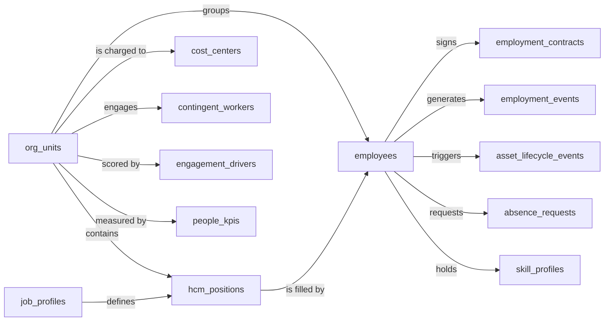
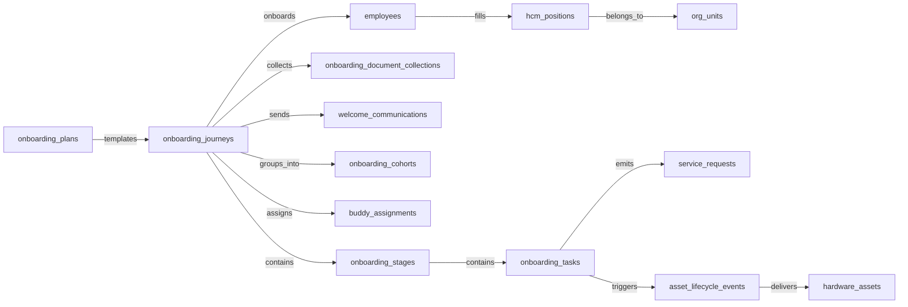
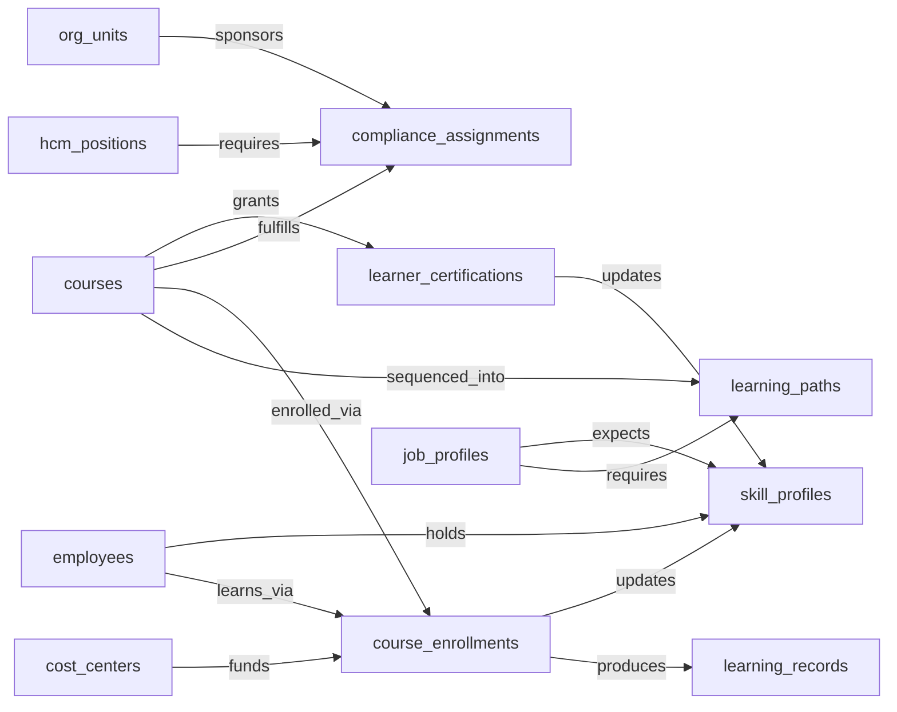
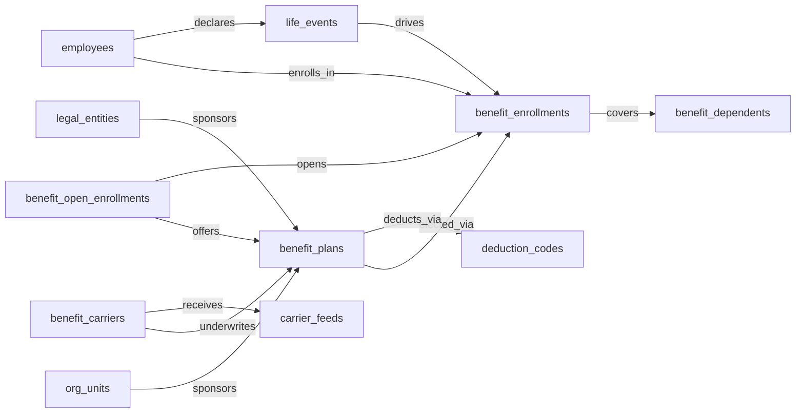
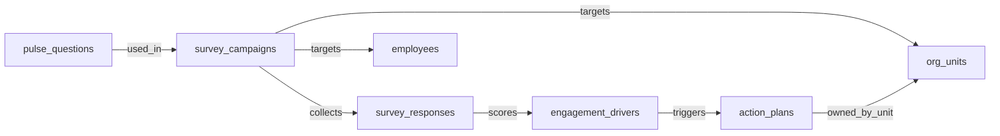
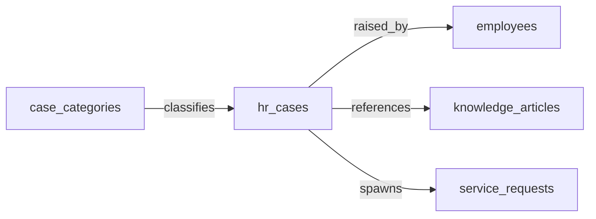

# Cluster A draft — People

## Domain: HCM — Human Capital Management

### 1. Mermaid graph (intra-domain only — visualize the entity-cluster shape)

### 2. Intra-domain relationships

| from | verb | to | cardinality | kind | required | owner_side | inverse_verb | notes |
|---|---|---|---|---|---|---|---|---|
| org_units | groups | employees | one_to_many | reference | true | source | is grouped under | every employee rolls up to an org unit |
| org_units | contains | hcm_positions | one_to_many | reference | true | source | belongs to | positions live inside an org unit |
| hcm_positions | is_filled_by | employees | one_to_one | reference | false | target | fills | a position may be vacant or filled by one incumbent |
| job_profiles | defines | hcm_positions | one_to_many | reference | true | source | conforms to | job profile is the template for positions |
| employees | signs | employment_contracts | one_to_many | composition | true | source | is signed by | contracts belong to the employee |
| employees | generates | employment_events | one_to_many | composition | true | source | applies to | hire/transfer/leave/term events for an employee |
| org_units | is_charged_to | cost_centers | many_to_one | reference | true | target | funds | org-unit labor cost rolls to a cost center |
| employees | triggers | asset_lifecycle_events | one_to_many | reference | false | source | involves | issue/return/recall events tied to the employee |
| employees | requests | absence_requests | one_to_many | reference | false | source | requested by | self-service absence requests originate from employee |
| employees | holds | skill_profiles | one_to_one | reference | false | source | held by | each employee may have a skill profile |
| org_units | engages | contingent_workers | one_to_many | reference | false | source | engaged by | contingent workforce attaches to an org unit |
| org_units | is_scored_by | engagement_drivers | one_to_many | reference | false | target | scores | engagement drivers measured at org-unit level |
| org_units | is_measured_by | people_kpis | one_to_many | reference | false | target | measures | people KPIs aggregated by org unit |
| job_profiles | maps_to | skill_profiles | many_to_many | association | false | source | expected for | competencies expected by job profile |

### 3. Users edges (platform_builtin)

| from | verb | to | cardinality | kind | required | owner_side | inverse_verb | notes |
|---|---|---|---|---|---|---|---|---|
| employees | is_linked_to | users | one_to_one | reference | false | target | represents | every employee maps to an identity user |
| hcm_positions | is_managed_by | users | many_to_one | reference | false | target | manages | manager-of-position relationship |
| org_units | is_led_by | users | many_to_one | reference | false | target | leads | org-unit head |
| employment_contracts | is_approved_by | users | many_to_one | reference | false | target | approves | HRBP/manager contract approver |
| employment_events | is_recorded_by | users | many_to_one | reference | false | target | records | HR admin who entered the event |
| absence_requests | is_requested_by | users | many_to_one | reference | true | target | requests | requester identity |
| absence_requests | is_approved_by | users | many_to_one | reference | false | target | approves | line-manager approver |
| asset_lifecycle_events | is_assigned_to | users | many_to_one | reference | false | target | assigned | end-user of the asset |
| job_profiles | is_owned_by | users | many_to_one | reference | false | target | owns | catalog owner (HR/COE) |
| cost_centers | is_owned_by | users | many_to_one | reference | false | target | owns | cost-center owner |
| contingent_workers | is_sponsored_by | users | many_to_one | reference | false | target | sponsors | hiring manager / sponsor |

### 4. Cross-domain edges (clean payload→target only)

| from | verb | to | cardinality | kind | required | owner_side | inverse_verb | notes |
|---|---|---|---|---|---|---|---|---|
| employees | triggers | service_requests | one_to_many | reference | false | source | spawned by | termination fan-out of offboarding service requests in ITSM |
| asset_lifecycle_events | triggers | asset_contracts | many_to_one | reference | false | target | triggered by | termination drives ITAM asset-recall events |
| employees | triggers | iga_provisioning_events | one_to_many | reference | false | source | spawned by | create/terminate/promote drives IGA account/entitlement actions |
| employment_events | triggers | iga_provisioning_events | one_to_many | reference | false | source | driven by | transfer/leave/FTE changes drive IGA re-evaluation |
| employment_contracts | triggers | iga_provisioning_events | one_to_many | reference | false | source | driven by | contract expiry must deprovision access |
| org_units | triggers | iga_entitlement_definitions | one_to_many | reference | false | source | derived from | new/merged/disbanded org units drive IGA group lifecycle |
| employees | triggers | pay_runs | one_to_many | reference | false | source | activates | new-hire/termination/promotion drives Payroll comp activation and final pay |
| employment_events | feeds | pay_runs | one_to_many | reference | false | source | informed by | employment events drive proration/effective-dated payroll |
| employment_contracts | feeds | pay_runs | one_to_many | reference | false | source | informed by | executed/expired contracts flow comp basis to Payroll |
| hcm_positions | spawns | job_requisitions | one_to_many | reference | false | source | filled from | approved position becomes a requisition in ATS |
| job_profiles | feeds | job_postings | one_to_many | reference | false | source | derived from | canonical job profile feeds ATS posting templates |
| employees | enrolls_in | course_enrollments | one_to_many | reference | false | source | enrolled | new-hire creation provisions LMS training |
| job_profiles | maps_to | courses | many_to_many | association | false | source | expected by | job-profile competencies drive required training |
| employees | becomes | career_aspirations | one_to_one | reference | false | source | initialized from | new employee triggers talent-profile initialization in Talent-Mgmt |
| employees | becomes | work_shifts | one_to_many | reference | false | source | scheduled from | new employee becomes a schedulable resource in WFM |
| employees | becomes | compensation_statements | one_to_one | reference | false | source | issued to | new-hire/promotion drives Comp-Mgmt compensation basis |
| hcm_positions | maps_to | salary_bands | many_to_one | reference | false | target | anchors | approved position carries grade/band to Comp-Mgmt |
| job_profiles | maps_to | salary_bands | many_to_one | reference | false | target | bands | job-profile-to-salary-band mapping is authoritative |
| employees | triggers | benefit_enrollments | one_to_many | reference | false | source | governs | create/terminate/event drives BEN-ADMIN eligibility & COBRA |
| employment_events | triggers | benefit_enrollments | one_to_many | reference | false | source | reassesses | status changes impact benefits eligibility |
| employment_events | feeds | people_kpis | one_to_many | reference | false | source | computed from | HCM publishes employment events for PA KPI refresh |
| org_units | maps_to | cost_centers | one_to_one | reference | false | source | mirrors | new org unit usually maps to ERP-FIN cost center |
| employees | triggers | corporate_cards | one_to_many | reference | false | source | governs | termination deactivates corporate cards in EXPENSE |
| employees | spawns | onboarding_journeys | one_to_one | reference | false | source | created for | new-hire creation triggers onboarding plan instantiation |
| employees | spawns | hr_cases | one_to_many | reference | false | source | opened for | termination kicks off offboarding HR case in HRSD |
| employees | feeds | headcount_plans | one_to_many | reference | false | source | reconciles | headcount actuals reconcile to SWP plan |
| employees | feeds | agency_time_entries | one_to_many | reference | false | source | governs | agency staff termination freezes time entries in AGENCY-MGMT |

### 5. Aliases (≥1 per non-self-explanatory master)

| data_object | alias_name | alias_type | is_preferred | notes |
|---|---|---|---|---|
| employees | worker | synonym | false | common HR-vendor short form |
| employees | personnel | synonym | false | enterprise / formal usage |
| employment_contracts | offer letter | synonym | false | pre-execution form |
| employment_contracts | employment agreement | synonym | false | legal phrasing |
| employment_events | personnel action | industry_term | false | SAP / Workday term |
| employment_events | worker lifecycle event | synonym | false | modern HCM phrasing |
| hcm_positions | seat | synonym | false | informal / planning usage |
| hcm_positions | headcount slot | synonym | false | finance / SWP framing |
| job_profiles | role profile | synonym | false | Workday-style naming |
| job_profiles | job catalog entry | synonym | false | catalog framing |
| org_units | department | synonym | true | common enterprise label |
| org_units | cost-bearing unit | synonym | false | finance-overlay framing |

---

## Domain: ONBOARDING — Employee Onboarding

### 1. Mermaid graph (intra-domain only — visualize the entity-cluster shape)

### 2. Intra-domain relationships

| from | verb | to | cardinality | kind | required | owner_side | inverse_verb | notes |
|---|---|---|---|---|---|---|---|---|
| onboarding_plans | templates | onboarding_journeys | one_to_many | reference | true | source | instantiated from | journey is an instance of a plan template |
| onboarding_journeys | contains | onboarding_stages | one_to_many | composition | true | source | belongs to | stages live inside one journey |
| onboarding_stages | contains | onboarding_tasks | one_to_many | composition | true | source | belongs to | tasks live inside one stage |
| onboarding_journeys | collects | onboarding_document_collections | one_to_many | composition | false | source | collected during | doc collection per journey |
| onboarding_journeys | sends | welcome_communications | one_to_many | composition | false | source | sent for | scheduled welcome sequence |
| onboarding_journeys | groups_into | onboarding_cohorts | many_to_one | reference | false | target | groups | start-class cohort grouping |
| onboarding_journeys | assigns | buddy_assignments | one_to_many | composition | false | source | belongs to | buddy attached to the new-hire journey |
| onboarding_journeys | onboards | employees | many_to_one | reference | true | target | onboarded by | journey is bound to one new-hire employee |
| employees | fills | hcm_positions | one_to_one | reference | false | source | filled by | embedded — incumbent of the position being onboarded |
| hcm_positions | belongs_to | org_units | many_to_one | reference | true | target | contains | embedded — position's org unit |
| onboarding_tasks | emits | service_requests | one_to_many | reference | false | source | emitted by | IT/workplace task creates an internal service request |
| onboarding_tasks | triggers | asset_lifecycle_events | one_to_many | reference | false | source | triggered by | hardware-issue events tied to task |
| asset_lifecycle_events | delivers | hardware_assets | many_to_one | reference | false | target | delivered by | event hands over a physical asset |

### 3. Users edges (platform_builtin)

| from | verb | to | cardinality | kind | required | owner_side | inverse_verb | notes |
|---|---|---|---|---|---|---|---|---|
| onboarding_journeys | is_assigned_to | users | many_to_one | reference | true | target | onboards | new hire (as user identity) |
| onboarding_journeys | is_owned_by | users | many_to_one | reference | false | target | owns | HRBP / journey owner |
| onboarding_tasks | is_assigned_to | users | many_to_one | reference | false | target | performs | task assignee (new hire, manager, IT) |
| onboarding_tasks | is_created_by | users | many_to_one | reference | false | target | created | who added/edited the task |
| buddy_assignments | is_assigned_to | users | many_to_one | reference | true | target | mentors | buddy identity |
| onboarding_plans | is_owned_by | users | many_to_one | reference | false | target | maintains | template owner (HR ops) |
| welcome_communications | is_sent_by | users | many_to_one | reference | false | target | sends | sender / hiring manager |
| onboarding_document_collections | is_approved_by | users | many_to_one | reference | false | target | approves | HR document reviewer |
| onboarding_cohorts | is_owned_by | users | many_to_one | reference | false | target | manages | cohort facilitator |

### 4. Cross-domain edges (clean payload→target only)

| from | verb | to | cardinality | kind | required | owner_side | inverse_verb | notes |
|---|---|---|---|---|---|---|---|---|
| onboarding_tasks | emits | service_incidents | one_to_many | reference | false | source | spawned by | IT-provisioning onboarding task creates ITSM SR (incident family) |
| onboarding_tasks | emits | workplace_service_requests | one_to_many | reference | false | source | spawned by | workplace-setup tasks fan out to IWMS |
| onboarding_tasks | spawns | hr_cases | one_to_many | reference | false | source | escalated from | blocked/overdue task opens an HRSD case |
| onboarding_tasks | spawns | iga_access_requests | one_to_many | reference | false | source | requested from | access-provisioning task drives IGA request |
| onboarding_document_collections | finalizes | employees | many_to_one | reference | false | target | finalized by | all docs collected → HCM finalizes employee record |
| onboarding_journeys | activates | pay_runs | many_to_one | reference | false | target | activated by | Day-1 milestone activates new hire in Payroll |
| onboarding_document_collections | feeds | pay_runs | many_to_one | reference | false | target | finalized by | tax/direct-deposit/I-9 finalize Payroll setup |
| onboarding_tasks | spawns | course_enrollments | one_to_many | reference | false | source | requested from | compliance-training task triggers LMS enrollment |
| onboarding_journeys | spawns | survey_campaigns | one_to_many | reference | false | source | triggered by | day-one milestone fires onboarding-experience survey |

### 5. Aliases (≥1 per non-self-explanatory master)

| data_object | alias_name | alias_type | is_preferred | notes |
|---|---|---|---|---|
| onboarding_plans | onboarding template | synonym | false | the reusable template form |
| onboarding_plans | new-hire program | synonym | false | program-level framing |
| onboarding_journeys | new-hire journey | synonym | false | Workday Journeys phrasing |
| onboarding_journeys | onboarding workflow | synonym | false | generic phrasing |
| onboarding_stages | onboarding phase | synonym | false | common alternative |
| onboarding_stages | journey milestone group | synonym | false | platform-neutral framing |
| onboarding_tasks | onboarding to-do | synonym | false | informal |
| onboarding_tasks | new-hire checklist item | synonym | false | checklist framing |
| onboarding_document_collections | new-hire paperwork | synonym | true | the everyday term |
| onboarding_document_collections | day-one forms | synonym | false | timing framing |
| welcome_communications | welcome email | synonym | false | most common channel |
| welcome_communications | new-hire announcement | synonym | false | internal-comms framing |
| onboarding_cohorts | new-hire class | synonym | false | start-class framing |
| onboarding_cohorts | start cohort | synonym | false | scheduling-time framing |
| buddy_assignments | onboarding mentor | synonym | false | mentor framing |
| buddy_assignments | new-hire buddy | synonym | false | most common usage |

---

## Domain: LMS — Learning Management

### 1. Mermaid graph (intra-domain only — visualize the entity-cluster shape)

### 2. Intra-domain relationships

| from | verb | to | cardinality | kind | required | owner_side | inverse_verb | notes |
|---|---|---|---|---|---|---|---|---|
| courses | sequenced_into | learning_paths | many_to_many | association | false | source | composed of | a path is an ordered collection of courses |
| courses | enrolled_via | course_enrollments | one_to_many | reference | true | source | enrolls in | enrollments reference a course |
| course_enrollments | produces | learning_records | one_to_many | composition | true | source | recorded from | transcript records derive from enrollments |
| courses | fulfills | compliance_assignments | one_to_many | reference | false | source | satisfied by | compliance assignment satisfied by one or more courses |
| courses | grants | learner_certifications | one_to_many | reference | false | source | awarded by | certifications earned from courses |
| learner_certifications | updates | skill_profiles | many_to_one | reference | false | target | updated by | earning a cert refreshes the worker skill profile |
| course_enrollments | updates | skill_profiles | many_to_one | reference | false | target | updated by | completion refreshes skill profile |
| employees | learns_via | course_enrollments | one_to_many | reference | true | source | enrolls | embedded — learner identity |
| employees | holds | skill_profiles | one_to_one | reference | false | source | held by | each learner may hold a skill profile |
| hcm_positions | requires | compliance_assignments | one_to_many | reference | false | source | required for | role-based compliance training |
| job_profiles | requires | learning_paths | many_to_many | association | false | source | required for | job-profile competency paths |
| job_profiles | expects | skill_profiles | many_to_many | association | false | source | expected for | competency expectation by profile |
| org_units | sponsors | compliance_assignments | one_to_many | reference | false | source | sponsored by | org-unit assigns compliance training |
| cost_centers | funds | course_enrollments | one_to_many | reference | false | source | funded by | training cost allocation |

### 3. Users edges (platform_builtin)

| from | verb | to | cardinality | kind | required | owner_side | inverse_verb | notes |
|---|---|---|---|---|---|---|---|---|
| courses | is_authored_by | users | many_to_one | reference | false | target | authors | course author / instructor |
| courses | is_owned_by | users | many_to_one | reference | false | target | owns | content owner |
| course_enrollments | is_enrolled_by | users | many_to_one | reference | true | target | enrolls in | learner identity |
| course_enrollments | is_assigned_by | users | many_to_one | reference | false | target | assigns | assigning manager |
| learning_records | is_recorded_for | users | many_to_one | reference | true | target | earns | transcript belongs to learner |
| compliance_assignments | is_assigned_to | users | many_to_one | reference | true | target | must complete | mandatory training assignee |
| compliance_assignments | is_owned_by | users | many_to_one | reference | false | target | owns | compliance owner |
| learner_certifications | is_held_by | users | many_to_one | reference | true | target | holds | cert holder |
| learning_paths | is_owned_by | users | many_to_one | reference | false | target | curates | curriculum owner |
| skill_profiles | is_held_by | users | many_to_one | reference | true | target | holds | learner identity |

### 4. Cross-domain edges (clean payload→target only)

| from | verb | to | cardinality | kind | required | owner_side | inverse_verb | notes |
|---|---|---|---|---|---|---|---|---|
| compliance_assignments | flags | compliance_obligations | many_to_one | reference | false | target | tracked by | overdue compliance training is a control failure in GRC |
| compliance_assignments | triggers | iga_provisioning_events | one_to_many | reference | false | source | suspended by | severe overdue suspends access via IGA |
| learning_records | posts_to | employees | many_to_one | reference | false | target | reflects | learning transcript visible on HCM employee record |
| compliance_assignments | reflects_on | employees | many_to_one | reference | false | target | reflected on | lapsed mandatory training surfaces on HCM employee record |
| skill_profiles | feeds | candidates | one_to_many | reference | false | source | sourced from | internal-candidate skill data flows to ATS |
| skill_profiles | feeds | career_aspirations | one_to_many | reference | false | source | informs | skill profile drives talent-mobility matching |
| course_enrollments | updates | career_aspirations | one_to_many | reference | false | source | informs | completion drives dev-plans / succession |
| learning_records | feeds | people_kpis | one_to_many | reference | false | source | computed from | training completions feed PA L&D KPIs |

### 5. Aliases (≥1 per non-self-explanatory master)

| data_object | alias_name | alias_type | is_preferred | notes |
|---|---|---|---|---|
| courses | training course | synonym | false | learner-facing label |
| courses | learning module | synonym | false | content-team framing |
| course_enrollments | training registration | synonym | false | registrar phrasing |
| course_enrollments | learner enrollment | synonym | false | LMS-vendor standard |
| learning_records | transcript entry | synonym | false | transcript framing |
| learning_records | learning activity record | industry_term | false | xAPI / SCORM phrasing |
| learning_paths | curriculum | synonym | true | enterprise standard term |
| learning_paths | development path | synonym | false | TM-style framing |
| compliance_assignments | mandatory training assignment | synonym | true | compliance-team standard |
| compliance_assignments | regulatory training | synonym | false | risk/compliance framing |
| learner_certifications | credential | synonym | false | broader term |
| learner_certifications | training certificate | synonym | false | informal |
| skill_profiles | competency profile | synonym | false | TM framing |
| skill_profiles | skills passport | synonym | false | Skills-Cloud branding |

---

## Domain: BEN-ADMIN — Benefits Administration

### 1. Mermaid graph (intra-domain only — visualize the entity-cluster shape)

### 2. Intra-domain relationships

| from | verb | to | cardinality | kind | required | owner_side | inverse_verb | notes |
|---|---|---|---|---|---|---|---|---|
| benefit_carriers | underwrites | benefit_plans | one_to_many | reference | true | source | underwritten by | each plan has a carrier |
| benefit_open_enrollments | offers | benefit_plans | many_to_many | association | true | source | offered in | enrollment-window plan catalog |
| benefit_plans | elected_via | benefit_enrollments | one_to_many | reference | true | source | elects | enrollment references plan |
| benefit_open_enrollments | opens | benefit_enrollments | one_to_many | reference | false | source | created during | OE-window opens new enrollments |
| benefit_enrollments | covers | benefit_dependents | one_to_many | composition | false | source | covered by | dependents attached to enrollment |
| life_events | drives | benefit_enrollments | one_to_many | reference | false | source | triggered by | qualifying life-event change |
| benefit_carriers | receives | carrier_feeds | one_to_many | composition | true | source | transmitted to | per-carrier 834 / equivalent feeds |
| benefit_plans | deducts_via | deduction_codes | many_to_many | association | false | source | maps to | plan-to-deduction code mapping |
| employees | enrolls_in | benefit_enrollments | one_to_many | reference | true | source | enrolled by | embedded — enrollee identity |
| employees | declares | life_events | one_to_many | reference | false | source | declared by | embedded — employee declaring event |
| org_units | sponsors | benefit_plans | many_to_many | association | false | source | offered by | embedded — org-level offering |
| legal_entities | sponsors | benefit_plans | one_to_many | reference | false | source | sponsored by | legal-entity plan sponsor |

### 3. Users edges (platform_builtin)

| from | verb | to | cardinality | kind | required | owner_side | inverse_verb | notes |
|---|---|---|---|---|---|---|---|---|
| benefit_enrollments | is_enrolled_by | users | many_to_one | reference | true | target | enrolls | enrollee identity |
| benefit_enrollments | is_approved_by | users | many_to_one | reference | false | target | approves | benefits admin approver |
| life_events | is_declared_by | users | many_to_one | reference | true | target | declares | employee declaring the event |
| life_events | is_approved_by | users | many_to_one | reference | false | target | approves | benefits admin approver |
| benefit_plans | is_owned_by | users | many_to_one | reference | false | target | owns | plan owner / benefits PM |
| benefit_open_enrollments | is_managed_by | users | many_to_one | reference | false | target | manages | OE campaign owner |
| benefit_carriers | is_owned_by | users | many_to_one | reference | false | target | manages | carrier relationship manager |
| carrier_feeds | is_monitored_by | users | many_to_one | reference | false | target | monitors | feed-ops owner |
| benefit_dependents | is_declared_by | users | many_to_one | reference | true | target | declares | enrollee adds dependent |

### 4. Cross-domain edges (clean payload→target only)

| from | verb | to | cardinality | kind | required | owner_side | inverse_verb | notes |
|---|---|---|---|---|---|---|---|---|
| carrier_feeds | spawns | hr_cases | one_to_many | reference | false | source | escalated from | carrier reconciliation exceptions become HR cases |
| life_events | updates | employees | many_to_one | reference | false | target | updated by | approved life event may update dependents / emergency contacts in HCM |
| benefit_carriers | triggers | pay_runs | one_to_many | reference | false | source | adjusts | OE-close drives mass payroll deduction-code updates |
| benefit_enrollments | adjusts | pay_runs | one_to_many | reference | false | source | adjusted by | election change drives mid-cycle deduction adjustment |
| life_events | adjusts | pay_runs | one_to_many | reference | false | source | adjusted by | life-event approval re-rates deductions |
| benefit_enrollments | posts_to | payroll_journal_entries | one_to_many | reference | false | source | posted from | enrollment changes update payroll deductions |
| benefit_enrollments | posts_to | journal_entries | one_to_many | reference | false | source | posted from | employer-side benefit cost accrual to GL |
| carrier_feeds | posts_to | journal_entries | one_to_many | reference | false | source | posted from | carrier premium accruals flow to ERP-FIN AP |

### 5. Aliases (≥1 per non-self-explanatory master)

| data_object | alias_name | alias_type | is_preferred | notes |
|---|---|---|---|---|
| benefit_plans | benefit offering | synonym | false | catalog framing |
| benefit_plans | benefits product | synonym | false | carrier-side framing |
| benefit_enrollments | benefit election | synonym | true | open-enrollment standard |
| benefit_enrollments | coverage selection | synonym | false | learner-facing |
| benefit_carriers | insurance carrier | synonym | true | common enterprise term |
| benefit_carriers | benefits provider | synonym | false | vendor-neutral framing |
| benefit_dependents | covered dependent | synonym | false | claims framing |
| benefit_dependents | dependent | synonym | true | common short form |
| benefit_open_enrollments | open enrollment | synonym | true | annual cycle term |
| benefit_open_enrollments | annual enrollment window | synonym | false | descriptive |
| carrier_feeds | 834 feed | industry_term | false | EDI 834 framing (US) |
| carrier_feeds | benefits eligibility feed | synonym | false | descriptive |
| life_events | qualifying life event | industry_term | true | IRS / benefits term (US) |
| life_events | QLE | synonym | false | acronym used in US benefits ops |

---

## Domain: EMP-EXP — Employee Experience and Engagement

### 1. Mermaid graph (intra-domain only — visualize the entity-cluster shape)

### 2. Intra-domain relationships

| from | verb | to | cardinality | kind | required | owner_side | inverse_verb | notes |
|---|---|---|---|---|---|---|---|---|
| pulse_questions | used_in | survey_campaigns | many_to_many | association | true | source | uses | question library reused across campaigns |
| survey_campaigns | collects | survey_responses | one_to_many | composition | true | source | belongs to | responses belong to one campaign |
| survey_responses | scores | engagement_drivers | many_to_many | association | false | source | scored by | response contributes to driver scores |
| engagement_drivers | triggers | action_plans | one_to_many | reference | false | source | addresses | low-scoring driver opens an action plan |
| survey_campaigns | targets | employees | many_to_many | association | false | source | invited to | embedded — invited population |
| survey_campaigns | targets | org_units | many_to_many | association | false | source | scoped to | embedded — org-unit scoping |
| action_plans | owned_by_unit | org_units | many_to_one | reference | false | target | owns | org-unit accountable for action plan |
| survey_responses | submitted_by | employees | many_to_one | reference | false | target | submits | respondent identity at employee level |

### 3. Users edges (platform_builtin)

| from | verb | to | cardinality | kind | required | owner_side | inverse_verb | notes |
|---|---|---|---|---|---|---|---|---|
| survey_campaigns | is_owned_by | users | many_to_one | reference | true | target | owns | campaign owner / HRBP |
| survey_campaigns | is_created_by | users | many_to_one | reference | false | target | creates | campaign author |
| survey_responses | is_submitted_by | users | many_to_one | reference | false | target | submits | respondent identity (often anonymized) |
| action_plans | is_owned_by | users | many_to_one | reference | true | target | owns | accountable owner |
| action_plans | is_assigned_to | users | many_to_many | association | false | target | works on | action-plan contributors |
| pulse_questions | is_authored_by | users | many_to_one | reference | false | target | authors | question author |
| engagement_drivers | is_owned_by | users | many_to_one | reference | false | target | owns | driver / framework owner |

### 4. Cross-domain edges (clean payload→target only)

| from | verb | to | cardinality | kind | required | owner_side | inverse_verb | notes |
|---|---|---|---|---|---|---|---|---|
| engagement_drivers | flags | employees | many_to_one | reference | false | target | flagged on | high attrition-risk surfaces on HCM employee dashboard |
| engagement_drivers | reflects_on | employees | many_to_one | reference | false | target | reflected on | survey-cycle results visible to HRBPs in HCM |
| survey_responses | flags | career_aspirations | many_to_one | reference | false | target | informs | negative sentiment triggers flight-risk review in TM |
| engagement_drivers | feeds | people_kpis | one_to_many | reference | false | source | computed from | driver scores feed PA cohort analyses |
| survey_responses | feeds | people_kpis | one_to_many | reference | false | source | computed from | responses feed PA engagement models |
| action_plans | spawns | work_items | one_to_many | reference | false | source | tracked as | action plans tracked as work items in WORK-MGMT |

### 5. Aliases (≥1 per non-self-explanatory master)

| data_object | alias_name | alias_type | is_preferred | notes |
|---|---|---|---|---|
| survey_campaigns | engagement survey | synonym | true | common employee-facing label |
| survey_campaigns | pulse survey | synonym | false | shorter-cadence variant |
| survey_responses | survey submission | synonym | false | descriptive |
| survey_responses | respondent answer | synonym | false | analytics framing |
| pulse_questions | survey question library | synonym | true | reuse framing |
| pulse_questions | item bank | industry_term | false | psychometrics term |
| engagement_drivers | engagement factor | synonym | false | framework framing |
| engagement_drivers | sentiment driver | synonym | false | analytics framing |
| action_plans | engagement action plan | synonym | true | full canonical form |
| action_plans | follow-up plan | synonym | false | informal |

---

## Domain: HRSD — HR Service Delivery

### 1. Mermaid graph (intra-domain only — visualize the entity-cluster shape)

### 2. Intra-domain relationships

| from | verb | to | cardinality | kind | required | owner_side | inverse_verb | notes |
|---|---|---|---|---|---|---|---|---|
| case_categories | classifies | hr_cases | one_to_many | reference | true | source | classified as | every case carries a category |
| hr_cases | raised_by | employees | many_to_one | reference | true | target | raises | requester identity (employee scope) |
| hr_cases | references | knowledge_articles | many_to_many | association | false | source | referenced by | KB lookup attached to case |
| hr_cases | spawns | service_requests | one_to_many | reference | false | source | spawned by | downstream service request (intra-domain reference container) |
| case_categories | parent_of | case_categories | one_to_many | reference | false | source | child of | hierarchical category tree |

### 3. Users edges (platform_builtin)

| from | verb | to | cardinality | kind | required | owner_side | inverse_verb | notes |
|---|---|---|---|---|---|---|---|---|
| hr_cases | is_raised_by | users | many_to_one | reference | true | target | raises | requester identity |
| hr_cases | is_assigned_to | users | many_to_one | reference | false | target | works on | HR case agent |
| hr_cases | is_owned_by | users | many_to_one | reference | false | target | owns | case owner / HRBP |
| hr_cases | is_approved_by | users | many_to_one | reference | false | target | approves | approval step (e.g. policy exception) |
| case_categories | is_owned_by | users | many_to_one | reference | false | target | manages | taxonomy owner |
| knowledge_articles | is_authored_by | users | many_to_one | reference | false | target | authors | KB author |
| service_requests | is_requested_by | users | many_to_one | reference | true | target | requests | requester identity |
| service_requests | is_assigned_to | users | many_to_one | reference | false | target | fulfills | service-request fulfiller |

### 4. Cross-domain edges (clean payload→target only)

| from | verb | to | cardinality | kind | required | owner_side | inverse_verb | notes |
|---|---|---|---|---|---|---|---|---|
| service_requests | routes_to | service_incidents | one_to_many | reference | false | source | routed from | HR case needing IT action routes a service request into ITSM |
| hr_cases | spawns | iga_access_requests | one_to_many | reference | false | source | escalated from | HR cases requiring app/system access escalate to IGA |
| hr_cases | updates | employees | many_to_one | reference | false | target | updated by | HR cases involving data changes flow back to HCM |
| case_categories | drives | knowledge_base_articles | one_to_many | reference | false | source | retagged by | category taxonomy changes drive KMS remapping |
| case_categories | drives | employees | one_to_many | reference | false | source | routes | taxonomy affects HCM employee-portal self-service routing |

### 5. Aliases (≥1 per non-self-explanatory master)

| data_object | alias_name | alias_type | is_preferred | notes |
|---|---|---|---|---|
| hr_cases | HR ticket | synonym | true | most common employee-facing term |
| hr_cases | employee case | synonym | false | analyst framing |
| hr_cases | employee inquiry | synonym | false | service-desk framing |
| case_categories | HR case taxonomy | synonym | false | catalog framing |
| case_categories | HR case type | synonym | true | what end-users see |
