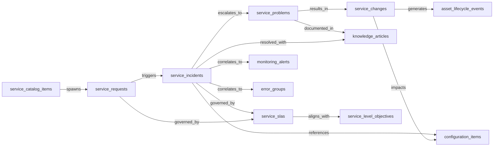
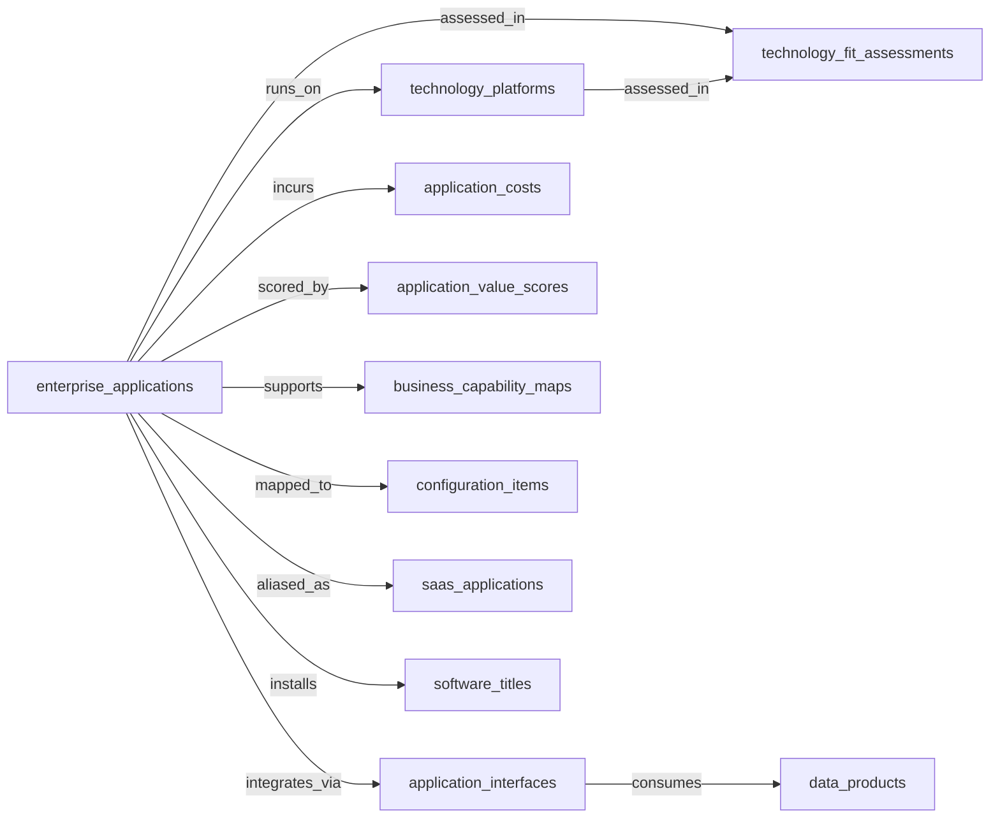
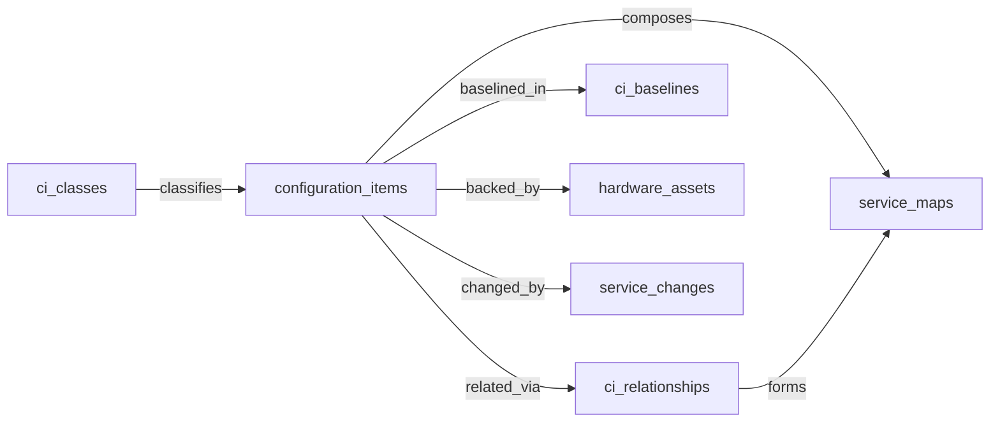
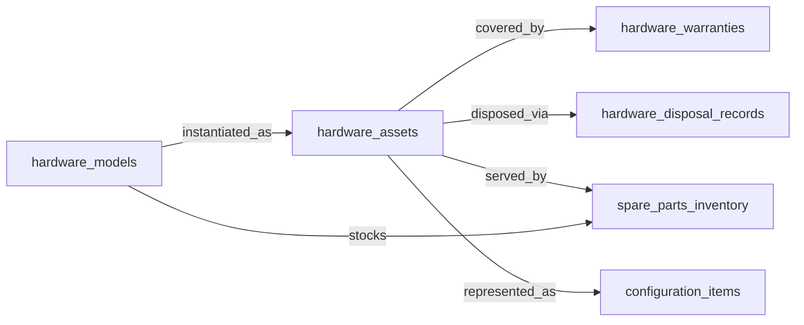
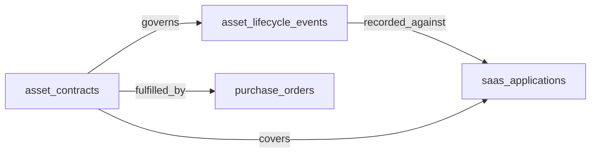
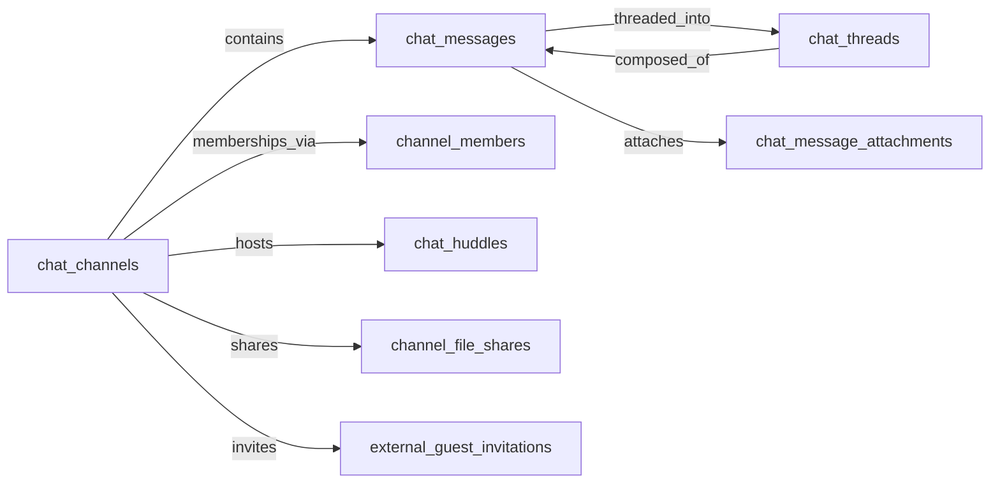

# Cluster B draft — IT Service & Assets

## Domain: ITSM — IT Service Management

### 1. Mermaid graph (intra-domain only — visualize the entity-cluster shape)

### 2. Intra-domain relationships

| from | verb | to | cardinality | kind | required | owner_side | inverse_verb | notes |
|---|---|---|---|---|---|---|---|---|
| service_catalog_items | spawns | service_requests | one_to_many | reference | false | target | is requested from | catalog items materialize as service requests |
| service_requests | triggers | service_incidents | one_to_many | reference | false | target | originated from request | a request can surface as an incident when fulfillment fails |
| service_incidents | escalates_to | service_problems | many_to_one | reference | false | target | is investigated by | recurring incidents grouped under a problem record |
| service_problems | results_in | service_changes | one_to_many | reference | false | target | resolves problem | RCA leads to a change record |
| service_changes | generates | asset_lifecycle_events | one_to_many | reference | false | target | recorded for change | changes that touch assets emit lifecycle events |
| service_incidents | references | configuration_items | many_to_many | reference | false | target | affected by incident | incidents are filed against CIs |
| service_changes | impacts | configuration_items | many_to_many | reference | true | target | changed by | every change targets one or more CIs |
| service_incidents | governed_by | service_slas | many_to_one | reference | true | target | governs incident | SLA defines response/resolve targets |
| service_requests | governed_by | service_slas | many_to_one | reference | true | target | governs request | fulfillment SLA |
| service_problems | documented_in | knowledge_articles | one_to_many | reference | false | source | documents problem | known-error article authored from problem |
| service_incidents | resolved_with | knowledge_articles | many_to_many | reference | false | source | resolves incidents | KB articles applied to close incidents |
| service_incidents | correlates_to | monitoring_alerts | many_to_many | reference | false | target | triggered incident | alert-driven incidents link back to alerts |
| service_incidents | correlates_to | error_groups | many_to_many | reference | false | target | surfaces incident | observability error groups linked to incident |
| service_slas | aligns_with | service_level_objectives | many_to_many | reference | false | target | underpins SLA | business SLA backed by technical SLO |

### 3. Users edges (platform_builtin)

| from | verb | to | cardinality | kind | required | owner_side | inverse_verb | notes |
|---|---|---|---|---|---|---|---|---|
| service_incidents | is_assigned_to | users | many_to_one | reference | false | target | assigned incidents | technician ownership |
| service_incidents | is_created_by | users | many_to_one | reference | true | target | reported incidents | reporter / requester |
| service_requests | is_assigned_to | users | many_to_one | reference | false | target | assigned requests | fulfillment owner |
| service_requests | is_created_by | users | many_to_one | reference | true | target | submitted requests | requester |
| service_problems | is_assigned_to | users | many_to_one | reference | false | target | owned problems | problem manager |
| service_changes | is_assigned_to | users | many_to_one | reference | false | target | owned changes | change owner |
| service_changes | is_approved_by | users | many_to_many | reference | false | target | approved changes | CAB approvers |
| knowledge_articles | is_created_by | users | many_to_one | reference | true | target | authored articles | author |
| service_catalog_items | is_owned_by | users | many_to_one | reference | false | target | owned catalog items | catalog owner |
| service_slas | is_owned_by | users | many_to_one | reference | false | target | owned SLAs | service owner |
| asset_lifecycle_events | is_created_by | users | many_to_one | reference | false | target | logged events | recorded by technician |

### 4. Cross-domain edges (clean payload→target only)

| from | verb | to | cardinality | kind | required | owner_side | inverse_verb | notes |
|---|---|---|---|---|---|---|---|---|
| asset_lifecycle_events | feeds | fixed_assets | many_to_one | reference | false | target | impacted by lifecycle | ERP-FIN fixed asset register update on lifecycle events |
| knowledge_articles | publishes_to | knowledge_base_articles | one_to_one | reference | false | target | sourced from ITSM | ITSM articles sync to KMS |
| service_catalog_items | exposes | iga_entitlement_definitions | one_to_many | reference | false | target | exposed via catalog | new catalog items wire entitlements into IGA |
| service_changes | updates | configuration_items | many_to_many | reference | false | target | reconciled by change | completed changes update CMDB CI state (cross-cluster ok; CMDB CI master is in this cluster) |
| service_incidents | triggers | remediation_plans | one_to_many | reference | false | target | remediated by incident | GRC remediation plans materialize ITSM tickets (reverse direction of GRC handoff) |

### 5. Aliases (≥1 per non-self-explanatory master)

| data_object | alias_name | alias_type | is_preferred | notes |
|---|---|---|---|---|
| service_incidents | ticket | synonym | false | common short form |
| service_incidents | incident ticket | industry_term | false | ITIL terminology |
| service_requests | service ticket | synonym | false | common alias |
| service_requests | request fulfillment | industry_term | false | ITIL practice name |
| service_problems | known error | industry_term | false | ITIL terminology |
| service_changes | change ticket | synonym | false | common short form |
| service_changes | RFC | industry_term | false | request for change |
| service_catalog_items | catalog offering | synonym | false | offering terminology |
| service_slas | service level agreement | synonym | true | spell-out is more recognizable |
| knowledge_articles | KB article | synonym | false | common short form |

---

## Domain: APM — Application Portfolio Management

### 1. Mermaid graph (intra-domain only — visualize the entity-cluster shape)

### 2. Intra-domain relationships

| from | verb | to | cardinality | kind | required | owner_side | inverse_verb | notes |
|---|---|---|---|---|---|---|---|---|
| enterprise_applications | runs_on | technology_platforms | many_to_many | reference | false | target | hosts application | application-to-platform fit |
| enterprise_applications | integrates_via | application_interfaces | one_to_many | reference | false | target | belongs to application | interfaces exposed/consumed by the app |
| enterprise_applications | incurs | application_costs | one_to_many | reference | false | source | costs of application | TCO records per app |
| enterprise_applications | scored_by | application_value_scores | one_to_many | reference | false | target | scores application | TIME-style value scoring |
| enterprise_applications | assessed_in | technology_fit_assessments | one_to_many | reference | false | target | assesses application | fit assessment |
| enterprise_applications | supports | business_capability_maps | many_to_many | reference | false | target | supported by application | application-capability heatmap |
| technology_platforms | assessed_in | technology_fit_assessments | one_to_many | reference | false | target | assesses platform | fit assessment over platform |
| application_interfaces | consumes | data_products | many_to_many | reference | false | target | consumed by interface | data products consumed/produced by an interface |
| enterprise_applications | mapped_to | configuration_items | many_to_many | reference | false | target | represents application | app↔CI mapping into CMDB |
| enterprise_applications | aliased_as | saas_applications | one_to_one | reference | false | target | SaaS instance of | enterprise app may be a SaaS app |
| enterprise_applications | installs | software_titles | many_to_many | reference | false | target | installed for application | software title to enterprise app mapping |

### 3. Users edges (platform_builtin)

| from | verb | to | cardinality | kind | required | owner_side | inverse_verb | notes |
|---|---|---|---|---|---|---|---|---|
| enterprise_applications | is_owned_by | users | many_to_one | reference | false | target | owned applications | application owner |
| technology_platforms | is_owned_by | users | many_to_one | reference | false | target | owned platforms | platform owner |
| application_interfaces | is_owned_by | users | many_to_one | reference | false | target | owned interfaces | interface owner |
| business_capability_maps | is_owned_by | users | many_to_one | reference | false | target | owned capability maps | enterprise architect |
| application_value_scores | is_created_by | users | many_to_one | reference | false | target | authored scores | scoring analyst |
| technology_fit_assessments | is_created_by | users | many_to_one | reference | false | target | authored assessments | EA reviewer |
| application_costs | is_created_by | users | many_to_one | reference | false | target | recorded costs | TCO analyst |

### 4. Cross-domain edges (clean payload→target only)

| from | verb | to | cardinality | kind | required | owner_side | inverse_verb | notes |
|---|---|---|---|---|---|---|---|---|
| application_interfaces | raises | service_incidents | one_to_many | reference | false | target | triggered by interface | broken interface → ITSM incident |
| technology_platforms | registers_as | asset_lifecycle_events | one_to_many | reference | false | target | registers platform | ITAM tracks platform as IT asset |
| enterprise_applications | onboards_into | configuration_items | one_to_one | reference | false | target | represents onboarded app | application onboarding creates CMDB CI |
| enterprise_applications | licenses | software_titles | many_to_many | reference | false | target | licensed for application | SAM software-title sync on onboarding/sunset |
| technology_platforms | retires_to | compliance_risks | one_to_many | reference | false | target | risk shrunk by sunset | platform sunset shrinks GRC compliance scope |

### 5. Aliases (≥1 per non-self-explanatory master)

| data_object | alias_name | alias_type | is_preferred | notes |
|---|---|---|---|---|
| enterprise_applications | business application | synonym | false | common term |
| enterprise_applications | application | synonym | false | short form |
| application_costs | TCO | industry_term | false | total cost of ownership |
| application_costs | application TCO | synonym | true | spelled-out form widely used |
| application_value_scores | TIME score | industry_term | false | Gartner TIME framework |
| application_value_scores | application rating | synonym | false | common alt |
| business_capability_maps | capability model | synonym | false | EA terminology |
| business_capability_maps | business capability model | industry_term | false | TOGAF / BIZBOK term |
| technology_fit_assessments | fit-for-purpose assessment | industry_term | false | EA term |
| application_interfaces | integration | synonym | false | colloquial |
| application_interfaces | API integration | synonym | false | common alt |
| technology_platforms | tech stack component | synonym | false | informal |

---

## Domain: CMDB — Configuration Management Database

### 1. Mermaid graph (intra-domain only — visualize the entity-cluster shape)

### 2. Intra-domain relationships

| from | verb | to | cardinality | kind | required | owner_side | inverse_verb | notes |
|---|---|---|---|---|---|---|---|---|
| ci_classes | classifies | configuration_items | one_to_many | reference | true | target | typed as | every CI belongs to a CI class |
| configuration_items | related_via | ci_relationships | one_to_many | reference | false | source | endpoints of | CIs are joined via relationship records |
| configuration_items | baselined_in | ci_baselines | many_to_many | reference | false | target | baselines CIs | configuration baseline snapshots |
| configuration_items | composes | service_maps | many_to_many | reference | false | target | composed of CIs | service map = CI subset + relationships |
| configuration_items | backed_by | hardware_assets | one_to_one | reference | false | target | represents asset | physical asset backing a CI |
| configuration_items | changed_by | service_changes | many_to_many | reference | false | target | targets CI | changes modifying CI state |
| ci_relationships | forms | service_maps | many_to_many | reference | false | target | uses relationships | relationship set used to render a service map |

### 3. Users edges (platform_builtin)

| from | verb | to | cardinality | kind | required | owner_side | inverse_verb | notes |
|---|---|---|---|---|---|---|---|---|
| configuration_items | is_owned_by | users | many_to_one | reference | false | target | owned CIs | CI owner / custodian |
| ci_classes | is_owned_by | users | many_to_one | reference | false | target | owned classes | data steward |
| ci_baselines | is_created_by | users | many_to_one | reference | false | target | authored baselines | CMDB admin |
| service_maps | is_owned_by | users | many_to_one | reference | false | target | owned service maps | service owner |
| ci_relationships | is_created_by | users | many_to_one | reference | false | target | created relationships | discovery operator or admin |

### 4. Cross-domain edges (clean payload→target only)

| from | verb | to | cardinality | kind | required | owner_side | inverse_verb | notes |
|---|---|---|---|---|---|---|---|---|
| configuration_items | triggers | service_incidents | one_to_many | reference | false | target | raised for CI | unauthorized change on a CI → ITSM incident |
| service_maps | refreshes | service_incidents | many_to_many | reference | false | target | impact-analyzed by map | service map updates refresh ITSM impact analysis |
| ci_baselines | triggers | service_incidents | one_to_many | reference | false | target | raised by baseline drift | baseline deviation → unauthorized-change investigation |

### 5. Aliases (≥1 per non-self-explanatory master)

| data_object | alias_name | alias_type | is_preferred | notes |
|---|---|---|---|---|
| configuration_items | CI | industry_term | true | universal ITIL abbreviation |
| configuration_items | config item | synonym | false | colloquial form |
| ci_classes | CI type | synonym | false | informal |
| ci_classes | CI category | synonym | false | alt term |
| ci_relationships | CI dependency | synonym | false | dependency-graph framing |
| ci_relationships | CI link | synonym | false | informal |
| ci_baselines | configuration baseline | synonym | true | spelled-out form |
| service_maps | application service map | industry_term | false | ServiceNow term |
| service_maps | dependency map | synonym | false | alt phrasing |

---

## Domain: HAM — Hardware Asset Management

### 1. Mermaid graph (intra-domain only — visualize the entity-cluster shape)

### 2. Intra-domain relationships

| from | verb | to | cardinality | kind | required | owner_side | inverse_verb | notes |
|---|---|---|---|---|---|---|---|---|
| hardware_models | instantiated_as | hardware_assets | one_to_many | reference | true | target | follows model | each asset references its model spec |
| hardware_assets | covered_by | hardware_warranties | one_to_many | reference | false | source | warrants asset | warranty contracts per asset |
| hardware_assets | disposed_via | hardware_disposal_records | one_to_one | reference | false | source | disposes asset | disposal record per retired asset |
| hardware_assets | served_by | spare_parts_inventory | many_to_many | reference | false | target | services assets | compatible spares feeding an asset |
| hardware_assets | represented_as | configuration_items | one_to_one | reference | false | target | represents asset | HAM asset reflected as a CMDB CI |
| hardware_models | stocks | spare_parts_inventory | one_to_many | reference | false | target | compatible with model | spares are indexed by hardware model |

### 3. Users edges (platform_builtin)

| from | verb | to | cardinality | kind | required | owner_side | inverse_verb | notes |
|---|---|---|---|---|---|---|---|---|
| hardware_assets | is_assigned_to | users | many_to_one | reference | false | target | assigned hardware | assignee (e.g., employee laptop) |
| hardware_assets | is_owned_by | users | many_to_one | reference | false | target | custodian of assets | asset custodian |
| hardware_disposal_records | is_created_by | users | many_to_one | reference | false | target | recorded disposals | disposal officer |
| hardware_warranties | is_owned_by | users | many_to_one | reference | false | target | manages warranties | warranty admin |
| spare_parts_inventory | is_owned_by | users | many_to_one | reference | false | target | manages stock | inventory keeper |
| hardware_models | is_owned_by | users | many_to_one | reference | false | target | curates models | model catalog steward |

### 4. Cross-domain edges (clean payload→target only)

| from | verb | to | cardinality | kind | required | owner_side | inverse_verb | notes |
|---|---|---|---|---|---|---|---|---|
| hardware_models | informs | roadmap_items | one_to_many | reference | false | target | informed by EOL | EOL announcements drive SPM tech-refresh planning |
| hardware_disposal_records | evidences | compliance_evidence | one_to_many | reference | false | target | sourced from disposal | disposal records as GRC data-destruction evidence |
| hardware_disposal_records | writes_off | fixed_assets | one_to_one | reference | false | target | written off by disposal | ERP-FIN fixed-asset write-off |
| spare_parts_inventory | requisitions | purchase_requisitions | one_to_many | reference | false | target | replenishes spares | low-threshold triggers S2P replenishment |
| hardware_warranties | renews_via | purchase_orders | one_to_many | reference | false | target | renews warranty | expiring warranty cues procurement renewal |
| hardware_assets | triggers | rmm_agents | one_to_one | reference | false | target | unenrolled on retirement | retired asset → RMM agent uninstall |

### 5. Aliases (≥1 per non-self-explanatory master)

| data_object | alias_name | alias_type | is_preferred | notes |
|---|---|---|---|---|
| hardware_assets | endpoint | synonym | false | for laptops/desktops |
| hardware_assets | device | synonym | false | informal |
| hardware_assets | IT hardware | synonym | false | descriptive form |
| hardware_models | hardware SKU | synonym | false | procurement framing |
| hardware_models | device model | synonym | false | alt phrasing |
| hardware_warranties | warranty contract | synonym | false | descriptive form |
| hardware_disposal_records | disposal certificate | industry_term | false | data-destruction documentation |
| hardware_disposal_records | asset retirement record | synonym | false | alt phrasing |
| spare_parts_inventory | spares stock | synonym | false | informal |
| spare_parts_inventory | parts inventory | synonym | false | short form |

---

## Domain: ITAM — IT Asset Management

### 1. Mermaid graph (intra-domain only — visualize the entity-cluster shape)

### 2. Intra-domain relationships

| from | verb | to | cardinality | kind | required | owner_side | inverse_verb | notes |
|---|---|---|---|---|---|---|---|---|
| asset_contracts | governs | asset_lifecycle_events | one_to_many | reference | false | target | governed by contract | contract terms shape lifecycle events |
| asset_lifecycle_events | recorded_against | saas_applications | many_to_one | reference | false | target | lifecycle events for | SaaS app receives provisioning / retirement events |
| asset_contracts | fulfilled_by | purchase_orders | one_to_many | reference | false | target | fulfills contract | POs implement contracts |
| asset_contracts | covers | saas_applications | many_to_many | reference | false | target | covered by contract | SaaS subscription contract coverage |

### 3. Users edges (platform_builtin)

| from | verb | to | cardinality | kind | required | owner_side | inverse_verb | notes |
|---|---|---|---|---|---|---|---|---|
| asset_contracts | is_owned_by | users | many_to_one | reference | false | target | owned contracts | contract owner |
| asset_lifecycle_events | is_created_by | users | many_to_one | reference | false | target | recorded events | event recorder |
| asset_lifecycle_events | is_assigned_to | users | many_to_one | reference | false | target | events for user | lifecycle event subject (e.g., employee assignment) |

### 4. Cross-domain edges (clean payload→target only)

| from | verb | to | cardinality | kind | required | owner_side | inverse_verb | notes |
|---|---|---|---|---|---|---|---|---|
| asset_contracts | feeds | compliance_risks | one_to_many | reference | false | target | risk surfaced from contract | expired support contract → GRC risk register |
| asset_lifecycle_events | hands_off_to | hardware_disposal_records | one_to_one | reference | false | target | initiated by retirement | retired asset → HAM disposal workflow |
| asset_lifecycle_events | updates | fixed_assets | many_to_one | reference | false | target | updated by lifecycle | ERP-FIN fixed-asset register depreciation update |
| asset_contracts | accrues_in | journal_entries | one_to_many | reference | false | target | accrued from contract | renewed contracts update ERP-FIN accruals |

### 5. Aliases (≥1 per non-self-explanatory master)

| data_object | alias_name | alias_type | is_preferred | notes |
|---|---|---|---|---|
| asset_contracts | IT contract | synonym | false | colloquial |
| asset_contracts | support contract | synonym | false | common alt for maintenance/support |
| asset_contracts | maintenance agreement | industry_term | false | vendor terminology |
| asset_lifecycle_events | asset event | synonym | false | short form |
| asset_lifecycle_events | asset transition | synonym | false | alt phrasing |

---

## Domain: WSC — Workstream Collaboration

### 1. Mermaid graph (intra-domain only — visualize the entity-cluster shape)

### 2. Intra-domain relationships

| from | verb | to | cardinality | kind | required | owner_side | inverse_verb | notes |
|---|---|---|---|---|---|---|---|---|
| chat_channels | contains | chat_messages | one_to_many | composition | true | source | posted in channel | messages live inside a channel |
| chat_channels | memberships_via | channel_members | one_to_many | composition | true | source | member of channel | channel membership join |
| chat_channels | hosts | chat_huddles | one_to_many | reference | false | source | hosted in channel | voice/video huddle anchored to a channel |
| chat_channels | shares | channel_file_shares | one_to_many | composition | false | source | shared in channel | file shares in channel |
| chat_channels | invites | external_guest_invitations | one_to_many | reference | false | source | invited into channel | external-guest invites scoped to a channel |
| chat_messages | threaded_into | chat_threads | many_to_one | reference | false | target | groups messages | a message can belong to a thread |
| chat_messages | attaches | chat_message_attachments | one_to_many | composition | false | source | attached to message | message-attachment relationship |
| chat_threads | composed_of | chat_messages | one_to_many | reference | false | source | composes thread | reverse navigation by thread |

### 3. Users edges (platform_builtin)

| from | verb | to | cardinality | kind | required | owner_side | inverse_verb | notes |
|---|---|---|---|---|---|---|---|---|
| chat_channels | is_owned_by | users | many_to_one | reference | false | target | owned channels | channel owner |
| chat_channels | is_created_by | users | many_to_one | reference | true | target | created channels | channel creator |
| chat_messages | is_created_by | users | many_to_one | reference | true | target | posted messages | message author |
| chat_threads | is_created_by | users | many_to_one | reference | true | target | started threads | thread starter |
| channel_members | is_assigned_to | users | many_to_one | reference | true | target | channel memberships | member-of-user link |
| chat_huddles | is_created_by | users | many_to_one | reference | true | target | started huddles | huddle initiator |
| chat_message_attachments | is_created_by | users | many_to_one | reference | false | target | uploaded attachments | uploader |
| channel_file_shares | is_created_by | users | many_to_one | reference | false | target | shared files | sharer |
| external_guest_invitations | is_created_by | users | many_to_one | reference | true | target | issued invitations | inviter |

### 4. Cross-domain edges (clean payload→target only)

| from | verb | to | cardinality | kind | required | owner_side | inverse_verb | notes |
|---|---|---|---|---|---|---|---|---|
| chat_threads | escalates_to | service_incidents | one_to_many | reference | false | target | created from thread | IT-support threads become ITSM tickets |
| external_guest_invitations | requires | iga_access_requests | one_to_one | reference | false | target | required for guest invite | guest invites require IGA approval |
| channel_members | reconciles_to | iga_access_certifications | many_to_one | reference | false | target | reconciles channel membership | sensitive-channel changes feed access certification |
| external_guest_invitations | revokes | iga_provisioning_events | one_to_one | reference | false | target | revoked via IGA | guest revocation cascades through IGA |
| chat_message_attachments | captured_in | content_documents | one_to_one | reference | false | target | captured from chat | regulated-channel attachments captured to ECM |
| chat_channels | archives_to | content_documents | one_to_many | reference | false | target | archived from channel | final ECM capture pass on channel archive |
| chat_threads | escalates_to | support_sessions | one_to_many | reference | false | target | escalated from chat | customer-facing thread to CCAAS live assist |
| chat_messages | materializes_as | msp_tickets | one_to_many | reference | false | target | sourced from chat | MSP customer chat → MSP-PSA ticket |
| chat_messages | streamed_to | dlp_incidents | one_to_many | reference | false | target | inspected from message | posted messages streamed to DLP for inspection |

### 5. Aliases (≥1 per non-self-explanatory master)

| data_object | alias_name | alias_type | is_preferred | notes |
|---|---|---|---|---|
| chat_channels | channel | synonym | true | universal short form |
| chat_channels | workspace channel | synonym | false | alt phrasing |
| chat_messages | message | synonym | true | universal short form |
| chat_messages | post | synonym | false | informal alt |
| chat_threads | thread | synonym | true | universal short form |
| chat_huddles | huddle | synonym | true | Slack-style terminology |
| chat_huddles | voice meeting | synonym | false | descriptive alt |
| channel_members | channel membership | synonym | false | descriptive form |
| channel_file_shares | shared file | synonym | false | descriptive form |
| chat_message_attachments | attachment | synonym | true | short form |
| external_guest_invitations | guest invite | synonym | true | short form |
| external_guest_invitations | external collaborator invite | synonym | false | descriptive alt |
