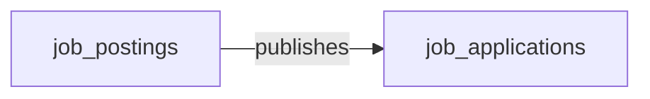

# Cluster C brief — Compliance / Audit / Legal

**Domains in scope (4):** AUDIT, LSD, TEST-MGMT, VIS-MGMT

**Your job:** for EACH of the 4 domains, author one markdown section following the OUTPUT TEMPLATE below. Write the full set to `.tmp_deploy/cluster_C_draft.md`. Do NOT call semantius or any database tool — drafts only. The draft will be reviewed by the user before any load happens.

---

## Domain details

### AUDIT — Audit Management

**Description:** Planning, fieldwork, evidence, and issue tracking for internal and external audits.

**Data objects (12):**

| role | data_object_name | singular | plural |
|---|---|---|---|
| master | `audit_engagements` | Audit Engagement | Audit Engagements |
| master | `audit_findings` | Audit Finding | Audit Findings |
| master | `audit_plans` | Audit Plan | Audit Plans |
| master | `audit_recommendations` | Audit Recommendation | Audit Recommendations |
| master | `audit_reports` | Audit Report | Audit Reports |
| master | `control_tests` | Audit Control Test | Audit Control Tests |
| master | `follow_up_actions` | Audit Follow-up Action | Audit Follow-up Actions |
| master | `work_papers` | Work Paper | Work Papers |
| consumer | `audit_issues` | Issue | Issues |
| consumer | `employees` | Employee | Employees |
| consumer | `financial_forecasts` | Forecast | Forecasts |
| consumer | `journal_entries` | Journal Entry | Journal Entries |

### LSD — Legal Service Delivery

**Description:** Intake, matter management, and operational workflows for the in-house legal function.

**Data objects (9):**

| role | data_object_name | singular | plural |
|---|---|---|---|
| master | `ediscovery_requests` | eDiscovery Request | eDiscovery Requests |
| master | `in_house_legal_matters` | In-House Legal Matter | In-House Legal Matters |
| master | `legal_advice_records` | Legal Advice Record | Legal Advice Records |
| master | `legal_case_dockets` | Legal Case Docket | Legal Case Dockets |
| master | `legal_holds` | Legal Hold | Legal Holds |
| master | `legal_intake_requests` | Legal Intake Request | Legal Intake Requests |
| master | `outside_counsel_engagements` | Outside Counsel Engagement | Outside Counsel Engagements |
| master | `regulatory_inquiries` | Regulatory Inquiry | Regulatory Inquiries |
| consumer | `legal_contracts` | Contract | Contracts |

### TEST-MGMT — Test Management

**Description:** Authoring, execution, and tracking of manual and automated software tests.

**Business logic:** Test runner orchestration (queuing, parallelisation, retry) is engine-like, but the test-management application itself is pure CRUD over cases, runs, and defects.

**Data objects (8):**

| role | data_object_name | singular | plural |
|---|---|---|---|
| master | `automation_scripts` | Automation Script | Automation Scripts |
| master | `requirements_to_test_traceability` | Requirements-to-Test Traceability | Requirements-to-Test Traceabilities |
| master | `test_cases` | Test Case | Test Cases |
| master | `test_defects` | Test Defect | Test Defects |
| master | `test_environments` | Test Environment | Test Environments |
| master | `test_plans` | Test Plan | Test Plans |
| master | `test_runs` | Test Run | Test Runs |
| master | `test_suites` | Test Suite | Test Suites |

### VIS-MGMT — Visitor Management

**Description:** Pre-registration, check-in, badging, and tracking of physical-site visitors.

**Data objects (8):**

| role | data_object_name | singular | plural |
|---|---|---|---|
| master | `host_assignments` | Visitor Host Assignment | Visitor Host Assignments |
| master | `visitor_audit_logs` | Visitor Audit Log | Visitor Audit Logs |
| master | `visitor_badges` | Visitor Badge | Visitor Badges |
| master | `visitor_check_ins` | Visitor Check-In | Visitor Check-Ins |
| master | `visitor_evacuation_lists` | Visitor Evacuation List | Visitor Evacuation Lists |
| master | `visitor_nda_acknowledgements` | Visitor NDA Acknowledgement | Visitor NDA Acknowledgements |
| master | `visitor_registrations` | Visitor Registration | Visitor Registrations |
| master | `visitor_watchlist_screenings` | Visitor Watchlist Screening | Visitor Watchlist Screenings |

---

## Cross-domain handoffs touching this cluster (64)

Convert each row to a cross-domain relationship edge (section 4 of each domain's draft) where there is a clean payload→target mapping. The payload's data_object is the **from** side; pick a natural recipient in the target_domain as the **to** side.

| source_domain | payload (data_object) | trigger_event | target_domain | integration_pattern | friction | description |
|---|---|---|---|---|---|---|
| TEST-MGMT | `test_defects` | `test_defect.created` | ITSM | api_call | medium | Customer-impacting defects in production-pathing tests escalate to ITSM tickets. |
| TEST-MGMT | `test_runs` | `test_run.completed` | GRC | batch_sync | medium | Compliance and validation test runs feed GRC as control evidence. |
| TEST-MGMT | `test_runs` | `test_run.completed` | VSDP | event_stream | low | Test results gate VSDP pipeline progression and release decisions. |
| TEST-MGMT | `test_runs` | `test_run.failed` | VSDP | event_stream | low | Failed test runs block VSDP release gates and surface in delivery dashboards. |
| TEST-MGMT | `requirements_to_test_traceability` | `requirements_to_test_traceability.linked` | PROD-MGMT | event_stream | medium | Requirement-to-test linkage updates feed product traceability and coverage reports. |
| TEST-MGMT | `test_defects` | `test_defect.created` | WORK-MGMT | event_stream | low | New defects materialize as work items on the engineering team's board for triage and fix. |
| GRC | `audit_issues` | `audit_issue.created` | AUDIT | api_call | medium | GRC-identified compliance gap feeds AUDIT investigation workflow. |
| GRC | `compliance_obligations` | `obligation.overdue` | AUDIT | api_call | high | Obligation past due → AUDIT escalation as non-conformance risk. |
| GRC | `compliance_controls` | `control.failed` | AUDIT | event_stream | medium | Failed control routed to AUDIT for follow-up. |
| AUDIT | `audit_engagements` | `audit_engagement.completed` | ITSM | manual_handoff | high | IT audit outcomes trigger ITSM actions; requires human interpretation of scope/findings. |
| AUDIT | `audit_findings` | `finding.created` | GRC | event_stream | medium | Audit finding flows to GRC for issue creation; canonical AUDIT→GRC separation. |
| AUDIT | `follow_up_actions` | `follow_up_action.closed` | GRC | api_call | low | AUDIT remediation closure → GRC issue closure (1:1 linkage established at finding time). |
| AUDIT | `control_tests` | `control_test.deficient` | GRC | event_stream | high | Deficient tests open GRC issues and remediation plans. |
| AUDIT | `audit_plans` | `audit_plan.approved` | GRC | event_stream | low | Approved audit plan aligns GRC scoping and control-test cadence. |
| AUDIT | `audit_findings` | `finding.remediated` | TPRM | api_call | medium | Third-party audit findings flow to TPRM for vendor-risk score update. |
| AUDIT | `control_tests` | `control_test.deficient` | ERP-FIN | manual_handoff | high | Financial-process control deficiencies trigger controller remediation. |
| AUDIT | `work_papers` | `work_paper.signed_off` | ERP-FIN | file_drop | low | Signed-off work papers archive financial-process evidence. |
| AUDIT | `audit_recommendations` | `recommendation.accepted` | EPM | batch_sync | medium | Accepted recommendations with budget impact → EPM scenario planning. |
| ESG | `emissions_records` | `emissions_record.ingested` | AUDIT | api_call | medium | ESG publishes immutable fact; AUDIT reads for assurance sampling. |
| ESG | `esg_disclosures` | `esg_disclosure.submitted_for_assurance` | AUDIT | api_call | high | Disclosure handed to AUDIT; tight Q deadline; no ack/retry on missed submissions. |
| ESG | `esg_initiatives` | `esg_initiative.launched` | AUDIT | event_stream | low | ESG initiative recorded for assurance scope. |
| VIS-MGMT | `visitor_audit_logs` | `visitor_audit_log.sealed` | GRC | event_stream | low | Visitor audit trails locked for SOC2/SOX compliance. |
| VIS-MGMT | `visitor_registrations` | `visitor_registration.submitted` | IGA | event_stream | medium | Visitor identity provisioned in IGA for building access. |
| VIS-MGMT | `host_assignments` | `host_notification.sent` | HCM | event_stream | low | Host notifications trigger employee engagement signals. |
| LSD | `in_house_legal_matters` | `in_house_legal_matter.regulatory_disclosure_required` | GRC | event_stream | high | Disclosure-triggering matters open a GRC compliance obligation with the deadline and reporting authority pre-populated. |
| LSD | `regulatory_inquiries` | `regulatory_inquiry.received` | AUDIT | manual_handoff | high | Regulatory inquiries trigger audit coordination on evidence collection and reporting. |
| LSD | `legal_holds` | `legal_hold.released` | AUDIT | manual_handoff | medium | Hold release tracked by audit to evidence completeness of preservation obligations. |
| LSD | `in_house_legal_matters` | `in_house_legal_matter.closed` | AUDIT | manual_handoff | medium | Closed matters may be referenced in internal-audit work; legal counsel manually shares the relevant outcome and remediation summary. |
| LSD | `legal_holds` | `legal_hold.issued` | HCM | api_call | medium | Custodian identification for legal holds depends on current HCM employee status and reporting relationships. |
| LSD | `legal_advice_records` | `legal_advice_record.employee_related` | HCM | manual_handoff | high | Employee-related advice is referenced from the HR case without exposing privileged content; the handoff is deliberately gated through counsel. |
| LSD | `legal_holds` | `legal_hold.issued` | ECM | api_call | high | Legal hold freezes ECM retention policies on identified content and custodians. |
| LSD | `ediscovery_requests` | `ediscovery_request.created` | ECM | api_call | high | E-discovery requires ECM collection workflows for in-scope content. |
| LSD | `in_house_legal_matters` | `legal_matter.opened` | ECM | api_call | medium | New matter triggers ECM matter-workspace provisioning. |
| LSD | `in_house_legal_matters` | `in_house_legal_matter.opened` | ECM | api_call | low | Opening a matter provisions a privileged ECM workspace where pleadings, correspondence, and work-product are filed under legal hold. |
| LSD | `legal_advice_records` | `legal_advice_record.issued` | ECM | api_call | low | Issued advice memos are filed in the privileged ECM repository with appropriate legal-hold and access controls. |
| SUP-LIFE | `supplier_risk_assessments` | `supplier_risk_assessment.completed` | AUDIT | batch_sync | medium | AUDIT samples supplier risk assessments as part of third-party-risk testing. |
| AP-AUTO | `invoice_matches` | `invoice_match.manual_override` | AUDIT | event_stream | high | Manual overrides are a SOX-relevant control event captured for audit evidence. |
| IPAAS | `integration_data_mappings` | `integration_data_mapping.updated` | TEST-MGMT | event_stream | medium | Mapping changes trigger contract-test reruns to validate downstream record shapes. |
| RPA | `rpa_executions` | `rpa_execution.completed` | AUDIT | event_stream | low | Bot execution log captured for SOX/audit trail with input/output evidence. |
| RPA | `rpa_activity_logs` | `rpa_activity_log.exception_captured` | AUDIT | event_stream | medium | Activity exception logged into audit forensic trail. |
| ERP-FIN | `journal_entries` | `journal_entry.posted` | AUDIT | event_stream | high | Every posted GL journal entry must flow into the audit log for forensic review and anomaly detection. Failure modes: high volume drowns the audit pipeline; backdated entries arrive |
| ERP-FIN | `fixed_assets` | `fixed_asset.disposed` | AUDIT | event_stream | medium | Asset disposals require AUDIT evidence and gain/loss verification. |
| ERP-FIN | `accounting_periods` | `accounting_period.closed` | AUDIT | event_stream | low | Period close kicks off AUDIT period-end procedures and locks the work-paper snapshot. |
| ERP-FIN | `legal_entities` | `legal_entity.created` | AUDIT | api_call | medium | New legal entities expand AUDIT scope and engagement schedule. |
| ERP-FIN | `cash_transactions` | `cash_transaction.unmatched` | AUDIT | manual_handoff | high | Unmatched cash items are a classic audit exception driving controller investigation. |
| ERP-FIN | `intercompany_transactions` | `intercompany.mismatch_detected` | AUDIT | manual_handoff | high | Intercompany mismatches require controller investigation and AUDIT testing. |
| EPM | `financial_forecasts` | `financial_forecast.refreshed` | AUDIT | batch_sync | medium | Refreshed forecast feeds into the audit trail for forecast-accuracy review and as input to management-review documentation. Failure modes: forecast versions proliferate (top-down,  |
| EPM | `variance_analyses` | `variance_analysis.material_variance` | AUDIT | event_stream | medium | AUDIT inspects material variances as part of management review controls. |
| EXPENSE | `expense_lines` | `expense_line.policy_violation` | AUDIT | event_stream | medium | Policy violations are sampled by AUDIT for T&E expense testing. |
| APIM | `api_specifications` | `api_specification.updated` | TEST-MGMT | event_stream | medium | Spec updates trigger contract-test regeneration and regression-suite re-baselining. |
| VSDP | `ci_pipeline_runs` | `ci_pipeline_run.failed` | TEST-MGMT | event_stream | low | Pipeline failures surface failing test cases for triage in test management. |
| DCG | `data_lineage_relationships` | `data_lineage_relationship.broken` | AUDIT | event_stream | medium | Broken lineage edge may indicate uncontrolled pipeline change; audit captures the event. |
| ECM | `records_retention_policies` | `document.retention_expired` | AUDIT | event_stream | low | Retention-expiry events and disposition outcomes are streamed to AUDIT so destruction evidence is preserved. |
| ECM | `content_documents` | `legal_hold.placed` | LSD | api_call | low | Placing a document under legal hold creates / updates the hold record in LSD and freezes retention disposition. |
| HCMS | `editorial_workflows` | `editorial_workflow.review_required` | LSD | api_call | medium | An editorial step routed to legal review opens a legal-intake record so LSD can track turnaround and decisions. |
| SPEND-MGMT | `card_authorizations` | `card_authorization.high_value` | AUDIT | batch_sync | medium | High-value card transactions sampled for travel/card expense audit. |
| DSPM | `cloud_databases` | `cloud_database.discovered` | AUDIT | event_stream | high | Unknown cloud DB triggers audit review. |
| RE-PROP-MGMT | `property_tenants` | `property_tenant.evicted` | LSD | manual_handoff | high | Eviction initiation triggers a legal matter (filing, notice service, court date tracking); typical legal workflow runs in a separate matter-management system. |
| RE-CRE | `building_certifications` | `building_certification.earned` | AUDIT | event_stream | low | Building certifications logged for compliance audit trail. |
| LEGAL-PRACT-MGMT | `external_court_filings` | `court_filing.served` | AUDIT | manual_handoff | low | Served filing creates deadlines tracked by audit for malpractice-risk and trust-compliance reviews. |
| FOOD-TRACE | `key_data_elements` | `key_data_element.captured` | AUDIT | batch_sync | low | Captured KDEs are retained as audit-evidence artefacts for FSMA traceability audits. |
| FOOD-TRACE | `critical_tracking_events` | `critical_tracking_event.recorded` | AUDIT | batch_sync | medium | CTE records are sampled by internal AUDIT to verify traceability program effectiveness. |
| FSQM | `audit_findings` | `audit_finding.created` | AUDIT | api_call | medium | GFSI / FSMA-PC audit findings flow into the enterprise audit register for cross-functional follow-up and corrective-action tracking. |
| FSQM | `haccp_plans` | `haccp_plan.approved` | AUDIT | batch_sync | low | Approved HACCP plan triggers AUDIT to schedule surveillance audit and align test scripts. |

---

## Cross-cluster reference (data_objects in OTHER clusters that handoffs reach into)

Use these names when authoring section 4 (cross-domain edges) of any domain in this cluster.

- **ITSM** (IT Service Management): `service_incidents`, `service_requests`, `service_problems`, `service_changes`, `knowledge_articles`, `service_catalog_items`, `service_slas`
- **PROD-MGMT** (Product Management): `product_lines`, `product_features`, `product_releases`, `product_roadmaps`, `feature_requests`, `customer_feedback_items`, `product_metrics`, `beta_programs`
- **SPEND-MGMT** (Corporate Spend Management): `spend_requests`, `corporate_card_accounts`, `card_authorizations`, `vendor_payment_authorizations`, `spend_policies`
- **WORK-MGMT** (Work Management): `work_items`, `work_projects`, `work_automations`, `okr_objectives`
- **DSPM** (Data Security Posture Management): `cloud_storage_buckets`, `cloud_databases`, `data_warehouses`, `saas_app_instances`, `iam_access_policies`, `sensitive_data_incidents`, `data_risk_scores`, `shadow_data_findings`
- **RE-PROP-MGMT** (Residential Property Management): `rental_units`, `property_tenants`, `rental_applications`, `rent_payments`, `tenant_maintenance_requests`, `rental_leases`
- **RE-CRE** (Commercial Real Estate Operations): `commercial_leases`, `stacking_plans`, `cam_charges`, `tenant_credit_records`, `sublease_transactions`, `building_certifications`
- **GRC** (Governance, Risk and Compliance): `compliance_risks`, `compliance_controls`, `control_assessments`, `compliance_policies`, `policy_attestations`, `compliance_obligations`, `compliance_evidence`, `audit_issues`, `remediation_plans`, `risk_assessments`
- **LEGAL-PRACT-MGMT** (Legal Practice Management): `legal_matters`, `trust_accounts`, `conflict_checks`, `engagement_letters`, `external_court_filings`, `client_invoices`
- **FOOD-TRACE** (Food Traceability and Provenance): `traceability_lots`, `critical_tracking_events`, `key_data_elements`, `recall_events`, `supplier_certifications`
- **FSQM** (Food Safety and Quality Management): `haccp_plans`, `critical_control_points`, `ccp_measurements`, `food_safety_incidents`, `allergen_programs`, `environmental_monitoring_samples`, `sanitation_records`
- **ESG** (ESG Management): `emissions_records`, `emission_factors`, `activity_data_records`, `esg_targets`, `esg_metrics`, `esg_disclosures`, `supplier_esg_assessments`, `facility_emissions`, `esg_initiatives`
- **SUP-LIFE** (Supplier Lifecycle Management): `suppliers`, `supplier_onboardings`, `supplier_qualifications`, `supplier_scorecards`, `supplier_risk_assessments`, `supplier_certifications`
- **AP-AUTO** (Accounts Payable Automation): `invoice_matches`, `payment_runs`
- **IGA** (Identity Governance and Administration): `employees`, `saas_app_assignments`, `iga_access_requests`, `iga_access_certifications`, `iga_entitlement_definitions`, `iga_sod_violations`, `iga_provisioning_events`
- **IPAAS** (Integration Platform as a Service): `integration_recipes`, `integration_runs`, `integration_connectors`, `webhook_subscriptions`, `integration_triggers`, `integration_data_mappings`
- **RPA** (Robotic Process Automation): `rpa_bots`, `rpa_executions`, `rpa_schedules`, `rpa_activities`, `rpa_activity_logs`, `rpa_bot_credentials`, `rpa_deployment_packages`
- **HCM** (Human Capital Management): `employees`, `hcm_positions`, `job_profiles`, `org_units`, `employment_contracts`, `employment_events`
- **ERP-FIN** (Core ERP Financial Management): `journal_entries`, `general_ledger_accounts`, `cost_centers`, `legal_entities`, `accounting_periods`, `bank_accounts`, `cash_transactions`, `fixed_assets`, `asset_depreciation_schedules`, `intercompany_transactions`, `revenue_recognition_records`
- **EPM** (Enterprise Performance Management): `financial_plans`, `financial_budgets`, `financial_forecasts`, `financial_scenarios`, `variance_analyses`
- **EXPENSE** (Expense Management): `expense_reports`, `expense_lines`, `expense_policies`, `travel_bookings`, `corporate_cards`, `card_transactions`
- **APIM** (API Management): `api_versions`, `api_specifications`, `api_deployments`, `api_policies`, `api_usage_metrics`, `api_gateways`, `api_consumers`
- **VSDP** (Value Stream Delivery Platform): `source_repositories`, `code_commits`, `pull_requests`, `ci_pipelines`, `ci_pipeline_runs`, `build_artifacts`, `software_deployments`, `value_stream_metrics`
- **DCG** (Data Catalog and Governance): `data_domains`, `data_assets`, `data_lineage_relationships`, `glossary_terms`, `data_classifications`, `data_stewardship_assignments`, `data_certifications`, `data_access_policies`, `data_usage_metrics`, `metric_definitions`, `data_products`, `ontologies`
- **ECM** (Enterprise Content Management): `content_documents`, `document_versions`, `document_folders`, `document_classifications`, `records_retention_policies`
- **HCMS** (Headless Content Management): `content_types`, `content_entries`, `content_releases`, `editorial_workflows`, `content_locales`, `content_environments`

---

## Platform built-in

Reference `users` (data_object_id=748, kind=platform_builtin) for any assignee / owner / approver / creator relationship. Always section 3.

---

## OUTPUT TEMPLATE — repeat once per domain (replace the example rows)

## Domain: <DOMAIN_CODE> — <Domain Name>

### 1. Mermaid graph (intra-domain only — visualize the entity-cluster shape)

### 2. Intra-domain relationships

| from | verb | to | cardinality | kind | required | owner_side | inverse_verb | notes |
|---|---|---|---|---|---|---|---|---|
| job_postings | publishes | job_applications | one_to_many | composition | true | source | is published from | each application belongs to one posting |

### 3. Users edges (platform_builtin)

| from | verb | to | cardinality | kind | required | owner_side | inverse_verb | notes |
|---|---|---|---|---|---|---|---|---|
| job_applications | assigned_to | users | many_to_one | reference | false | target | hiring manager for | recruiter ownership |

### 4. Cross-domain edges (clean payload→target only)

| from | verb | to | cardinality | kind | required | owner_side | inverse_verb | notes |
|---|---|---|---|---|---|---|---|---|
| job_offers | becomes | employees | one_to_one | reference | false | target | onboarded from | only when offer accepted |

### 5. Aliases (≥1 per non-self-explanatory master)

| data_object | alias_name | alias_type | is_preferred | notes |
|---|---|---|---|---|
| job_applications | application | synonym | false | common short form |
| job_applications | candidate submission | industry_term | false | HR vendor terminology |

---

## Schema reference

### data_object_relationships schema

| Column | Type / values | Notes |
|---|---|---|
| data_object_id | reference→data_objects | The **source / subject** side. Use the data_object_name (the loader will resolve to id). |
| related_data_object_id | reference→data_objects | The **target / object** side. |
| relationship_verb | text | Parent-voice verb. Conventions: `owns`, `manages`, `schedules`, `places`, `is_assigned_to`, `extends`, `groups`, `contains`, `triggers`, `approves`, `fulfills`, `closes`, `spawns`, `becomes`. Use snake_case. |
| inverse_verb | text | Reverse phrasing for navigation: `is owned by`, `reports to`, `is scheduled by`. Natural prose, no snake_case required. |
| relationship_type | enum | `one_to_one` / `one_to_many` / `many_to_many` |
| relationship_kind | enum | `composition` (parent owns child, cascade), `reference` (loose link, no cascade), `association` (peer-to-peer M:N), `inheritance` (subtype / IS-A) |
| owner_side | enum | `source` = the row identified by data_object_id cascades into the related object on delete; `target` = the related object owns the lifecycle. Drives delete-mode derivation downstream. |
| is_required | boolean | true if mandatory in typical implementations (every Order has a Customer); false if optional. |
| notes | text | Free-form. |

### data_object_aliases schema

| Column | Type / values | Notes |
|---|---|---|
| data_object_id | reference→data_objects | The aliased entity (by data_object_name). |
| alias_name | text | The alternative term. |
| alias_type | enum | `synonym` (general alt term), `industry_term` (specific to an industry — set industry_id), `solution_term` (specific to a vendor product — set solution_id). For Step 5 only `synonym` and `industry_term` are expected; `industry_term` rows without an industry_id will be skipped by the loader. |
| is_preferred | boolean | True if this alias is more common than the canonical name in its context. Usually false. |

### Guardrails

1. **Use data_object_name (snake_case) everywhere in tables**, not labels. Loader resolves names → ids.
2. **Only reference data_objects that exist** in your cluster's domain list OR `users` (the only platform_builtin) OR data_objects that belong to other domains shown in the **cross-cluster reference list** below. Do not invent new entity names.
3. **Intra-domain edges**: every edge's both ends are data_objects belonging to a single domain in this cluster (could be the same domain). Aim for completeness — every master/embedded_master should have at least one edge unless it is a true root entity.
4. **Users edges**: cover assignee / owner / created_by / approver style relationships. Every entity that has any user-shaped role gets a users edge. Use distinct verbs (`is_owned_by`, `is_assigned_to`, `is_created_by`, `is_approved_by`).
5. **Cross-domain edges**: ONLY include where there is a clean, deterministic payload→target mapping (e.g. `candidates → becomes → employees` when a hire happens, `job_offers → spawns → onboarding_journeys`). Do NOT speculate. The cross_domain_handoffs in your brief are an existing source of truth; convert each row to a relationship edge where the payload (data_object_id) is the **from** side and the target_domain has a master data_object that is the natural recipient.
6. **Aliases**: focus on non-self-explanatory masters. A master named `hcm_employees` doesn't need an alias for "employee" because the singular is obvious. But `itsm_incidents` could alias to "ticket"; `crm_opportunities` to "deal"; `cmdb_configuration_items` to "CI". 1-3 aliases per master that benefits, none for those that don't.
7. **Avoid duplicate edges**: do not author both A→B and B→A; pick the natural source side (the side that *owns the action* in the verb). E.g. for "publishes" the publisher is source; for "is_assigned_to" the assignee-holder is source.
8. **Use `composition` sparingly**: only when delete-cascade is the obvious correct behavior (an order_line cannot exist without its order). Most edges are `reference`.
9. **`owner_side='source'`** is the right answer when the source row's lifecycle drives the related row (composition pattern). **`owner_side='target'`** is correct for "reference upward" relationships (a job_application references a job_posting; the posting is the lifecycle owner).
10. **Output is markdown only.** Do NOT call semantius or PostgREST. Write the draft to the path your prompt specifies.
