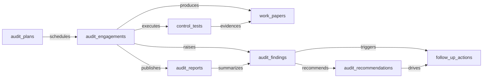
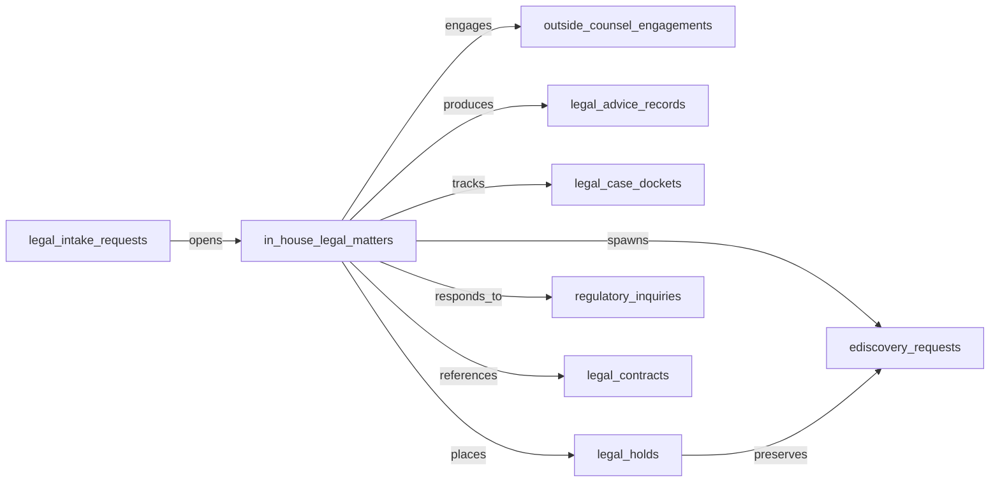
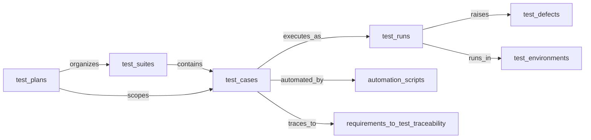
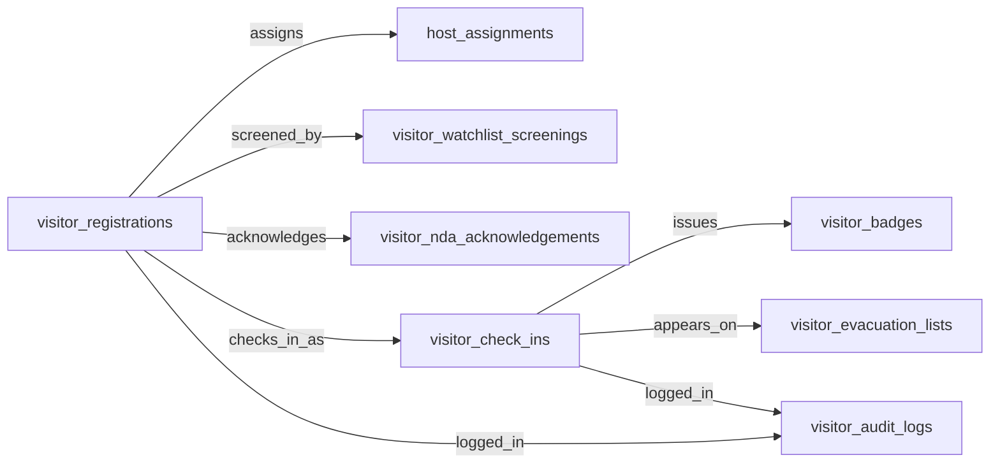

# Cluster C draft — Compliance / Audit / Legal

## Domain: AUDIT — Audit Management

### 1. Mermaid graph (intra-domain only — visualize the entity-cluster shape)

### 2. Intra-domain relationships

| from | verb | to | cardinality | kind | required | owner_side | inverse_verb | notes |
|---|---|---|---|---|---|---|---|---|
| audit_plans | schedules | audit_engagements | one_to_many | reference | true | target | is scheduled under | annual / risk-based plan groups engagements |
| audit_engagements | executes | control_tests | one_to_many | composition | true | source | is executed within | each control test belongs to one engagement |
| audit_engagements | produces | work_papers | one_to_many | composition | true | source | is produced for | work papers cascade with the engagement |
| audit_engagements | raises | audit_findings | one_to_many | composition | false | source | is raised in | findings discovered during fieldwork |
| audit_engagements | publishes | audit_reports | one_to_many | composition | false | source | is published from | engagement deliverable |
| audit_findings | recommends | audit_recommendations | one_to_many | composition | false | source | is recommended for | each recommendation addresses a finding |
| audit_findings | triggers | follow_up_actions | one_to_many | reference | false | source | follows up on | remediation tasks for the finding |
| audit_recommendations | drives | follow_up_actions | one_to_many | reference | false | source | implements | actions implementing the recommendation |
| control_tests | evidences | work_papers | one_to_many | reference | false | source | provides evidence for | test results documented in work papers |
| audit_reports | summarizes | audit_findings | one_to_many | reference | false | target | is summarized in | report rolls up findings |

### 3. Users edges (platform_builtin)

| from | verb | to | cardinality | kind | required | owner_side | inverse_verb | notes |
|---|---|---|---|---|---|---|---|---|
| audit_plans | is_owned_by | users | many_to_one | reference | true | target | owns audit plan | chief audit executive / plan owner |
| audit_engagements | is_assigned_to | users | many_to_one | reference | true | target | leads engagement | lead auditor |
| audit_findings | is_assigned_to | users | many_to_one | reference | false | target | owns finding | finding owner / auditor |
| audit_recommendations | is_approved_by | users | many_to_one | reference | false | target | approves recommendation | audit committee or sponsor |
| audit_reports | is_approved_by | users | many_to_one | reference | true | target | signs report | report signoff |
| control_tests | is_assigned_to | users | many_to_one | reference | true | target | performs control test | tester |
| follow_up_actions | is_assigned_to | users | many_to_one | reference | true | target | owns follow-up | remediation owner |
| work_papers | is_created_by | users | many_to_one | reference | true | target | authored | preparer / reviewer |

### 4. Cross-domain edges (clean payload→target only)

| from | verb | to | cardinality | kind | required | owner_side | inverse_verb | notes |
|---|---|---|---|---|---|---|---|---|
| audit_findings | escalates_to | audit_issues | one_to_many | reference | false | target | originates from | AUDIT→GRC: finding becomes GRC issue |
| follow_up_actions | closes | audit_issues | one_to_one | reference | false | target | is closed by | 1:1 linkage to GRC issue closure |
| control_tests | opens | audit_issues | one_to_many | reference | false | target | originates from | deficient control opens GRC issue |
| audit_plans | aligns_with | compliance_controls | many_to_many | association | false | source | scopes | approved plan aligns GRC scoping cadence |
| audit_findings | updates | suppliers | many_to_many | reference | false | target | is impacted by | third-party finding updates vendor risk |
| control_tests | escalates_to | service_incidents | one_to_many | reference | false | target | is investigated by | financial-process control deficiency to controller |
| work_papers | archives_to | accounting_periods | many_to_one | reference | false | target | references work paper | signed-off work papers tagged to period |
| audit_recommendations | feeds | financial_scenarios | many_to_many | reference | false | target | is informed by | accepted recommendations with budget impact |
| audit_engagements | triggers | service_requests | one_to_many | reference | false | target | follows up on | IT audit outcomes → ITSM actions |
| audit_issues | tracks | emissions_records | many_to_many | reference | false | source | is sampled for | ESG fact assured by audit |
| audit_engagements | reviews | esg_disclosures | one_to_many | reference | false | source | is assured by | disclosure handed to AUDIT for assurance |
| audit_plans | scopes | esg_initiatives | many_to_many | reference | false | source | is in scope of | initiative recorded for assurance |
| audit_engagements | samples | supplier_risk_assessments | many_to_many | reference | false | source | is sampled by | TPRM sampling in audit testing |
| audit_findings | reviews | invoice_matches | many_to_many | reference | false | source | is evidence for | manual override is SOX-relevant control event |
| audit_findings | reviews | rpa_executions | many_to_many | reference | false | source | is logged for | bot execution evidence for SOX |
| audit_findings | reviews | rpa_activity_logs | many_to_many | reference | false | source | is logged for | RPA exception captured in audit trail |
| audit_findings | reviews | journal_entries | many_to_many | reference | false | source | is sampled for | every posted GL entry feeds audit trail |
| audit_findings | reviews | fixed_assets | many_to_many | reference | false | source | is evidenced by | asset disposals require audit evidence |
| audit_engagements | follows | accounting_periods | many_to_many | reference | false | source | triggers | period close kicks off period-end procedures |
| audit_plans | expands_for | legal_entities | many_to_many | reference | false | source | scopes audit for | new legal entity expands audit scope |
| audit_findings | investigates | cash_transactions | many_to_many | reference | false | source | is exception for | unmatched cash items drive investigation |
| audit_findings | investigates | intercompany_transactions | many_to_many | reference | false | source | is mismatch for | intercompany mismatch testing |
| audit_findings | reviews | financial_forecasts | many_to_many | reference | false | source | is audited for | forecast-accuracy review |
| audit_findings | reviews | variance_analyses | many_to_many | reference | false | source | inspects | material variance management review |
| audit_findings | samples | expense_lines | many_to_many | reference | false | source | is audited via | T&E policy violation sampling |
| audit_findings | reviews | data_lineage_relationships | many_to_many | reference | false | source | is captured for | broken lineage indicates uncontrolled change |
| audit_findings | reviews | records_retention_policies | many_to_many | reference | false | source | is evidenced by | retention-expiry destruction evidence |
| audit_findings | samples | card_authorizations | many_to_many | reference | false | source | is audited via | high-value card audit sampling |
| audit_findings | reviews | cloud_databases | many_to_many | reference | false | source | triggers audit of | unknown cloud DB triggers audit review |
| audit_findings | reviews | building_certifications | many_to_many | reference | false | source | is logged for | certification logged for compliance trail |
| audit_findings | tracks | external_court_filings | many_to_many | reference | false | source | sets deadlines from | served filings create audit-tracked deadlines |
| audit_findings | reviews | key_data_elements | many_to_many | reference | false | source | retains as evidence | FSMA traceability audit evidence |
| audit_findings | samples | critical_tracking_events | many_to_many | reference | false | source | verifies via | CTE records sampled in audit |
| audit_findings | imports | audit_findings | many_to_many | reference | false | source | flows into | FSQM audit findings flow into enterprise register (cross-domain alias) |
| audit_plans | schedules | haccp_plans | many_to_many | reference | false | source | triggers surveillance for | HACCP approval triggers surveillance audit |

### 5. Aliases

| data_object | alias_name | alias_type | is_preferred | notes |
|---|---|---|---|---|
| audit_engagements | audit | synonym | false | common short form |
| audit_engagements | audit project | synonym | false | engagement-as-project framing |
| audit_findings | finding | synonym | true | preferred short form in audit practice |
| audit_findings | observation | industry_term | false | external audit terminology |
| audit_findings | issue | synonym | false | colloquial alias |
| audit_plans | annual audit plan | industry_term | false | IIA-style naming |
| audit_recommendations | management action | industry_term | false | IIA-aligned wording |
| audit_recommendations | corrective action | synonym | false | remediation framing |
| audit_reports | audit memorandum | industry_term | false | formal external naming |
| control_tests | test of control | industry_term | true | SOX / SOC audit terminology |
| control_tests | toc | synonym | false | SOX acronym |
| follow_up_actions | remediation action | synonym | true | common audit term |
| follow_up_actions | corrective action plan | industry_term | false | CAP shorthand |
| work_papers | working papers | synonym | true | conventional plural form |
| work_papers | audit evidence file | industry_term | false | external-audit naming |

---

## Domain: LSD — Legal Service Delivery

### 1. Mermaid graph (intra-domain only — visualize the entity-cluster shape)

### 2. Intra-domain relationships

| from | verb | to | cardinality | kind | required | owner_side | inverse_verb | notes |
|---|---|---|---|---|---|---|---|---|
| legal_intake_requests | opens | in_house_legal_matters | one_to_one | reference | false | target | originates from | triaged intake becomes a matter |
| in_house_legal_matters | engages | outside_counsel_engagements | one_to_many | composition | false | source | is engaged for | external counsel scoped to a matter |
| in_house_legal_matters | produces | legal_advice_records | one_to_many | composition | false | source | is produced for | privileged advice tied to matter |
| in_house_legal_matters | tracks | legal_case_dockets | one_to_many | composition | false | source | is docketed under | docket entries belong to a matter |
| in_house_legal_matters | places | legal_holds | one_to_many | composition | false | source | preserves | hold issued in the context of a matter |
| in_house_legal_matters | spawns | ediscovery_requests | one_to_many | composition | false | source | is collected for | discovery requests originate from matter |
| in_house_legal_matters | responds_to | regulatory_inquiries | one_to_many | reference | false | source | is handled by | inquiry routed to a matter for handling |
| legal_holds | preserves | ediscovery_requests | one_to_many | reference | false | source | is preserved by | hold scopes e-discovery collection |
| in_house_legal_matters | references | legal_contracts | many_to_many | reference | false | source | is referenced in | matter may cite or arise from contracts |

### 3. Users edges (platform_builtin)

| from | verb | to | cardinality | kind | required | owner_side | inverse_verb | notes |
|---|---|---|---|---|---|---|---|---|
| legal_intake_requests | is_created_by | users | many_to_one | reference | true | target | submitted intake | requester |
| in_house_legal_matters | is_assigned_to | users | many_to_one | reference | true | target | leads matter | responsible attorney |
| legal_advice_records | is_created_by | users | many_to_one | reference | true | target | authored advice | issuing counsel |
| legal_case_dockets | is_owned_by | users | many_to_one | reference | true | target | owns docket | docket clerk / paralegal |
| legal_holds | is_created_by | users | many_to_one | reference | true | target | issued hold | hold custodian / issuer |
| ediscovery_requests | is_assigned_to | users | many_to_one | reference | true | target | runs discovery | e-discovery lead |
| outside_counsel_engagements | is_approved_by | users | many_to_one | reference | true | target | approves engagement | general counsel / engagement owner |
| regulatory_inquiries | is_assigned_to | users | many_to_one | reference | true | target | responds to inquiry | regulatory liaison |

### 4. Cross-domain edges (clean payload→target only)

| from | verb | to | cardinality | kind | required | owner_side | inverse_verb | notes |
|---|---|---|---|---|---|---|---|---|
| in_house_legal_matters | triggers | compliance_obligations | one_to_many | reference | false | source | originates from | regulatory disclosure opens compliance obligation |
| regulatory_inquiries | triggers | audit_engagements | one_to_many | reference | false | source | is coordinated with | inquiry triggers audit coordination |
| legal_holds | evidences | audit_engagements | many_to_many | reference | false | source | evidences hold for | release tracked by audit |
| in_house_legal_matters | shares_outcome_with | audit_engagements | many_to_many | reference | false | source | references matter outcome | closed-matter outcomes referenced in audit |
| legal_holds | identifies_custodians_from | employees | many_to_many | reference | false | source | is custodian for | HCM employee data drives custodian id |
| legal_advice_records | references | employees | many_to_many | reference | false | source | is referenced in HR case | employee-related advice from HR case |
| legal_holds | freezes | content_documents | one_to_many | reference | false | source | is frozen by | hold freezes ECM retention |
| ediscovery_requests | collects_from | content_documents | many_to_many | reference | false | source | is collected by | ECM collection workflow |
| in_house_legal_matters | provisions | document_folders | one_to_many | reference | false | source | hosts matter for | matter triggers ECM workspace |
| legal_advice_records | files_to | content_documents | one_to_many | reference | false | source | stores | issued advice filed in ECM |

### 5. Aliases

| data_object | alias_name | alias_type | is_preferred | notes |
|---|---|---|---|---|
| in_house_legal_matters | legal matter | synonym | true | conventional short form |
| in_house_legal_matters | matter | synonym | false | common single-word reference |
| legal_intake_requests | legal intake | synonym | true | preferred short form |
| legal_intake_requests | new matter request | industry_term | false | intake portal terminology |
| legal_advice_records | advice memo | synonym | false | common drafting term |
| legal_advice_records | legal memorandum | industry_term | false | formal naming |
| legal_case_dockets | case docket | synonym | true | conventional short form |
| legal_case_dockets | docket | synonym | false | one-word reference |
| legal_holds | litigation hold | industry_term | true | preferred US legal terminology |
| legal_holds | preservation notice | industry_term | false | preservation-obligation framing |
| ediscovery_requests | e-discovery request | synonym | true | hyphenated form |
| ediscovery_requests | discovery request | synonym | false | shortened form |
| outside_counsel_engagements | external counsel engagement | synonym | false | alternative phrasing |
| outside_counsel_engagements | law firm engagement | industry_term | false | firm-side terminology |
| regulatory_inquiries | regulatory request | synonym | false | broader phrasing |
| regulatory_inquiries | agency inquiry | industry_term | false | when sender is an agency |

---

## Domain: TEST-MGMT — Test Management

### 1. Mermaid graph (intra-domain only — visualize the entity-cluster shape)

### 2. Intra-domain relationships

| from | verb | to | cardinality | kind | required | owner_side | inverse_verb | notes |
|---|---|---|---|---|---|---|---|---|
| test_plans | organizes | test_suites | one_to_many | reference | false | source | belongs to | plan groups suites |
| test_suites | contains | test_cases | one_to_many | reference | false | source | is in suite | suite-case membership (often M:N in tooling but here modeled as 1:N for canonical shape) |
| test_cases | executes_as | test_runs | one_to_many | reference | false | source | is execution of | each run executes one case |
| test_runs | raises | test_defects | one_to_many | reference | false | source | was raised by | failed runs raise defects |
| test_cases | automated_by | automation_scripts | one_to_one | reference | false | target | automates | manual case may be linked to script |
| test_runs | runs_in | test_environments | many_to_one | reference | true | target | hosts run | run executes against an environment |
| test_cases | traces_to | requirements_to_test_traceability | one_to_many | composition | false | source | traces case for | trace rows link cases to requirements |
| test_plans | scopes | test_cases | many_to_many | association | false | source | is scoped under | plan selects in-scope cases |

### 3. Users edges (platform_builtin)

| from | verb | to | cardinality | kind | required | owner_side | inverse_verb | notes |
|---|---|---|---|---|---|---|---|---|
| test_plans | is_owned_by | users | many_to_one | reference | true | target | owns plan | test lead |
| test_cases | is_created_by | users | many_to_one | reference | true | target | authored case | case author |
| test_runs | is_assigned_to | users | many_to_one | reference | false | target | executed run | tester / runner |
| test_defects | is_assigned_to | users | many_to_one | reference | false | target | owns defect | defect owner |
| automation_scripts | is_created_by | users | many_to_one | reference | true | target | maintains script | script author |
| test_suites | is_owned_by | users | many_to_one | reference | false | target | owns suite | suite owner |
| test_environments | is_owned_by | users | many_to_one | reference | false | target | administers environment | environment admin |
| requirements_to_test_traceability | is_created_by | users | many_to_one | reference | false | target | mapped trace | trace author |

### 4. Cross-domain edges (clean payload→target only)

| from | verb | to | cardinality | kind | required | owner_side | inverse_verb | notes |
|---|---|---|---|---|---|---|---|---|
| test_defects | escalates_to | service_incidents | one_to_many | reference | false | source | originates from | customer-impacting defect to ITSM |
| test_defects | spawns | work_items | one_to_many | reference | false | source | tracks defect | defect surfaces on engineering board |
| test_runs | feeds | compliance_evidence | many_to_many | reference | false | source | is evidence from | compliance/validation runs feed GRC |
| test_runs | gates | software_deployments | many_to_many | reference | false | source | is gated by | test results gate VSDP pipeline |
| test_runs | blocks | ci_pipeline_runs | many_to_many | reference | false | source | is blocked by | failed runs block release gates |
| requirements_to_test_traceability | feeds | product_features | many_to_many | reference | false | source | is traced for | requirement-test linkage feeds product traceability |
| test_cases | is_triggered_by | integration_data_mappings | many_to_many | reference | false | target | reruns contract tests for | mapping changes trigger contract-test reruns |
| test_cases | is_triggered_by | api_specifications | many_to_many | reference | false | target | regenerates contract tests for | spec updates trigger contract-test regeneration |
| test_defects | surfaces_from | ci_pipeline_runs | many_to_many | reference | false | target | exposes defect | pipeline failures surface failing cases |

### 5. Aliases

| data_object | alias_name | alias_type | is_preferred | notes |
|---|---|---|---|---|
| test_cases | test script | synonym | false | common QA term |
| test_cases | scenario | synonym | false | BDD framing |
| test_runs | test execution | synonym | true | preferred industry term |
| test_runs | run | synonym | false | short form |
| test_defects | bug | synonym | true | preferred colloquial term |
| test_defects | defect | synonym | false | already in canonical name; emphasized for matching |
| test_suites | suite | synonym | false | short form |
| test_plans | test strategy | industry_term | false | strategy-level framing |
| automation_scripts | automated test | synonym | false | common alias |
| automation_scripts | test automation | synonym | false | discipline-level framing |
| test_environments | test bed | synonym | false | infrastructure framing |
| test_environments | qa environment | industry_term | false | environment naming |
| requirements_to_test_traceability | traceability matrix | industry_term | true | preferred industry term |
| requirements_to_test_traceability | rtm | synonym | false | common acronym |

---

## Domain: VIS-MGMT — Visitor Management

### 1. Mermaid graph (intra-domain only — visualize the entity-cluster shape)

### 2. Intra-domain relationships

| from | verb | to | cardinality | kind | required | owner_side | inverse_verb | notes |
|---|---|---|---|---|---|---|---|---|
| visitor_registrations | assigns | host_assignments | one_to_one | composition | true | source | is assigned for | host assignment derived from registration |
| visitor_registrations | screened_by | visitor_watchlist_screenings | one_to_one | composition | false | source | screens | watchlist screening attached to registration |
| visitor_registrations | acknowledges | visitor_nda_acknowledgements | one_to_one | composition | false | source | is acknowledged in | NDA captured at registration |
| visitor_registrations | checks_in_as | visitor_check_ins | one_to_one | reference | false | source | originates from | check-in events for the registration |
| visitor_check_ins | issues | visitor_badges | one_to_one | composition | false | source | is issued at | badge issued at check-in |
| visitor_check_ins | appears_on | visitor_evacuation_lists | many_to_many | reference | false | source | includes | active visitors appear on evacuation rosters |
| visitor_check_ins | logged_in | visitor_audit_logs | one_to_many | reference | false | source | logs | check-in events appended to audit log |
| visitor_registrations | logged_in | visitor_audit_logs | one_to_many | reference | false | source | logs | registration events appended to audit log |

### 3. Users edges (platform_builtin)

| from | verb | to | cardinality | kind | required | owner_side | inverse_verb | notes |
|---|---|---|---|---|---|---|---|---|
| host_assignments | is_assigned_to | users | many_to_one | reference | true | target | hosts visitor | internal host |
| visitor_registrations | is_created_by | users | many_to_one | reference | false | target | created registration | requestor / reception |
| visitor_check_ins | is_assigned_to | users | many_to_one | reference | false | target | processed check-in | reception agent |
| visitor_watchlist_screenings | is_approved_by | users | many_to_one | reference | false | target | reviewed screening | security reviewer |
| visitor_evacuation_lists | is_owned_by | users | many_to_one | reference | false | target | owns evacuation roster | floor warden / safety officer |
| visitor_audit_logs | is_owned_by | users | many_to_one | reference | false | target | administers audit log | facility security admin |
| visitor_badges | is_created_by | users | many_to_one | reference | false | target | printed badge | reception agent |
| visitor_nda_acknowledgements | is_created_by | users | many_to_one | reference | false | target | witnessed nda | reception witness |

### 4. Cross-domain edges (clean payload→target only)

| from | verb | to | cardinality | kind | required | owner_side | inverse_verb | notes |
|---|---|---|---|---|---|---|---|---|
| visitor_audit_logs | feeds | compliance_evidence | many_to_many | reference | false | source | is sealed for | visitor audit trail locked for SOC2/SOX |
| visitor_registrations | provisions | iga_provisioning_events | one_to_many | reference | false | source | is provisioned from | visitor identity provisioned for building access |
| host_assignments | notifies | employees | many_to_one | reference | true | target | is host for | host notifications trigger employee engagement |

### 5. Aliases

| data_object | alias_name | alias_type | is_preferred | notes |
|---|---|---|---|---|
| visitor_registrations | pre-registration | synonym | true | preferred when describing the up-front step |
| visitor_registrations | visitor invite | synonym | false | invite-style framing |
| host_assignments | host | synonym | false | short form for the host relationship |
| host_assignments | sponsor assignment | industry_term | false | secure-facility terminology |
| visitor_check_ins | sign-in | synonym | true | preferred reception term |
| visitor_check_ins | arrival | synonym | false | event-style framing |
| visitor_badges | visitor pass | synonym | true | preferred reception term |
| visitor_badges | guest badge | synonym | false | common alias |
| visitor_audit_logs | visitor log | synonym | true | preferred short form |
| visitor_audit_logs | gate log | industry_term | false | physical-security terminology |
| visitor_evacuation_lists | muster list | industry_term | true | preferred emergency-management term |
| visitor_evacuation_lists | roll call list | synonym | false | colloquial alias |
| visitor_nda_acknowledgements | nda signature | synonym | true | preferred short form |
| visitor_nda_acknowledgements | confidentiality acknowledgement | industry_term | false | formal phrasing |
| visitor_watchlist_screenings | denied party screening | industry_term | true | export-control terminology |
| visitor_watchlist_screenings | sanctions screening | industry_term | false | sanctions-program framing |
