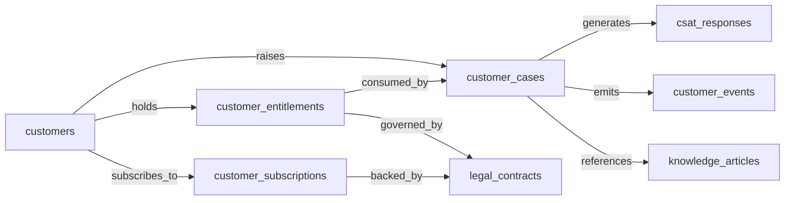
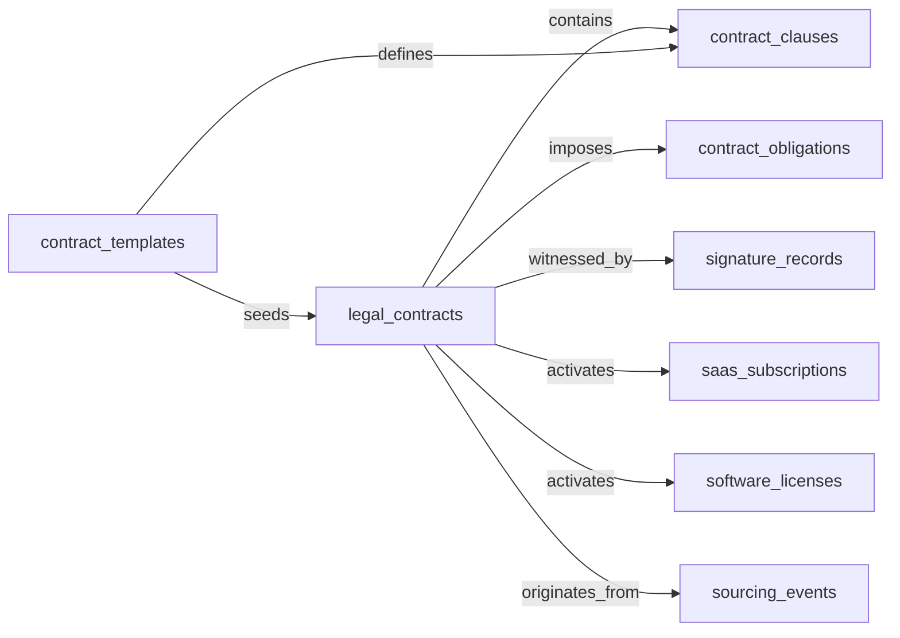
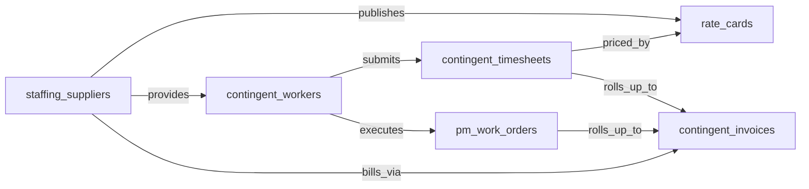
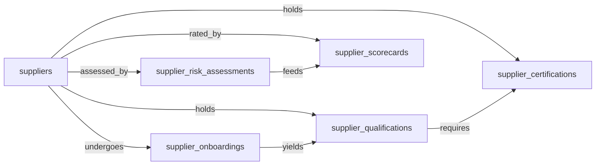

## Domain: CSM — Customer Service Management

### 1. Mermaid graph (intra-domain only — visualize the entity-cluster shape)

### 2. Intra-domain relationships

| from | verb | to | cardinality | kind | required | owner_side | inverse_verb | notes |
|---|---|---|---|---|---|---|---|---|
| customers | raises | customer_cases | one_to_many | reference | true | target | is raised by | every case belongs to one customer |
| customers | holds | customer_entitlements | one_to_many | reference | false | target | is held by | service entitlements per customer/tier |
| customers | subscribes_to | customer_subscriptions | one_to_many | reference | false | target | is subscribed by | service view of the subscription |
| customer_cases | generates | csat_responses | one_to_many | composition | false | source | is in response to | survey responses tied to case resolution |
| customer_cases | emits | customer_events | one_to_many | composition | false | source | is emitted from | case lifecycle events stream |
| customer_cases | references | knowledge_articles | many_to_many | association | false | source | is referenced by | agent-assist / KB article usage on a case |
| customer_entitlements | governed_by | legal_contracts | many_to_one | reference | false | target | governs | entitlement terms flow from the contract |
| customer_subscriptions | backed_by | legal_contracts | many_to_one | reference | false | target | backs | subscription rests on a signed agreement |
| customer_entitlements | consumed_by | customer_cases | one_to_many | reference | false | source | consumes | entitlement units / hours drawn down by cases |

### 3. Users edges (platform_builtin)

| from | verb | to | cardinality | kind | required | owner_side | inverse_verb | notes |
|---|---|---|---|---|---|---|---|---|
| customer_cases | is_assigned_to | users | many_to_one | reference | false | target | is assignee for | agent assigned to the case |
| customer_cases | is_created_by | users | many_to_one | reference | false | target | created | case author (agent or self-service surrogate) |
| customers | is_owned_by | users | many_to_one | reference | false | target | owns | CSM account owner |
| customer_entitlements | is_owned_by | users | many_to_one | reference | false | target | owns | entitlement steward |
| csat_responses | is_created_by | users | many_to_one | reference | false | target | submitted | recorded-by user when agent-entered |
| knowledge_articles | is_created_by | users | many_to_one | reference | false | target | authored | KB author |
| knowledge_articles | is_approved_by | users | many_to_one | reference | false | target | approved | editorial approval |

### 4. Cross-domain edges (clean payload→target only)

| from | verb | to | cardinality | kind | required | owner_side | inverse_verb | notes |
|---|---|---|---|---|---|---|---|---|
| customers | flags_churn_risk_on | crm_opportunities | one_to_many | reference | false | target | reflects churn risk from | declining health / critical cases surface to CRM opportunity/account |
| customer_cases | logged_as_activity_on | crm_opportunities | many_to_one | reference | false | target | is activity context for | case-created activity logged against CRM account/opportunity |
| customers | triggers_dunning_review_in | customer_subscriptions | many_to_one | reference | false | target | adjusts dunning for | health-score decline informs SUB-MGMT retention/dunning |
| customer_entitlements | provisioned_from | customer_subscriptions | many_to_one | reference | false | target | provisions | subscription.activated seeds entitlement |
| customer_cases | opened_from | customer_invoices | many_to_one | reference | false | target | opens | payment.failed / past-due opens CSM case |
| customer_cases | escalated_from | support_sessions | many_to_one | reference | false | target | escalates to | CCAAS call escalation creates / re-assigns case |
| customer_cases | triaged_from | social_messages | many_to_one | reference | false | target | triages into | inbound social DM/comment becomes case |
| customer_cases | triaged_from | social_mentions | many_to_one | reference | false | target | triages into | listening alert / off-channel mention becomes case |
| customer_cases | opened_from | commerce_orders | many_to_one | reference | false | target | opens | post-purchase support case from completed order |
| customer_cases | opened_from | return_authorizations | many_to_one | reference | false | target | opens | RMA-driven case |
| customer_cases | opened_from | order_allocations | many_to_one | reference | false | target | opens | allocation failure → customer-facing exception case |
| customer_cases | opened_from | service_work_orders | many_to_one | reference | false | target | opens | field-service completion / dispatch-fail case |
| customer_cases | opened_from | dispatch_records | many_to_one | reference | false | target | opens | failed dispatch escalates to CSM |
| customer_cases | opened_from | field_visits | many_to_one | reference | false | target | opens | post-visit CSAT / billing kickoff case |
| customer_cases | opened_from | payment_runs | many_to_one | reference | false | target | opens | refund-payment failure surfaces to CSM |
| customer_cases | opened_from | telco_subscriptions | many_to_one | reference | false | target | opens | telco subscription suspension drives CSM outreach |
| customer_cases | opened_from | telco_service_orders | many_to_one | reference | false | target | opens | service-order completion triggers welcome/activation motion |
| customer_cases | opened_from | account_openings | many_to_one | reference | false | target | opens | new bank account triggers welcome case |
| customer_cases | opened_from | banking_cases | many_to_one | reference | false | target | opens | operational banking case visible to CSM |
| customer_cases | opened_from | insurance_claims | many_to_one | reference | false | target | opens | FNOL / claim closure triggers CSM case |
| customer_cases | opened_from | insurance_policies | many_to_one | reference | false | target | opens | policy cancellation triggers retention case |
| customer_cases | opened_from | patient_appointments | many_to_one | reference | false | target | opens | no-show triggers CSM outreach |
| customer_cases | opened_from | patient_referrals | many_to_one | reference | false | target | opens | referral requires patient-facing outreach |
| customer_cases | opened_from | permit_inspections | many_to_one | reference | false | target | opens | failed inspection → constituent outreach case |
| customer_cases | opened_from | license_renewals | many_to_one | reference | false | target | opens | renewal-due → CSM campaign |
| customer_cases | opened_from | outage_events | many_to_one | reference | false | target | opens | declared outage triggers mass-notification |
| customer_cases | opened_from | msp_tickets | many_to_one | reference | false | target | opens | escalated MSP ticket routed to CSM |
| customers | engaged_for_renewal_from | msp_contracts | many_to_one | reference | false | target | drives engagement | MSP contract renewal-due alerts CSM |
| customer_cases | opened_from | rental_units | many_to_one | reference | false | target | opens | vacancy triggers re-lease engagement |
| customer_cases | opened_from | animal_patients | many_to_one | reference | false | target | opens | appointment-due triggers pet-owner outreach |
| customer_cases | opened_from | veterinary_vaccinations | many_to_one | reference | false | target | opens | vaccination-due triggers outreach |
| customer_cases | opened_from | crm_opportunities | many_to_one | reference | false | target | opens | closed-won opportunity triggers CSM onboarding case |
| knowledge_articles | sourced_from | knowledge_base_articles | many_to_one | reference | false | target | sources | KMS publication feeds CSM agent-assist |
| knowledge_articles | informed_by | intent_definitions | many_to_one | reference | false | target | informs | low-confidence intent spikes flag KB gaps |
| customer_events | published_to | customer_attributes | one_to_many | reference | false | target | enriches | CSM case lifecycle events flow to CDP profile |
| customers | refreshed_from | customer_golden_records | many_to_one | reference | false | target | resolves to | MDM golden-record publication updates service view |
| customers | feedback_routed_from | customer_feedback_items | one_to_many | reference | false | target | closes loop on | product-feedback linkage surfaced back to customer |
| customers | impacted_by | product_features | many_to_many | association | false | source | impacts | deprecation triggers coordinated customer comms |
| customers | impacted_by | product_releases | many_to_many | association | false | source | impacts | release rollback requires CSM customer comms |
| customers | tracked_by | product_metrics | many_to_many | association | false | target | tracks | threshold-breached metrics trigger outreach plays |
| customers | monitored_in | beta_programs | many_to_many | association | false | target | monitors | white-glove monitoring of beta participants |

### 5. Aliases (≥1 per non-self-explanatory master)

| data_object | alias_name | alias_type | is_preferred | notes |
|---|---|---|---|---|
| customers | account | synonym | false | common B2B/CRM term |
| customers | client | synonym | false | service-industry term |
| customer_cases | ticket | synonym | false | helpdesk / ITSM-style term |
| customer_cases | support case | synonym | false | full-form for case |
| customer_entitlements | service entitlement | synonym | false | distinguishes from product entitlement |
| customer_entitlements | support contract | industry_term | false | informal vendor terminology |
| csat_responses | satisfaction survey | synonym | false | survey-form view |
| csat_responses | customer feedback | synonym | false | broader framing |

## Domain: CLM — Contract Lifecycle Management

### 1. Mermaid graph (intra-domain only — visualize the entity-cluster shape)

### 2. Intra-domain relationships

| from | verb | to | cardinality | kind | required | owner_side | inverse_verb | notes |
|---|---|---|---|---|---|---|---|---|
| contract_templates | seeds | legal_contracts | one_to_many | reference | false | target | is drafted from | template provides starting shape |
| legal_contracts | contains | contract_clauses | one_to_many | composition | false | source | is contained in | clauses are part of the contract instance |
| legal_contracts | imposes | contract_obligations | one_to_many | composition | true | source | is imposed by | obligations tracked against the contract |
| legal_contracts | witnessed_by | signature_records | one_to_many | composition | true | source | witnesses | signature events for the contract |
| legal_contracts | activates | saas_subscriptions | one_to_many | reference | false | source | is activated by | SaaS contract drives subscription record |
| legal_contracts | activates | software_licenses | one_to_many | reference | false | source | is activated by | license entitlements created on signature |
| legal_contracts | originates_from | sourcing_events | many_to_one | reference | false | target | originates | award triggers contract draft |
| contract_templates | defines | contract_clauses | one_to_many | composition | false | source | is defined in | template clause library |

### 3. Users edges (platform_builtin)

| from | verb | to | cardinality | kind | required | owner_side | inverse_verb | notes |
|---|---|---|---|---|---|---|---|---|
| legal_contracts | is_owned_by | users | many_to_one | reference | false | target | owns | contract owner / legal lead |
| legal_contracts | is_approved_by | users | many_to_one | reference | false | target | approved | legal approval / sign-off |
| legal_contracts | is_created_by | users | many_to_one | reference | false | target | drafted | author of the contract draft |
| contract_templates | is_owned_by | users | many_to_one | reference | false | target | owns | template steward |
| contract_templates | is_approved_by | users | many_to_one | reference | false | target | approved | legal-approved template |
| contract_obligations | is_assigned_to | users | many_to_one | reference | false | target | is obligation owner for | obligation owner |
| signature_records | is_created_by | users | many_to_one | reference | false | target | signed | signer record |
| contract_clauses | is_approved_by | users | many_to_one | reference | false | target | approved | clause-library approval |

### 4. Cross-domain edges (clean payload→target only)

| from | verb | to | cardinality | kind | required | owner_side | inverse_verb | notes |
|---|---|---|---|---|---|---|---|---|
| legal_contracts | triggers_creation_of | purchase_orders | one_to_many | reference | false | source | is created from | signed contract triggers PO in S2P |
| legal_contracts | triggers_review_in | purchase_requisitions | one_to_many | reference | false | source | reviews | expired contract triggers renewal-decision workflow |
| legal_contracts | propagates_terms_to | invoice_matches | one_to_many | reference | false | source | inherits terms from | amended contract updates AP three-way match terms |
| legal_contracts | feeds_revrec_in | revenue_recognition_records | one_to_many | reference | false | source | derives terms from | signed contract feeds ERP-FIN payment & revrec |
| legal_contracts | seeds | service_projects | one_to_many | reference | false | source | is seeded from | signed SOW seeds PSA project scope |
| legal_contracts | renewal_warns | crm_opportunities | one_to_many | reference | false | source | watches | 30-day renewal warning surfaces in CRM |
| legal_contracts | renewal_warns | saas_subscriptions | one_to_many | reference | false | source | watches | SMP renewal-watch surfaces to CLM (modeled CLM-side) |
| contract_obligations | breaches_into | audit_issues | one_to_many | reference | false | source | is breach of | obligation breach creates GRC issue |
| contract_obligations | alerts | customer_cases | one_to_many | reference | false | source | alerts on | upcoming SLA / deliverable obligation alerts CSM |
| contract_templates | published_to | contract_drafts | one_to_many | reference | false | source | is published to | new approved template available to CPQ |
| legal_contracts | renewed_into | customer_subscriptions | one_to_many | reference | false | source | renews | renewed SaaS contract updates SUB-MGMT subscription |
| legal_contracts | seeds | agency_jobs | one_to_many | reference | false | source | seeds | signed SOW/MSA seeds agency_job billing & scope |
| legal_contracts | drafted_from | crm_opportunities | many_to_one | reference | false | target | drafts | closed-won opportunity triggers contract drafting |
| legal_contracts | drafted_from | sales_quotes | many_to_one | reference | false | target | drafts | accepted quote hands off to CLM |
| legal_contracts | drafted_from | contract_drafts | many_to_one | reference | false | target | drafts | CPQ-generated draft handed off to CLM |
| legal_contracts | terms_from | quote_discounts | many_to_one | reference | false | target | flows into | approved discount terms flow into contract |
| signature_records | recorded_from | envelopes | many_to_one | reference | false | target | yields | completed e-signature envelope creates signature record |
| legal_contracts | ingested_from | commercial_leases | many_to_one | reference | false | target | flows into | executed lease flows into CLM repository |
| legal_contracts | ingested_from | engagement_letters | many_to_one | reference | false | target | flows into | signed engagement letter tracked as contract artifact |
| contract_obligations | updated_from | project_billing_milestones | many_to_one | reference | false | target | updates | milestone reached updates contract-performance attributes |

### 5. Aliases (≥1 per non-self-explanatory master)

| data_object | alias_name | alias_type | is_preferred | notes |
|---|---|---|---|---|
| legal_contracts | agreement | synonym | false | common alternative |
| legal_contracts | contract | synonym | true | shorter canonical term in everyday usage |
| legal_contracts | MSA | industry_term | false | master service agreement |
| contract_templates | template | synonym | false | shorter form |
| contract_templates | playbook | industry_term | false | legal-ops term for negotiation templates |
| contract_clauses | clause | synonym | false | shorter form |
| contract_clauses | provision | synonym | false | legal-drafting term |
| contract_obligations | obligation | synonym | false | shorter form |
| contract_obligations | commitment | synonym | false | business-side framing |
| contract_obligations | SLA commitment | industry_term | false | common in services contracts |
| signature_records | signature | synonym | false | shorter form |
| signature_records | execution record | industry_term | false | legal/CLM vendor term |

## Domain: VMS — Vendor Management System

### 1. Mermaid graph (intra-domain only — visualize the entity-cluster shape)

### 2. Intra-domain relationships

| from | verb | to | cardinality | kind | required | owner_side | inverse_verb | notes |
|---|---|---|---|---|---|---|---|---|
| staffing_suppliers | provides | contingent_workers | one_to_many | reference | true | target | is provided by | each worker sourced through one supplier |
| staffing_suppliers | publishes | rate_cards | one_to_many | composition | true | source | is published by | rate cards defined per supplier |
| contingent_workers | submits | contingent_timesheets | one_to_many | reference | true | target | is submitted by | worker timesheets |
| contingent_workers | executes | pm_work_orders | one_to_many | reference | false | target | is executed by | PM work-orders performed by contingent labor |
| contingent_timesheets | priced_by | rate_cards | many_to_one | reference | true | target | prices | rate-card hours × rate drives invoice line |
| contingent_timesheets | rolls_up_to | contingent_invoices | many_to_one | reference | false | target | rolls up | approved timesheets aggregate into invoice |
| pm_work_orders | rolls_up_to | contingent_invoices | many_to_one | reference | false | target | rolls up | completed PM WO contributes to billing |
| staffing_suppliers | bills_via | contingent_invoices | one_to_many | reference | true | target | is billed by | invoices issued per supplier |

### 3. Users edges (platform_builtin)

| from | verb | to | cardinality | kind | required | owner_side | inverse_verb | notes |
|---|---|---|---|---|---|---|---|---|
| staffing_suppliers | is_owned_by | users | many_to_one | reference | false | target | owns | supplier-relationship owner |
| contingent_workers | is_assigned_to | users | many_to_one | reference | false | target | manages | hiring manager / engagement manager |
| contingent_timesheets | is_approved_by | users | many_to_one | reference | false | target | approves | timesheet approver |
| contingent_invoices | is_approved_by | users | many_to_one | reference | false | target | approves | invoice approver |
| pm_work_orders | is_assigned_to | users | many_to_one | reference | false | target | dispatches | PM work order dispatcher |
| rate_cards | is_approved_by | users | many_to_one | reference | false | target | approves | procurement-approved rates |

### 4. Cross-domain edges (clean payload→target only)

| from | verb | to | cardinality | kind | required | owner_side | inverse_verb | notes |
|---|---|---|---|---|---|---|---|---|
| contingent_invoices | flows_into | supplier_invoices | one_to_many | reference | false | source | originates as | VMS invoices enter S2P / AP queue |
| contingent_invoices | enters_match_with | invoice_matches | one_to_many | reference | false | source | matches | three-way match in AP-AUTO |
| contingent_invoices | posts_to | journal_entries | one_to_many | reference | false | source | posts | matched invoices post GL liability |
| contingent_timesheets | feeds | pay_runs | one_to_many | reference | false | source | is fed by | EOR payroll cycle ingests approved hours |
| contingent_timesheets | posts_to | project_billing_milestones | one_to_many | reference | false | source | feeds actuals | approved hours hit PSA project actuals |
| contingent_workers | reviewed_against | employees | one_to_one | reference | false | target | reclassifies | tenure-threshold crossover triggers HCM reclassification/conversion |
| staffing_suppliers | reconciled_with | suppliers | many_to_one | reference | false | target | reconciles | activated staffing supplier maps to supplier master |

### 5. Aliases (≥1 per non-self-explanatory master)

| data_object | alias_name | alias_type | is_preferred | notes |
|---|---|---|---|---|
| staffing_suppliers | staffing agency | synonym | false | conversational term |
| staffing_suppliers | MSP supplier | industry_term | false | VMS / MSP-program terminology |
| contingent_workers | contractor | synonym | false | common everyday term |
| contingent_workers | non-employee worker | industry_term | false | HR/compliance framing |
| contingent_workers | gig worker | synonym | false | informal |
| contingent_timesheets | timesheet | synonym | false | shorter form |
| contingent_timesheets | time and attendance record | industry_term | false | HR-systems framing |
| contingent_invoices | supplier invoice | synonym | false | downstream AP framing |
| rate_cards | bill rate schedule | industry_term | false | VMS-vendor term |
| rate_cards | pricing schedule | synonym | false | generic alternative |
| pm_work_orders | preventive maintenance order | synonym | false | full form |
| pm_work_orders | PM WO | industry_term | false | facilities/maintenance abbreviation |

## Domain: SUP-LIFE — Supplier Lifecycle Management

### 1. Mermaid graph (intra-domain only — visualize the entity-cluster shape)

### 2. Intra-domain relationships

| from | verb | to | cardinality | kind | required | owner_side | inverse_verb | notes |
|---|---|---|---|---|---|---|---|---|
| suppliers | undergoes | supplier_onboardings | one_to_many | composition | true | source | onboards | onboarding instances per supplier |
| suppliers | holds | supplier_qualifications | one_to_many | composition | false | source | qualifies | qualification records per supplier |
| suppliers | holds | supplier_certifications | one_to_many | composition | false | source | certifies | certification documents per supplier |
| suppliers | assessed_by | supplier_risk_assessments | one_to_many | composition | false | source | assesses | periodic risk assessments |
| suppliers | rated_by | supplier_scorecards | one_to_many | composition | false | source | rates | performance scorecards |
| supplier_onboardings | yields | supplier_qualifications | one_to_many | reference | false | source | completes | onboarding produces initial qualification |
| supplier_qualifications | requires | supplier_certifications | many_to_many | association | false | source | satisfies | certs may be prerequisite to a qualification |
| supplier_risk_assessments | feeds | supplier_scorecards | one_to_many | reference | false | source | is informed by | risk score is a scorecard input |

### 3. Users edges (platform_builtin)

| from | verb | to | cardinality | kind | required | owner_side | inverse_verb | notes |
|---|---|---|---|---|---|---|---|---|
| suppliers | is_owned_by | users | many_to_one | reference | false | target | owns | supplier-relationship owner |
| supplier_onboardings | is_assigned_to | users | many_to_one | reference | false | target | runs | onboarding case-worker |
| supplier_onboardings | is_approved_by | users | many_to_one | reference | false | target | approves | onboarding approver |
| supplier_qualifications | is_approved_by | users | many_to_one | reference | false | target | approves | qualification approver |
| supplier_risk_assessments | is_created_by | users | many_to_one | reference | false | target | authors | risk-assessment author |
| supplier_risk_assessments | is_approved_by | users | many_to_one | reference | false | target | approves | risk approver |
| supplier_scorecards | is_owned_by | users | many_to_one | reference | false | target | owns | scorecard steward |
| supplier_certifications | is_created_by | users | many_to_one | reference | false | target | uploads | cert-record uploader |

### 4. Cross-domain edges (clean payload→target only)

| from | verb | to | cardinality | kind | required | owner_side | inverse_verb | notes |
|---|---|---|---|---|---|---|---|---|
| supplier_qualifications | updated_from | supplier_esg_assessments | many_to_one | reference | false | target | updates | ESG score updates qualification / tier |
| supplier_scorecards | escalates_to | audit_issues | one_to_many | reference | false | source | escalates | risk elevation opens GRC issue |
| supplier_risk_assessments | escalates_to | audit_issues | one_to_many | reference | false | source | escalates | elevated risk opens GRC issue |
| supplier_risk_assessments | sampled_by | audit_engagements | one_to_many | reference | false | target | samples | AUDIT samples assessments as part of TPRM testing |
| suppliers | enables | sourcing_events | one_to_many | reference | false | source | enables | approved supplier becomes eligible for sourcing |
| supplier_qualifications | gates | purchase_orders | one_to_many | reference | false | source | gates | qualification status gates PO issuance |
| suppliers | propagates_bank_change_to | payment_runs | one_to_many | reference | false | source | trusts bank from | bank-account change carries AP fraud risk |
| supplier_qualifications | unblocks | payment_runs | one_to_many | reference | false | source | unblocks | qualification approval unblocks payments |
| supplier_onboardings | creates_vendor_master_in | bank_accounts | one_to_many | reference | false | source | creates | onboarding triggers ERP-FIN vendor-master + bank record |
| suppliers | mastered_from | supplier_golden_records | many_to_one | reference | false | target | resolves to | MDM golden-record updates flow to SUP-LIFE |
| supplier_qualifications | updated_from | supplier_certifications | many_to_one | reference | true | target | updates | FOOD-TRACE-modeled supplier_certifications expiry blocks new POs (cross-cluster ref) |
| supplier_scorecards | signal_from | invoice_matches | many_to_one | reference | false | target | signals | AP-AUTO exceptions update scorecard signals |
| supplier_scorecards | signal_from | goods_receipts | many_to_one | reference | false | target | signals | quantity variances feed scorecards |

### 5. Aliases (≥1 per non-self-explanatory master)

| data_object | alias_name | alias_type | is_preferred | notes |
|---|---|---|---|---|
| suppliers | vendor | synonym | true | most common everyday term in procurement |
| suppliers | trading partner | industry_term | false | EDI / supply-chain framing |
| supplier_onboardings | vendor onboarding | synonym | false | alt phrasing |
| supplier_onboardings | supplier setup | synonym | false | common informal term |
| supplier_qualifications | supplier approval | synonym | false | colloquial term |
| supplier_qualifications | vendor prequalification | industry_term | false | procurement framing |
| supplier_certifications | compliance certificate | synonym | false | document framing |
| supplier_certifications | ISO certification | industry_term | false | common cert family |
| supplier_risk_assessments | TPRM assessment | industry_term | false | third-party risk management term |
| supplier_risk_assessments | due diligence review | synonym | false | informal alternative |
| supplier_scorecards | vendor scorecard | synonym | false | alt phrasing |
| supplier_scorecards | supplier performance review | synonym | false | full-form |
