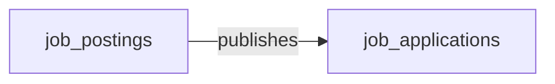

# Cluster E brief — Content / Asset Management

**Domains in scope (4):** ECM, HCMS, EAM, DAM

**Your job:** for EACH of the 4 domains, author one markdown section following the OUTPUT TEMPLATE below. Write the full set to `.tmp_deploy/cluster_E_draft.md`. Do NOT call semantius or any database tool — drafts only. The draft will be reviewed by the user before any load happens.

---

## Domain details

### ECM — Enterprise Content Management

**Description:** Document repositories, records management, workflow, and information governance for internal unstructured content. Distinct from DXP (external/customer-facing). Vendors: OpenText, Hyland (OnBase, Alfresco, Nuxeo), M-Files, Box, IBM FileNet, Microsoft SharePoint, DocuWare, Laserfiche, iManage.

**Business logic:** Full-text search and OCR; the rest is repositories, taxonomies, retention rules, and approval workflows.

**Data objects (5):**

| role | data_object_name | singular | plural |
|---|---|---|---|
| master | `content_documents` | Document | Documents |
| master | `document_classifications` | Document Classification | Document Classifications |
| master | `document_folders` | Document Folder | Document Folders |
| master | `document_versions` | Document Version | Document Versions |
| master | `records_retention_policies` | Records Retention Policy | Records Retention Policies |

### HCMS — Headless Content Management

**Description:** API-first content platforms and headless CMS for omnichannel content delivery, decoupled from presentation. Complements DXP suites for teams that want best-of-breed content infrastructure. Vendors: Contentful, Sanity, Storyblok, Strapi, Hygraph, Kontent.ai, Contentstack, Prismic, ButterCMS, Payload.

**Business logic:** CDN and rendering pipeline (delivery, caching, image processing) sit beneath the API — the application surface itself is content models and entries.

**Data objects (7):**

| role | data_object_name | singular | plural |
|---|---|---|---|
| master | `content_entries` | Content Entry | Content Entries |
| master | `content_environments` | Content Environment | Content Environments |
| master | `content_locales` | Content Locale | Content Locales |
| master | `content_releases` | Content Release | Content Releases |
| master | `content_types` | Content Type | Content Types |
| master | `editorial_workflows` | Editorial Workflow | Editorial Workflows |
| contributor | `digital_assets` | Digital Asset | Digital Assets |

### EAM — Enterprise Asset Management

**Description:** Maintenance, work order, and lifecycle management for physical plant, equipment, and infrastructure.

**Business logic:** Preventive-maintenance scheduling rules driven by meter readings, runtime hours, or condition data. Mostly declarative but benefits from a calculation engine for asset risk and maintenance intervals.

**Data objects (3):**

| role | data_object_name | singular | plural |
|---|---|---|---|
| master | `eam_work_orders` | EAM Work Order | EAM Work Orders |
| master | `equipment_pm_schedules` | Equipment PM Schedule | Equipment PM Schedules |
| master | `industrial_assets` | Industrial Asset | Industrial Assets |

### DAM — Digital Asset Management

**Description:** Centralised storage, taxonomy, rights management, and distribution of brand and creative assets (images, video, design files). Vendors: Bynder, Aprimo, Acquia DAM (Widen), Adobe Experience Manager Assets, Cloudinary, Frontify, Brandfolder (Smartsheet), Canto, MediaValet, Brandworkz.

**Business logic:** Image and video transforms (resize, format conversion, watermark) — irreducible but commodified by cloud media services.

**Data objects (1):**

| role | data_object_name | singular | plural |
|---|---|---|---|
| master | `digital_assets` | Digital Asset | Digital Assets |

---

## Cross-domain handoffs touching this cluster (41)

Convert each row to a cross-domain relationship edge (section 4 of each domain's draft) where there is a clean payload→target mapping. The payload's data_object is the **from** side; pick a natural recipient in the target_domain as the **to** side.

| source_domain | payload (data_object) | trigger_event | target_domain | integration_pattern | friction | description |
|---|---|---|---|---|---|---|
| LSD | `legal_holds` | `legal_hold.issued` | ECM | api_call | high | Legal hold freezes ECM retention policies on identified content and custodians. |
| LSD | `ediscovery_requests` | `ediscovery_request.created` | ECM | api_call | high | E-discovery requires ECM collection workflows for in-scope content. |
| LSD | `in_house_legal_matters` | `legal_matter.opened` | ECM | api_call | medium | New matter triggers ECM matter-workspace provisioning. |
| LSD | `in_house_legal_matters` | `in_house_legal_matter.opened` | ECM | api_call | low | Opening a matter provisions a privileged ECM workspace where pleadings, correspondence, and work-product are filed under legal hold. |
| LSD | `legal_advice_records` | `legal_advice_record.issued` | ECM | api_call | low | Issued advice memos are filed in the privileged ECM repository with appropriate legal-hold and access controls. |
| IDP | `extracted_records` | `extracted_record.completed` | ECM | api_call | low | Completed extracted record stored in ECM with metadata indexed for retrieval. |
| IDP | `document_classification_results` | `document_classification_result.uncertain` | ECM | manual_handoff | medium | Uncertain classification routed to records manager for human disposition. |
| MFG-OPS | `production_downtime_events` | `production_downtime_event.recorded` | EAM | event_stream | medium | Recorded downtime event auto-creates EAM maintenance work order for the affected asset. |
| MFG-OPS | `production_schedules` | `production_schedule.published` | EAM | event_stream | low | Published production schedule allows EAM to plan PM windows around production blocks. |
| EAM | `eam_work_orders` | `eam_work_order.created` | ITSM | event_stream | medium | Critical equipment failures escalated to IT incidents. |
| EAM | `equipment_pm_schedules` | `equipment_pm.due` | GRC | event_stream | low | Regulatory inspection schedules created from maintenance triggers. |
| EAM | `eam_work_orders` | `eam_work_order.completed` | MFG-OPS | event_stream | low | Maintenance completion updates production downtime records. |
| WSC | `chat_message_attachments` | `chat_attachment.shared` | ECM | event_stream | medium | WSC attachments in regulated channels are captured to ECM for retention and discoverability. |
| WSC | `chat_channels` | `chat_channel.archived` | ECM | batch_sync | medium | Archiving a WSC channel triggers a final ECM capture pass of messages and attachments for record-keeping. |
| ECM | `document_classifications` | `document.classified` | GRC | api_call | medium | Classified documents that match controlled categories (SOX, PCI, PHI) are linked as evidence to GRC controls. |
| ECM | `records_retention_policies` | `document.retention_expired` | AUDIT | event_stream | low | Retention-expiry events and disposition outcomes are streamed to AUDIT so destruction evidence is preserved. |
| ECM | `content_documents` | `legal_hold.placed` | LSD | api_call | low | Placing a document under legal hold creates / updates the hold record in LSD and freezes retention disposition. |
| ECM | `document_versions` | `document.version_published` | KMS | api_call | medium | Authoritative document versions are mirrored to KMS so knowledge articles always cite the latest approved source. |
| ECM | `document_folders` | `document_folder.permissions_changed` | IGA | api_call | medium | ECM ACL changes are reconciled into IGA so entitlement reviews remain accurate. |
| ECM | `content_documents` | `document.classified` | IGA | api_call | medium | Classification change can require IGA to realign entitlements (e.g., restricted documents must drop public-share groups). |
| ECM | `content_documents` | `content_document.uploaded` | DLP | event_stream | low | Newly captured documents are scanned by DLP for sensitive content; quarantine or classification suggestions are written back. |
| ECM | `document_classifications` | `document.classified` | DLP | event_stream | low | Classification label changes drive DLP policy recomputation (egress, sharing, retention enforcement). |
| DAM | `digital_assets` | `digital_asset.published` | HCMS | api_call | high | DAM publishes an approved asset; HCMS authors need the asset to appear in their picker for inclusion in content entries. Integration typically resolves asset URLs at content delive |
| HCMS | `editorial_workflows` | `editorial_workflow.review_required` | LSD | api_call | medium | An editorial step routed to legal review opens a legal-intake record so LSD can track turnaround and decisions. |
| HCMS | `content_entries` | `content_entry.published` | MA | manual_handoff | high | Marketing-Automation campaigns reference content snippets, hero copy, and CTAs that live in the CMS, but the link between a CMS entry and a campaign template is rarely event-driven |
| HCMS | `content_entries` | `content_entry.published` | B2C-COMM | api_call | medium | Storefront refreshes product copy, banner content, or marketing pages when CMS publishes. Common in composable-commerce stacks (commercetools + Contentful, Shopify + Sanity). Failu |
| HCMS | `content_releases` | `content_release.published` | B2C-COMM | event_stream | medium | Coordinated go-live of a content release and commerce changes (new collection launch, pricing campaign). The release event fans out to the storefront which invalidates caches and r |
| HCMS | `content_entries` | `content_entry.published` | DXP | api_call | medium | HCMS publishes a content entry; DXP must re-render the affected pages, invalidate its CDN cache, or trigger an ISR rebuild. Payload typically includes content_type, entry_id, local |
| HCMS | `content_releases` | `content_release.scheduled` | DXP | api_call | medium | Scheduled CMS release triggers a build pipeline ahead of go-live time so the rendered frontend is ready when the release publishes. SSG/ISR build kickoff via webhook. Failure modes |
| HCMS | `content_types` | `content_type.changed` | DXP | manual_handoff | high | Field renames, type changes, or removals on content_types break frontend renderers that are coupled to the schema. Typically handled through dev coordination (PR + deploy) rather t |
| HCMS | `content_releases` | `content_release.published` | DXP | api_call | low | Headless CMS publish webhook notifies DXP to invalidate caches and rebuild SSG/SSR routes for the affected entries. |
| HCMS | `content_entries` | `content_entry.scheduled` | DXP | api_call | low | HCMS schedules a future publish; DXP receives the embargo so it can pre-warm caches and stage the publish at the exact moment. |
| HCMS | `content_entries` | `content_entry.unpublished` | DXP | api_call | low | Unpublish in HCMS triggers DXP cache purge and removal of any rendered surfaces that referenced the entry. |
| HCMS | `content_entries` | `content_entry.created` | DAM | api_call | medium | Authoring a content entry resolves asset references from DAM; missing or unapproved assets block publish. |
| HCMS | `content_locales` | `content_locale.added` | WEB-CONTOPS | api_call | medium | Adding a locale expands WEB-CONTOPS audit and accessibility scan scope to the new locale's published surfaces. |
| WEB-CONTOPS | `brand_voice_violations` | `brand_violation.detected` | HCMS | api_call | medium | Brand/voice violations are routed back to the originating HCMS entry as an author task before re-publish. |
| WEB-CONTOPS | `broken_link_findings` | `broken_link.detected` | HCMS | api_call | low | Broken links found in published surfaces are written back as fix tasks on the source HCMS entry. |
| REAL-EST | `capital_projects` | `capital_project.completed` | EAM | api_call | medium | New assets installed; EAM records created at project closeout. |
| FLEET-MAINT | `vehicle_work_orders` | `vehicle_work_order.completed` | EAM | batch_sync | medium | Vehicle-maintenance cost and hours roll into EAM for organizations that report fleet-asset costs through an EAM platform (Maximo, Hexagon EAM). |
| LEGAL-PRACT-MGMT | `external_court_filings` | `court_filing.submitted` | ECM | api_call | medium | Court filings archived to ECM matter workspace for record retention. |
| AGENCY-MGMT | `creative_deliverables` | `deliverable.approved` | DAM | api_call | medium | Final-approved creative deliverable registers in DAM as the canonical brand asset with metadata (client, campaign, agency_job, usage rights, expiry). Surfaces in DAM search for fut |

---

## Cross-cluster reference (data_objects in OTHER clusters that handoffs reach into)

Use these names when authoring section 4 (cross-domain edges) of any domain in this cluster.

- **ITSM** (IT Service Management): `service_incidents`, `service_requests`, `service_problems`, `service_changes`, `knowledge_articles`, `service_catalog_items`, `service_slas`
- **WEB-CONTOPS** (Web Content Operations & Governance): `content_audits`, `web_content_inventory_records`, `accessibility_scan_findings`, `broken_link_findings`, `technical_seo_findings`, `brand_voice_violations`, `content_lifecycle_plans`
- **DLP** (Data Loss Prevention): `dlp_incidents`, `dlp_policies`, `data_exfiltration_attempts`, `dlp_quarantine_items`, `dlp_exceptions`, `dlp_user_activity_logs`
- **REAL-EST** (Real Estate and Workplace Management): `real_estate_properties`, `property_leases`, `floor_plans`, `property_spaces`, `occupancy_records`, `facility_work_orders`, `utility_meter_readings`, `capital_projects`
- **FLEET-MAINT** (Fleet Maintenance Management): `vehicle_work_orders`, `preventive_maintenance_schedules`, `vehicle_parts_inventory`, `maintenance_defects`
- **GRC** (Governance, Risk and Compliance): `compliance_risks`, `compliance_controls`, `control_assessments`, `compliance_policies`, `policy_attestations`, `compliance_obligations`, `compliance_evidence`, `audit_issues`, `remediation_plans`, `risk_assessments`
- **LEGAL-PRACT-MGMT** (Legal Practice Management): `legal_matters`, `trust_accounts`, `conflict_checks`, `engagement_letters`, `external_court_filings`, `client_invoices`
- **AGENCY-MGMT** (Agency Management Software): `agency_jobs`, `agency_time_entries`, `agency_retainers`, `media_plans`, `insertion_orders`, `creative_briefs`, `creative_deliverables`, `agency_estimates`
- **AUDIT** (Audit Management): `audit_plans`, `audit_engagements`, `audit_findings`, `work_papers`, `control_tests`, `audit_recommendations`, `audit_reports`, `follow_up_actions`
- **LSD** (Legal Service Delivery): `in_house_legal_matters`, `legal_intake_requests`, `legal_holds`, `ediscovery_requests`, `outside_counsel_engagements`, `legal_advice_records`, `regulatory_inquiries`, `legal_case_dockets`
- **KMS** (Knowledge Management): `knowledge_base_articles`, `knowledge_categories`, `article_revisions`, `article_feedback`, `knowledge_search_queries`, `knowledge_collections`
- **IGA** (Identity Governance and Administration): `employees`, `saas_app_assignments`, `iga_access_requests`, `iga_access_certifications`, `iga_entitlement_definitions`, `iga_sod_violations`, `iga_provisioning_events`
- **IDP** (Intelligent Document Processing): `capture_batches`, `idp_extraction_models`, `extracted_fields`, `extracted_records`, `idp_validation_results`, `document_classification_results`, `idp_extraction_templates`, `training_datasets`
- **MFG-OPS** (Manufacturing Connected Operations): `production_orders`, `work_instructions`, `production_schedules`, `produced_units`, `production_downtime_events`, `production_quality_inspections`, `shop_floor_cases`
- **MA** (Marketing Automation): `marketing_campaigns`, `marketing_emails`, `lead_scores`, `nurture_journeys`, `marketing_forms`
- **B2C-COMM** (Digital Commerce): `commerce_orders`, `order_lines`, `carts`, `commerce_products`, `commerce_storefronts`, `checkouts`, `payment_transactions`, `fulfillments`, `commerce_shipments`, `coupons`
- **WSC** (Workstream Collaboration): `chat_channels`, `chat_messages`, `chat_threads`, `chat_huddles`, `channel_members`, `external_guest_invitations`, `chat_message_attachments`, `channel_file_shares`
- **DXP** (Digital Experience Platform): `web_pages`, `content_components`, `digital_experiences`, `personalization_rules`, `ab_tests`, `segments_dxp`, `journey_steps`

---

## Platform built-in

Reference `users` (data_object_id=748, kind=platform_builtin) for any assignee / owner / approver / creator relationship. Always section 3.

---

## OUTPUT TEMPLATE — repeat once per domain (replace the example rows)

## Domain: <DOMAIN_CODE> — <Domain Name>

### 1. Mermaid graph (intra-domain only — visualize the entity-cluster shape)

### 2. Intra-domain relationships

| from | verb | to | cardinality | kind | required | owner_side | inverse_verb | notes |
|---|---|---|---|---|---|---|---|---|
| job_postings | publishes | job_applications | one_to_many | composition | true | source | is published from | each application belongs to one posting |

### 3. Users edges (platform_builtin)

| from | verb | to | cardinality | kind | required | owner_side | inverse_verb | notes |
|---|---|---|---|---|---|---|---|---|
| job_applications | assigned_to | users | many_to_one | reference | false | target | hiring manager for | recruiter ownership |

### 4. Cross-domain edges (clean payload→target only)

| from | verb | to | cardinality | kind | required | owner_side | inverse_verb | notes |
|---|---|---|---|---|---|---|---|---|
| job_offers | becomes | employees | one_to_one | reference | false | target | onboarded from | only when offer accepted |

### 5. Aliases (≥1 per non-self-explanatory master)

| data_object | alias_name | alias_type | is_preferred | notes |
|---|---|---|---|---|
| job_applications | application | synonym | false | common short form |
| job_applications | candidate submission | industry_term | false | HR vendor terminology |

---

## Schema reference

### data_object_relationships schema

| Column | Type / values | Notes |
|---|---|---|
| data_object_id | reference→data_objects | The **source / subject** side. Use the data_object_name (the loader will resolve to id). |
| related_data_object_id | reference→data_objects | The **target / object** side. |
| relationship_verb | text | Parent-voice verb. Conventions: `owns`, `manages`, `schedules`, `places`, `is_assigned_to`, `extends`, `groups`, `contains`, `triggers`, `approves`, `fulfills`, `closes`, `spawns`, `becomes`. Use snake_case. |
| inverse_verb | text | Reverse phrasing for navigation: `is owned by`, `reports to`, `is scheduled by`. Natural prose, no snake_case required. |
| relationship_type | enum | `one_to_one` / `one_to_many` / `many_to_many` |
| relationship_kind | enum | `composition` (parent owns child, cascade), `reference` (loose link, no cascade), `association` (peer-to-peer M:N), `inheritance` (subtype / IS-A) |
| owner_side | enum | `source` = the row identified by data_object_id cascades into the related object on delete; `target` = the related object owns the lifecycle. Drives delete-mode derivation downstream. |
| is_required | boolean | true if mandatory in typical implementations (every Order has a Customer); false if optional. |
| notes | text | Free-form. |

### data_object_aliases schema

| Column | Type / values | Notes |
|---|---|---|
| data_object_id | reference→data_objects | The aliased entity (by data_object_name). |
| alias_name | text | The alternative term. |
| alias_type | enum | `synonym` (general alt term), `industry_term` (specific to an industry — set industry_id), `solution_term` (specific to a vendor product — set solution_id). For Step 5 only `synonym` and `industry_term` are expected; `industry_term` rows without an industry_id will be skipped by the loader. |
| is_preferred | boolean | True if this alias is more common than the canonical name in its context. Usually false. |

### Guardrails

1. **Use data_object_name (snake_case) everywhere in tables**, not labels. Loader resolves names → ids.
2. **Only reference data_objects that exist** in your cluster's domain list OR `users` (the only platform_builtin) OR data_objects that belong to other domains shown in the **cross-cluster reference list** below. Do not invent new entity names.
3. **Intra-domain edges**: every edge's both ends are data_objects belonging to a single domain in this cluster (could be the same domain). Aim for completeness — every master/embedded_master should have at least one edge unless it is a true root entity.
4. **Users edges**: cover assignee / owner / created_by / approver style relationships. Every entity that has any user-shaped role gets a users edge. Use distinct verbs (`is_owned_by`, `is_assigned_to`, `is_created_by`, `is_approved_by`).
5. **Cross-domain edges**: ONLY include where there is a clean, deterministic payload→target mapping (e.g. `candidates → becomes → employees` when a hire happens, `job_offers → spawns → onboarding_journeys`). Do NOT speculate. The cross_domain_handoffs in your brief are an existing source of truth; convert each row to a relationship edge where the payload (data_object_id) is the **from** side and the target_domain has a master data_object that is the natural recipient.
6. **Aliases**: focus on non-self-explanatory masters. A master named `hcm_employees` doesn't need an alias for "employee" because the singular is obvious. But `itsm_incidents` could alias to "ticket"; `crm_opportunities` to "deal"; `cmdb_configuration_items` to "CI". 1-3 aliases per master that benefits, none for those that don't.
7. **Avoid duplicate edges**: do not author both A→B and B→A; pick the natural source side (the side that *owns the action* in the verb). E.g. for "publishes" the publisher is source; for "is_assigned_to" the assignee-holder is source.
8. **Use `composition` sparingly**: only when delete-cascade is the obvious correct behavior (an order_line cannot exist without its order). Most edges are `reference`.
9. **`owner_side='source'`** is the right answer when the source row's lifecycle drives the related row (composition pattern). **`owner_side='target'`** is correct for "reference upward" relationships (a job_application references a job_posting; the posting is the lifecycle owner).
10. **Output is markdown only.** Do NOT call semantius or PostgREST. Write the draft to the path your prompt specifies.
