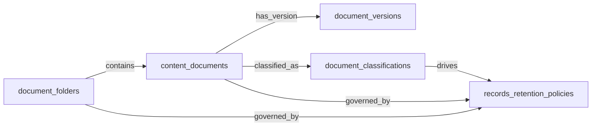
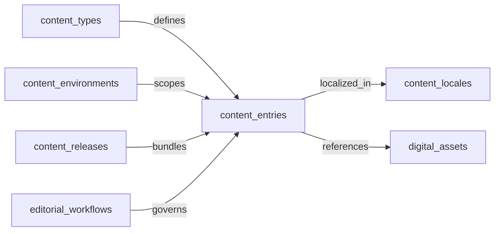
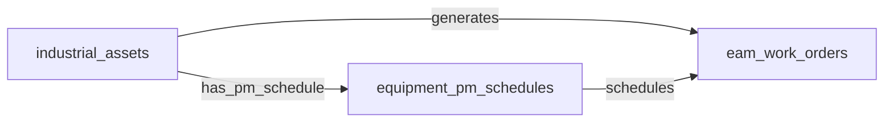
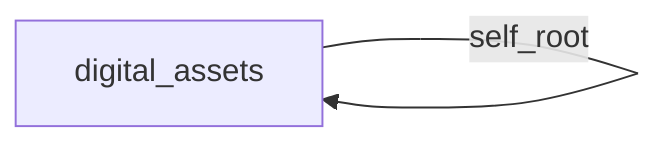

# Cluster E draft — Content / Asset Management

## Domain: ECM — Enterprise Content Management

### 1. Mermaid graph (intra-domain only — visualize the entity-cluster shape)

### 2. Intra-domain relationships

| from | verb | to | cardinality | kind | required | owner_side | inverse_verb | notes |
|---|---|---|---|---|---|---|---|---|
| document_folders | contains | content_documents | one_to_many | composition | false | source | is filed in | folder hierarchy owns documents; deleting a folder cascades to its documents (subject to retention) |
| content_documents | has_version | document_versions | one_to_many | composition | true | source | is version of | every document has at least one version; versions are owned by the document |
| content_documents | classified_as | document_classifications | many_to_one | reference | false | target | classifies | documents reference a classification taxonomy entry; taxonomy lives independently |
| content_documents | governed_by | records_retention_policies | many_to_one | reference | false | target | retains | retention policy applied at document level (overrides folder default) |
| document_folders | governed_by | records_retention_policies | many_to_one | reference | false | target | retains | default retention policy applied at the folder level |
| document_classifications | drives | records_retention_policies | many_to_one | reference | false | target | applies to classification | classification labels (e.g. PII, SOX) determine which retention policy applies by default |

### 3. Users edges (platform_builtin)

| from | verb | to | cardinality | kind | required | owner_side | inverse_verb | notes |
|---|---|---|---|---|---|---|---|---|
| content_documents | is_created_by | users | many_to_one | reference | true | target | authored | document author / uploader |
| content_documents | is_owned_by | users | many_to_one | reference | false | target | owns | records custodian / business owner |
| document_folders | is_owned_by | users | many_to_one | reference | false | target | owns | folder owner / steward |
| document_versions | is_created_by | users | many_to_one | reference | true | target | revised | who saved this version |
| document_classifications | is_owned_by | users | many_to_one | reference | false | target | stewards | taxonomy steward |
| records_retention_policies | is_owned_by | users | many_to_one | reference | false | target | maintains | records manager who owns the policy |

### 4. Cross-domain edges (clean payload→target only)

| from | verb | to | cardinality | kind | required | owner_side | inverse_verb | notes |
|---|---|---|---|---|---|---|---|---|
| legal_holds | freezes | content_documents | one_to_many | reference | false | source | is frozen by | LSD legal hold freezes retention on identified ECM content |
| ediscovery_requests | collects_from | content_documents | one_to_many | reference | false | source | is collected for | e-discovery collection workflow scopes into ECM content |
| in_house_legal_matters | provisions | document_folders | one_to_many | reference | false | source | is matter workspace for | new matter creates a privileged matter-workspace folder |
| legal_advice_records | is_filed_in | content_documents | one_to_one | reference | false | target | files | issued advice memo stored as an ECM document under hold |
| extracted_records | is_stored_as | content_documents | one_to_one | reference | false | target | originates from extraction | completed IDP extraction lands in ECM with indexed metadata |
| document_classification_results | is_dispositioned_into | document_classifications | many_to_one | reference | false | target | dispositions | uncertain IDP classifications routed to records manager for human disposition into ECM taxonomy |
| chat_message_attachments | is_captured_to | content_documents | many_to_one | reference | false | source | captures | regulated-channel attachments captured to ECM for retention |
| chat_channels | is_archived_to | document_folders | many_to_one | reference | false | source | archives | archived WSC channels trigger a final ECM capture pass into a record folder |
| document_classifications | is_evidence_for | compliance_controls | many_to_many | reference | false | source | evidenced by | classified docs matching SOX/PCI/PHI linked as evidence to GRC controls |
| records_retention_policies | streams_disposition_to | audit_engagements | one_to_many | reference | false | source | receives disposition events | retention-expiry and destruction events streamed to AUDIT |
| content_documents | triggers | legal_holds | one_to_many | reference | false | source | freezes | placing a document under hold creates/updates LSD legal hold record |
| document_versions | mirrors_to | knowledge_base_articles | one_to_many | reference | false | source | cites | authoritative versions mirrored to KMS so articles cite the latest source |
| document_folders | reconciles_to | iga_entitlement_definitions | one_to_many | reference | false | source | reflects | ECM ACL changes reconciled into IGA for entitlement reviews |
| content_documents | realigns | iga_access_requests | one_to_many | reference | false | source | realigns from | classification changes can require IGA to drop public-share groups |
| content_documents | is_scanned_by | dlp_policies | many_to_many | reference | false | target | scans | newly captured documents scanned by DLP; quarantine/classification suggestions written back |
| document_classifications | recomputes | dlp_policies | one_to_many | reference | false | source | is recomputed from | classification label changes drive DLP policy recomputation |
| external_court_filings | is_archived_to | content_documents | many_to_one | reference | false | source | archives | court filings archived to ECM matter workspace |

### 5. Aliases (≥1 per non-self-explanatory master)

| data_object | alias_name | alias_type | is_preferred | notes |
|---|---|---|---|---|
| content_documents | document | synonym | false | common short form |
| content_documents | file | synonym | false | colloquial term used in ECM UIs |
| content_documents | record | industry_term | false | records management terminology |
| document_classifications | classification label | synonym | false | how end users refer to it |
| document_classifications | sensitivity label | industry_term | false | M365/Purview terminology |
| document_folders | folder | synonym | false | obvious short form |
| document_folders | library | industry_term | false | SharePoint terminology |
| document_versions | revision | synonym | false | common alternative |
| document_versions | version history entry | synonym | false | descriptive long form |
| records_retention_policies | retention policy | synonym | false | common short form |
| records_retention_policies | records schedule | industry_term | false | records management terminology |

---

## Domain: HCMS — Headless Content Management

### 1. Mermaid graph (intra-domain only — visualize the entity-cluster shape)

### 2. Intra-domain relationships

| from | verb | to | cardinality | kind | required | owner_side | inverse_verb | notes |
|---|---|---|---|---|---|---|---|---|
| content_types | defines | content_entries | one_to_many | reference | true | target | conforms to | each entry conforms to a content type schema; type lifecycle is independent |
| content_environments | scopes | content_entries | one_to_many | reference | true | target | belongs to environment | every entry lives in an environment (e.g. master/staging) |
| content_entries | localized_in | content_locales | many_to_many | association | false | source | localizes | entries have per-locale variants |
| content_releases | bundles | content_entries | many_to_many | association | false | source | is bundled in | a release groups entries for coordinated publish |
| editorial_workflows | governs | content_entries | one_to_many | reference | false | target | follows | editorial workflow state machine applied to entries |
| content_entries | references | digital_assets | many_to_many | reference | false | source | is referenced by | entries embed/reference DAM-sourced assets |
| content_environments | scopes | content_types | one_to_many | reference | false | target | is available in | content type definitions are versioned per environment |

### 3. Users edges (platform_builtin)

| from | verb | to | cardinality | kind | required | owner_side | inverse_verb | notes |
|---|---|---|---|---|---|---|---|---|
| content_entries | is_created_by | users | many_to_one | reference | true | target | authored | author of the entry |
| content_entries | is_assigned_to | users | many_to_one | reference | false | target | edits | current editorial assignee |
| content_releases | is_owned_by | users | many_to_one | reference | false | target | manages release | release manager |
| content_types | is_owned_by | users | many_to_one | reference | false | target | maintains schema | content modeler / schema owner |
| editorial_workflows | is_owned_by | users | many_to_one | reference | false | target | maintains workflow | workflow owner |
| content_environments | is_owned_by | users | many_to_one | reference | false | target | administers | environment admin |
| content_locales | is_owned_by | users | many_to_one | reference | false | target | curates locale | locale lead / translation coordinator |

### 4. Cross-domain edges (clean payload→target only)

| from | verb | to | cardinality | kind | required | owner_side | inverse_verb | notes |
|---|---|---|---|---|---|---|---|---|
| editorial_workflows | opens | legal_intake_requests | one_to_many | reference | false | source | is opened from | editorial step routed to legal review opens an LSD intake record |
| content_entries | feeds | marketing_campaigns | many_to_many | reference | false | source | sources copy from | MA campaigns reference CMS snippets/hero copy/CTAs (mostly manual handoff) |
| content_entries | refreshes | commerce_storefronts | many_to_many | reference | false | source | is refreshed by | storefront refreshes product copy / banner / marketing pages on publish |
| content_releases | coordinates | commerce_storefronts | many_to_many | reference | false | source | coordinates with | content release go-live fans out to storefront for cache invalidation |
| content_entries | re_renders | web_pages | one_to_many | reference | false | source | is re-rendered from | DXP re-renders affected pages and invalidates CDN cache on publish |
| content_releases | triggers_build_of | web_pages | one_to_many | reference | false | source | builds from | scheduled CMS release triggers DXP build pipeline ahead of go-live |
| content_types | breaks | digital_experiences | one_to_many | reference | false | source | is coupled to | content type schema changes break DXP renderers coupled to the schema |
| content_releases | invalidates_cache_of | web_pages | one_to_many | reference | false | source | refreshes from | publish webhook notifies DXP to invalidate caches and rebuild routes |
| content_entries | embargoes | web_pages | one_to_many | reference | false | source | pre-warms from | scheduled HCMS publish gives DXP an embargo to pre-warm caches |
| content_entries | purges | web_pages | one_to_many | reference | false | source | purges from | unpublish in HCMS triggers DXP cache purge and removal of rendered surfaces |
| content_entries | resolves_assets_from | digital_assets | many_to_many | reference | false | source | is resolved by | authoring an entry resolves asset references from DAM; missing assets block publish |
| content_locales | expands_scope_of | content_audits | one_to_many | reference | false | source | scopes from | adding a locale expands WEB-CONTOPS audit & accessibility scan scope |
| brand_voice_violations | is_routed_to | content_entries | many_to_one | reference | false | source | receives | brand/voice violations sent back to originating HCMS entry as author tasks |
| broken_link_findings | is_routed_to | content_entries | many_to_one | reference | false | source | receives | broken link findings written back as fix tasks on the source entry |
| digital_assets | publishes_to | content_entries | many_to_many | reference | false | source | sources assets from | DAM publish makes asset available in HCMS author picker |

### 5. Aliases (≥1 per non-self-explanatory master)

| data_object | alias_name | alias_type | is_preferred | notes |
|---|---|---|---|---|
| content_entries | entry | synonym | false | obvious short form |
| content_entries | content item | synonym | false | common alternative |
| content_types | content model | industry_term | false | Contentful / Sanity terminology |
| content_types | schema | synonym | false | developer shorthand |
| content_environments | environment | synonym | false | obvious short form |
| content_environments | space | industry_term | false | Contentful terminology |
| content_locales | locale | synonym | false | obvious short form |
| content_locales | language variant | synonym | false | descriptive form |
| content_releases | release | synonym | false | obvious short form |
| content_releases | content launch | synonym | false | marketing-friendly term |
| editorial_workflows | workflow | synonym | false | short form |
| editorial_workflows | review pipeline | synonym | false | descriptive alternative |

---

## Domain: EAM — Enterprise Asset Management

### 1. Mermaid graph (intra-domain only — visualize the entity-cluster shape)

### 2. Intra-domain relationships

| from | verb | to | cardinality | kind | required | owner_side | inverse_verb | notes |
|---|---|---|---|---|---|---|---|---|
| industrial_assets | has_pm_schedule | equipment_pm_schedules | one_to_many | composition | false | source | maintains | PM schedule belongs to an asset; deleting the asset removes its schedule |
| industrial_assets | generates | eam_work_orders | one_to_many | reference | false | source | is performed on | work orders target a specific asset |
| equipment_pm_schedules | schedules | eam_work_orders | one_to_many | reference | false | source | originates from PM | preventive-maintenance schedule spawns work orders when due |

### 3. Users edges (platform_builtin)

| from | verb | to | cardinality | kind | required | owner_side | inverse_verb | notes |
|---|---|---|---|---|---|---|---|---|
| eam_work_orders | is_assigned_to | users | many_to_one | reference | false | target | performs | technician assigned to the work order |
| eam_work_orders | is_created_by | users | many_to_one | reference | true | target | raised | planner / requester who created the WO |
| industrial_assets | is_owned_by | users | many_to_one | reference | false | target | owns asset | asset custodian / responsible engineer |
| equipment_pm_schedules | is_owned_by | users | many_to_one | reference | false | target | maintains schedule | maintenance planner |

### 4. Cross-domain edges (clean payload→target only)

| from | verb | to | cardinality | kind | required | owner_side | inverse_verb | notes |
|---|---|---|---|---|---|---|---|---|
| production_downtime_events | spawns | eam_work_orders | one_to_many | reference | false | source | remediates | recorded downtime auto-creates an EAM work order for the affected asset |
| production_schedules | constrains | equipment_pm_schedules | many_to_many | reference | false | source | plans around | published production schedule allows EAM to plan PM windows around production blocks |
| eam_work_orders | escalates_to | service_incidents | one_to_many | reference | false | source | escalates from | critical equipment failures escalated to ITSM incidents |
| equipment_pm_schedules | triggers | compliance_obligations | one_to_many | reference | false | source | originates from PM | regulatory inspection schedules created from maintenance triggers |
| eam_work_orders | closes | production_downtime_events | one_to_many | reference | false | source | is closed by | maintenance completion updates production downtime records |
| capital_projects | commissions | industrial_assets | one_to_many | reference | false | source | is commissioned by | new assets installed at project closeout become EAM records |
| vehicle_work_orders | rolls_up_to | eam_work_orders | many_to_one | reference | false | source | aggregates | fleet work-order cost/hours roll into EAM for orgs reporting fleet through EAM |

### 5. Aliases (≥1 per non-self-explanatory master)

| data_object | alias_name | alias_type | is_preferred | notes |
|---|---|---|---|---|
| eam_work_orders | work order | synonym | false | common short form |
| eam_work_orders | maintenance ticket | synonym | false | colloquial alternative |
| eam_work_orders | WO | industry_term | false | maintenance industry acronym |
| equipment_pm_schedules | PM schedule | industry_term | false | maintenance acronym (preventive maintenance) |
| equipment_pm_schedules | maintenance plan | synonym | false | common alternative |
| industrial_assets | asset | synonym | false | obvious short form |
| industrial_assets | equipment | synonym | false | common alternative |
| industrial_assets | plant asset | industry_term | false | manufacturing terminology |

---

## Domain: DAM — Digital Asset Management

### 1. Mermaid graph (intra-domain only — visualize the entity-cluster shape)

### 2. Intra-domain relationships

| from | verb | to | cardinality | kind | required | owner_side | inverse_verb | notes |
|---|---|---|---|---|---|---|---|---|
| _ | _ | _ | _ | _ | _ | _ | _ | (none — DAM has a single master entity `digital_assets` as a true root; no intra-domain edges) |

### 3. Users edges (platform_builtin)

| from | verb | to | cardinality | kind | required | owner_side | inverse_verb | notes |
|---|---|---|---|---|---|---|---|---|
| digital_assets | is_created_by | users | many_to_one | reference | true | target | uploaded | uploader / creator of the asset |
| digital_assets | is_owned_by | users | many_to_one | reference | false | target | owns | brand owner / asset steward |
| digital_assets | is_approved_by | users | many_to_one | reference | false | target | approves | brand approver who signed off on the asset |

### 4. Cross-domain edges (clean payload→target only)

| from | verb | to | cardinality | kind | required | owner_side | inverse_verb | notes |
|---|---|---|---|---|---|---|---|---|
| creative_deliverables | registers_as | digital_assets | one_to_one | reference | false | source | originates from | approved agency deliverable registers in DAM as the canonical brand asset with rights / expiry metadata |

### 5. Aliases (≥1 per non-self-explanatory master)

| data_object | alias_name | alias_type | is_preferred | notes |
|---|---|---|---|---|
| digital_assets | asset | synonym | false | common short form |
| digital_assets | creative asset | industry_term | false | agency / brand terminology |
| digital_assets | brand asset | industry_term | false | DAM vendor terminology |
