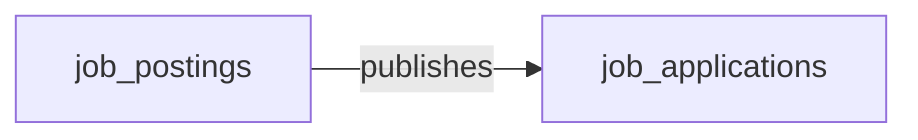

# Cluster F brief — Specialized / Industry

**Domains in scope (5):** CLIN-DEV, PS-LIC, RET-STORE, EXPENSE, WORK-MGMT

**Your job:** for EACH of the 5 domains, author one markdown section following the OUTPUT TEMPLATE below. Write the full set to `.tmp_deploy/cluster_F_draft.md`. Do NOT call semantius or any database tool — drafts only. The draft will be reviewed by the user before any load happens.

---

## Domain details

### CLIN-DEV — Clinical Device Management

**Description:** Medical-device inventory, preventive maintenance, recalls, and clinical engineering workflows.

**Business logic:** Preventive-maintenance schedules and recall propagation for medical devices — mostly declarative rules over inventory.

**Data objects (7):**

| role | data_object_name | singular | plural |
|---|---|---|---|
| master | `clinical_engineering_work_orders` | Clinical Engineering Work Order | Clinical Engineering Work Orders |
| master | `device_calibration_records` | Device Calibration Record | Device Calibration Records |
| master | `device_incident_reports` | Device Incident Report | Device Incident Reports |
| master | `device_maintenance_logs` | Device Maintenance Log | Device Maintenance Logs |
| master | `device_recalls` | Device Recall | Device Recalls |
| master | `medical_devices` | Medical Device | Medical Devices |
| master | `sterilization_cycles` | Sterilization Cycle | Sterilization Cycles |

### PS-LIC — Public-Sector Licensing and Permitting

**Description:** Application, review, issuance, inspection, and renewal of licenses and permits for governments.

**Data objects (6):**

| role | data_object_name | singular | plural |
|---|---|---|---|
| master | `code_violations` | Code Violation / Citation | Code Violation / Citations |
| master | `license_records` | Issued License Record | Issued License Records |
| master | `license_renewals` | License Renewal | License Renewals |
| master | `permit_applications` | Permit Application | Permit Applications |
| master | `permit_inspections` | Permit Inspection | Permit Inspections |
| master | `regulatory_fees` | Regulatory Fee | Regulatory Fees |

### RET-STORE — Retail Store Operations

**Description:** Task management, labour scheduling, and store-associate workflows for retail.

**Data objects (6):**

| role | data_object_name | singular | plural |
|---|---|---|---|
| master | `mystery_shopper_records` | Mystery Shopper Record | Mystery Shopper Records |
| master | `planogram_compliance_records` | Planogram Compliance Record | Planogram Compliance Records |
| master | `retail_labour_schedules` | Retail Labour Schedule | Retail Labour Schedules |
| master | `store_associate_checklists` | Store Associate Checklist | Store Associate Checklists |
| master | `store_audits` | Store Audit | Store Audits |
| master | `store_tasks` | Store Task | Store Tasks |

### EXPENSE — Expense Management

**Description:** Receipt capture, expense entry, policy enforcement, corporate card reconciliation, travel-booking integration, and reimbursement.

**Business logic:** Policy engine (per-diem caps, currency, category limits) and OCR for receipt extraction — both increasingly declarative or ML-based.

**Data objects (8):**

| role | data_object_name | singular | plural |
|---|---|---|---|
| master | `card_transactions` | Card Transaction | Card Transactions |
| master | `corporate_cards` | Corporate Card | Corporate Cards |
| master | `expense_lines` | Expense Line | Expense Lines |
| master | `expense_policies` | Expense Policy | Expense Policies |
| master | `expense_reports` | Expense Report | Expense Reports |
| master | `travel_bookings` | Travel Booking | Travel Bookings |
| consumer | `saas_subscriptions` | SaaS Subscription | SaaS Subscriptions |
| consumer | `supplier_invoices` | Invoice | Invoices |

### WORK-MGMT — Work Management

**Description:** Task, project, and workflow management for cross-functional work — assignments with owners and due dates, dependencies, statuses, dashboards, automations, and goal/OKR tracking. Bought by PMOs, BizOps, marketing, and any team running structured work that isn't engineering-specific. Distinct from SPM (top-down portfolio investment decision, CIO/EPMO buyer), from PSA (services billing/utilization for revenue-generating projects), and from Jira Software (engineering team sprints + dev workflow). Vendors: Monday.com, Asana, Smartsheet, ClickUp, Wrike, Trello, Basecamp, Teamwork, Hive.

**Business logic:** Cross-project resource leveling and capacity calculations; critical-path and dependency scheduling on linked tasks; OKR-to-task progress rollup with weighted contribution; recurring-task generation rules; AI features for task summarization, status drafting, and risk flagging (Asana Intelligence, Monday AI, ClickUp Brain).

**Data objects (4):**

| role | data_object_name | singular | plural |
|---|---|---|---|
| master | `okr_objectives` | Objective / OKR | Objective / OKRs |
| master | `work_automations` | Work Automation | Work Automations |
| master | `work_items` | Work Item | Work Items |
| master | `work_projects` | Work Project | Work Projects |

---

## Cross-domain handoffs touching this cluster (58)

Convert each row to a cross-domain relationship edge (section 4 of each domain's draft) where there is a clean payload→target mapping. The payload's data_object is the **from** side; pick a natural recipient in the target_domain as the **to** side.

| source_domain | payload (data_object) | trigger_event | target_domain | integration_pattern | friction | description |
|---|---|---|---|---|---|---|
| TEST-MGMT | `test_defects` | `test_defect.created` | WORK-MGMT | event_stream | low | New defects materialize as work items on the engineering team's board for triage and fix. |
| SPM | `okr_objectives` | `okr_objective.created` | WORK-MGMT | manual_handoff | high | Executive-level OKRs created in SPM (or in a slide deck, or an HCM perf system) need to cascade into team-level OKRs in the work-management tool. Almost universally manual: someone |
| SPM | `strategic_initiatives` | `demand_intake.approved` | WORK-MGMT | api_call | high | SPM creates work_projects + kickoff work_items for charter and resourcing. |
| SPM | `strategic_portfolios` | `strategic_portfolio.rebalanced` | WORK-MGMT | batch_sync | high | Re-prioritisation cascades to project priority updates; high-touch validation. |
| SPM | `business_value_assessments` | `business_value_assessment.completed` | WORK-MGMT | event_stream | medium | Approved initiatives cascade into team-level work items in WORK-MGMT. |
| IPAAS | `webhook_subscriptions` | `webhook_subscription.delivery_failed` | WORK-MGMT | api_call | medium | Webhook delivery failures create tasks for integration owners to investigate. |
| PROC-MIN | `business_rules_extracted` | `business_rule_extracted.identified` | WORK-MGMT | manual_handoff | medium | Extracted business rule routed for analyst validation and possible codification. |
| PS-LIC | `code_violations` | `code_violation.issued` | GRC | api_call | medium | Issued code violations feed GRC enforcement and risk-register reporting. |
| PS-LIC | `permit_inspections` | `permit_inspection.failed` | GRC | api_call | medium | Failed inspections feed GRC compliance tracking. |
| PS-LIC | `permit_inspections` | `permit_inspection.failed` | CSM | api_call | medium | Failed inspection triggers CSM constituent outreach and reinspection scheduling. |
| PS-LIC | `license_renewals` | `license_renewal.due` | CSM | batch_sync | low | Renewal-window openings trigger CSM customer-communication campaigns. |
| PS-LIC | `regulatory_fees` | `regulatory_fee.assessed` | ERP-FIN | batch_sync | medium | Regulatory-fee assessments post to AR in ERP-FIN. |
| PS-LIC | `license_records` | `license.issued` | ERP-FIN | batch_sync | low | License issuance triggers fee revenue posting in ERP-FIN. |
| RET-STORE | `store_audits` | `store_audit.failed` | HCM | api_call | medium | A failed store audit triggers HCM coaching/performance review for store leadership. |
| RET-STORE | `retail_labour_schedules` | `retail_labour_schedule.published` | WFM | event_stream | low | Published store labour schedule is consumed by WFM to materialise shifts and time-off interactions. |
| RET-STORE | `store_associate_checklists` | `store_associate_checklist.overdue` | WFM | api_call | medium | Overdue checklist escalation feeds WFM shift-manager alerting and labour-coverage replanning. |
| RET-STORE | `store_tasks` | `store_task.completed` | WFM | event_stream | low | Completed store-task feeds WFM productivity tracking and labour-rate effectiveness analytics. |
| RET-STORE | `mystery_shopper_records` | `mystery_shopper_record.submitted` | CRM | api_call | medium | Mystery shopper findings feed CRM/CSM coaching cases for customer-facing associates. |
| CLIN-DEV | `clinical_engineering_work_orders` | `clinical_engineering_work_order.opened` | ITSM | api_call | medium | Clinical engineering work order surfaces in ITSM when shared with IT for connected-device support. |
| CLIN-DEV | `device_calibration_records` | `device_calibration.due` | ITSM | batch_sync | low | Calibration scheduling visible to ITSM when biomed device is shared infrastructure. |
| CLIN-DEV | `device_recalls` | `device_recall.issued` | GRC | manual_handoff | high | Device recall triggers GRC regulatory-reporting and risk-register updates. |
| CLIN-DEV | `device_incident_reports` | `device_incident.reported` | GRC | manual_handoff | high | Device adverse-event incidents handed to GRC for FDA MDR / EU MDR regulatory reporting. |
| CLIN-DEV | `device_recalls` | `device_recall.issued` | HC-PATIENT | manual_handoff | high | Recall list cross-referenced against patient records to identify affected patients for outreach. |
| CLIN-DEV | `sterilization_cycles` | `sterilization_cycle.failed` | HC-PATIENT | manual_handoff | high | Failed sterilization cycle requires HC-PATIENT to evaluate impacted surgeries and patient exposures. |
| HCM | `employees` | `employee.terminated` | EXPENSE | event_stream | medium | Termination triggers EXPENSE corporate-card deactivation and outstanding-report close-out. |
| PAYROLL | `pay_slips` | `expense.reimbursable` | EXPENSE | api_call | low | Approved expense_reports flagged for payroll reimbursement (rather than card-cleared) feed into the next pay_run as a non-taxable earning_code. |
| EMP-EXP | `action_plans` | `action_plan.created` | WORK-MGMT | api_call | medium | Engagement action plans often tracked as work items in WORK-MGMT for execution visibility. |
| EXPENSE | `expense_lines` | `expense_line.policy_violation` | AUDIT | event_stream | medium | Policy violations are sampled by AUDIT for T&E expense testing. |
| EXPENSE | `expense_reports` | `expense_report.approved` | AP-AUTO | event_stream | low | Expense reimbursement via AP rather than payroll: the approved expense_report becomes a supplier_invoice paid in the next payment_run. |
| EXPENSE | `expense_lines` | `expense_line.approved` | AP-AUTO | event_stream | low | Approved reimbursable expenses enter the payables queue. |
| EXPENSE | `expense_lines` | `expense_line.approved` | PAYROLL | batch_sync | medium | Reimbursable expenses paid via payroll add to the next pay cycle. |
| EXPENSE | `expense_reports` | `expense_report.approved` | ERP-FIN | event_stream | low | Approved expense_reports post accrual journal_entries to ERP-FIN; reimbursement routed via AP or payroll based on policy. |
| EXPENSE | `expense_lines` | `expense_line.posted_to_gl` | ERP-FIN | batch_sync | low | Approved expenses post to the GL as liabilities or direct expenses. |
| EXPENSE | `expense_reports` | `expense.approved` | PSA | event_stream | medium | Project-tagged expense_reports flow to PSA for T&E billing rollup and project cost. Project-code errors and late corrections are recurring pain. |
| EXPENSE | `shadow_it_apps` | `card.saas_charge_detected` | SMP | event_stream | high | Corporate-card SaaS charge detected by the expense system surfaces a candidate shadow-IT app in SMP. High friction: finance sees the charge, IT/SMP sees (or doesn't see) the app —  |
| EXPENSE | `expense_policies` | `expense_policy.updated` | SPEND-MGMT | api_call | high | Policy changes authored in EXPENSE (per-category limits, prohibited MCCs, approver thresholds) must propagate to SPEND-MGMT real-time card-auth rules. Drift between submission-time |
| EXPENSE | `expense_lines` | `expense_line.policy_violation` | SPEND-MGMT | event_stream | medium | Policy violations feed into spend governance dashboards and exception reviews. |
| EXPENSE | `travel_bookings` | `travel_booking.out_of_policy` | SPEND-MGMT | event_stream | medium | Out-of-policy travel surfaces in spend governance for manager approval. |
| PSA | `project_assignments` | `project_assignment.confirmed` | WORK-MGMT | event_stream | low | PSA seeds the WORK-MGMT project board with the newly-assigned resource so day-to-day task tracking can begin. |
| PSA | `project_tasks` | `project_task.completed` | WORK-MGMT | event_stream | low | PSA task completion mirrors into the WORK-MGMT board to keep team-level views current. |
| CRM | `crm_opportunities` | `crm_opportunity.closed_won` | WORK-MGMT | api_call | high | Sales closes a deal in CRM; delivery / Customer Success spin up a kickoff project in their work-management tool (Asana / Monday / ClickUp). Custom Zapier/Make integrations or hand- |
| VSDP | `pull_requests` | `pull_request.merged` | WORK-MGMT | event_stream | low | PR merges transition the linked work item to a completed state in the team's WORK-MGMT board. |
| PROD-MGMT | `feature_requests` | `feature_request.upvoted_threshold` | WORK-MGMT | event_stream | medium | Once demand-signal crosses the prioritisation threshold, an engineering work item / epic is created in WORK-MGMT. Many teams still do this by hand. |
| PROD-MGMT | `product_releases` | `product_release.planned` | WORK-MGMT | event_stream | low | WORK-MGMT creates the delivery workstream / release train for the planned release, with the scope and target date hydrated from PROD-MGMT. |
| PROD-MGMT | `product_roadmaps` | `product_roadmap.item_promoted` | WORK-MGMT | event_stream | medium | Promoting a roadmap item to now/next must create the corresponding delivery work in WORK-MGMT; manual handoff here is one of the most-cited PROD↔ENG pain points. |
| SPEND-MGMT | `card_transactions` | `card_transaction.posted` | EXPENSE | api_call | high | When the corporate-card platform (Ramp/Brex/Pleo) is a different vendor from the expense-reimbursement system (Concur/Expensify), settled card transactions must propagate to create |
| SPEND-MGMT | `spend_policies` | `spend_policy.updated` | EXPENSE | api_call | low | EXPENSE refreshes policy rule engine when SPEND-MGMT publishes policy updates. |
| SPEND-MGMT | `card_authorizations` | `card_authorization.declined` | EXPENSE | event_stream | medium | Declined corporate-card auths surface to the cardholder via the expense app. |
| NCDB | `nocode_automations` | `nocode_automation.triggered` | WORK-MGMT | api_call | low | No-code automation creates a work item in the WORK-MGMT platform when its trigger fires. |
| WORK-MGMT | `work_items` | `work_item.status_changed` | ITSM | api_call | high | Cross-functional WORK-MGMT items intersect with IT support requests: a marketing project task ('IT-provision new SaaS') needs to be linked to a ServiceNow request, with status mirr |
| WORK-MGMT | `work_automations` | `work_automation.triggered` | ITSM | event_stream | low | Work-item automations linked to IT tickets propagate status changes to ITSM. |
| WORK-MGMT | `work_items` | `work_item.completed` | SPM | batch_sync | medium | Work-management platforms publish task-completion data to portfolio dashboards in SPM tools. The portfolio rollup powers strategy-to-execution dashboards and OKR progress (via okr_ |
| WORK-MGMT | `work_automations` | `work_automation.triggered` | SPM | batch_sync | medium | Aggregated work-automation outcomes feed SPM portfolio rollup. |
| WORK-MGMT | `work_projects` | `work_project.completed` | PSA | batch_sync | medium | Services orgs running delivery in WORK-MGMT (Wrike, Teamwork, Asana) close a project and need utilization, billable hours, and milestone-based revenue recognition to roll up into P |
| WORK-MGMT | `work_automations` | `work_automation.triggered` | PSA | event_stream | low | Automation-driven task transitions feed PSA for utilization and billable-hour tracking. |
| WORK-MGMT | `work_automations` | `work_automation.triggered` | WSC | api_call | low | Automations post status updates and task notifications into workstream collaboration channels. |
| WORK-MGMT | `work_automations` | `work_automation.triggered` | PROD-MGMT | event_stream | medium | Engineering team automations mirror into product-management roadmap tracking. |
| BPA | `process_simulation_runs` | `process_simulation_run.bottleneck_identified` | WORK-MGMT | event_stream | medium | Bottleneck findings spawn improvement tasks in WORK-MGMT. |

---

## Cross-cluster reference (data_objects in OTHER clusters that handoffs reach into)

Use these names when authoring section 4 (cross-domain edges) of any domain in this cluster.

- **ITSM** (IT Service Management): `service_incidents`, `service_requests`, `service_problems`, `service_changes`, `knowledge_articles`, `service_catalog_items`, `service_slas`
- **PROD-MGMT** (Product Management): `product_lines`, `product_features`, `product_releases`, `product_roadmaps`, `feature_requests`, `customer_feedback_items`, `product_metrics`, `beta_programs`
- **SPEND-MGMT** (Corporate Spend Management): `spend_requests`, `corporate_card_accounts`, `card_authorizations`, `vendor_payment_authorizations`, `spend_policies`
- **NCDB** (No-Code Database): `nocode_bases`, `nocode_record_definitions`, `nocode_forms`, `nocode_views`, `nocode_automations`
- **BPA** (Business Process Architecture): `business_process_models`, `business_capability_maps`, `value_streams`, `process_simulation_runs`
- **GRC** (Governance, Risk and Compliance): `compliance_risks`, `compliance_controls`, `control_assessments`, `compliance_policies`, `policy_attestations`, `compliance_obligations`, `compliance_evidence`, `audit_issues`, `remediation_plans`, `risk_assessments`
- **AUDIT** (Audit Management): `audit_plans`, `audit_engagements`, `audit_findings`, `work_papers`, `control_tests`, `audit_recommendations`, `audit_reports`, `follow_up_actions`
- **AP-AUTO** (Accounts Payable Automation): `invoice_matches`, `payment_runs`
- **CSM** (Customer Service Management): `customer_cases`, `customer_entitlements`, `csat_responses`, `customers`
- **IPAAS** (Integration Platform as a Service): `integration_recipes`, `integration_runs`, `integration_connectors`, `webhook_subscriptions`, `integration_triggers`, `integration_data_mappings`
- **PROC-MIN** (Process Mining): `event_logs`, `discovered_process_models`, `process_conformance_results`, `process_variants`, `process_bottleneck_findings`, `business_rules_extracted`
- **HC-PATIENT** (Healthcare Patient Operations): `patient_appointments`, `clinical_encounters`, `care_plans`, `patient_referrals`, `clinical_orders`, `clinical_notes`
- **HCM** (Human Capital Management): `employees`, `hcm_positions`, `job_profiles`, `org_units`, `employment_contracts`, `employment_events`
- **PAYROLL** (Payroll Management): `employees`, `pay_runs`, `pay_slips`, `earning_codes`, `deduction_codes`, `tax_authorities`, `tax_filings`, `garnishment_orders`, `payroll_journal_entries`, `hcm_positions`, `org_units`, `cost_centers`
- **WFM** (Workforce Management): `work_schedules`, `work_shifts`, `time_entries`, `absence_requests`, `absence_balances`, `time_off_policies`, `meal_break_records`, `job_profiles`, `org_units`, `employees`, `cost_centers`, `hcm_positions`
- **EMP-EXP** (Employee Experience and Engagement): `survey_campaigns`, `survey_responses`, `engagement_drivers`, `action_plans`, `pulse_questions`, `employees`, `org_units`
- **ERP-FIN** (Core ERP Financial Management): `journal_entries`, `general_ledger_accounts`, `cost_centers`, `legal_entities`, `accounting_periods`, `bank_accounts`, `cash_transactions`, `fixed_assets`, `asset_depreciation_schedules`, `intercompany_transactions`, `revenue_recognition_records`
- **PSA** (Professional Services Automation): `service_projects`, `project_tasks`, `project_assignments`, `project_billing_milestones`, `resource_skill_inventories`, `project_resource_allocations`
- **CRM** (Customer Relationship Management): `customers`, `crm_contacts`, `crm_leads`, `crm_opportunities`, `pipeline_stages`, `sales_activities`
- **WSC** (Workstream Collaboration): `chat_channels`, `chat_messages`, `chat_threads`, `chat_huddles`, `channel_members`, `external_guest_invitations`, `chat_message_attachments`, `channel_file_shares`
- **TEST-MGMT** (Test Management): `test_cases`, `test_suites`, `test_plans`, `test_runs`, `test_defects`, `test_environments`, `requirements_to_test_traceability`, `automation_scripts`
- **VSDP** (Value Stream Delivery Platform): `source_repositories`, `code_commits`, `pull_requests`, `ci_pipelines`, `ci_pipeline_runs`, `build_artifacts`, `software_deployments`, `value_stream_metrics`
- **SMP** (SaaS Management Platforms): `saas_applications`, `saas_subscriptions`, `saas_app_assignments`, `saas_usage_metrics`, `shadow_it_apps`
- **SPM** (Strategic Portfolio Management): `okr_objectives`, `strategic_portfolios`, `strategic_initiatives`, `roadmap_items`, `business_value_assessments`, `resource_allocations`, `demand_intake_requests`, `scenario_plans`, `dependency_chains`, `benefits_tracking_records`

---

## Platform built-in

Reference `users` (data_object_id=748, kind=platform_builtin) for any assignee / owner / approver / creator relationship. Always section 3.

---

## OUTPUT TEMPLATE — repeat once per domain (replace the example rows)

## Domain: <DOMAIN_CODE> — <Domain Name>

### 1. Mermaid graph (intra-domain only — visualize the entity-cluster shape)

### 2. Intra-domain relationships

| from | verb | to | cardinality | kind | required | owner_side | inverse_verb | notes |
|---|---|---|---|---|---|---|---|---|
| job_postings | publishes | job_applications | one_to_many | composition | true | source | is published from | each application belongs to one posting |

### 3. Users edges (platform_builtin)

| from | verb | to | cardinality | kind | required | owner_side | inverse_verb | notes |
|---|---|---|---|---|---|---|---|---|
| job_applications | assigned_to | users | many_to_one | reference | false | target | hiring manager for | recruiter ownership |

### 4. Cross-domain edges (clean payload→target only)

| from | verb | to | cardinality | kind | required | owner_side | inverse_verb | notes |
|---|---|---|---|---|---|---|---|---|
| job_offers | becomes | employees | one_to_one | reference | false | target | onboarded from | only when offer accepted |

### 5. Aliases (≥1 per non-self-explanatory master)

| data_object | alias_name | alias_type | is_preferred | notes |
|---|---|---|---|---|
| job_applications | application | synonym | false | common short form |
| job_applications | candidate submission | industry_term | false | HR vendor terminology |

---

## Schema reference

### data_object_relationships schema

| Column | Type / values | Notes |
|---|---|---|
| data_object_id | reference→data_objects | The **source / subject** side. Use the data_object_name (the loader will resolve to id). |
| related_data_object_id | reference→data_objects | The **target / object** side. |
| relationship_verb | text | Parent-voice verb. Conventions: `owns`, `manages`, `schedules`, `places`, `is_assigned_to`, `extends`, `groups`, `contains`, `triggers`, `approves`, `fulfills`, `closes`, `spawns`, `becomes`. Use snake_case. |
| inverse_verb | text | Reverse phrasing for navigation: `is owned by`, `reports to`, `is scheduled by`. Natural prose, no snake_case required. |
| relationship_type | enum | `one_to_one` / `one_to_many` / `many_to_many` |
| relationship_kind | enum | `composition` (parent owns child, cascade), `reference` (loose link, no cascade), `association` (peer-to-peer M:N), `inheritance` (subtype / IS-A) |
| owner_side | enum | `source` = the row identified by data_object_id cascades into the related object on delete; `target` = the related object owns the lifecycle. Drives delete-mode derivation downstream. |
| is_required | boolean | true if mandatory in typical implementations (every Order has a Customer); false if optional. |
| notes | text | Free-form. |

### data_object_aliases schema

| Column | Type / values | Notes |
|---|---|---|
| data_object_id | reference→data_objects | The aliased entity (by data_object_name). |
| alias_name | text | The alternative term. |
| alias_type | enum | `synonym` (general alt term), `industry_term` (specific to an industry — set industry_id), `solution_term` (specific to a vendor product — set solution_id). For Step 5 only `synonym` and `industry_term` are expected; `industry_term` rows without an industry_id will be skipped by the loader. |
| is_preferred | boolean | True if this alias is more common than the canonical name in its context. Usually false. |

### Guardrails

1. **Use data_object_name (snake_case) everywhere in tables**, not labels. Loader resolves names → ids.
2. **Only reference data_objects that exist** in your cluster's domain list OR `users` (the only platform_builtin) OR data_objects that belong to other domains shown in the **cross-cluster reference list** below. Do not invent new entity names.
3. **Intra-domain edges**: every edge's both ends are data_objects belonging to a single domain in this cluster (could be the same domain). Aim for completeness — every master/embedded_master should have at least one edge unless it is a true root entity.
4. **Users edges**: cover assignee / owner / created_by / approver style relationships. Every entity that has any user-shaped role gets a users edge. Use distinct verbs (`is_owned_by`, `is_assigned_to`, `is_created_by`, `is_approved_by`).
5. **Cross-domain edges**: ONLY include where there is a clean, deterministic payload→target mapping (e.g. `candidates → becomes → employees` when a hire happens, `job_offers → spawns → onboarding_journeys`). Do NOT speculate. The cross_domain_handoffs in your brief are an existing source of truth; convert each row to a relationship edge where the payload (data_object_id) is the **from** side and the target_domain has a master data_object that is the natural recipient.
6. **Aliases**: focus on non-self-explanatory masters. A master named `hcm_employees` doesn't need an alias for "employee" because the singular is obvious. But `itsm_incidents` could alias to "ticket"; `crm_opportunities` to "deal"; `cmdb_configuration_items` to "CI". 1-3 aliases per master that benefits, none for those that don't.
7. **Avoid duplicate edges**: do not author both A→B and B→A; pick the natural source side (the side that *owns the action* in the verb). E.g. for "publishes" the publisher is source; for "is_assigned_to" the assignee-holder is source.
8. **Use `composition` sparingly**: only when delete-cascade is the obvious correct behavior (an order_line cannot exist without its order). Most edges are `reference`.
9. **`owner_side='source'`** is the right answer when the source row's lifecycle drives the related row (composition pattern). **`owner_side='target'`** is correct for "reference upward" relationships (a job_application references a job_posting; the posting is the lifecycle owner).
10. **Output is markdown only.** Do NOT call semantius or PostgREST. Write the draft to the path your prompt specifies.
