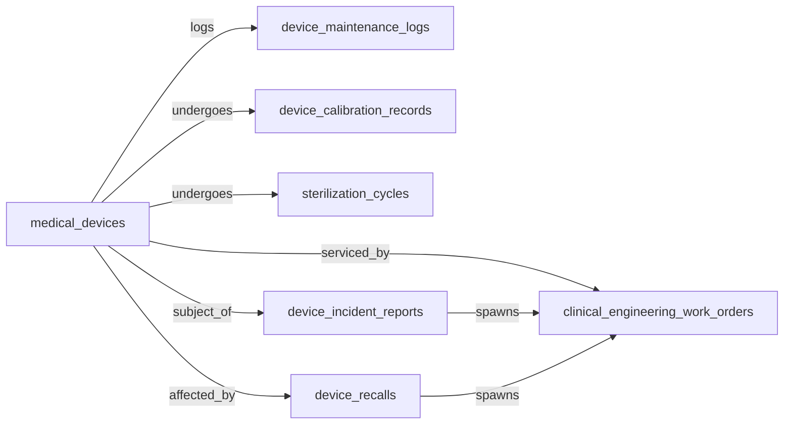
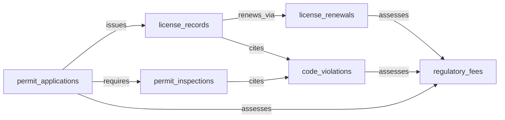
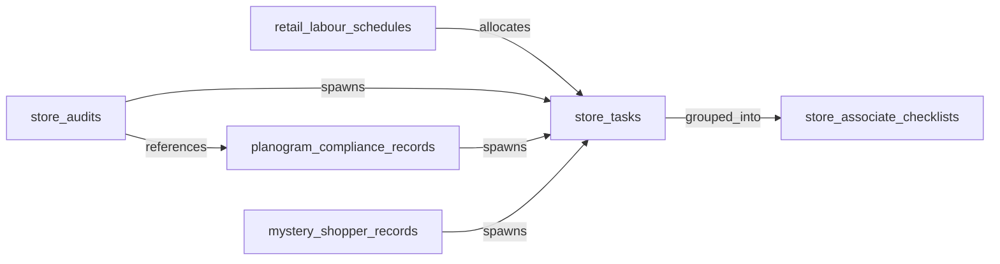
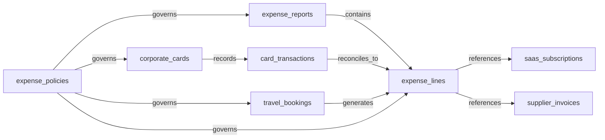
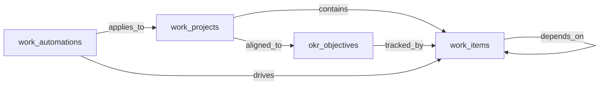

## Domain: CLIN-DEV — Clinical Device Management

### 1. Mermaid graph (intra-domain only — visualize the entity-cluster shape)

### 2. Intra-domain relationships

| from | verb | to | cardinality | kind | required | owner_side | inverse_verb | notes |
|---|---|---|---|---|---|---|---|---|
| medical_devices | logs | device_maintenance_logs | one_to_many | composition | true | source | is logged for | PM and corrective maintenance history per device |
| medical_devices | undergoes | device_calibration_records | one_to_many | composition | true | source | is calibration of | scheduled and ad-hoc calibration history per device |
| medical_devices | undergoes | sterilization_cycles | one_to_many | composition | false | source | is sterilization of | applies only to reprocessed devices/instruments |
| medical_devices | subject_of | device_incident_reports | one_to_many | reference | false | source | reports incident on | adverse event traceable to a specific device |
| medical_devices | affected_by | device_recalls | many_to_many | association | false | target | recalls | a recall lists many devices; a device may be hit by multiple recalls |
| medical_devices | serviced_by | clinical_engineering_work_orders | one_to_many | reference | false | source | services | biomed work orders raised against a device |
| device_incident_reports | spawns | clinical_engineering_work_orders | one_to_many | reference | false | source | investigates | adverse event triggers investigation/repair work order |
| device_recalls | spawns | clinical_engineering_work_orders | one_to_many | reference | false | source | remediates | recall triggers field-action work orders per affected device |

### 3. Users edges (platform_builtin)

| from | verb | to | cardinality | kind | required | owner_side | inverse_verb | notes |
|---|---|---|---|---|---|---|---|---|
| medical_devices | is_owned_by | users | many_to_one | reference | false | target | owns device | biomed asset owner / responsible engineer |
| device_maintenance_logs | is_performed_by | users | many_to_one | reference | true | target | performed maintenance | clinical engineer performing PM/CM |
| device_calibration_records | is_performed_by | users | many_to_one | reference | true | target | performed calibration | calibrating technician |
| sterilization_cycles | is_operated_by | users | many_to_one | reference | true | target | operated cycle | SPD/CSSD operator running the load |
| device_incident_reports | is_reported_by | users | many_to_one | reference | true | target | reported incident | clinician/staff who filed the incident |
| device_recalls | is_managed_by | users | many_to_one | reference | false | target | manages recall | biomed/regulatory lead for the recall |
| clinical_engineering_work_orders | is_assigned_to | users | many_to_one | reference | false | target | assigned work orders | biomed technician working the order |
| clinical_engineering_work_orders | is_created_by | users | many_to_one | reference | true | target | opened work orders | requester / dispatcher |

### 4. Cross-domain edges (clean payload→target only)

| from | verb | to | cardinality | kind | required | owner_side | inverse_verb | notes |
|---|---|---|---|---|---|---|---|---|
| clinical_engineering_work_orders | surfaces_in | service_requests | one_to_one | reference | false | source | mirrors biomed work order | shared with ITSM when device is connected/IT-managed |
| device_calibration_records | schedules_in | service_requests | one_to_many | reference | false | source | tracks calibration due | calibration due visible to ITSM for shared infrastructure |
| device_recalls | triggers | compliance_obligations | one_to_many | reference | false | source | regulatory reporting from | FDA MDR / EU MDR reporting obligation in GRC |
| device_incident_reports | triggers | compliance_obligations | one_to_many | reference | true | source | adverse-event reporting from | MDR-class incident reporting in GRC |
| device_recalls | affects | patient_appointments | many_to_many | reference | false | source | recall impacts | recall list cross-referenced against patients with implants/exposure |
| sterilization_cycles | impacts | clinical_encounters | many_to_many | reference | false | source | sterilization failure impacts | failed cycle requires evaluation of surgeries that used the load |

### 5. Aliases (≥1 per non-self-explanatory master)

| data_object | alias_name | alias_type | is_preferred | notes |
|---|---|---|---|---|
| medical_devices | biomedical equipment | industry_term | false | clinical-engineering terminology |
| medical_devices | biomed asset | synonym | false | common short form |
| clinical_engineering_work_orders | biomed work order | synonym | true | how technicians refer to them |
| clinical_engineering_work_orders | CE work order | synonym | false | CE = clinical engineering |
| device_maintenance_logs | PM log | synonym | false | preventive-maintenance log |
| device_calibration_records | calibration certificate | industry_term | false | metrology terminology |
| device_incident_reports | MDR report | industry_term | false | FDA Medical Device Report |
| device_incident_reports | adverse event report | synonym | false | EU MDR / vigilance terminology |
| device_recalls | field safety notice | industry_term | false | EU MDR FSN terminology |
| sterilization_cycles | autoclave cycle | synonym | false | common SPD term |
| sterilization_cycles | reprocessing cycle | industry_term | false | CSSD terminology |

---

## Domain: PS-LIC — Public-Sector Licensing and Permitting

### 1. Mermaid graph (intra-domain only — visualize the entity-cluster shape)

### 2. Intra-domain relationships

| from | verb | to | cardinality | kind | required | owner_side | inverse_verb | notes |
|---|---|---|---|---|---|---|---|---|
| permit_applications | issues | license_records | one_to_one | reference | false | source | is issued from | approved application produces a license/permit record |
| permit_applications | requires | permit_inspections | one_to_many | composition | false | source | inspects | site / plan-review inspections tied to an application |
| permit_applications | assesses | regulatory_fees | one_to_many | reference | true | source | charged against | application/permit fees |
| license_records | renews_via | license_renewals | one_to_many | composition | false | source | renews | each renewal cycle is a child of the issued license |
| license_renewals | assesses | regulatory_fees | one_to_many | reference | true | source | charged against | renewal fees |
| permit_inspections | cites | code_violations | one_to_many | reference | false | source | cited by | failed inspections produce citations |
| code_violations | assesses | regulatory_fees | one_to_many | reference | false | source | fines from | citation-related fines |
| license_records | cites | code_violations | one_to_many | reference | false | source | cited against | violations issued against an existing license holder |

### 3. Users edges (platform_builtin)

| from | verb | to | cardinality | kind | required | owner_side | inverse_verb | notes |
|---|---|---|---|---|---|---|---|---|
| permit_applications | is_assigned_to | users | many_to_one | reference | false | target | assigned applications | reviewing officer / case worker |
| permit_applications | is_submitted_by | users | many_to_one | reference | true | target | submitted applications | applicant of record (if portal user) |
| license_records | is_owned_by | users | many_to_one | reference | false | target | owns license | issuing department owner |
| license_renewals | is_processed_by | users | many_to_one | reference | false | target | processes renewals | renewal clerk |
| permit_inspections | is_assigned_to | users | many_to_one | reference | true | target | assigned inspections | field inspector |
| code_violations | is_issued_by | users | many_to_one | reference | true | target | issued violations | code-enforcement officer |
| regulatory_fees | is_assessed_by | users | many_to_one | reference | false | target | assessed fees | clerk / system actor |

### 4. Cross-domain edges (clean payload→target only)

| from | verb | to | cardinality | kind | required | owner_side | inverse_verb | notes |
|---|---|---|---|---|---|---|---|---|
| code_violations | feeds | compliance_risks | one_to_many | reference | false | source | tracked in GRC | enforcement and risk-register reporting |
| permit_inspections | feeds | compliance_obligations | one_to_many | reference | false | source | tracked in GRC | failed inspections drive compliance tracking |
| permit_inspections | triggers | customer_cases | one_to_many | reference | false | source | reinspection outreach from | failed inspection triggers CSM constituent outreach |
| license_renewals | triggers | customer_cases | one_to_many | reference | false | source | renewal campaign from | renewal-window campaigns in CSM |
| regulatory_fees | posts_to | journal_entries | one_to_many | reference | true | source | fee posting from | AR posting in ERP-FIN for fee assessment |
| license_records | posts_to | journal_entries | one_to_many | reference | true | source | revenue posting from | license issuance posts revenue in ERP-FIN |

### 5. Aliases (≥1 per non-self-explanatory master)

| data_object | alias_name | alias_type | is_preferred | notes |
|---|---|---|---|---|
| permit_applications | permit request | synonym | false | citizen-facing term |
| permit_applications | application for permit | synonym | false | long form |
| license_records | issued permit | synonym | false | permit-side framing |
| license_records | license certificate | industry_term | false | issued credential |
| license_renewals | renewal application | synonym | false | applicant-facing term |
| permit_inspections | code inspection | synonym | false | building/health code inspection |
| permit_inspections | site inspection | synonym | false | field-visit terminology |
| code_violations | citation | synonym | true | enforcement-officer term |
| code_violations | notice of violation | industry_term | false | NOV — formal regulatory term |
| regulatory_fees | permit fee | synonym | false | typical fee subtype |
| regulatory_fees | license fee | synonym | false | renewal/issuance fee |

---

## Domain: RET-STORE — Retail Store Operations

### 1. Mermaid graph (intra-domain only — visualize the entity-cluster shape)

### 2. Intra-domain relationships

| from | verb | to | cardinality | kind | required | owner_side | inverse_verb | notes |
|---|---|---|---|---|---|---|---|---|
| retail_labour_schedules | allocates | store_tasks | one_to_many | reference | false | source | scheduled in | published schedule slots are filled with store tasks |
| store_tasks | grouped_into | store_associate_checklists | many_to_many | association | false | target | contains tasks | checklists bundle recurring tasks for shifts/zones |
| store_audits | spawns | store_tasks | one_to_many | reference | false | source | remediates audit finding | failed audit items create remediation tasks |
| planogram_compliance_records | spawns | store_tasks | one_to_many | reference | false | source | reset task for | non-compliant fixtures generate reset tasks |
| mystery_shopper_records | spawns | store_tasks | one_to_many | reference | false | source | coaching task from | findings turn into associate coaching tasks |
| store_audits | references | planogram_compliance_records | one_to_many | reference | false | source | audited within | audit sections often include planogram checks |

### 3. Users edges (platform_builtin)

| from | verb | to | cardinality | kind | required | owner_side | inverse_verb | notes |
|---|---|---|---|---|---|---|---|---|
| store_tasks | is_assigned_to | users | many_to_one | reference | false | target | assigned tasks | associate / shift lead |
| store_tasks | is_created_by | users | many_to_one | reference | true | target | created tasks | manager or upstream automation actor |
| store_associate_checklists | is_assigned_to | users | many_to_one | reference | false | target | assigned checklists | associate executing the checklist |
| retail_labour_schedules | is_published_by | users | many_to_one | reference | true | target | publishes schedules | store manager / scheduler |
| store_audits | is_conducted_by | users | many_to_one | reference | true | target | conducted audits | district manager / auditor |
| planogram_compliance_records | is_verified_by | users | many_to_one | reference | true | target | verified planogram | merchandiser / store manager |
| mystery_shopper_records | is_submitted_by | users | many_to_one | reference | true | target | submitted mystery shop | mystery shopper / agency contact |

### 4. Cross-domain edges (clean payload→target only)

| from | verb | to | cardinality | kind | required | owner_side | inverse_verb | notes |
|---|---|---|---|---|---|---|---|---|
| store_audits | triggers | employment_events | one_to_many | reference | false | source | coaching event from | failed audit triggers HCM coaching/performance event for store leadership |
| retail_labour_schedules | materializes_as | work_shifts | one_to_many | reference | true | source | materialized from | WFM creates shift records from the published schedule |
| store_associate_checklists | escalates_to | work_shifts | one_to_many | reference | false | source | overdue checklist alert from | overdue checklist feeds WFM shift-manager alerting |
| store_tasks | feeds | time_entries | one_to_many | reference | false | source | productivity tracking from | task completion feeds WFM productivity / labor-rate analytics |
| mystery_shopper_records | spawns | customer_cases | one_to_many | reference | false | source | coaching case from | findings feed CRM/CSM coaching cases |

### 5. Aliases (≥1 per non-self-explanatory master)

| data_object | alias_name | alias_type | is_preferred | notes |
|---|---|---|---|---|
| store_tasks | task | synonym | false | short form on associate-facing apps |
| store_associate_checklists | shift checklist | synonym | false | most common usage |
| store_associate_checklists | task list | synonym | false | colloquial in-store term |
| retail_labour_schedules | labor schedule | synonym | true | US spelling, common in vendor UIs |
| retail_labour_schedules | store schedule | synonym | false | manager-facing term |
| store_audits | retail audit | synonym | false | survey-tool terminology |
| store_audits | site visit | synonym | false | district-manager terminology |
| planogram_compliance_records | POG check | industry_term | false | POG = planogram |
| planogram_compliance_records | shelf compliance | synonym | false | merchandising vocabulary |
| mystery_shopper_records | secret shopper report | synonym | false | consumer-facing label |
| mystery_shopper_records | mystery audit | synonym | false | hybrid usage |

---

## Domain: EXPENSE — Expense Management

### 1. Mermaid graph (intra-domain only — visualize the entity-cluster shape)

### 2. Intra-domain relationships

| from | verb | to | cardinality | kind | required | owner_side | inverse_verb | notes |
|---|---|---|---|---|---|---|---|---|
| expense_reports | contains | expense_lines | one_to_many | composition | true | source | belongs to report | line items submitted as part of a report |
| corporate_cards | records | card_transactions | one_to_many | composition | true | source | charged to card | transactions belong to the issuing card |
| card_transactions | reconciles_to | expense_lines | one_to_one | reference | false | source | reconciled from txn | settled card txn matched to a submitted line |
| travel_bookings | generates | expense_lines | one_to_many | reference | false | source | generated from booking | airfare/hotel/car bookings expand into expense lines |
| expense_policies | governs | expense_reports | one_to_many | reference | true | source | governed by policy | policy version applied to a submitted report |
| expense_policies | governs | expense_lines | one_to_many | reference | true | source | governed by policy | per-line category limits and per-diem caps |
| expense_policies | governs | travel_bookings | one_to_many | reference | false | source | governed by policy | booking-time policy gates (advance purchase, fare class) |
| expense_policies | governs | corporate_cards | one_to_many | reference | false | source | governed by policy | card MCC and limit rules |
| expense_lines | references | saas_subscriptions | many_to_one | reference | false | target | charged to subscription | SaaS-charge expense lines tagged to a subscription |
| expense_lines | references | supplier_invoices | many_to_one | reference | false | target | reimbursed via invoice | line eventually emitted as a supplier invoice when paid via AP |

### 3. Users edges (platform_builtin)

| from | verb | to | cardinality | kind | required | owner_side | inverse_verb | notes |
|---|---|---|---|---|---|---|---|---|
| expense_reports | is_submitted_by | users | many_to_one | reference | true | target | submitted reports | employee submitting the report |
| expense_reports | is_approved_by | users | many_to_one | reference | false | target | approved reports | manager / approver of record |
| expense_lines | is_created_by | users | many_to_one | reference | true | target | created lines | originating employee |
| corporate_cards | is_held_by | users | many_to_one | reference | true | target | holds cards | cardholder |
| card_transactions | is_charged_by | users | many_to_one | reference | false | target | charged transactions | inferred from card holder |
| travel_bookings | is_booked_by | users | many_to_one | reference | true | target | booked travel | traveler / booker |
| travel_bookings | is_approved_by | users | many_to_one | reference | false | target | approved travel | pre-trip approver |
| expense_policies | is_owned_by | users | many_to_one | reference | false | target | owns policy | T&E policy owner (often Finance) |

### 4. Cross-domain edges (clean payload→target only)

| from | verb | to | cardinality | kind | required | owner_side | inverse_verb | notes |
|---|---|---|---|---|---|---|---|---|
| expense_lines | sampled_by | audit_findings | one_to_many | reference | false | source | T&E sampling source | policy-violating lines sampled by AUDIT |
| expense_reports | becomes | supplier_invoices | one_to_one | reference | false | source | reimbursement invoice from | approved report paid via AP becomes a supplier invoice |
| expense_lines | enters | invoice_matches | one_to_many | reference | false | source | payables queue entry from | approved reimbursable lines enter AP queue |
| expense_lines | feeds | pay_runs | many_to_many | reference | false | source | payroll reimbursement from | reimbursable expenses paid via payroll cycle |
| expense_reports | posts_to | journal_entries | one_to_many | reference | true | source | accrual journal from | approved reports post accrual entries in ERP-FIN |
| expense_lines | posts_to | journal_entries | one_to_many | reference | true | source | GL posting from | lines post liabilities or direct expense |
| expense_reports | rolls_up_into | service_projects | many_to_one | reference | false | source | project T&E rollup from | project-tagged reports flow to PSA for T&E billing |
| expense_lines | flags | spend_policies | many_to_many | reference | false | source | governance violation against | policy violations feed SPEND-MGMT dashboards |
| travel_bookings | flags | spend_policies | many_to_many | reference | false | source | out-of-policy travel against | out-of-policy travel surfaces in spend governance |
| expense_policies | syncs_to | spend_policies | one_to_one | reference | false | source | policy mirror in SPEND-MGMT | policy changes propagate to real-time card-auth rules |

### 5. Aliases (≥1 per non-self-explanatory master)

| data_object | alias_name | alias_type | is_preferred | notes |
|---|---|---|---|---|
| expense_reports | expense claim | synonym | false | EMEA/APAC vendor terminology |
| expense_reports | T&E report | industry_term | false | travel and expense |
| expense_lines | expense item | synonym | false | per-receipt line |
| expense_lines | line item | synonym | false | generic |
| corporate_cards | company card | synonym | false | informal usage |
| corporate_cards | P-card | industry_term | false | purchasing card |
| card_transactions | card charge | synonym | false | informal |
| card_transactions | card swipe | synonym | false | POS-centric framing |
| travel_bookings | trip itinerary | synonym | false | TMC/OBT terminology |
| travel_bookings | corporate booking | synonym | false | TMC terminology |
| expense_policies | T&E policy | industry_term | true | most common label |
| expense_policies | travel policy | synonym | false | narrower scope |

---

## Domain: WORK-MGMT — Work Management

### 1. Mermaid graph (intra-domain only — visualize the entity-cluster shape)

### 2. Intra-domain relationships

| from | verb | to | cardinality | kind | required | owner_side | inverse_verb | notes |
|---|---|---|---|---|---|---|---|---|
| work_projects | contains | work_items | one_to_many | composition | true | source | belongs to project | tasks/cards live within a project/board |
| work_items | depends_on | work_items | many_to_many | association | false | source | blocks | task dependency graph |
| okr_objectives | tracked_by | work_items | one_to_many | reference | false | source | contributes to | weighted OKR progress rollup from tasks |
| work_automations | drives | work_items | one_to_many | reference | false | source | created by automation | recurring-task generation, status transitions |
| work_automations | applies_to | work_projects | many_to_many | association | false | target | governed by automations | board/project-scoped automations |
| work_projects | aligned_to | okr_objectives | many_to_many | association | false | source | project alignment for | project supports one or more OKRs |

### 3. Users edges (platform_builtin)

| from | verb | to | cardinality | kind | required | owner_side | inverse_verb | notes |
|---|---|---|---|---|---|---|---|---|
| work_items | is_assigned_to | users | many_to_one | reference | false | target | assigned items | task assignee |
| work_items | is_created_by | users | many_to_one | reference | true | target | created items | creator / originator |
| work_projects | is_owned_by | users | many_to_one | reference | true | target | owns projects | project lead / DRI |
| okr_objectives | is_owned_by | users | many_to_one | reference | true | target | owns OKR | OKR owner |
| work_automations | is_created_by | users | many_to_one | reference | true | target | authored automations | automation author |

### 4. Cross-domain edges (clean payload→target only)

| from | verb | to | cardinality | kind | required | owner_side | inverse_verb | notes |
|---|---|---|---|---|---|---|---|---|
| work_items | mirrors_to | service_requests | one_to_one | reference | false | source | linked IT request from | cross-functional work items linked to ITSM tickets |
| work_automations | propagates_to | service_requests | many_to_many | reference | false | source | status propagation from | automation-driven status changes mirrored to ITSM |
| work_items | rolls_up_into | strategic_initiatives | many_to_one | reference | false | source | portfolio rollup from | completion data feeds SPM portfolio dashboards |
| work_automations | rolls_up_into | strategic_portfolios | many_to_many | reference | false | source | portfolio aggregation from | automation outcomes feed SPM rollup |
| work_projects | closes_into | service_projects | one_to_one | reference | false | source | PSA closeout from | services orgs close work-mgmt projects into PSA for revenue recognition |
| work_automations | feeds | project_tasks | many_to_many | reference | false | source | utilization feed from | task transitions feed PSA utilization/billable hours |
| work_automations | posts_to | chat_channels | many_to_many | reference | false | source | notification target of | automations post status updates to WSC channels |
| work_automations | mirrors_to | product_roadmaps | many_to_many | reference | false | source | roadmap mirror from | engineering team automations mirror into PROD-MGMT roadmaps |

### 5. Aliases (≥1 per non-self-explanatory master)

| data_object | alias_name | alias_type | is_preferred | notes |
|---|---|---|---|---|
| work_items | task | synonym | true | most common label across Asana / Monday / ClickUp |
| work_items | card | synonym | false | kanban/Trello terminology |
| work_items | ticket | synonym | false | colloquial cross-functional usage |
| work_projects | board | synonym | false | Monday / Trello terminology |
| work_projects | project | synonym | true | most common label |
| work_projects | workspace | synonym | false | Asana/ClickUp parent grouping |
| okr_objectives | OKR | synonym | true | universally used acronym |
| okr_objectives | objective | synonym | false | the "O" in OKR |
| okr_objectives | goal | synonym | false | Asana Goals / Monday Goals terminology |
| work_automations | workflow | synonym | false | ClickUp / Monday terminology |
| work_automations | recipe | industry_term | false | Monday.com vendor term |
| work_automations | rule | synonym | false | Trello / Jira automation term |
