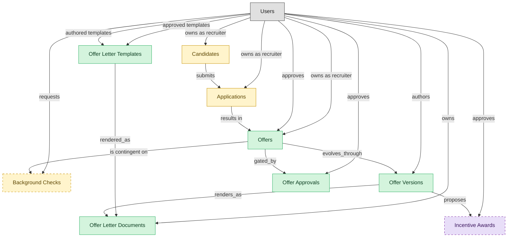

# Job Offers

## 1. Overview

Offer drafting, approval, extension, signature, and acceptance. Realizes OFFER-MGMT. Realizes the `offer_extended` state on `job_applications`. Requires an external `sign_document` tool, drops module Semantius coverage to ~83%.

## 2. Entity summary

| Name | data_object | Description |
| --- | --- | --- |
| Offer Approvals | `offer_approvals` | Approval steps in the offer-approval chain, triggered when an offer exceeds band, includes non-standard equity, or matches other escalation rules. |
| Offer Letter Documents | `offer_letter_documents` | Generated PDF letters of the offer terms, versioned alongside the structured offer and related to the e-signature envelope. |
| Offer Letter Templates | `offer_letter_templates` | Reusable offer-letter templates with merge tokens for candidate, role, and pay terms, versioned by jurisdiction and language to render offer letters. |
| Offer Versions | `offer_versions` | Versioned snapshots of a job offer during negotiation, each holding the structured terms and the author of the change, from initial through accepted. |
| Offers | `job_offers` | Formal employment offers extended to candidates, with compensation, start date, terms, approval, and status. |
| Applications | `job_applications` | Candidate submissions for a specific job, with pipeline stage, status, and source. |
| Background Checks | `background_checks` | External verification results for a candidate (criminal, employment, education, credit, identity), with status and findings from a screening provider. |
| Candidates | `candidates` | People known to the recruiting organization, with or without an active application, carrying contact details, resume, tags, consent, and source. |
| Incentive Awards | `incentive_awards` | Individual bonus, commission, and long-term incentive awards, with target and approved amounts, performance metrics, and payout dates. |

## 3. Entities catalog

| # | data_object | catalog code | singular | plural | held_as | mastered in | mastered label | install_optional | personal_content | entity_type | write tier | notes |
| ---: | --- | --- | --- | --- | --- | --- | --- | --- | --- | --- | --- | --- |
| 1 | `offer_approvals` | `offer_approvals` | Offer Approval | Offer Approvals | master | - | - | - | - | operational_workflow | `:manage` | - |
| 2 | `offer_letter_documents` | `offer_letter_documents` | Offer Letter Document | Offer Letter Documents | master | - | - | - | yes | operational_workflow | `:manage` | - |
| 3 | `offer_letter_templates` | `offer_letter_templates` | Offer Letter Template | Offer Letter Templates | master | - | - | - | - | catalog | `:admin` | - |
| 4 | `offer_versions` | `offer_versions` | Offer Version | Offer Versions | master | - | - | - | yes | operational_workflow | `:manage` | - |
| 5 | `job_offers` | `job_offers` | Offer | Offers | master | - | - | - | yes | operational_workflow | `:manage` | - |
| 6 | `job_applications` | `job_applications` | Application | Applications | embedded_master | `ats-recruitment-pipeline` | Recruitment Pipeline | - | yes | operational_workflow | `:manage` | - |
| 7 | `background_checks` | `background_checks` | Background Check | Background Checks | embedded_master | `bgv-screening-orders` | Screening Orders and Packages | yes | yes | operational_workflow | `:manage` | - |
| 8 | `candidates` | `candidates` | Candidate | Candidates | embedded_master | `ats-candidate-crm` | Candidate CRM | - | yes | operational_workflow | `:manage` | - |
| 9 | `incentive_awards` | `incentive_awards` | Incentive Award | Incentive Awards | consumer | `comp-incentives` | Incentives and Equity Plans | yes | yes | operational_workflow | `:manage` | - |

## 4. Aliases and industry synonyms

_(none: no industry-scoped aliases for this scope)_

## 5. Relationships

_`field_required` applies only when both entities are installed. It never makes an entity required._

### 5.1 Relationships between entities in this blueprint

| from | verb | to | cardinality | kind | field_required | delete_mode | fk_format | notes |
| --- | --- | --- | --- | --- | --- | --- | --- | --- |
| `candidates` | submits | `job_applications` | one_to_many | reference | yes | restrict | reference | - |
| `job_applications` | results in | `job_offers` | one_to_many | reference | yes | restrict | reference | - |
| `job_offers` | is contingent on | `background_checks` | one_to_many | reference | no | clear | reference | - |
| `job_offers` | evolves_through | `offer_versions` | one_to_many | composition | yes | cascade | parent | - |
| `job_offers` | gated_by | `offer_approvals` | one_to_many | composition | yes | cascade | parent | - |
| `offer_versions` | renders_as | `offer_letter_documents` | one_to_one | composition | yes | cascade | parent | - |
| `offer_versions` | proposes | `incentive_awards` | one_to_many | reference | no | clear | reference | - |
| `offer_letter_templates` | rendered_as | `offer_letter_documents` | one_to_many | reference | no | clear | reference | - |

### 5.2 Relationships to platform built-ins (`users`)

| from | verb | to | cardinality | field_required | delete_mode | fk_format | notes |
| --- | --- | --- | --- | --- | --- | --- | --- |
| `users` | owns as recruiter | `job_applications` | one_to_many | no | clear | reference | - |
| `users` | approves | `job_offers` | one_to_many | yes | restrict | reference | - |
| `users` | owns as recruiter | `candidates` | one_to_many | no | clear | reference | - |
| `users` | requests | `background_checks` | one_to_many | yes | restrict | reference | - |
| `users` | authored templates | `offer_letter_templates` | one_to_many | no | clear | reference | - |
| `users` | approved templates | `offer_letter_templates` | one_to_many | no | clear | reference | - |
| `users` | authors | `offer_versions` | one_to_many | yes | restrict | reference | - |
| `users` | approves | `offer_approvals` | one_to_many | yes | restrict | reference | - |
| `users` | owns | `offer_letter_documents` | one_to_many | no | clear | reference | - |
| `users` | owns as recruiter | `job_offers` | one_to_many | no | clear | reference | - |
| `users` | approves | `incentive_awards` | one_to_many | no | clear | reference | - |

### 5.3 Relationships to entities outside this blueprint

_External entities are optional: this blueprint never installs them. If one exists at install, the relationship is proposed. A many-to-many relationship is listed under outgoing and proposed as a new junction table._

#### 5.3a Outgoing relationships: this blueprint's entity points to the external entity

| from | verb | to | cardinality | field_required | notes |
| --- | --- | --- | --- | --- | --- |
| `skill_profiles` | feeds | `candidates` | one_to_many | no | - |
| `job_requisitions` | receives | `job_applications` | one_to_many | no | - |
| `job_postings` | is applied to via | `job_applications` | one_to_many | no | - |
| `recruitment_sources` | attributes | `candidates` | one_to_many | no | - |
| `recruitment_agencies` | sources | `candidates` | one_to_many | no | - |
| `recruitment_events` | attracts | `candidates` | one_to_many | no | - |
| `talent_pools` | groups | `candidates` | many_to_many | - | - |
| `background_check_packages` | shapes | `background_checks` | one_to_many | yes | - |
| `employees` | applies_as | `candidates` | one_to_many | no | - |
| `recruitment_sources` | attributes | `job_applications` | one_to_many | no | - |
| `compensation_plans` | governs | `incentive_awards` | one_to_many | no | - |
| `merit_recommendations` | produces | `incentive_awards` | one_to_many | no | - |
| `employees` | receives | `incentive_awards` | one_to_many | yes | - |
| `compensation_statements` | composes | `incentive_awards` | one_to_many | no | - |

#### 5.3b Incoming relationships: the external entity points to this blueprint's entity

| from | verb | to | cardinality | field_required | notes |
| --- | --- | --- | --- | --- | --- |
| `candidates` | is referred through | `candidate_referrals` | one_to_many | yes | - |
| `job_applications` | schedules | `interviews` | one_to_many | yes | - |
| `job_applications` | requires | `candidate_assessments` | one_to_many | yes | - |
| `job_offers` | spawns | `onboarding_journeys` | one_to_many | no | - |
| `job_offers` | triggers | `benefit_enrollments` | one_to_many | no | - |
| `job_offers` | seeds | `compensation_statements` | one_to_many | no | - |
| `candidates` | becomes | `employees` | one_to_one | no | - |
| `job_offers` | spawns pre-employee record | `pre_employees` | one_to_one | yes | - |
| `candidates` | becomes pre-employee | `pre_employees` | one_to_one | yes | - |
| `candidates` | engaged_via | `candidate_engagements` | one_to_many | no | - |
| `candidates` | attends_via | `recruiting_event_attendances` | one_to_many | yes | - |
| `candidates` | consents_via | `candidate_consents` | one_to_many | yes | - |
| `candidates` | member_of_via | `talent_pool_memberships` | one_to_many | yes | - |
| `background_checks` | contains | `background_check_components` | one_to_many | yes | - |
| `candidates` | discloses_via | `fcra_disclosures` | one_to_many | yes | - |
| `background_checks` | adjudicated_via | `background_check_adjudications` | one_to_one | yes | - |
| `job_applications` | transitions_via | `application_stage_transitions` | one_to_many | yes | - |
| `job_applications` | answers_via | `application_screening_answers` | one_to_many | yes | - |
| `candidates` | self_identifies_via | `eeo_responses` | one_to_many | yes | - |
| `candidates` | submits_via | `data_subject_requests` | one_to_many | yes | - |
| `candidates` | self_ids_via | `voluntary_self_identifications` | one_to_many | yes | - |
| `candidates` | acknowledges_via | `fcra_summary_of_rights_acknowledgments` | one_to_many | yes | - |
| `job_applications` | disposed_via | `application_dispositions` | one_to_many | yes | - |
| `job_applications` | logged_via | `applicant_flow_records` | one_to_one | yes | - |
| `background_checks` | triggers_pre_notice | `pre_adverse_action_notices` | one_to_many | yes | - |
| `background_checks` | gated_by | `fcra_summary_of_rights_acknowledgments` | one_to_one | yes | - |
| `candidates` | documented_via | `candidate_documents` | one_to_many | yes | - |
| `candidates` | annotated_via | `candidate_notes` | one_to_many | yes | - |
| `candidates` | tagged_via | `candidate_tag_assignments` | one_to_many | yes | - |
| `candidates` | corresponds_via | `candidate_emails` | one_to_many | no | - |
| `candidates` | screened_via | `drug_health_screenings` | one_to_many | no | - |
| `candidates` | verified_via | `right_to_work_verifications` | one_to_many | no | - |
| `candidates` | submitted_via | `agency_submissions` | one_to_many | no | - |
| `incentive_awards` | settles as | `equity_grants` | one_to_many | no | - |

## 6. Cross-domain context

### 6.1 Master consumers (other modules / domains that embed this scope's masters)

_(none: no other module embeds this scope's masters)_

### 6.2 Outbound handoffs (events this scope publishes)

_(none: no outbound handoffs whose payload is in this scope)_

### 6.3 Inbound handoffs (events this scope reacts to)

_(none: no inbound handoffs whose payload is in this scope)_

### 6.4 Master providers (modules / domains that own masters this scope embeds)

| data_object | held_as | install_optional | catalog owner(s) | slice notes |
| --- | --- | --- | --- | --- |
| `background_checks` | embedded_master | yes | BGV-SCREENING-ORDERS (BGV) | - |
| `candidates` | embedded_master | - | ATS-CANDIDATE-CRM (ATS) | - |
| `job_applications` | embedded_master | - | ATS-RECRUITMENT-PIPELINE (ATS) | - |
| `incentive_awards` | consumer | yes | COMP-INCENTIVES (COMP-MGMT) | - |

## 7. Lifecycle states

### `background_checks` (Background Check)

_This scope holds `background_checks` as **embedded_master**; the canonical state machine is owned by `BGV-SCREENING-ORDERS`._

| order | state_name | initial? | terminal? | realizing module | requires_permission? | high risk? | derived gate | description |
| --- | --- | --- | --- | --- | --- | --- | --- | --- |
| 1 | `requested` | ✓ | - | _(always)_ | - | - | - | Check ordered from the provider for a candidate. |
| 2 | `in_progress` | - | - | _(always)_ | - | - | - | Provider is running verification (criminal, employment, education, identity). |
| 3 | `completed_clear` | - | ✓ | `BGV-SCREENING-ORDERS` | ✓ | - | `bgv-screening-orders:clear_background_check` | Provider returned a clear result; no adverse findings. |
| 4 | `completed_consider` | - | ✓ | `BGV-SCREENING-ORDERS` | ✓ | - | `bgv-screening-orders:adjudicate_background_check` | Provider returned adverse findings; gated review required before adjudication. |
| 5 | `canceled` | - | ✓ | _(always)_ | - | - | - | Check withdrawn before the provider returned a result. |

### `candidates` (Candidate)

_This scope holds `candidates` as **embedded_master**; the canonical state machine is owned by `ATS-CANDIDATE-CRM`._

| order | state_name | initial? | terminal? | realizing module | requires_permission? | high risk? | derived gate | description |
| --- | --- | --- | --- | --- | --- | --- | --- | --- |
| 1 | `prospect` | ✓ | - | _(always)_ | - | - | - | Person known to the recruiting org with no active application. |
| 2 | `active` | - | - | _(always)_ | - | - | - | Candidate has at least one open application or is actively engaged. |
| 3 | `hired` | - | - | `ATS-CANDIDATE-CRM` | ✓ | - | `ats-candidate-crm:hire_candidate` | Candidate accepted an offer and converted to employee; a new application moves the person back to active. |
| 4 | `do_not_hire` | - | ✓ | `ATS-CANDIDATE-CRM` | ✓ | - | `ats-candidate-crm:flag_do_not_hire` | Candidate flagged as ineligible for future consideration; gated decision. |
| 5 | `archived` | - | - | _(always)_ | - | - | - | Candidate kept in the database but not active in any pipeline; a new application moves the candidate back to active. |

### `job_applications` (Application)

_This scope holds `job_applications` as **embedded_master**; the canonical state machine is owned by `ATS-RECRUITMENT-PIPELINE`._

| order | state_name | initial? | terminal? | realizing module | requires_permission? | high risk? | derived gate | description |
| --- | --- | --- | --- | --- | --- | --- | --- | --- |
| 1 | `applied` | ✓ | - | _(always)_ | - | - | - | Candidate submitted an application for the job. |
| 2 | `screening` | - | - | _(always)_ | - | - | - | Recruiter is reviewing resume and qualifications. |
| 3 | `interviewing` | - | - | `ATS-INTERVIEWS` | - | - | - | Candidate is progressing through interview loops. |
| 4 | `offer_extended` | - | - | `ATS-OFFERS` | - | - | - | An offer has been generated and is in flight for this application. |
| 5 | `hired` | - | ✓ | `ATS-PRE-EMPLOYEE-RECORD` | ✓ | - | `ats-pre-employee-record:hire_candidate` | Candidate accepted the offer and was hired; gated transition. |
| 6 | `rejected` | - | ✓ | _(always)_ | - | - | - | Application closed without progression by recruiter or hiring manager. |
| 7 | `withdrawn` | - | ✓ | _(always)_ | - | - | - | Candidate withdrew their application. |

### `job_offers` (Offer)

| order | state_name | initial? | terminal? | realizing module | requires_permission? | high risk? | derived gate | description |
| --- | --- | --- | --- | --- | --- | --- | --- | --- |
| 1 | `draft` | ✓ | - | _(always)_ | - | - | - | Recruiter is composing offer terms and compensation components. |
| 2 | `pending_approval` | - | - | _(always)_ | - | - | - | Offer routed to the designated approver for sign-off. |
| 3 | `approved` | - | - | `ATS-OFFERS` | ✓ | - | `ats-offers:approve_offer` | Approver signed off; offer is ready to send. |
| 4 | `sent` | - | - | _(always)_ | - | - | - | Offer delivered to the candidate. |
| 5 | `accepted` | - | - | _(always)_ | - | - | - | Candidate accepted the offer. |
| 6 | `declined` | - | ✓ | _(always)_ | - | - | - | Candidate declined the offer. |
| 7 | `rescinded` | - | ✓ | `ATS-OFFERS` | ✓ | - | `ats-offers:rescind_offer` | Offer withdrawn by the employer after being sent or accepted; gated action. |
| 8 | `completed` | - | ✓ | _(always)_ | - | - | - | Candidate was hired and the offer is closed; no further changes. |
| 9 | `canceled` | - | ✓ | _(always)_ | - | - | - | Offer abandoned before it was sent. |
| 10 | `reneged` | - | ✓ | _(always)_ | - | - | - | Candidate backed out after accepting the offer. |

### `offer_approvals` (Offer Approval)

| order | state_name | initial? | terminal? | realizing module | requires_permission? | high risk? | derived gate | description |
| --- | --- | --- | --- | --- | --- | --- | --- | --- |
| 1 | `pending` | ✓ | - | _(always)_ | - | - | - | Approval step awaiting decision. |
| 2 | `approved` | - | ✓ | _(always)_ | ✓ | - | `ats-offers:approve_offer` | Step approved; offer can advance. |
| 3 | `rejected` | - | ✓ | _(always)_ | ✓ | - | `ats-offers:reject_offer` | Step rejected; offer blocked or requires revision. |
| 4 | `escalated` | - | - | _(always)_ | - | - | - | Step escalated to a higher approver. |

### `offer_letter_documents` (Offer Letter Document)

| order | state_name | initial? | terminal? | realizing module | requires_permission? | high risk? | derived gate | description |
| --- | --- | --- | --- | --- | --- | --- | --- | --- |
| 1 | `drafted` | ✓ | - | _(always)_ | - | - | - | Letter rendered from template; not yet sent. |
| 2 | `sent` | - | - | _(always)_ | - | - | - | Letter delivered to candidate via e-sign provider. |
| 3 | `signed` | - | ✓ | _(always)_ | - | - | - | Candidate signed; offer accepted. |
| 4 | `voided` | - | ✓ | _(always)_ | - | - | - | Letter voided before signature. |

### `offer_letter_templates` (Offer Letter Template)

| order | state_name | initial? | terminal? | realizing module | requires_permission? | high risk? | derived gate | description |
| --- | --- | --- | --- | --- | --- | --- | --- | --- |
| 10 | `draft` | ✓ | - | `ATS-OFFERS` | - | - | - | Template is being authored; not visible for offer generation. |
| 20 | `in_review` | - | - | `ATS-OFFERS` | - | - | - | Author has submitted the template for legal or HR-Comp review. |
| 30 | `approved` | - | - | `ATS-OFFERS` | ✓ | - | `ats-offers:approve_offer_letter_template` | Single approver (legal or HR-Comp) has signed off; ready for activation. |
| 40 | `active` | - | - | `ATS-OFFERS` | - | - | - | Template is live and available for new offers to render against. |
| 50 | `superseded` | - | - | `ATS-OFFERS` | - | - | - | A newer version of this template has been activated; this row is retained for historical offers. |
| 60 | `retired` | - | ✓ | `ATS-OFFERS` | ✓ | - | `ats-offers:retire_offer_letter_template` | Template withdrawn from use; no new offers may render against it. |

### `offer_versions` (Offer Version)

| order | state_name | initial? | terminal? | realizing module | requires_permission? | high risk? | derived gate | description |
| --- | --- | --- | --- | --- | --- | --- | --- | --- |
| 1 | `draft` | ✓ | - | _(always)_ | - | - | - | Version being authored; not yet presented. |
| 2 | `presented` | - | - | _(always)_ | - | - | - | Version sent to candidate. |
| 3 | `countered` | - | - | _(always)_ | - | - | - | Candidate countered; this version superseded by a newer one. |
| 4 | `accepted` | - | ✓ | _(always)_ | - | - | - | Version accepted by candidate. |
| 5 | `withdrawn` | - | ✓ | _(always)_ | - | - | - | Version pulled before acceptance. |

## 8. Permissions and business rules (derived)

### 8.1 Permissions

| permission | tier | description | included in `:admin`? |
| --- | --- | --- | --- |
| `ats-offers:read` | baseline-read | Read access to every entity in the module | ✓ |
| `ats-offers:manage` | baseline-manage | Edit operational records | ✓ |
| `ats-offers:admin` | baseline-admin | Edit reference data and inherit every workflow gate below | - |
| `ats-candidate-crm:read_candidates` | entity-read | Read Candidates | ✓ |
| `ats-candidate-crm:write_candidates` | entity-write | Write Candidates | ✓ |
| `ats-recruitment-pipeline:read_job_applications` | entity-read | Read Applications | ✓ |
| `ats-recruitment-pipeline:write_job_applications` | entity-write | Write Applications | ✓ |
| `ats-offers:read_job_offers` | entity-read | Read Offers | ✓ |
| `ats-offers:write_job_offers` | entity-write | Write Offers | ✓ |
| `bgv-screening-orders:read_background_checks` | entity-read | Read Background Checks | ✓ |
| `bgv-screening-orders:write_background_checks` | entity-write | Write Background Checks | ✓ |
| `ats-offers:read_offer_versions` | entity-read | Read Offer Versions | ✓ |
| `ats-offers:write_offer_versions` | entity-write | Write Offer Versions | ✓ |
| `ats-offers:read_offer_approvals` | entity-read | Read Offer Approvals | ✓ |
| `ats-offers:write_offer_approvals` | entity-write | Write Offer Approvals | ✓ |
| `ats-offers:read_offer_letter_documents` | entity-read | Read Offer Letter Documents | ✓ |
| `ats-offers:write_offer_letter_documents` | entity-write | Write Offer Letter Documents | ✓ |
| `ats-offers:read_offer_letter_templates` | entity-read | Read Offer Letter Templates | ✓ |
| `ats-offers:write_offer_letter_templates` | entity-write | Write Offer Letter Templates | ✓ |
| `comp-incentives:read_incentive_awards` | entity-read | Read Incentive Awards | ✓ |
| `ats-candidate-crm:hire_candidate` | workflow-gate (lifecycle) | Transition `candidates` into state `hired` | ✓ |
| `ats-candidate-crm:flag_do_not_hire` | workflow-gate (lifecycle) | Transition `candidates` into state `do_not_hire` | ✓ |
| `ats-pre-employee-record:hire_candidate` | workflow-gate (lifecycle) | Transition `job_applications` into state `hired` | ✓ |
| `ats-offers:approve_offer` | workflow-gate (lifecycle) | Transition `job_offers` into state `approved` or `offer_approvals` into state `approved` | ✓ |
| `ats-offers:rescind_offer` | workflow-gate (lifecycle) | Transition `job_offers` into state `rescinded` | ✓ |
| `bgv-screening-orders:clear_background_check` | workflow-gate (lifecycle) | Transition `background_checks` into state `completed_clear` | ✓ |
| `bgv-screening-orders:adjudicate_background_check` | workflow-gate (lifecycle) | Transition `background_checks` into state `completed_consider` | ✓ |
| `ats-offers:reject_offer` | workflow-gate (lifecycle) | Transition `offer_approvals` into state `rejected` | ✓ |
| `ats-offers:approve_offer_letter_template` | workflow-gate (lifecycle) | Transition `offer_letter_templates` into state `approved` | ✓ |
| `ats-offers:retire_offer_letter_template` | workflow-gate (lifecycle) | Transition `offer_letter_templates` into state `retired` | ✓ |
| `ats-candidate-crm:view_all_candidates` | override (personal_content) | View all `candidates` rows beyond row-scope | ✓ |
| `ats-candidate-crm:manage_all_candidates` | override (personal_content) | Manage all `candidates` rows beyond row-scope | ✓ |
| `ats-recruitment-pipeline:view_all_applications` | override (personal_content) | View all `job_applications` rows beyond row-scope | ✓ |
| `ats-recruitment-pipeline:manage_all_applications` | override (personal_content) | Manage all `job_applications` rows beyond row-scope | ✓ |
| `ats-offers:view_all_offers` | override (personal_content) | View all `job_offers` rows beyond row-scope | ✓ |
| `ats-offers:manage_all_offers` | override (personal_content) | Manage all `job_offers` rows beyond row-scope | ✓ |
| `bgv-screening-orders:view_all_background_checks` | override (personal_content) | View all `background_checks` rows beyond row-scope | ✓ |
| `bgv-screening-orders:manage_all_background_checks` | override (personal_content) | Manage all `background_checks` rows beyond row-scope | ✓ |
| `ats-offers:view_all_offer_versions` | override (personal_content) | View all `offer_versions` rows beyond row-scope | ✓ |
| `ats-offers:manage_all_offer_versions` | override (personal_content) | Manage all `offer_versions` rows beyond row-scope | ✓ |
| `ats-offers:view_all_offer_letter_documents` | override (personal_content) | View all `offer_letter_documents` rows beyond row-scope | ✓ |
| `ats-offers:manage_all_offer_letter_documents` | override (personal_content) | Manage all `offer_letter_documents` rows beyond row-scope | ✓ |

_Gates with no process: `ats-candidate-crm:flag_do_not_hire`, `ats-offers:rescind_offer`, `ats-offers:reject_offer`, `ats-offers:approve_offer_letter_template`, `ats-offers:retire_offer_letter_template`. No Accountable can hold them, so this blueprint does not support `raci`._

### 8.2 Business rules

| rule_name | data_object | source flag | intent |
| --- | --- | --- | --- |
| `candidate_edit_scope` | `candidates` | has_personal_content | Row-scope by default; override via `ats-candidate-crm:view_all_candidates` / `ats-candidate-crm:manage_all_candidates` |
| `application_edit_scope` | `job_applications` | has_personal_content | Row-scope by default; override via `ats-recruitment-pipeline:view_all_applications` / `ats-recruitment-pipeline:manage_all_applications` |
| `offer_edit_scope` | `job_offers` | has_personal_content | Row-scope by default; override via `ats-offers:view_all_offers` / `ats-offers:manage_all_offers` |
| `background_check_edit_scope` | `background_checks` | has_personal_content | Row-scope by default; override via `bgv-screening-orders:view_all_background_checks` / `bgv-screening-orders:manage_all_background_checks` |
| `offer_version_edit_scope` | `offer_versions` | has_personal_content | Row-scope by default; override via `ats-offers:view_all_offer_versions` / `ats-offers:manage_all_offer_versions` |
| `offer_letter_document_edit_scope` | `offer_letter_documents` | has_personal_content | Row-scope by default; override via `ats-offers:view_all_offer_letter_documents` / `ats-offers:manage_all_offer_letter_documents` |

## 9. Roles, RACI, and responsibilities (derived)

_Baseline roles, the permission hierarchy, and RACI realization are DERIVED from this scope's entity-type write tiers + `process_raci`; none of it is stored in the catalog (the deployer provisions it from this blueprint)._

### 9.1 `ATS-OFFERS`

**Baseline roles:**

| role | baseline grant |
| --- | --- |
| `ats-offers_viewer` | `ats-offers:read` |
| `ats-offers_manager` | `ats-offers:manage` |
| `ats-offers_admin` | `ats-offers:admin` |

**Permission hierarchy:**

| permission | includes |
| --- | --- |
| `ats-offers:admin` | `ats-offers:manage` |
| `ats-offers:manage` | `ats-offers:read` |
| `ats-offers:read` | `ats-candidate-crm:read_candidates` |
| `ats-offers:read` | `ats-recruitment-pipeline:read_job_applications` |
| `ats-offers:read` | `ats-offers:read_job_offers` |
| `ats-offers:read` | `bgv-screening-orders:read_background_checks` |
| `ats-offers:read` | `ats-offers:read_offer_versions` |
| `ats-offers:read` | `ats-offers:read_offer_approvals` |
| `ats-offers:read` | `ats-offers:read_offer_letter_documents` |
| `ats-offers:read` | `ats-offers:read_offer_letter_templates` |
| `ats-offers:read` | `comp-incentives:read_incentive_awards` |
| `ats-offers:manage` | `ats-candidate-crm:write_candidates` |
| `ats-candidate-crm:write_candidates` | `ats-candidate-crm:read_candidates` |
| `ats-offers:manage` | `ats-recruitment-pipeline:write_job_applications` |
| `ats-recruitment-pipeline:write_job_applications` | `ats-recruitment-pipeline:read_job_applications` |
| `ats-offers:manage` | `ats-offers:write_job_offers` |
| `ats-offers:write_job_offers` | `ats-offers:read_job_offers` |
| `ats-offers:manage` | `bgv-screening-orders:write_background_checks` |
| `bgv-screening-orders:write_background_checks` | `bgv-screening-orders:read_background_checks` |
| `ats-offers:manage` | `ats-offers:write_offer_versions` |
| `ats-offers:write_offer_versions` | `ats-offers:read_offer_versions` |
| `ats-offers:manage` | `ats-offers:write_offer_approvals` |
| `ats-offers:write_offer_approvals` | `ats-offers:read_offer_approvals` |
| `ats-offers:manage` | `ats-offers:write_offer_letter_documents` |
| `ats-offers:write_offer_letter_documents` | `ats-offers:read_offer_letter_documents` |
| `ats-offers:admin` | `ats-offers:write_offer_letter_templates` |
| `ats-offers:write_offer_letter_templates` | `ats-offers:read_offer_letter_templates` |
| `ats-offers:admin` | `ats-candidate-crm:hire_candidate` |
| `ats-offers:admin` | `ats-candidate-crm:flag_do_not_hire` |
| `ats-offers:admin` | `ats-pre-employee-record:hire_candidate` |
| `ats-offers:admin` | `ats-offers:approve_offer` |
| `ats-offers:admin` | `ats-offers:rescind_offer` |
| `ats-offers:admin` | `bgv-screening-orders:clear_background_check` |
| `ats-offers:admin` | `bgv-screening-orders:adjudicate_background_check` |
| `ats-offers:admin` | `ats-offers:reject_offer` |
| `ats-offers:admin` | `ats-offers:approve_offer_letter_template` |
| `ats-offers:admin` | `ats-offers:retire_offer_letter_template` |
| `ats-offers:admin` | `ats-candidate-crm:view_all_candidates` |
| `ats-offers:admin` | `ats-candidate-crm:manage_all_candidates` |
| `ats-offers:admin` | `ats-recruitment-pipeline:view_all_applications` |
| `ats-offers:admin` | `ats-recruitment-pipeline:manage_all_applications` |
| `ats-offers:admin` | `ats-offers:view_all_offers` |
| `ats-offers:admin` | `ats-offers:manage_all_offers` |
| `ats-offers:admin` | `bgv-screening-orders:view_all_background_checks` |
| `ats-offers:admin` | `bgv-screening-orders:manage_all_background_checks` |
| `ats-offers:admin` | `ats-offers:view_all_offer_versions` |
| `ats-offers:admin` | `ats-offers:manage_all_offer_versions` |
| `ats-offers:admin` | `ats-offers:view_all_offer_letter_documents` |
| `ats-offers:admin` | `ats-offers:manage_all_offer_letter_documents` |

**Processes wired:**

| process_key | process_name | PCF code | PCF ID | level | description |
| --- | --- | --- | --- | --- | --- |
| `hire_candidate` | Hire candidate | 7.2.4.3 | 10465 | 4 | Wrapping up the process for hiring candidates. Agree to all hiring terms and conditions. Have the candidate accept and sign the job offer. |
| `draw_up_make_offer` | Draw up and make offer | 7.2.4.1 | 10463 | 4 | Compiling job-related information for the selected candidates in order to make up a job. Include information about the job description, reporting relationship, salary, bonus potential, benefits, and vacation allotment. |
| `obtain_candidate_background` | Obtain candidate background information | 7.2.5.1 | 10460 | 4 | Conducting a background investigation on the candidates with the objective of gathering and compiling criminal, commercial, medical, and financial information. |
| `manage_new_hire_re_hire` | Manage new hire/re-hire | 7.2.4 | 10443 | 3 | Creating and making job offers to the selected candidates. Fairly negotiate the job offers. Agree on terms with the candidate to complete the hiring process. |

**RACI realization:**

| actor | kind | raci | process_key | realization |
| --- | --- | --- | --- | --- |
| `RECRUITING-RECRUITER` | persona | responsible | `hire_candidate` | the gated entities' write tier |
| `HIRING-MANAGER` | persona | accountable | `hire_candidate` | grant gates [ats-candidate-crm:hire_candidate, ats-pre-employee-record:hire_candidate] + the gated entities' write tier |
| `LEGAL-COMPLIANCE-SPECIALIST` | persona | informed | `hire_candidate` | notify on trigger_events [candidate.hired] |
| `RECRUITING-RECRUITER` | persona | responsible | `draw_up_make_offer` | the gated entities' write tier |
| `HIRING-MANAGER` | persona | accountable | `draw_up_make_offer` | grant gates [ats-offers:approve_offer] + the gated entities' write tier |
| `RECRUITING-MANAGER` | persona | consulted | `draw_up_make_offer` | advisory read grant |
| `RECRUITING-RECRUITER` | persona | responsible | `obtain_candidate_background` | the gated entities' write tier |
| `RECRUITING-MANAGER` | persona | accountable | `obtain_candidate_background` | grant gates [bgv-screening-orders:clear_background_check] + the gated entities' write tier |
| `LEGAL-COMPLIANCE-SPECIALIST` | persona | responsible | `manage_new_hire_re_hire` | the gated entities' write tier |
| `RECRUITING-MANAGER` | persona | accountable | `manage_new_hire_re_hire` | grant gates [bgv-screening-orders:adjudicate_background_check] + the gated entities' write tier |
| `RECRUITING-COORDINATOR` | persona | consulted | `manage_new_hire_re_hire` | blocking consultation state |

### 9.2 Functional ownership and default grants

| responsibility | business function | default role | default tier |
| --- | --- | --- | --- |
| owner | Recruiting | `admin` | `:admin` |
| contributor | Human Resources | `manager` | `:manage` |
| contributor | Legal | `manager` | `:manage` |
| consumer | Finance | `viewer` | `:read` |
