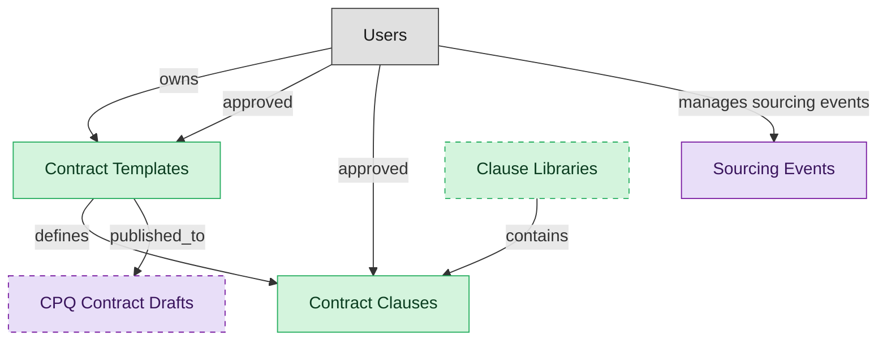

# Contract Authoring

## 1. Overview

Template-driven contract drafting with the approved clause library. Masters contract_templates and contract_clauses; produces draft legal_contracts that flow into CLM-NEGOTIATION. Realizes CLM-CONTRACT-AUTHORING and CLM-CLAUSE-LIBRARY-MGMT.

## 2. Entity summary

| Name | data_object | Description |
| --- | --- | --- |
| Clause Libraries | `clause_libraries` | Versioned, governed collections of approved contract clauses, often organized by jurisdiction or contract type, that authors draw from. |
| Contract Clauses | `contract_clauses` | Reusable clause library with preferred and fallback language for terms like indemnification, IP, termination, and payment. |
| Contract Templates | `contract_templates` | Pre-approved contract templates such as NDAs, MSAs, and SOWs, assembled from the clause library to author new contracts. |
| CPQ Contract Drafts | `contract_drafts` | Draft contracts handed off from an approved quote, the precursor to a signed contract. |
| Sourcing Events | `sourcing_events` | Competitive bidding processes (RFI, RFQ, RFP, or reverse auction), tracking scope, suppliers, scorecards, responses, and the awarded supplier. |

## 3. Entities catalog

| # | data_object | catalog code | singular | plural | held_as | mastered in | mastered label | install_optional | personal_content | entity_type | write tier | notes |
| ---: | --- | --- | --- | --- | --- | --- | --- | --- | --- | --- | --- | --- |
| 1 | `clause_libraries` | `clause_libraries` | Clause Library | Clause Libraries | master | - | - | yes | - | catalog | `:admin` | - |
| 2 | `contract_clauses` | `contract_clauses` | Contract Clause | Contract Clauses | master | - | - | - | - | catalog | `:admin` | - |
| 3 | `contract_templates` | `contract_templates` | Contract Template | Contract Templates | master | - | - | - | - | catalog | `:admin` | - |
| 4 | `contract_drafts` | `contract_drafts` | CPQ Contract Draft | CPQ Contract Drafts | consumer | `cpq-approvals-contracts` | Approvals and Contract Drafts | yes | - | operational_workflow | `:manage` | - |
| 5 | `sourcing_events` | `sourcing_events` | Sourcing Event | Sourcing Events | consumer | - | - | - | - | operational_workflow | `:manage` | - |

## 4. Aliases and industry synonyms

_(none: no industry-scoped aliases for this scope)_

## 5. Relationships

_`field_required` applies only when both entities are installed. It never makes an entity required._

### 5.1 Relationships between entities in this blueprint

| from | verb | to | cardinality | kind | field_required | delete_mode | fk_format | notes |
| --- | --- | --- | --- | --- | --- | --- | --- | --- |
| `contract_templates` | defines | `contract_clauses` | one_to_many | reference | no | clear | reference | - |
| `contract_templates` | published_to | `contract_drafts` | one_to_many | reference | no | clear | reference | - |
| `clause_libraries` | contains | `contract_clauses` | one_to_many | reference | no | clear | reference | - |

### 5.2 Relationships to platform built-ins (`users`)

| from | verb | to | cardinality | field_required | delete_mode | fk_format | notes |
| --- | --- | --- | --- | --- | --- | --- | --- |
| `users` | owns | `contract_templates` | one_to_many | no | clear | reference | - |
| `users` | approved | `contract_templates` | one_to_many | no | clear | reference | - |
| `users` | approved | `contract_clauses` | one_to_many | no | clear | reference | - |
| `users` | manages sourcing events | `sourcing_events` | one_to_many | no | clear | reference | - |

### 5.3 Relationships to entities outside this blueprint

_External entities are optional: this blueprint never installs them. If one exists at install, the relationship is proposed. A many-to-many relationship is listed under outgoing and proposed as a new junction table._

#### 5.3a Outgoing relationships: this blueprint's entity points to the external entity

| from | verb | to | cardinality | field_required | notes |
| --- | --- | --- | --- | --- | --- |
| `legal_contracts` | contains | `contract_clauses` | one_to_many | no | - |
| `suppliers` | enables | `sourcing_events` | one_to_many | no | - |
| `negotiation_playbooks` | defines positions for | `contract_clauses` | one_to_many | no | - |

#### 5.3b Incoming relationships: the external entity points to this blueprint's entity

| from | verb | to | cardinality | field_required | notes |
| --- | --- | --- | --- | --- | --- |
| `contract_templates` | seeds | `legal_contracts` | one_to_many | no | - |
| `sourcing_events` | originates | `legal_contracts` | one_to_many | no | - |
| `contract_drafts` | drafts | `legal_contracts` | one_to_many | no | - |

## 6. Cross-domain context

### 6.1 Master consumers (other modules / domains that embed this scope's masters)

_(none: no other module embeds this scope's masters)_

### 6.2 Outbound handoffs (events this scope publishes)

_(none: no outbound handoffs whose payload is in this scope)_

### 6.3 Inbound handoffs (events this scope reacts to)

_(none: no inbound handoffs whose payload is in this scope)_

### 6.4 Master providers (modules / domains that own masters this scope embeds)

| data_object | held_as | install_optional | catalog owner(s) | slice notes |
| --- | --- | --- | --- | --- |
| `contract_drafts` | consumer | yes | CPQ-APPROVALS-CONTRACTS (CPQ) | - |
| `sourcing_events` | consumer | - | _(no catalog owner recorded)_ | - |

## 7. Lifecycle states

### `contract_clauses` (Contract Clause)

| order | state_name | initial? | terminal? | requires_permission? | high risk? | derived gate | description |
| --- | --- | --- | --- | --- | --- | --- | --- |
| 10 | `draft` | ✓ | - | - | - | - | Clause authored but not yet reviewed. Cannot be selected for new contracts. |
| 20 | `in_review` | - | - | - | - | - | Clause routed to the legal panel for review. |
| 30 | `approved` | - | - | ✓ | - | `clm-authoring:approve_contract_clause` | Clause approved for use in contract authoring. |
| 40 | `published` | - | - | - | - | - | Clause available in the library for selection by authors. Locked from edits; supersession requires a new version. |
| 50 | `deprecated` | - | ✓ | ✓ | - | `clm-authoring:deprecate_contract_clause` | Clause withdrawn from the library; existing contracts retain it but new authoring cannot select it. Terminal. |

### `contract_templates` (Contract Template)

| order | state_name | initial? | terminal? | requires_permission? | high risk? | derived gate | description |
| --- | --- | --- | --- | --- | --- | --- | --- |
| 10 | `draft` | ✓ | - | - | - | - | Template authored but not yet reviewed. Cannot be used for new contracts. |
| 20 | `in_review` | - | - | - | - | - | Template routed to the legal panel for review. |
| 30 | `approved` | - | - | ✓ | - | `clm-authoring:approve_contract_template` | Template approved for publication. |
| 40 | `published` | - | - | - | - | - | Template available in the library; authors can instantiate new contracts from it. Locked from edits. |
| 50 | `deprecated` | - | ✓ | ✓ | - | `clm-authoring:deprecate_contract_template` | Template withdrawn from the library; existing in-flight drafts retain it but new authoring cannot select it. Terminal. |

## 8. Permissions and business rules (derived)

### 8.1 Permissions

| permission | tier | description | included in `:admin`? |
| --- | --- | --- | --- |
| `clm-authoring:read` | baseline-read | Read access to every entity in the module | ✓ |
| `clm-authoring:manage` | baseline-manage | Edit operational records | ✓ |
| `clm-authoring:admin` | baseline-admin | Edit reference data and inherit every workflow gate below | - |
| `clm-authoring:read_contract_clauses` | entity-read | Read Contract Clauses | ✓ |
| `clm-authoring:write_contract_clauses` | entity-write | Write Contract Clauses | ✓ |
| `clm-authoring:read_contract_templates` | entity-read | Read Contract Templates | ✓ |
| `clm-authoring:write_contract_templates` | entity-write | Write Contract Templates | ✓ |
| `cpq-approvals-contracts:read_contract_drafts` | entity-read | Read CPQ Contract Drafts | ✓ |
| `clm-authoring:read_clause_libraries` | entity-read | Read Clause Libraries | ✓ |
| `clm-authoring:write_clause_libraries` | entity-write | Write Clause Libraries | ✓ |
| `clm-authoring:approve_contract_clause` | workflow-gate (lifecycle) | Transition `contract_clauses` into state `approved` | ✓ |
| `clm-authoring:deprecate_contract_clause` | workflow-gate (lifecycle) | Transition `contract_clauses` into state `deprecated` | ✓ |
| `clm-authoring:approve_contract_template` | workflow-gate (lifecycle) | Transition `contract_templates` into state `approved` | ✓ |
| `clm-authoring:deprecate_contract_template` | workflow-gate (lifecycle) | Transition `contract_templates` into state `deprecated` | ✓ |

### 8.2 Business rules

_(none: no flag-derived business rules)_

## 9. Roles, RACI, and responsibilities (derived)

_Baseline roles, the permission hierarchy, and RACI realization are DERIVED from this scope's entity-type write tiers + `process_raci`; none of it is stored in the catalog (the deployer provisions it from this blueprint)._

### 9.1 `CLM-AUTHORING`

**Baseline roles:**

| role | baseline grant |
| --- | --- |
| `clm-authoring_viewer` | `clm-authoring:read` |
| `clm-authoring_manager` | `clm-authoring:manage` |
| `clm-authoring_admin` | `clm-authoring:admin` |

**Permission hierarchy:**

| permission | includes |
| --- | --- |
| `clm-authoring:admin` | `clm-authoring:manage` |
| `clm-authoring:manage` | `clm-authoring:read` |
| `clm-authoring:read` | `clm-authoring:read_contract_clauses` |
| `clm-authoring:read` | `clm-authoring:read_contract_templates` |
| `clm-authoring:read` | `cpq-approvals-contracts:read_contract_drafts` |
| `clm-authoring:read` | `clm-authoring:read_clause_libraries` |
| `clm-authoring:admin` | `clm-authoring:write_contract_clauses` |
| `clm-authoring:write_contract_clauses` | `clm-authoring:read_contract_clauses` |
| `clm-authoring:admin` | `clm-authoring:write_contract_templates` |
| `clm-authoring:write_contract_templates` | `clm-authoring:read_contract_templates` |
| `clm-authoring:admin` | `clm-authoring:write_clause_libraries` |
| `clm-authoring:write_clause_libraries` | `clm-authoring:read_clause_libraries` |
| `clm-authoring:admin` | `clm-authoring:approve_contract_clause` |
| `clm-authoring:admin` | `clm-authoring:deprecate_contract_clause` |
| `clm-authoring:admin` | `clm-authoring:approve_contract_template` |
| `clm-authoring:admin` | `clm-authoring:deprecate_contract_template` |

**Processes wired:**

| process_key | process_name | PCF code | PCF ID | level | description |
| --- | --- | --- | --- | --- | --- |
| `provide_legal_advice_counseling` | Provide legal advice/counseling | 12.4.8 | 11051 | 3 | Providing legal advice concerning the substance or procedure of a law in relation to a particular situation. |

**RACI realization:**

| actor | kind | raci | process_key | realization |
| --- | --- | --- | --- | --- |
| `LEGAL-COUNSEL` | persona | responsible | `provide_legal_advice_counseling` | the gated entities' write tier |
| `CONTRACT-OPS-MANAGER` | persona | accountable | `provide_legal_advice_counseling` | grant gates [clm-authoring:approve_contract_clause, clm-authoring:deprecate_contract_clause, clm-authoring:approve_contract_template, clm-authoring:deprecate_contract_template] + the gated entities' write tier |
| `CONTRACT-OPS-SPECIALIST` | persona | informed | `provide_legal_advice_counseling` | notify on trigger_events [contract_clause.approved, contract_clause.deprecated, contract_template.approved, contract_template.deprecated] |

### 9.2 Functional ownership and default grants

| responsibility | business function | default role | default tier |
| --- | --- | --- | --- |
| owner | Contract Operations | `admin` | `:admin` |
| contributor | Procurement | `manager` | `:manage` |
| contributor | Sales | `manager` | `:manage` |
