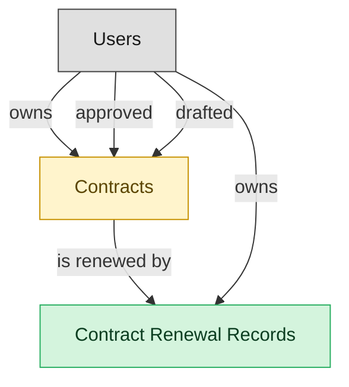

# Contract Renewal Management

## 1. Overview

Date-based renewal alerting, auto-renewal-clause detection, and renewal execution. Consumes legal_contracts; publishes renewal.30_day_warning and legal_contract.renewed. Distinct from amendments which run through CLM-REPOSITORY.

## 2. Entity summary

| Name | data_object | Description |
| --- | --- | --- |
| Contract Renewal Records | `contract_renewal_records` | Records of a single renewal of an existing contract, capturing the renewed term, pricing, and outcome. |
| Contracts | `legal_contracts` | Contracts with counterparties or suppliers, covering type, value, key dates, governing law, and lifecycle from draft to terminated. |

## 3. Entities catalog

| # | data_object | catalog code | singular | plural | held_as | mastered in | mastered label | install_optional | personal_content | entity_type | write tier | notes |
| ---: | --- | --- | --- | --- | --- | --- | --- | --- | --- | --- | --- | --- |
| 1 | `contract_renewal_records` | `contract_renewal_records` | Contract Renewal Record | Contract Renewal Records | master | - | - | - | - | operational_workflow | `:manage` | - |
| 2 | `legal_contracts` | `legal_contracts` | Contract | Contracts | embedded_master | `clm-repository` | Contract Repository | - | yes | operational_workflow | `:manage` | - |

## 4. Aliases and industry synonyms

_(none: no industry-scoped aliases for this scope)_

## 5. Relationships

_`field_required` applies only when both entities are installed. It never makes an entity required._

### 5.1 Relationships between entities in this blueprint

| from | verb | to | cardinality | kind | field_required | delete_mode | fk_format | notes |
| --- | --- | --- | --- | --- | --- | --- | --- | --- |
| `legal_contracts` | is renewed by | `contract_renewal_records` | one_to_many | composition | yes | cascade | parent | - |

### 5.2 Relationships to platform built-ins (`users`)

| from | verb | to | cardinality | field_required | delete_mode | fk_format | notes |
| --- | --- | --- | --- | --- | --- | --- | --- |
| `users` | owns | `legal_contracts` | one_to_many | no | clear | reference | - |
| `users` | approved | `legal_contracts` | one_to_many | no | clear | reference | - |
| `users` | drafted | `legal_contracts` | one_to_many | no | clear | reference | - |
| `users` | owns | `contract_renewal_records` | one_to_many | no | clear | reference | - |

### 5.3 Relationships to entities outside this blueprint

_External entities are optional: this blueprint never installs them. If one exists at install, the relationship is proposed. A many-to-many relationship is listed under outgoing and proposed as a new junction table._

#### 5.3a Outgoing relationships: this blueprint's entity points to the external entity

| from | verb | to | cardinality | field_required | notes |
| --- | --- | --- | --- | --- | --- |
| `in_house_legal_matters` | references | `legal_contracts` | many_to_many | - | - |
| `contract_templates` | seeds | `legal_contracts` | one_to_many | no | - |
| `sourcing_events` | originates | `legal_contracts` | one_to_many | no | - |
| `crm_opportunities` | drafts | `legal_contracts` | one_to_many | no | - |
| `sales_quotes` | drafts | `legal_contracts` | one_to_many | no | - |
| `contract_drafts` | drafts | `legal_contracts` | one_to_many | no | - |
| `quote_discounts` | flows into | `legal_contracts` | one_to_many | no | - |
| `commercial_leases` | flows into | `legal_contracts` | one_to_many | no | - |
| `engagement_letters` | flows into | `legal_contracts` | one_to_many | no | - |
| `contract_counterparties` | is party to | `legal_contracts` | one_to_many | no | - |

#### 5.3b Incoming relationships: the external entity points to this blueprint's entity

| from | verb | to | cardinality | field_required | notes |
| --- | --- | --- | --- | --- | --- |
| `legal_contracts` | governs | `customer_entitlements` | one_to_many | no | - |
| `legal_contracts` | backs | `customer_subscriptions` | one_to_many | no | - |
| `legal_contracts` | contains | `contract_clauses` | one_to_many | no | - |
| `legal_contracts` | imposes | `contract_obligations` | one_to_many | yes | - |
| `legal_contracts` | witnessed_by | `signature_records` | one_to_many | yes | - |
| `legal_contracts` | activates | `saas_subscriptions` | one_to_many | no | - |
| `legal_contracts` | activates | `software_licenses` | one_to_many | no | - |
| `legal_contracts` | triggers_creation_of | `purchase_orders` | one_to_many | no | - |
| `legal_contracts` | triggers_review_in | `purchase_requisitions` | one_to_many | no | - |
| `legal_contracts` | propagates_terms_to | `invoice_matches` | one_to_many | no | - |
| `legal_contracts` | feeds_revrec_in | `revenue_recognition_records` | one_to_many | no | - |
| `legal_contracts` | seeds | `service_projects` | one_to_many | no | - |
| `legal_contracts` | renewal_warns | `crm_opportunities` | one_to_many | no | - |
| `legal_contracts` | renewal_warns | `saas_subscriptions` | one_to_many | no | - |
| `legal_contracts` | renewed_into | `customer_subscriptions` | one_to_many | no | - |
| `legal_contracts` | seeds | `agency_jobs` | one_to_many | no | - |
| `legal_contracts` | is amended by | `contract_amendments` | one_to_many | yes | - |
| `legal_contracts` | is assessed by | `contract_risk_assessments` | one_to_many | no | - |
| `legal_contracts` | has milestone | `contract_milestones` | one_to_many | yes | - |
| `legal_contracts` | has data protection addendum | `data_protection_addenda` | one_to_many | yes | - |
| `legal_contracts` | is negotiated in | `contract_negotiation_threads` | one_to_many | yes | - |

## 6. Cross-domain context

### 6.1 Master consumers (other modules / domains that embed this scope's masters)

_(none: no other module embeds this scope's masters)_

### 6.2 Outbound handoffs (events this scope publishes)

_(none: no outbound handoffs whose payload is in this scope)_

### 6.3 Inbound handoffs (events this scope reacts to)

_(none: no inbound handoffs whose payload is in this scope)_

### 6.4 Master providers (modules / domains that own masters this scope embeds)

| data_object | held_as | install_optional | catalog owner(s) | slice notes |
| --- | --- | --- | --- | --- |
| `legal_contracts` | embedded_master | - | CLM-REPOSITORY (CLM) | - |

## 7. Lifecycle states

### `contract_renewal_records` (Contract Renewal Record)

| order | state_name | initial? | terminal? | realizing module | requires_permission? | high risk? | derived gate | description |
| --- | --- | --- | --- | --- | --- | --- | --- | --- |
| 10 | `pending` | ✓ | - | _(always)_ | - | - | - | - |
| 20 | `in_progress` | - | - | _(always)_ | - | - | - | - |
| 30 | `renewed` | - | ✓ | `CLM-RENEWAL` | ✓ | - | `clm-renewal:renewed_contract_renewal_record` | - |
| 40 | `lapsed` | - | ✓ | _(always)_ | - | - | - | - |

### `legal_contracts` (Contract)

_This scope holds `legal_contracts` as **embedded_master**; the canonical state machine is owned by `CLM-REPOSITORY`._

| order | state_name | initial? | terminal? | realizing module | requires_permission? | high risk? | derived gate | description |
| --- | --- | --- | --- | --- | --- | --- | --- | --- |
| 10 | `draft` | ✓ | - | _(always)_ | - | - | - | Initial draft created in CLM-AUTHORING from a template, or received via inbound handoff from CPQ/sourcing. |
| 20 | `in_review` | - | - | `CLM-NEGOTIATION` | - | - | - | Draft has been routed for internal review prior to counterparty exchange. |
| 30 | `in_negotiation` | - | - | `CLM-NEGOTIATION` | - | - | - | Active counterparty negotiation with track-changes / redline exchange. |
| 40 | `approved` | - | - | `CLM-NEGOTIATION` | ✓ | - | `clm-negotiation:approve_legal_contract` | Final negotiated text approved by all internal stakeholders; ready for signature. |
| 50 | `out_for_signature` | - | - | `CLM-REPOSITORY` | - | - | - | Signature envelope dispatched to all required signers. |
| 60 | `signed` | - | - | `CLM-REPOSITORY` | ✓ | - | `clm-repository:execute_legal_contract` | All signers have signed; contract is fully executed. |
| 70 | `active` | - | - | _(always)_ | - | - | - | Effective date has passed; contract is in force. Default post-signature state. |
| 75 | `amended` | - | - | `CLM-REPOSITORY` | ✓ | - | `clm-repository:amend_legal_contract` | An amendment has been executed against this contract. Amendment is a separate record; this contract row reflects the amended terms going forward. |
| 80 | `expired` | - | ✓ | _(always)_ | - | - | - | End date passed without renewal or termination. Terminal state. |
| 90 | `terminated` | - | ✓ | `CLM-REPOSITORY` | ✓ | - | `clm-repository:terminate_legal_contract` | Contract terminated before end date (by mutual consent, breach, or for-cause). Terminal state. |
| 100 | `renewed` | - | ✓ | `CLM-RENEWAL` | ✓ | - | `clm-renewal:renew_legal_contract` | Renewed via a new contract record (or extended via amendment). The renewal is a separate record; this row is terminal. |

## 8. Permissions and business rules (derived)

### 8.1 Permissions

| permission | tier | description | included in `:admin`? |
| --- | --- | --- | --- |
| `clm-renewal:read` | baseline-read | Read access to every entity in the module | ✓ |
| `clm-renewal:manage` | baseline-manage | Edit operational records | ✓ |
| `clm-renewal:admin` | baseline-admin | Edit reference data and inherit every workflow gate below | - |
| `clm-repository:read_legal_contracts` | entity-read | Read Contracts | ✓ |
| `clm-repository:write_legal_contracts` | entity-write | Write Contracts | ✓ |
| `clm-renewal:read_contract_renewal_records` | entity-read | Read Contract Renewal Records | ✓ |
| `clm-renewal:write_contract_renewal_records` | entity-write | Write Contract Renewal Records | ✓ |
| `clm-negotiation:approve_legal_contract` | workflow-gate (lifecycle) | Transition `legal_contracts` into state `approved` | ✓ |
| `clm-repository:execute_legal_contract` | workflow-gate (lifecycle) | Transition `legal_contracts` into state `signed` | ✓ |
| `clm-repository:amend_legal_contract` | workflow-gate (lifecycle) | Transition `legal_contracts` into state `amended` | ✓ |
| `clm-repository:terminate_legal_contract` | workflow-gate (lifecycle) | Transition `legal_contracts` into state `terminated` | ✓ |
| `clm-renewal:renew_legal_contract` | workflow-gate (lifecycle) | Transition `legal_contracts` into state `renewed` | ✓ |
| `clm-renewal:renewed_contract_renewal_record` | workflow-gate (lifecycle) | Transition `contract_renewal_records` into state `renewed` | ✓ |
| `clm-repository:view_all_contracts` | override (personal_content) | View all `legal_contracts` rows beyond row-scope | ✓ |
| `clm-repository:manage_all_contracts` | override (personal_content) | Manage all `legal_contracts` rows beyond row-scope | ✓ |

_Gates with no process: `clm-repository:amend_legal_contract`, `clm-renewal:renewed_contract_renewal_record`. No Accountable can hold them, so this blueprint does not support `raci`._

### 8.2 Business rules

| rule_name | data_object | source flag | intent |
| --- | --- | --- | --- |
| `contract_edit_scope` | `legal_contracts` | has_personal_content | Row-scope by default; override via `clm-repository:view_all_contracts` / `clm-repository:manage_all_contracts` |

## 9. Roles, RACI, and responsibilities (derived)

_Baseline roles, the permission hierarchy, and RACI realization are DERIVED from this scope's entity-type write tiers + `process_raci`; none of it is stored in the catalog (the deployer provisions it from this blueprint)._

### 9.1 `CLM-RENEWAL`

**Baseline roles:**

| role | baseline grant |
| --- | --- |
| `clm-renewal_viewer` | `clm-renewal:read` |
| `clm-renewal_manager` | `clm-renewal:manage` |
| `clm-renewal_admin` | `clm-renewal:admin` |

**Permission hierarchy:**

| permission | includes |
| --- | --- |
| `clm-renewal:admin` | `clm-renewal:manage` |
| `clm-renewal:manage` | `clm-renewal:read` |
| `clm-renewal:read` | `clm-repository:read_legal_contracts` |
| `clm-renewal:read` | `clm-renewal:read_contract_renewal_records` |
| `clm-renewal:manage` | `clm-repository:write_legal_contracts` |
| `clm-repository:write_legal_contracts` | `clm-repository:read_legal_contracts` |
| `clm-renewal:manage` | `clm-renewal:write_contract_renewal_records` |
| `clm-renewal:write_contract_renewal_records` | `clm-renewal:read_contract_renewal_records` |
| `clm-renewal:admin` | `clm-negotiation:approve_legal_contract` |
| `clm-renewal:admin` | `clm-repository:execute_legal_contract` |
| `clm-renewal:admin` | `clm-repository:amend_legal_contract` |
| `clm-renewal:admin` | `clm-repository:terminate_legal_contract` |
| `clm-renewal:admin` | `clm-renewal:renew_legal_contract` |
| `clm-renewal:admin` | `clm-renewal:renewed_contract_renewal_record` |
| `clm-renewal:admin` | `clm-repository:view_all_contracts` |
| `clm-renewal:admin` | `clm-repository:manage_all_contracts` |

**Processes wired:**

| process_key | process_name | PCF code | PCF ID | level | description |
| --- | --- | --- | --- | --- | --- |
| `negotiate_document_agreements` | Negotiate and document agreements/contracts | 12.4.9 | 11052 | 3 | Negotiating terms to reach a final draft of a contract that is acceptable to all parties. |
| `manage_contracts` | Manage contracts | 4.2.3.4 | 10291 | 4 | Keeping contracts up-to-date with routine evaluation. Maintain order and discipline with the contracts in order to avoid any loss of information and mishaps. |

**RACI realization:**

| actor | kind | raci | process_key | realization |
| --- | --- | --- | --- | --- |
| `LEGAL-COUNSEL` | persona | responsible | `negotiate_document_agreements` | the gated entities' write tier |
| `CONTRACT-OPS-MANAGER` | persona | accountable | `negotiate_document_agreements` | grant gates [clm-negotiation:approve_legal_contract] + the gated entities' write tier |
| `PROCUREMENT-CONTRACT-LIAISON` | persona | consulted | `negotiate_document_agreements` | advisory read grant |
| `CONTRACT-OPS-SPECIALIST` | persona | informed | `negotiate_document_agreements` | notify on trigger_events [legal_contract.approved] |
| `CONTRACT-OPS-SPECIALIST` | persona | responsible | `manage_contracts` | the gated entities' write tier |
| `CONTRACT-OPS-MANAGER` | persona | accountable | `manage_contracts` | grant gates [clm-repository:execute_legal_contract, clm-repository:terminate_legal_contract, clm-renewal:renew_legal_contract] + the gated entities' write tier |
| `LEGAL-COUNSEL` | persona | consulted | `manage_contracts` | advisory read grant |

### 9.2 Functional ownership and default grants

| responsibility | business function | default role | default tier |
| --- | --- | --- | --- |
| owner | Contract Operations | `admin` | `:admin` |
| contributor | Procurement | `manager` | `:manage` |
| contributor | Sales | `manager` | `:manage` |
