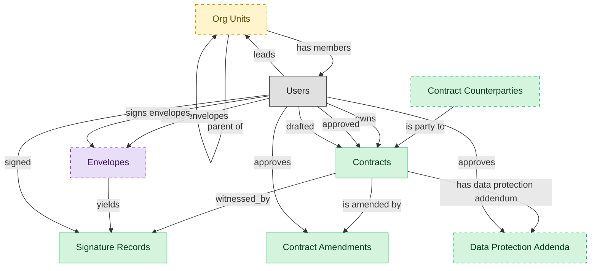

# Contract Repository

## 1. Overview

Executed-contract index. Masters legal_contracts (post-signature) and signature_records. Contributes terms to saas_subscriptions and software_licenses (the buyer-side records that consume contract terms). The system of record for the active, expired, renewed, and terminated lifecycle states.

## 2. Entity summary

| Name | data_object | Description |
| --- | --- | --- |
| Contract Amendments | `contract_amendments` | Formal changes to the terms of an executed contract, each tracked with its own approval and signature trail. |
| Contract Counterparties | `contract_counterparties` | External parties to a contract, held separately because a counterparty may not be a CRM account or supplier and may sign many contracts. |
| Contracts | `legal_contracts` | Contracts with counterparties or suppliers, covering type, value, key dates, governing law, and lifecycle from draft to terminated. |
| Data Protection Addenda | `data_protection_addenda` | Data processing addenda attached to contracts that govern how personal data is handled, each with its own approval and renewal cycle. |
| Signature Records | `signature_records` | E-signature envelopes with signing audit trail, IP addresses, provider references, and the signed document, one contract may have many. |
| Org Units | `org_units` | Nodes in the organizational hierarchy such as divisions, departments, and teams, with manager, cost center alignment, geographic scope, and parent-child relationships. |
| Envelopes | `envelopes` | E-signature transactions wrapping one or more signature requests against a document, tracked from created through completed, declined, or voided. |

## 3. Entities catalog

| # | data_object | catalog code | singular | plural | held_as | mastered in | mastered label | install_optional | personal_content | entity_type | write tier | notes |
| ---: | --- | --- | --- | --- | --- | --- | --- | --- | --- | --- | --- | --- |
| 1 | `contract_amendments` | `contract_amendments` | Contract Amendment | Contract Amendments | master | - | - | - | - | operational_workflow | `:manage` | - |
| 2 | `contract_counterparties` | `contract_counterparties` | Contract Counterparty | Contract Counterparties | master | - | - | yes | yes | operational_record | `:manage` | - |
| 3 | `legal_contracts` | `legal_contracts` | Contract | Contracts | master | - | - | - | yes | operational_workflow | `:manage` | - |
| 4 | `data_protection_addenda` | `data_protection_addenda` | Data Protection Addendum | Data Protection Addenda | master | - | - | yes | yes | operational_workflow | `:manage` | - |
| 5 | `signature_records` | `signature_records` | Signature Record | Signature Records | master | - | - | - | yes | operational_workflow | `:manage` | - |
| 6 | `org_units` | `org_units` | Org Unit | Org Units | embedded_master | `hcm-org-positions` | Organization and Position Management | yes | - | operational_workflow | `:manage` | - |
| 7 | `envelopes` | `envelopes` | Envelope | Envelopes | consumer | - | - | yes | - | operational_workflow | `:manage` | - |

## 4. Aliases and industry synonyms

_(none: no industry-scoped aliases for this scope)_

## 5. Relationships

_`field_required` applies only when both entities are installed. It never makes an entity required._

### 5.1 Relationships between entities in this blueprint

| from | verb | to | cardinality | kind | field_required | delete_mode | fk_format | notes |
| --- | --- | --- | --- | --- | --- | --- | --- | --- |
| `legal_contracts` | witnessed_by | `signature_records` | one_to_many | composition | yes | cascade | parent | - |
| `envelopes` | yields | `signature_records` | one_to_many | reference | no | clear | reference | - |
| `org_units` | parent of | `org_units` | one_to_many | reference | no | clear | reference | - |
| `legal_contracts` | is amended by | `contract_amendments` | one_to_many | composition | yes | cascade | parent | - |
| `contract_counterparties` | is party to | `legal_contracts` | one_to_many | reference | no | clear | reference | - |
| `legal_contracts` | has data protection addendum | `data_protection_addenda` | one_to_many | composition | yes | cascade | parent | - |

### 5.2 Relationships to platform built-ins (`users`)

| from | verb | to | cardinality | field_required | delete_mode | fk_format | notes |
| --- | --- | --- | --- | --- | --- | --- | --- |
| `users` | leads | `org_units` | one_to_many | no | clear | reference | - |
| `users` | owns | `legal_contracts` | one_to_many | no | clear | reference | - |
| `users` | approved | `legal_contracts` | one_to_many | no | clear | reference | - |
| `users` | drafted | `legal_contracts` | one_to_many | no | clear | reference | - |
| `users` | signed | `signature_records` | one_to_many | no | clear | reference | - |
| `org_units` | has members | `users` | one_to_many | no | clear | reference | - |
| `users` | sends envelopes | `envelopes` | one_to_many | no | clear | reference | - |
| `users` | signs envelopes | `envelopes` | one_to_many | no | clear | reference | - |
| `users` | approves | `contract_amendments` | one_to_many | no | clear | reference | - |
| `users` | approves | `data_protection_addenda` | one_to_many | no | clear | reference | - |

### 5.3 Relationships to entities outside this blueprint

_External entities are optional: this blueprint never installs them. If one exists at install, the relationship is proposed. A many-to-many relationship is listed under outgoing and proposed as a new junction table._

#### 5.3a Outgoing relationships: this blueprint's entity points to the external entity

| from | verb | to | cardinality | field_required | notes |
| --- | --- | --- | --- | --- | --- |
| `cost_centers` | funds | `org_units` | one_to_many | yes | - |
| `org_units` | sponsors | `benefit_plans` | many_to_many | - | - |
| `survey_campaigns` | targets | `org_units` | many_to_many | - | - |
| `in_house_legal_matters` | references | `legal_contracts` | many_to_many | - | - |
| `contract_templates` | seeds | `legal_contracts` | one_to_many | no | - |
| `sourcing_events` | originates | `legal_contracts` | one_to_many | no | - |
| `crm_opportunities` | drafts | `legal_contracts` | one_to_many | no | - |
| `sales_quotes` | drafts | `legal_contracts` | one_to_many | no | - |
| `contract_drafts` | drafts | `legal_contracts` | one_to_many | no | - |
| `quote_discounts` | flows into | `legal_contracts` | one_to_many | no | - |
| `commercial_leases` | flows into | `legal_contracts` | one_to_many | no | - |
| `engagement_letters` | flows into | `legal_contracts` | one_to_many | no | - |

#### 5.3b Incoming relationships: the external entity points to this blueprint's entity

| from | verb | to | cardinality | field_required | notes |
| --- | --- | --- | --- | --- | --- |
| `org_units` | groups | `employees` | one_to_many | yes | - |
| `org_units` | contains | `hcm_positions` | one_to_many | yes | - |
| `org_units` | engages | `contingent_workers` | one_to_many | no | - |
| `org_units` | is_scored_by | `engagement_drivers` | one_to_many | no | - |
| `org_units` | is_measured_by | `people_kpis` | one_to_many | no | - |
| `org_units` | triggers | `iga_entitlement_definitions` | one_to_many | no | - |
| `org_units` | maps_to | `cost_centers` | one_to_one | no | - |
| `org_units` | sponsors | `compliance_assignments` | one_to_many | no | - |
| `org_units` | owns | `action_plans` | one_to_many | no | - |
| `legal_contracts` | governs | `customer_entitlements` | one_to_many | no | - |
| `legal_contracts` | backs | `customer_subscriptions` | one_to_many | no | - |
| `legal_contracts` | contains | `contract_clauses` | one_to_many | no | - |
| `legal_contracts` | imposes | `contract_obligations` | one_to_many | yes | - |
| `legal_contracts` | activates | `saas_subscriptions` | one_to_many | no | - |
| `legal_contracts` | activates | `software_licenses` | one_to_many | no | - |
| `legal_contracts` | triggers_creation_of | `purchase_orders` | one_to_many | no | - |
| `legal_contracts` | triggers_review_in | `purchase_requisitions` | one_to_many | no | - |
| `legal_contracts` | propagates_terms_to | `invoice_matches` | one_to_many | no | - |
| `legal_contracts` | feeds_revrec_in | `revenue_recognition_records` | one_to_many | no | - |
| `legal_contracts` | seeds | `service_projects` | one_to_many | no | - |
| `legal_contracts` | renewal_warns | `crm_opportunities` | one_to_many | no | - |
| `legal_contracts` | renewal_warns | `saas_subscriptions` | one_to_many | no | - |
| `legal_contracts` | renewed_into | `customer_subscriptions` | one_to_many | no | - |
| `legal_contracts` | seeds | `agency_jobs` | one_to_many | no | - |
| `legal_contracts` | is renewed by | `contract_renewal_records` | one_to_many | yes | - |
| `legal_contracts` | is assessed by | `contract_risk_assessments` | one_to_many | no | - |
| `legal_contracts` | has milestone | `contract_milestones` | one_to_many | yes | - |
| `legal_contracts` | is negotiated in | `contract_negotiation_threads` | one_to_many | yes | - |

## 6. Cross-domain context

### 6.1 Master consumers (other modules / domains that embed this scope's masters)

_(none: no other module embeds this scope's masters)_

### 6.2 Outbound handoffs (events this scope publishes)

_(none: no outbound handoffs whose payload is in this scope)_

### 6.3 Inbound handoffs (events this scope reacts to)

_(none: no inbound handoffs whose payload is in this scope)_

### 6.4 Master providers (modules / domains that own masters this scope embeds)

| data_object | held_as | install_optional | catalog owner(s) | slice notes |
| --- | --- | --- | --- | --- |
| `org_units` | embedded_master | yes | HCM-ORG-POSITIONS (HCM) | - |
| `envelopes` | consumer | yes | _(no catalog owner recorded)_ | - |

## 7. Lifecycle states

### `contract_amendments` (Contract Amendment)

| order | state_name | initial? | terminal? | realizing module | requires_permission? | high risk? | derived gate | description |
| --- | --- | --- | --- | --- | --- | --- | --- | --- |
| 10 | `drafting` | ✓ | - | _(always)_ | - | - | - | - |
| 20 | `in_review` | - | - | _(always)_ | - | - | - | - |
| 30 | `approved` | - | - | `CLM-REPOSITORY` | ✓ | - | `clm-repository:approved_contract_amendment` | - |
| 40 | `executed` | - | ✓ | `CLM-REPOSITORY` | ✓ | - | `clm-repository:executed_contract_amendment` | - |

### `data_protection_addenda` (Data Protection Addendum)

| order | state_name | initial? | terminal? | realizing module | requires_permission? | high risk? | derived gate | description |
| --- | --- | --- | --- | --- | --- | --- | --- | --- |
| 10 | `drafting` | ✓ | - | _(always)_ | - | - | - | - |
| 20 | `active` | - | - | `CLM-REPOSITORY` | ✓ | - | `clm-repository:active_data_protection_addendum` | - |
| 30 | `expired` | - | ✓ | _(always)_ | - | - | - | - |

### `legal_contracts` (Contract)

| order | state_name | initial? | terminal? | realizing module | requires_permission? | high risk? | derived gate | description |
| --- | --- | --- | --- | --- | --- | --- | --- | --- |
| 10 | `draft` | ✓ | - | _(always)_ | - | - | - | Initial draft created in CLM-AUTHORING from a template, or received via inbound handoff from CPQ/sourcing. |
| 20 | `in_review` | - | - | `CLM-NEGOTIATION` | - | - | - | Draft has been routed for internal review prior to counterparty exchange. |
| 30 | `in_negotiation` | - | - | `CLM-NEGOTIATION` | - | - | - | Active counterparty negotiation with track-changes / redline exchange. |
| 40 | `approved` | - | - | `CLM-NEGOTIATION` | ✓ | - | `clm-negotiation:approve_legal_contract` | Final negotiated text approved by all internal stakeholders; ready for signature. |
| 50 | `out_for_signature` | - | - | `CLM-REPOSITORY` | - | - | - | Signature envelope dispatched to all required signers. |
| 60 | `signed` | - | - | `CLM-REPOSITORY` | ✓ | - | `clm-repository:execute_legal_contract` | All signers have signed; contract is fully executed. |
| 70 | `active` | - | - | _(always)_ | - | - | - | Effective date has passed; contract is in force. Default post-signature state. |
| 75 | `amended` | - | - | `CLM-REPOSITORY` | ✓ | - | `clm-repository:amend_legal_contract` | An amendment has been executed against this contract. Amendment is a separate record; this contract row reflects the amended terms going forward. |
| 80 | `expired` | - | ✓ | _(always)_ | - | - | - | End date passed without renewal or termination. Terminal state. |
| 90 | `terminated` | - | ✓ | `CLM-REPOSITORY` | ✓ | - | `clm-repository:terminate_legal_contract` | Contract terminated before end date (by mutual consent, breach, or for-cause). Terminal state. |
| 100 | `renewed` | - | ✓ | `CLM-RENEWAL` | ✓ | - | `clm-renewal:renew_legal_contract` | Renewed via a new contract record (or extended via amendment). The renewal is a separate record; this row is terminal. |

### `org_units` (Org Unit)

_This scope holds `org_units` as **embedded_master**; the canonical state machine is owned by `HCM-ORG-POSITIONS`._

| order | state_name | initial? | terminal? | realizing module | requires_permission? | high risk? | derived gate | description |
| --- | --- | --- | --- | --- | --- | --- | --- | --- |
| 1 | `draft` | ✓ | - | `HCM-ORG-POSITIONS` | - | - | - | Org unit defined as part of a future structure; not yet operational. |
| 2 | `active` | - | - | `HCM-ORG-POSITIONS` | ✓ | - | `hcm-org-positions:active_org_unit` | Operational unit; carries headcount, cost-center relationship, and reporting lines. |
| 3 | `reorganized` | - | ✓ | `HCM-ORG-POSITIONS` | ✓ | - | `hcm-org-positions:reorganized_org_unit` | Unit folded into or replaced by a new structure; references remain for history. |
| 4 | `closed` | - | ✓ | `HCM-ORG-POSITIONS` | ✓ | - | `hcm-org-positions:closed_org_unit` | Unit dissolved; no employees or positions reside in it. |

### `signature_records` (Signature Record)

| order | state_name | initial? | terminal? | realizing module | requires_permission? | high risk? | derived gate | description |
| --- | --- | --- | --- | --- | --- | --- | --- | --- |
| 10 | `pending` | ✓ | - | _(always)_ | - | - | - | Signature envelope created but not yet dispatched. |
| 20 | `sent` | - | - | `CLM-REPOSITORY` | - | - | - | Envelope dispatched to first signer(s); awaiting first signature. |
| 30 | `in_progress` | - | - | `CLM-REPOSITORY` | - | - | - | One or more signers have signed; others remain. |
| 40 | `completed` | - | ✓ | _(always)_ | - | - | - | All required signers have signed. The signed contract document is persisted. Terminal positive outcome. |
| 50 | `declined` | - | ✓ | _(always)_ | - | - | - | A signer declined to sign. Envelope is terminal; a new envelope can be created if negotiation re-opens. |
| 60 | `voided` | - | ✓ | `CLM-REPOSITORY` | ✓ | - | `clm-repository:void_signature_record` | Sender voided the envelope before all signers completed. Terminal. |

## 8. Permissions and business rules (derived)

### 8.1 Permissions

| permission | tier | description | included in `:admin`? |
| --- | --- | --- | --- |
| `clm-repository:read` | baseline-read | Read access to every entity in the module | ✓ |
| `clm-repository:manage` | baseline-manage | Edit operational records | ✓ |
| `clm-repository:admin` | baseline-admin | Edit reference data and inherit every workflow gate below | - |
| `hcm-org-positions:read_org_units` | entity-read | Read Org Units | ✓ |
| `hcm-org-positions:write_org_units` | entity-write | Write Org Units | ✓ |
| `clm-repository:read_legal_contracts` | entity-read | Read Contracts | ✓ |
| `clm-repository:write_legal_contracts` | entity-write | Write Contracts | ✓ |
| `clm-repository:read_signature_records` | entity-read | Read Signature Records | ✓ |
| `clm-repository:write_signature_records` | entity-write | Write Signature Records | ✓ |
| `clm-repository:read_contract_amendments` | entity-read | Read Contract Amendments | ✓ |
| `clm-repository:write_contract_amendments` | entity-write | Write Contract Amendments | ✓ |
| `clm-repository:read_contract_counterparties` | entity-read | Read Contract Counterparties | ✓ |
| `clm-repository:write_contract_counterparties` | entity-write | Write Contract Counterparties | ✓ |
| `clm-repository:read_data_protection_addenda` | entity-read | Read Data Protection Addenda | ✓ |
| `clm-repository:write_data_protection_addenda` | entity-write | Write Data Protection Addenda | ✓ |
| `hcm-org-positions:active_org_unit` | workflow-gate (lifecycle) | Transition `org_units` into state `active` | ✓ |
| `hcm-org-positions:reorganized_org_unit` | workflow-gate (lifecycle) | Transition `org_units` into state `reorganized` | ✓ |
| `hcm-org-positions:closed_org_unit` | workflow-gate (lifecycle) | Transition `org_units` into state `closed` | ✓ |
| `clm-negotiation:approve_legal_contract` | workflow-gate (lifecycle) | Transition `legal_contracts` into state `approved` | ✓ |
| `clm-repository:execute_legal_contract` | workflow-gate (lifecycle) | Transition `legal_contracts` into state `signed` | ✓ |
| `clm-repository:amend_legal_contract` | workflow-gate (lifecycle) | Transition `legal_contracts` into state `amended` | ✓ |
| `clm-repository:terminate_legal_contract` | workflow-gate (lifecycle) | Transition `legal_contracts` into state `terminated` | ✓ |
| `clm-renewal:renew_legal_contract` | workflow-gate (lifecycle) | Transition `legal_contracts` into state `renewed` | ✓ |
| `clm-repository:void_signature_record` | workflow-gate (lifecycle) | Transition `signature_records` into state `voided` | ✓ |
| `clm-repository:approved_contract_amendment` | workflow-gate (lifecycle) | Transition `contract_amendments` into state `approved` | ✓ |
| `clm-repository:executed_contract_amendment` | workflow-gate (lifecycle) | Transition `contract_amendments` into state `executed` | ✓ |
| `clm-repository:active_data_protection_addendum` | workflow-gate (lifecycle) | Transition `data_protection_addenda` into state `active` | ✓ |
| `clm-repository:view_all_contracts` | override (personal_content) | View all `legal_contracts` rows beyond row-scope | ✓ |
| `clm-repository:manage_all_contracts` | override (personal_content) | Manage all `legal_contracts` rows beyond row-scope | ✓ |
| `clm-repository:view_all_signature_records` | override (personal_content) | View all `signature_records` rows beyond row-scope | ✓ |
| `clm-repository:manage_all_signature_records` | override (personal_content) | Manage all `signature_records` rows beyond row-scope | ✓ |
| `clm-repository:view_all_contract_counterparties` | override (personal_content) | View all `contract_counterparties` rows beyond row-scope | ✓ |
| `clm-repository:manage_all_contract_counterparties` | override (personal_content) | Manage all `contract_counterparties` rows beyond row-scope | ✓ |
| `clm-repository:view_all_data_protection_addenda` | override (personal_content) | View all `data_protection_addenda` rows beyond row-scope | ✓ |
| `clm-repository:manage_all_data_protection_addenda` | override (personal_content) | Manage all `data_protection_addenda` rows beyond row-scope | ✓ |

_Gates with no process: `hcm-org-positions:closed_org_unit`, `clm-repository:amend_legal_contract`, `clm-repository:approved_contract_amendment`, `clm-repository:executed_contract_amendment`, `clm-repository:active_data_protection_addendum`. No Accountable can hold them, so this blueprint does not support `raci`._

### 8.2 Business rules

| rule_name | data_object | source flag | intent |
| --- | --- | --- | --- |
| `contract_edit_scope` | `legal_contracts` | has_personal_content | Row-scope by default; override via `clm-repository:view_all_contracts` / `clm-repository:manage_all_contracts` |
| `signature_record_edit_scope` | `signature_records` | has_personal_content | Row-scope by default; override via `clm-repository:view_all_signature_records` / `clm-repository:manage_all_signature_records` |
| `contract_counterparty_edit_scope` | `contract_counterparties` | has_personal_content | Row-scope by default; override via `clm-repository:view_all_contract_counterparties` / `clm-repository:manage_all_contract_counterparties` |
| `data_protection_addendum_edit_scope` | `data_protection_addenda` | has_personal_content | Row-scope by default; override via `clm-repository:view_all_data_protection_addenda` / `clm-repository:manage_all_data_protection_addenda` |

## 9. Roles, RACI, and responsibilities (derived)

_Baseline roles, the permission hierarchy, and RACI realization are DERIVED from this scope's entity-type write tiers + `process_raci`; none of it is stored in the catalog (the deployer provisions it from this blueprint)._

### 9.1 `CLM-REPOSITORY`

**Baseline roles:**

| role | baseline grant |
| --- | --- |
| `clm-repository_viewer` | `clm-repository:read` |
| `clm-repository_manager` | `clm-repository:manage` |
| `clm-repository_admin` | `clm-repository:admin` |

**Permission hierarchy:**

| permission | includes |
| --- | --- |
| `clm-repository:admin` | `clm-repository:manage` |
| `clm-repository:manage` | `clm-repository:read` |
| `clm-repository:read` | `hcm-org-positions:read_org_units` |
| `clm-repository:read` | `clm-repository:read_legal_contracts` |
| `clm-repository:read` | `clm-repository:read_signature_records` |
| `clm-repository:read` | `clm-repository:read_contract_amendments` |
| `clm-repository:read` | `clm-repository:read_contract_counterparties` |
| `clm-repository:read` | `clm-repository:read_data_protection_addenda` |
| `clm-repository:manage` | `hcm-org-positions:write_org_units` |
| `hcm-org-positions:write_org_units` | `hcm-org-positions:read_org_units` |
| `clm-repository:manage` | `clm-repository:write_legal_contracts` |
| `clm-repository:write_legal_contracts` | `clm-repository:read_legal_contracts` |
| `clm-repository:manage` | `clm-repository:write_signature_records` |
| `clm-repository:write_signature_records` | `clm-repository:read_signature_records` |
| `clm-repository:manage` | `clm-repository:write_contract_amendments` |
| `clm-repository:write_contract_amendments` | `clm-repository:read_contract_amendments` |
| `clm-repository:manage` | `clm-repository:write_contract_counterparties` |
| `clm-repository:write_contract_counterparties` | `clm-repository:read_contract_counterparties` |
| `clm-repository:manage` | `clm-repository:write_data_protection_addenda` |
| `clm-repository:write_data_protection_addenda` | `clm-repository:read_data_protection_addenda` |
| `clm-repository:admin` | `hcm-org-positions:active_org_unit` |
| `clm-repository:admin` | `hcm-org-positions:reorganized_org_unit` |
| `clm-repository:admin` | `hcm-org-positions:closed_org_unit` |
| `clm-repository:admin` | `clm-negotiation:approve_legal_contract` |
| `clm-repository:admin` | `clm-repository:execute_legal_contract` |
| `clm-repository:admin` | `clm-repository:amend_legal_contract` |
| `clm-repository:admin` | `clm-repository:terminate_legal_contract` |
| `clm-repository:admin` | `clm-renewal:renew_legal_contract` |
| `clm-repository:admin` | `clm-repository:void_signature_record` |
| `clm-repository:admin` | `clm-repository:approved_contract_amendment` |
| `clm-repository:admin` | `clm-repository:executed_contract_amendment` |
| `clm-repository:admin` | `clm-repository:active_data_protection_addendum` |
| `clm-repository:admin` | `clm-repository:view_all_contracts` |
| `clm-repository:admin` | `clm-repository:manage_all_contracts` |
| `clm-repository:admin` | `clm-repository:view_all_signature_records` |
| `clm-repository:admin` | `clm-repository:manage_all_signature_records` |
| `clm-repository:admin` | `clm-repository:view_all_contract_counterparties` |
| `clm-repository:admin` | `clm-repository:manage_all_contract_counterparties` |
| `clm-repository:admin` | `clm-repository:view_all_data_protection_addenda` |
| `clm-repository:admin` | `clm-repository:manage_all_data_protection_addenda` |

**Processes wired:**

| process_key | process_name | PCF code | PCF ID | level | description |
| --- | --- | --- | --- | --- | --- |
| `create_organizational_design` | Create organizational design | 1.2.5 | 10041 | 3 | Formulating a design for the organization's resources that allow it to meet its objectives. Develop a new framework for molding the organization's various processes into a coherent and seamless whole. |
| `conduct_organization` | Conduct organization restructuring opportunities | 1.1.5 | 16792 | 3 | Examining the scope and contingencies for restructuring based on market situation and internal realities. Map the market forces over which any and all probabilities can be probed for utility and viability. Once the restructuring options have been analyzed and the due-diligence performed, execute the deal. Consider seeking professional services for assistance in formalizing these opportunities. |
| `negotiate_document_agreements` | Negotiate and document agreements/contracts | 12.4.9 | 11052 | 3 | Negotiating terms to reach a final draft of a contract that is acceptable to all parties. |
| `manage_contracts` | Manage contracts | 4.2.3.4 | 10291 | 4 | Keeping contracts up-to-date with routine evaluation. Maintain order and discipline with the contracts in order to avoid any loss of information and mishaps. |

**RACI realization:**

| actor | kind | raci | process_key | realization |
| --- | --- | --- | --- | --- |
| `HR-ORG-DESIGN-ANALYST` | persona | responsible | `create_organizational_design` | the gated entities' write tier |
| `HR-BUSINESS-PARTNER` | persona | accountable | `create_organizational_design` | grant gates [hcm-org-positions:active_org_unit] + the gated entities' write tier |
| `PEOPLE-MANAGER` | persona | consulted | `create_organizational_design` | advisory read grant |
| `HR-HRIS-ADMIN` | persona | informed | `create_organizational_design` | ⚠ no event wired |
| `HR-ORG-DESIGN-ANALYST` | persona | responsible | `conduct_organization` | the gated entities' write tier |
| `HR-BUSINESS-PARTNER` | persona | accountable | `conduct_organization` | grant gates [hcm-org-positions:reorganized_org_unit] + the gated entities' write tier |
| `PEOPLE-MANAGER` | persona | consulted | `conduct_organization` | advisory read grant |
| `LEGAL-COUNSEL` | persona | responsible | `negotiate_document_agreements` | the gated entities' write tier |
| `CONTRACT-OPS-MANAGER` | persona | accountable | `negotiate_document_agreements` | grant gates [clm-negotiation:approve_legal_contract] + the gated entities' write tier |
| `PROCUREMENT-CONTRACT-LIAISON` | persona | consulted | `negotiate_document_agreements` | advisory read grant |
| `CONTRACT-OPS-SPECIALIST` | persona | informed | `negotiate_document_agreements` | notify on trigger_events [legal_contract.approved] |
| `CONTRACT-OPS-SPECIALIST` | persona | responsible | `manage_contracts` | the gated entities' write tier |
| `CONTRACT-OPS-MANAGER` | persona | accountable | `manage_contracts` | grant gates [clm-repository:execute_legal_contract, clm-repository:terminate_legal_contract, clm-renewal:renew_legal_contract, clm-repository:void_signature_record] + the gated entities' write tier |
| `LEGAL-COUNSEL` | persona | consulted | `manage_contracts` | advisory read grant |

### 9.2 Functional ownership and default grants

| responsibility | business function | default role | default tier |
| --- | --- | --- | --- |
| owner | Contract Operations | `admin` | `:admin` |
| contributor | Procurement | `manager` | `:manage` |
| contributor | Sales | `manager` | `:manage` |
