# Core Worker Record

## 1. Overview

Core worker record: identity, employment lifecycle, contracts, and effective-dated employment events. The system-of-record layer for every employee.

## 2. Entity summary

| Name | data_object | Description |
| --- | --- | --- |
| Emergency Contacts | `emergency_contacts` | People to contact in an emergency for a worker, with priority order and relationship. Holds personal data on third parties. |
| Employee Dependents | `employee_dependents` | Spouses, children, and other dependents of a worker, used by benefits administration for eligibility and beneficiary designation. |
| Employees | `employees` | Canonical records of people currently or formerly employed, carrying identity, employment metadata, and relationships to position, manager, and org unit. |
| Employment Contracts | `employment_contracts` | Contractual terms of employment: contract type, start and end dates, jurisdiction, working hours, notice period, and references to the signed document. |
| Employment Events | `employment_events` | Lifecycle events for an employee, such as hire, promotion, transfer, leave, comp change, and termination. The audit history of an employment. |
| National IDs | `national_ids` | Government-issued identity numbers for a worker, such as social security or national insurance numbers, held with restricted access and validity dates. |
| Work Eligibility Documents | `work_eligibility_documents` | Right-to-work evidence for a worker such as a visa or work permit, effective-dated with a tracked expiry, jurisdiction-conditional and access-restricted. |
| Worker Addresses | `worker_addresses` | Home, work, and mailing addresses for a worker, effective-dated and typed by purpose, supporting multi-jurisdiction formats. |
| Locations | `locations` | Physical or organizational locations referenced across the system, used to place and group other records. |
| Cost Centers | `cost_centers` | Organizational units for cost allocation, with code, manager, hierarchy, and currency, driving variance and departmental reporting. |
| Contingent Workers | `contingent_workers` | Non-employee resources such as contractors, agency staff, consultants, and interns, with supplier, role, rate, and end date. |
| MDM Source Records | `source_records` | Raw records pulled from source systems before match and merge, preserving origin and source identifier for lineage. |
| Onboarding Document Collections | `onboarding_document_collections` | Paperwork collected from a new hire during onboarding, such as tax and eligibility forms, with signature state and e-signature envelope references. |
| Pay Slips | `pay_slips` | Per-employee per-cycle gross-to-net pay statements, showing earnings, deductions, contributions, withholdings, net pay, and year-to-date totals. |
| People KPIs | `people_kpis` | Calculated workforce metrics such as time-to-fill, attrition, retention, and cost-per-hire, derived from HR, recruiting, learning, and payroll event streams. |
| Project Assignments | `project_assignments` | Allocations of a worker to a project, with role, bill rate, cost rate, planned hours, and period, driving utilization and availability reporting. |
| Project Resource Allocations | `project_resource_allocations` | Forward-looking plans committing resources to projects, with skill, planned utilization, and effective period, distinct from executed assignments. |
| Resource Skill Inventories | `resource_skill_inventories` | Inventories of skills and competencies across the resource base, with proficiency levels, used to forecast utilization. |
| Users | `users` | Platform users referenced as assignees, authors, approvers, and creators across records. |

```mermaid
flowchart TD
  classDef master fill:#d4f4dd,stroke:#27ae60,color:#0b3d20;
  classDef embedded_master fill:#fff4cc,stroke:#c79100,color:#5b4500;
  classDef contributor fill:#cfe8ff,stroke:#1976d2,color:#0d3a66;
  classDef consumer fill:#e8def8,stroke:#7b1fa2,color:#3a155d;
  onboarding_document_collections["Onboarding Document Collections"]
  employees["Employees"]
  employment_contracts["Employment Contracts"]
  employment_events["Employment Events"]
  people_kpis["People KPIs"]
  pay_slips["Pay Slips"]
  contingent_workers["Contingent Workers"]
  cost_centers["Cost Centers"]
  project_assignments["Project Assignments"]
  source_records["MDM Source Records"]
  resource_skill_inventories["Resource Skill Inventories"]
  project_resource_allocations["Project Resource Allocations"]
  users["Users"]
  locations["Locations"]
  emergency_contacts["Emergency Contacts"]
  work_eligibility_documents["Work Eligibility Documents"]
  national_ids["National IDs"]
  worker_addresses["Worker Addresses"]
  employee_dependents["Employee Dependents"]
  employees -->|"signs"| employment_contracts
  employees -->|"generates"| employment_events
  users -->|"represents"| employees
  users -->|"approves"| employment_contracts
  users -->|"records"| employment_events
  users -->|"owns"| cost_centers
  users -->|"sponsors"| contingent_workers
  employment_events -->|"feeds"| people_kpis
  users -->|"approves"| onboarding_document_collections
  employees -->|"finalized by"| onboarding_document_collections
  users -->|"manages"| contingent_workers
  employees -->|"reclassifies"| contingent_workers
  locations -->|"parent of"| locations
  locations -->|"houses"| users
  project_assignments -->|"requires_skills_from"| resource_skill_inventories
  project_resource_allocations -->|"confirms_into"| project_assignments
  users -->|"staffed_on"| project_assignments
  users -->|"has_skill_profile"| resource_skill_inventories
  users -->|"allocates"| project_resource_allocations
  users -->|"publishes"| people_kpis
  users -->|"receives pay slips"| pay_slips
  contingent_workers -->|"converts_to"| employees
  employees -->|"has"| emergency_contacts
  employees -->|"has"| work_eligibility_documents
  employees -->|"has"| national_ids
  employees -->|"has"| worker_addresses
  users -->|"verifies"| work_eligibility_documents
  employees -->|"has"| employee_dependents
  class onboarding_document_collections consumer;
  class employees master;
  class employment_contracts master;
  class employment_events master;
  class people_kpis consumer;
  class pay_slips consumer;
  class contingent_workers consumer;
  class cost_centers contributor;
  class project_assignments consumer;
  class source_records consumer;
  class resource_skill_inventories consumer;
  class project_resource_allocations consumer;
  class users consumer;
  class locations embedded_master;
  class emergency_contacts master;
  class work_eligibility_documents master;
  class national_ids master;
  class worker_addresses master;
  class employee_dependents master;
  style onboarding_document_collections stroke-dasharray:5 5;
  style people_kpis stroke-dasharray:5 5;
  style pay_slips stroke-dasharray:5 5;
  style contingent_workers stroke-dasharray:5 5;
  style cost_centers stroke-dasharray:5 5;
  style project_assignments stroke-dasharray:5 5;
  style source_records stroke-dasharray:5 5;
  style resource_skill_inventories stroke-dasharray:5 5;
  style project_resource_allocations stroke-dasharray:5 5;
  style locations stroke-dasharray:5 5;
  style emergency_contacts stroke-dasharray:5 5;
  style work_eligibility_documents stroke-dasharray:5 5;
  style national_ids stroke-dasharray:5 5;
  style worker_addresses stroke-dasharray:5 5;
  style employee_dependents stroke-dasharray:5 5;
```

## 3. Entities catalog

| # | data_object | catalog code | singular | plural | held_as | mastered in | mastered label | install_optional | personal_content | entity_type | write tier | notes |
| ---: | --- | --- | --- | --- | --- | --- | --- | --- | --- | --- | --- | --- |
| 1 | `emergency_contacts` | `emergency_contacts` | Emergency Contact | Emergency Contacts | master | - | - | yes | yes | operational_record | `:manage` | - |
| 2 | `employee_dependents` | `employee_dependents` | Employee Dependent | Employee Dependents | master | - | - | yes | yes | operational_record | `:manage` | - |
| 3 | `employees` | `employees` | Employee | Employees | master | - | - | - | yes | operational_workflow | `:manage` | - |
| 4 | `employment_contracts` | `employment_contracts` | Employment Contract | Employment Contracts | master | - | - | - | yes | operational_workflow | `:manage` | - |
| 5 | `employment_events` | `employment_events` | Employment Event | Employment Events | master | - | - | - | yes | operational_workflow | `:manage` | - |
| 6 | `national_ids` | `national_ids` | National ID | National IDs | master | - | - | yes | yes | operational_record | `:manage` | - |
| 7 | `work_eligibility_documents` | `work_eligibility_documents` | Work Eligibility Document | Work Eligibility Documents | master | - | - | yes | yes | operational_workflow | `:manage` | - |
| 8 | `worker_addresses` | `worker_addresses` | Worker Address | Worker Addresses | master | - | - | yes | yes | operational_record | `:manage` | - |
| 9 | `locations` | `locations` | Location | Locations | embedded_master | `iwms-location-master` | Location and Property Master | yes | - | catalog | `:admin` | - |
| 10 | `cost_centers` | `cost_centers` | Cost Center | Cost Centers | contributor | `fin-gl-close` | General Ledger and Close | yes | - | catalog | `:admin` | - |
| 11 | `contingent_workers` | `contingent_workers` | Contingent Worker | Contingent Workers | consumer | `cwm-worker-sourcing` | Worker Sourcing and Supplier Management | yes | yes | operational_workflow | `:manage` | - |
| 12 | `source_records` | `source_records` | MDM Source Record | MDM Source Records | consumer | - | - | yes | - | operational_workflow | `:manage` | - |
| 13 | `onboarding_document_collections` | `onboarding_document_collections` | Onboarding Document Collection | Onboarding Document Collections | consumer | `onb-document-intake` | Onboarding Document Intake | yes | yes | operational_workflow | `:manage` | - |
| 14 | `pay_slips` | `pay_slips` | Pay Slip | Pay Slips | consumer | `payroll-employee-pay-statements` | Pay Slips and Self-Service Statements | yes | yes | operational_workflow | `:manage` | - |
| 15 | `people_kpis` | `people_kpis` | People KPI | People KPIs | consumer | `pa-workforce-metrics` | Workforce Metrics | yes | - | computed | read-only | - |
| 16 | `project_assignments` | `project_assignments` | Project Assignment | Project Assignments | consumer | `psa-resource-mgmt` | Resource Management | yes | - | operational_workflow | `:manage` | - |
| 17 | `project_resource_allocations` | `project_resource_allocations` | Project Resource Allocation | Project Resource Allocations | consumer | `psa-resource-mgmt` | Resource Management | yes | - | operational_workflow | `:manage` | - |
| 18 | `resource_skill_inventories` | `resource_skill_inventories` | Resource Skill Inventory | Resource Skill Inventories | consumer | `psa-resource-mgmt` | Resource Management | yes | - | catalog | `:admin` | - |
| 19 | `users` | `users` | User | Users | consumer | _(platform built-in)_ | _(platform built-in)_ | - | - | operational_record | `:manage` | - |

## 4. Aliases and industry synonyms

_(none: no industry-scoped aliases for this scope)_

## 5. Relationships

_`field_required` applies only when both entities are installed. It never makes an entity required._

### 5.1 Relationships between entities in this blueprint

| from | verb | to | cardinality | kind | field_required | delete_mode | fk_format | notes |
| --- | --- | --- | --- | --- | --- | --- | --- | --- |
| `employees` | signs | `employment_contracts` | one_to_many | composition | yes | cascade | parent | - |
| `employees` | generates | `employment_events` | one_to_many | composition | yes | cascade | parent | - |
| `employment_events` | feeds | `people_kpis` | one_to_many | reference | no | clear | reference | - |
| `employees` | finalized by | `onboarding_document_collections` | one_to_many | reference | no | clear | reference | - |
| `employees` | reclassifies | `contingent_workers` | one_to_one | reference | no | clear | reference | - |
| `locations` | parent of | `locations` | one_to_many | reference | no | clear | reference | - |
| `project_assignments` | requires_skills_from | `resource_skill_inventories` | many_to_many | reference | - | cascade | parent | - |
| `project_resource_allocations` | confirms_into | `project_assignments` | one_to_many | reference | no | clear | reference | - |
| `contingent_workers` | converts_to | `employees` | one_to_one | reference | no | clear | reference | - |
| `employees` | has | `emergency_contacts` | one_to_many | composition | yes | cascade | parent | - |
| `employees` | has | `work_eligibility_documents` | one_to_many | composition | yes | cascade | parent | - |
| `employees` | has | `national_ids` | one_to_many | composition | yes | cascade | parent | - |
| `employees` | has | `worker_addresses` | one_to_many | composition | yes | cascade | parent | - |
| `employees` | has | `employee_dependents` | one_to_many | composition | yes | cascade | parent | - |

### 5.2 Relationships to platform built-ins (`users`)

| from | verb | to | cardinality | field_required | delete_mode | fk_format | notes |
| --- | --- | --- | --- | --- | --- | --- | --- |
| `users` | represents | `employees` | one_to_one | no | clear | reference | - |
| `users` | approves | `employment_contracts` | one_to_many | no | clear | reference | - |
| `users` | records | `employment_events` | one_to_many | no | clear | reference | - |
| `users` | owns | `cost_centers` | one_to_many | no | clear | reference | - |
| `users` | sponsors | `contingent_workers` | one_to_many | no | clear | reference | - |
| `users` | approves | `onboarding_document_collections` | one_to_many | no | clear | reference | - |
| `users` | manages | `contingent_workers` | one_to_many | no | clear | reference | - |
| `locations` | houses | `users` | one_to_many | no | clear | reference | - |
| `users` | staffed_on | `project_assignments` | one_to_many | yes | restrict | reference | - |
| `users` | has_skill_profile | `resource_skill_inventories` | one_to_many | yes | restrict | reference | - |
| `users` | allocates | `project_resource_allocations` | one_to_many | yes | restrict | reference | - |
| `users` | publishes | `people_kpis` | one_to_many | no | clear | reference | - |
| `users` | receives pay slips | `pay_slips` | one_to_many | no | clear | reference | - |
| `users` | verifies | `work_eligibility_documents` | one_to_many | no | clear | reference | - |

### 5.3 Relationships to entities outside this blueprint

_External entities are optional: this blueprint never installs them. If one exists at install, the relationship is proposed. A many-to-many relationship is listed under outgoing and proposed as a new junction table._

#### 5.3a Outgoing relationships: this blueprint's entity points to the external entity

| from | verb | to | cardinality | field_required | notes |
| --- | --- | --- | --- | --- | --- |
| `org_units` | groups | `employees` | one_to_many | yes | - |
| `org_units` | engages | `contingent_workers` | one_to_many | no | - |
| `org_units` | is_measured_by | `people_kpis` | one_to_many | no | - |
| `org_units` | maps_to | `cost_centers` | one_to_one | no | - |
| `onboarding_journeys` | collects | `onboarding_document_collections` | one_to_many | yes | - |
| `pay_runs` | finalized by | `onboarding_document_collections` | one_to_many | no | - |
| `learning_records` | feeds | `people_kpis` | one_to_many | no | - |
| `survey_campaigns` | targets | `employees` | many_to_many | - | - |
| `engagement_drivers` | feeds | `people_kpis` | one_to_many | no | - |
| `survey_responses` | feeds | `people_kpis` | one_to_many | no | - |
| `case_categories` | drives | `employees` | one_to_many | no | - |
| `legal_holds` | identifies_custodians_from | `employees` | many_to_many | - | - |
| `legal_advice_records` | references | `employees` | many_to_many | - | - |
| `staffing_suppliers` | provides | `contingent_workers` | one_to_many | yes | - |
| `store_audits` | triggers | `employment_events` | one_to_many | no | - |
| `candidates` | becomes | `employees` | one_to_one | no | - |
| `job_requisitions` | feeds | `people_kpis` | one_to_many | no | - |
| `pre_employees` | promotes to | `employees` | one_to_one | no | - |
| `service_projects` | staffs | `project_assignments` | one_to_many | yes | - |
| `service_projects` | plans_resources_via | `project_resource_allocations` | one_to_many | yes | - |
| `project_tasks` | performed_by | `project_assignments` | many_to_many | - | - |
| `pay_runs` | produces | `pay_slips` | one_to_many | yes | - |
| `earning_codes` | contributes_to | `pay_slips` | many_to_many | - | - |
| `deduction_codes` | contributes_to | `pay_slips` | many_to_many | - | - |

#### 5.3b Incoming relationships: the external entity points to this blueprint's entity

| from | verb | to | cardinality | field_required | notes |
| --- | --- | --- | --- | --- | --- |
| `cost_centers` | funds | `org_units` | one_to_many | yes | - |
| `employees` | triggers | `asset_lifecycle_events` | one_to_many | no | - |
| `employees` | requests | `absence_requests` | one_to_many | no | - |
| `employees` | holds | `skill_profiles` | one_to_one | no | - |
| `employees` | triggers | `service_requests` | one_to_many | no | - |
| `employees` | triggers | `iga_provisioning_events` | one_to_many | no | - |
| `employment_events` | triggers | `iga_provisioning_events` | one_to_many | no | - |
| `employment_contracts` | triggers | `iga_provisioning_events` | one_to_many | no | - |
| `employees` | triggers | `pay_runs` | one_to_many | no | - |
| `employment_events` | feeds | `pay_runs` | one_to_many | no | - |
| `employment_contracts` | feeds | `pay_runs` | one_to_many | no | - |
| `employees` | enrolls_in | `course_enrollments` | one_to_many | no | - |
| `employees` | becomes | `career_aspirations` | one_to_one | no | - |
| `employees` | becomes | `work_shifts` | one_to_many | no | - |
| `employees` | becomes | `compensation_statements` | one_to_one | no | - |
| `employees` | triggers | `benefit_enrollments` | one_to_many | no | - |
| `employment_events` | triggers | `benefit_enrollments` | one_to_many | no | - |
| `employees` | triggers | `corporate_cards` | one_to_many | no | - |
| `employees` | spawns | `onboarding_journeys` | one_to_one | no | - |
| `employees` | spawns | `hr_cases` | one_to_many | no | - |
| `employees` | feeds | `headcount_plans` | one_to_many | no | - |
| `employees` | feeds | `agency_time_entries` | one_to_many | no | - |
| `employees` | onboarded by | `onboarding_journeys` | one_to_many | yes | - |
| `employees` | fills | `hcm_positions` | one_to_one | no | - |
| `employees` | learns_via | `course_enrollments` | one_to_many | yes | - |
| `cost_centers` | funds | `course_enrollments` | one_to_many | no | - |
| `employees` | reflects | `learning_records` | one_to_many | no | - |
| `employees` | reflected on | `compliance_assignments` | one_to_many | no | - |
| `employees` | enrolls_in | `benefit_enrollments` | one_to_many | yes | - |
| `employees` | declares | `life_events` | one_to_many | no | - |
| `employees` | updated by | `life_events` | one_to_many | no | - |
| `employees` | submits | `survey_responses` | one_to_many | no | - |
| `employees` | flagged on | `engagement_drivers` | one_to_many | no | - |
| `employees` | reflected on | `engagement_drivers` | one_to_many | no | - |
| `employees` | raises | `hr_cases` | one_to_many | yes | - |
| `employees` | updated by | `hr_cases` | one_to_many | no | - |
| `employees` | is host for | `host_assignments` | one_to_many | yes | - |
| `contingent_workers` | submits | `contingent_timesheets` | one_to_many | yes | - |
| `contingent_workers` | executes | `pm_work_orders` | one_to_many | no | - |
| `locations` | hosts_desk_bookings | `desk_bookings` | one_to_many | yes | - |
| `locations` | hosts_room_reservations | `room_reservations` | one_to_many | yes | - |
| `locations` | site_of_service_requests | `workplace_service_requests` | one_to_many | yes | - |
| `locations` | measured_by_reports | `space_utilization_reports` | one_to_many | yes | - |
| `locations` | subject_of_feedback | `workplace_experience_feedback` | one_to_many | no | - |
| `pay_slips` | evidences | `payroll_journal_entries` | one_to_one | no | - |
| `employees` | receives | `merit_recommendations` | one_to_one | no | - |
| `employees` | holds | `equity_grants` | one_to_one | no | - |
| `employees` | receives | `compensation_statements` | one_to_one | no | - |
| `employees` | has | `worker_change_requests` | one_to_many | yes | - |
| `employees` | applies_as | `candidates` | one_to_many | no | - |
| `employees` | is the worker behind | `traveler_profiles` | one_to_one | no | - |
| `employees` | is assessed by | `exit_risk_assessments` | one_to_one | no | - |
| `employees` | is subject of | `insider_risk_cases` | one_to_many | no | - |
| `employees` | is recognized in | `frontline_recognitions` | one_to_many | yes | - |
| `employees` | is enrolled as | `advocate_profiles` | one_to_one | yes | - |
| `employees` | receives | `incentive_awards` | one_to_many | yes | - |

## 6. Cross-domain context

### 6.1 Master consumers (other modules / domains that embed this scope's masters)

_(none: no other module embeds this scope's masters)_

### 6.2 Outbound handoffs (events this scope publishes)

_(none: no outbound handoffs whose payload is in this scope)_

### 6.3 Inbound handoffs (events this scope reacts to)

_(none: no inbound handoffs whose payload is in this scope)_

### 6.4 Master providers (modules / domains that own masters this scope embeds)

| data_object | held_as | install_optional | catalog owner(s) | slice notes |
| --- | --- | --- | --- | --- |
| `locations` | embedded_master | yes | IWMS-LOCATION-MASTER (IWMS) | - |
| `cost_centers` | contributor | yes | FIN-GL-CLOSE (FIN) | - |
| `contingent_workers` | consumer | yes | CWM-WORKER-SOURCING (CWM) | - |
| `onboarding_document_collections` | consumer | yes | ONB-DOCUMENT-INTAKE (ONBOARDING) | - |
| `pay_slips` | consumer | yes | PAYROLL-EMPLOYEE-PAY-STATEMENTS (PAYROLL) | - |
| `people_kpis` | consumer | yes | PA-WORKFORCE-METRICS (PA) | - |
| `project_assignments` | consumer | yes | PSA-RESOURCE-MGMT (PSA) | - |
| `project_resource_allocations` | consumer | yes | PSA-RESOURCE-MGMT (PSA) | - |
| `resource_skill_inventories` | consumer | yes | PSA-RESOURCE-MGMT (PSA) | - |
| `source_records` | consumer | yes | _(no catalog owner recorded)_ | - |
| `users` | consumer | - | _(platform built-in)_ | - |

## 7. Lifecycle states

### `employees` (Employee)

| order | state_name | initial? | terminal? | requires_permission? | high risk? | derived gate | description |
| --- | --- | --- | --- | --- | --- | --- | --- |
| 1 | `draft` | ✓ | - | - | - | - | Pre-hire stub created during requisition or onboarding handoff; not yet a worker of record. |
| 2 | `active` | - | - | ✓ | - | `hcm-core-worker:active_employee` | Worker is currently employed and appears in headcount, payroll eligibility, and directory feeds. |
| 3 | `on_leave` | - | - | ✓ | - | `hcm-core-worker:on_leave_employee` | Employee is on approved leave (parental, medical, sabbatical); active record but suppressed from some downstream feeds. |
| 4 | `suspended` | - | - | ✓ | - | `hcm-core-worker:suspended_employee` | Employment temporarily halted (investigation, disciplinary); pay and access may be paused. |
| 5 | `terminated` | - | ✓ | ✓ | - | `hcm-core-worker:terminated_employee` | Employment ended (voluntary or involuntary); final pay processed, access deprovisioned. |

### `employment_contracts` (Employment Contract)

| order | state_name | initial? | terminal? | requires_permission? | high risk? | derived gate | description |
| --- | --- | --- | --- | --- | --- | --- | --- |
| 1 | `draft` | ✓ | - | - | - | - | Contract is being authored; terms still editable by HR or hiring manager. |
| 2 | `submitted` | - | - | ✓ | - | `hcm-core-worker:submitted_employment_contract` | Locked for review; sent to legal/HR approver for sign-off. |
| 3 | `approved` | - | - | ✓ | - | `hcm-core-worker:approved_employment_contract` | Cleared for execution; ready to be sent to candidate/employee for signature. |
| 4 | `signed` | - | - | ✓ | - | `hcm-core-worker:signed_employment_contract` | Both parties have signed; contract is in force. |
| 5 | `terminated` | - | ✓ | ✓ | - | `hcm-core-worker:terminated_employment_contract` | Contract ended (resignation, dismissal, expiry of fixed term, mutual release). |
| 6 | `superseded` | - | ✓ | ✓ | - | `hcm-core-worker:superseded_employment_contract` | Replaced by a newer contract (promotion, role change, addendum supplanting prior terms). |

### `employment_events` (Employment Event)

| order | state_name | initial? | terminal? | requires_permission? | high risk? | derived gate | description |
| --- | --- | --- | --- | --- | --- | --- | --- |
| 1 | `draft` | ✓ | - | - | - | - | Event is being prepared (effective date, reason code, new values); editable. |
| 2 | `submitted` | - | - | ✓ | - | `hcm-core-worker:submitted_employment_event` | Locked and routed to the configured approver for the event type. |
| 3 | `approved` | - | - | ✓ | - | `hcm-core-worker:approved_employment_event` | Approver has signed off; event ready to post to the employee record. |
| 4 | `posted` | - | ✓ | ✓ | - | `hcm-core-worker:posted_employment_event` | Event applied to the worker record; downstream feeds (payroll, IGA, PA) notified. |
| 5 | `rejected` | - | ✓ | ✓ | - | `hcm-core-worker:rejected_employment_event` | Approver declined; event will not post. Author may clone and re-draft. |
| 6 | `reversed` | - | ✓ | ✓ | - | `hcm-core-worker:reversed_employment_event` | Posted event was reversed by a compensating event after the fact. |

### `work_eligibility_documents` (Work Eligibility Document)

| order | state_name | initial? | terminal? | requires_permission? | high risk? | derived gate | description |
| --- | --- | --- | --- | --- | --- | --- | --- |
| 1 | `pending_verification` | ✓ | - | - | - | - | - |
| 2 | `verified` | - | - | ✓ | - | `hcm-core-worker:verified_work_eligibility_document` | - |
| 3 | `expired` | - | ✓ | - | - | - | - |
| 4 | `rejected` | - | ✓ | - | - | - | - |

## 8. Permissions and business rules (derived)

### 8.1 Permissions

| permission | tier | description | included in `:admin`? |
| --- | --- | --- | --- |
| `hcm-core-worker:read` | baseline-read | Read access to every entity in the module | ✓ |
| `hcm-core-worker:manage` | baseline-manage | Edit operational records | ✓ |
| `hcm-core-worker:admin` | baseline-admin | Edit reference data and inherit every workflow gate below | - |
| `onb-document-intake:read_onboarding_document_collections` | entity-read | Read Onboarding Document Collections | ✓ |
| `hcm-core-worker:read_employees` | entity-read | Read Employees | ✓ |
| `hcm-core-worker:write_employees` | entity-write | Write Employees | ✓ |
| `hcm-core-worker:read_employment_contracts` | entity-read | Read Employment Contracts | ✓ |
| `hcm-core-worker:write_employment_contracts` | entity-write | Write Employment Contracts | ✓ |
| `hcm-core-worker:read_employment_events` | entity-read | Read Employment Events | ✓ |
| `hcm-core-worker:write_employment_events` | entity-write | Write Employment Events | ✓ |
| `pa-workforce-metrics:read_people_kpis` | entity-read | Read People KPIs | ✓ |
| `payroll-employee-pay-statements:read_pay_slips` | entity-read | Read Pay Slips | ✓ |
| `cwm-worker-sourcing:read_contingent_workers` | entity-read | Read Contingent Workers | ✓ |
| `fin-gl-close:read_cost_centers` | entity-read | Read Cost Centers | ✓ |
| `fin-gl-close:write_cost_centers` | entity-write | Write Cost Centers | ✓ |
| `psa-resource-mgmt:read_project_assignments` | entity-read | Read Project Assignments | ✓ |
| `psa-resource-mgmt:read_resource_skill_inventories` | entity-read | Read Resource Skill Inventories | ✓ |
| `psa-resource-mgmt:read_project_resource_allocations` | entity-read | Read Project Resource Allocations | ✓ |
| `iwms-location-master:read_locations` | entity-read | Read Locations | ✓ |
| `iwms-location-master:write_locations` | entity-write | Write Locations | ✓ |
| `hcm-core-worker:read_emergency_contacts` | entity-read | Read Emergency Contacts | ✓ |
| `hcm-core-worker:write_emergency_contacts` | entity-write | Write Emergency Contacts | ✓ |
| `hcm-core-worker:read_work_eligibility_documents` | entity-read | Read Work Eligibility Documents | ✓ |
| `hcm-core-worker:write_work_eligibility_documents` | entity-write | Write Work Eligibility Documents | ✓ |
| `hcm-core-worker:read_national_ids` | entity-read | Read National IDs | ✓ |
| `hcm-core-worker:write_national_ids` | entity-write | Write National IDs | ✓ |
| `hcm-core-worker:read_worker_addresses` | entity-read | Read Worker Addresses | ✓ |
| `hcm-core-worker:write_worker_addresses` | entity-write | Write Worker Addresses | ✓ |
| `hcm-core-worker:read_employee_dependents` | entity-read | Read Employee Dependents | ✓ |
| `hcm-core-worker:write_employee_dependents` | entity-write | Write Employee Dependents | ✓ |
| `hcm-core-worker:active_employee` | workflow-gate (lifecycle) | Transition `employees` into state `active` | ✓ |
| `hcm-core-worker:on_leave_employee` | workflow-gate (lifecycle) | Transition `employees` into state `on_leave` | ✓ |
| `hcm-core-worker:suspended_employee` | workflow-gate (lifecycle) | Transition `employees` into state `suspended` | ✓ |
| `hcm-core-worker:terminated_employee` | workflow-gate (lifecycle) | Transition `employees` into state `terminated` | ✓ |
| `hcm-core-worker:submitted_employment_contract` | workflow-gate (lifecycle) | Transition `employment_contracts` into state `submitted` | ✓ |
| `hcm-core-worker:approved_employment_contract` | workflow-gate (lifecycle) | Transition `employment_contracts` into state `approved` | ✓ |
| `hcm-core-worker:signed_employment_contract` | workflow-gate (lifecycle) | Transition `employment_contracts` into state `signed` | ✓ |
| `hcm-core-worker:terminated_employment_contract` | workflow-gate (lifecycle) | Transition `employment_contracts` into state `terminated` | ✓ |
| `hcm-core-worker:superseded_employment_contract` | workflow-gate (lifecycle) | Transition `employment_contracts` into state `superseded` | ✓ |
| `hcm-core-worker:submitted_employment_event` | workflow-gate (lifecycle) | Transition `employment_events` into state `submitted` | ✓ |
| `hcm-core-worker:approved_employment_event` | workflow-gate (lifecycle) | Transition `employment_events` into state `approved` | ✓ |
| `hcm-core-worker:posted_employment_event` | workflow-gate (lifecycle) | Transition `employment_events` into state `posted` | ✓ |
| `hcm-core-worker:rejected_employment_event` | workflow-gate (lifecycle) | Transition `employment_events` into state `rejected` | ✓ |
| `hcm-core-worker:reversed_employment_event` | workflow-gate (lifecycle) | Transition `employment_events` into state `reversed` | ✓ |
| `hcm-core-worker:verified_work_eligibility_document` | workflow-gate (lifecycle) | Transition `work_eligibility_documents` into state `verified` | ✓ |
| `hcm-core-worker:view_all_employees` | override (personal_content) | View all `employees` rows beyond row-scope | ✓ |
| `hcm-core-worker:manage_all_employees` | override (personal_content) | Manage all `employees` rows beyond row-scope | ✓ |
| `hcm-core-worker:view_all_employment_contracts` | override (personal_content) | View all `employment_contracts` rows beyond row-scope | ✓ |
| `hcm-core-worker:manage_all_employment_contracts` | override (personal_content) | Manage all `employment_contracts` rows beyond row-scope | ✓ |
| `hcm-core-worker:view_all_employment_events` | override (personal_content) | View all `employment_events` rows beyond row-scope | ✓ |
| `hcm-core-worker:manage_all_employment_events` | override (personal_content) | Manage all `employment_events` rows beyond row-scope | ✓ |
| `hcm-core-worker:view_all_emergency_contacts` | override (personal_content) | View all `emergency_contacts` rows beyond row-scope | ✓ |
| `hcm-core-worker:manage_all_emergency_contacts` | override (personal_content) | Manage all `emergency_contacts` rows beyond row-scope | ✓ |
| `hcm-core-worker:view_all_work_eligibility_documents` | override (personal_content) | View all `work_eligibility_documents` rows beyond row-scope | ✓ |
| `hcm-core-worker:manage_all_work_eligibility_documents` | override (personal_content) | Manage all `work_eligibility_documents` rows beyond row-scope | ✓ |
| `hcm-core-worker:view_all_national_ids` | override (personal_content) | View all `national_ids` rows beyond row-scope | ✓ |
| `hcm-core-worker:manage_all_national_ids` | override (personal_content) | Manage all `national_ids` rows beyond row-scope | ✓ |
| `hcm-core-worker:view_all_worker_addresses` | override (personal_content) | View all `worker_addresses` rows beyond row-scope | ✓ |
| `hcm-core-worker:manage_all_worker_addresses` | override (personal_content) | Manage all `worker_addresses` rows beyond row-scope | ✓ |
| `hcm-core-worker:view_all_employee_dependents` | override (personal_content) | View all `employee_dependents` rows beyond row-scope | ✓ |
| `hcm-core-worker:manage_all_employee_dependents` | override (personal_content) | Manage all `employee_dependents` rows beyond row-scope | ✓ |

_Gates with no process: `hcm-core-worker:suspended_employee`, `hcm-core-worker:submitted_employment_contract`, `hcm-core-worker:terminated_employment_contract`, `hcm-core-worker:superseded_employment_contract`, `hcm-core-worker:submitted_employment_event`, `hcm-core-worker:posted_employment_event`, `hcm-core-worker:rejected_employment_event`, `hcm-core-worker:reversed_employment_event`, `hcm-core-worker:verified_work_eligibility_document`. No Accountable can hold them, so this blueprint does not support `raci`._

### 8.2 Business rules

| rule_name | data_object | source flag | intent |
| --- | --- | --- | --- |
| `employee_edit_scope` | `employees` | has_personal_content | Row-scope by default; override via `hcm-core-worker:view_all_employees` / `hcm-core-worker:manage_all_employees` |
| `employment_contract_edit_scope` | `employment_contracts` | has_personal_content | Row-scope by default; override via `hcm-core-worker:view_all_employment_contracts` / `hcm-core-worker:manage_all_employment_contracts` |
| `employment_event_edit_scope` | `employment_events` | has_personal_content | Row-scope by default; override via `hcm-core-worker:view_all_employment_events` / `hcm-core-worker:manage_all_employment_events` |
| `emergency_contact_edit_scope` | `emergency_contacts` | has_personal_content | Row-scope by default; override via `hcm-core-worker:view_all_emergency_contacts` / `hcm-core-worker:manage_all_emergency_contacts` |
| `work_eligibility_document_edit_scope` | `work_eligibility_documents` | has_personal_content | Row-scope by default; override via `hcm-core-worker:view_all_work_eligibility_documents` / `hcm-core-worker:manage_all_work_eligibility_documents` |
| `national_id_edit_scope` | `national_ids` | has_personal_content | Row-scope by default; override via `hcm-core-worker:view_all_national_ids` / `hcm-core-worker:manage_all_national_ids` |
| `worker_address_edit_scope` | `worker_addresses` | has_personal_content | Row-scope by default; override via `hcm-core-worker:view_all_worker_addresses` / `hcm-core-worker:manage_all_worker_addresses` |
| `employee_dependent_edit_scope` | `employee_dependents` | has_personal_content | Row-scope by default; override via `hcm-core-worker:view_all_employee_dependents` / `hcm-core-worker:manage_all_employee_dependents` |

## 9. Roles, RACI, and responsibilities (derived)

_Baseline roles, the permission hierarchy, and RACI realization are DERIVED from this scope's entity-type write tiers + `process_raci`; none of it is stored in the catalog (the deployer provisions it from this blueprint)._

### 9.1 `HCM-CORE-WORKER`

**Baseline roles:**

| role | baseline grant |
| --- | --- |
| `hcm-core-worker_viewer` | `hcm-core-worker:read` |
| `hcm-core-worker_manager` | `hcm-core-worker:manage` |
| `hcm-core-worker_admin` | `hcm-core-worker:admin` |

**Permission hierarchy:**

| permission | includes |
| --- | --- |
| `hcm-core-worker:admin` | `hcm-core-worker:manage` |
| `hcm-core-worker:manage` | `hcm-core-worker:read` |
| `hcm-core-worker:read` | `onb-document-intake:read_onboarding_document_collections` |
| `hcm-core-worker:read` | `hcm-core-worker:read_employees` |
| `hcm-core-worker:read` | `hcm-core-worker:read_employment_contracts` |
| `hcm-core-worker:read` | `hcm-core-worker:read_employment_events` |
| `hcm-core-worker:read` | `pa-workforce-metrics:read_people_kpis` |
| `hcm-core-worker:read` | `payroll-employee-pay-statements:read_pay_slips` |
| `hcm-core-worker:read` | `cwm-worker-sourcing:read_contingent_workers` |
| `hcm-core-worker:read` | `fin-gl-close:read_cost_centers` |
| `hcm-core-worker:read` | `psa-resource-mgmt:read_project_assignments` |
| `hcm-core-worker:read` | `psa-resource-mgmt:read_resource_skill_inventories` |
| `hcm-core-worker:read` | `psa-resource-mgmt:read_project_resource_allocations` |
| `hcm-core-worker:read` | `iwms-location-master:read_locations` |
| `hcm-core-worker:read` | `hcm-core-worker:read_emergency_contacts` |
| `hcm-core-worker:read` | `hcm-core-worker:read_work_eligibility_documents` |
| `hcm-core-worker:read` | `hcm-core-worker:read_national_ids` |
| `hcm-core-worker:read` | `hcm-core-worker:read_worker_addresses` |
| `hcm-core-worker:read` | `hcm-core-worker:read_employee_dependents` |
| `hcm-core-worker:manage` | `hcm-core-worker:write_employees` |
| `hcm-core-worker:write_employees` | `hcm-core-worker:read_employees` |
| `hcm-core-worker:manage` | `hcm-core-worker:write_employment_contracts` |
| `hcm-core-worker:write_employment_contracts` | `hcm-core-worker:read_employment_contracts` |
| `hcm-core-worker:manage` | `hcm-core-worker:write_employment_events` |
| `hcm-core-worker:write_employment_events` | `hcm-core-worker:read_employment_events` |
| `hcm-core-worker:admin` | `fin-gl-close:write_cost_centers` |
| `fin-gl-close:write_cost_centers` | `fin-gl-close:read_cost_centers` |
| `hcm-core-worker:admin` | `iwms-location-master:write_locations` |
| `iwms-location-master:write_locations` | `iwms-location-master:read_locations` |
| `hcm-core-worker:manage` | `hcm-core-worker:write_emergency_contacts` |
| `hcm-core-worker:write_emergency_contacts` | `hcm-core-worker:read_emergency_contacts` |
| `hcm-core-worker:manage` | `hcm-core-worker:write_work_eligibility_documents` |
| `hcm-core-worker:write_work_eligibility_documents` | `hcm-core-worker:read_work_eligibility_documents` |
| `hcm-core-worker:manage` | `hcm-core-worker:write_national_ids` |
| `hcm-core-worker:write_national_ids` | `hcm-core-worker:read_national_ids` |
| `hcm-core-worker:manage` | `hcm-core-worker:write_worker_addresses` |
| `hcm-core-worker:write_worker_addresses` | `hcm-core-worker:read_worker_addresses` |
| `hcm-core-worker:manage` | `hcm-core-worker:write_employee_dependents` |
| `hcm-core-worker:write_employee_dependents` | `hcm-core-worker:read_employee_dependents` |
| `hcm-core-worker:admin` | `hcm-core-worker:active_employee` |
| `hcm-core-worker:admin` | `hcm-core-worker:on_leave_employee` |
| `hcm-core-worker:admin` | `hcm-core-worker:suspended_employee` |
| `hcm-core-worker:admin` | `hcm-core-worker:terminated_employee` |
| `hcm-core-worker:admin` | `hcm-core-worker:submitted_employment_contract` |
| `hcm-core-worker:admin` | `hcm-core-worker:approved_employment_contract` |
| `hcm-core-worker:admin` | `hcm-core-worker:signed_employment_contract` |
| `hcm-core-worker:admin` | `hcm-core-worker:terminated_employment_contract` |
| `hcm-core-worker:admin` | `hcm-core-worker:superseded_employment_contract` |
| `hcm-core-worker:admin` | `hcm-core-worker:submitted_employment_event` |
| `hcm-core-worker:admin` | `hcm-core-worker:approved_employment_event` |
| `hcm-core-worker:admin` | `hcm-core-worker:posted_employment_event` |
| `hcm-core-worker:admin` | `hcm-core-worker:rejected_employment_event` |
| `hcm-core-worker:admin` | `hcm-core-worker:reversed_employment_event` |
| `hcm-core-worker:admin` | `hcm-core-worker:verified_work_eligibility_document` |
| `hcm-core-worker:admin` | `hcm-core-worker:view_all_employees` |
| `hcm-core-worker:admin` | `hcm-core-worker:manage_all_employees` |
| `hcm-core-worker:admin` | `hcm-core-worker:view_all_employment_contracts` |
| `hcm-core-worker:admin` | `hcm-core-worker:manage_all_employment_contracts` |
| `hcm-core-worker:admin` | `hcm-core-worker:view_all_employment_events` |
| `hcm-core-worker:admin` | `hcm-core-worker:manage_all_employment_events` |
| `hcm-core-worker:admin` | `hcm-core-worker:view_all_emergency_contacts` |
| `hcm-core-worker:admin` | `hcm-core-worker:manage_all_emergency_contacts` |
| `hcm-core-worker:admin` | `hcm-core-worker:view_all_work_eligibility_documents` |
| `hcm-core-worker:admin` | `hcm-core-worker:manage_all_work_eligibility_documents` |
| `hcm-core-worker:admin` | `hcm-core-worker:view_all_national_ids` |
| `hcm-core-worker:admin` | `hcm-core-worker:manage_all_national_ids` |
| `hcm-core-worker:admin` | `hcm-core-worker:view_all_worker_addresses` |
| `hcm-core-worker:admin` | `hcm-core-worker:manage_all_worker_addresses` |
| `hcm-core-worker:admin` | `hcm-core-worker:view_all_employee_dependents` |
| `hcm-core-worker:admin` | `hcm-core-worker:manage_all_employee_dependents` |

**Processes wired:**

| process_key | process_name | PCF code | PCF ID | level | description |
| --- | --- | --- | --- | --- | --- |
| `manage_maintain_employee_data` | Manage and maintain employee data | 7.7.3 | 10524 | 3 | Capturing and updating employee information and data and information on the employees. |
| `manage_leave_absence` | Manage leave of absence | 7.6.2.2 | 10515 | 4 | Managing the period of time that an employee must be away from their primary job, while maintaining the status of employee (i.e., paid and unpaid leave of absence but not vacations, holidays, hiatuses, sabbaticals, and work-from-home programs). |
| `manage_separation` | Manage separation | 7.6.2 | 10513 | 3 | Managing the process of employee separation, including leaves of absence, resignations, discharges, and layoffs. Inform the employee of the termination. Complete paperwork for continuation of benefits. Enter employment status change into system. |
| `relocate_employees_manage` | Relocate employees and manage assignments | 7.6.3 | 17055 | 3 | Managing the relocation of employees in order to carry out assignments. Manage internal business processes to transfer employees, their families, and/or entire departments of a business to a new location. |

**RACI realization:**

| actor | kind | raci | process_key | realization |
| --- | --- | --- | --- | --- |
| `HR-PEOPLE-OPS-SPECIALIST` | persona | responsible | `manage_maintain_employee_data` | the gated entities' write tier |
| `HR-BUSINESS-PARTNER` | persona | accountable | `manage_maintain_employee_data` | grant gates [hcm-core-worker:active_employee, hcm-core-worker:approved_employment_contract, hcm-core-worker:signed_employment_contract] + the gated entities' write tier |
| `HR-HRIS-ADMIN` | persona | consulted | `manage_maintain_employee_data` | advisory read grant |
| `PEOPLE-MANAGER` | persona | informed | `manage_maintain_employee_data` | notify on trigger_events [employee.applied_internally] |
| `HR-PEOPLE-OPS-SPECIALIST` | persona | responsible | `manage_leave_absence` | the gated entities' write tier |
| `PEOPLE-MANAGER` | persona | accountable | `manage_leave_absence` | grant gates [hcm-core-worker:on_leave_employee] + the gated entities' write tier |
| `HR-BUSINESS-PARTNER` | persona | consulted | `manage_leave_absence` | blocking consultation state |
| `HR-HRIS-ADMIN` | persona | informed | `manage_leave_absence` | ⚠ no event wired |
| `HR-PEOPLE-OPS-SPECIALIST` | persona | responsible | `manage_separation` | the gated entities' write tier |
| `HR-BUSINESS-PARTNER` | persona | accountable | `manage_separation` | grant gates [hcm-core-worker:terminated_employee] + the gated entities' write tier |
| `PEOPLE-MANAGER` | persona | consulted | `manage_separation` | advisory read grant |
| `HR-HRIS-ADMIN` | persona | informed | `manage_separation` | notify on trigger_events [employee.terminated] |
| `HR-PEOPLE-OPS-SPECIALIST` | persona | responsible | `relocate_employees_manage` | the gated entities' write tier |
| `PEOPLE-MANAGER` | persona | accountable | `relocate_employees_manage` | grant gates [hcm-core-worker:approved_employment_event] + the gated entities' write tier |
| `HR-BUSINESS-PARTNER` | persona | consulted | `relocate_employees_manage` | advisory read grant |
| `HR-HRIS-ADMIN` | persona | informed | `relocate_employees_manage` | ⚠ no event wired |

### 9.2 Functional ownership and default grants

| responsibility | business function | default role | default tier |
| --- | --- | --- | --- |
| owner | Human Resources | `admin` | `:admin` |
| contributor | Finance | `manager` | `:manage` |
| contributor | IT Operations | `manager` | `:manage` |
| contributor | Legal | `manager` | `:manage` |
| contributor | Payroll | `manager` | `:manage` |
| consumer | Executive | `viewer` | `:read` |
| consumer | Governance, Risk and Compliance | `viewer` | `:read` |
