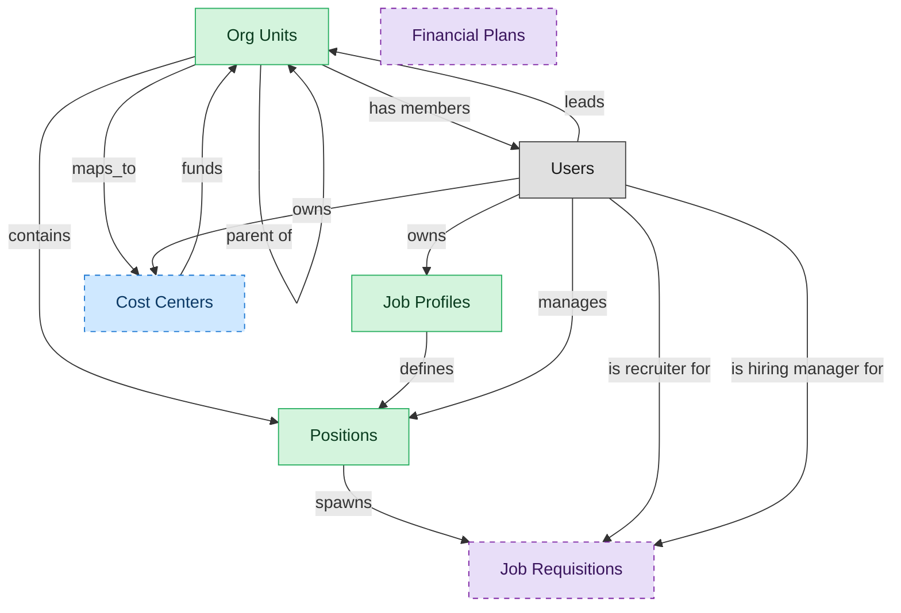

# Organization and Position Management

## 1. Overview

Organization design: org units, positions, and job profiles. Effective-dated org structure with position approval workflow, job-profile authority, and the hierarchical backbone every downstream HR system reads. Foundation for workforce planning and span-of-control analytics.

## 2. Entity summary

| Name | data_object | Description |
| --- | --- | --- |
| Job Profiles | `job_profiles` | Canonical role definitions in the job catalog: title, family, level, responsibilities, required skills, pay range, and FLSA class. Many positions share one profile. |
| Org Units | `org_units` | Nodes in the organizational hierarchy such as divisions, departments, and teams, with manager, cost center alignment, geographic scope, and parent-child relationships. |
| Positions | `hcm_positions` | Approved org slots with role definition, cost center, reporting line, location, and FTE allocation. Each can be open, filled, or eliminated. |
| Cost Centers | `cost_centers` | Organizational units for cost allocation, with code, manager, hierarchy, and currency, driving variance and departmental reporting. |
| Financial Plans | `financial_plans` | Umbrella records for financial planning artifacts: annual budget, rolling forecast, and long-range plan, with period, version, and approval state. |
| Job Requisitions | `job_requisitions` | Requests to hire for a specific role, carrying headcount, level, location, hiring manager, recruiter, and status. |

## 3. Entities catalog

| # | data_object | catalog code | singular | plural | held_as | mastered in | mastered label | install_optional | personal_content | entity_type | write tier | notes |
| ---: | --- | --- | --- | --- | --- | --- | --- | --- | --- | --- | --- | --- |
| 1 | `job_profiles` | `job_profiles` | Job Profile | Job Profiles | master | - | - | - | - | catalog | `:admin` | - |
| 2 | `org_units` | `org_units` | Org Unit | Org Units | master | - | - | - | - | operational_workflow | `:manage` | - |
| 3 | `hcm_positions` | `hcm_positions` | Position | Positions | master | - | - | - | - | operational_workflow | `:manage` | - |
| 4 | `cost_centers` | `cost_centers` | Cost Center | Cost Centers | contributor | `fin-gl-close` | General Ledger and Close | yes | - | catalog | `:admin` | - |
| 5 | `financial_plans` | `financial_plans` | Financial Plan | Financial Plans | consumer | `epm-plan-budget` | Planning and Budgeting | yes | - | operational_workflow | `:manage` | - |
| 6 | `job_requisitions` | `job_requisitions` | Job Requisition | Job Requisitions | consumer | `ats-recruitment-pipeline` | Recruitment Pipeline | yes | - | operational_workflow | `:manage` | - |

## 4. Aliases and industry synonyms

_(none: no industry-scoped aliases for this scope)_

## 5. Relationships

_`field_required` applies only when both entities are installed. It never makes an entity required._

### 5.1 Relationships between entities in this blueprint

| from | verb | to | cardinality | kind | field_required | delete_mode | fk_format | notes |
| --- | --- | --- | --- | --- | --- | --- | --- | --- |
| `org_units` | contains | `hcm_positions` | one_to_many | reference | yes | restrict | reference | - |
| `job_profiles` | defines | `hcm_positions` | one_to_many | reference | yes | restrict | reference | - |
| `cost_centers` | funds | `org_units` | one_to_many | reference | yes | restrict | reference | - |
| `hcm_positions` | spawns | `job_requisitions` | one_to_many | reference | no | clear | reference | - |
| `org_units` | maps_to | `cost_centers` | one_to_one | reference | no | clear | reference | - |
| `org_units` | parent of | `org_units` | one_to_many | reference | no | clear | reference | - |

### 5.2 Relationships to platform built-ins (`users`)

| from | verb | to | cardinality | field_required | delete_mode | fk_format | notes |
| --- | --- | --- | --- | --- | --- | --- | --- |
| `users` | manages | `hcm_positions` | one_to_many | no | clear | reference | - |
| `users` | leads | `org_units` | one_to_many | no | clear | reference | - |
| `users` | owns | `job_profiles` | one_to_many | no | clear | reference | - |
| `users` | owns | `cost_centers` | one_to_many | no | clear | reference | - |
| `users` | is recruiter for | `job_requisitions` | one_to_many | yes | restrict | reference | - |
| `org_units` | has members | `users` | one_to_many | no | clear | reference | - |
| `users` | is hiring manager for | `job_requisitions` | one_to_many | yes | restrict | reference | - |

### 5.3 Relationships to entities outside this blueprint

_External entities are optional: this blueprint never installs them. If one exists at install, the relationship is proposed. A many-to-many relationship is listed under outgoing and proposed as a new junction table._

#### 5.3a Outgoing relationships: this blueprint's entity points to the external entity

| from | verb | to | cardinality | field_required | notes |
| --- | --- | --- | --- | --- | --- |
| `job_profiles` | maps_to | `skill_profiles` | many_to_many | - | - |
| `job_profiles` | maps_to | `courses` | many_to_many | - | - |
| `salary_bands` | anchors | `hcm_positions` | one_to_many | no | - |
| `salary_bands` | bands | `job_profiles` | one_to_many | no | - |
| `employees` | fills | `hcm_positions` | one_to_one | no | - |
| `job_profiles` | requires | `learning_paths` | many_to_many | - | - |
| `job_profiles` | expects | `skill_profiles` | many_to_many | - | - |
| `org_units` | sponsors | `benefit_plans` | many_to_many | - | - |
| `survey_campaigns` | targets | `org_units` | many_to_many | - | - |
| `job_requisitions` | updates | `position_demand_forecasts` | many_to_many | - | - |
| `headcount_plans` | authorizes | `job_requisitions` | one_to_many | no | - |
| `position_demand_forecasts` | triggers | `job_requisitions` | one_to_many | no | - |
| `workforce_scenarios` | drives | `hcm_positions` | one_to_many | no | - |
| `org_designs` | proposes | `hcm_positions` | one_to_many | no | - |
| `workforce_cost_projections` | feeds | `financial_plans` | one_to_many | no | - |
| `dc_capacity_plans` | informs | `financial_plans` | one_to_many | no | - |

#### 5.3b Incoming relationships: the external entity points to this blueprint's entity

| from | verb | to | cardinality | field_required | notes |
| --- | --- | --- | --- | --- | --- |
| `org_units` | groups | `employees` | one_to_many | yes | - |
| `org_units` | engages | `contingent_workers` | one_to_many | no | - |
| `org_units` | is_scored_by | `engagement_drivers` | one_to_many | no | - |
| `org_units` | is_measured_by | `people_kpis` | one_to_many | no | - |
| `org_units` | triggers | `iga_entitlement_definitions` | one_to_many | no | - |
| `job_profiles` | feeds | `job_postings` | one_to_many | no | - |
| `hcm_positions` | requires | `compliance_assignments` | one_to_many | no | - |
| `org_units` | sponsors | `compliance_assignments` | one_to_many | no | - |
| `cost_centers` | funds | `course_enrollments` | one_to_many | no | - |
| `org_units` | owns | `action_plans` | one_to_many | no | - |
| `job_requisitions` | is advertised through | `job_postings` | one_to_many | no | - |
| `job_requisitions` | receives | `job_applications` | one_to_many | no | - |
| `job_requisitions` | feeds | `people_kpis` | one_to_many | no | - |
| `job_profiles` | expects | `competency_models` | one_to_many | no | - |
| `job_requisitions` | defines_pipeline | `application_stages` | one_to_many | no | - |
| `job_requisitions` | gated_by | `requisition_approvals` | one_to_many | yes | - |
| `job_requisitions` | staffed_by | `hiring_team_assignments` | one_to_many | yes | - |
| `financial_plans` | includes | `financial_budgets` | one_to_many | yes | - |
| `financial_plans` | includes | `financial_forecasts` | one_to_many | yes | - |
| `financial_plans` | explores_via | `financial_scenarios` | one_to_many | no | - |

## 6. Cross-domain context

### 6.1 Master consumers (other modules / domains that embed this scope's masters)

_(none: no other module embeds this scope's masters)_

### 6.2 Outbound handoffs (events this scope publishes)

_(none: no outbound handoffs whose payload is in this scope)_

### 6.3 Inbound handoffs (events this scope reacts to)

_(none: no inbound handoffs whose payload is in this scope)_

### 6.4 Master providers (modules / domains that own masters this scope embeds)

| data_object | held_as | install_optional | catalog owner(s) | slice notes |
| --- | --- | --- | --- | --- |
| `cost_centers` | contributor | yes | FIN-GL-CLOSE (FIN) | - |
| `financial_plans` | consumer | yes | EPM-PLAN-BUDGET (EPM) | - |
| `job_requisitions` | consumer | yes | ATS-RECRUITMENT-PIPELINE (ATS) | - |

## 7. Lifecycle states

### `hcm_positions` (Position)

| order | state_name | initial? | terminal? | requires_permission? | high risk? | derived gate | description |
| --- | --- | --- | --- | --- | --- | --- | --- |
| 1 | `proposed` | ✓ | - | - | - | - | Position has been designed but not yet approved against the headcount plan. |
| 2 | `approved` | - | - | ✓ | - | `hcm-org-positions:approved_position` | Cleared by headcount/finance owner; eligible to spawn a requisition. |
| 3 | `open` | - | - | ✓ | - | `hcm-org-positions:open_position` | Approved and actively being recruited against; not yet filled. |
| 4 | `filled` | - | - | ✓ | - | `hcm-org-positions:filled_position` | An employee occupies the position. |
| 5 | `frozen` | - | - | ✓ | - | `hcm-org-positions:frozen_position` | Temporarily not fillable (hiring freeze, budget hold); retains the slot. |
| 6 | `eliminated` | - | ✓ | ✓ | - | `hcm-org-positions:eliminated_position` | Removed from the org structure permanently. |

### `job_profiles` (Job Profile)

| order | state_name | initial? | terminal? | requires_permission? | high risk? | derived gate | description |
| --- | --- | --- | --- | --- | --- | --- | --- |
| 1 | `draft` | ✓ | - | - | - | - | Profile is being authored or revised; not yet available for position assignment. |
| 2 | `approved` | - | - | ✓ | - | `hcm-org-positions:approved_job_profile` | Cleared by the catalog owner; ready to be referenced by positions and postings. |
| 3 | `active` | - | - | ✓ | - | `hcm-org-positions:active_job_profile` | In production use; positions and postings can reference it. |
| 4 | `retired` | - | ✓ | ✓ | - | `hcm-org-positions:retired_job_profile` | No longer assignable to new positions; historical references preserved. |

### `org_units` (Org Unit)

| order | state_name | initial? | terminal? | requires_permission? | high risk? | derived gate | description |
| --- | --- | --- | --- | --- | --- | --- | --- |
| 1 | `draft` | ✓ | - | - | - | - | Org unit defined as part of a future structure; not yet operational. |
| 2 | `active` | - | - | ✓ | - | `hcm-org-positions:active_org_unit` | Operational unit; carries headcount, cost-center relationship, and reporting lines. |
| 3 | `reorganized` | - | ✓ | ✓ | - | `hcm-org-positions:reorganized_org_unit` | Unit folded into or replaced by a new structure; references remain for history. |
| 4 | `closed` | - | ✓ | ✓ | - | `hcm-org-positions:closed_org_unit` | Unit dissolved; no employees or positions reside in it. |

## 8. Permissions and business rules (derived)

### 8.1 Permissions

| permission | tier | description | included in `:admin`? |
| --- | --- | --- | --- |
| `hcm-org-positions:read` | baseline-read | Read access to every entity in the module | ✓ |
| `hcm-org-positions:manage` | baseline-manage | Edit operational records | ✓ |
| `hcm-org-positions:admin` | baseline-admin | Edit reference data and inherit every workflow gate below | - |
| `ats-recruitment-pipeline:read_job_requisitions` | entity-read | Read Job Requisitions | ✓ |
| `hcm-org-positions:read_hcm_positions` | entity-read | Read Positions | ✓ |
| `hcm-org-positions:write_hcm_positions` | entity-write | Write Positions | ✓ |
| `hcm-org-positions:read_job_profiles` | entity-read | Read Job Profiles | ✓ |
| `hcm-org-positions:write_job_profiles` | entity-write | Write Job Profiles | ✓ |
| `hcm-org-positions:read_org_units` | entity-read | Read Org Units | ✓ |
| `hcm-org-positions:write_org_units` | entity-write | Write Org Units | ✓ |
| `epm-plan-budget:read_financial_plans` | entity-read | Read Financial Plans | ✓ |
| `fin-gl-close:read_cost_centers` | entity-read | Read Cost Centers | ✓ |
| `fin-gl-close:write_cost_centers` | entity-write | Write Cost Centers | ✓ |
| `hcm-org-positions:approved_position` | workflow-gate (lifecycle) | Transition `hcm_positions` into state `approved` | ✓ |
| `hcm-org-positions:open_position` | workflow-gate (lifecycle) | Transition `hcm_positions` into state `open` | ✓ |
| `hcm-org-positions:filled_position` | workflow-gate (lifecycle) | Transition `hcm_positions` into state `filled` | ✓ |
| `hcm-org-positions:frozen_position` | workflow-gate (lifecycle) | Transition `hcm_positions` into state `frozen` | ✓ |
| `hcm-org-positions:eliminated_position` | workflow-gate (lifecycle) | Transition `hcm_positions` into state `eliminated` | ✓ |
| `hcm-org-positions:approved_job_profile` | workflow-gate (lifecycle) | Transition `job_profiles` into state `approved` | ✓ |
| `hcm-org-positions:active_job_profile` | workflow-gate (lifecycle) | Transition `job_profiles` into state `active` | ✓ |
| `hcm-org-positions:retired_job_profile` | workflow-gate (lifecycle) | Transition `job_profiles` into state `retired` | ✓ |
| `hcm-org-positions:active_org_unit` | workflow-gate (lifecycle) | Transition `org_units` into state `active` | ✓ |
| `hcm-org-positions:reorganized_org_unit` | workflow-gate (lifecycle) | Transition `org_units` into state `reorganized` | ✓ |
| `hcm-org-positions:closed_org_unit` | workflow-gate (lifecycle) | Transition `org_units` into state `closed` | ✓ |

_Gates with no process: `hcm-org-positions:open_position`, `hcm-org-positions:filled_position`, `hcm-org-positions:frozen_position`, `hcm-org-positions:eliminated_position`, `hcm-org-positions:active_job_profile`, `hcm-org-positions:retired_job_profile`, `hcm-org-positions:closed_org_unit`. No Accountable can hold them, so this blueprint does not support `raci`._

### 8.2 Business rules

_(none: no flag-derived business rules)_

## 9. Roles, RACI, and responsibilities (derived)

_Baseline roles, the permission hierarchy, and RACI realization are DERIVED from this scope's entity-type write tiers + `process_raci`; none of it is stored in the catalog (the deployer provisions it from this blueprint)._

### 9.1 `HCM-ORG-POSITIONS`

**Baseline roles:**

| role | baseline grant |
| --- | --- |
| `hcm-org-positions_viewer` | `hcm-org-positions:read` |
| `hcm-org-positions_manager` | `hcm-org-positions:manage` |
| `hcm-org-positions_admin` | `hcm-org-positions:admin` |

**Permission hierarchy:**

| permission | includes |
| --- | --- |
| `hcm-org-positions:admin` | `hcm-org-positions:manage` |
| `hcm-org-positions:manage` | `hcm-org-positions:read` |
| `hcm-org-positions:read` | `ats-recruitment-pipeline:read_job_requisitions` |
| `hcm-org-positions:read` | `hcm-org-positions:read_hcm_positions` |
| `hcm-org-positions:read` | `hcm-org-positions:read_job_profiles` |
| `hcm-org-positions:read` | `hcm-org-positions:read_org_units` |
| `hcm-org-positions:read` | `epm-plan-budget:read_financial_plans` |
| `hcm-org-positions:read` | `fin-gl-close:read_cost_centers` |
| `hcm-org-positions:manage` | `hcm-org-positions:write_hcm_positions` |
| `hcm-org-positions:write_hcm_positions` | `hcm-org-positions:read_hcm_positions` |
| `hcm-org-positions:admin` | `hcm-org-positions:write_job_profiles` |
| `hcm-org-positions:write_job_profiles` | `hcm-org-positions:read_job_profiles` |
| `hcm-org-positions:manage` | `hcm-org-positions:write_org_units` |
| `hcm-org-positions:write_org_units` | `hcm-org-positions:read_org_units` |
| `hcm-org-positions:admin` | `fin-gl-close:write_cost_centers` |
| `fin-gl-close:write_cost_centers` | `fin-gl-close:read_cost_centers` |
| `hcm-org-positions:admin` | `hcm-org-positions:approved_position` |
| `hcm-org-positions:admin` | `hcm-org-positions:open_position` |
| `hcm-org-positions:admin` | `hcm-org-positions:filled_position` |
| `hcm-org-positions:admin` | `hcm-org-positions:frozen_position` |
| `hcm-org-positions:admin` | `hcm-org-positions:eliminated_position` |
| `hcm-org-positions:admin` | `hcm-org-positions:approved_job_profile` |
| `hcm-org-positions:admin` | `hcm-org-positions:active_job_profile` |
| `hcm-org-positions:admin` | `hcm-org-positions:retired_job_profile` |
| `hcm-org-positions:admin` | `hcm-org-positions:active_org_unit` |
| `hcm-org-positions:admin` | `hcm-org-positions:reorganized_org_unit` |
| `hcm-org-positions:admin` | `hcm-org-positions:closed_org_unit` |

**Processes wired:**

| process_key | process_name | PCF code | PCF ID | level | description |
| --- | --- | --- | --- | --- | --- |
| `create_organizational_design` | Create organizational design | 1.2.5 | 10041 | 3 | Formulating a design for the organization's resources that allow it to meet its objectives. Develop a new framework for molding the organization's various processes into a coherent and seamless whole. |
| `develop_maintain_job` | Develop and maintain job descriptions | 7.1.2.16 | 10447 | 4 | Creating descriptions for job requisitions. Define the normal components of a job description, such as the overall position description with general areas of responsibility listed, essential functions of the job described with a couple of examples of each, required knowledge, skills, abilities, required education and experience, a description of the physical demands, and a description of the work environment. |
| `conduct_organization` | Conduct organization restructuring opportunities | 1.1.5 | 16792 | 3 | Examining the scope and contingencies for restructuring based on market situation and internal realities. Map the market forces over which any and all probabilities can be probed for utility and viability. Once the restructuring options have been analyzed and the due-diligence performed, execute the deal. Consider seeking professional services for assistance in formalizing these opportunities. |

**RACI realization:**

| actor | kind | raci | process_key | realization |
| --- | --- | --- | --- | --- |
| `HR-ORG-DESIGN-ANALYST` | persona | responsible | `create_organizational_design` | the gated entities' write tier |
| `HR-BUSINESS-PARTNER` | persona | accountable | `create_organizational_design` | grant gates [hcm-org-positions:approved_position, hcm-org-positions:active_org_unit] + the gated entities' write tier |
| `PEOPLE-MANAGER` | persona | consulted | `create_organizational_design` | advisory read grant |
| `HR-HRIS-ADMIN` | persona | informed | `create_organizational_design` | notify on trigger_events [hcm_position.approved] |
| `HR-ORG-DESIGN-ANALYST` | persona | responsible | `develop_maintain_job` | the gated entities' write tier |
| `HR-HRIS-ADMIN` | persona | accountable | `develop_maintain_job` | grant gates [hcm-org-positions:approved_job_profile] + the gated entities' write tier |
| `HR-BUSINESS-PARTNER` | persona | consulted | `develop_maintain_job` | advisory read grant |
| `HR-ORG-DESIGN-ANALYST` | persona | responsible | `conduct_organization` | the gated entities' write tier |
| `HR-BUSINESS-PARTNER` | persona | accountable | `conduct_organization` | grant gates [hcm-org-positions:reorganized_org_unit] + the gated entities' write tier |
| `PEOPLE-MANAGER` | persona | consulted | `conduct_organization` | advisory read grant |

### 9.2 Functional ownership and default grants

| responsibility | business function | default role | default tier |
| --- | --- | --- | --- |
| owner | Human Resources | `admin` | `:admin` |
| contributor | Finance | `manager` | `:manage` |
| contributor | IT Operations | `manager` | `:manage` |
| contributor | Legal | `manager` | `:manage` |
| contributor | Payroll | `manager` | `:manage` |
| consumer | Executive | `viewer` | `:read` |
| consumer | Governance, Risk and Compliance | `viewer` | `:read` |
