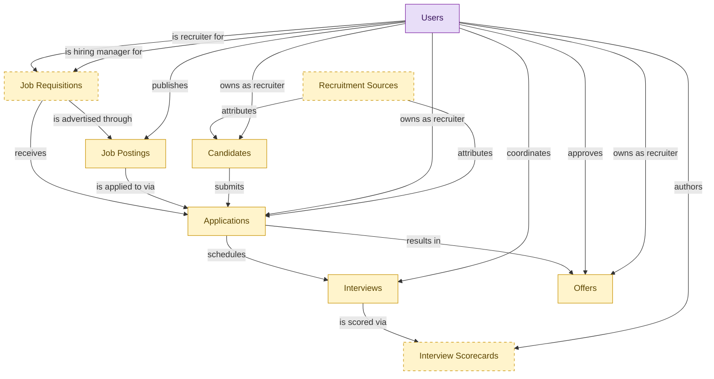

# Hiring Starter

## 1. Overview

Entry-tier deployable for a basic hiring workflow: post jobs, capture applications, run interviews, and make offers. Embeds the canonical masters from the full ATS modules and inherits their lifecycle states and gated steps, which it governs under its own permission prefix. Leaves out the requisition approval chain, background-check processing (it reacts when a background check is flagged), and the pre-employee record (an accepted offer hands the new hire to HCM). When the full ATS modules are installed, its entities move to them without data migration.

## 2. Entity summary

| Name | data_object | Description |
| --- | --- | --- |
| Applications | `job_applications` | Candidate submissions against a specific requisition, with pipeline stage, status, source, and full evaluation history. |
| Candidates | `candidates` | People known to the recruiting organization, with or without an active application, carrying contact details, resume, tags, consent, and source. |
| Interview Scorecards | `interview_scorecards` | Structured interviewer feedback against a rubric: per-competency ratings, written notes, and a hire or no-hire recommendation. |
| Interviews | `interviews` | Scheduled assessment events between a candidate and one or more interviewers, with time, location, panel, and outcome. |
| Job Postings | `job_postings` | Published, candidate-facing versions of a requisition on a career site or job board, one requisition possibly having many postings. |
| Job Requisitions | `job_requisitions` | Requests to hire for a specific role, carrying headcount, level, location, hiring manager, recruiter, and status. |
| Offers | `job_offers` | Formal employment offers extended to candidates, with compensation, start date, terms, approval chain, and status. |
| Recruitment Sources | `recruitment_sources` | Channels a candidate came from, such as job board, referral, agency, campaign, or inbound, used for source-of-hire and channel analytics. |
| Users | `users` | Platform users referenced as assignees, authors, approvers, and creators across records. |

## Additional Requirements Specification

Hiring manager access to candidates. A `candidates` row has no relationship leading to its hiring manager, so the row-scope rule cannot admit them. As a workaround, under `access_scope: raci` the `HIRING-MANAGER` persona holds `hiring-starter:view_all_candidates`.

## 3. Entities catalog

| # | data_object | catalog code | singular | plural | held_as | mastered in | mastered label | install_optional | personal_content | entity_type | write tier | notes |
| ---: | --- | --- | --- | --- | --- | --- | --- | --- | --- | --- | --- | --- |
| 1 | `job_applications` | `job_applications` | Application | Applications | embedded_master | `ats-recruitment-pipeline` | Recruitment Pipeline | - | yes | operational_workflow | `:manage` | - |
| 2 | `candidates` | `candidates` | Candidate | Candidates | embedded_master | `ats-candidate-crm` | Candidate CRM | - | yes | operational_workflow | `:manage` | - |
| 3 | `interview_scorecards` | `interview_scorecards` | Interview Scorecard | Interview Scorecards | embedded_master | `ats-interviews` | Candidate Interviews | yes | yes | operational_workflow | `:manage` | - |
| 4 | `interviews` | `interviews` | Interview | Interviews | embedded_master | `ats-interviews` | Candidate Interviews | - | yes | operational_workflow | `:manage` | - |
| 5 | `job_postings` | `job_postings` | Job Posting | Job Postings | embedded_master | `ats-recruitment-pipeline` | Recruitment Pipeline | - | - | operational_workflow | `:manage` | - |
| 6 | `job_requisitions` | `job_requisitions` | Job Requisition | Job Requisitions | embedded_master | `ats-recruitment-pipeline` | Recruitment Pipeline | yes | - | operational_workflow | `:manage` | - |
| 7 | `job_offers` | `job_offers` | Offer | Offers | embedded_master | `ats-offers` | Job Offers | - | yes | operational_workflow | `:manage` | - |
| 8 | `recruitment_sources` | `recruitment_sources` | Recruitment Source | Recruitment Sources | embedded_master | `ats-candidate-crm` | Candidate CRM | yes | - | catalog | `:admin` | - |
| 9 | `users` | `users` | User | Users | consumer | _(platform built-in)_ | _(platform built-in)_ | - | - | operational_record | `:manage` | - |

## 4. Aliases and industry synonyms

_(none: no industry-scoped aliases for this scope)_

## 5. Relationships

_`field_required` applies only when both entities are installed. It never makes an entity required._

### 5.1 Relationships between entities in this blueprint

| from | verb | to | cardinality | kind | field_required | delete_mode | fk_format | notes |
| --- | --- | --- | --- | --- | --- | --- | --- | --- |
| `job_requisitions` | is advertised through | `job_postings` | one_to_many | reference | no | clear | reference | - |
| `job_requisitions` | receives | `job_applications` | one_to_many | reference | no | clear | reference | - |
| `job_postings` | is applied to via | `job_applications` | one_to_many | reference | no | clear | reference | - |
| `candidates` | submits | `job_applications` | one_to_many | reference | yes | restrict | reference | - |
| `recruitment_sources` | attributes | `candidates` | one_to_many | reference | no | clear | reference | - |
| `job_applications` | schedules | `interviews` | one_to_many | reference | yes | restrict | reference | - |
| `interviews` | is scored via | `interview_scorecards` | one_to_many | reference | yes | restrict | reference | - |
| `job_applications` | results in | `job_offers` | one_to_many | reference | yes | restrict | reference | - |
| `recruitment_sources` | attributes | `job_applications` | one_to_many | reference | no | clear | reference | - |

### 5.2 Relationships to platform built-ins (`users`)

| from | verb | to | cardinality | field_required | delete_mode | fk_format | notes |
| --- | --- | --- | --- | --- | --- | --- | --- |
| `users` | is recruiter for | `job_requisitions` | one_to_many | yes | restrict | reference | - |
| `users` | owns as recruiter | `job_applications` | one_to_many | no | clear | reference | - |
| `users` | coordinates | `interviews` | one_to_many | yes | restrict | reference | - |
| `users` | authors | `interview_scorecards` | one_to_many | yes | restrict | reference | - |
| `users` | approves | `job_offers` | one_to_many | yes | restrict | reference | - |
| `users` | owns as recruiter | `candidates` | one_to_many | no | clear | reference | - |
| `users` | publishes | `job_postings` | one_to_many | yes | restrict | reference | - |
| `users` | is hiring manager for | `job_requisitions` | one_to_many | yes | restrict | reference | - |
| `users` | owns as recruiter | `job_offers` | one_to_many | no | clear | reference | - |

### 5.3 Relationships to entities outside this blueprint

_External entities are optional: this blueprint never installs them. If one exists at install, the relationship is proposed. A many-to-many relationship is listed under outgoing and proposed as a new junction table._

#### 5.3a Outgoing relationships: this blueprint's entity points to the external entity

| from | verb | to | cardinality | field_required | notes |
| --- | --- | --- | --- | --- | --- |
| `hcm_positions` | spawns | `job_requisitions` | one_to_many | no | - |
| `job_profiles` | feeds | `job_postings` | one_to_many | no | - |
| `skill_profiles` | feeds | `candidates` | one_to_many | no | - |
| `recruitment_agencies` | sources | `candidates` | one_to_many | no | - |
| `recruitment_events` | attracts | `candidates` | one_to_many | no | - |
| `talent_pools` | groups | `candidates` | many_to_many | - | - |
| `job_requisitions` | updates | `position_demand_forecasts` | many_to_many | - | - |
| `headcount_plans` | authorizes | `job_requisitions` | one_to_many | no | - |
| `position_demand_forecasts` | triggers | `job_requisitions` | one_to_many | no | - |
| `interview_kits` | shapes | `interviews` | one_to_many | no | - |
| `interview_panels` | produces | `interview_scorecards` | one_to_many | no | - |
| `employees` | applies_as | `candidates` | one_to_many | no | - |

#### 5.3b Incoming relationships: the external entity points to this blueprint's entity

| from | verb | to | cardinality | field_required | notes |
| --- | --- | --- | --- | --- | --- |
| `candidates` | is referred through | `candidate_referrals` | one_to_many | yes | - |
| `job_applications` | requires | `candidate_assessments` | one_to_many | yes | - |
| `job_offers` | is contingent on | `background_checks` | one_to_many | no | - |
| `job_offers` | spawns | `onboarding_journeys` | one_to_many | no | - |
| `job_offers` | triggers | `benefit_enrollments` | one_to_many | no | - |
| `job_offers` | seeds | `compensation_statements` | one_to_many | no | - |
| `candidates` | becomes | `employees` | one_to_one | no | - |
| `job_requisitions` | feeds | `people_kpis` | one_to_many | no | - |
| `job_offers` | spawns pre-employee record | `pre_employees` | one_to_one | yes | - |
| `candidates` | becomes pre-employee | `pre_employees` | one_to_one | yes | - |
| `candidates` | engaged_via | `candidate_engagements` | one_to_many | no | - |
| `candidates` | attends_via | `recruiting_event_attendances` | one_to_many | yes | - |
| `candidates` | consents_via | `candidate_consents` | one_to_many | yes | - |
| `candidates` | member_of_via | `talent_pool_memberships` | one_to_many | yes | - |
| `candidates` | discloses_via | `fcra_disclosures` | one_to_many | yes | - |
| `job_requisitions` | defines_pipeline | `application_stages` | one_to_many | no | - |
| `job_applications` | transitions_via | `application_stage_transitions` | one_to_many | yes | - |
| `job_requisitions` | gated_by | `requisition_approvals` | one_to_many | yes | - |
| `job_postings` | syndicates_via | `job_posting_distributions` | one_to_many | yes | - |
| `job_postings` | asks | `application_screening_questions` | one_to_many | yes | - |
| `job_applications` | answers_via | `application_screening_answers` | one_to_many | yes | - |
| `candidates` | self_identifies_via | `eeo_responses` | one_to_many | yes | - |
| `interviews` | convenes | `interview_panels` | one_to_many | yes | - |
| `interviews` | occupies | `interviewer_availability_slots` | one_to_many | no | - |
| `job_offers` | evolves_through | `offer_versions` | one_to_many | yes | - |
| `job_offers` | gated_by | `offer_approvals` | one_to_many | yes | - |
| `candidates` | submits_via | `data_subject_requests` | one_to_many | yes | - |
| `candidates` | self_ids_via | `voluntary_self_identifications` | one_to_many | yes | - |
| `candidates` | acknowledges_via | `fcra_summary_of_rights_acknowledgments` | one_to_many | yes | - |
| `job_applications` | disposed_via | `application_dispositions` | one_to_many | yes | - |
| `job_applications` | logged_via | `applicant_flow_records` | one_to_one | yes | - |
| `job_requisitions` | staffed_by | `hiring_team_assignments` | one_to_many | yes | - |
| `candidates` | documented_via | `candidate_documents` | one_to_many | yes | - |
| `candidates` | annotated_via | `candidate_notes` | one_to_many | yes | - |
| `candidates` | tagged_via | `candidate_tag_assignments` | one_to_many | yes | - |
| `candidates` | corresponds_via | `candidate_emails` | one_to_many | no | - |
| `candidates` | screened_via | `drug_health_screenings` | one_to_many | no | - |
| `candidates` | verified_via | `right_to_work_verifications` | one_to_many | no | - |
| `candidates` | submitted_via | `agency_submissions` | one_to_many | no | - |

## 6. Cross-domain context

### 6.1 Master consumers (other modules / domains that embed this scope's masters)

_(none: this scope masters no entities)_

### 6.2 Outbound handoffs (events this scope publishes)

_(none: no outbound handoffs whose payload is in this scope)_

### 6.3 Inbound handoffs (events this scope reacts to)

_(none: no inbound handoffs whose payload is in this scope)_

### 6.4 Master providers (modules / domains that own masters this scope embeds)

| data_object | held_as | install_optional | catalog owner(s) | slice notes |
| --- | --- | --- | --- | --- |
| `candidates` | embedded_master | - | ATS-CANDIDATE-CRM (ATS) | - |
| `interview_scorecards` | embedded_master | yes | ATS-INTERVIEWS (ATS) | - |
| `interviews` | embedded_master | - | ATS-INTERVIEWS (ATS) | - |
| `job_applications` | embedded_master | - | ATS-RECRUITMENT-PIPELINE (ATS) | - |
| `job_offers` | embedded_master | - | ATS-OFFERS (ATS) | - |
| `job_postings` | embedded_master | - | ATS-RECRUITMENT-PIPELINE (ATS) | - |
| `job_requisitions` | embedded_master | yes | ATS-RECRUITMENT-PIPELINE (ATS) | - |
| `recruitment_sources` | embedded_master | yes | ATS-CANDIDATE-CRM (ATS) | - |
| `users` | consumer | - | _(platform built-in)_ | - |

## 7. Lifecycle states

### `candidates` (Candidate)

_This scope holds `candidates` as **embedded_master**; the canonical state machine is owned by `ATS-CANDIDATE-CRM`._

| order | state_name | initial? | terminal? | requires_permission? | high risk? | derived gate | description |
| --- | --- | --- | --- | --- | --- | --- | --- |
| 1 | `prospect` | ✓ | - | - | - | - | Person known to the recruiting org with no active application. |
| 2 | `active` | - | - | - | - | - | Candidate has at least one open application or is actively engaged. |
| 3 | `hired` | - | ✓ | ✓ | - | `hiring-starter:hire_candidate` | Candidate accepted an offer and converted to employee. |
| 4 | `do_not_hire` | - | ✓ | ✓ | - | `hiring-starter:flag_do_not_hire` | Candidate flagged as ineligible for future consideration; gated decision. |
| 5 | `archived` | - | ✓ | - | - | - | Candidate kept in the database but not active in any pipeline. |

### `interview_scorecards` (Interview Scorecard)

_This scope holds `interview_scorecards` as **embedded_master**; the canonical state machine is owned by `ATS-INTERVIEWS`._

| order | state_name | initial? | terminal? | requires_permission? | high risk? | derived gate | description |
| --- | --- | --- | --- | --- | --- | --- | --- |
| 1 | `draft` | ✓ | - | - | - | - | Interviewer is filling in ratings and notes against the rubric. |
| 2 | `submitted` | - | ✓ | - | - | - | Scorecard submitted and locked; hire/no-hire recommendation recorded. |

### `interviews` (Interview)

_This scope holds `interviews` as **embedded_master**; the canonical state machine is owned by `ATS-INTERVIEWS`._

| order | state_name | initial? | terminal? | requires_permission? | high risk? | derived gate | description |
| --- | --- | --- | --- | --- | --- | --- | --- |
| 1 | `scheduled` | ✓ | - | - | - | - | Interview booked with candidate, panel, time, and medium. |
| 2 | `confirmed` | - | - | - | - | - | Candidate and panel confirmed attendance. |
| 3 | `completed` | - | ✓ | - | - | - | Interview took place; scorecards are being collected. |
| 4 | `no_show` | - | ✓ | - | - | - | Candidate or panel did not attend; interview did not occur. |
| 5 | `canceled` | - | ✓ | - | - | - | Interview canceled before it took place. |
| 6 | `rescheduled` | - | ✓ | - | - | - | Original slot abandoned in favor of a new scheduled interview record. |

### `job_applications` (Application)

_This scope holds `job_applications` as **embedded_master**; the canonical state machine is owned by `ATS-RECRUITMENT-PIPELINE`._

| order | state_name | initial? | terminal? | requires_permission? | high risk? | derived gate | description |
| --- | --- | --- | --- | --- | --- | --- | --- |
| 1 | `applied` | ✓ | - | - | - | - | Candidate submitted an application against the requisition. |
| 2 | `screening` | - | - | - | - | - | Recruiter is reviewing resume and qualifications. |
| 3 | `interviewing` | - | - | - | - | - | Candidate is progressing through interview loops. |
| 4 | `offer_extended` | - | - | - | - | - | An offer has been generated and is in flight for this application. |
| 5 | `hired` | - | ✓ | ✓ | - | `hiring-starter:hire_candidate` | Candidate accepted the offer and was hired; gated transition. |
| 6 | `rejected` | - | ✓ | - | - | - | Application closed without progression by recruiter or hiring manager. |
| 7 | `withdrawn` | - | ✓ | - | - | - | Candidate withdrew their application. |

### `job_offers` (Offer)

_This scope holds `job_offers` as **embedded_master**; the canonical state machine is owned by `ATS-OFFERS`._

| order | state_name | initial? | terminal? | requires_permission? | high risk? | derived gate | description |
| --- | --- | --- | --- | --- | --- | --- | --- |
| 1 | `draft` | ✓ | - | - | - | - | Recruiter is composing offer terms and compensation components. |
| 2 | `pending_approval` | - | - | - | - | - | Offer routed to the designated approver for sign-off. |
| 3 | `approved` | - | - | ✓ | - | `hiring-starter:approve_offer` | Approver signed off; offer is ready to send. |
| 4 | `sent` | - | - | - | - | - | Offer delivered to the candidate. |
| 5 | `accepted` | - | ✓ | - | - | - | Candidate accepted the offer. |
| 6 | `declined` | - | ✓ | - | - | - | Candidate declined the offer. |
| 7 | `rescinded` | - | ✓ | ✓ | - | `hiring-starter:rescind_offer` | Offer withdrawn by the employer after being sent; gated action. |

### `job_postings` (Job Posting)

_This scope holds `job_postings` as **embedded_master**; the canonical state machine is owned by `ATS-RECRUITMENT-PIPELINE`._

| order | state_name | initial? | terminal? | requires_permission? | high risk? | derived gate | description |
| --- | --- | --- | --- | --- | --- | --- | --- |
| 1 | `draft` | ✓ | - | - | - | - | Posting being composed against a requisition for a specific board or region. |
| 2 | `published` | - | - | ✓ | - | `hiring-starter:publish_posting` | Posting is live on the target channel; gated publish step. |
| 3 | `paused` | - | - | - | - | - | Posting temporarily hidden from the channel. |
| 4 | `expired` | - | ✓ | - | - | - | Posting reached its scheduled end date. |
| 5 | `closed` | - | ✓ | - | - | - | Posting taken down because the requisition is filled or canceled. |

### `job_requisitions` (Job Requisition)

_This scope holds `job_requisitions` as **embedded_master**; the canonical state machine is owned by `ATS-RECRUITMENT-PIPELINE`._

| order | state_name | initial? | terminal? | requires_permission? | high risk? | derived gate | description |
| --- | --- | --- | --- | --- | --- | --- | --- |
| 1 | `draft` | ✓ | - | - | - | - | Hiring manager is drafting the requisition. |
| 2 | `pending_approval` | - | - | - | - | - | Requisition routed for headcount and budget approval. |
| 3 | `open` | - | - | ✓ | - | `hiring-starter:approve_requisition` | Requisition approved and actively recruiting. |
| 4 | `on_hold` | - | - | - | - | - | Recruiting temporarily paused (budget freeze, scope change). |
| 5 | `filled` | - | ✓ | ✓ | - | `hiring-starter:close_requisition` | Requisition closed because the role was filled. |
| 6 | `canceled` | - | ✓ | - | - | - | Requisition closed without a hire. |

## 8. Permissions and business rules (derived)

### 8.1 Permissions

| permission | tier | description | included in `:admin`? |
| --- | --- | --- | --- |
| `hiring-starter:read` | baseline-read | Read access to every entity in the module | ✓ |
| `hiring-starter:manage` | baseline-manage | Edit operational records | ✓ |
| `hiring-starter:admin` | baseline-admin | Edit reference data and inherit every workflow gate below | - |
| `hiring-starter:approve_requisition` | workflow-gate (lifecycle) | Transition `job_requisitions` into state `open` | ✓ |
| `hiring-starter:close_requisition` | workflow-gate (lifecycle) | Transition `job_requisitions` into state `filled` (⚠ no process) | ✓ |
| `hiring-starter:publish_posting` | workflow-gate (lifecycle) | Transition `job_postings` into state `published` | ✓ |
| `hiring-starter:hire_candidate` | workflow-gate (lifecycle) | Transition `candidates` into state `hired` or `job_applications` into state `hired` | ✓ |
| `hiring-starter:flag_do_not_hire` | workflow-gate (lifecycle) | Transition `candidates` into state `do_not_hire` (⚠ no process) | ✓ |
| `hiring-starter:approve_offer` | workflow-gate (lifecycle) | Transition `job_offers` into state `approved` | ✓ |
| `hiring-starter:rescind_offer` | workflow-gate (lifecycle) | Transition `job_offers` into state `rescinded` (⚠ no process) | ✓ |
| `hiring-starter:view_all_candidates` | override (personal_content) | View all `candidates` rows beyond row-scope | ✓ |
| `hiring-starter:manage_all_candidates` | override (personal_content) | Manage all `candidates` rows beyond row-scope | ✓ |
| `hiring-starter:view_all_applications` | override (personal_content) | View all `job_applications` rows beyond row-scope | ✓ |
| `hiring-starter:manage_all_applications` | override (personal_content) | Manage all `job_applications` rows beyond row-scope | ✓ |
| `hiring-starter:view_all_interviews` | override (personal_content) | View all `interviews` rows beyond row-scope | ✓ |
| `hiring-starter:manage_all_interviews` | override (personal_content) | Manage all `interviews` rows beyond row-scope | ✓ |
| `hiring-starter:view_all_interview_scorecards` | override (personal_content) | View all `interview_scorecards` rows beyond row-scope | ✓ |
| `hiring-starter:manage_all_interview_scorecards` | override (personal_content) | Manage all `interview_scorecards` rows beyond row-scope | ✓ |
| `hiring-starter:view_all_offers` | override (personal_content) | View all `job_offers` rows beyond row-scope | ✓ |
| `hiring-starter:manage_all_offers` | override (personal_content) | Manage all `job_offers` rows beyond row-scope | ✓ |

### 8.2 Business rules

| rule_name | data_object | source flag | intent |
| --- | --- | --- | --- |
| `candidate_edit_scope` | `candidates` | has_personal_content | Row-scope by default; override via `hiring-starter:view_all_candidates` / `hiring-starter:manage_all_candidates` |
| `application_edit_scope` | `job_applications` | has_personal_content | Row-scope by default; override via `hiring-starter:view_all_applications` / `hiring-starter:manage_all_applications` |
| `interview_edit_scope` | `interviews` | has_personal_content | Row-scope by default; override via `hiring-starter:view_all_interviews` / `hiring-starter:manage_all_interviews` |
| `interview_scorecard_edit_scope` | `interview_scorecards` | has_personal_content | Row-scope by default; override via `hiring-starter:view_all_interview_scorecards` / `hiring-starter:manage_all_interview_scorecards` |
| `offer_edit_scope` | `job_offers` | has_personal_content | Row-scope by default; override via `hiring-starter:view_all_offers` / `hiring-starter:manage_all_offers` |

## 9. Roles, RACI, and responsibilities (derived)

_Baseline roles, the permission hierarchy, and RACI realization are DERIVED from this scope's entity-type write tiers + `process_raci`; none of it is stored in the catalog (the deployer provisions it from this blueprint)._

### 9.1 `HIRING-STARTER`

**Baseline roles:**

| role | baseline grant |
| --- | --- |
| `hiring-starter_viewer` | `hiring-starter:read` |
| `hiring-starter_manager` | `hiring-starter:manage` |
| `hiring-starter_admin` | `hiring-starter:admin` |

**Permission hierarchy:**

| permission | includes |
| --- | --- |
| `hiring-starter:admin` | `hiring-starter:manage` |
| `hiring-starter:manage` | `hiring-starter:read` |
| `hiring-starter:admin` | `hiring-starter:approve_requisition` |
| `hiring-starter:admin` | `hiring-starter:close_requisition` |
| `hiring-starter:admin` | `hiring-starter:publish_posting` |
| `hiring-starter:admin` | `hiring-starter:hire_candidate` |
| `hiring-starter:admin` | `hiring-starter:flag_do_not_hire` |
| `hiring-starter:admin` | `hiring-starter:approve_offer` |
| `hiring-starter:admin` | `hiring-starter:rescind_offer` |
| `hiring-starter:admin` | `hiring-starter:view_all_candidates` |
| `hiring-starter:admin` | `hiring-starter:manage_all_candidates` |
| `hiring-starter:admin` | `hiring-starter:view_all_applications` |
| `hiring-starter:admin` | `hiring-starter:manage_all_applications` |
| `hiring-starter:admin` | `hiring-starter:view_all_interviews` |
| `hiring-starter:admin` | `hiring-starter:manage_all_interviews` |
| `hiring-starter:admin` | `hiring-starter:view_all_interview_scorecards` |
| `hiring-starter:admin` | `hiring-starter:manage_all_interview_scorecards` |
| `hiring-starter:admin` | `hiring-starter:view_all_offers` |
| `hiring-starter:admin` | `hiring-starter:manage_all_offers` |

**Processes wired:**

| process_key | process_name | PCF code | PCF ID | level | description |
| --- | --- | --- | --- | --- | --- |
| `manage_employee_requisitions` | Manage employee requisitions | 7.2.1 | 21698 | 3 | Handling the requirements for new employees. Create and open job requisitions by clearly defining the job descriptions. Post these requirements internally and externally, and modify them as appropriate. Manage the dates of the whole requisition process. |
| `recruit_source_candidates` | Recruit/Source candidates | 7.2.2 | 10440 | 3 | Recruiting new candidates for deployment across various functional areas inside the organization. Select methods for sourcing new employees. Manage relationships with third-party agencies. Stage recruitment fairs and drives. Manage employee referral programs. |
| `hire_candidate` | Hire candidate | 7.2.4.3 | 10465 | 4 | Wrapping up the process for hiring candidates. Agree to all hiring terms and conditions. Have the candidate accept and sign the job offer. |
| `interview_candidates` | Interview candidates | 7.2.3.2 | 10457 | 4 | Assessing the candidates by their performance in the interviews. Conduct HR interview, technical interview, hiring manager interview, etc. Understand the mindset of the candidate, and comprehend his/her personal and professional lives. |
| `draw_up_make_offer` | Draw up and make offer | 7.2.4.1 | 10463 | 4 | Compiling job-related information for the selected candidates in order to make up a job. Include information about the job description, reporting relationship, salary, bonus potential, benefits, and vacation allotment. |

**RACI realization:**

| actor | kind | raci | process_key | realization |
| --- | --- | --- | --- | --- |
| `RECRUITING-RECRUITER` | persona | responsible | `manage_employee_requisitions` | the gated entities' write tier |
| `RECRUITING-MANAGER` | persona | accountable | `manage_employee_requisitions` | grant gates [hiring-starter:approve_requisition] + the gated entities' write tier |
| `RECRUITING-SOURCER` | persona | responsible | `recruit_source_candidates` | the gated entities' write tier |
| `RECRUITING-RECRUITER` | persona | responsible | `recruit_source_candidates` | the gated entities' write tier |
| `RECRUITING-MANAGER` | persona | accountable | `recruit_source_candidates` | grant gates [hiring-starter:publish_posting] + the gated entities' write tier |
| `HIRING-MANAGER` | persona | informed | `recruit_source_candidates` | notify on trigger_events [job_posting.published] |
| `RECRUITING-RECRUITER` | persona | responsible | `hire_candidate` | the gated entities' write tier |
| `HIRING-MANAGER` | persona | accountable | `hire_candidate` | grant gates [hiring-starter:hire_candidate] + the gated entities' write tier |
| `LEGAL-COMPLIANCE-SPECIALIST` | persona | informed | `hire_candidate` | notify on trigger_events [candidate.hired] |
| `HIRING-MANAGER` | persona | responsible | `interview_candidates` | the gated entities' write tier |
| `RECRUITING-MANAGER` | persona | accountable | `interview_candidates` | the gated entities' write tier |
| `RECRUITING-RECRUITER` | persona | consulted | `interview_candidates` | advisory read grant |
| `RECRUITING-COORDINATOR` | persona | responsible | `interview_candidates` | the gated entities' write tier |
| `RECRUITING-RECRUITER` | persona | responsible | `draw_up_make_offer` | the gated entities' write tier |
| `HIRING-MANAGER` | persona | accountable | `draw_up_make_offer` | grant gates [hiring-starter:approve_offer] + the gated entities' write tier |
| `RECRUITING-MANAGER` | persona | consulted | `draw_up_make_offer` | advisory read grant |

### 9.2 Functional ownership and default grants

| responsibility | business function | default role | default tier |
| --- | --- | --- | --- |
| owner | Recruiting | `admin` | `:admin` |
| contributor | Human Resources | `manager` | `:manage` |
| contributor | Legal | `manager` | `:manage` |
| consumer | Finance | `viewer` | `:read` |
