# HR Case Management

## 1. Overview

Core HR case management surface: HR cases, case taxonomy, triage, approval routing, and AI-assisted classification. Masters hr_cases and case_categories. The execution backbone of any HRSD deployment.

## 2. Entity summary

| Name | data_object | Description |
| --- | --- | --- |
| HR Case Categories | `case_categories` | Taxonomy of HR request types such as pay, benefits, leave, and policy, driving routing, SLAs, knowledge lookup, and trend analytics. |
| HR Cases | `hr_cases` | Employee inquiries and service requests routed to HR operations, such as pay questions, benefits changes, leave requests, and complaints. |
| Employees | `employees` | Canonical records of people currently or formerly employed, carrying identity, employment metadata, and relationships to position, manager, and org unit. |
| Background Checks | `background_checks` | External verification results for a candidate (criminal, employment, education, credit, identity), with status and findings from a screening provider. |
| Carrier Feeds | `carrier_feeds` | Outbound integrations that send enrollment and remittance data to a benefit carrier, typically as weekly batches whose failures cause coverage discrepancies. |
| Compensation Statements | `compensation_statements` | Personalized total-rewards statements showing a worker the value of their base, bonus, equity, benefits, and perks. |
| Compliance Training Assignments | `compliance_assignments` | Mandatory training assignments tied to a regulation, role, location, or hire event, with due dates and escalation policy. |
| Engagement Surveys | `engagement_surveys` | Employee engagement, pulse, and sentiment survey responses, used to score engagement and trigger interventions. |
| Garnishment Orders | `garnishment_orders` | Court-ordered or agency-issued instructions to withhold from an employee's wages, carrying priority, ceiling, remit-to details, and lifecycle status. |
| IGA Access Requests | `iga_access_requests` | User-initiated access requests and their approval workflow within an identity-governance platform. |
| Knowledge Articles | `knowledge_articles` | Knowledge-base articles backing self-service portals and agent-assist tools, moving through draft, review, published, and retired. |
| Knowledge Base Articles | `knowledge_base_articles` | Authored, versioned knowledge content units that move through draft, published, and archived. |
| Onboarding Tasks | `onboarding_tasks` | Discrete to-do items within an onboarding journey, each with an assignee, due date, type, and completion state, some triggering handoffs to other systems. |
| Policy Attestations | `policy_attestations` | Records that a user read and acknowledged a policy, with timestamp, policy version, medium, and completion evidence. |
| Shifts | `work_shifts` | Scheduled work blocks assigned to a worker, with start, end, position, location, break plan, and premium pay flags. |

```mermaid
flowchart TD
  classDef master fill:#d4f4dd,stroke:#27ae60,color:#0b3d20;
  classDef embedded_master fill:#fff4cc,stroke:#c79100,color:#5b4500;
  classDef consumer fill:#e8def8,stroke:#7b1fa2,color:#3a155d;
  classDef platform_builtin fill:#e0e0e0,stroke:#424242,color:#1a1a1a;
  background_checks["Background Checks"]
  onboarding_tasks["Onboarding Tasks"]
  employees["Employees"]
  engagement_surveys["Engagement Surveys"]
  knowledge_articles["Knowledge Articles"]
  garnishment_orders["Garnishment Orders"]
  carrier_feeds["Carrier Feeds"]
  compensation_statements["Compensation Statements"]
  work_shifts["Shifts"]
  compliance_assignments["Compliance Training Assignments"]
  hr_cases["HR Cases"]
  case_categories["HR Case Categories"]
  policy_attestations["Policy Attestations"]
  knowledge_base_articles["Knowledge Base Articles"]
  iga_access_requests["IGA Access Requests"]
  users["Users"]
  employees -->|"becomes"| work_shifts
  employees -->|"becomes"| compensation_statements
  employees -->|"spawns"| hr_cases
  onboarding_tasks -->|"spawns"| hr_cases
  onboarding_tasks -->|"spawns"| iga_access_requests
  employees -->|"reflected on"| compliance_assignments
  carrier_feeds -->|"spawns"| hr_cases
  case_categories -->|"classifies"| hr_cases
  employees -->|"raises"| hr_cases
  hr_cases -->|"references"| knowledge_articles
  case_categories -->|"parent_of"| case_categories
  hr_cases -->|"spawns"| iga_access_requests
  employees -->|"updated by"| hr_cases
  case_categories -->|"drives"| knowledge_base_articles
  case_categories -->|"drives"| employees
  knowledge_articles -->|"publishes_to"| knowledge_base_articles
  knowledge_base_articles -->|"resolves"| hr_cases
  employees -->|"receives"| compensation_statements
  users -->|"represents"| employees
  users -->|"performs"| onboarding_tasks
  users -->|"created"| onboarding_tasks
  users -->|"must complete"| compliance_assignments
  users -->|"owns"| compliance_assignments
  users -->|"monitors"| carrier_feeds
  users -->|"raises"| hr_cases
  users -->|"works on"| hr_cases
  users -->|"owns"| hr_cases
  users -->|"approves"| hr_cases
  users -->|"manages"| case_categories
  users -->|"authors"| knowledge_articles
  users -->|"authored articles"| knowledge_articles
  users -->|"authored"| knowledge_articles
  users -->|"approved"| knowledge_articles
  users -->|"requests"| iga_access_requests
  users -->|"approves"| iga_access_requests
  users -->|"requests"| background_checks
  users -->|"authors"| knowledge_base_articles
  users -->|"owns"| knowledge_base_articles
  users -->|"receives"| compensation_statements
  users -->|"launches"| engagement_surveys
  users -->|"attests to policies"| policy_attestations
  users -->|"attests"| policy_attestations
  users -->|"transmits"| carrier_feeds
  users -->|"owns"| carrier_feeds
  users -->|"processes garnishment orders"| garnishment_orders
  users -->|"assigned_to_shift"| work_shifts
  class background_checks consumer;
  class onboarding_tasks consumer;
  class employees embedded_master;
  class engagement_surveys consumer;
  class knowledge_articles consumer;
  class garnishment_orders consumer;
  class carrier_feeds consumer;
  class compensation_statements consumer;
  class work_shifts consumer;
  class compliance_assignments consumer;
  class hr_cases master;
  class case_categories master;
  class policy_attestations consumer;
  class knowledge_base_articles consumer;
  class iga_access_requests consumer;
  class users platform_builtin;
  style background_checks stroke-dasharray:5 5;
  style onboarding_tasks stroke-dasharray:5 5;
  style engagement_surveys stroke-dasharray:5 5;
  style knowledge_articles stroke-dasharray:5 5;
  style garnishment_orders stroke-dasharray:5 5;
  style carrier_feeds stroke-dasharray:5 5;
  style compensation_statements stroke-dasharray:5 5;
  style work_shifts stroke-dasharray:5 5;
  style compliance_assignments stroke-dasharray:5 5;
  style policy_attestations stroke-dasharray:5 5;
  style knowledge_base_articles stroke-dasharray:5 5;
  style iga_access_requests stroke-dasharray:5 5;
```

## 3. Entities catalog

| # | data_object | catalog code | singular | plural | held_as | mastered in | mastered label | install_optional | personal_content | entity_type | write tier | notes |
| ---: | --- | --- | --- | --- | --- | --- | --- | --- | --- | --- | --- | --- |
| 1 | `case_categories` | `case_categories` | HR Case Category | HR Case Categories | master | - | - | - | - | catalog | `:admin` | - |
| 2 | `hr_cases` | `hr_cases` | HR Case | HR Cases | master | - | - | - | yes | operational_workflow | `:manage` | - |
| 3 | `employees` | `employees` | Employee | Employees | embedded_master | `hcm-core-worker` | Core Worker Record | - | yes | operational_workflow | `:manage` | - |
| 4 | `background_checks` | `background_checks` | Background Check | Background Checks | consumer | `bgv-screening-orders` | Screening Orders and Packages | yes | yes | operational_workflow | `:manage` | - |
| 5 | `carrier_feeds` | `carrier_feeds` | Carrier Feed | Carrier Feeds | consumer | `ben-carrier-integ` | Carrier Connectivity | yes | - | operational_workflow | `:manage` | - |
| 6 | `compensation_statements` | `compensation_statements` | Compensation Statement | Compensation Statements | consumer | `comp-statements` | Total Rewards Statements | yes | yes | operational_workflow | `:manage` | - |
| 7 | `compliance_assignments` | `compliance_assignments` | Compliance Training Assignment | Compliance Training Assignments | consumer | `lms-compliance-training` | Compliance Training | yes | yes | operational_workflow | `:manage` | - |
| 8 | `engagement_surveys` | `engagement_surveys` | Engagement Survey | Engagement Surveys | consumer | `pa-engagement-surveys` | Engagement Surveys | yes | - | operational_workflow | `:manage` | - |
| 9 | `garnishment_orders` | `garnishment_orders` | Garnishment Order | Garnishment Orders | consumer | `payroll-earnings-deductions` | Earnings, Deductions and Garnishments | yes | - | operational_workflow | `:manage` | - |
| 10 | `iga_access_requests` | `iga_access_requests` | IGA Access Request | IGA Access Requests | consumer | `iga-access-request` | IGA Access Request | yes | - | operational_workflow | `:manage` | - |
| 11 | `knowledge_articles` | `knowledge_articles` | Knowledge Article | Knowledge Articles | consumer | `itsm-knowledge` | IT Knowledge Management | yes | - | operational_workflow | `:manage` | - |
| 12 | `knowledge_base_articles` | `knowledge_base_articles` | Knowledge Base Article | Knowledge Base Articles | consumer | - | - | yes | - | operational_workflow | `:manage` | - |
| 13 | `onboarding_tasks` | `onboarding_tasks` | Onboarding Task | Onboarding Tasks | consumer | `onb-journey-mgmt` | Onboarding Journey Management | yes | yes | operational_workflow | `:manage` | - |
| 14 | `policy_attestations` | `policy_attestations` | Policy Attestation | Policy Attestations | consumer | - | - | yes | - | operational_workflow | `:manage` | - |
| 15 | `work_shifts` | `work_shifts` | Shift | Shifts | consumer | `wfm-scheduling` | Workforce Scheduling | yes | - | operational_record | `:manage` | - |

## 4. Aliases and industry synonyms

_(none: no industry-scoped aliases for this scope)_

## 5. Relationships

_`field_required` applies only when both entities are installed. It never makes an entity required._

### 5.1 Relationships between entities in this blueprint

| from | verb | to | cardinality | kind | field_required | delete_mode | fk_format | notes |
| --- | --- | --- | --- | --- | --- | --- | --- | --- |
| `employees` | becomes | `work_shifts` | one_to_many | reference | no | clear | reference | - |
| `employees` | becomes | `compensation_statements` | one_to_one | reference | no | clear | reference | - |
| `employees` | spawns | `hr_cases` | one_to_many | reference | no | clear | reference | - |
| `onboarding_tasks` | spawns | `hr_cases` | one_to_many | reference | no | clear | reference | - |
| `onboarding_tasks` | spawns | `iga_access_requests` | one_to_many | reference | no | clear | reference | - |
| `employees` | reflected on | `compliance_assignments` | one_to_many | reference | no | clear | reference | - |
| `carrier_feeds` | spawns | `hr_cases` | one_to_many | reference | no | clear | reference | - |
| `case_categories` | classifies | `hr_cases` | one_to_many | reference | yes | restrict | reference | - |
| `employees` | raises | `hr_cases` | one_to_many | reference | yes | restrict | reference | - |
| `hr_cases` | references | `knowledge_articles` | many_to_many | association | - | cascade | parent | - |
| `case_categories` | parent_of | `case_categories` | one_to_many | reference | no | clear | reference | - |
| `hr_cases` | spawns | `iga_access_requests` | one_to_many | reference | no | clear | reference | - |
| `employees` | updated by | `hr_cases` | one_to_many | reference | no | clear | reference | - |
| `case_categories` | drives | `knowledge_base_articles` | one_to_many | reference | no | clear | reference | - |
| `case_categories` | drives | `employees` | one_to_many | reference | no | clear | reference | - |
| `knowledge_articles` | publishes_to | `knowledge_base_articles` | one_to_one | reference | no | clear | reference | - |
| `knowledge_base_articles` | resolves | `hr_cases` | many_to_many | reference | - | cascade | parent | - |
| `employees` | receives | `compensation_statements` | one_to_one | reference | no | clear | reference | - |

### 5.2 Relationships to platform built-ins (`users`)

| from | verb | to | cardinality | field_required | delete_mode | fk_format | notes |
| --- | --- | --- | --- | --- | --- | --- | --- |
| `users` | represents | `employees` | one_to_one | no | clear | reference | - |
| `users` | performs | `onboarding_tasks` | one_to_many | no | clear | reference | - |
| `users` | created | `onboarding_tasks` | one_to_many | no | clear | reference | - |
| `users` | must complete | `compliance_assignments` | one_to_many | yes | restrict | reference | - |
| `users` | owns | `compliance_assignments` | one_to_many | no | clear | reference | - |
| `users` | monitors | `carrier_feeds` | one_to_many | no | clear | reference | - |
| `users` | raises | `hr_cases` | one_to_many | yes | restrict | reference | - |
| `users` | works on | `hr_cases` | one_to_many | no | clear | reference | - |
| `users` | owns | `hr_cases` | one_to_many | no | clear | reference | - |
| `users` | approves | `hr_cases` | one_to_many | no | clear | reference | - |
| `users` | manages | `case_categories` | one_to_many | no | clear | reference | - |
| `users` | authors | `knowledge_articles` | one_to_many | no | clear | reference | - |
| `users` | authored articles | `knowledge_articles` | one_to_many | yes | restrict | reference | - |
| `users` | authored | `knowledge_articles` | one_to_many | no | clear | reference | - |
| `users` | approved | `knowledge_articles` | one_to_many | no | clear | reference | - |
| `users` | requests | `iga_access_requests` | one_to_many | yes | restrict | reference | - |
| `users` | approves | `iga_access_requests` | one_to_many | no | clear | reference | - |
| `users` | requests | `background_checks` | one_to_many | yes | restrict | reference | - |
| `users` | authors | `knowledge_base_articles` | one_to_many | yes | restrict | reference | - |
| `users` | owns | `knowledge_base_articles` | one_to_many | no | clear | reference | - |
| `users` | receives | `compensation_statements` | one_to_many | yes | restrict | reference | - |
| `users` | launches | `engagement_surveys` | one_to_many | no | clear | reference | - |
| `users` | attests to policies | `policy_attestations` | one_to_many | no | clear | reference | - |
| `users` | attests | `policy_attestations` | one_to_many | yes | restrict | reference | - |
| `users` | transmits | `carrier_feeds` | one_to_many | no | clear | reference | - |
| `users` | owns | `carrier_feeds` | one_to_many | no | clear | reference | - |
| `users` | processes garnishment orders | `garnishment_orders` | one_to_many | no | clear | reference | - |
| `users` | assigned_to_shift | `work_shifts` | one_to_many | yes | restrict | reference | - |

### 5.3 Relationships to entities outside this blueprint

_External entities are optional: this blueprint never installs them. If one exists at install, the relationship is proposed. A many-to-many relationship is listed under outgoing and proposed as a new junction table._

#### 5.3a Outgoing relationships: this blueprint's entity points to the external entity

| from | verb | to | cardinality | field_required | notes |
| --- | --- | --- | --- | --- | --- |
| `org_units` | groups | `employees` | one_to_many | yes | - |
| `onboarding_stages` | contains | `onboarding_tasks` | one_to_many | yes | - |
| `courses` | fulfills | `compliance_assignments` | one_to_many | no | - |
| `hcm_positions` | requires | `compliance_assignments` | one_to_many | no | - |
| `org_units` | sponsors | `compliance_assignments` | one_to_many | no | - |
| `compliance_obligations` | tracked by | `compliance_assignments` | one_to_many | no | - |
| `benefit_carriers` | receives | `carrier_feeds` | one_to_many | yes | - |
| `survey_campaigns` | targets | `employees` | many_to_many | - | - |
| `service_problems` | documented_in | `knowledge_articles` | one_to_many | no | - |
| `service_incidents` | resolved_with | `knowledge_articles` | many_to_many | - | - |
| `legal_holds` | identifies_custodians_from | `employees` | many_to_many | - | - |
| `legal_advice_records` | references | `employees` | many_to_many | - | - |
| `customer_cases` | references | `knowledge_articles` | many_to_many | - | - |
| `intent_definitions` | informs | `knowledge_articles` | one_to_many | no | - |
| `document_versions` | mirrors_to | `knowledge_base_articles` | one_to_many | no | - |
| `content_documents` | realigns | `iga_access_requests` | one_to_many | no | - |
| `retail_labor_schedules` | materializes_as | `work_shifts` | one_to_many | yes | - |
| `store_associate_checklists` | escalates_to | `work_shifts` | one_to_many | no | - |
| `job_offers` | is contingent on | `background_checks` | one_to_many | no | - |
| `job_offers` | seeds | `compensation_statements` | one_to_many | no | - |
| `candidates` | becomes | `employees` | one_to_one | no | - |
| `pre_employees` | promotes to | `employees` | one_to_one | no | - |
| `iga_access_requests` | targets | `iga_entitlement_definitions` | many_to_many | - | - |
| `background_check_packages` | shapes | `background_checks` | one_to_many | yes | - |
| `compliance_training_campaigns` | generates | `compliance_assignments` | one_to_many | yes | - |
| `automated_enrollment_rules` | creates | `compliance_assignments` | one_to_many | no | - |
| `knowledge_categories` | classifies | `knowledge_base_articles` | one_to_many | no | - |
| `knowledge_base_articles` | appears_in | `knowledge_collections` | many_to_many | - | - |
| `knowledge_search_queries` | resolved_by | `knowledge_base_articles` | many_to_many | - | - |
| `knowledge_base_articles` | resolves | `customer_cases` | many_to_many | - | - |
| `knowledge_base_articles` | trains | `conversation_flows` | many_to_many | - | - |
| `contingent_workers` | converts_to | `employees` | one_to_one | no | - |
| `work_schedules` | includes | `work_shifts` | one_to_many | yes | - |

#### 5.3b Incoming relationships: the external entity points to this blueprint's entity

| from | verb | to | cardinality | field_required | notes |
| --- | --- | --- | --- | --- | --- |
| `employees` | signs | `employment_contracts` | one_to_many | yes | - |
| `employees` | generates | `employment_events` | one_to_many | yes | - |
| `employees` | triggers | `asset_lifecycle_events` | one_to_many | no | - |
| `employees` | requests | `absence_requests` | one_to_many | no | - |
| `employees` | holds | `skill_profiles` | one_to_one | no | - |
| `employees` | triggers | `service_requests` | one_to_many | no | - |
| `employees` | triggers | `iga_provisioning_events` | one_to_many | no | - |
| `employees` | triggers | `pay_runs` | one_to_many | no | - |
| `employees` | enrolls_in | `course_enrollments` | one_to_many | no | - |
| `employees` | becomes | `career_aspirations` | one_to_one | no | - |
| `employees` | triggers | `benefit_enrollments` | one_to_many | no | - |
| `employees` | triggers | `corporate_cards` | one_to_many | no | - |
| `employees` | spawns | `onboarding_journeys` | one_to_one | no | - |
| `employees` | feeds | `headcount_plans` | one_to_many | no | - |
| `employees` | feeds | `agency_time_entries` | one_to_many | no | - |
| `employees` | onboarded by | `onboarding_journeys` | one_to_many | yes | - |
| `employees` | fills | `hcm_positions` | one_to_one | no | - |
| `onboarding_tasks` | emits | `service_requests` | one_to_many | no | - |
| `onboarding_tasks` | triggers | `asset_lifecycle_events` | one_to_many | no | - |
| `onboarding_tasks` | emits | `service_incidents` | one_to_many | no | - |
| `onboarding_tasks` | emits | `workplace_service_requests` | one_to_many | no | - |
| `employees` | finalized by | `onboarding_document_collections` | one_to_many | no | - |
| `onboarding_tasks` | spawns | `course_enrollments` | one_to_many | no | - |
| `employees` | learns_via | `course_enrollments` | one_to_many | yes | - |
| `compliance_assignments` | triggers | `iga_provisioning_events` | one_to_many | no | - |
| `employees` | reflects | `learning_records` | one_to_many | no | - |
| `employees` | enrolls_in | `benefit_enrollments` | one_to_many | yes | - |
| `employees` | declares | `life_events` | one_to_many | no | - |
| `employees` | updated by | `life_events` | one_to_many | no | - |
| `carrier_feeds` | posts_to | `journal_entries` | one_to_many | no | - |
| `employees` | submits | `survey_responses` | one_to_many | no | - |
| `employees` | flagged on | `engagement_drivers` | one_to_many | no | - |
| `employees` | reflected on | `engagement_drivers` | one_to_many | no | - |
| `hr_cases` | spawns | `service_requests` | one_to_many | no | - |
| `iga_access_requests` | required for guest invite | `external_guest_invitations` | one_to_one | no | - |
| `employees` | is host for | `host_assignments` | one_to_many | yes | - |
| `employees` | reclassifies | `contingent_workers` | one_to_one | no | - |
| `iga_access_requests` | spawns | `iga_provisioning_events` | one_to_many | no | - |
| `iga_access_requests` | may_trigger | `iga_sod_violations` | one_to_many | no | - |
| `background_checks` | contains | `background_check_components` | one_to_many | yes | - |
| `background_checks` | adjudicated_via | `background_check_adjudications` | one_to_one | yes | - |
| `background_checks` | triggers_pre_notice | `pre_adverse_action_notices` | one_to_many | yes | - |
| `background_checks` | gated_by | `fcra_summary_of_rights_acknowledgments` | one_to_one | yes | - |
| `compliance_assignments` | evidenced_by | `compliance_audit_records` | one_to_many | no | - |
| `compliance_assignments` | acknowledged_via | `harassment_training_acknowledgments` | one_to_many | no | - |
| `compliance_assignments` | produces | `fda_part11_audit_trails` | one_to_many | no | - |
| `compliance_assignments` | escalates_via | `manager_nudges` | one_to_many | no | - |
| `knowledge_base_articles` | has_revisions | `article_revisions` | one_to_many | yes | - |
| `knowledge_base_articles` | receives | `article_feedback` | one_to_many | yes | - |
| `compensation_statements` | composes | `merit_recommendations` | one_to_many | no | - |
| `compensation_statements` | composes | `equity_grants` | one_to_many | no | - |
| `garnishment_orders` | deducts_via | `pay_runs` | one_to_many | yes | - |
| `employees` | receives | `merit_recommendations` | one_to_one | no | - |
| `employees` | holds | `equity_grants` | one_to_one | no | - |
| `employees` | has | `emergency_contacts` | one_to_many | yes | - |
| `employees` | has | `work_eligibility_documents` | one_to_many | yes | - |
| `employees` | has | `national_ids` | one_to_many | yes | - |
| `employees` | has | `worker_addresses` | one_to_many | yes | - |
| `employees` | has | `employee_dependents` | one_to_many | yes | - |
| `employees` | has | `worker_change_requests` | one_to_many | yes | - |
| `employees` | applies_as | `candidates` | one_to_many | no | - |
| `employees` | is the worker behind | `traveler_profiles` | one_to_one | no | - |
| `employees` | is assessed by | `exit_risk_assessments` | one_to_one | no | - |
| `employees` | is subject of | `insider_risk_cases` | one_to_many | no | - |
| `employees` | is recognized in | `frontline_recognitions` | one_to_many | yes | - |
| `work_shifts` | is concerned by | `shift_swap_requests` | one_to_many | yes | - |
| `employees` | is enrolled as | `advocate_profiles` | one_to_one | yes | - |
| `work_shifts` | has | `time_entries` | one_to_many | no | - |
| `employees` | receives | `incentive_awards` | one_to_many | yes | - |
| `compensation_statements` | composes | `incentive_awards` | one_to_many | no | - |

## 6. Cross-domain context

### 6.1 Master consumers (other modules / domains that embed this scope's masters)

_(none: no other module embeds this scope's masters)_

### 6.2 Outbound handoffs (events this scope publishes)

_(none: no outbound handoffs whose payload is in this scope)_

### 6.3 Inbound handoffs (events this scope reacts to)

_(none: no inbound handoffs whose payload is in this scope)_

### 6.4 Master providers (modules / domains that own masters this scope embeds)

| data_object | held_as | install_optional | catalog owner(s) | slice notes |
| --- | --- | --- | --- | --- |
| `employees` | embedded_master | - | HCM-CORE-WORKER (HCM) | - |
| `background_checks` | consumer | yes | BGV-SCREENING-ORDERS (BGV) | - |
| `carrier_feeds` | consumer | yes | BEN-CARRIER-INTEG (BEN-ADMIN) | - |
| `compensation_statements` | consumer | yes | COMP-STATEMENTS (COMP-MGMT) | - |
| `compliance_assignments` | consumer | yes | LMS-COMPLIANCE-TRAINING (LMS) | - |
| `engagement_surveys` | consumer | yes | PA-ENGAGEMENT-SURVEYS (PA) | - |
| `garnishment_orders` | consumer | yes | PAYROLL-EARNINGS-DEDUCTIONS (PAYROLL) | - |
| `iga_access_requests` | consumer | yes | IGA-ACCESS-REQUEST (IGA) | - |
| `knowledge_articles` | consumer | yes | ITSM-KNOWLEDGE (ITSM) | - |
| `knowledge_base_articles` | consumer | yes | _(no catalog owner recorded)_ | - |
| `onboarding_tasks` | consumer | yes | ONB-JOURNEY-MGMT (ONBOARDING) | - |
| `policy_attestations` | consumer | yes | _(no catalog owner recorded)_ | - |
| `work_shifts` | consumer | yes | WFM-SCHEDULING (WFM) | - |

## 7. Lifecycle states

### `employees` (Employee)

_This scope holds `employees` as **embedded_master**; the canonical state machine is owned by `HCM-CORE-WORKER`._

| order | state_name | initial? | terminal? | realizing module | requires_permission? | high risk? | derived gate | description |
| --- | --- | --- | --- | --- | --- | --- | --- | --- |
| 1 | `draft` | ✓ | - | `HCM-CORE-WORKER` | - | - | - | Pre-hire stub created during requisition or onboarding handoff; not yet a worker of record. |
| 2 | `active` | - | - | `HCM-CORE-WORKER` | ✓ | - | `hcm-core-worker:active_employee` | Worker is currently employed and appears in headcount, payroll eligibility, and directory feeds. |
| 3 | `on_leave` | - | - | `HCM-CORE-WORKER` | ✓ | - | `hcm-core-worker:on_leave_employee` | Employee is on approved leave (parental, medical, sabbatical); active record but suppressed from some downstream feeds. |
| 4 | `suspended` | - | - | `HCM-CORE-WORKER` | ✓ | - | `hcm-core-worker:suspended_employee` | Employment temporarily halted (investigation, disciplinary); pay and access may be paused. |
| 5 | `terminated` | - | ✓ | `HCM-CORE-WORKER` | ✓ | - | `hcm-core-worker:terminated_employee` | Employment ended (voluntary or involuntary); final pay processed, access deprovisioned. |

### `hr_cases` (HR Case)

| order | state_name | initial? | terminal? | realizing module | requires_permission? | high risk? | derived gate | description |
| --- | --- | --- | --- | --- | --- | --- | --- | --- |
| 1 | `intake` | ✓ | - | `HRSD-CASE-MGMT` | - | - | - | Case has been submitted via the self-service portal or another intake channel; awaiting triage by AI classification or HR agent. |
| 2 | `triaged` | - | - | `HRSD-CASE-MGMT` | ✓ | - | `hrsd-case-mgmt:triage_hr_case` | Case has been categorized and prioritized; ready for assignment to an HR agent or HRBP. |
| 3 | `assigned` | - | - | `HRSD-CASE-MGMT` | ✓ | - | `hrsd-case-mgmt:assign_hr_case` | Case is assigned to a named HR agent or HRBP owner. The owner is responsible for resolution within the case SLA. |
| 4 | `in_progress` | - | - | `HRSD-CASE-MGMT` | - | - | - | The owner is actively working the case (researching, requesting info from the employee, consulting policy). |
| 5 | `pending_approval` | - | - | `HRSD-CASE-MGMT` | ✓ | - | `hrsd-case-mgmt:approve_hr_case` | Case resolution requires a sign-off from manager, HRBP, legal, or compliance (policy exception, accommodation, sensitive ER outcome). |
| 6 | `resolved` | - | - | `HRSD-CASE-MGMT` | ✓ | - | `hrsd-case-mgmt:resolve_hr_case` | Owner has answered the employee's request or completed the workflow. Case enters the close-out review window. |
| 7 | `closed` | - | ✓ | `HRSD-CASE-MGMT` | - | - | - | Case is closed. Auto-closes after the SLA-defined review window if the employee does not respond or reopen. |
| 8 | `reopened` | - | - | `HRSD-CASE-MGMT` | ✓ | - | `hrsd-case-mgmt:reopen_hr_case` | A closed case has been reopened by the employee, owner, or HRBP for additional work. Returns to in_progress on next update. |

## 8. Permissions and business rules (derived)

### 8.1 Permissions

| permission | tier | description | included in `:admin`? |
| --- | --- | --- | --- |
| `hrsd-case-mgmt:read` | baseline-read | Read access to every entity in the module | ✓ |
| `hrsd-case-mgmt:manage` | baseline-manage | Edit operational records | ✓ |
| `hrsd-case-mgmt:admin` | baseline-admin | Edit reference data and inherit every workflow gate below | - |
| `bgv-screening-orders:read_background_checks` | entity-read | Read Background Checks | ✓ |
| `onb-journey-mgmt:read_onboarding_tasks` | entity-read | Read Onboarding Tasks | ✓ |
| `hcm-core-worker:read_employees` | entity-read | Read Employees | ✓ |
| `hcm-core-worker:write_employees` | entity-write | Write Employees | ✓ |
| `pa-engagement-surveys:read_engagement_surveys` | entity-read | Read Engagement Surveys | ✓ |
| `itsm-knowledge:read_knowledge_articles` | entity-read | Read Knowledge Articles | ✓ |
| `payroll-earnings-deductions:read_garnishment_orders` | entity-read | Read Garnishment Orders | ✓ |
| `ben-carrier-integ:read_carrier_feeds` | entity-read | Read Carrier Feeds | ✓ |
| `comp-statements:read_compensation_statements` | entity-read | Read Compensation Statements | ✓ |
| `wfm-scheduling:read_work_shifts` | entity-read | Read Shifts | ✓ |
| `lms-compliance-training:read_compliance_assignments` | entity-read | Read Compliance Training Assignments | ✓ |
| `hrsd-case-mgmt:read_hr_cases` | entity-read | Read HR Cases | ✓ |
| `hrsd-case-mgmt:write_hr_cases` | entity-write | Write HR Cases | ✓ |
| `hrsd-case-mgmt:read_case_categories` | entity-read | Read HR Case Categories | ✓ |
| `hrsd-case-mgmt:write_case_categories` | entity-write | Write HR Case Categories | ✓ |
| `iga-access-request:read_iga_access_requests` | entity-read | Read IGA Access Requests | ✓ |
| `hcm-core-worker:active_employee` | workflow-gate (lifecycle) | Transition `employees` into state `active` | ✓ |
| `hcm-core-worker:on_leave_employee` | workflow-gate (lifecycle) | Transition `employees` into state `on_leave` | ✓ |
| `hcm-core-worker:suspended_employee` | workflow-gate (lifecycle) | Transition `employees` into state `suspended` | ✓ |
| `hcm-core-worker:terminated_employee` | workflow-gate (lifecycle) | Transition `employees` into state `terminated` | ✓ |
| `hrsd-case-mgmt:triage_hr_case` | workflow-gate (lifecycle) | Transition `hr_cases` into state `triaged` | ✓ |
| `hrsd-case-mgmt:assign_hr_case` | workflow-gate (lifecycle) | Transition `hr_cases` into state `assigned` | ✓ |
| `hrsd-case-mgmt:approve_hr_case` | workflow-gate (lifecycle) | Transition `hr_cases` into state `pending_approval` | ✓ |
| `hrsd-case-mgmt:resolve_hr_case` | workflow-gate (lifecycle) | Transition `hr_cases` into state `resolved` | ✓ |
| `hrsd-case-mgmt:reopen_hr_case` | workflow-gate (lifecycle) | Transition `hr_cases` into state `reopened` | ✓ |
| `hcm-core-worker:view_all_employees` | override (personal_content) | View all `employees` rows beyond row-scope | ✓ |
| `hcm-core-worker:manage_all_employees` | override (personal_content) | Manage all `employees` rows beyond row-scope | ✓ |
| `hrsd-case-mgmt:view_all_hr_cases` | override (personal_content) | View all `hr_cases` rows beyond row-scope | ✓ |
| `hrsd-case-mgmt:manage_all_hr_cases` | override (personal_content) | Manage all `hr_cases` rows beyond row-scope | ✓ |

_Gates with no process: `hcm-core-worker:suspended_employee`. No Accountable can hold them, so this blueprint does not support `raci`._

### 8.2 Business rules

| rule_name | data_object | source flag | intent |
| --- | --- | --- | --- |
| `employee_edit_scope` | `employees` | has_personal_content | Row-scope by default; override via `hcm-core-worker:view_all_employees` / `hcm-core-worker:manage_all_employees` |
| `hr_case_edit_scope` | `hr_cases` | has_personal_content | Row-scope by default; override via `hrsd-case-mgmt:view_all_hr_cases` / `hrsd-case-mgmt:manage_all_hr_cases` |

## 9. Roles, RACI, and responsibilities (derived)

_Baseline roles, the permission hierarchy, and RACI realization are DERIVED from this scope's entity-type write tiers + `process_raci`; none of it is stored in the catalog (the deployer provisions it from this blueprint)._

### 9.1 `HRSD-CASE-MGMT`

**Baseline roles:**

| role | baseline grant |
| --- | --- |
| `hrsd-case-mgmt_viewer` | `hrsd-case-mgmt:read` |
| `hrsd-case-mgmt_manager` | `hrsd-case-mgmt:manage` |
| `hrsd-case-mgmt_admin` | `hrsd-case-mgmt:admin` |

**Permission hierarchy:**

| permission | includes |
| --- | --- |
| `hrsd-case-mgmt:admin` | `hrsd-case-mgmt:manage` |
| `hrsd-case-mgmt:manage` | `hrsd-case-mgmt:read` |
| `hrsd-case-mgmt:read` | `bgv-screening-orders:read_background_checks` |
| `hrsd-case-mgmt:read` | `onb-journey-mgmt:read_onboarding_tasks` |
| `hrsd-case-mgmt:read` | `hcm-core-worker:read_employees` |
| `hrsd-case-mgmt:read` | `pa-engagement-surveys:read_engagement_surveys` |
| `hrsd-case-mgmt:read` | `itsm-knowledge:read_knowledge_articles` |
| `hrsd-case-mgmt:read` | `payroll-earnings-deductions:read_garnishment_orders` |
| `hrsd-case-mgmt:read` | `ben-carrier-integ:read_carrier_feeds` |
| `hrsd-case-mgmt:read` | `comp-statements:read_compensation_statements` |
| `hrsd-case-mgmt:read` | `wfm-scheduling:read_work_shifts` |
| `hrsd-case-mgmt:read` | `lms-compliance-training:read_compliance_assignments` |
| `hrsd-case-mgmt:read` | `hrsd-case-mgmt:read_hr_cases` |
| `hrsd-case-mgmt:read` | `hrsd-case-mgmt:read_case_categories` |
| `hrsd-case-mgmt:read` | `iga-access-request:read_iga_access_requests` |
| `hrsd-case-mgmt:manage` | `hcm-core-worker:write_employees` |
| `hcm-core-worker:write_employees` | `hcm-core-worker:read_employees` |
| `hrsd-case-mgmt:manage` | `hrsd-case-mgmt:write_hr_cases` |
| `hrsd-case-mgmt:write_hr_cases` | `hrsd-case-mgmt:read_hr_cases` |
| `hrsd-case-mgmt:admin` | `hrsd-case-mgmt:write_case_categories` |
| `hrsd-case-mgmt:write_case_categories` | `hrsd-case-mgmt:read_case_categories` |
| `hrsd-case-mgmt:admin` | `hcm-core-worker:active_employee` |
| `hrsd-case-mgmt:admin` | `hcm-core-worker:on_leave_employee` |
| `hrsd-case-mgmt:admin` | `hcm-core-worker:suspended_employee` |
| `hrsd-case-mgmt:admin` | `hcm-core-worker:terminated_employee` |
| `hrsd-case-mgmt:admin` | `hrsd-case-mgmt:triage_hr_case` |
| `hrsd-case-mgmt:admin` | `hrsd-case-mgmt:assign_hr_case` |
| `hrsd-case-mgmt:admin` | `hrsd-case-mgmt:approve_hr_case` |
| `hrsd-case-mgmt:admin` | `hrsd-case-mgmt:resolve_hr_case` |
| `hrsd-case-mgmt:admin` | `hrsd-case-mgmt:reopen_hr_case` |
| `hrsd-case-mgmt:admin` | `hcm-core-worker:view_all_employees` |
| `hrsd-case-mgmt:admin` | `hcm-core-worker:manage_all_employees` |
| `hrsd-case-mgmt:admin` | `hrsd-case-mgmt:view_all_hr_cases` |
| `hrsd-case-mgmt:admin` | `hrsd-case-mgmt:manage_all_hr_cases` |

**Processes wired:**

| process_key | process_name | PCF code | PCF ID | level | description |
| --- | --- | --- | --- | --- | --- |
| `manage_maintain_employee_data` | Manage and maintain employee data | 7.7.3 | 10524 | 3 | Capturing and updating employee information and data and information on the employees. |
| `manage_leave_absence` | Manage leave of absence | 7.6.2.2 | 10515 | 4 | Managing the period of time that an employee must be away from their primary job, while maintaining the status of employee (i.e., paid and unpaid leave of absence but not vacations, holidays, hiatuses, sabbaticals, and work-from-home programs). |
| `manage_separation` | Manage separation | 7.6.2 | 10513 | 3 | Managing the process of employee separation, including leaves of absence, resignations, discharges, and layoffs. Inform the employee of the termination. Complete paperwork for continuation of benefits. Enter employment status change into system. |
| `manage_employee_inquiry_process` | Manage employee inquiry process | 7.7.2 | 10523 | 3 | Handling instances where an employee believes that he/she has been inappropriately treated or he/she desires clarification. Encourage employees to inquire when needed. Record and clarify the issues for which the inquiry has been made. |

**RACI realization:**

| actor | kind | raci | process_key | realization |
| --- | --- | --- | --- | --- |
| `HR-PEOPLE-OPS-SPECIALIST` | persona | responsible | `manage_maintain_employee_data` | the gated entities' write tier |
| `HR-BUSINESS-PARTNER` | persona | accountable | `manage_maintain_employee_data` | grant gates [hcm-core-worker:active_employee] + the gated entities' write tier |
| `HR-HRIS-ADMIN` | persona | consulted | `manage_maintain_employee_data` | advisory read grant |
| `PEOPLE-MANAGER` | persona | informed | `manage_maintain_employee_data` | notify on trigger_events [employee.applied_internally] |
| `HR-PEOPLE-OPS-SPECIALIST` | persona | responsible | `manage_leave_absence` | the gated entities' write tier |
| `PEOPLE-MANAGER` | persona | accountable | `manage_leave_absence` | grant gates [hcm-core-worker:on_leave_employee] + the gated entities' write tier |
| `HR-BUSINESS-PARTNER` | persona | consulted | `manage_leave_absence` | blocking consultation state |
| `HR-HRIS-ADMIN` | persona | informed | `manage_leave_absence` | ⚠ no event wired |
| `HR-PEOPLE-OPS-SPECIALIST` | persona | responsible | `manage_separation` | the gated entities' write tier |
| `HR-BUSINESS-PARTNER` | persona | accountable | `manage_separation` | grant gates [hcm-core-worker:terminated_employee] + the gated entities' write tier |
| `PEOPLE-MANAGER` | persona | consulted | `manage_separation` | advisory read grant |
| `HR-HRIS-ADMIN` | persona | informed | `manage_separation` | notify on trigger_events [employee.terminated] |
| `HRSD-CASE-AGENT` | persona | responsible | `manage_employee_inquiry_process` | the gated entities' write tier |
| `HRSD-SERVICE-MANAGER` | persona | accountable | `manage_employee_inquiry_process` | grant gates [hrsd-case-mgmt:triage_hr_case, hrsd-case-mgmt:assign_hr_case, hrsd-case-mgmt:approve_hr_case, hrsd-case-mgmt:resolve_hr_case, hrsd-case-mgmt:reopen_hr_case] + the gated entities' write tier |
| `HRSD-KNOWLEDGE-MANAGER` | persona | informed | `manage_employee_inquiry_process` | notify on trigger_events [hr_case.resolved] |

### 9.2 Functional ownership and default grants

| responsibility | business function | default role | default tier |
| --- | --- | --- | --- |
| owner | HR Service Delivery | `admin` | `:admin` |
| contributor | IT Operations | `manager` | `:manage` |
