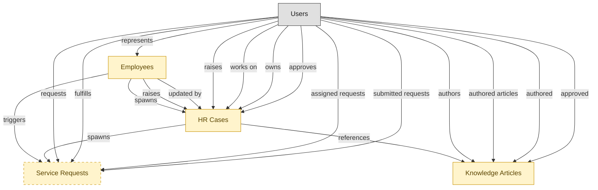

# Employee Self-Service Portal

## 1. Overview

Employee self-service intake surface: catalog browse, request submission, knowledge search, and case status. Workflow layer on top of HRSD-CASE-MGMT, no masters of its own. Hands intake off to case-mgmt and can route IT-flavored requests through to ITSM.

## 2. Entity summary

| Name | data_object | Description |
| --- | --- | --- |
| Employees | `employees` | Canonical records of people currently or formerly employed, carrying identity, employment metadata, and relationships to position, manager, and org unit. |
| HR Cases | `hr_cases` | Employee inquiries and service requests routed to HR operations, such as pay questions, benefits changes, leave requests, and complaints. |
| Knowledge Articles | `knowledge_articles` | Knowledge-base articles backing self-service portals and agent-assist tools, moving through draft, review, published, and retired. |
| Service Requests | `service_requests` | Planned, catalog-driven requests for access, hardware, software, or information, distinct from reactive incidents. |

## 3. Entities catalog

| # | data_object | catalog code | singular | plural | held_as | mastered in | mastered label | install_optional | personal_content | entity_type | write tier | notes |
| ---: | --- | --- | --- | --- | --- | --- | --- | --- | --- | --- | --- | --- |
| 1 | `employees` | `employees` | Employee | Employees | embedded_master | `hcm-core-worker` | Core Worker Record | - | yes | operational_workflow | `:manage` | - |
| 2 | `hr_cases` | `hr_cases` | HR Case | HR Cases | embedded_master | `hrsd-case-mgmt` | HR Case Management | - | yes | operational_workflow | `:manage` | - |
| 3 | `knowledge_articles` | `knowledge_articles` | Knowledge Article | Knowledge Articles | embedded_master | `itsm-knowledge` | IT Knowledge Management | - | - | operational_workflow | `:manage` | - |
| 4 | `service_requests` | `service_requests` | Service Request | Service Requests | embedded_master | `itsm-service-request` | Service Request Fulfillment | yes | - | operational_workflow | `:manage` | - |

## 4. Aliases and industry synonyms

_(none: no industry-scoped aliases for this scope)_

## 5. Relationships

_`field_required` applies only when both entities are installed. It never makes an entity required._

### 5.1 Relationships between entities in this blueprint

| from | verb | to | cardinality | kind | field_required | delete_mode | fk_format | notes |
| --- | --- | --- | --- | --- | --- | --- | --- | --- |
| `employees` | triggers | `service_requests` | one_to_many | reference | no | clear | reference | - |
| `employees` | spawns | `hr_cases` | one_to_many | reference | no | clear | reference | - |
| `employees` | raises | `hr_cases` | one_to_many | reference | yes | restrict | reference | - |
| `hr_cases` | references | `knowledge_articles` | many_to_many | association | - | cascade | parent | - |
| `hr_cases` | spawns | `service_requests` | one_to_many | reference | no | clear | reference | - |
| `employees` | updated by | `hr_cases` | one_to_many | reference | no | clear | reference | - |

### 5.2 Relationships to platform built-ins (`users`)

| from | verb | to | cardinality | field_required | delete_mode | fk_format | notes |
| --- | --- | --- | --- | --- | --- | --- | --- |
| `users` | represents | `employees` | one_to_one | no | clear | reference | - |
| `users` | raises | `hr_cases` | one_to_many | yes | restrict | reference | - |
| `users` | works on | `hr_cases` | one_to_many | no | clear | reference | - |
| `users` | owns | `hr_cases` | one_to_many | no | clear | reference | - |
| `users` | approves | `hr_cases` | one_to_many | no | clear | reference | - |
| `users` | authors | `knowledge_articles` | one_to_many | no | clear | reference | - |
| `users` | requests | `service_requests` | one_to_many | yes | restrict | reference | - |
| `users` | fulfills | `service_requests` | one_to_many | no | clear | reference | - |
| `users` | assigned requests | `service_requests` | one_to_many | no | clear | reference | - |
| `users` | submitted requests | `service_requests` | one_to_many | yes | restrict | reference | - |
| `users` | authored articles | `knowledge_articles` | one_to_many | yes | restrict | reference | - |
| `users` | authored | `knowledge_articles` | one_to_many | no | clear | reference | - |
| `users` | approved | `knowledge_articles` | one_to_many | no | clear | reference | - |

### 5.3 Relationships to entities outside this blueprint

_External entities are optional: this blueprint never installs them. If one exists at install, the relationship is proposed. A many-to-many relationship is listed under outgoing and proposed as a new junction table._

#### 5.3a Outgoing relationships: this blueprint's entity points to the external entity

| from | verb | to | cardinality | field_required | notes |
| --- | --- | --- | --- | --- | --- |
| `org_units` | groups | `employees` | one_to_many | yes | - |
| `onboarding_tasks` | emits | `service_requests` | one_to_many | no | - |
| `onboarding_tasks` | spawns | `hr_cases` | one_to_many | no | - |
| `carrier_feeds` | spawns | `hr_cases` | one_to_many | no | - |
| `survey_campaigns` | targets | `employees` | many_to_many | - | - |
| `case_categories` | classifies | `hr_cases` | one_to_many | yes | - |
| `case_categories` | drives | `employees` | one_to_many | no | - |
| `service_catalog_items` | spawns | `service_requests` | one_to_many | no | - |
| `service_slas` | governs request | `service_requests` | one_to_many | yes | - |
| `service_problems` | documented_in | `knowledge_articles` | one_to_many | no | - |
| `service_incidents` | resolved_with | `knowledge_articles` | many_to_many | - | - |
| `audit_engagements` | triggers | `service_requests` | one_to_many | no | - |
| `legal_holds` | identifies_custodians_from | `employees` | many_to_many | - | - |
| `legal_advice_records` | references | `employees` | many_to_many | - | - |
| `customer_cases` | references | `knowledge_articles` | many_to_many | - | - |
| `intent_definitions` | informs | `knowledge_articles` | one_to_many | no | - |
| `clinical_engineering_work_orders` | surfaces_in | `service_requests` | one_to_one | no | - |
| `device_calibration_records` | schedules_in | `service_requests` | one_to_many | no | - |
| `work_items` | mirrors_to | `service_requests` | one_to_one | no | - |
| `work_automations` | propagates_to | `service_requests` | many_to_many | - | - |
| `candidates` | becomes | `employees` | one_to_one | no | - |
| `pre_employees` | promotes to | `employees` | one_to_one | no | - |
| `knowledge_base_articles` | resolves | `hr_cases` | many_to_many | - | - |
| `contingent_workers` | converts_to | `employees` | one_to_one | no | - |

#### 5.3b Incoming relationships: the external entity points to this blueprint's entity

| from | verb | to | cardinality | field_required | notes |
| --- | --- | --- | --- | --- | --- |
| `employees` | signs | `employment_contracts` | one_to_many | yes | - |
| `employees` | generates | `employment_events` | one_to_many | yes | - |
| `employees` | triggers | `asset_lifecycle_events` | one_to_many | no | - |
| `employees` | requests | `absence_requests` | one_to_many | no | - |
| `employees` | holds | `skill_profiles` | one_to_one | no | - |
| `employees` | triggers | `iga_provisioning_events` | one_to_many | no | - |
| `employees` | triggers | `pay_runs` | one_to_many | no | - |
| `employees` | enrolls_in | `course_enrollments` | one_to_many | no | - |
| `employees` | becomes | `career_aspirations` | one_to_one | no | - |
| `employees` | becomes | `work_shifts` | one_to_many | no | - |
| `employees` | becomes | `compensation_statements` | one_to_one | no | - |
| `employees` | triggers | `benefit_enrollments` | one_to_many | no | - |
| `employees` | triggers | `corporate_cards` | one_to_many | no | - |
| `employees` | spawns | `onboarding_journeys` | one_to_one | no | - |
| `employees` | feeds | `headcount_plans` | one_to_many | no | - |
| `employees` | feeds | `agency_time_entries` | one_to_many | no | - |
| `employees` | onboarded by | `onboarding_journeys` | one_to_many | yes | - |
| `employees` | fills | `hcm_positions` | one_to_one | no | - |
| `employees` | finalized by | `onboarding_document_collections` | one_to_many | no | - |
| `employees` | learns_via | `course_enrollments` | one_to_many | yes | - |
| `employees` | reflects | `learning_records` | one_to_many | no | - |
| `employees` | reflected on | `compliance_assignments` | one_to_many | no | - |
| `employees` | enrolls_in | `benefit_enrollments` | one_to_many | yes | - |
| `employees` | declares | `life_events` | one_to_many | no | - |
| `employees` | updated by | `life_events` | one_to_many | no | - |
| `employees` | submits | `survey_responses` | one_to_many | no | - |
| `employees` | flagged on | `engagement_drivers` | one_to_many | no | - |
| `employees` | reflected on | `engagement_drivers` | one_to_many | no | - |
| `service_requests` | routes_to | `service_incidents` | one_to_many | no | - |
| `hr_cases` | spawns | `iga_access_requests` | one_to_many | no | - |
| `service_requests` | triggers | `service_incidents` | one_to_many | no | - |
| `knowledge_articles` | publishes_to | `knowledge_base_articles` | one_to_one | no | - |
| `employees` | is host for | `host_assignments` | one_to_many | yes | - |
| `employees` | reclassifies | `contingent_workers` | one_to_one | no | - |
| `employees` | receives | `merit_recommendations` | one_to_one | no | - |
| `employees` | holds | `equity_grants` | one_to_one | no | - |
| `employees` | receives | `compensation_statements` | one_to_one | no | - |
| `employees` | has | `emergency_contacts` | one_to_many | yes | - |
| `employees` | has | `work_eligibility_documents` | one_to_many | yes | - |
| `employees` | has | `national_ids` | one_to_many | yes | - |
| `employees` | has | `worker_addresses` | one_to_many | yes | - |
| `employees` | has | `employee_dependents` | one_to_many | yes | - |
| `employees` | has | `worker_change_requests` | one_to_many | yes | - |
| `employees` | applies_as | `candidates` | one_to_many | no | - |
| `employees` | is the worker behind | `traveler_profiles` | one_to_one | no | - |
| `employees` | is assessed by | `exit_risk_assessments` | one_to_one | no | - |
| `employees` | is subject of | `insider_risk_cases` | one_to_many | no | - |
| `employees` | is recognized in | `frontline_recognitions` | one_to_many | yes | - |
| `employees` | is enrolled as | `advocate_profiles` | one_to_one | yes | - |
| `employees` | receives | `incentive_awards` | one_to_many | yes | - |

## 6. Cross-domain context

### 6.1 Master consumers (other modules / domains that embed this scope's masters)

_(none: this scope masters no entities)_

### 6.2 Outbound handoffs (events this scope publishes)

_(none: no outbound handoffs whose payload is in this scope)_

### 6.3 Inbound handoffs (events this scope reacts to)

_(none: no inbound handoffs whose payload is in this scope)_

### 6.4 Master providers (modules / domains that own masters this scope embeds)

| data_object | held_as | install_optional | catalog owner(s) | slice notes |
| --- | --- | --- | --- | --- |
| `employees` | embedded_master | - | HCM-CORE-WORKER (HCM) | - |
| `hr_cases` | embedded_master | - | HRSD-CASE-MGMT (HRSD) | - |
| `knowledge_articles` | embedded_master | - | ITSM-KNOWLEDGE (ITSM) | - |
| `service_requests` | embedded_master | yes | ITSM-SERVICE-REQUEST (ITSM) | - |

## 7. Lifecycle states

### `employees` (Employee)

_This scope holds `employees` as **embedded_master**; the canonical state machine is owned by `HCM-CORE-WORKER`._

| order | state_name | initial? | terminal? | realizing module | requires_permission? | high risk? | derived gate | description |
| --- | --- | --- | --- | --- | --- | --- | --- | --- |
| 1 | `draft` | ✓ | - | `HCM-CORE-WORKER` | - | - | - | Pre-hire stub created during requisition or onboarding handoff; not yet a worker of record. |
| 2 | `active` | - | - | `HCM-CORE-WORKER` | ✓ | - | `hcm-core-worker:active_employee` | Worker is currently employed and appears in headcount, payroll eligibility, and directory feeds. |
| 3 | `on_leave` | - | - | `HCM-CORE-WORKER` | ✓ | - | `hcm-core-worker:on_leave_employee` | Employee is on approved leave (parental, medical, sabbatical); active record but suppressed from some downstream feeds. |
| 4 | `suspended` | - | - | `HCM-CORE-WORKER` | ✓ | - | `hcm-core-worker:suspended_employee` | Employment temporarily halted (investigation, disciplinary); pay and access may be paused. |
| 5 | `terminated` | - | ✓ | `HCM-CORE-WORKER` | ✓ | - | `hcm-core-worker:terminated_employee` | Employment ended (voluntary or involuntary); final pay processed, access deprovisioned. |

### `hr_cases` (HR Case)

_This scope holds `hr_cases` as **embedded_master**; the canonical state machine is owned by `HRSD-CASE-MGMT`._

| order | state_name | initial? | terminal? | realizing module | requires_permission? | high risk? | derived gate | description |
| --- | --- | --- | --- | --- | --- | --- | --- | --- |
| 1 | `intake` | ✓ | - | `HRSD-CASE-MGMT` | - | - | - | Case has been submitted via the self-service portal or another intake channel; awaiting triage by AI classification or HR agent. |
| 2 | `triaged` | - | - | `HRSD-CASE-MGMT` | ✓ | - | `hrsd-case-mgmt:triage_hr_case` | Case has been categorized and prioritized; ready for assignment to an HR agent or HRBP. |
| 3 | `assigned` | - | - | `HRSD-CASE-MGMT` | ✓ | - | `hrsd-case-mgmt:assign_hr_case` | Case is assigned to a named HR agent or HRBP owner. The owner is responsible for resolution within the case SLA. |
| 4 | `in_progress` | - | - | `HRSD-CASE-MGMT` | - | - | - | The owner is actively working the case (researching, requesting info from the employee, consulting policy). |
| 5 | `pending_approval` | - | - | `HRSD-CASE-MGMT` | ✓ | - | `hrsd-case-mgmt:approve_hr_case` | Case resolution requires a sign-off from manager, HRBP, legal, or compliance (policy exception, accommodation, sensitive ER outcome). |
| 6 | `resolved` | - | - | `HRSD-CASE-MGMT` | ✓ | - | `hrsd-case-mgmt:resolve_hr_case` | Owner has answered the employee's request or completed the workflow. Case enters the close-out review window. |
| 7 | `closed` | - | ✓ | `HRSD-CASE-MGMT` | - | - | - | Case is closed. Auto-closes after the SLA-defined review window if the employee does not respond or reopen. |
| 8 | `reopened` | - | - | `HRSD-CASE-MGMT` | ✓ | - | `hrsd-case-mgmt:reopen_hr_case` | A closed case has been reopened by the employee, owner, or HRBP for additional work. Returns to in_progress on next update. |

### `knowledge_articles` (Knowledge Article)

_This scope holds `knowledge_articles` as **embedded_master**; the canonical state machine is owned by `ITSM-KNOWLEDGE`._

| order | state_name | initial? | terminal? | realizing module | requires_permission? | high risk? | derived gate | description |
| --- | --- | --- | --- | --- | --- | --- | --- | --- |
| 1 | `draft` | ✓ | - | `ITSM-KNOWLEDGE` | - | - | - | Author is drafting the article; freely editable. |
| 2 | `in_review` | - | - | `ITSM-KNOWLEDGE` | - | - | - | Submitted for editorial/SME review; body locked from free edits. |
| 3 | `published` | - | - | `ITSM-KNOWLEDGE` | ✓ | - | `itsm-knowledge:publish_article` | Article is live and visible to consumers. |
| 4 | `retired` | - | ✓ | `ITSM-KNOWLEDGE` | - | - | - | Article withdrawn from circulation; retained for audit. |

### `service_requests` (Service Request)

_This scope holds `service_requests` as **embedded_master**; the canonical state machine is owned by `ITSM-SERVICE-REQUEST`._

| order | state_name | initial? | terminal? | realizing module | requires_permission? | high risk? | derived gate | description |
| --- | --- | --- | --- | --- | --- | --- | --- | --- |
| 1 | `submitted` | ✓ | - | `ITSM-SERVICE-REQUEST` | - | - | - | Requester has submitted the catalog request. |
| 2 | `approved` | - | - | `ITSM-SERVICE-REQUEST` | ✓ | - | `itsm-service-request:approved_service_request` | Approver has authorized fulfillment. |
| 3 | `fulfilling` | - | - | `ITSM-SERVICE-REQUEST` | - | - | - | Fulfillment team is provisioning or executing the request. |
| 4 | `fulfilled` | - | - | `ITSM-SERVICE-REQUEST` | - | - | - | Item or access has been delivered to the requester. |
| 5 | `closed` | - | ✓ | `ITSM-SERVICE-REQUEST` | - | - | - | Request archived after requester confirmation. |
| 6 | `canceled` | - | ✓ | `ITSM-SERVICE-REQUEST` | - | - | - | Request withdrawn or rejected before fulfillment. |

## 8. Permissions and business rules (derived)

### 8.1 Permissions

| permission | tier | description | included in `:admin`? |
| --- | --- | --- | --- |
| `hrsd-employee-portal:read` | baseline-read | Read access to every entity in the module | ✓ |
| `hrsd-employee-portal:manage` | baseline-manage | Edit operational records | ✓ |
| `hrsd-employee-portal:admin` | baseline-admin | Edit reference data and inherit every workflow gate below | - |
| `hcm-core-worker:read_employees` | entity-read | Read Employees | ✓ |
| `hcm-core-worker:write_employees` | entity-write | Write Employees | ✓ |
| `itsm-service-request:read_service_requests` | entity-read | Read Service Requests | ✓ |
| `itsm-service-request:write_service_requests` | entity-write | Write Service Requests | ✓ |
| `itsm-knowledge:read_knowledge_articles` | entity-read | Read Knowledge Articles | ✓ |
| `itsm-knowledge:write_knowledge_articles` | entity-write | Write Knowledge Articles | ✓ |
| `hrsd-case-mgmt:read_hr_cases` | entity-read | Read HR Cases | ✓ |
| `hrsd-case-mgmt:write_hr_cases` | entity-write | Write HR Cases | ✓ |
| `hcm-core-worker:active_employee` | workflow-gate (lifecycle) | Transition `employees` into state `active` | ✓ |
| `hcm-core-worker:on_leave_employee` | workflow-gate (lifecycle) | Transition `employees` into state `on_leave` | ✓ |
| `hcm-core-worker:suspended_employee` | workflow-gate (lifecycle) | Transition `employees` into state `suspended` | ✓ |
| `hcm-core-worker:terminated_employee` | workflow-gate (lifecycle) | Transition `employees` into state `terminated` | ✓ |
| `itsm-service-request:approved_service_request` | workflow-gate (lifecycle) | Transition `service_requests` into state `approved` | ✓ |
| `itsm-knowledge:publish_article` | workflow-gate (lifecycle) | Transition `knowledge_articles` into state `published` | ✓ |
| `hrsd-case-mgmt:triage_hr_case` | workflow-gate (lifecycle) | Transition `hr_cases` into state `triaged` | ✓ |
| `hrsd-case-mgmt:assign_hr_case` | workflow-gate (lifecycle) | Transition `hr_cases` into state `assigned` | ✓ |
| `hrsd-case-mgmt:approve_hr_case` | workflow-gate (lifecycle) | Transition `hr_cases` into state `pending_approval` | ✓ |
| `hrsd-case-mgmt:resolve_hr_case` | workflow-gate (lifecycle) | Transition `hr_cases` into state `resolved` | ✓ |
| `hrsd-case-mgmt:reopen_hr_case` | workflow-gate (lifecycle) | Transition `hr_cases` into state `reopened` | ✓ |
| `hcm-core-worker:view_all_employees` | override (personal_content) | View all `employees` rows beyond row-scope | ✓ |
| `hcm-core-worker:manage_all_employees` | override (personal_content) | Manage all `employees` rows beyond row-scope | ✓ |
| `hrsd-case-mgmt:view_all_hr_cases` | override (personal_content) | View all `hr_cases` rows beyond row-scope | ✓ |
| `hrsd-case-mgmt:manage_all_hr_cases` | override (personal_content) | Manage all `hr_cases` rows beyond row-scope | ✓ |

_Gates with no process: `hcm-core-worker:suspended_employee`, `itsm-service-request:approved_service_request`, `itsm-knowledge:publish_article`. No Accountable can hold them, so this blueprint does not support `raci`._

### 8.2 Business rules

| rule_name | data_object | source flag | intent |
| --- | --- | --- | --- |
| `employee_edit_scope` | `employees` | has_personal_content | Row-scope by default; override via `hcm-core-worker:view_all_employees` / `hcm-core-worker:manage_all_employees` |
| `hr_case_edit_scope` | `hr_cases` | has_personal_content | Row-scope by default; override via `hrsd-case-mgmt:view_all_hr_cases` / `hrsd-case-mgmt:manage_all_hr_cases` |

## 9. Roles, RACI, and responsibilities (derived)

_Baseline roles, the permission hierarchy, and RACI realization are DERIVED from this scope's entity-type write tiers + `process_raci`; none of it is stored in the catalog (the deployer provisions it from this blueprint)._

### 9.1 `HRSD-EMPLOYEE-PORTAL`

**Baseline roles:**

| role | baseline grant |
| --- | --- |
| `hrsd-employee-portal_viewer` | `hrsd-employee-portal:read` |
| `hrsd-employee-portal_manager` | `hrsd-employee-portal:manage` |
| `hrsd-employee-portal_admin` | `hrsd-employee-portal:admin` |

**Permission hierarchy:**

| permission | includes |
| --- | --- |
| `hrsd-employee-portal:admin` | `hrsd-employee-portal:manage` |
| `hrsd-employee-portal:manage` | `hrsd-employee-portal:read` |
| `hrsd-employee-portal:read` | `hcm-core-worker:read_employees` |
| `hrsd-employee-portal:read` | `itsm-service-request:read_service_requests` |
| `hrsd-employee-portal:read` | `itsm-knowledge:read_knowledge_articles` |
| `hrsd-employee-portal:read` | `hrsd-case-mgmt:read_hr_cases` |
| `hrsd-employee-portal:manage` | `hcm-core-worker:write_employees` |
| `hcm-core-worker:write_employees` | `hcm-core-worker:read_employees` |
| `hrsd-employee-portal:manage` | `itsm-service-request:write_service_requests` |
| `itsm-service-request:write_service_requests` | `itsm-service-request:read_service_requests` |
| `hrsd-employee-portal:manage` | `itsm-knowledge:write_knowledge_articles` |
| `itsm-knowledge:write_knowledge_articles` | `itsm-knowledge:read_knowledge_articles` |
| `hrsd-employee-portal:manage` | `hrsd-case-mgmt:write_hr_cases` |
| `hrsd-case-mgmt:write_hr_cases` | `hrsd-case-mgmt:read_hr_cases` |
| `hrsd-employee-portal:admin` | `hcm-core-worker:active_employee` |
| `hrsd-employee-portal:admin` | `hcm-core-worker:on_leave_employee` |
| `hrsd-employee-portal:admin` | `hcm-core-worker:suspended_employee` |
| `hrsd-employee-portal:admin` | `hcm-core-worker:terminated_employee` |
| `hrsd-employee-portal:admin` | `itsm-service-request:approved_service_request` |
| `hrsd-employee-portal:admin` | `itsm-knowledge:publish_article` |
| `hrsd-employee-portal:admin` | `hrsd-case-mgmt:triage_hr_case` |
| `hrsd-employee-portal:admin` | `hrsd-case-mgmt:assign_hr_case` |
| `hrsd-employee-portal:admin` | `hrsd-case-mgmt:approve_hr_case` |
| `hrsd-employee-portal:admin` | `hrsd-case-mgmt:resolve_hr_case` |
| `hrsd-employee-portal:admin` | `hrsd-case-mgmt:reopen_hr_case` |
| `hrsd-employee-portal:admin` | `hcm-core-worker:view_all_employees` |
| `hrsd-employee-portal:admin` | `hcm-core-worker:manage_all_employees` |
| `hrsd-employee-portal:admin` | `hrsd-case-mgmt:view_all_hr_cases` |
| `hrsd-employee-portal:admin` | `hrsd-case-mgmt:manage_all_hr_cases` |

**Processes wired:**

| process_key | process_name | PCF code | PCF ID | level | description |
| --- | --- | --- | --- | --- | --- |
| `manage_maintain_employee_data` | Manage and maintain employee data | 7.7.3 | 10524 | 3 | Capturing and updating employee information and data and information on the employees. |
| `manage_leave_absence` | Manage leave of absence | 7.6.2.2 | 10515 | 4 | Managing the period of time that an employee must be away from their primary job, while maintaining the status of employee (i.e., paid and unpaid leave of absence but not vacations, holidays, hiatuses, sabbaticals, and work-from-home programs). |
| `manage_separation` | Manage separation | 7.6.2 | 10513 | 3 | Managing the process of employee separation, including leaves of absence, resignations, discharges, and layoffs. Inform the employee of the termination. Complete paperwork for continuation of benefits. Enter employment status change into system. |
| `manage_employee_inquiry_process` | Manage employee inquiry process | 7.7.2 | 10523 | 3 | Handling instances where an employee believes that he/she has been inappropriately treated or he/she desires clarification. Encourage employees to inquire when needed. Record and clarify the issues for which the inquiry has been made. |

**RACI realization:**

| actor | kind | raci | process_key | realization |
| --- | --- | --- | --- | --- |
| `HR-PEOPLE-OPS-SPECIALIST` | persona | responsible | `manage_maintain_employee_data` | the gated entities' write tier |
| `HR-BUSINESS-PARTNER` | persona | accountable | `manage_maintain_employee_data` | grant gates [hcm-core-worker:active_employee] + the gated entities' write tier |
| `HR-HRIS-ADMIN` | persona | consulted | `manage_maintain_employee_data` | advisory read grant |
| `PEOPLE-MANAGER` | persona | informed | `manage_maintain_employee_data` | notify on trigger_events [employee.applied_internally] |
| `HR-PEOPLE-OPS-SPECIALIST` | persona | responsible | `manage_leave_absence` | the gated entities' write tier |
| `PEOPLE-MANAGER` | persona | accountable | `manage_leave_absence` | grant gates [hcm-core-worker:on_leave_employee] + the gated entities' write tier |
| `HR-BUSINESS-PARTNER` | persona | consulted | `manage_leave_absence` | blocking consultation state |
| `HR-HRIS-ADMIN` | persona | informed | `manage_leave_absence` | ⚠ no event wired |
| `HR-PEOPLE-OPS-SPECIALIST` | persona | responsible | `manage_separation` | the gated entities' write tier |
| `HR-BUSINESS-PARTNER` | persona | accountable | `manage_separation` | grant gates [hcm-core-worker:terminated_employee] + the gated entities' write tier |
| `PEOPLE-MANAGER` | persona | consulted | `manage_separation` | advisory read grant |
| `HR-HRIS-ADMIN` | persona | informed | `manage_separation` | notify on trigger_events [employee.terminated] |
| `HRSD-CASE-AGENT` | persona | responsible | `manage_employee_inquiry_process` | the gated entities' write tier |
| `HRSD-SERVICE-MANAGER` | persona | accountable | `manage_employee_inquiry_process` | grant gates [hrsd-case-mgmt:triage_hr_case, hrsd-case-mgmt:assign_hr_case, hrsd-case-mgmt:approve_hr_case, hrsd-case-mgmt:resolve_hr_case, hrsd-case-mgmt:reopen_hr_case] + the gated entities' write tier |
| `HRSD-KNOWLEDGE-MANAGER` | persona | informed | `manage_employee_inquiry_process` | notify on trigger_events [hr_case.resolved] |

### 9.2 Functional ownership and default grants

| responsibility | business function | default role | default tier |
| --- | --- | --- | --- |
| owner | HR Service Delivery | `admin` | `:admin` |
| contributor | IT Operations | `manager` | `:manage` |
