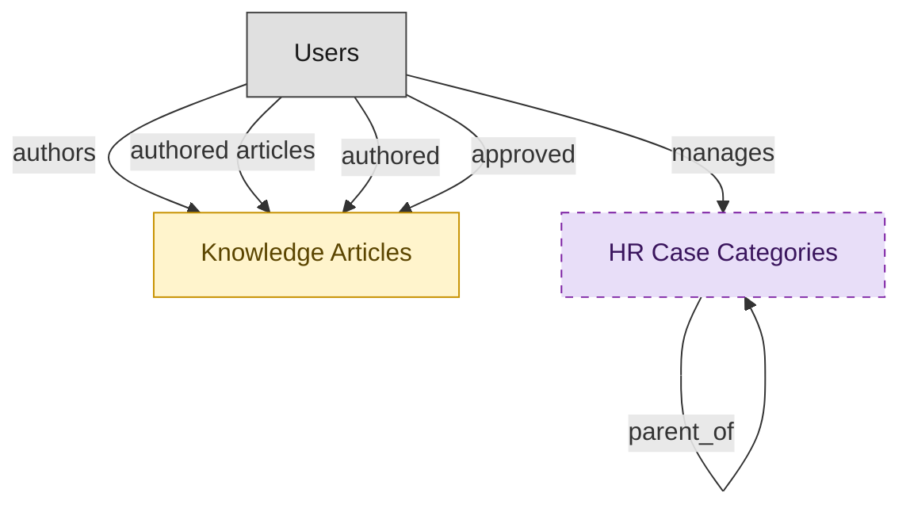

# HR Knowledge

## 1. Overview

HR knowledge surface: HR-audience articles, FAQs, and policy explainers. Consumes the cross-cutting knowledge_articles entity (mastered by ITSM/KMS) and feeds back authoring suggestions when cases are resolved.

## 2. Entity summary

| Name | data_object | Description |
| --- | --- | --- |
| Knowledge Articles | `knowledge_articles` | Knowledge-base articles backing self-service portals and agent-assist tools, moving through draft, review, published, and retired. |
| HR Case Categories | `case_categories` | Taxonomy of HR request types such as pay, benefits, leave, and policy, driving routing, SLAs, knowledge lookup, and trend analytics. |

## 3. Entities catalog

| # | data_object | catalog code | singular | plural | held_as | mastered in | mastered label | install_optional | personal_content | entity_type | write tier | notes |
| ---: | --- | --- | --- | --- | --- | --- | --- | --- | --- | --- | --- | --- |
| 1 | `knowledge_articles` | `knowledge_articles` | Knowledge Article | Knowledge Articles | embedded_master | `itsm-knowledge` | IT Knowledge Management | - | - | operational_workflow | `:manage` | - |
| 2 | `case_categories` | `case_categories` | HR Case Category | HR Case Categories | consumer | `hrsd-case-mgmt` | HR Case Management | yes | - | catalog | `:admin` | - |

## 4. Aliases and industry synonyms

_(none: no industry-scoped aliases for this scope)_

## 5. Relationships

_`field_required` applies only when both entities are installed. It never makes an entity required._

### 5.1 Relationships between entities in this blueprint

| from | verb | to | cardinality | kind | field_required | delete_mode | fk_format | notes |
| --- | --- | --- | --- | --- | --- | --- | --- | --- |
| `case_categories` | parent_of | `case_categories` | one_to_many | reference | no | clear | reference | - |

### 5.2 Relationships to platform built-ins (`users`)

| from | verb | to | cardinality | field_required | delete_mode | fk_format | notes |
| --- | --- | --- | --- | --- | --- | --- | --- |
| `users` | manages | `case_categories` | one_to_many | no | clear | reference | - |
| `users` | authors | `knowledge_articles` | one_to_many | no | clear | reference | - |
| `users` | authored articles | `knowledge_articles` | one_to_many | yes | restrict | reference | - |
| `users` | authored | `knowledge_articles` | one_to_many | no | clear | reference | - |
| `users` | approved | `knowledge_articles` | one_to_many | no | clear | reference | - |

### 5.3 Relationships to entities outside this blueprint

_External entities are optional: this blueprint never installs them. If one exists at install, the relationship is proposed. A many-to-many relationship is listed under outgoing and proposed as a new junction table._

#### 5.3a Outgoing relationships: this blueprint's entity points to the external entity

| from | verb | to | cardinality | field_required | notes |
| --- | --- | --- | --- | --- | --- |
| `hr_cases` | references | `knowledge_articles` | many_to_many | - | - |
| `service_problems` | documented_in | `knowledge_articles` | one_to_many | no | - |
| `service_incidents` | resolved_with | `knowledge_articles` | many_to_many | - | - |
| `customer_cases` | references | `knowledge_articles` | many_to_many | - | - |
| `intent_definitions` | informs | `knowledge_articles` | one_to_many | no | - |

#### 5.3b Incoming relationships: the external entity points to this blueprint's entity

| from | verb | to | cardinality | field_required | notes |
| --- | --- | --- | --- | --- | --- |
| `case_categories` | classifies | `hr_cases` | one_to_many | yes | - |
| `case_categories` | drives | `knowledge_base_articles` | one_to_many | no | - |
| `case_categories` | drives | `employees` | one_to_many | no | - |
| `knowledge_articles` | publishes_to | `knowledge_base_articles` | one_to_one | no | - |

## 6. Cross-domain context

### 6.1 Master consumers (other modules / domains that embed this scope's masters)

_(none: this scope masters no entities)_

### 6.2 Outbound handoffs (events this scope publishes)

_(none: no outbound handoffs whose payload is in this scope)_

### 6.3 Inbound handoffs (events this scope reacts to)

_(none: no inbound handoffs whose payload is in this scope)_

### 6.4 Master providers (modules / domains that own masters this scope embeds)

| data_object | held_as | install_optional | catalog owner(s) | slice notes |
| --- | --- | --- | --- | --- |
| `knowledge_articles` | embedded_master | - | ITSM-KNOWLEDGE (ITSM) | - |
| `case_categories` | consumer | yes | HRSD-CASE-MGMT (HRSD) | - |

## 7. Lifecycle states

### `knowledge_articles` (Knowledge Article)

_This scope holds `knowledge_articles` as **embedded_master**; the canonical state machine is owned by `ITSM-KNOWLEDGE`._

| order | state_name | initial? | terminal? | realizing module | requires_permission? | high risk? | derived gate | description |
| --- | --- | --- | --- | --- | --- | --- | --- | --- |
| 1 | `draft` | ✓ | - | `ITSM-KNOWLEDGE` | - | - | - | Author is drafting the article; freely editable. |
| 2 | `in_review` | - | - | `ITSM-KNOWLEDGE` | - | - | - | Submitted for editorial/SME review; body locked from free edits. |
| 3 | `published` | - | - | `ITSM-KNOWLEDGE` | ✓ | - | `itsm-knowledge:publish_article` | Article is live and visible to consumers. |
| 4 | `retired` | - | ✓ | `ITSM-KNOWLEDGE` | - | - | - | Article withdrawn from circulation; retained for audit. |

## 8. Permissions and business rules (derived)

### 8.1 Permissions

| permission | tier | description | included in `:admin`? |
| --- | --- | --- | --- |
| `hrsd-knowledge:read` | baseline-read | Read access to every entity in the module | ✓ |
| `hrsd-knowledge:manage` | baseline-manage | Edit operational records | ✓ |
| `hrsd-knowledge:admin` | baseline-admin | Edit reference data and inherit every workflow gate below | - |
| `itsm-knowledge:read_knowledge_articles` | entity-read | Read Knowledge Articles | ✓ |
| `itsm-knowledge:write_knowledge_articles` | entity-write | Write Knowledge Articles | ✓ |
| `hrsd-case-mgmt:read_case_categories` | entity-read | Read HR Case Categories | ✓ |
| `itsm-knowledge:publish_article` | workflow-gate (lifecycle) | Transition `knowledge_articles` into state `published` | ✓ |

_Gates with no process: `itsm-knowledge:publish_article`. No Accountable can hold them, so this blueprint does not support `raci`._

### 8.2 Business rules

_(none: no flag-derived business rules)_

## 9. Roles, RACI, and responsibilities (derived)

_Baseline roles, the permission hierarchy, and RACI realization are DERIVED from this scope's entity-type write tiers + `process_raci`; none of it is stored in the catalog (the deployer provisions it from this blueprint)._

### 9.1 `HRSD-KNOWLEDGE`

**Baseline roles:**

| role | baseline grant |
| --- | --- |
| `hrsd-knowledge_viewer` | `hrsd-knowledge:read` |
| `hrsd-knowledge_manager` | `hrsd-knowledge:manage` |
| `hrsd-knowledge_admin` | `hrsd-knowledge:admin` |

**Permission hierarchy:**

| permission | includes |
| --- | --- |
| `hrsd-knowledge:admin` | `hrsd-knowledge:manage` |
| `hrsd-knowledge:manage` | `hrsd-knowledge:read` |
| `hrsd-knowledge:read` | `itsm-knowledge:read_knowledge_articles` |
| `hrsd-knowledge:read` | `hrsd-case-mgmt:read_case_categories` |
| `hrsd-knowledge:manage` | `itsm-knowledge:write_knowledge_articles` |
| `itsm-knowledge:write_knowledge_articles` | `itsm-knowledge:read_knowledge_articles` |
| `hrsd-knowledge:admin` | `itsm-knowledge:publish_article` |

**RACI realization:**

_(none: no process_raci assignments wired to this module's gated processes yet)_

### 9.2 Functional ownership and default grants

| responsibility | business function | default role | default tier |
| --- | --- | --- | --- |
| owner | HR Service Delivery | `admin` | `:admin` |
| contributor | IT Operations | `manager` | `:manage` |
