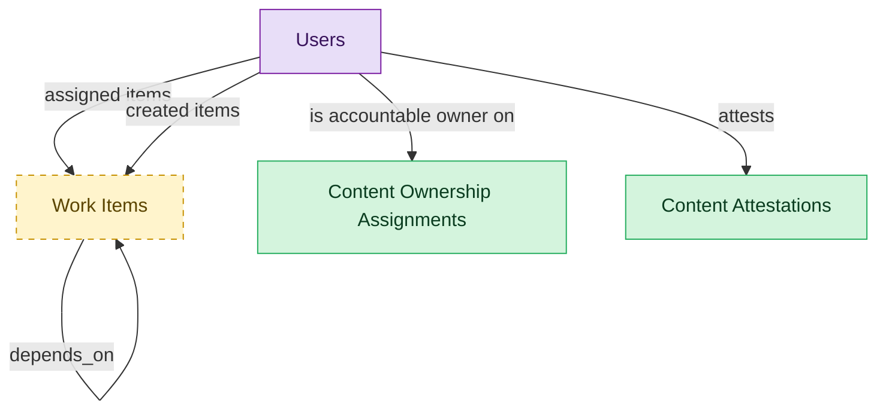

# Intranet Content Governance and Lifecycle

## 1. Overview

Accountable ownership assignments, recertification attestations, and the improvement backlog.

## 2. Entity summary

| Name | data_object | Description |
| --- | --- | --- |
| Content Attestations | `intranet_content_attestations` | Recertification records where an owner confirms content is current or flags it stale for remediation or archival. |
| Content Ownership Assignments | `intranet_content_ownership_assignments` | Assignments of an accountable owner and backup to a content record, with the review cadence the owner must keep. |
| Work Items | `work_items` | Atomic tasks, items, or cards in a work-management tool, with owner, due date, status, priority, dependencies, subtasks, attachments, and comments. |
| Users | `users` | Platform users referenced as assignees, authors, approvers, and creators across records. |

## 3. Entities catalog

| # | data_object | catalog code | singular | plural | held_as | mastered in | mastered label | install_optional | personal_content | entity_type | write tier | notes |
| ---: | --- | --- | --- | --- | --- | --- | --- | --- | --- | --- | --- | --- |
| 1 | `intranet_content_attestations` | `intranet_content_attestations` | Content Attestation | Content Attestations | master | - | - | - | - | operational_workflow | `:manage` | - |
| 2 | `intranet_content_ownership_assignments` | `intranet_content_ownership_assignments` | Content Ownership Assignment | Content Ownership Assignments | master | - | - | - | - | junction | `:manage` | - |
| 3 | `work_items` | `work_items` | Work Item | Work Items | embedded_master | `work-mgmt-task-exec` | Task and Project Execution | yes | - | operational_workflow | `:manage` | - |
| 4 | `users` | `users` | User | Users | consumer | _(platform built-in)_ | _(platform built-in)_ | - | - | operational_record | `:manage` | - |

## 4. Aliases and industry synonyms

_(none: no industry-scoped aliases for this scope)_

## 5. Relationships

_`field_required` applies only when both entities are installed. It never makes an entity required._

### 5.1 Relationships between entities in this blueprint

| from | verb | to | cardinality | kind | field_required | delete_mode | fk_format | notes |
| --- | --- | --- | --- | --- | --- | --- | --- | --- |
| `work_items` | depends_on | `work_items` | many_to_many | association | - | cascade | parent | - |

### 5.2 Relationships to platform built-ins (`users`)

| from | verb | to | cardinality | field_required | delete_mode | fk_format | notes |
| --- | --- | --- | --- | --- | --- | --- | --- |
| `users` | assigned items | `work_items` | one_to_many | no | clear | reference | - |
| `users` | created items | `work_items` | one_to_many | yes | restrict | reference | - |
| `users` | is accountable owner on | `intranet_content_ownership_assignments` | one_to_many | yes | restrict | reference | - |
| `users` | attests | `intranet_content_attestations` | one_to_many | yes | restrict | reference | - |

### 5.3 Relationships to entities outside this blueprint

_External entities are optional: this blueprint never installs them. If one exists at install, the relationship is proposed. A many-to-many relationship is listed under outgoing and proposed as a new junction table._

#### 5.3a Outgoing relationships: this blueprint's entity points to the external entity

| from | verb | to | cardinality | field_required | notes |
| --- | --- | --- | --- | --- | --- |
| `action_plans` | spawns | `work_items` | one_to_many | no | - |
| `test_defects` | spawns | `work_items` | one_to_many | no | - |
| `work_projects` | contains | `work_items` | one_to_many | yes | - |
| `okr_objectives` | tracked_by | `work_items` | one_to_many | no | - |
| `work_automations` | drives | `work_items` | one_to_many | no | - |
| `strategic_initiatives` | portfolio rollup from | `work_items` | one_to_many | no | - |
| `work_dependencies` | blocks | `work_items` | many_to_many | - | - |
| `work_approval_chains` | gates | `work_items` | many_to_many | - | - |
| `work_user_workloads` | rolls_up | `work_items` | many_to_many | - | - |
| `work_sections` | holds_items | `work_items` | one_to_many | no | - |
| `work_task_templates` | seeds_item | `work_items` | one_to_many | no | - |
| `work_form_submissions` | converts_to | `work_items` | one_to_many | no | - |
| `intranet_content_inventory_records` | is governed by | `intranet_content_ownership_assignments` | one_to_many | yes | - |
| `intranet_content_inventory_records` | is attested by | `intranet_content_attestations` | one_to_many | yes | - |
| `intranet_content_inventory_records` | spawns improvement | `work_items` | one_to_many | no | - |
| `marketing_plan_lines` | is delivered by | `work_items` | one_to_many | no | - |
| `work_statuses` | is_status_of | `work_items` | one_to_many | no | - |

#### 5.3b Incoming relationships: the external entity points to this blueprint's entity

| from | verb | to | cardinality | field_required | notes |
| --- | --- | --- | --- | --- | --- |
| `work_items` | mirrors_to | `service_requests` | one_to_one | no | - |
| `work_items` | has_field_values | `work_custom_field_values` | one_to_many | yes | - |
| `work_items` | has_tag_assignments | `work_item_tags` | one_to_many | yes | - |
| `work_items` | has_comments | `work_item_comments` | one_to_many | yes | - |
| `work_items` | has_attachments | `work_item_attachments` | one_to_many | yes | - |
| `work_items` | has_proofing_sessions | `proofing_sessions` | one_to_many | yes | - |
| `work_items` | has_time_entries | `work_time_entries` | one_to_many | yes | - |
| `work_items` | is_related_by | `work_goal_relationships` | one_to_many | yes | - |
| `work_items` | has_status_updates | `work_status_updates` | one_to_many | yes | - |

## 6. Cross-domain context

### 6.1 Master consumers (other modules / domains that embed this scope's masters)

_(none: no other module embeds this scope's masters)_

### 6.2 Outbound handoffs (events this scope publishes)

_(none: no outbound handoffs whose payload is in this scope)_

### 6.3 Inbound handoffs (events this scope reacts to)

_(none: no inbound handoffs whose payload is in this scope)_

### 6.4 Master providers (modules / domains that own masters this scope embeds)

| data_object | held_as | install_optional | catalog owner(s) | slice notes |
| --- | --- | --- | --- | --- |
| `work_items` | embedded_master | yes | WORK-MGMT-TASK-EXEC (WORK-MGMT) | - |
| `users` | consumer | - | _(platform built-in)_ | - |

## 7. Lifecycle states

### `intranet_content_attestations` (Content Attestation)

| order | state_name | initial? | terminal? | realizing module | requires_permission? | high risk? | derived gate | description |
| --- | --- | --- | --- | --- | --- | --- | --- | --- |
| 1 | `pending` | ✓ | - | _(always)_ | - | - | - | - |
| 2 | `attested_current` | - | - | `INTGOV-GOVERNANCE` | ✓ | - | `intgov-governance:attest` | - |
| 3 | `flagged_stale` | - | - | `INTGOV-GOVERNANCE` | ✓ | - | `intgov-governance:flag_stale` | - |
| 4 | `remediated` | - | - | _(always)_ | - | - | - | - |
| 5 | `archived` | - | ✓ | `INTGOV-GOVERNANCE` | ✓ | - | `intgov-governance:archive` | - |

### `work_items` (Work Item)

_This scope holds `work_items` as **embedded_master**; the canonical state machine is owned by `WORK-MGMT-TASK-EXEC`._

| order | state_name | initial? | terminal? | realizing module | requires_permission? | high risk? | derived gate | description |
| --- | --- | --- | --- | --- | --- | --- | --- | --- |
| 1 | `open` | ✓ | - | `WORK-MGMT-TASK-EXEC` | - | - | - | - |
| 2 | `in_progress` | - | - | `WORK-MGMT-TASK-EXEC` | - | - | - | - |
| 3 | `blocked` | - | - | `WORK-MGMT-TASK-EXEC` | - | - | - | - |
| 4 | `done` | - | ✓ | `WORK-MGMT-TASK-EXEC` | - | - | - | - |
| 5 | `canceled` | - | ✓ | `WORK-MGMT-TASK-EXEC` | ✓ | - | `work-mgmt-task-exec:cancel_work_item` | - |

## 8. Permissions and business rules (derived)

### 8.1 Permissions

| permission | tier | description | included in `:admin`? |
| --- | --- | --- | --- |
| `intgov-governance:read` | baseline-read | Read access to every entity in the module | ✓ |
| `intgov-governance:manage` | baseline-manage | Edit operational records | ✓ |
| `intgov-governance:admin` | baseline-admin | Edit reference data and inherit every workflow gate below | - |
| `work-mgmt-task-exec:read_work_items` | entity-read | Read Work Items | ✓ |
| `work-mgmt-task-exec:write_work_items` | entity-write | Write Work Items | ✓ |
| `intgov-governance:read_intranet_content_ownership_assignments` | entity-read | Read Content Ownership Assignments | ✓ |
| `intgov-governance:write_intranet_content_ownership_assignments` | entity-write | Write Content Ownership Assignments | ✓ |
| `intgov-governance:read_intranet_content_attestations` | entity-read | Read Content Attestations | ✓ |
| `intgov-governance:write_intranet_content_attestations` | entity-write | Write Content Attestations | ✓ |
| `work-mgmt-task-exec:cancel_work_item` | workflow-gate (lifecycle) | Transition `work_items` into state `canceled` | ✓ |
| `intgov-governance:attest` | workflow-gate (lifecycle) | Transition `intranet_content_attestations` into state `attested_current` | ✓ |
| `intgov-governance:flag_stale` | workflow-gate (lifecycle) | Transition `intranet_content_attestations` into state `flagged_stale` | ✓ |
| `intgov-governance:archive` | workflow-gate (lifecycle) | Transition `intranet_content_attestations` into state `archived` | ✓ |

### 8.2 Business rules

_(none: no flag-derived business rules)_

## 9. Roles, RACI, and responsibilities (derived)

_Baseline roles, the permission hierarchy, and RACI realization are DERIVED from this scope's entity-type write tiers + `process_raci`; none of it is stored in the catalog (the deployer provisions it from this blueprint)._

### 9.1 `INTGOV-GOVERNANCE`

**Baseline roles:**

| role | baseline grant |
| --- | --- |
| `intgov-governance_viewer` | `intgov-governance:read` |
| `intgov-governance_manager` | `intgov-governance:manage` |
| `intgov-governance_admin` | `intgov-governance:admin` |

**Permission hierarchy:**

| permission | includes |
| --- | --- |
| `intgov-governance:admin` | `intgov-governance:manage` |
| `intgov-governance:manage` | `intgov-governance:read` |
| `intgov-governance:read` | `work-mgmt-task-exec:read_work_items` |
| `intgov-governance:read` | `intgov-governance:read_intranet_content_ownership_assignments` |
| `intgov-governance:read` | `intgov-governance:read_intranet_content_attestations` |
| `intgov-governance:manage` | `work-mgmt-task-exec:write_work_items` |
| `work-mgmt-task-exec:write_work_items` | `work-mgmt-task-exec:read_work_items` |
| `intgov-governance:manage` | `intgov-governance:write_intranet_content_ownership_assignments` |
| `intgov-governance:write_intranet_content_ownership_assignments` | `intgov-governance:read_intranet_content_ownership_assignments` |
| `intgov-governance:manage` | `intgov-governance:write_intranet_content_attestations` |
| `intgov-governance:write_intranet_content_attestations` | `intgov-governance:read_intranet_content_attestations` |
| `intgov-governance:admin` | `work-mgmt-task-exec:cancel_work_item` |
| `intgov-governance:admin` | `intgov-governance:attest` |
| `intgov-governance:admin` | `intgov-governance:flag_stale` |
| `intgov-governance:admin` | `intgov-governance:archive` |

**Processes wired:**

| process_key | process_name | PCF code | PCF ID | level | description |
| --- | --- | --- | --- | --- | --- |
| `manage_projects` | Manage projects | 13.2.3 | 16410 | 3 | Establishing the scope of the projects. Create plans for implementing the projects. Initiate projects. Review and report project performance to management. Close projects. |
| - | Recertify Intranet Content | CUSTOM-INTRANET-GOV-RECERT | - | 1 | Periodic recertification of intranet content: owners attest that content is current, or flag it stale for remediation or archival, keeping the intranet free of ghost-town content. |

**RACI realization:**

| actor | kind | raci | process_key | realization |
| --- | --- | --- | --- | --- |
| `OPERATIONS-WORK-CONTRIBUTOR` | persona | responsible | `manage_projects` | the gated entities' write tier |
| `OPERATIONS-WORK-PROGRAM-LEAD` | persona | accountable | `manage_projects` | grant gates [work-mgmt-task-exec:cancel_work_item] + the gated entities' write tier |
| `CONTENT-OWNER` | persona | responsible | - | the gated entities' write tier |
| `DIGITAL-WORKPLACE-GOV-LEAD` | persona | accountable | - | grant gates [intgov-governance:attest, intgov-governance:flag_stale, intgov-governance:archive] + the gated entities' write tier |
| `ITOPS-INTRANET-ADMIN` | persona | consulted | - | advisory read grant |

### 9.2 Functional ownership and default grants

| responsibility | business function | default role | default tier |
| --- | --- | --- | --- |
| owner | Human Resources | `admin` | `:admin` |
| owner | IT Operations | `admin` | `:admin` |
| contributor | Marketing Communications | `manager` | `:manage` |
| consumer | Executive | `viewer` | `:read` |
