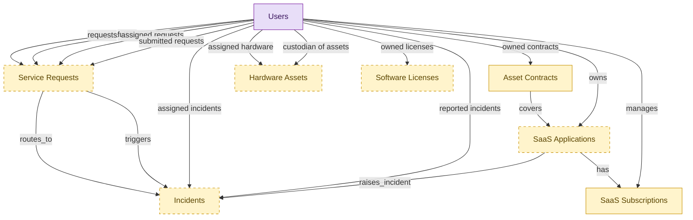

# IT Operations Starter

## 1. Overview

Cross-domain starter kit for small and mid-sized IT teams. Embeds lightweight shells of the records a small IT shop manages: the helpdesk (optional), the hardware register, the SaaS application and renewal tracker, and the contract register. The renewal/contract spine (asset_contracts + saas_subscriptions) is required; hardware, SaaS apps, helpdesk, and on-prem licenses are optional. domain_id NULL; hosts ITSM, HAM, SMP, ITAM, SAM. Replaces the helpdesk-plus-spreadsheets reality; budget stays in the general ledger.

## 2. Entity summary

| Name | data_object | Description |
| --- | --- | --- |
| Asset Contracts | `asset_contracts` | Lease, maintenance, support, or warranty contracts governing an asset or pool of assets, indexed on the asset side. |
| Hardware Assets | `hardware_assets` | Physical IT assets such as laptops, servers, network gear, and peripherals, with serial number, asset tag, current user or location, and lifecycle state. |
| Incidents | `service_incidents` | Unplanned service interruptions or quality reductions, with severity, priority, category, assignee, and affected components. |
| SaaS Applications | `saas_applications` | SaaS applications in the company portfolio, with vendor, category, criticality, owner, and whether each is sanctioned or shadow IT. |
| SaaS Subscriptions | `saas_subscriptions` | Contractual subscriptions for SaaS apps: plan tier, seat count, recurring cost, billing cadence, renewal date, and owner. |
| Service Requests | `service_requests` | Planned, catalog-driven requests for access, hardware, software, or information, distinct from reactive incidents. |
| Software Licenses | `software_licenses` | License entitlements granting the right to use a software title, with vendor, purchased count, license model, term, and renewal date. |
| Users | `users` | Platform users referenced as assignees, authors, approvers, and creators across records. |

## Additional Requirements Specification

Cost fields on the embedded shells. For the standalone renewal-and-cost view to resolve, two embedded masters each need a flat cost figure plus a currency code:

- `asset_contracts`: a flat `renewal_cost` (or `annual_value`) numeric field.
- `saas_subscriptions`: a flat `annual_spend` (or MRR/ARR) numeric field.

Coexistence: these flat fields are a standalone-only denormalization. They are not needed when the full asset-management and SaaS-management modules are already installed (those carry cost on their own spend entities); when such a full module is added later, the flat field must be deduplicated and reconciled against the canonical source so cost is not double-counted.

## 3. Entities catalog

| # | data_object | catalog code | singular | plural | held_as | mastered in | mastered label | install_optional | personal_content | entity_type | write tier | notes |
| ---: | --- | --- | --- | --- | --- | --- | --- | --- | --- | --- | --- | --- |
| 1 | `asset_contracts` | `asset_contracts` | Asset Contract | Asset Contracts | embedded_master | `itam-contracts` | Cross-Asset Contract Management | - | - | operational_workflow | `:manage` | - |
| 2 | `hardware_assets` | `hardware_assets` | Hardware Asset | Hardware Assets | embedded_master | `ham-asset-registry` | Hardware Asset Registry | yes | - | operational_workflow | `:manage` | - |
| 3 | `service_incidents` | `service_incidents` | Incident | Incidents | embedded_master | `itsm-incident-mgmt` | Incident Management | yes | yes | operational_workflow | `:manage` | - |
| 4 | `saas_applications` | `saas_applications` | SaaS Application | SaaS Applications | embedded_master | `smp-discovery` | SMP Discovery and Catalog | yes | - | operational_workflow | `:manage` | - |
| 5 | `saas_subscriptions` | `saas_subscriptions` | SaaS Subscription | SaaS Subscriptions | embedded_master | `smp-renewal-vendor` | SMP Renewal and Vendor Management | - | - | operational_workflow | `:manage` | - |
| 6 | `service_requests` | `service_requests` | Service Request | Service Requests | embedded_master | `itsm-service-request` | Service Request Fulfillment | yes | - | operational_workflow | `:manage` | - |
| 7 | `software_licenses` | `software_licenses` | Software License | Software Licenses | embedded_master | `sam-entitlement-mgmt` | Entitlement Reconciliation and Renewal | yes | - | operational_workflow | `:manage` | - |
| 8 | `users` | `users` | User | Users | consumer | _(platform built-in)_ | _(platform built-in)_ | - | - | operational_record | `:manage` | - |

## 4. Aliases and industry synonyms

_(none: no industry-scoped aliases for this scope)_

## 5. Relationships

_`field_required` applies only when both entities are installed. It never makes an entity required._

### 5.1 Relationships between entities in this blueprint

| from | verb | to | cardinality | kind | field_required | delete_mode | fk_format | notes |
| --- | --- | --- | --- | --- | --- | --- | --- | --- |
| `service_requests` | routes_to | `service_incidents` | one_to_many | reference | no | clear | reference | - |
| `service_requests` | triggers | `service_incidents` | one_to_many | reference | no | clear | reference | - |
| `asset_contracts` | covers | `saas_applications` | many_to_many | reference | - | cascade | parent | - |
| `saas_applications` | has | `saas_subscriptions` | one_to_many | reference | no | clear | reference | - |
| `saas_applications` | raises_incident | `service_incidents` | one_to_many | reference | no | clear | reference | - |

### 5.2 Relationships to platform built-ins (`users`)

| from | verb | to | cardinality | field_required | delete_mode | fk_format | notes |
| --- | --- | --- | --- | --- | --- | --- | --- |
| `users` | requests | `service_requests` | one_to_many | yes | restrict | reference | - |
| `users` | fulfills | `service_requests` | one_to_many | no | clear | reference | - |
| `users` | assigned incidents | `service_incidents` | one_to_many | no | clear | reference | - |
| `users` | reported incidents | `service_incidents` | one_to_many | yes | restrict | reference | - |
| `users` | assigned requests | `service_requests` | one_to_many | no | clear | reference | - |
| `users` | submitted requests | `service_requests` | one_to_many | yes | restrict | reference | - |
| `users` | assigned hardware | `hardware_assets` | one_to_many | no | clear | reference | - |
| `users` | custodian of assets | `hardware_assets` | one_to_many | no | clear | reference | - |
| `users` | owned contracts | `asset_contracts` | one_to_many | no | clear | reference | - |
| `users` | owns | `saas_applications` | one_to_many | yes | restrict | reference | - |
| `users` | manages | `saas_subscriptions` | one_to_many | yes | restrict | reference | - |
| `users` | owned licenses | `software_licenses` | one_to_many | no | clear | reference | - |

### 5.3 Relationships to entities outside this blueprint

_External entities are optional: this blueprint never installs them. If one exists at install, the relationship is proposed. A many-to-many relationship is listed under outgoing and proposed as a new junction table._

#### 5.3a Outgoing relationships: this blueprint's entity points to the external entity

| from | verb | to | cardinality | field_required | notes |
| --- | --- | --- | --- | --- | --- |
| `employees` | triggers | `service_requests` | one_to_many | no | - |
| `onboarding_tasks` | emits | `service_requests` | one_to_many | no | - |
| `onboarding_tasks` | emits | `service_incidents` | one_to_many | no | - |
| `hr_cases` | spawns | `service_requests` | one_to_many | no | - |
| `service_catalog_items` | spawns | `service_requests` | one_to_many | no | - |
| `service_problems` | is investigated by | `service_incidents` | one_to_many | no | - |
| `service_incidents` | references | `configuration_items` | many_to_many | - | - |
| `service_slas` | governs incident | `service_incidents` | one_to_many | yes | - |
| `service_slas` | governs request | `service_requests` | one_to_many | yes | - |
| `service_incidents` | resolved_with | `knowledge_articles` | many_to_many | - | - |
| `service_incidents` | correlates_to | `monitoring_alerts` | many_to_many | - | - |
| `service_incidents` | correlates_to | `error_groups` | many_to_many | - | - |
| `application_interfaces` | raises | `service_incidents` | one_to_many | no | - |
| `configuration_items` | triggers | `service_incidents` | one_to_many | no | - |
| `service_maps` | refreshes | `service_incidents` | many_to_many | - | - |
| `ci_baselines` | triggers | `service_incidents` | one_to_many | no | - |
| `hardware_models` | instantiated_as | `hardware_assets` | one_to_many | yes | - |
| `hardware_assets` | served_by | `spare_parts_inventory` | many_to_many | - | - |
| `chat_threads` | escalates_to | `service_incidents` | one_to_many | no | - |
| `control_tests` | escalates_to | `service_incidents` | one_to_many | no | - |
| `audit_engagements` | triggers | `service_requests` | one_to_many | no | - |
| `test_defects` | escalates_to | `service_incidents` | one_to_many | no | - |
| `legal_contracts` | activates | `saas_subscriptions` | one_to_many | no | - |
| `legal_contracts` | activates | `software_licenses` | one_to_many | no | - |
| `legal_contracts` | renewal_warns | `saas_subscriptions` | one_to_many | no | - |
| `eam_work_orders` | escalates_to | `service_incidents` | one_to_many | no | - |
| `clinical_engineering_work_orders` | surfaces_in | `service_requests` | one_to_one | no | - |
| `device_calibration_records` | schedules_in | `service_requests` | one_to_many | no | - |
| `work_items` | mirrors_to | `service_requests` | one_to_one | no | - |
| `work_automations` | propagates_to | `service_requests` | many_to_many | - | - |
| `shadow_it_apps` | promotes_to | `saas_applications` | one_to_one | no | - |
| `saas_applications` | owns | `smp_app_owners` | many_to_many | - | - |
| `smp_app_lifecycle_stages` | has_stage | `saas_applications` | one_to_one | yes | - |
| `dlp_incidents` | informs_security_incident | `service_incidents` | one_to_many | no | - |
| `lcap_apps` | opens | `service_incidents` | many_to_many | - | - |
| `event_correlations` | triggers | `service_incidents` | one_to_many | no | - |
| `root_cause_analyses` | annotates | `service_incidents` | one_to_many | no | - |
| `incident_predictions` | forecasts | `service_incidents` | one_to_many | no | - |
| `dc_cabinets` | raises | `service_incidents` | one_to_many | no | - |
| `dc_power_distribution_units` | raises | `service_incidents` | one_to_many | no | - |
| `dc_uninterruptible_power_supplies` | raises | `service_incidents` | one_to_many | no | - |
| `dc_cooling_units` | raises | `service_incidents` | one_to_many | no | - |
| `enterprise_applications` | is delivered via | `saas_subscriptions` | one_to_many | no | - |
| `endpoint_experience_scores` | triggers | `service_incidents` | one_to_many | no | - |

#### 5.3b Incoming relationships: the external entity points to this blueprint's entity

| from | verb | to | cardinality | field_required | notes |
| --- | --- | --- | --- | --- | --- |
| `hardware_assets` | delivered by | `asset_lifecycle_events` | one_to_many | no | - |
| `service_incidents` | triggers | `remediation_plans` | one_to_many | no | - |
| `hardware_assets` | covered_by | `hardware_warranties` | one_to_many | no | - |
| `hardware_assets` | disposed_via | `hardware_disposal_records` | one_to_one | no | - |
| `hardware_assets` | represented_as | `configuration_items` | one_to_one | no | - |
| `hardware_assets` | triggers | `rmm_agents` | one_to_one | no | - |
| `asset_contracts` | governs | `asset_lifecycle_events` | one_to_many | no | - |
| `saas_applications` | lifecycle events for | `asset_lifecycle_events` | one_to_many | no | - |
| `asset_contracts` | fulfilled_by | `purchase_orders` | one_to_many | no | - |
| `asset_contracts` | feeds | `compliance_risks` | one_to_many | no | - |
| `asset_contracts` | accrues_in | `journal_entries` | one_to_many | no | - |
| `saas_subscriptions` | charged to subscription | `expense_lines` | one_to_many | no | - |
| `saas_applications` | measured_by | `saas_usage_metrics` | one_to_many | yes | - |
| `saas_applications` | assigned_via | `smp_license_seat_assignments` | one_to_many | yes | - |
| `saas_subscriptions` | grants | `smp_license_seat_assignments` | one_to_many | no | - |
| `saas_applications` | entitles_to | `iga_user_entitlements` | one_to_many | no | - |
| `saas_applications` | integrates_with | `smp_app_integrations` | one_to_many | yes | - |
| `saas_applications` | publishes | `smp_app_catalog_listings` | one_to_one | yes | - |
| `saas_applications` | has_alerts | `smp_alerts` | one_to_many | no | - |
| `saas_applications` | has_recommendations | `smp_optimization_recommendations` | one_to_many | no | - |
| `saas_subscriptions` | has_recommendations | `smp_optimization_recommendations` | one_to_many | no | - |
| `saas_applications` | has_benchmarks | `smp_app_benchmarks` | one_to_many | yes | - |
| `saas_subscriptions` | has_renewal_tasks | `smp_renewal_tasks` | one_to_many | yes | - |
| `saas_subscriptions` | has_engagements | `smp_renewal_engagements` | one_to_many | yes | - |
| `saas_subscriptions` | has_allocations | `smp_spend_allocations` | one_to_many | yes | - |
| `saas_applications` | has_risk_assessments | `smp_vendor_risk_assessments` | one_to_many | yes | - |
| `saas_applications` | has_workflows | `smp_automation_workflows` | one_to_many | no | - |
| `saas_applications` | is registered as | `enterprise_applications` | one_to_one | no | - |

## 6. Cross-domain context

### 6.1 Master consumers (other modules / domains that embed this scope's masters)

_(none: this scope masters no entities)_

### 6.2 Outbound handoffs (events this scope publishes)

_(none: no outbound handoffs whose payload is in this scope)_

### 6.3 Inbound handoffs (events this scope reacts to)

_(none: no inbound handoffs whose payload is in this scope)_

### 6.4 Master providers (modules / domains that own masters this scope embeds)

| data_object | held_as | install_optional | catalog owner(s) | slice notes |
| --- | --- | --- | --- | --- |
| `asset_contracts` | embedded_master | - | ITAM-CONTRACTS (ITAM) | - |
| `hardware_assets` | embedded_master | yes | HAM-ASSET-REGISTRY (HAM) | - |
| `saas_applications` | embedded_master | yes | SMP-DISCOVERY (SMP) | - |
| `saas_subscriptions` | embedded_master | - | SMP-RENEWAL-VENDOR (SMP) | - |
| `service_incidents` | embedded_master | yes | ITSM-INCIDENT-MGMT (ITSM) | - |
| `service_requests` | embedded_master | yes | ITSM-SERVICE-REQUEST (ITSM) | - |
| `software_licenses` | embedded_master | yes | SAM-ENTITLEMENT-MGMT (SAM) | - |
| `users` | consumer | - | _(platform built-in)_ | - |

## 7. Lifecycle states

### `asset_contracts` (Asset Contract)

_This scope holds `asset_contracts` as **embedded_master**; the canonical state machine is owned by `ITAM-CONTRACTS`._

| order | state_name | initial? | terminal? | realizing module | requires_permission? | high risk? | derived gate | description |
| --- | --- | --- | --- | --- | --- | --- | --- | --- |
| 1 | `draft` | ✓ | - | _(always)_ | - | - | - | Contract record being entered into the ITAM index. |
| 2 | `active` | - | - | `ITAM-CONTRACTS` | ✓ | - | `itam-contracts:activate_contract` | Contract is in force and covering the related assets. |
| 3 | `expiring` | - | - | _(always)_ | - | - | - | Contract within the renewal window; action required. |
| 4 | `expired` | - | ✓ | _(always)_ | - | - | - | Contract term ended without renewal. |
| 5 | `terminated` | - | ✓ | `ITAM-CONTRACTS` | ✓ | - | `itam-contracts:terminate_contract` | Contract ended early by either party. |

### `saas_applications` (SaaS Application)

_This scope holds `saas_applications` as **embedded_master**; the canonical state machine is owned by `SMP-DISCOVERY`._

| order | state_name | initial? | terminal? | realizing module | requires_permission? | high risk? | derived gate | description |
| --- | --- | --- | --- | --- | --- | --- | --- | --- |
| 10 | `discovered` | ✓ | - | `SMP-DISCOVERY` | - | - | - | App detected via SSO logs, expense data, or browser plugin. Not yet reviewed by IT. |
| 20 | `triaged` | - | - | `SMP-DISCOVERY` | - | - | - | App has been reviewed by IT but no sanction decision recorded yet. |
| 30 | `sanctioned` | - | - | `SMP-DISCOVERY` | ✓ | - | `smp-discovery:sanction_application` | App is officially supported; IGA provisioning, FINOPS spend tracking, and ITAM registration activated. |
| 40 | `deprecated` | - | - | `SMP-DISCOVERY` | ✓ | - | `smp-discovery:deprecate_application` | Slated for replacement or removal; no new assignments allowed; existing users on read-only or sunset path. |
| 50 | `deprovisioned` | - | ✓ | `SMP-DISCOVERY` | ✓ | - | `smp-discovery:deprovision_application` | App removed tenant-wide. ITSM closes related tickets; IGA revokes access; FINOPS terminates spend. |

### `saas_subscriptions` (SaaS Subscription)

_This scope holds `saas_subscriptions` as **embedded_master**; the canonical state machine is owned by `SMP-RENEWAL-VENDOR`._

| order | state_name | initial? | terminal? | realizing module | requires_permission? | high risk? | derived gate | description |
| --- | --- | --- | --- | --- | --- | --- | --- | --- |
| 10 | `draft` | ✓ | - | `SMP-RENEWAL-VENDOR` | - | - | - | Subscription record created during procurement; terms not yet finalized. |
| 20 | `active` | - | - | `SMP-RENEWAL-VENDOR` | - | - | - | Contract executed; license consumption underway. |
| 30 | `renewing` | - | - | `SMP-RENEWAL-VENDOR` | ✓ | - | `smp-renewal-vendor:initiate_renewal` | Within the renewal window (typically 90 days pre-expiry). Quantity and tier negotiation in progress. |
| 40 | `renewed` | - | ✓ | `SMP-RENEWAL-VENDOR` | ✓ | - | `smp-renewal-vendor:approve_renewal` | Renewal executed; a new active term started. |
| 50 | `canceled` | - | ✓ | `SMP-RENEWAL-VENDOR` | ✓ | - | `smp-renewal-vendor:cancel_subscription` | Subscription terminated; deprovisioning workflow triggered. |

### `service_incidents` (Incident)

_This scope holds `service_incidents` as **embedded_master**; the canonical state machine is owned by `ITSM-INCIDENT-MGMT`._

| order | state_name | initial? | terminal? | realizing module | requires_permission? | high risk? | derived gate | description |
| --- | --- | --- | --- | --- | --- | --- | --- | --- |
| 1 | `new` | ✓ | - | `ITSM-INCIDENT-MGMT` | - | - | - | Incident has been logged; not yet triaged or routed. |
| 2 | `assigned` | - | - | `ITSM-INCIDENT-MGMT` | - | - | - | Triaged and assigned to a support group or agent. |
| 3 | `in_progress` | - | - | `ITSM-INCIDENT-MGMT` | - | - | - | Assignee is actively diagnosing or working the incident. |
| 4 | `resolved` | - | - | `ITSM-INCIDENT-MGMT` | ✓ | - | `itsm-incident-mgmt:resolved_incident` | Workaround or fix delivered; awaiting reporter confirmation. |
| 5 | `closed` | - | ✓ | `ITSM-INCIDENT-MGMT` | ✓ | - | `itsm-incident-mgmt:closed_incident` | Resolution confirmed; incident archived and SLA clock stopped. |
| 6 | `canceled` | - | ✓ | `ITSM-INCIDENT-MGMT` | - | - | - | Incident withdrawn (duplicate, invalid, raised in error). |

### `service_requests` (Service Request)

_This scope holds `service_requests` as **embedded_master**; the canonical state machine is owned by `ITSM-SERVICE-REQUEST`._

| order | state_name | initial? | terminal? | realizing module | requires_permission? | high risk? | derived gate | description |
| --- | --- | --- | --- | --- | --- | --- | --- | --- |
| 1 | `submitted` | ✓ | - | `ITSM-SERVICE-REQUEST` | - | - | - | Requester has submitted the catalog request. |
| 2 | `approved` | - | - | `ITSM-SERVICE-REQUEST` | ✓ | - | `itsm-service-request:approved_service_request` | Approver has authorized fulfillment. |
| 3 | `fulfilling` | - | - | `ITSM-SERVICE-REQUEST` | - | - | - | Fulfillment team is provisioning or executing the request. |
| 4 | `fulfilled` | - | - | `ITSM-SERVICE-REQUEST` | - | - | - | Item or access has been delivered to the requester. |
| 5 | `closed` | - | ✓ | `ITSM-SERVICE-REQUEST` | - | - | - | Request archived after requester confirmation. |
| 6 | `canceled` | - | ✓ | `ITSM-SERVICE-REQUEST` | - | - | - | Request withdrawn or rejected before fulfillment. |

## 8. Permissions and business rules (derived)

### 8.1 Permissions

| permission | tier | description | included in `:admin`? |
| --- | --- | --- | --- |
| `it-ops-starter:read` | baseline-read | Read access to every entity in the module | ✓ |
| `it-ops-starter:manage` | baseline-manage | Edit operational records | ✓ |
| `it-ops-starter:admin` | baseline-admin | Edit reference data and inherit every workflow gate below | - |
| `itsm-incident-mgmt:read_service_incidents` | entity-read | Read Incidents | ✓ |
| `itsm-incident-mgmt:write_service_incidents` | entity-write | Write Incidents | ✓ |
| `itsm-service-request:read_service_requests` | entity-read | Read Service Requests | ✓ |
| `itsm-service-request:write_service_requests` | entity-write | Write Service Requests | ✓ |
| `itam-contracts:read_asset_contracts` | entity-read | Read Asset Contracts | ✓ |
| `itam-contracts:write_asset_contracts` | entity-write | Write Asset Contracts | ✓ |
| `ham-asset-registry:read_hardware_assets` | entity-read | Read Hardware Assets | ✓ |
| `ham-asset-registry:write_hardware_assets` | entity-write | Write Hardware Assets | ✓ |
| `sam-entitlement-mgmt:read_software_licenses` | entity-read | Read Software Licenses | ✓ |
| `sam-entitlement-mgmt:write_software_licenses` | entity-write | Write Software Licenses | ✓ |
| `smp-discovery:read_saas_applications` | entity-read | Read SaaS Applications | ✓ |
| `smp-discovery:write_saas_applications` | entity-write | Write SaaS Applications | ✓ |
| `smp-renewal-vendor:read_saas_subscriptions` | entity-read | Read SaaS Subscriptions | ✓ |
| `smp-renewal-vendor:write_saas_subscriptions` | entity-write | Write SaaS Subscriptions | ✓ |
| `itsm-incident-mgmt:resolved_incident` | workflow-gate (lifecycle) | Transition `service_incidents` into state `resolved` | ✓ |
| `itsm-incident-mgmt:closed_incident` | workflow-gate (lifecycle) | Transition `service_incidents` into state `closed` | ✓ |
| `itsm-service-request:approved_service_request` | workflow-gate (lifecycle) | Transition `service_requests` into state `approved` | ✓ |
| `itam-contracts:activate_contract` | workflow-gate (lifecycle) | Transition `asset_contracts` into state `active` | ✓ |
| `itam-contracts:terminate_contract` | workflow-gate (lifecycle) | Transition `asset_contracts` into state `terminated` | ✓ |
| `smp-discovery:sanction_application` | workflow-gate (lifecycle) | Transition `saas_applications` into state `sanctioned` | ✓ |
| `smp-discovery:deprecate_application` | workflow-gate (lifecycle) | Transition `saas_applications` into state `deprecated` | ✓ |
| `smp-discovery:deprovision_application` | workflow-gate (lifecycle) | Transition `saas_applications` into state `deprovisioned` | ✓ |
| `smp-renewal-vendor:initiate_renewal` | workflow-gate (lifecycle) | Transition `saas_subscriptions` into state `renewing` | ✓ |
| `smp-renewal-vendor:approve_renewal` | workflow-gate (lifecycle) | Transition `saas_subscriptions` into state `renewed` | ✓ |
| `smp-renewal-vendor:cancel_subscription` | workflow-gate (lifecycle) | Transition `saas_subscriptions` into state `canceled` | ✓ |
| `itsm-incident-mgmt:view_all_incidents` | override (personal_content) | View all `service_incidents` rows beyond row-scope | ✓ |
| `itsm-incident-mgmt:manage_all_incidents` | override (personal_content) | Manage all `service_incidents` rows beyond row-scope | ✓ |

_Gates with no process: `itsm-incident-mgmt:resolved_incident`, `itsm-incident-mgmt:closed_incident`, `itsm-service-request:approved_service_request`, `itam-contracts:activate_contract`, `itam-contracts:terminate_contract`. No Accountable can hold them, so this blueprint does not support `raci`._

### 8.2 Business rules

| rule_name | data_object | source flag | intent |
| --- | --- | --- | --- |
| `incident_edit_scope` | `service_incidents` | has_personal_content | Row-scope by default; override via `itsm-incident-mgmt:view_all_incidents` / `itsm-incident-mgmt:manage_all_incidents` |

## 9. Roles, RACI, and responsibilities (derived)

_Baseline roles, the permission hierarchy, and RACI realization are DERIVED from this scope's entity-type write tiers + `process_raci`; none of it is stored in the catalog (the deployer provisions it from this blueprint)._

### 9.1 `IT-OPS-STARTER`

**Baseline roles:**

| role | baseline grant |
| --- | --- |
| `it-ops-starter_viewer` | `it-ops-starter:read` |
| `it-ops-starter_manager` | `it-ops-starter:manage` |
| `it-ops-starter_admin` | `it-ops-starter:admin` |

**Permission hierarchy:**

| permission | includes |
| --- | --- |
| `it-ops-starter:admin` | `it-ops-starter:manage` |
| `it-ops-starter:manage` | `it-ops-starter:read` |
| `it-ops-starter:read` | `itsm-incident-mgmt:read_service_incidents` |
| `it-ops-starter:read` | `itsm-service-request:read_service_requests` |
| `it-ops-starter:read` | `itam-contracts:read_asset_contracts` |
| `it-ops-starter:read` | `ham-asset-registry:read_hardware_assets` |
| `it-ops-starter:read` | `sam-entitlement-mgmt:read_software_licenses` |
| `it-ops-starter:read` | `smp-discovery:read_saas_applications` |
| `it-ops-starter:read` | `smp-renewal-vendor:read_saas_subscriptions` |
| `it-ops-starter:manage` | `itsm-incident-mgmt:write_service_incidents` |
| `itsm-incident-mgmt:write_service_incidents` | `itsm-incident-mgmt:read_service_incidents` |
| `it-ops-starter:manage` | `itsm-service-request:write_service_requests` |
| `itsm-service-request:write_service_requests` | `itsm-service-request:read_service_requests` |
| `it-ops-starter:manage` | `itam-contracts:write_asset_contracts` |
| `itam-contracts:write_asset_contracts` | `itam-contracts:read_asset_contracts` |
| `it-ops-starter:manage` | `ham-asset-registry:write_hardware_assets` |
| `ham-asset-registry:write_hardware_assets` | `ham-asset-registry:read_hardware_assets` |
| `it-ops-starter:manage` | `sam-entitlement-mgmt:write_software_licenses` |
| `sam-entitlement-mgmt:write_software_licenses` | `sam-entitlement-mgmt:read_software_licenses` |
| `it-ops-starter:manage` | `smp-discovery:write_saas_applications` |
| `smp-discovery:write_saas_applications` | `smp-discovery:read_saas_applications` |
| `it-ops-starter:manage` | `smp-renewal-vendor:write_saas_subscriptions` |
| `smp-renewal-vendor:write_saas_subscriptions` | `smp-renewal-vendor:read_saas_subscriptions` |
| `it-ops-starter:admin` | `itsm-incident-mgmt:resolved_incident` |
| `it-ops-starter:admin` | `itsm-incident-mgmt:closed_incident` |
| `it-ops-starter:admin` | `itsm-service-request:approved_service_request` |
| `it-ops-starter:admin` | `itam-contracts:activate_contract` |
| `it-ops-starter:admin` | `itam-contracts:terminate_contract` |
| `it-ops-starter:admin` | `smp-discovery:sanction_application` |
| `it-ops-starter:admin` | `smp-discovery:deprecate_application` |
| `it-ops-starter:admin` | `smp-discovery:deprovision_application` |
| `it-ops-starter:admin` | `smp-renewal-vendor:initiate_renewal` |
| `it-ops-starter:admin` | `smp-renewal-vendor:approve_renewal` |
| `it-ops-starter:admin` | `smp-renewal-vendor:cancel_subscription` |
| `it-ops-starter:admin` | `itsm-incident-mgmt:view_all_incidents` |
| `it-ops-starter:admin` | `itsm-incident-mgmt:manage_all_incidents` |

**Processes wired:**

| process_key | process_name | PCF code | PCF ID | level | description |
| --- | --- | --- | --- | --- | --- |
| `manage_it_portfolio_strategy` | Manage IT portfolio strategy | 8.2.2 | 20660 | 3 | Strategy for systematic management of IT investments, projects, and activities. Analyze and examine the value of the IT portfolio and allocate resources based on business objectives. |
| `manage_it_user_identity` | Manage IT user identity and authorization | 8.3.8 | 20756 | 3 | The process of identifying, authenticating, and authorizing IT users to have access to applications, systems, IT components, or networks by associating user rights and restrictions with established identities. |
| `manage_demand_products` | Manage demand for products | 4.1.2 | 10222 | 3 | Forecasting demand for products using secondary research and customer feedback. Refine these forecasts. Inspect the approach used in creating forecasts, and determine its accuracy. |

**RACI realization:**

| actor | kind | raci | process_key | realization |
| --- | --- | --- | --- | --- |
| `ITAM-SAAS-PORTFOLIO-MANAGER` | persona | responsible | `manage_it_portfolio_strategy` | the gated entities' write tier |
| `ITAM-SAAS-PORTFOLIO-MANAGER` | persona | accountable | `manage_it_portfolio_strategy` | grant gates [smp-discovery:sanction_application, smp-discovery:deprecate_application] + the gated entities' write tier |
| `IT-SAAS-ADMIN` | persona | responsible | `manage_it_user_identity` | the gated entities' write tier |
| `IT-SAAS-ADMIN` | persona | accountable | `manage_it_user_identity` | grant gates [smp-discovery:deprovision_application] + the gated entities' write tier |
| `PROCUREMENT-SAAS-RENEWAL-OWNER` | persona | responsible | `manage_demand_products` | the gated entities' write tier |
| `PROCUREMENT-SAAS-RENEWAL-OWNER` | persona | accountable | `manage_demand_products` | grant gates [smp-renewal-vendor:initiate_renewal, smp-renewal-vendor:approve_renewal, smp-renewal-vendor:cancel_subscription] + the gated entities' write tier |

### 9.2 Functional ownership and default grants

_(none: no business_function_domains rows for this scope's domain)_
