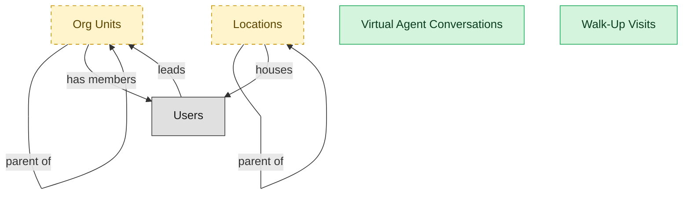

# Service Agent Workspace and Reporting

## 1. Overview

Unified agent experience: workspace, walk-up support, virtual agent / conversational ITSM, and continuous-improvement reporting.

## 2. Entity summary

| Name | data_object | Description |
| --- | --- | --- |
| Virtual Agent Conversations | `virtual_agent_conversations` | Chatbot and virtual-agent conversation transcripts, capturing the turn-by-turn exchange, resolved intent, any escalation to a human, and the ticket produced. |
| Walk-Up Visits | `walkup_visits` | Walk-up or onsite check-in records, capturing the visitor, reason, queue position, estimated service time, and outcome. |
| Locations | `locations` | Physical or organizational locations referenced across the system, used to place and group other records. |
| Org Units | `org_units` | Nodes in the organizational hierarchy such as divisions, departments, and teams, with manager, cost center alignment, geographic scope, and parent-child relationships. |

## 3. Entities catalog

| # | data_object | catalog code | singular | plural | held_as | mastered in | mastered label | install_optional | personal_content | entity_type | write tier | notes |
| ---: | --- | --- | --- | --- | --- | --- | --- | --- | --- | --- | --- | --- |
| 1 | `virtual_agent_conversations` | `virtual_agent_conversations` | Virtual Agent Conversation | Virtual Agent Conversations | master | - | - | - | - | operational_record | `:manage` | - |
| 2 | `walkup_visits` | `walkup_visits` | Walk-Up Visit | Walk-Up Visits | master | - | - | - | - | operational_workflow | `:manage` | - |
| 3 | `locations` | `locations` | Location | Locations | embedded_master | `iwms-location-master` | Location and Property Master | yes | - | catalog | `:admin` | - |
| 4 | `org_units` | `org_units` | Org Unit | Org Units | embedded_master | `hcm-org-positions` | Organization and Position Management | yes | - | operational_workflow | `:manage` | - |

## 4. Aliases and industry synonyms

_(none: no industry-scoped aliases for this scope)_

## 5. Relationships

_`field_required` applies only when both entities are installed. It never makes an entity required._

### 5.1 Relationships between entities in this blueprint

| from | verb | to | cardinality | kind | field_required | delete_mode | fk_format | notes |
| --- | --- | --- | --- | --- | --- | --- | --- | --- |
| `org_units` | parent of | `org_units` | one_to_many | reference | no | clear | reference | - |
| `locations` | parent of | `locations` | one_to_many | reference | no | clear | reference | - |

### 5.2 Relationships to platform built-ins (`users`)

| from | verb | to | cardinality | field_required | delete_mode | fk_format | notes |
| --- | --- | --- | --- | --- | --- | --- | --- |
| `users` | leads | `org_units` | one_to_many | no | clear | reference | - |
| `org_units` | has members | `users` | one_to_many | no | clear | reference | - |
| `locations` | houses | `users` | one_to_many | no | clear | reference | - |

### 5.3 Relationships to entities outside this blueprint

_External entities are optional: this blueprint never installs them. If one exists at install, the relationship is proposed. A many-to-many relationship is listed under outgoing and proposed as a new junction table._

#### 5.3a Outgoing relationships: this blueprint's entity points to the external entity

| from | verb | to | cardinality | field_required | notes |
| --- | --- | --- | --- | --- | --- |
| `cost_centers` | funds | `org_units` | one_to_many | yes | - |
| `org_units` | sponsors | `benefit_plans` | many_to_many | - | - |
| `survey_campaigns` | targets | `org_units` | many_to_many | - | - |

#### 5.3b Incoming relationships: the external entity points to this blueprint's entity

| from | verb | to | cardinality | field_required | notes |
| --- | --- | --- | --- | --- | --- |
| `org_units` | groups | `employees` | one_to_many | yes | - |
| `org_units` | contains | `hcm_positions` | one_to_many | yes | - |
| `org_units` | engages | `contingent_workers` | one_to_many | no | - |
| `org_units` | is_scored_by | `engagement_drivers` | one_to_many | no | - |
| `org_units` | is_measured_by | `people_kpis` | one_to_many | no | - |
| `org_units` | triggers | `iga_entitlement_definitions` | one_to_many | no | - |
| `org_units` | maps_to | `cost_centers` | one_to_one | no | - |
| `org_units` | sponsors | `compliance_assignments` | one_to_many | no | - |
| `org_units` | owns | `action_plans` | one_to_many | no | - |
| `locations` | hosts_desk_bookings | `desk_bookings` | one_to_many | yes | - |
| `locations` | hosts_room_reservations | `room_reservations` | one_to_many | yes | - |
| `locations` | site_of_service_requests | `workplace_service_requests` | one_to_many | yes | - |
| `locations` | measured_by_reports | `space_utilization_reports` | one_to_many | yes | - |
| `locations` | subject_of_feedback | `workplace_experience_feedback` | one_to_many | no | - |

## 6. Cross-domain context

### 6.1 Master consumers (other modules / domains that embed this scope's masters)

_(none: no other module embeds this scope's masters)_

### 6.2 Outbound handoffs (events this scope publishes)

_(none: no outbound handoffs whose payload is in this scope)_

### 6.3 Inbound handoffs (events this scope reacts to)

_(none: no inbound handoffs whose payload is in this scope)_

### 6.4 Master providers (modules / domains that own masters this scope embeds)

| data_object | held_as | install_optional | catalog owner(s) | slice notes |
| --- | --- | --- | --- | --- |
| `locations` | embedded_master | yes | IWMS-LOCATION-MASTER (IWMS) | - |
| `org_units` | embedded_master | yes | HCM-ORG-POSITIONS (HCM) | - |

## 7. Lifecycle states

### `org_units` (Org Unit)

_This scope holds `org_units` as **embedded_master**; the canonical state machine is owned by `HCM-ORG-POSITIONS`._

| order | state_name | initial? | terminal? | realizing module | requires_permission? | high risk? | derived gate | description |
| --- | --- | --- | --- | --- | --- | --- | --- | --- |
| 1 | `draft` | ✓ | - | `HCM-ORG-POSITIONS` | - | - | - | Org unit defined as part of a future structure; not yet operational. |
| 2 | `active` | - | - | `HCM-ORG-POSITIONS` | ✓ | - | `hcm-org-positions:active_org_unit` | Operational unit; carries headcount, cost-center relationship, and reporting lines. |
| 3 | `reorganized` | - | ✓ | `HCM-ORG-POSITIONS` | ✓ | - | `hcm-org-positions:reorganized_org_unit` | Unit folded into or replaced by a new structure; references remain for history. |
| 4 | `closed` | - | ✓ | `HCM-ORG-POSITIONS` | ✓ | - | `hcm-org-positions:closed_org_unit` | Unit dissolved; no employees or positions reside in it. |

## 8. Permissions and business rules (derived)

### 8.1 Permissions

| permission | tier | description | included in `:admin`? |
| --- | --- | --- | --- |
| `itsm-agent-workspace:read` | baseline-read | Read access to every entity in the module | ✓ |
| `itsm-agent-workspace:manage` | baseline-manage | Edit operational records | ✓ |
| `itsm-agent-workspace:admin` | baseline-admin | Edit reference data and inherit every workflow gate below | - |
| `hcm-org-positions:read_org_units` | entity-read | Read Org Units | ✓ |
| `hcm-org-positions:write_org_units` | entity-write | Write Org Units | ✓ |
| `iwms-location-master:read_locations` | entity-read | Read Locations | ✓ |
| `iwms-location-master:write_locations` | entity-write | Write Locations | ✓ |
| `itsm-agent-workspace:read_virtual_agent_conversations` | entity-read | Read Virtual Agent Conversations | ✓ |
| `itsm-agent-workspace:write_virtual_agent_conversations` | entity-write | Write Virtual Agent Conversations | ✓ |
| `itsm-agent-workspace:read_walkup_visits` | entity-read | Read Walk-Up Visits | ✓ |
| `itsm-agent-workspace:write_walkup_visits` | entity-write | Write Walk-Up Visits | ✓ |
| `hcm-org-positions:active_org_unit` | workflow-gate (lifecycle) | Transition `org_units` into state `active` | ✓ |
| `hcm-org-positions:reorganized_org_unit` | workflow-gate (lifecycle) | Transition `org_units` into state `reorganized` | ✓ |
| `hcm-org-positions:closed_org_unit` | workflow-gate (lifecycle) | Transition `org_units` into state `closed` | ✓ |

_Gates with no process: `hcm-org-positions:closed_org_unit`. No Accountable can hold them, so this blueprint does not support `raci`._

### 8.2 Business rules

_(none: no flag-derived business rules)_

## 9. Roles, RACI, and responsibilities (derived)

_Baseline roles, the permission hierarchy, and RACI realization are DERIVED from this scope's entity-type write tiers + `process_raci`; none of it is stored in the catalog (the deployer provisions it from this blueprint)._

### 9.1 `ITSM-AGENT-WORKSPACE`

**Baseline roles:**

| role | baseline grant |
| --- | --- |
| `itsm-agent-workspace_viewer` | `itsm-agent-workspace:read` |
| `itsm-agent-workspace_manager` | `itsm-agent-workspace:manage` |
| `itsm-agent-workspace_admin` | `itsm-agent-workspace:admin` |

**Permission hierarchy:**

| permission | includes |
| --- | --- |
| `itsm-agent-workspace:admin` | `itsm-agent-workspace:manage` |
| `itsm-agent-workspace:manage` | `itsm-agent-workspace:read` |
| `itsm-agent-workspace:read` | `hcm-org-positions:read_org_units` |
| `itsm-agent-workspace:read` | `iwms-location-master:read_locations` |
| `itsm-agent-workspace:read` | `itsm-agent-workspace:read_virtual_agent_conversations` |
| `itsm-agent-workspace:read` | `itsm-agent-workspace:read_walkup_visits` |
| `itsm-agent-workspace:manage` | `hcm-org-positions:write_org_units` |
| `hcm-org-positions:write_org_units` | `hcm-org-positions:read_org_units` |
| `itsm-agent-workspace:admin` | `iwms-location-master:write_locations` |
| `iwms-location-master:write_locations` | `iwms-location-master:read_locations` |
| `itsm-agent-workspace:manage` | `itsm-agent-workspace:write_virtual_agent_conversations` |
| `itsm-agent-workspace:write_virtual_agent_conversations` | `itsm-agent-workspace:read_virtual_agent_conversations` |
| `itsm-agent-workspace:manage` | `itsm-agent-workspace:write_walkup_visits` |
| `itsm-agent-workspace:write_walkup_visits` | `itsm-agent-workspace:read_walkup_visits` |
| `itsm-agent-workspace:admin` | `hcm-org-positions:active_org_unit` |
| `itsm-agent-workspace:admin` | `hcm-org-positions:reorganized_org_unit` |
| `itsm-agent-workspace:admin` | `hcm-org-positions:closed_org_unit` |

**Processes wired:**

| process_key | process_name | PCF code | PCF ID | level | description |
| --- | --- | --- | --- | --- | --- |
| `create_organizational_design` | Create organizational design | 1.2.5 | 10041 | 3 | Formulating a design for the organization's resources that allow it to meet its objectives. Develop a new framework for molding the organization's various processes into a coherent and seamless whole. |
| `conduct_organization` | Conduct organization restructuring opportunities | 1.1.5 | 16792 | 3 | Examining the scope and contingencies for restructuring based on market situation and internal realities. Map the market forces over which any and all probabilities can be probed for utility and viability. Once the restructuring options have been analyzed and the due-diligence performed, execute the deal. Consider seeking professional services for assistance in formalizing these opportunities. |

**RACI realization:**

| actor | kind | raci | process_key | realization |
| --- | --- | --- | --- | --- |
| `HR-ORG-DESIGN-ANALYST` | persona | responsible | `create_organizational_design` | the gated entities' write tier |
| `HR-BUSINESS-PARTNER` | persona | accountable | `create_organizational_design` | grant gates [hcm-org-positions:active_org_unit] + the gated entities' write tier |
| `PEOPLE-MANAGER` | persona | consulted | `create_organizational_design` | advisory read grant |
| `HR-HRIS-ADMIN` | persona | informed | `create_organizational_design` | ⚠ no event wired |
| `HR-ORG-DESIGN-ANALYST` | persona | responsible | `conduct_organization` | the gated entities' write tier |
| `HR-BUSINESS-PARTNER` | persona | accountable | `conduct_organization` | grant gates [hcm-org-positions:reorganized_org_unit] + the gated entities' write tier |
| `PEOPLE-MANAGER` | persona | consulted | `conduct_organization` | advisory read grant |

### 9.2 Functional ownership and default grants

| responsibility | business function | default role | default tier |
| --- | --- | --- | --- |
| owner | IT Service Desk | `admin` | `:admin` |
| contributor | IT Operations | `manager` | `:manage` |
| contributor | Security | `manager` | `:manage` |
| consumer | Finance | `viewer` | `:read` |
| consumer | Human Resources | `viewer` | `:read` |
