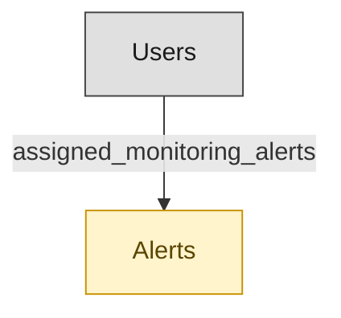

# Event and Alert Handling

## 1. Overview

Reactive event filtering, deduplication, and routing into the incident workflow. Bridge between observability platforms and ITSM.

## 2. Entity summary

| Name | data_object | Description |
| --- | --- | --- |
| Alerts | `monitoring_alerts` | Filtered, human-relevant events that crossed a threshold or matched a pattern, enriched with priority and routing, ready to be paged or ticketed. |

## 3. Entities catalog

| # | data_object | catalog code | singular | plural | held_as | mastered in | mastered label | install_optional | personal_content | entity_type | write tier | notes |
| ---: | --- | --- | --- | --- | --- | --- | --- | --- | --- | --- | --- | --- |
| 1 | `monitoring_alerts` | `monitoring_alerts` | Alert | Alerts | embedded_master | `itom-infra-mon` | Infrastructure Monitoring and Event Management | - | - | operational_workflow | `:manage` | - |

## 4. Aliases and industry synonyms

_(none: no industry-scoped aliases for this scope)_

## 5. Relationships

_`field_required` applies only when both entities are installed. It never makes an entity required._

### 5.1 Relationships between entities in this blueprint

_(none: no relationships with both entities in this blueprint)_

### 5.2 Relationships to platform built-ins (`users`)

| from | verb | to | cardinality | field_required | delete_mode | fk_format | notes |
| --- | --- | --- | --- | --- | --- | --- | --- |
| `users` | assigned_monitoring_alerts | `monitoring_alerts` | one_to_many | no | clear | reference | - |

### 5.3 Relationships to entities outside this blueprint

_External entities are optional: this blueprint never installs them. If one exists at install, the relationship is proposed. A many-to-many relationship is listed under outgoing and proposed as a new junction table._

#### 5.3a Outgoing relationships: this blueprint's entity points to the external entity

| from | verb | to | cardinality | field_required | notes |
| --- | --- | --- | --- | --- | --- |
| `service_incidents` | correlates_to | `monitoring_alerts` | many_to_many | - | - |

#### 5.3b Incoming relationships: the external entity points to this blueprint's entity

_(none: no incoming relationships from external entities)_

## 6. Cross-domain context

### 6.1 Master consumers (other modules / domains that embed this scope's masters)

_(none: this scope masters no entities)_

### 6.2 Outbound handoffs (events this scope publishes)

_(none: no outbound handoffs whose payload is in this scope)_

### 6.3 Inbound handoffs (events this scope reacts to)

_(none: no inbound handoffs whose payload is in this scope)_

### 6.4 Master providers (modules / domains that own masters this scope embeds)

| data_object | held_as | install_optional | catalog owner(s) | slice notes |
| --- | --- | --- | --- | --- |
| `monitoring_alerts` | embedded_master | - | ITOM-INFRA-MON (ITOM) | - |

## 7. Lifecycle states

_(none: no lifecycle states for the entities in this scope)_
## 8. Permissions and business rules (derived)

### 8.1 Permissions

| permission | tier | description | included in `:admin`? |
| --- | --- | --- | --- |
| `itsm-event-mgmt:read` | baseline-read | Read access to every entity in the module | ✓ |
| `itsm-event-mgmt:manage` | baseline-manage | Edit operational records | ✓ |
| `itsm-event-mgmt:admin` | baseline-admin | Edit reference data and inherit every workflow gate below | - |
| `itom-infra-mon:read_monitoring_alerts` | entity-read | Read Alerts | ✓ |
| `itom-infra-mon:write_monitoring_alerts` | entity-write | Write Alerts | ✓ |

### 8.2 Business rules

_(none: no flag-derived business rules)_

## 9. Roles, RACI, and responsibilities (derived)

_Baseline roles, the permission hierarchy, and RACI realization are DERIVED from this scope's entity-type write tiers + `process_raci`; none of it is stored in the catalog (the deployer provisions it from this blueprint)._

### 9.1 `ITSM-EVENT-MGMT`

**Baseline roles:**

| role | baseline grant |
| --- | --- |
| `itsm-event-mgmt_viewer` | `itsm-event-mgmt:read` |
| `itsm-event-mgmt_manager` | `itsm-event-mgmt:manage` |
| `itsm-event-mgmt_admin` | `itsm-event-mgmt:admin` |

**Permission hierarchy:**

| permission | includes |
| --- | --- |
| `itsm-event-mgmt:admin` | `itsm-event-mgmt:manage` |
| `itsm-event-mgmt:manage` | `itsm-event-mgmt:read` |
| `itsm-event-mgmt:read` | `itom-infra-mon:read_monitoring_alerts` |
| `itsm-event-mgmt:manage` | `itom-infra-mon:write_monitoring_alerts` |
| `itom-infra-mon:write_monitoring_alerts` | `itom-infra-mon:read_monitoring_alerts` |

**RACI realization:**

_(none: no process_raci assignments wired to this module's gated processes yet)_

### 9.2 Functional ownership and default grants

| responsibility | business function | default role | default tier |
| --- | --- | --- | --- |
| owner | IT Service Desk | `admin` | `:admin` |
| contributor | IT Operations | `manager` | `:manage` |
| contributor | Security | `manager` | `:manage` |
| consumer | Finance | `viewer` | `:read` |
| consumer | Human Resources | `viewer` | `:read` |
