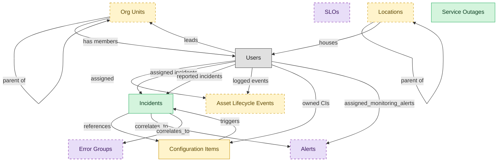

# Incident Management

## 1. Overview

Capture, triage, route, and resolve service-disrupting incidents. Includes major-incident command, AI-assisted classification, and skill-based assignment.

## 2. Entity summary

| Name | data_object | Description |
| --- | --- | --- |
| Incidents | `service_incidents` | Unplanned service interruptions or quality reductions, with severity, priority, category, assignee, and affected components. |
| Service Outages | `service_outages` | Customer-facing outage records, with the affected service, public status, start and end times, and the customer message. |
| Asset Lifecycle Events | `asset_lifecycle_events` | Cross-cutting lifecycle log for hardware, software, and SaaS assets: procurement, deployment, transfer, retirement, and disposal. |
| Configuration Items | `configuration_items` | Canonical records of IT things under management: servers, containers, applications, services, network devices, databases, and cloud resources. |
| Locations | `locations` | Physical or organizational locations referenced across the system, used to place and group other records. |
| Org Units | `org_units` | Nodes in the organizational hierarchy such as divisions, departments, and teams, with manager, cost center alignment, geographic scope, and parent-child relationships. |
| Alerts | `monitoring_alerts` | Filtered, human-relevant events that crossed a threshold or matched a pattern, enriched with priority and routing, ready to be paged or ticketed. |
| Error Groups | `error_groups` | Aggregated exception records grouped by fingerprint, with first and last seen, occurrence count, affected releases, owners, and status. |
| SLOs | `service_level_objectives` | Service-level objective definitions and their breach state, with targets, remaining error budget, burn rate, and last breach. |

## 3. Entities catalog

| # | data_object | catalog code | singular | plural | held_as | mastered in | mastered label | install_optional | personal_content | entity_type | write tier | notes |
| ---: | --- | --- | --- | --- | --- | --- | --- | --- | --- | --- | --- | --- |
| 1 | `service_incidents` | `service_incidents` | Incident | Incidents | master | - | - | - | yes | operational_workflow | `:manage` | - |
| 2 | `service_outages` | `service_outages` | Service Outage | Service Outages | master | - | - | - | - | operational_workflow | `:manage` | - |
| 3 | `asset_lifecycle_events` | `asset_lifecycle_events` | Asset Lifecycle Event | Asset Lifecycle Events | embedded_master | `itam-lifecycle` | Unified Asset Lifecycle Log | yes | - | operational_record | `:manage` | - |
| 4 | `configuration_items` | `configuration_items` | Configuration Item | Configuration Items | embedded_master | `cmdb-core` | CMDB Core Repository | - | - | operational_workflow | `:manage` | - |
| 5 | `locations` | `locations` | Location | Locations | embedded_master | `iwms-location-master` | Location and Property Master | yes | - | catalog | `:admin` | - |
| 6 | `org_units` | `org_units` | Org Unit | Org Units | embedded_master | `hcm-org-positions` | Organization and Position Management | yes | - | operational_workflow | `:manage` | - |
| 7 | `monitoring_alerts` | `monitoring_alerts` | Alert | Alerts | consumer | `itom-infra-mon` | Infrastructure Monitoring and Event Management | yes | - | operational_workflow | `:manage` | - |
| 8 | `error_groups` | `error_groups` | Error Group | Error Groups | consumer | - | - | yes | - | operational_workflow | `:manage` | - |
| 9 | `service_level_objectives` | `service_level_objectives` | SLO | SLOs | consumer | - | - | yes | - | operational_workflow | `:manage` | - |

## 4. Aliases and industry synonyms

_(none: no industry-scoped aliases for this scope)_

## 5. Relationships

_`field_required` applies only when both entities are installed. It never makes an entity required._

### 5.1 Relationships between entities in this blueprint

| from | verb | to | cardinality | kind | field_required | delete_mode | fk_format | notes |
| --- | --- | --- | --- | --- | --- | --- | --- | --- |
| `service_incidents` | references | `configuration_items` | many_to_many | reference | - | cascade | parent | - |
| `service_incidents` | correlates_to | `monitoring_alerts` | many_to_many | reference | - | cascade | parent | - |
| `service_incidents` | correlates_to | `error_groups` | many_to_many | reference | - | cascade | parent | - |
| `configuration_items` | triggers | `service_incidents` | one_to_many | reference | no | clear | reference | - |
| `org_units` | parent of | `org_units` | one_to_many | reference | no | clear | reference | - |
| `locations` | parent of | `locations` | one_to_many | reference | no | clear | reference | - |

### 5.2 Relationships to platform built-ins (`users`)

| from | verb | to | cardinality | field_required | delete_mode | fk_format | notes |
| --- | --- | --- | --- | --- | --- | --- | --- |
| `users` | leads | `org_units` | one_to_many | no | clear | reference | - |
| `users` | assigned | `asset_lifecycle_events` | one_to_many | no | clear | reference | - |
| `users` | assigned incidents | `service_incidents` | one_to_many | no | clear | reference | - |
| `users` | reported incidents | `service_incidents` | one_to_many | yes | restrict | reference | - |
| `users` | logged events | `asset_lifecycle_events` | one_to_many | no | clear | reference | - |
| `users` | owned CIs | `configuration_items` | one_to_many | no | clear | reference | - |
| `org_units` | has members | `users` | one_to_many | no | clear | reference | - |
| `locations` | houses | `users` | one_to_many | no | clear | reference | - |
| `users` | assigned_monitoring_alerts | `monitoring_alerts` | one_to_many | no | clear | reference | - |

### 5.3 Relationships to entities outside this blueprint

_External entities are optional: this blueprint never installs them. If one exists at install, the relationship is proposed. A many-to-many relationship is listed under outgoing and proposed as a new junction table._

#### 5.3a Outgoing relationships: this blueprint's entity points to the external entity

| from | verb | to | cardinality | field_required | notes |
| --- | --- | --- | --- | --- | --- |
| `cost_centers` | funds | `org_units` | one_to_many | yes | - |
| `employees` | triggers | `asset_lifecycle_events` | one_to_many | no | - |
| `onboarding_tasks` | triggers | `asset_lifecycle_events` | one_to_many | no | - |
| `hardware_assets` | delivered by | `asset_lifecycle_events` | one_to_many | no | - |
| `onboarding_tasks` | emits | `service_incidents` | one_to_many | no | - |
| `org_units` | sponsors | `benefit_plans` | many_to_many | - | - |
| `survey_campaigns` | targets | `org_units` | many_to_many | - | - |
| `service_requests` | routes_to | `service_incidents` | one_to_many | no | - |
| `service_requests` | triggers | `service_incidents` | one_to_many | no | - |
| `service_problems` | is investigated by | `service_incidents` | one_to_many | no | - |
| `service_changes` | generates | `asset_lifecycle_events` | one_to_many | no | - |
| `service_changes` | impacts | `configuration_items` | many_to_many | - | - |
| `service_slas` | governs incident | `service_incidents` | one_to_many | yes | - |
| `service_incidents` | resolved_with | `knowledge_articles` | many_to_many | - | - |
| `service_slas` | aligns_with | `service_level_objectives` | many_to_many | - | - |
| `fixed_assets` | impacted by lifecycle | `asset_lifecycle_events` | one_to_many | no | - |
| `service_changes` | updates | `configuration_items` | many_to_many | - | - |
| `enterprise_applications` | mapped_to | `configuration_items` | many_to_many | - | - |
| `application_interfaces` | raises | `service_incidents` | one_to_many | no | - |
| `technology_platforms` | registers_as | `asset_lifecycle_events` | one_to_many | no | - |
| `enterprise_applications` | onboards_into | `configuration_items` | one_to_one | no | - |
| `ci_classes` | classifies | `configuration_items` | one_to_many | yes | - |
| `configuration_items` | baselined_in | `ci_baselines` | many_to_many | - | - |
| `configuration_items` | composes | `service_maps` | many_to_many | - | - |
| `configuration_items` | changed_by | `service_changes` | many_to_many | - | - |
| `service_maps` | refreshes | `service_incidents` | many_to_many | - | - |
| `ci_baselines` | triggers | `service_incidents` | one_to_many | no | - |
| `hardware_assets` | represented_as | `configuration_items` | one_to_one | no | - |
| `asset_contracts` | governs | `asset_lifecycle_events` | one_to_many | no | - |
| `saas_applications` | lifecycle events for | `asset_lifecycle_events` | one_to_many | no | - |
| `fixed_assets` | updated by lifecycle | `asset_lifecycle_events` | one_to_many | no | - |
| `chat_threads` | escalates_to | `service_incidents` | one_to_many | no | - |
| `control_tests` | escalates_to | `service_incidents` | one_to_many | no | - |
| `test_defects` | escalates_to | `service_incidents` | one_to_many | no | - |
| `eam_work_orders` | escalates_to | `service_incidents` | one_to_many | no | - |
| `dlp_incidents` | informs_security_incident | `service_incidents` | one_to_many | no | - |
| `lcap_apps` | opens | `service_incidents` | many_to_many | - | - |
| `dc_port_connections` | updates | `configuration_items` | one_to_many | no | - |
| `event_correlations` | triggers | `service_incidents` | one_to_many | no | - |
| `root_cause_analyses` | annotates | `service_incidents` | one_to_many | no | - |
| `incident_predictions` | forecasts | `service_incidents` | one_to_many | no | - |
| `dc_cabinets` | raises | `service_incidents` | one_to_many | no | - |
| `dc_power_distribution_units` | raises | `service_incidents` | one_to_many | no | - |
| `dc_uninterruptible_power_supplies` | raises | `service_incidents` | one_to_many | no | - |
| `dc_cooling_units` | raises | `service_incidents` | one_to_many | no | - |
| `endpoint_experience_scores` | triggers | `service_incidents` | one_to_many | no | - |
| `saas_applications` | raises_incident | `service_incidents` | one_to_many | no | - |

#### 5.3b Incoming relationships: the external entity points to this blueprint's entity

| from | verb | to | cardinality | field_required | notes |
| --- | --- | --- | --- | --- | --- |
| `org_units` | groups | `employees` | one_to_many | yes | - |
| `org_units` | contains | `hcm_positions` | one_to_many | yes | - |
| `org_units` | engages | `contingent_workers` | one_to_many | no | - |
| `org_units` | is_scored_by | `engagement_drivers` | one_to_many | no | - |
| `org_units` | is_measured_by | `people_kpis` | one_to_many | no | - |
| `org_units` | triggers | `iga_entitlement_definitions` | one_to_many | no | - |
| `org_units` | maps_to | `cost_centers` | one_to_one | no | - |
| `org_units` | sponsors | `compliance_assignments` | one_to_many | no | - |
| `org_units` | owns | `action_plans` | one_to_many | no | - |
| `service_incidents` | triggers | `remediation_plans` | one_to_many | no | - |
| `configuration_items` | related_via | `ci_relationships` | one_to_many | no | - |
| `asset_lifecycle_events` | hands_off_to | `hardware_disposal_records` | one_to_one | no | - |
| `locations` | hosts_desk_bookings | `desk_bookings` | one_to_many | yes | - |
| `locations` | hosts_room_reservations | `room_reservations` | one_to_many | yes | - |
| `locations` | site_of_service_requests | `workplace_service_requests` | one_to_many | yes | - |
| `locations` | measured_by_reports | `space_utilization_reports` | one_to_many | yes | - |
| `locations` | subject_of_feedback | `workplace_experience_feedback` | one_to_many | no | - |
| `configuration_items` | affected_by | `vulnerabilities` | one_to_many | no | - |

## 6. Cross-domain context

### 6.1 Master consumers (other modules / domains that embed this scope's masters)

_(none: no other module embeds this scope's masters)_

### 6.2 Outbound handoffs (events this scope publishes)

_(none: no outbound handoffs whose payload is in this scope)_

### 6.3 Inbound handoffs (events this scope reacts to)

_(none: no inbound handoffs whose payload is in this scope)_

### 6.4 Master providers (modules / domains that own masters this scope embeds)

| data_object | held_as | install_optional | catalog owner(s) | slice notes |
| --- | --- | --- | --- | --- |
| `asset_lifecycle_events` | embedded_master | yes | ITAM-LIFECYCLE (ITAM) | - |
| `configuration_items` | embedded_master | - | CMDB-CORE (CMDB) | - |
| `locations` | embedded_master | yes | IWMS-LOCATION-MASTER (IWMS) | - |
| `org_units` | embedded_master | yes | HCM-ORG-POSITIONS (HCM) | - |
| `error_groups` | consumer | yes | _(no catalog owner recorded)_ | - |
| `monitoring_alerts` | consumer | yes | ITOM-INFRA-MON (ITOM) | - |
| `service_level_objectives` | consumer | yes | _(no catalog owner recorded)_ | - |

## 7. Lifecycle states

### `configuration_items` (Configuration Item)

_This scope holds `configuration_items` as **embedded_master**; the canonical state machine is owned by `CMDB-CORE`._

| order | state_name | initial? | terminal? | realizing module | requires_permission? | high risk? | derived gate | description |
| --- | --- | --- | --- | --- | --- | --- | --- | --- |
| 1 | `discovered` | ✓ | - | `CMDB-CORE` | - | - | - | CI auto-detected by discovery feed; not yet curated. |
| 2 | `registered` | - | - | `CMDB-CORE` | ✓ | - | `cmdb-core:register_ci` | CI record curated and accepted into the CMDB of record. |
| 3 | `in_use` | - | - | `CMDB-CORE` | - | - | - | CI is actively in operational use. |
| 4 | `retired` | - | - | `CMDB-CORE` | ✓ | - | `cmdb-core:retire_ci` | CI taken out of service but record retained. |
| 5 | `archived` | - | ✓ | `CMDB-CORE` | ✓ | - | `cmdb-core:archive_ci` | CI record archived after retirement; read-only for audit. |

### `org_units` (Org Unit)

_This scope holds `org_units` as **embedded_master**; the canonical state machine is owned by `HCM-ORG-POSITIONS`._

| order | state_name | initial? | terminal? | realizing module | requires_permission? | high risk? | derived gate | description |
| --- | --- | --- | --- | --- | --- | --- | --- | --- |
| 1 | `draft` | ✓ | - | `HCM-ORG-POSITIONS` | - | - | - | Org unit defined as part of a future structure; not yet operational. |
| 2 | `active` | - | - | `HCM-ORG-POSITIONS` | ✓ | - | `hcm-org-positions:active_org_unit` | Operational unit; carries headcount, cost-center relationship, and reporting lines. |
| 3 | `reorganized` | - | ✓ | `HCM-ORG-POSITIONS` | ✓ | - | `hcm-org-positions:reorganized_org_unit` | Unit folded into or replaced by a new structure; references remain for history. |
| 4 | `closed` | - | ✓ | `HCM-ORG-POSITIONS` | ✓ | - | `hcm-org-positions:closed_org_unit` | Unit dissolved; no employees or positions reside in it. |

### `service_incidents` (Incident)

| order | state_name | initial? | terminal? | realizing module | requires_permission? | high risk? | derived gate | description |
| --- | --- | --- | --- | --- | --- | --- | --- | --- |
| 1 | `new` | ✓ | - | `ITSM-INCIDENT-MGMT` | - | - | - | Incident has been logged; not yet triaged or routed. |
| 2 | `assigned` | - | - | `ITSM-INCIDENT-MGMT` | - | - | - | Triaged and assigned to a support group or agent. |
| 3 | `in_progress` | - | - | `ITSM-INCIDENT-MGMT` | - | - | - | Assignee is actively diagnosing or working the incident. |
| 4 | `resolved` | - | - | `ITSM-INCIDENT-MGMT` | ✓ | - | `itsm-incident-mgmt:resolved_incident` | Workaround or fix delivered; awaiting reporter confirmation. |
| 5 | `closed` | - | ✓ | `ITSM-INCIDENT-MGMT` | ✓ | - | `itsm-incident-mgmt:closed_incident` | Resolution confirmed; incident archived and SLA clock stopped. |
| 6 | `canceled` | - | ✓ | `ITSM-INCIDENT-MGMT` | - | - | - | Incident withdrawn (duplicate, invalid, raised in error). |

## 8. Permissions and business rules (derived)

### 8.1 Permissions

| permission | tier | description | included in `:admin`? |
| --- | --- | --- | --- |
| `itsm-incident-mgmt:read` | baseline-read | Read access to every entity in the module | ✓ |
| `itsm-incident-mgmt:manage` | baseline-manage | Edit operational records | ✓ |
| `itsm-incident-mgmt:admin` | baseline-admin | Edit reference data and inherit every workflow gate below | - |
| `hcm-org-positions:read_org_units` | entity-read | Read Org Units | ✓ |
| `hcm-org-positions:write_org_units` | entity-write | Write Org Units | ✓ |
| `itsm-incident-mgmt:read_service_incidents` | entity-read | Read Incidents | ✓ |
| `itsm-incident-mgmt:write_service_incidents` | entity-write | Write Incidents | ✓ |
| `itam-lifecycle:read_asset_lifecycle_events` | entity-read | Read Asset Lifecycle Events | ✓ |
| `itam-lifecycle:write_asset_lifecycle_events` | entity-write | Write Asset Lifecycle Events | ✓ |
| `cmdb-core:read_configuration_items` | entity-read | Read Configuration Items | ✓ |
| `cmdb-core:write_configuration_items` | entity-write | Write Configuration Items | ✓ |
| `itom-infra-mon:read_monitoring_alerts` | entity-read | Read Alerts | ✓ |
| `iwms-location-master:read_locations` | entity-read | Read Locations | ✓ |
| `iwms-location-master:write_locations` | entity-write | Write Locations | ✓ |
| `itsm-incident-mgmt:read_service_outages` | entity-read | Read Service Outages | ✓ |
| `itsm-incident-mgmt:write_service_outages` | entity-write | Write Service Outages | ✓ |
| `hcm-org-positions:active_org_unit` | workflow-gate (lifecycle) | Transition `org_units` into state `active` | ✓ |
| `hcm-org-positions:reorganized_org_unit` | workflow-gate (lifecycle) | Transition `org_units` into state `reorganized` | ✓ |
| `hcm-org-positions:closed_org_unit` | workflow-gate (lifecycle) | Transition `org_units` into state `closed` | ✓ |
| `itsm-incident-mgmt:resolved_incident` | workflow-gate (lifecycle) | Transition `service_incidents` into state `resolved` | ✓ |
| `itsm-incident-mgmt:closed_incident` | workflow-gate (lifecycle) | Transition `service_incidents` into state `closed` | ✓ |
| `cmdb-core:register_ci` | workflow-gate (lifecycle) | Transition `configuration_items` into state `registered` | ✓ |
| `cmdb-core:retire_ci` | workflow-gate (lifecycle) | Transition `configuration_items` into state `retired` | ✓ |
| `cmdb-core:archive_ci` | workflow-gate (lifecycle) | Transition `configuration_items` into state `archived` | ✓ |
| `itsm-incident-mgmt:view_all_incidents` | override (personal_content) | View all `service_incidents` rows beyond row-scope | ✓ |
| `itsm-incident-mgmt:manage_all_incidents` | override (personal_content) | Manage all `service_incidents` rows beyond row-scope | ✓ |

_Gates with no process: `hcm-org-positions:closed_org_unit`, `itsm-incident-mgmt:resolved_incident`, `itsm-incident-mgmt:closed_incident`, `cmdb-core:register_ci`, `cmdb-core:retire_ci`, `cmdb-core:archive_ci`. No Accountable can hold them, so this blueprint does not support `raci`._

### 8.2 Business rules

| rule_name | data_object | source flag | intent |
| --- | --- | --- | --- |
| `incident_edit_scope` | `service_incidents` | has_personal_content | Row-scope by default; override via `itsm-incident-mgmt:view_all_incidents` / `itsm-incident-mgmt:manage_all_incidents` |

## 9. Roles, RACI, and responsibilities (derived)

_Baseline roles, the permission hierarchy, and RACI realization are DERIVED from this scope's entity-type write tiers + `process_raci`; none of it is stored in the catalog (the deployer provisions it from this blueprint)._

### 9.1 `ITSM-INCIDENT-MGMT`

**Baseline roles:**

| role | baseline grant |
| --- | --- |
| `itsm-incident-mgmt_viewer` | `itsm-incident-mgmt:read` |
| `itsm-incident-mgmt_manager` | `itsm-incident-mgmt:manage` |
| `itsm-incident-mgmt_admin` | `itsm-incident-mgmt:admin` |

**Permission hierarchy:**

| permission | includes |
| --- | --- |
| `itsm-incident-mgmt:admin` | `itsm-incident-mgmt:manage` |
| `itsm-incident-mgmt:manage` | `itsm-incident-mgmt:read` |
| `itsm-incident-mgmt:read` | `hcm-org-positions:read_org_units` |
| `itsm-incident-mgmt:read` | `itsm-incident-mgmt:read_service_incidents` |
| `itsm-incident-mgmt:read` | `itam-lifecycle:read_asset_lifecycle_events` |
| `itsm-incident-mgmt:read` | `cmdb-core:read_configuration_items` |
| `itsm-incident-mgmt:read` | `itom-infra-mon:read_monitoring_alerts` |
| `itsm-incident-mgmt:read` | `iwms-location-master:read_locations` |
| `itsm-incident-mgmt:read` | `itsm-incident-mgmt:read_service_outages` |
| `itsm-incident-mgmt:manage` | `hcm-org-positions:write_org_units` |
| `hcm-org-positions:write_org_units` | `hcm-org-positions:read_org_units` |
| `itsm-incident-mgmt:manage` | `itsm-incident-mgmt:write_service_incidents` |
| `itsm-incident-mgmt:write_service_incidents` | `itsm-incident-mgmt:read_service_incidents` |
| `itsm-incident-mgmt:manage` | `itam-lifecycle:write_asset_lifecycle_events` |
| `itam-lifecycle:write_asset_lifecycle_events` | `itam-lifecycle:read_asset_lifecycle_events` |
| `itsm-incident-mgmt:manage` | `cmdb-core:write_configuration_items` |
| `cmdb-core:write_configuration_items` | `cmdb-core:read_configuration_items` |
| `itsm-incident-mgmt:admin` | `iwms-location-master:write_locations` |
| `iwms-location-master:write_locations` | `iwms-location-master:read_locations` |
| `itsm-incident-mgmt:manage` | `itsm-incident-mgmt:write_service_outages` |
| `itsm-incident-mgmt:write_service_outages` | `itsm-incident-mgmt:read_service_outages` |
| `itsm-incident-mgmt:admin` | `hcm-org-positions:active_org_unit` |
| `itsm-incident-mgmt:admin` | `hcm-org-positions:reorganized_org_unit` |
| `itsm-incident-mgmt:admin` | `hcm-org-positions:closed_org_unit` |
| `itsm-incident-mgmt:admin` | `itsm-incident-mgmt:resolved_incident` |
| `itsm-incident-mgmt:admin` | `itsm-incident-mgmt:closed_incident` |
| `itsm-incident-mgmt:admin` | `cmdb-core:register_ci` |
| `itsm-incident-mgmt:admin` | `cmdb-core:retire_ci` |
| `itsm-incident-mgmt:admin` | `cmdb-core:archive_ci` |
| `itsm-incident-mgmt:admin` | `itsm-incident-mgmt:view_all_incidents` |
| `itsm-incident-mgmt:admin` | `itsm-incident-mgmt:manage_all_incidents` |

**Processes wired:**

| process_key | process_name | PCF code | PCF ID | level | description |
| --- | --- | --- | --- | --- | --- |
| `create_organizational_design` | Create organizational design | 1.2.5 | 10041 | 3 | Formulating a design for the organization's resources that allow it to meet its objectives. Develop a new framework for molding the organization's various processes into a coherent and seamless whole. |
| `conduct_organization` | Conduct organization restructuring opportunities | 1.1.5 | 16792 | 3 | Examining the scope and contingencies for restructuring based on market situation and internal realities. Map the market forces over which any and all probabilities can be probed for utility and viability. Once the restructuring options have been analyzed and the due-diligence performed, execute the deal. Consider seeking professional services for assistance in formalizing these opportunities. |

**RACI realization:**

| actor | kind | raci | process_key | realization |
| --- | --- | --- | --- | --- |
| `HR-ORG-DESIGN-ANALYST` | persona | responsible | `create_organizational_design` | the gated entities' write tier |
| `HR-BUSINESS-PARTNER` | persona | accountable | `create_organizational_design` | grant gates [hcm-org-positions:active_org_unit] + the gated entities' write tier |
| `PEOPLE-MANAGER` | persona | consulted | `create_organizational_design` | advisory read grant |
| `HR-HRIS-ADMIN` | persona | informed | `create_organizational_design` | ⚠ no event wired |
| `HR-ORG-DESIGN-ANALYST` | persona | responsible | `conduct_organization` | the gated entities' write tier |
| `HR-BUSINESS-PARTNER` | persona | accountable | `conduct_organization` | grant gates [hcm-org-positions:reorganized_org_unit] + the gated entities' write tier |
| `PEOPLE-MANAGER` | persona | consulted | `conduct_organization` | advisory read grant |

### 9.2 Functional ownership and default grants

| responsibility | business function | default role | default tier |
| --- | --- | --- | --- |
| owner | IT Service Desk | `admin` | `:admin` |
| contributor | IT Operations | `manager` | `:manage` |
| contributor | Security | `manager` | `:manage` |
| consumer | Finance | `viewer` | `:read` |
| consumer | Human Resources | `viewer` | `:read` |
