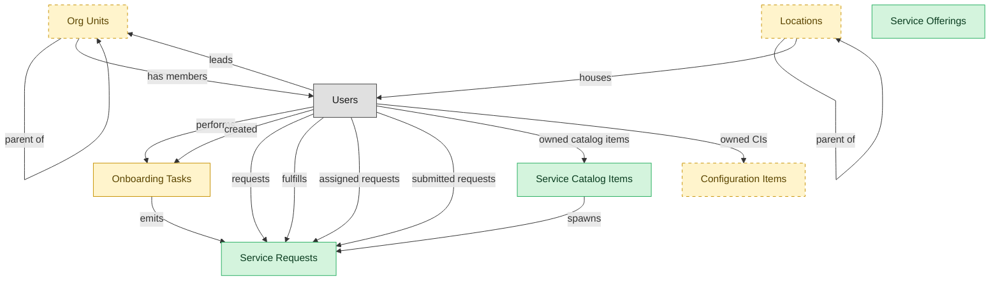

# Service Request Fulfillment

## 1. Overview

End-user-driven request workflow, including catalog authoring, request routing, approvals, and self-service portal.

## 2. Entity summary

| Name | data_object | Description |
| --- | --- | --- |
| Service Catalog Items | `service_catalog_items` | Definitions of what can be requested: the request form, fulfillment workflow, approvals, service level, and charge-back rules. |
| Service Offerings | `service_offerings` | Back-end service definitions covering commitments, supported configurations, and fulfillment, separate from their user-facing catalog items. |
| Service Requests | `service_requests` | Planned, catalog-driven requests for access, hardware, software, or information, distinct from reactive incidents. |
| Configuration Items | `configuration_items` | Canonical records of IT things under management: servers, containers, applications, services, network devices, databases, and cloud resources. |
| Locations | `locations` | Physical or organizational locations referenced across the system, used to place and group other records. |
| Onboarding Tasks | `onboarding_tasks` | Discrete to-do items within an onboarding journey, each with an assignee, due date, type, and completion state, some triggering handoffs to other systems. |
| Org Units | `org_units` | Nodes in the organizational hierarchy such as divisions, departments, and teams, with manager, cost center alignment, geographic scope, and parent-child relationships. |

## 3. Entities catalog

| # | data_object | catalog code | singular | plural | held_as | mastered in | mastered label | install_optional | personal_content | entity_type | write tier | notes |
| ---: | --- | --- | --- | --- | --- | --- | --- | --- | --- | --- | --- | --- |
| 1 | `service_catalog_items` | `service_catalog_items` | Service Catalog Item | Service Catalog Items | master | - | - | - | - | catalog | `:admin` | - |
| 2 | `service_offerings` | `service_offerings` | Service Offering | Service Offerings | master | - | - | - | - | catalog | `:admin` | - |
| 3 | `service_requests` | `service_requests` | Service Request | Service Requests | master | - | - | - | - | operational_workflow | `:manage` | - |
| 4 | `configuration_items` | `configuration_items` | Configuration Item | Configuration Items | embedded_master | `cmdb-core` | CMDB Core Repository | yes | - | operational_workflow | `:manage` | - |
| 5 | `locations` | `locations` | Location | Locations | embedded_master | `iwms-location-master` | Location and Property Master | yes | - | catalog | `:admin` | - |
| 6 | `onboarding_tasks` | `onboarding_tasks` | Onboarding Task | Onboarding Tasks | embedded_master | `onb-journey-mgmt` | Onboarding Journey Management | - | yes | operational_workflow | `:manage` | ITSM-SERVICE-REQUEST receives onboarding tasks (IT provisioning, workplace setup) as service-request payloads. |
| 7 | `org_units` | `org_units` | Org Unit | Org Units | embedded_master | `hcm-org-positions` | Organization and Position Management | yes | - | operational_workflow | `:manage` | - |

## 4. Aliases and industry synonyms

_(none: no industry-scoped aliases for this scope)_

## 5. Relationships

_`field_required` applies only when both entities are installed. It never makes an entity required._

### 5.1 Relationships between entities in this blueprint

| from | verb | to | cardinality | kind | field_required | delete_mode | fk_format | notes |
| --- | --- | --- | --- | --- | --- | --- | --- | --- |
| `onboarding_tasks` | emits | `service_requests` | one_to_many | reference | no | clear | reference | - |
| `service_catalog_items` | spawns | `service_requests` | one_to_many | reference | no | clear | reference | - |
| `org_units` | parent of | `org_units` | one_to_many | reference | no | clear | reference | - |
| `locations` | parent of | `locations` | one_to_many | reference | no | clear | reference | - |

### 5.2 Relationships to platform built-ins (`users`)

| from | verb | to | cardinality | field_required | delete_mode | fk_format | notes |
| --- | --- | --- | --- | --- | --- | --- | --- |
| `users` | leads | `org_units` | one_to_many | no | clear | reference | - |
| `users` | performs | `onboarding_tasks` | one_to_many | no | clear | reference | - |
| `users` | created | `onboarding_tasks` | one_to_many | no | clear | reference | - |
| `users` | requests | `service_requests` | one_to_many | yes | restrict | reference | - |
| `users` | fulfills | `service_requests` | one_to_many | no | clear | reference | - |
| `users` | assigned requests | `service_requests` | one_to_many | no | clear | reference | - |
| `users` | submitted requests | `service_requests` | one_to_many | yes | restrict | reference | - |
| `users` | owned catalog items | `service_catalog_items` | one_to_many | no | clear | reference | - |
| `users` | owned CIs | `configuration_items` | one_to_many | no | clear | reference | - |
| `org_units` | has members | `users` | one_to_many | no | clear | reference | - |
| `locations` | houses | `users` | one_to_many | no | clear | reference | - |

### 5.3 Relationships to entities outside this blueprint

_External entities are optional: this blueprint never installs them. If one exists at install, the relationship is proposed. A many-to-many relationship is listed under outgoing and proposed as a new junction table._

#### 5.3a Outgoing relationships: this blueprint's entity points to the external entity

| from | verb | to | cardinality | field_required | notes |
| --- | --- | --- | --- | --- | --- |
| `cost_centers` | funds | `org_units` | one_to_many | yes | - |
| `employees` | triggers | `service_requests` | one_to_many | no | - |
| `onboarding_stages` | contains | `onboarding_tasks` | one_to_many | yes | - |
| `org_units` | sponsors | `benefit_plans` | many_to_many | - | - |
| `survey_campaigns` | targets | `org_units` | many_to_many | - | - |
| `hr_cases` | spawns | `service_requests` | one_to_many | no | - |
| `service_incidents` | references | `configuration_items` | many_to_many | - | - |
| `service_changes` | impacts | `configuration_items` | many_to_many | - | - |
| `service_slas` | governs request | `service_requests` | one_to_many | yes | - |
| `service_changes` | updates | `configuration_items` | many_to_many | - | - |
| `enterprise_applications` | mapped_to | `configuration_items` | many_to_many | - | - |
| `enterprise_applications` | onboards_into | `configuration_items` | one_to_one | no | - |
| `ci_classes` | classifies | `configuration_items` | one_to_many | yes | - |
| `configuration_items` | baselined_in | `ci_baselines` | many_to_many | - | - |
| `configuration_items` | composes | `service_maps` | many_to_many | - | - |
| `configuration_items` | changed_by | `service_changes` | many_to_many | - | - |
| `hardware_assets` | represented_as | `configuration_items` | one_to_one | no | - |
| `audit_engagements` | triggers | `service_requests` | one_to_many | no | - |
| `clinical_engineering_work_orders` | surfaces_in | `service_requests` | one_to_one | no | - |
| `device_calibration_records` | schedules_in | `service_requests` | one_to_many | no | - |
| `work_items` | mirrors_to | `service_requests` | one_to_one | no | - |
| `work_automations` | propagates_to | `service_requests` | many_to_many | - | - |
| `dc_port_connections` | updates | `configuration_items` | one_to_many | no | - |

#### 5.3b Incoming relationships: the external entity points to this blueprint's entity

| from | verb | to | cardinality | field_required | notes |
| --- | --- | --- | --- | --- | --- |
| `org_units` | groups | `employees` | one_to_many | yes | - |
| `org_units` | contains | `hcm_positions` | one_to_many | yes | - |
| `org_units` | engages | `contingent_workers` | one_to_many | no | - |
| `org_units` | is_scored_by | `engagement_drivers` | one_to_many | no | - |
| `org_units` | is_measured_by | `people_kpis` | one_to_many | no | - |
| `org_units` | triggers | `iga_entitlement_definitions` | one_to_many | no | - |
| `org_units` | maps_to | `cost_centers` | one_to_one | no | - |
| `onboarding_tasks` | triggers | `asset_lifecycle_events` | one_to_many | no | - |
| `onboarding_tasks` | emits | `service_incidents` | one_to_many | no | - |
| `onboarding_tasks` | emits | `workplace_service_requests` | one_to_many | no | - |
| `onboarding_tasks` | spawns | `hr_cases` | one_to_many | no | - |
| `onboarding_tasks` | spawns | `iga_access_requests` | one_to_many | no | - |
| `onboarding_tasks` | spawns | `course_enrollments` | one_to_many | no | - |
| `org_units` | sponsors | `compliance_assignments` | one_to_many | no | - |
| `org_units` | owns | `action_plans` | one_to_many | no | - |
| `service_requests` | routes_to | `service_incidents` | one_to_many | no | - |
| `service_requests` | triggers | `service_incidents` | one_to_many | no | - |
| `service_catalog_items` | exposes | `iga_entitlement_definitions` | one_to_many | no | - |
| `configuration_items` | related_via | `ci_relationships` | one_to_many | no | - |
| `configuration_items` | triggers | `service_incidents` | one_to_many | no | - |
| `locations` | hosts_desk_bookings | `desk_bookings` | one_to_many | yes | - |
| `locations` | hosts_room_reservations | `room_reservations` | one_to_many | yes | - |
| `locations` | site_of_service_requests | `workplace_service_requests` | one_to_many | yes | - |
| `locations` | measured_by_reports | `space_utilization_reports` | one_to_many | yes | - |
| `locations` | subject_of_feedback | `workplace_experience_feedback` | one_to_many | no | - |
| `configuration_items` | affected_by | `vulnerabilities` | one_to_many | no | - |

## 6. Cross-domain context

### 6.1 Master consumers (other modules / domains that embed this scope's masters)

_(none: no other module embeds this scope's masters)_

### 6.2 Outbound handoffs (events this scope publishes)

_(none: no outbound handoffs whose payload is in this scope)_

### 6.3 Inbound handoffs (events this scope reacts to)

_(none: no inbound handoffs whose payload is in this scope)_

### 6.4 Master providers (modules / domains that own masters this scope embeds)

| data_object | held_as | install_optional | catalog owner(s) | slice notes |
| --- | --- | --- | --- | --- |
| `configuration_items` | embedded_master | yes | CMDB-CORE (CMDB) | - |
| `locations` | embedded_master | yes | IWMS-LOCATION-MASTER (IWMS) | - |
| `onboarding_tasks` | embedded_master | - | ONB-JOURNEY-MGMT (ONBOARDING) | ITSM-SERVICE-REQUEST receives onboarding tasks (IT provisioning, workplace setup) as service-request payloads. |
| `org_units` | embedded_master | yes | HCM-ORG-POSITIONS (HCM) | - |

## 7. Lifecycle states

### `configuration_items` (Configuration Item)

_This scope holds `configuration_items` as **embedded_master**; the canonical state machine is owned by `CMDB-CORE`._

| order | state_name | initial? | terminal? | realizing module | requires_permission? | high risk? | derived gate | description |
| --- | --- | --- | --- | --- | --- | --- | --- | --- |
| 1 | `discovered` | ✓ | - | `CMDB-CORE` | - | - | - | CI auto-detected by discovery feed; not yet curated. |
| 2 | `registered` | - | - | `CMDB-CORE` | ✓ | - | `cmdb-core:register_ci` | CI record curated and accepted into the CMDB of record. |
| 3 | `in_use` | - | - | `CMDB-CORE` | - | - | - | CI is actively in operational use. |
| 4 | `retired` | - | - | `CMDB-CORE` | ✓ | - | `cmdb-core:retire_ci` | CI taken out of service but record retained. |
| 5 | `archived` | - | ✓ | `CMDB-CORE` | ✓ | - | `cmdb-core:archive_ci` | CI record archived after retirement; read-only for audit. |

### `onboarding_tasks` (Onboarding Task)

_This scope holds `onboarding_tasks` as **embedded_master**; the canonical state machine is owned by `ONB-JOURNEY-MGMT`._

| order | state_name | initial? | terminal? | realizing module | requires_permission? | high risk? | derived gate | description |
| --- | --- | --- | --- | --- | --- | --- | --- | --- |
| 1 | `pending` | ✓ | - | `ONB-JOURNEY-MGMT` | - | - | - | Task assigned; due date set; not yet started. |
| 2 | `in_progress` | - | - | `ONB-JOURNEY-MGMT` | - | - | - | Assignee has started work or partial evidence captured. |
| 3 | `completed` | - | ✓ | `ONB-JOURNEY-MGMT` | ✓ | - | `onb-journey-mgmt:completed_onboarding_task` | Task done; evidence (form, acknowledgment, signature, ticket id) captured. |
| 4 | `skipped` | - | ✓ | `ONB-JOURNEY-MGMT` | ✓ | - | `onb-journey-mgmt:skipped_onboarding_task` | Task waived by manager/HR for this journey. |
| 5 | `canceled` | - | ✓ | `ONB-JOURNEY-MGMT` | ✓ | - | `onb-journey-mgmt:canceled_onboarding_task` | Task voided (journey canceled, prerequisite removed). |

### `org_units` (Org Unit)

_This scope holds `org_units` as **embedded_master**; the canonical state machine is owned by `HCM-ORG-POSITIONS`._

| order | state_name | initial? | terminal? | realizing module | requires_permission? | high risk? | derived gate | description |
| --- | --- | --- | --- | --- | --- | --- | --- | --- |
| 1 | `draft` | ✓ | - | `HCM-ORG-POSITIONS` | - | - | - | Org unit defined as part of a future structure; not yet operational. |
| 2 | `active` | - | - | `HCM-ORG-POSITIONS` | ✓ | - | `hcm-org-positions:active_org_unit` | Operational unit; carries headcount, cost-center relationship, and reporting lines. |
| 3 | `reorganized` | - | ✓ | `HCM-ORG-POSITIONS` | ✓ | - | `hcm-org-positions:reorganized_org_unit` | Unit folded into or replaced by a new structure; references remain for history. |
| 4 | `closed` | - | ✓ | `HCM-ORG-POSITIONS` | ✓ | - | `hcm-org-positions:closed_org_unit` | Unit dissolved; no employees or positions reside in it. |

### `service_catalog_items` (Service Catalog Item)

| order | state_name | initial? | terminal? | realizing module | requires_permission? | high risk? | derived gate | description |
| --- | --- | --- | --- | --- | --- | --- | --- | --- |
| 1 | `draft` | ✓ | - | `ITSM-SERVICE-REQUEST` | - | - | - | - |
| 2 | `published` | - | - | `ITSM-SERVICE-REQUEST` | ✓ | - | `itsm-service-request:publish_catalog_item` | - |
| 3 | `retired` | - | ✓ | `ITSM-SERVICE-REQUEST` | ✓ | - | `itsm-service-request:retire_catalog_item` | - |

### `service_requests` (Service Request)

| order | state_name | initial? | terminal? | realizing module | requires_permission? | high risk? | derived gate | description |
| --- | --- | --- | --- | --- | --- | --- | --- | --- |
| 1 | `submitted` | ✓ | - | `ITSM-SERVICE-REQUEST` | - | - | - | Requester has submitted the catalog request. |
| 2 | `approved` | - | - | `ITSM-SERVICE-REQUEST` | ✓ | - | `itsm-service-request:approved_service_request` | Approver has authorized fulfillment. |
| 3 | `fulfilling` | - | - | `ITSM-SERVICE-REQUEST` | - | - | - | Fulfillment team is provisioning or executing the request. |
| 4 | `fulfilled` | - | - | `ITSM-SERVICE-REQUEST` | - | - | - | Item or access has been delivered to the requester. |
| 5 | `closed` | - | ✓ | `ITSM-SERVICE-REQUEST` | - | - | - | Request archived after requester confirmation. |
| 6 | `canceled` | - | ✓ | `ITSM-SERVICE-REQUEST` | - | - | - | Request withdrawn or rejected before fulfillment. |

## 8. Permissions and business rules (derived)

### 8.1 Permissions

| permission | tier | description | included in `:admin`? |
| --- | --- | --- | --- |
| `itsm-service-request:read` | baseline-read | Read access to every entity in the module | ✓ |
| `itsm-service-request:manage` | baseline-manage | Edit operational records | ✓ |
| `itsm-service-request:admin` | baseline-admin | Edit reference data and inherit every workflow gate below | - |
| `onb-journey-mgmt:read_onboarding_tasks` | entity-read | Read Onboarding Tasks | ✓ |
| `onb-journey-mgmt:write_onboarding_tasks` | entity-write | Write Onboarding Tasks | ✓ |
| `hcm-org-positions:read_org_units` | entity-read | Read Org Units | ✓ |
| `hcm-org-positions:write_org_units` | entity-write | Write Org Units | ✓ |
| `itsm-service-request:read_service_requests` | entity-read | Read Service Requests | ✓ |
| `itsm-service-request:write_service_requests` | entity-write | Write Service Requests | ✓ |
| `itsm-service-request:read_service_catalog_items` | entity-read | Read Service Catalog Items | ✓ |
| `itsm-service-request:write_service_catalog_items` | entity-write | Write Service Catalog Items | ✓ |
| `cmdb-core:read_configuration_items` | entity-read | Read Configuration Items | ✓ |
| `cmdb-core:write_configuration_items` | entity-write | Write Configuration Items | ✓ |
| `iwms-location-master:read_locations` | entity-read | Read Locations | ✓ |
| `iwms-location-master:write_locations` | entity-write | Write Locations | ✓ |
| `itsm-service-request:read_service_offerings` | entity-read | Read Service Offerings | ✓ |
| `itsm-service-request:write_service_offerings` | entity-write | Write Service Offerings | ✓ |
| `onb-journey-mgmt:completed_onboarding_task` | workflow-gate (lifecycle) | Transition `onboarding_tasks` into state `completed` | ✓ |
| `onb-journey-mgmt:skipped_onboarding_task` | workflow-gate (lifecycle) | Transition `onboarding_tasks` into state `skipped` | ✓ |
| `onb-journey-mgmt:canceled_onboarding_task` | workflow-gate (lifecycle) | Transition `onboarding_tasks` into state `canceled` | ✓ |
| `hcm-org-positions:active_org_unit` | workflow-gate (lifecycle) | Transition `org_units` into state `active` | ✓ |
| `hcm-org-positions:reorganized_org_unit` | workflow-gate (lifecycle) | Transition `org_units` into state `reorganized` | ✓ |
| `hcm-org-positions:closed_org_unit` | workflow-gate (lifecycle) | Transition `org_units` into state `closed` | ✓ |
| `itsm-service-request:approved_service_request` | workflow-gate (lifecycle) | Transition `service_requests` into state `approved` | ✓ |
| `itsm-service-request:publish_catalog_item` | workflow-gate (lifecycle) | Transition `service_catalog_items` into state `published` | ✓ |
| `itsm-service-request:retire_catalog_item` | workflow-gate (lifecycle) | Transition `service_catalog_items` into state `retired` | ✓ |
| `cmdb-core:register_ci` | workflow-gate (lifecycle) | Transition `configuration_items` into state `registered` | ✓ |
| `cmdb-core:retire_ci` | workflow-gate (lifecycle) | Transition `configuration_items` into state `retired` | ✓ |
| `cmdb-core:archive_ci` | workflow-gate (lifecycle) | Transition `configuration_items` into state `archived` | ✓ |
| `onb-journey-mgmt:view_all_onboarding_tasks` | override (personal_content) | View all `onboarding_tasks` rows beyond row-scope | ✓ |
| `onb-journey-mgmt:manage_all_onboarding_tasks` | override (personal_content) | Manage all `onboarding_tasks` rows beyond row-scope | ✓ |

_Gates with no process: `onb-journey-mgmt:completed_onboarding_task`, `onb-journey-mgmt:skipped_onboarding_task`, `onb-journey-mgmt:canceled_onboarding_task`, `hcm-org-positions:closed_org_unit`, `itsm-service-request:approved_service_request`, `itsm-service-request:publish_catalog_item`, `itsm-service-request:retire_catalog_item`, `cmdb-core:register_ci`, `cmdb-core:retire_ci`, `cmdb-core:archive_ci`. No Accountable can hold them, so this blueprint does not support `raci`._

### 8.2 Business rules

| rule_name | data_object | source flag | intent |
| --- | --- | --- | --- |
| `onboarding_task_edit_scope` | `onboarding_tasks` | has_personal_content | Row-scope by default; override via `onb-journey-mgmt:view_all_onboarding_tasks` / `onb-journey-mgmt:manage_all_onboarding_tasks` |

## 9. Roles, RACI, and responsibilities (derived)

_Baseline roles, the permission hierarchy, and RACI realization are DERIVED from this scope's entity-type write tiers + `process_raci`; none of it is stored in the catalog (the deployer provisions it from this blueprint)._

### 9.1 `ITSM-SERVICE-REQUEST`

**Baseline roles:**

| role | baseline grant |
| --- | --- |
| `itsm-service-request_viewer` | `itsm-service-request:read` |
| `itsm-service-request_manager` | `itsm-service-request:manage` |
| `itsm-service-request_admin` | `itsm-service-request:admin` |

**Permission hierarchy:**

| permission | includes |
| --- | --- |
| `itsm-service-request:admin` | `itsm-service-request:manage` |
| `itsm-service-request:manage` | `itsm-service-request:read` |
| `itsm-service-request:read` | `onb-journey-mgmt:read_onboarding_tasks` |
| `itsm-service-request:read` | `hcm-org-positions:read_org_units` |
| `itsm-service-request:read` | `itsm-service-request:read_service_requests` |
| `itsm-service-request:read` | `itsm-service-request:read_service_catalog_items` |
| `itsm-service-request:read` | `cmdb-core:read_configuration_items` |
| `itsm-service-request:read` | `iwms-location-master:read_locations` |
| `itsm-service-request:read` | `itsm-service-request:read_service_offerings` |
| `itsm-service-request:manage` | `onb-journey-mgmt:write_onboarding_tasks` |
| `onb-journey-mgmt:write_onboarding_tasks` | `onb-journey-mgmt:read_onboarding_tasks` |
| `itsm-service-request:manage` | `hcm-org-positions:write_org_units` |
| `hcm-org-positions:write_org_units` | `hcm-org-positions:read_org_units` |
| `itsm-service-request:manage` | `itsm-service-request:write_service_requests` |
| `itsm-service-request:write_service_requests` | `itsm-service-request:read_service_requests` |
| `itsm-service-request:admin` | `itsm-service-request:write_service_catalog_items` |
| `itsm-service-request:write_service_catalog_items` | `itsm-service-request:read_service_catalog_items` |
| `itsm-service-request:manage` | `cmdb-core:write_configuration_items` |
| `cmdb-core:write_configuration_items` | `cmdb-core:read_configuration_items` |
| `itsm-service-request:admin` | `iwms-location-master:write_locations` |
| `iwms-location-master:write_locations` | `iwms-location-master:read_locations` |
| `itsm-service-request:admin` | `itsm-service-request:write_service_offerings` |
| `itsm-service-request:write_service_offerings` | `itsm-service-request:read_service_offerings` |
| `itsm-service-request:admin` | `onb-journey-mgmt:completed_onboarding_task` |
| `itsm-service-request:admin` | `onb-journey-mgmt:skipped_onboarding_task` |
| `itsm-service-request:admin` | `onb-journey-mgmt:canceled_onboarding_task` |
| `itsm-service-request:admin` | `hcm-org-positions:active_org_unit` |
| `itsm-service-request:admin` | `hcm-org-positions:reorganized_org_unit` |
| `itsm-service-request:admin` | `hcm-org-positions:closed_org_unit` |
| `itsm-service-request:admin` | `itsm-service-request:approved_service_request` |
| `itsm-service-request:admin` | `itsm-service-request:publish_catalog_item` |
| `itsm-service-request:admin` | `itsm-service-request:retire_catalog_item` |
| `itsm-service-request:admin` | `cmdb-core:register_ci` |
| `itsm-service-request:admin` | `cmdb-core:retire_ci` |
| `itsm-service-request:admin` | `cmdb-core:archive_ci` |
| `itsm-service-request:admin` | `onb-journey-mgmt:view_all_onboarding_tasks` |
| `itsm-service-request:admin` | `onb-journey-mgmt:manage_all_onboarding_tasks` |

**Processes wired:**

| process_key | process_name | PCF code | PCF ID | level | description |
| --- | --- | --- | --- | --- | --- |
| `create_organizational_design` | Create organizational design | 1.2.5 | 10041 | 3 | Formulating a design for the organization's resources that allow it to meet its objectives. Develop a new framework for molding the organization's various processes into a coherent and seamless whole. |
| `conduct_organization` | Conduct organization restructuring opportunities | 1.1.5 | 16792 | 3 | Examining the scope and contingencies for restructuring based on market situation and internal realities. Map the market forces over which any and all probabilities can be probed for utility and viability. Once the restructuring options have been analyzed and the due-diligence performed, execute the deal. Consider seeking professional services for assistance in formalizing these opportunities. |

**RACI realization:**

| actor | kind | raci | process_key | realization |
| --- | --- | --- | --- | --- |
| `HR-ORG-DESIGN-ANALYST` | persona | responsible | `create_organizational_design` | the gated entities' write tier |
| `HR-BUSINESS-PARTNER` | persona | accountable | `create_organizational_design` | grant gates [hcm-org-positions:active_org_unit] + the gated entities' write tier |
| `PEOPLE-MANAGER` | persona | consulted | `create_organizational_design` | advisory read grant |
| `HR-HRIS-ADMIN` | persona | informed | `create_organizational_design` | ⚠ no event wired |
| `HR-ORG-DESIGN-ANALYST` | persona | responsible | `conduct_organization` | the gated entities' write tier |
| `HR-BUSINESS-PARTNER` | persona | accountable | `conduct_organization` | grant gates [hcm-org-positions:reorganized_org_unit] + the gated entities' write tier |
| `PEOPLE-MANAGER` | persona | consulted | `conduct_organization` | advisory read grant |

### 9.2 Functional ownership and default grants

| responsibility | business function | default role | default tier |
| --- | --- | --- | --- |
| owner | IT Service Desk | `admin` | `:admin` |
| contributor | IT Operations | `manager` | `:manage` |
| contributor | Security | `manager` | `:manage` |
| consumer | Finance | `viewer` | `:read` |
| consumer | Human Resources | `viewer` | `:read` |
