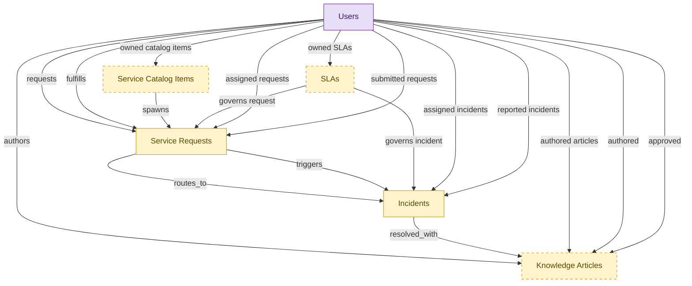

# IT Service Desk Starter

## 1. Overview

Single-domain starter kit for a small IT team that wants a lightweight service desk without the full ITSM suite or any asset estate. Embeds lightweight shells of ITSM's own records: incidents and service requests (the required helpdesk core), plus an optional request catalog, knowledge base, and SLA clocks. Problem, change, release, and event handling stay in the full itsm-* modules you turn on when you outgrow the desk; assets are out of scope (IT-OPS-STARTER and HAM). The embedded shells demote to the canonical itsm-* masters when those modules install alongside. The narrow, single-domain complement to IT-OPS-STARTER.

## 2. Entity summary

| Name | data_object | Description |
| --- | --- | --- |
| Incidents | `service_incidents` | Unplanned service interruptions or quality reductions, with severity, priority, category, assignee, and affected components. |
| Knowledge Articles | `knowledge_articles` | Knowledge-base articles backing self-service portals and agent-assist tools, moving through draft, review, published, and retired. |
| Service Catalog Items | `service_catalog_items` | Definitions of what can be requested: the request form, fulfillment workflow, approvals, service level, and charge-back rules. |
| Service Requests | `service_requests` | Planned, catalog-driven requests for access, hardware, software, or information, distinct from reactive incidents. |
| SLAs | `service_slas` | Service-level agreements setting response, resolution, and availability targets by priority, category, or customer tier. |
| Users | `users` | Platform users referenced as assignees, authors, approvers, and creators across records. |

## 3. Entities catalog

| # | data_object | catalog code | singular | plural | held_as | mastered in | mastered label | install_optional | personal_content | entity_type | write tier | notes |
| ---: | --- | --- | --- | --- | --- | --- | --- | --- | --- | --- | --- | --- |
| 1 | `service_incidents` | `service_incidents` | Incident | Incidents | embedded_master | `itsm-incident-mgmt` | Incident Management | - | yes | operational_workflow | `:manage` | - |
| 2 | `knowledge_articles` | `knowledge_articles` | Knowledge Article | Knowledge Articles | embedded_master | `itsm-knowledge` | IT Knowledge Management | yes | - | operational_workflow | `:manage` | - |
| 3 | `service_catalog_items` | `service_catalog_items` | Service Catalog Item | Service Catalog Items | embedded_master | `itsm-service-request` | Service Request Fulfillment | yes | - | catalog | `:admin` | - |
| 4 | `service_requests` | `service_requests` | Service Request | Service Requests | embedded_master | `itsm-service-request` | Service Request Fulfillment | - | - | operational_workflow | `:manage` | - |
| 5 | `service_slas` | `service_slas` | SLA | SLAs | embedded_master | `itsm-sla-mgmt` | SLA and Chargeback Management | yes | - | catalog | `:admin` | - |
| 6 | `users` | `users` | User | Users | consumer | _(platform built-in)_ | _(platform built-in)_ | - | - | operational_record | `:manage` | - |

## 4. Aliases and industry synonyms

_(none: no industry-scoped aliases for this scope)_

## 5. Relationships

_`field_required` applies only when both entities are installed. It never makes an entity required._

### 5.1 Relationships between entities in this blueprint

| from | verb | to | cardinality | kind | field_required | delete_mode | fk_format | notes |
| --- | --- | --- | --- | --- | --- | --- | --- | --- |
| `service_requests` | routes_to | `service_incidents` | one_to_many | reference | no | clear | reference | - |
| `service_catalog_items` | spawns | `service_requests` | one_to_many | reference | no | clear | reference | - |
| `service_requests` | triggers | `service_incidents` | one_to_many | reference | no | clear | reference | - |
| `service_slas` | governs incident | `service_incidents` | one_to_many | reference | yes | restrict | reference | - |
| `service_slas` | governs request | `service_requests` | one_to_many | reference | yes | restrict | reference | - |
| `service_incidents` | resolved_with | `knowledge_articles` | many_to_many | reference | - | cascade | parent | - |

### 5.2 Relationships to platform built-ins (`users`)

| from | verb | to | cardinality | field_required | delete_mode | fk_format | notes |
| --- | --- | --- | --- | --- | --- | --- | --- |
| `users` | authors | `knowledge_articles` | one_to_many | no | clear | reference | - |
| `users` | requests | `service_requests` | one_to_many | yes | restrict | reference | - |
| `users` | fulfills | `service_requests` | one_to_many | no | clear | reference | - |
| `users` | assigned incidents | `service_incidents` | one_to_many | no | clear | reference | - |
| `users` | reported incidents | `service_incidents` | one_to_many | yes | restrict | reference | - |
| `users` | assigned requests | `service_requests` | one_to_many | no | clear | reference | - |
| `users` | submitted requests | `service_requests` | one_to_many | yes | restrict | reference | - |
| `users` | authored articles | `knowledge_articles` | one_to_many | yes | restrict | reference | - |
| `users` | owned catalog items | `service_catalog_items` | one_to_many | no | clear | reference | - |
| `users` | owned SLAs | `service_slas` | one_to_many | no | clear | reference | - |
| `users` | authored | `knowledge_articles` | one_to_many | no | clear | reference | - |
| `users` | approved | `knowledge_articles` | one_to_many | no | clear | reference | - |

### 5.3 Relationships to entities outside this blueprint

_External entities are optional: this blueprint never installs them. If one exists at install, the relationship is proposed. A many-to-many relationship is listed under outgoing and proposed as a new junction table._

#### 5.3a Outgoing relationships: this blueprint's entity points to the external entity

| from | verb | to | cardinality | field_required | notes |
| --- | --- | --- | --- | --- | --- |
| `employees` | triggers | `service_requests` | one_to_many | no | - |
| `onboarding_tasks` | emits | `service_requests` | one_to_many | no | - |
| `onboarding_tasks` | emits | `service_incidents` | one_to_many | no | - |
| `hr_cases` | references | `knowledge_articles` | many_to_many | - | - |
| `hr_cases` | spawns | `service_requests` | one_to_many | no | - |
| `service_problems` | is investigated by | `service_incidents` | one_to_many | no | - |
| `service_incidents` | references | `configuration_items` | many_to_many | - | - |
| `service_problems` | documented_in | `knowledge_articles` | one_to_many | no | - |
| `service_incidents` | correlates_to | `monitoring_alerts` | many_to_many | - | - |
| `service_incidents` | correlates_to | `error_groups` | many_to_many | - | - |
| `service_slas` | aligns_with | `service_level_objectives` | many_to_many | - | - |
| `application_interfaces` | raises | `service_incidents` | one_to_many | no | - |
| `configuration_items` | triggers | `service_incidents` | one_to_many | no | - |
| `service_maps` | refreshes | `service_incidents` | many_to_many | - | - |
| `ci_baselines` | triggers | `service_incidents` | one_to_many | no | - |
| `chat_threads` | escalates_to | `service_incidents` | one_to_many | no | - |
| `control_tests` | escalates_to | `service_incidents` | one_to_many | no | - |
| `audit_engagements` | triggers | `service_requests` | one_to_many | no | - |
| `test_defects` | escalates_to | `service_incidents` | one_to_many | no | - |
| `customer_cases` | references | `knowledge_articles` | many_to_many | - | - |
| `intent_definitions` | informs | `knowledge_articles` | one_to_many | no | - |
| `eam_work_orders` | escalates_to | `service_incidents` | one_to_many | no | - |
| `clinical_engineering_work_orders` | surfaces_in | `service_requests` | one_to_one | no | - |
| `device_calibration_records` | schedules_in | `service_requests` | one_to_many | no | - |
| `work_items` | mirrors_to | `service_requests` | one_to_one | no | - |
| `work_automations` | propagates_to | `service_requests` | many_to_many | - | - |
| `dlp_incidents` | informs_security_incident | `service_incidents` | one_to_many | no | - |
| `lcap_apps` | opens | `service_incidents` | many_to_many | - | - |
| `event_correlations` | triggers | `service_incidents` | one_to_many | no | - |
| `root_cause_analyses` | annotates | `service_incidents` | one_to_many | no | - |
| `incident_predictions` | forecasts | `service_incidents` | one_to_many | no | - |
| `dc_cabinets` | raises | `service_incidents` | one_to_many | no | - |
| `dc_power_distribution_units` | raises | `service_incidents` | one_to_many | no | - |
| `dc_uninterruptible_power_supplies` | raises | `service_incidents` | one_to_many | no | - |
| `dc_cooling_units` | raises | `service_incidents` | one_to_many | no | - |
| `endpoint_experience_scores` | triggers | `service_incidents` | one_to_many | no | - |
| `saas_applications` | raises_incident | `service_incidents` | one_to_many | no | - |

#### 5.3b Incoming relationships: the external entity points to this blueprint's entity

| from | verb | to | cardinality | field_required | notes |
| --- | --- | --- | --- | --- | --- |
| `knowledge_articles` | publishes_to | `knowledge_base_articles` | one_to_one | no | - |
| `service_catalog_items` | exposes | `iga_entitlement_definitions` | one_to_many | no | - |
| `service_incidents` | triggers | `remediation_plans` | one_to_many | no | - |

## 6. Cross-domain context

### 6.1 Master consumers (other modules / domains that embed this scope's masters)

_(none: this scope masters no entities)_

### 6.2 Outbound handoffs (events this scope publishes)

_(none: no outbound handoffs whose payload is in this scope)_

### 6.3 Inbound handoffs (events this scope reacts to)

_(none: no inbound handoffs whose payload is in this scope)_

### 6.4 Master providers (modules / domains that own masters this scope embeds)

| data_object | held_as | install_optional | catalog owner(s) | slice notes |
| --- | --- | --- | --- | --- |
| `knowledge_articles` | embedded_master | yes | ITSM-KNOWLEDGE (ITSM) | - |
| `service_catalog_items` | embedded_master | yes | ITSM-SERVICE-REQUEST (ITSM) | - |
| `service_incidents` | embedded_master | - | ITSM-INCIDENT-MGMT (ITSM) | - |
| `service_requests` | embedded_master | - | ITSM-SERVICE-REQUEST (ITSM) | - |
| `service_slas` | embedded_master | yes | ITSM-SLA-MGMT (ITSM) | - |
| `users` | consumer | - | _(platform built-in)_ | - |

## 7. Lifecycle states

### `knowledge_articles` (Knowledge Article)

_This scope holds `knowledge_articles` as **embedded_master**; the canonical state machine is owned by `ITSM-KNOWLEDGE`._

| order | state_name | initial? | terminal? | realizing module | requires_permission? | high risk? | derived gate | description |
| --- | --- | --- | --- | --- | --- | --- | --- | --- |
| 1 | `draft` | ✓ | - | `ITSM-KNOWLEDGE` | - | - | - | Author is drafting the article; freely editable. |
| 2 | `in_review` | - | - | `ITSM-KNOWLEDGE` | - | - | - | Submitted for editorial/SME review; body locked from free edits. |
| 3 | `published` | - | - | `ITSM-KNOWLEDGE` | ✓ | - | `itsm-knowledge:publish_article` | Article is live and visible to consumers. |
| 4 | `retired` | - | ✓ | `ITSM-KNOWLEDGE` | - | - | - | Article withdrawn from circulation; retained for audit. |

### `service_catalog_items` (Service Catalog Item)

_This scope holds `service_catalog_items` as **embedded_master**; the canonical state machine is owned by `ITSM-SERVICE-REQUEST`._

| order | state_name | initial? | terminal? | realizing module | requires_permission? | high risk? | derived gate | description |
| --- | --- | --- | --- | --- | --- | --- | --- | --- |
| 1 | `draft` | ✓ | - | `ITSM-SERVICE-REQUEST` | - | - | - | - |
| 2 | `published` | - | - | `ITSM-SERVICE-REQUEST` | ✓ | - | `itsm-service-request:publish_catalog_item` | - |
| 3 | `retired` | - | ✓ | `ITSM-SERVICE-REQUEST` | ✓ | - | `itsm-service-request:retire_catalog_item` | - |

### `service_incidents` (Incident)

_This scope holds `service_incidents` as **embedded_master**; the canonical state machine is owned by `ITSM-INCIDENT-MGMT`._

| order | state_name | initial? | terminal? | realizing module | requires_permission? | high risk? | derived gate | description |
| --- | --- | --- | --- | --- | --- | --- | --- | --- |
| 1 | `new` | ✓ | - | `ITSM-INCIDENT-MGMT` | - | - | - | Incident has been logged; not yet triaged or routed. |
| 2 | `assigned` | - | - | `ITSM-INCIDENT-MGMT` | - | - | - | Triaged and assigned to a support group or agent. |
| 3 | `in_progress` | - | - | `ITSM-INCIDENT-MGMT` | - | - | - | Assignee is actively diagnosing or working the incident. |
| 4 | `resolved` | - | - | `ITSM-INCIDENT-MGMT` | ✓ | - | `itsm-incident-mgmt:resolved_incident` | Workaround or fix delivered; awaiting reporter confirmation. |
| 5 | `closed` | - | ✓ | `ITSM-INCIDENT-MGMT` | ✓ | - | `itsm-incident-mgmt:closed_incident` | Resolution confirmed; incident archived and SLA clock stopped. |
| 6 | `canceled` | - | ✓ | `ITSM-INCIDENT-MGMT` | - | - | - | Incident withdrawn (duplicate, invalid, raised in error). |

### `service_requests` (Service Request)

_This scope holds `service_requests` as **embedded_master**; the canonical state machine is owned by `ITSM-SERVICE-REQUEST`._

| order | state_name | initial? | terminal? | realizing module | requires_permission? | high risk? | derived gate | description |
| --- | --- | --- | --- | --- | --- | --- | --- | --- |
| 1 | `submitted` | ✓ | - | `ITSM-SERVICE-REQUEST` | - | - | - | Requester has submitted the catalog request. |
| 2 | `approved` | - | - | `ITSM-SERVICE-REQUEST` | ✓ | - | `itsm-service-request:approved_service_request` | Approver has authorized fulfillment. |
| 3 | `fulfilling` | - | - | `ITSM-SERVICE-REQUEST` | - | - | - | Fulfillment team is provisioning or executing the request. |
| 4 | `fulfilled` | - | - | `ITSM-SERVICE-REQUEST` | - | - | - | Item or access has been delivered to the requester. |
| 5 | `closed` | - | ✓ | `ITSM-SERVICE-REQUEST` | - | - | - | Request archived after requester confirmation. |
| 6 | `canceled` | - | ✓ | `ITSM-SERVICE-REQUEST` | - | - | - | Request withdrawn or rejected before fulfillment. |

## 8. Permissions and business rules (derived)

### 8.1 Permissions

| permission | tier | description | included in `:admin`? |
| --- | --- | --- | --- |
| `itsm-starter:read` | baseline-read | Read access to every entity in the module | ✓ |
| `itsm-starter:manage` | baseline-manage | Edit operational records | ✓ |
| `itsm-starter:admin` | baseline-admin | Edit reference data and inherit every workflow gate below | - |
| `itsm-incident-mgmt:read_service_incidents` | entity-read | Read Incidents | ✓ |
| `itsm-incident-mgmt:write_service_incidents` | entity-write | Write Incidents | ✓ |
| `itsm-service-request:read_service_requests` | entity-read | Read Service Requests | ✓ |
| `itsm-service-request:write_service_requests` | entity-write | Write Service Requests | ✓ |
| `itsm-knowledge:read_knowledge_articles` | entity-read | Read Knowledge Articles | ✓ |
| `itsm-knowledge:write_knowledge_articles` | entity-write | Write Knowledge Articles | ✓ |
| `itsm-service-request:read_service_catalog_items` | entity-read | Read Service Catalog Items | ✓ |
| `itsm-service-request:write_service_catalog_items` | entity-write | Write Service Catalog Items | ✓ |
| `itsm-sla-mgmt:read_service_slas` | entity-read | Read SLAs | ✓ |
| `itsm-sla-mgmt:write_service_slas` | entity-write | Write SLAs | ✓ |
| `itsm-incident-mgmt:resolved_incident` | workflow-gate (lifecycle) | Transition `service_incidents` into state `resolved` | ✓ |
| `itsm-incident-mgmt:closed_incident` | workflow-gate (lifecycle) | Transition `service_incidents` into state `closed` | ✓ |
| `itsm-service-request:approved_service_request` | workflow-gate (lifecycle) | Transition `service_requests` into state `approved` | ✓ |
| `itsm-knowledge:publish_article` | workflow-gate (lifecycle) | Transition `knowledge_articles` into state `published` | ✓ |
| `itsm-service-request:publish_catalog_item` | workflow-gate (lifecycle) | Transition `service_catalog_items` into state `published` | ✓ |
| `itsm-service-request:retire_catalog_item` | workflow-gate (lifecycle) | Transition `service_catalog_items` into state `retired` | ✓ |
| `itsm-incident-mgmt:view_all_incidents` | override (personal_content) | View all `service_incidents` rows beyond row-scope | ✓ |
| `itsm-incident-mgmt:manage_all_incidents` | override (personal_content) | Manage all `service_incidents` rows beyond row-scope | ✓ |

_Gates with no process: `itsm-incident-mgmt:resolved_incident`, `itsm-incident-mgmt:closed_incident`, `itsm-service-request:approved_service_request`, `itsm-knowledge:publish_article`, `itsm-service-request:publish_catalog_item`, `itsm-service-request:retire_catalog_item`. No Accountable can hold them, so this blueprint does not support `raci`._

### 8.2 Business rules

| rule_name | data_object | source flag | intent |
| --- | --- | --- | --- |
| `incident_edit_scope` | `service_incidents` | has_personal_content | Row-scope by default; override via `itsm-incident-mgmt:view_all_incidents` / `itsm-incident-mgmt:manage_all_incidents` |

## 9. Roles, RACI, and responsibilities (derived)

_Baseline roles, the permission hierarchy, and RACI realization are DERIVED from this scope's entity-type write tiers + `process_raci`; none of it is stored in the catalog (the deployer provisions it from this blueprint)._

### 9.1 `ITSM-STARTER`

**Baseline roles:**

| role | baseline grant |
| --- | --- |
| `itsm-starter_viewer` | `itsm-starter:read` |
| `itsm-starter_manager` | `itsm-starter:manage` |
| `itsm-starter_admin` | `itsm-starter:admin` |

**Permission hierarchy:**

| permission | includes |
| --- | --- |
| `itsm-starter:admin` | `itsm-starter:manage` |
| `itsm-starter:manage` | `itsm-starter:read` |
| `itsm-starter:read` | `itsm-incident-mgmt:read_service_incidents` |
| `itsm-starter:read` | `itsm-service-request:read_service_requests` |
| `itsm-starter:read` | `itsm-knowledge:read_knowledge_articles` |
| `itsm-starter:read` | `itsm-service-request:read_service_catalog_items` |
| `itsm-starter:read` | `itsm-sla-mgmt:read_service_slas` |
| `itsm-starter:manage` | `itsm-incident-mgmt:write_service_incidents` |
| `itsm-incident-mgmt:write_service_incidents` | `itsm-incident-mgmt:read_service_incidents` |
| `itsm-starter:manage` | `itsm-service-request:write_service_requests` |
| `itsm-service-request:write_service_requests` | `itsm-service-request:read_service_requests` |
| `itsm-starter:manage` | `itsm-knowledge:write_knowledge_articles` |
| `itsm-knowledge:write_knowledge_articles` | `itsm-knowledge:read_knowledge_articles` |
| `itsm-starter:admin` | `itsm-service-request:write_service_catalog_items` |
| `itsm-service-request:write_service_catalog_items` | `itsm-service-request:read_service_catalog_items` |
| `itsm-starter:admin` | `itsm-sla-mgmt:write_service_slas` |
| `itsm-sla-mgmt:write_service_slas` | `itsm-sla-mgmt:read_service_slas` |
| `itsm-starter:admin` | `itsm-incident-mgmt:resolved_incident` |
| `itsm-starter:admin` | `itsm-incident-mgmt:closed_incident` |
| `itsm-starter:admin` | `itsm-service-request:approved_service_request` |
| `itsm-starter:admin` | `itsm-knowledge:publish_article` |
| `itsm-starter:admin` | `itsm-service-request:publish_catalog_item` |
| `itsm-starter:admin` | `itsm-service-request:retire_catalog_item` |
| `itsm-starter:admin` | `itsm-incident-mgmt:view_all_incidents` |
| `itsm-starter:admin` | `itsm-incident-mgmt:manage_all_incidents` |

**RACI realization:**

_(none: no process_raci assignments wired to this module's gated processes yet)_

### 9.2 Functional ownership and default grants

| responsibility | business function | default role | default tier |
| --- | --- | --- | --- |
| owner | IT Service Desk | `admin` | `:admin` |
| contributor | IT Operations | `manager` | `:manage` |
| contributor | Security | `manager` | `:manage` |
| consumer | Finance | `viewer` | `:read` |
| consumer | Human Resources | `viewer` | `:read` |
