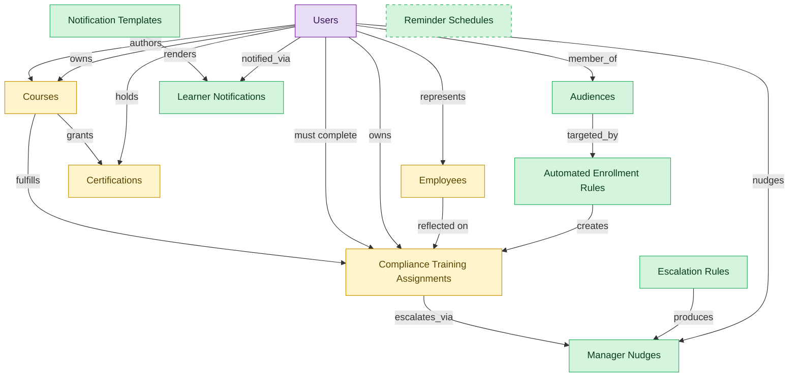

# Learning Automation

## 1. Overview

Horizontal automation surface across LMS deployment: dynamic audience segments, automated training assignment rules, reusable notification templates, learner notification log, manager-directed nudges for overdue training, and escalation policies. Cuts across LMS-COURSE-DELIVERY, LMS-COMPLIANCE-TRAINING, LMS-PATHS, and LMS-CREDENTIALS.

## 2. Entity summary

| Name | data_object | Description |
| --- | --- | --- |
| Audiences | `audiences` | Dynamic learner segments defined by attributes like department, location, and role, used by auto-enrollment and notification rules. |
| Automated Enrollment Rules | `automated_enrollment_rules` | Rule-engine entries that auto-enroll learners into courses or paths based on audience membership and lifecycle events. |
| Escalation Rules | `escalation_rules` | Policies that escalate overdue training through manager, skip-level, HR partner, or compliance officer. |
| Learner Notifications | `learner_notifications` | Log of notifications sent to learners: reminders, nudges, completions, and escalations. |
| Manager Nudges | `manager_nudges` | Reminders sent to a manager when one of their direct reports has overdue or upcoming training. |
| Notification Templates | `notification_templates` | Reusable email, in-app, and chat templates with merge fields, used by automation rules and manager reminders. |
| Reminder Schedules | `reminder_schedules` | Configured nudge cadences that drive automated reminders to learners and managers. |
| Certifications | `learner_certifications` | Credentials issued to a worker (internal, vendor, or regulatory), with issue date, expiry, issuing body, and renewal rules. Drives recertification campaigns. |
| Compliance Training Assignments | `compliance_assignments` | Mandatory training assignments tied to a regulation, role, location, or hire event, with due dates and escalation policy. |
| Courses | `courses` | Learning units such as e-learning modules, videos, live sessions, or blended programs, with format, duration, and prerequisites. |
| Employees | `employees` | Canonical records of people currently or formerly employed, carrying identity, employment metadata, and relationships to position, manager, and org unit. |
| Users | `users` | Platform users referenced as assignees, authors, approvers, and creators across records. |

## 3. Entities catalog

| # | data_object | catalog code | singular | plural | held_as | mastered in | mastered label | install_optional | personal_content | entity_type | write tier | notes |
| ---: | --- | --- | --- | --- | --- | --- | --- | --- | --- | --- | --- | --- |
| 1 | `audiences` | `audiences` | Audience | Audiences | master | - | - | - | - | catalog | `:admin` | - |
| 2 | `automated_enrollment_rules` | `automated_enrollment_rules` | Automated Enrollment Rule | Automated Enrollment Rules | master | - | - | - | - | catalog | `:admin` | - |
| 3 | `escalation_rules` | `escalation_rules` | Escalation Rule | Escalation Rules | master | - | - | - | - | catalog | `:admin` | - |
| 4 | `learner_notifications` | `learner_notifications` | Learner Notification | Learner Notifications | master | - | - | - | yes | operational_record | `:manage` | - |
| 5 | `manager_nudges` | `manager_nudges` | Manager Nudge | Manager Nudges | master | - | - | - | yes | operational_workflow | `:manage` | - |
| 6 | `notification_templates` | `notification_templates` | Notification Template | Notification Templates | master | - | - | - | - | catalog | `:admin` | - |
| 7 | `reminder_schedules` | `reminder_schedules` | Reminder Schedule | Reminder Schedules | master | - | - | yes | - | catalog | `:admin` | - |
| 8 | `learner_certifications` | `learner_certifications` | Certification | Certifications | embedded_master | `lms-credentials` | Credentials, Badges and Continuing Education | - | yes | operational_workflow | `:manage` | - |
| 9 | `compliance_assignments` | `compliance_assignments` | Compliance Training Assignment | Compliance Training Assignments | embedded_master | `lms-compliance-training` | Compliance Training | - | yes | operational_workflow | `:manage` | - |
| 10 | `courses` | `courses` | Course | Courses | embedded_master | `lms-course-delivery` | Course Delivery | - | - | operational_workflow | `:manage` | - |
| 11 | `employees` | `employees` | Employee | Employees | embedded_master | `hcm-core-worker` | Core Worker Record | - | yes | operational_workflow | `:manage` | - |
| 12 | `users` | `users` | User | Users | consumer | _(platform built-in)_ | _(platform built-in)_ | - | - | operational_record | `:manage` | - |

## 4. Aliases and industry synonyms

_(none: no industry-scoped aliases for this scope)_

## 5. Relationships

_`field_required` applies only when both entities are installed. It never makes an entity required._

### 5.1 Relationships between entities in this blueprint

| from | verb | to | cardinality | kind | field_required | delete_mode | fk_format | notes |
| --- | --- | --- | --- | --- | --- | --- | --- | --- |
| `courses` | fulfills | `compliance_assignments` | one_to_many | reference | no | clear | reference | - |
| `courses` | grants | `learner_certifications` | one_to_many | reference | no | clear | reference | - |
| `employees` | reflected on | `compliance_assignments` | one_to_many | reference | no | clear | reference | - |
| `audiences` | targeted_by | `automated_enrollment_rules` | one_to_many | reference | no | clear | reference | - |
| `automated_enrollment_rules` | creates | `compliance_assignments` | one_to_many | reference | no | clear | reference | - |
| `notification_templates` | renders | `learner_notifications` | one_to_many | reference | no | clear | reference | - |
| `compliance_assignments` | escalates_via | `manager_nudges` | one_to_many | reference | no | clear | reference | - |
| `escalation_rules` | produces | `manager_nudges` | one_to_many | reference | no | clear | reference | - |

### 5.2 Relationships to platform built-ins (`users`)

| from | verb | to | cardinality | field_required | delete_mode | fk_format | notes |
| --- | --- | --- | --- | --- | --- | --- | --- |
| `users` | represents | `employees` | one_to_one | no | clear | reference | - |
| `users` | authors | `courses` | one_to_many | no | clear | reference | - |
| `users` | owns | `courses` | one_to_many | no | clear | reference | - |
| `users` | must complete | `compliance_assignments` | one_to_many | yes | restrict | reference | - |
| `users` | owns | `compliance_assignments` | one_to_many | no | clear | reference | - |
| `users` | holds | `learner_certifications` | one_to_many | yes | restrict | reference | - |
| `users` | notified_via | `learner_notifications` | one_to_many | no | clear | reference | - |
| `users` | nudges | `manager_nudges` | one_to_many | no | clear | reference | - |
| `users` | member_of | `audiences` | one_to_many | no | clear | reference | - |

### 5.3 Relationships to entities outside this blueprint

_External entities are optional: this blueprint never installs them. If one exists at install, the relationship is proposed. A many-to-many relationship is listed under outgoing and proposed as a new junction table._

#### 5.3a Outgoing relationships: this blueprint's entity points to the external entity

| from | verb | to | cardinality | field_required | notes |
| --- | --- | --- | --- | --- | --- |
| `org_units` | groups | `employees` | one_to_many | yes | - |
| `job_profiles` | maps_to | `courses` | many_to_many | - | - |
| `courses` | sequenced_into | `learning_paths` | many_to_many | - | - |
| `skill_profiles` | updated by | `learner_certifications` | one_to_many | no | - |
| `hcm_positions` | requires | `compliance_assignments` | one_to_many | no | - |
| `org_units` | sponsors | `compliance_assignments` | one_to_many | no | - |
| `compliance_obligations` | tracked by | `compliance_assignments` | one_to_many | no | - |
| `survey_campaigns` | targets | `employees` | many_to_many | - | - |
| `case_categories` | drives | `employees` | one_to_many | no | - |
| `legal_holds` | identifies_custodians_from | `employees` | many_to_many | - | - |
| `legal_advice_records` | references | `employees` | many_to_many | - | - |
| `candidates` | becomes | `employees` | one_to_one | no | - |
| `pre_employees` | promotes to | `employees` | one_to_one | no | - |
| `courses` | classified_as | `course_categories` | many_to_many | - | - |
| `courses` | tagged_with | `course_tags` | many_to_many | - | - |
| `course_catalogs` | lists | `courses` | many_to_many | - | - |
| `certification_definitions` | instantiated_as | `learner_certifications` | one_to_many | yes | - |
| `certificate_templates` | renders | `learner_certifications` | one_to_many | no | - |
| `courses` | grants | `certification_definitions` | many_to_many | - | - |
| `courses` | yields_credits_via | `continuing_education_credits` | many_to_many | - | - |
| `compliance_training_campaigns` | generates | `compliance_assignments` | one_to_many | yes | - |
| `learning_path_steps` | references | `courses` | one_to_many | no | - |
| `contingent_workers` | converts_to | `employees` | one_to_one | no | - |

#### 5.3b Incoming relationships: the external entity points to this blueprint's entity

| from | verb | to | cardinality | field_required | notes |
| --- | --- | --- | --- | --- | --- |
| `employees` | signs | `employment_contracts` | one_to_many | yes | - |
| `employees` | generates | `employment_events` | one_to_many | yes | - |
| `employees` | triggers | `asset_lifecycle_events` | one_to_many | no | - |
| `employees` | requests | `absence_requests` | one_to_many | no | - |
| `employees` | holds | `skill_profiles` | one_to_one | no | - |
| `employees` | triggers | `service_requests` | one_to_many | no | - |
| `employees` | triggers | `iga_provisioning_events` | one_to_many | no | - |
| `employees` | triggers | `pay_runs` | one_to_many | no | - |
| `employees` | enrolls_in | `course_enrollments` | one_to_many | no | - |
| `employees` | becomes | `career_aspirations` | one_to_one | no | - |
| `employees` | becomes | `work_shifts` | one_to_many | no | - |
| `employees` | becomes | `compensation_statements` | one_to_one | no | - |
| `employees` | triggers | `benefit_enrollments` | one_to_many | no | - |
| `employees` | triggers | `corporate_cards` | one_to_many | no | - |
| `employees` | spawns | `onboarding_journeys` | one_to_one | no | - |
| `employees` | spawns | `hr_cases` | one_to_many | no | - |
| `employees` | feeds | `headcount_plans` | one_to_many | no | - |
| `employees` | feeds | `agency_time_entries` | one_to_many | no | - |
| `employees` | onboarded by | `onboarding_journeys` | one_to_many | yes | - |
| `employees` | fills | `hcm_positions` | one_to_one | no | - |
| `employees` | finalized by | `onboarding_document_collections` | one_to_many | no | - |
| `courses` | enrolled_via | `course_enrollments` | one_to_many | yes | - |
| `employees` | learns_via | `course_enrollments` | one_to_many | yes | - |
| `compliance_assignments` | triggers | `iga_provisioning_events` | one_to_many | no | - |
| `employees` | reflects | `learning_records` | one_to_many | no | - |
| `employees` | enrolls_in | `benefit_enrollments` | one_to_many | yes | - |
| `employees` | declares | `life_events` | one_to_many | no | - |
| `employees` | updated by | `life_events` | one_to_many | no | - |
| `employees` | submits | `survey_responses` | one_to_many | no | - |
| `employees` | flagged on | `engagement_drivers` | one_to_many | no | - |
| `employees` | reflected on | `engagement_drivers` | one_to_many | no | - |
| `employees` | raises | `hr_cases` | one_to_many | yes | - |
| `employees` | updated by | `hr_cases` | one_to_many | no | - |
| `employees` | is host for | `host_assignments` | one_to_many | yes | - |
| `employees` | reclassifies | `contingent_workers` | one_to_one | no | - |
| `courses` | has_version | `course_versions` | one_to_many | yes | - |
| `courses` | reviewed_via | `course_reviews` | one_to_many | no | - |
| `courses` | rated_via | `course_ratings` | one_to_many | no | - |
| `courses` | discussed_in | `course_discussions` | one_to_many | no | - |
| `courses` | scheduled_as | `course_offerings` | one_to_many | no | - |
| `compliance_assignments` | evidenced_by | `compliance_audit_records` | one_to_many | no | - |
| `compliance_assignments` | acknowledged_via | `harassment_training_acknowledgments` | one_to_many | no | - |
| `compliance_assignments` | produces | `fda_part11_audit_trails` | one_to_many | no | - |
| `automated_enrollment_rules` | creates | `course_enrollments` | one_to_many | no | - |
| `employees` | receives | `merit_recommendations` | one_to_one | no | - |
| `employees` | holds | `equity_grants` | one_to_one | no | - |
| `employees` | receives | `compensation_statements` | one_to_one | no | - |
| `employees` | has | `emergency_contacts` | one_to_many | yes | - |
| `employees` | has | `work_eligibility_documents` | one_to_many | yes | - |
| `employees` | has | `national_ids` | one_to_many | yes | - |
| `employees` | has | `worker_addresses` | one_to_many | yes | - |
| `employees` | has | `employee_dependents` | one_to_many | yes | - |
| `employees` | has | `worker_change_requests` | one_to_many | yes | - |
| `employees` | applies_as | `candidates` | one_to_many | no | - |
| `employees` | is the worker behind | `traveler_profiles` | one_to_one | no | - |
| `audiences` | syncs to | `ad_audiences` | one_to_one | no | - |
| `employees` | is assessed by | `exit_risk_assessments` | one_to_one | no | - |
| `employees` | is subject of | `insider_risk_cases` | one_to_many | no | - |
| `employees` | is recognized in | `frontline_recognitions` | one_to_many | yes | - |
| `employees` | is enrolled as | `advocate_profiles` | one_to_one | yes | - |
| `employees` | receives | `incentive_awards` | one_to_many | yes | - |

## 6. Cross-domain context

### 6.1 Master consumers (other modules / domains that embed this scope's masters)

_(none: no other module embeds this scope's masters)_

### 6.2 Outbound handoffs (events this scope publishes)

_(none: no outbound handoffs whose payload is in this scope)_

### 6.3 Inbound handoffs (events this scope reacts to)

_(none: no inbound handoffs whose payload is in this scope)_

### 6.4 Master providers (modules / domains that own masters this scope embeds)

| data_object | held_as | install_optional | catalog owner(s) | slice notes |
| --- | --- | --- | --- | --- |
| `compliance_assignments` | embedded_master | - | LMS-COMPLIANCE-TRAINING (LMS) | - |
| `courses` | embedded_master | - | LMS-COURSE-DELIVERY (LMS) | - |
| `employees` | embedded_master | - | HCM-CORE-WORKER (HCM) | - |
| `learner_certifications` | embedded_master | - | LMS-CREDENTIALS (LMS) | - |
| `users` | consumer | - | _(platform built-in)_ | - |

## 7. Lifecycle states

### `automated_enrollment_rules` (Automated Enrollment Rule)

| order | state_name | initial? | terminal? | realizing module | requires_permission? | high risk? | derived gate | description |
| --- | --- | --- | --- | --- | --- | --- | --- | --- |
| 1 | `draft` | ✓ | - | `LMS-AUTOMATION` | - | - | - | - |
| 2 | `active` | - | - | `LMS-AUTOMATION` | ✓ | - | `lms-automation:activate` | - |
| 3 | `paused` | - | - | `LMS-AUTOMATION` | ✓ | - | `lms-automation:pause` | - |
| 4 | `archived` | - | ✓ | `LMS-AUTOMATION` | ✓ | - | `lms-automation:archive` | - |

### `compliance_assignments` (Compliance Training Assignment)

_This scope holds `compliance_assignments` as **embedded_master**; the canonical state machine is owned by `LMS-COMPLIANCE-TRAINING`._

| order | state_name | initial? | terminal? | realizing module | requires_permission? | high risk? | derived gate | description |
| --- | --- | --- | --- | --- | --- | --- | --- | --- |
| 1 | `assigned` | ✓ | - | _(always)_ | - | - | - | Mandatory training assignment created for a learner with due date. |
| 2 | `in_progress` | - | - | _(always)_ | - | - | - | Learner has started the underlying course or activity. |
| 3 | `completed` | - | ✓ | `LMS-COMPLIANCE-TRAINING` | ✓ | - | `lms-compliance-training:complete` | Learner finished the assignment within the due window. |
| 4 | `overdue` | - | - | _(always)_ | - | - | - | Due date passed without completion and escalation policy engaged. |
| 5 | `waived` | - | ✓ | `LMS-COMPLIANCE-TRAINING` | ✓ | - | `lms-compliance-training:waive` | Assignment formally waived by compliance owner with audit reason. |
| 6 | `expired` | - | ✓ | `LMS-COMPLIANCE-TRAINING` | ✓ | - | `lms-compliance-training:expire` | Assignment closed unmet at the regulatory deadline. |

### `courses` (Course)

_This scope holds `courses` as **embedded_master**; the canonical state machine is owned by `LMS-COURSE-DELIVERY`._

| order | state_name | initial? | terminal? | realizing module | requires_permission? | high risk? | derived gate | description |
| --- | --- | --- | --- | --- | --- | --- | --- | --- |
| 1 | `draft` | ✓ | - | _(always)_ | - | - | - | Course being authored by an instructional designer or SME. |
| 2 | `in_review` | - | - | _(always)_ | - | - | - | Content under review by L&D or compliance reviewers. |
| 3 | `published` | - | - | `LMS-COURSE-DELIVERY` | ✓ | - | `lms-course-delivery:publish` | Course released to the catalog and available for enrollment. |
| 4 | `retired` | - | ✓ | `LMS-COURSE-DELIVERY` | ✓ | - | `lms-course-delivery:retire` | Course removed from the catalog and kept for historical transcripts. |

### `employees` (Employee)

_This scope holds `employees` as **embedded_master**; the canonical state machine is owned by `HCM-CORE-WORKER`._

| order | state_name | initial? | terminal? | realizing module | requires_permission? | high risk? | derived gate | description |
| --- | --- | --- | --- | --- | --- | --- | --- | --- |
| 1 | `draft` | ✓ | - | `HCM-CORE-WORKER` | - | - | - | Pre-hire stub created during requisition or onboarding handoff; not yet a worker of record. |
| 2 | `active` | - | - | `HCM-CORE-WORKER` | ✓ | - | `hcm-core-worker:active_employee` | Worker is currently employed and appears in headcount, payroll eligibility, and directory feeds. |
| 3 | `on_leave` | - | - | `HCM-CORE-WORKER` | ✓ | - | `hcm-core-worker:on_leave_employee` | Employee is on approved leave (parental, medical, sabbatical); active record but suppressed from some downstream feeds. |
| 4 | `suspended` | - | - | `HCM-CORE-WORKER` | ✓ | - | `hcm-core-worker:suspended_employee` | Employment temporarily halted (investigation, disciplinary); pay and access may be paused. |
| 5 | `terminated` | - | ✓ | `HCM-CORE-WORKER` | ✓ | - | `hcm-core-worker:terminated_employee` | Employment ended (voluntary or involuntary); final pay processed, access deprovisioned. |

### `escalation_rules` (Escalation Rule)

| order | state_name | initial? | terminal? | realizing module | requires_permission? | high risk? | derived gate | description |
| --- | --- | --- | --- | --- | --- | --- | --- | --- |
| 1 | `draft` | ✓ | - | `LMS-AUTOMATION` | - | - | - | - |
| 2 | `active` | - | - | `LMS-AUTOMATION` | ✓ | - | `lms-automation:activate` | - |
| 3 | `paused` | - | - | `LMS-AUTOMATION` | ✓ | - | `lms-automation:pause` | - |
| 4 | `archived` | - | ✓ | `LMS-AUTOMATION` | ✓ | - | `lms-automation:archive` | - |

### `learner_certifications` (Certification)

_This scope holds `learner_certifications` as **embedded_master**; the canonical state machine is owned by `LMS-CREDENTIALS`._

| order | state_name | initial? | terminal? | realizing module | requires_permission? | high risk? | derived gate | description |
| --- | --- | --- | --- | --- | --- | --- | --- | --- |
| 1 | `issued` | ✓ | - | `LMS-COMPLIANCE-TRAINING` | ✓ | - | `lms-compliance-training:issue` | Credential awarded to the learner with issue and expiry dates. |
| 2 | `active` | - | - | _(always)_ | - | - | - | Credential in force and valid for compliance or role requirements. |
| 3 | `renewing` | - | - | _(always)_ | - | - | - | Recertification campaign engaged before expiry. |
| 4 | `renewed` | - | - | `LMS-COMPLIANCE-TRAINING` | ✓ | - | `lms-compliance-training:renew` | Credential renewed with a fresh validity window. |
| 5 | `expired` | - | ✓ | _(always)_ | - | - | - | Credential past its expiry date and no longer valid. |
| 6 | `revoked` | - | ✓ | `LMS-COMPLIANCE-TRAINING` | ✓ | - | `lms-compliance-training:revoke` | Credential withdrawn by the issuing body or L&D for cause. |

### `learner_notifications` (Learner Notification)

| order | state_name | initial? | terminal? | realizing module | requires_permission? | high risk? | derived gate | description |
| --- | --- | --- | --- | --- | --- | --- | --- | --- |
| 1 | `queued` | ✓ | - | `LMS-AUTOMATION` | - | - | - | - |
| 2 | `sent` | - | - | `LMS-AUTOMATION` | ✓ | - | `lms-automation:send` | - |
| 3 | `delivered` | - | ✓ | `LMS-AUTOMATION` | - | - | - | - |
| 4 | `failed` | - | ✓ | `LMS-AUTOMATION` | - | - | - | - |

### `manager_nudges` (Manager Nudge)

| order | state_name | initial? | terminal? | realizing module | requires_permission? | high risk? | derived gate | description |
| --- | --- | --- | --- | --- | --- | --- | --- | --- |
| 1 | `pending` | ✓ | - | `LMS-AUTOMATION` | - | - | - | - |
| 2 | `sent` | - | - | `LMS-AUTOMATION` | ✓ | - | `lms-automation:send` | - |
| 3 | `acknowledged` | - | ✓ | `LMS-AUTOMATION` | - | - | - | - |
| 4 | `dismissed` | - | ✓ | `LMS-AUTOMATION` | - | - | - | - |

## 8. Permissions and business rules (derived)

### 8.1 Permissions

| permission | tier | description | included in `:admin`? |
| --- | --- | --- | --- |
| `lms-automation:read` | baseline-read | Read access to every entity in the module | ✓ |
| `lms-automation:manage` | baseline-manage | Edit operational records | ✓ |
| `lms-automation:admin` | baseline-admin | Edit reference data and inherit every workflow gate below | - |
| `hcm-core-worker:read_employees` | entity-read | Read Employees | ✓ |
| `hcm-core-worker:write_employees` | entity-write | Write Employees | ✓ |
| `lms-course-delivery:read_courses` | entity-read | Read Courses | ✓ |
| `lms-course-delivery:write_courses` | entity-write | Write Courses | ✓ |
| `lms-credentials:read_learner_certifications` | entity-read | Read Certifications | ✓ |
| `lms-credentials:write_learner_certifications` | entity-write | Write Certifications | ✓ |
| `lms-compliance-training:read_compliance_assignments` | entity-read | Read Compliance Training Assignments | ✓ |
| `lms-compliance-training:write_compliance_assignments` | entity-write | Write Compliance Training Assignments | ✓ |
| `lms-automation:read_audiences` | entity-read | Read Audiences | ✓ |
| `lms-automation:write_audiences` | entity-write | Write Audiences | ✓ |
| `lms-automation:read_automated_enrollment_rules` | entity-read | Read Automated Enrollment Rules | ✓ |
| `lms-automation:write_automated_enrollment_rules` | entity-write | Write Automated Enrollment Rules | ✓ |
| `lms-automation:read_learner_notifications` | entity-read | Read Learner Notifications | ✓ |
| `lms-automation:write_learner_notifications` | entity-write | Write Learner Notifications | ✓ |
| `lms-automation:read_notification_templates` | entity-read | Read Notification Templates | ✓ |
| `lms-automation:write_notification_templates` | entity-write | Write Notification Templates | ✓ |
| `lms-automation:read_manager_nudges` | entity-read | Read Manager Nudges | ✓ |
| `lms-automation:write_manager_nudges` | entity-write | Write Manager Nudges | ✓ |
| `lms-automation:read_escalation_rules` | entity-read | Read Escalation Rules | ✓ |
| `lms-automation:write_escalation_rules` | entity-write | Write Escalation Rules | ✓ |
| `lms-automation:read_reminder_schedules` | entity-read | Read Reminder Schedules | ✓ |
| `lms-automation:write_reminder_schedules` | entity-write | Write Reminder Schedules | ✓ |
| `hcm-core-worker:active_employee` | workflow-gate (lifecycle) | Transition `employees` into state `active` | ✓ |
| `hcm-core-worker:on_leave_employee` | workflow-gate (lifecycle) | Transition `employees` into state `on_leave` | ✓ |
| `hcm-core-worker:suspended_employee` | workflow-gate (lifecycle) | Transition `employees` into state `suspended` | ✓ |
| `hcm-core-worker:terminated_employee` | workflow-gate (lifecycle) | Transition `employees` into state `terminated` | ✓ |
| `lms-course-delivery:publish` | workflow-gate (lifecycle) | Transition `courses` into state `published` | ✓ |
| `lms-course-delivery:retire` | workflow-gate (lifecycle) | Transition `courses` into state `retired` | ✓ |
| `lms-compliance-training:issue` | workflow-gate (lifecycle) | Transition `learner_certifications` into state `issued` | ✓ |
| `lms-compliance-training:renew` | workflow-gate (lifecycle) | Transition `learner_certifications` into state `renewed` | ✓ |
| `lms-compliance-training:revoke` | workflow-gate (lifecycle) | Transition `learner_certifications` into state `revoked` | ✓ |
| `lms-compliance-training:complete` | workflow-gate (lifecycle) | Transition `compliance_assignments` into state `completed` | ✓ |
| `lms-compliance-training:waive` | workflow-gate (lifecycle) | Transition `compliance_assignments` into state `waived` | ✓ |
| `lms-compliance-training:expire` | workflow-gate (lifecycle) | Transition `compliance_assignments` into state `expired` | ✓ |
| `lms-automation:activate` | workflow-gate (lifecycle) | Transition `automated_enrollment_rules` into state `active` or `escalation_rules` into state `active` | ✓ |
| `lms-automation:pause` | workflow-gate (lifecycle) | Transition `automated_enrollment_rules` into state `paused` or `escalation_rules` into state `paused` | ✓ |
| `lms-automation:archive` | workflow-gate (lifecycle) | Transition `automated_enrollment_rules` into state `archived` or `escalation_rules` into state `archived` | ✓ |
| `lms-automation:send` | workflow-gate (lifecycle) | Transition `learner_notifications` into state `sent` or `manager_nudges` into state `sent` | ✓ |
| `hcm-core-worker:view_all_employees` | override (personal_content) | View all `employees` rows beyond row-scope | ✓ |
| `hcm-core-worker:manage_all_employees` | override (personal_content) | Manage all `employees` rows beyond row-scope | ✓ |
| `lms-credentials:view_all_certifications` | override (personal_content) | View all `learner_certifications` rows beyond row-scope | ✓ |
| `lms-credentials:manage_all_certifications` | override (personal_content) | Manage all `learner_certifications` rows beyond row-scope | ✓ |
| `lms-compliance-training:view_all_compliance_training_assignments` | override (personal_content) | View all `compliance_assignments` rows beyond row-scope | ✓ |
| `lms-compliance-training:manage_all_compliance_training_assignments` | override (personal_content) | Manage all `compliance_assignments` rows beyond row-scope | ✓ |
| `lms-automation:view_all_learner_notifications` | override (personal_content) | View all `learner_notifications` rows beyond row-scope | ✓ |
| `lms-automation:manage_all_learner_notifications` | override (personal_content) | Manage all `learner_notifications` rows beyond row-scope | ✓ |
| `lms-automation:view_all_manager_nudges` | override (personal_content) | View all `manager_nudges` rows beyond row-scope | ✓ |
| `lms-automation:manage_all_manager_nudges` | override (personal_content) | Manage all `manager_nudges` rows beyond row-scope | ✓ |

_Gates with no process: `hcm-core-worker:suspended_employee`, `lms-course-delivery:retire`, `lms-compliance-training:renew`, `lms-compliance-training:revoke`, `lms-compliance-training:waive`, `lms-compliance-training:expire`, `lms-automation:activate`, `lms-automation:pause`, `lms-automation:archive`, `lms-automation:send`. No Accountable can hold them, so this blueprint does not support `raci`._

### 8.2 Business rules

| rule_name | data_object | source flag | intent |
| --- | --- | --- | --- |
| `employee_edit_scope` | `employees` | has_personal_content | Row-scope by default; override via `hcm-core-worker:view_all_employees` / `hcm-core-worker:manage_all_employees` |
| `certification_edit_scope` | `learner_certifications` | has_personal_content | Row-scope by default; override via `lms-credentials:view_all_certifications` / `lms-credentials:manage_all_certifications` |
| `compliance_training_assignment_edit_scope` | `compliance_assignments` | has_personal_content | Row-scope by default; override via `lms-compliance-training:view_all_compliance_training_assignments` / `lms-compliance-training:manage_all_compliance_training_assignments` |
| `learner_notification_edit_scope` | `learner_notifications` | has_personal_content | Row-scope by default; override via `lms-automation:view_all_learner_notifications` / `lms-automation:manage_all_learner_notifications` |
| `manager_nudge_edit_scope` | `manager_nudges` | has_personal_content | Row-scope by default; override via `lms-automation:view_all_manager_nudges` / `lms-automation:manage_all_manager_nudges` |

## 9. Roles, RACI, and responsibilities (derived)

_Baseline roles, the permission hierarchy, and RACI realization are DERIVED from this scope's entity-type write tiers + `process_raci`; none of it is stored in the catalog (the deployer provisions it from this blueprint)._

### 9.1 `LMS-AUTOMATION`

**Baseline roles:**

| role | baseline grant |
| --- | --- |
| `lms-automation_viewer` | `lms-automation:read` |
| `lms-automation_manager` | `lms-automation:manage` |
| `lms-automation_admin` | `lms-automation:admin` |

**Permission hierarchy:**

| permission | includes |
| --- | --- |
| `lms-automation:admin` | `lms-automation:manage` |
| `lms-automation:manage` | `lms-automation:read` |
| `lms-automation:read` | `hcm-core-worker:read_employees` |
| `lms-automation:read` | `lms-course-delivery:read_courses` |
| `lms-automation:read` | `lms-credentials:read_learner_certifications` |
| `lms-automation:read` | `lms-compliance-training:read_compliance_assignments` |
| `lms-automation:read` | `lms-automation:read_audiences` |
| `lms-automation:read` | `lms-automation:read_automated_enrollment_rules` |
| `lms-automation:read` | `lms-automation:read_learner_notifications` |
| `lms-automation:read` | `lms-automation:read_notification_templates` |
| `lms-automation:read` | `lms-automation:read_manager_nudges` |
| `lms-automation:read` | `lms-automation:read_escalation_rules` |
| `lms-automation:read` | `lms-automation:read_reminder_schedules` |
| `lms-automation:manage` | `hcm-core-worker:write_employees` |
| `hcm-core-worker:write_employees` | `hcm-core-worker:read_employees` |
| `lms-automation:manage` | `lms-course-delivery:write_courses` |
| `lms-course-delivery:write_courses` | `lms-course-delivery:read_courses` |
| `lms-automation:manage` | `lms-credentials:write_learner_certifications` |
| `lms-credentials:write_learner_certifications` | `lms-credentials:read_learner_certifications` |
| `lms-automation:manage` | `lms-compliance-training:write_compliance_assignments` |
| `lms-compliance-training:write_compliance_assignments` | `lms-compliance-training:read_compliance_assignments` |
| `lms-automation:admin` | `lms-automation:write_audiences` |
| `lms-automation:write_audiences` | `lms-automation:read_audiences` |
| `lms-automation:admin` | `lms-automation:write_automated_enrollment_rules` |
| `lms-automation:write_automated_enrollment_rules` | `lms-automation:read_automated_enrollment_rules` |
| `lms-automation:manage` | `lms-automation:write_learner_notifications` |
| `lms-automation:write_learner_notifications` | `lms-automation:read_learner_notifications` |
| `lms-automation:admin` | `lms-automation:write_notification_templates` |
| `lms-automation:write_notification_templates` | `lms-automation:read_notification_templates` |
| `lms-automation:manage` | `lms-automation:write_manager_nudges` |
| `lms-automation:write_manager_nudges` | `lms-automation:read_manager_nudges` |
| `lms-automation:admin` | `lms-automation:write_escalation_rules` |
| `lms-automation:write_escalation_rules` | `lms-automation:read_escalation_rules` |
| `lms-automation:admin` | `lms-automation:write_reminder_schedules` |
| `lms-automation:write_reminder_schedules` | `lms-automation:read_reminder_schedules` |
| `lms-automation:admin` | `hcm-core-worker:active_employee` |
| `lms-automation:admin` | `hcm-core-worker:on_leave_employee` |
| `lms-automation:admin` | `hcm-core-worker:suspended_employee` |
| `lms-automation:admin` | `hcm-core-worker:terminated_employee` |
| `lms-automation:admin` | `lms-course-delivery:publish` |
| `lms-automation:admin` | `lms-course-delivery:retire` |
| `lms-automation:admin` | `lms-compliance-training:issue` |
| `lms-automation:admin` | `lms-compliance-training:renew` |
| `lms-automation:admin` | `lms-compliance-training:revoke` |
| `lms-automation:admin` | `lms-compliance-training:complete` |
| `lms-automation:admin` | `lms-compliance-training:waive` |
| `lms-automation:admin` | `lms-compliance-training:expire` |
| `lms-automation:admin` | `lms-automation:activate` |
| `lms-automation:admin` | `lms-automation:pause` |
| `lms-automation:admin` | `lms-automation:archive` |
| `lms-automation:admin` | `lms-automation:send` |
| `lms-automation:admin` | `hcm-core-worker:view_all_employees` |
| `lms-automation:admin` | `hcm-core-worker:manage_all_employees` |
| `lms-automation:admin` | `lms-credentials:view_all_certifications` |
| `lms-automation:admin` | `lms-credentials:manage_all_certifications` |
| `lms-automation:admin` | `lms-compliance-training:view_all_compliance_training_assignments` |
| `lms-automation:admin` | `lms-compliance-training:manage_all_compliance_training_assignments` |
| `lms-automation:admin` | `lms-automation:view_all_learner_notifications` |
| `lms-automation:admin` | `lms-automation:manage_all_learner_notifications` |
| `lms-automation:admin` | `lms-automation:view_all_manager_nudges` |
| `lms-automation:admin` | `lms-automation:manage_all_manager_nudges` |

**Processes wired:**

| process_key | process_name | PCF code | PCF ID | level | description |
| --- | --- | --- | --- | --- | --- |
| `manage_maintain_employee_data` | Manage and maintain employee data | 7.7.3 | 10524 | 3 | Capturing and updating employee information and data and information on the employees. |
| `manage_leave_absence` | Manage leave of absence | 7.6.2.2 | 10515 | 4 | Managing the period of time that an employee must be away from their primary job, while maintaining the status of employee (i.e., paid and unpaid leave of absence but not vacations, holidays, hiatuses, sabbaticals, and work-from-home programs). |
| `manage_separation` | Manage separation | 7.6.2 | 10513 | 3 | Managing the process of employee separation, including leaves of absence, resignations, discharges, and layoffs. Inform the employee of the termination. Complete paperwork for continuation of benefits. Enter employment status change into system. |
| `develop_conduct_manage_employee` | Develop, conduct, and manage employee training programs | 7.3.4.5 | 10493 | 4 | Creating, implementing, and managing the programs for training employees. Create and design sessions on the basis of the needs and the availability of the skills. Conduct the sessions in person or virtually. Manage all aspects related to the training programs. Consider including literacy training, interpersonal skills training, technical training, problem-solving training, diversity or sensitivity training, etc. |
| `manage_examinations` | Manage examinations and certifications | 7.3.4.6 | 20125 | 4 | Managing identified training programs for employees. Engage with industries to provide certifications, administer certification test, and maintain active certification. |
| `train_employees_appropriate` | Train employees on appropriate regulatory requirements | 2.1.3.5.1 | 12772 | 5 | Conducting training and impart learning to existing and new employees. Training will relate to the most recent/enforced regulations of the business to meet Manage regulatory requirements [12771]. |

**RACI realization:**

| actor | kind | raci | process_key | realization |
| --- | --- | --- | --- | --- |
| `HR-PEOPLE-OPS-SPECIALIST` | persona | responsible | `manage_maintain_employee_data` | the gated entities' write tier |
| `HR-BUSINESS-PARTNER` | persona | accountable | `manage_maintain_employee_data` | grant gates [hcm-core-worker:active_employee] + the gated entities' write tier |
| `HR-HRIS-ADMIN` | persona | consulted | `manage_maintain_employee_data` | advisory read grant |
| `PEOPLE-MANAGER` | persona | informed | `manage_maintain_employee_data` | notify on trigger_events [employee.applied_internally] |
| `HR-PEOPLE-OPS-SPECIALIST` | persona | responsible | `manage_leave_absence` | the gated entities' write tier |
| `PEOPLE-MANAGER` | persona | accountable | `manage_leave_absence` | grant gates [hcm-core-worker:on_leave_employee] + the gated entities' write tier |
| `HR-BUSINESS-PARTNER` | persona | consulted | `manage_leave_absence` | blocking consultation state |
| `HR-HRIS-ADMIN` | persona | informed | `manage_leave_absence` | ⚠ no event wired |
| `HR-PEOPLE-OPS-SPECIALIST` | persona | responsible | `manage_separation` | the gated entities' write tier |
| `HR-BUSINESS-PARTNER` | persona | accountable | `manage_separation` | grant gates [hcm-core-worker:terminated_employee] + the gated entities' write tier |
| `PEOPLE-MANAGER` | persona | consulted | `manage_separation` | advisory read grant |
| `HR-HRIS-ADMIN` | persona | informed | `manage_separation` | notify on trigger_events [employee.terminated] |
| `LD-INSTRUCTIONAL-DESIGNER` | persona | responsible | `develop_conduct_manage_employee` | the gated entities' write tier |
| `LD-LEARNING-ADMIN` | persona | accountable | `develop_conduct_manage_employee` | grant gates [lms-course-delivery:publish] + the gated entities' write tier |
| `LD-INSTRUCTOR` | persona | consulted | `develop_conduct_manage_employee` | advisory read grant |
| `PEOPLE-MANAGER` | persona | informed | `develop_conduct_manage_employee` | notify on trigger_events [course.published] |
| `LD-LEARNING-ADMIN` | persona | responsible | `manage_examinations` | the gated entities' write tier |
| `GRC-COMPLIANCE-TRAINING-MANAGER` | persona | accountable | `manage_examinations` | grant gates [lms-compliance-training:issue] + the gated entities' write tier |
| `LD-INSTRUCTOR` | persona | consulted | `manage_examinations` | advisory read grant |
| `GRC-COMPLIANCE-TRAINING-MANAGER` | persona | responsible | `train_employees_appropriate` | the gated entities' write tier |
| `GRC-COMPLIANCE-TRAINING-MANAGER` | persona | accountable | `train_employees_appropriate` | grant gates [lms-compliance-training:complete] + the gated entities' write tier |
| `PEOPLE-MANAGER` | persona | consulted | `train_employees_appropriate` | advisory read grant |
| `LEGAL-COMPLIANCE-SPECIALIST` | persona | informed | `train_employees_appropriate` | notify on trigger_events [compliance_assignment.completed] |

### 9.2 Functional ownership and default grants

| responsibility | business function | default role | default tier |
| --- | --- | --- | --- |
| owner | Learning and Development | `admin` | `:admin` |
| contributor | Governance, Risk and Compliance | `manager` | `:manage` |
| contributor | Legal | `manager` | `:manage` |
| consumer | Manufacturing Operations | `viewer` | `:read` |
| consumer | Sales | `viewer` | `:read` |
| consumer | Software Engineering | `viewer` | `:read` |
