# Compliance Training

## 1. Overview

Mandatory regulatory training assignment, tracking, and certification: sexual harassment training (CA SB-1343), HIPAA, OSHA, anti-bribery, SOX, GDPR, AML. Masters `compliance_assignments` and `learner_certifications`. Realizes COMPLIANCE-TRAIN and CERT-MGMT. Distinct from general LMS course delivery: assignments are mandatory and time-bound, lifecycle includes `overdue`/`waived`/`expired` states with regulator-evidence retention, and ownership typically sits with GRC/Compliance, not L&D.

## 2. Entity summary

| Name | data_object | Description |
| --- | --- | --- |
| Compliance Audit Records | `compliance_audit_records` | Regulator-facing audit records of who completed which training, when, with version and evidence references. |
| Compliance Regulations | `compliance_regulations` | Reference table of statutes a tenant is subject to, with jurisdiction, citation, and retention period; each tenant activates its applicable subset. |
| Compliance Training Assignments | `compliance_assignments` | Mandatory training assignments tied to a regulation, role, location, or hire event, with due dates and escalation policy. |
| Compliance Training Campaigns | `compliance_training_campaigns` | Campaigns that bundle compliance training assignments by audience and due date, such as an annual code-of-conduct cycle. |
| DPO Training Acknowledgments | `dpo_training_acknowledgments` | Records confirming that data protection officers completed required training, evidencing GDPR compliance. |
| FDA Part 11 Audit Trails | `fda_part11_audit_trails` | Tamper-evident, retention-locked audit-trail rows for regulated training, meeting electronic-records requirements. |
| GxP Training Signoffs | `gxp_training_signoffs` | Witnessed electronic signatures binding learner, course, content version, and timestamp for regulated life-sciences training. |
| Harassment Training Acknowledgments | `harassment_training_acknowledgments` | Statutory acknowledgments that harassment training was completed, carrying a signed timestamp and IP address. |
| PCI DSS Awareness Records | `pci_dss_awareness_records` | Security-awareness training records for staff who handle card data, kept for PCI DSS compliance. |
| Phishing Simulation Results | `phishing_simulation_results` | Per-recipient outcomes of a phishing simulation, recording whether each person clicked, reported, or ignored the test message. |
| Phishing Simulations | `phishing_simulations` | Configured simulated-phishing campaigns used for security-awareness training and PCI DSS compliance. |
| Recertification Schedules | `recertification_schedules` | Recurrence configurations that drive periodic compliance-refresh assignment cycles for regulations like FINRA, HIPAA, and OSHA. |
| Regulator Filing Exports | `regulator_filing_exports` | Export artifacts prepared for regulator submissions, such as OSHA 300 logs, FINRA filings, and state rollups. |
| Training Evidence Records | `training_evidence_records` | Inspection-ready training evidence packages, bundling the signed roster, certificate hash, content version, and signature record for regulators. |
| Certifications | `learner_certifications` | Credentials issued to a worker (internal, vendor, or regulatory), with issue date, expiry, issuing body, and renewal rules. Drives recertification campaigns. |
| Cost Centers | `cost_centers` | Organizational units for cost allocation, with code, manager, hierarchy, and currency, driving variance and departmental reporting. |
| Courses | `courses` | Learning units such as e-learning modules, videos, live sessions, or blended programs, with format, duration, and prerequisites. |
| Employees | `employees` | Canonical records of people currently or formerly employed, carrying identity, employment metadata, and relationships to position, manager, and org unit. |
| Org Units | `org_units` | Nodes in the organizational hierarchy such as divisions, departments, and teams, with manager, cost center alignment, geographic scope, and parent-child relationships. |
| Positions | `hcm_positions` | Approved org slots with role definition, cost center, reporting line, location, and FTE allocation. Each can be open, filled, or eliminated. |
| Signature Records | `signature_records` | E-signature envelopes with signing audit trail, IP addresses, provider references, and the signed document, one contract may have many. |
| Onboarding Tasks | `onboarding_tasks` | Discrete to-do items within an onboarding journey, each with an assignee, due date, type, and completion state, some triggering handoffs to other systems. |
| Policy Attestations | `policy_attestations` | Records that a user read and acknowledged a policy, with timestamp, policy version, medium, and completion evidence. |

```mermaid
flowchart TD
  classDef master fill:#d4f4dd,stroke:#27ae60,color:#0b3d20;
  classDef embedded_master fill:#fff4cc,stroke:#c79100,color:#5b4500;
  classDef consumer fill:#e8def8,stroke:#7b1fa2,color:#3a155d;
  classDef platform_builtin fill:#e0e0e0,stroke:#424242,color:#1a1a1a;
  onboarding_tasks["Onboarding Tasks"]
  employees["Employees"]
  hcm_positions["Positions"]
  org_units["Org Units"]
  signature_records["Signature Records"]
  courses["Courses"]
  learner_certifications["Certifications"]
  compliance_assignments["Compliance Training Assignments"]
  cost_centers["Cost Centers"]
  policy_attestations["Policy Attestations"]
  compliance_training_campaigns["Compliance Training Campaigns"]
  compliance_audit_records["Compliance Audit Records"]
  training_evidence_records["Training Evidence Records"]
  harassment_training_acknowledgments["Harassment Training Acknowledgments"]
  recertification_schedules["Recertification Schedules"]
  regulator_filing_exports["Regulator Filing Exports"]
  fda_part11_audit_trails["FDA Part 11 Audit Trails"]
  compliance_regulations["Compliance Regulations"]
  gxp_training_signoffs["GxP Training Signoffs"]
  phishing_simulations["Phishing Simulations"]
  phishing_simulation_results["Phishing Simulation Results"]
  dpo_training_acknowledgments["DPO Training Acknowledgments"]
  pci_dss_awareness_records["PCI DSS Awareness Records"]
  users["Users"]
  org_units -->|"groups"| employees
  org_units -->|"contains"| hcm_positions
  cost_centers -->|"funds"| org_units
  org_units -->|"maps_to"| cost_centers
  employees -->|"fills"| hcm_positions
  courses -->|"fulfills"| compliance_assignments
  courses -->|"grants"| learner_certifications
  hcm_positions -->|"requires"| compliance_assignments
  org_units -->|"sponsors"| compliance_assignments
  employees -->|"reflected on"| compliance_assignments
  org_units -->|"parent of"| org_units
  compliance_training_campaigns -->|"generates"| compliance_assignments
  compliance_assignments -->|"evidenced_by"| compliance_audit_records
  training_evidence_records -->|"consolidates"| compliance_audit_records
  training_evidence_records -->|"supplies"| regulator_filing_exports
  compliance_assignments -->|"acknowledged_via"| harassment_training_acknowledgments
  recertification_schedules -->|"triggers"| compliance_training_campaigns
  compliance_assignments -->|"produces"| fda_part11_audit_trails
  compliance_regulations -->|"is_evidenced_by"| training_evidence_records
  users -->|"represents"| employees
  users -->|"manages"| hcm_positions
  users -->|"leads"| org_units
  users -->|"owns"| cost_centers
  users -->|"performs"| onboarding_tasks
  users -->|"created"| onboarding_tasks
  users -->|"authors"| courses
  users -->|"owns"| courses
  users -->|"must complete"| compliance_assignments
  users -->|"owns"| compliance_assignments
  users -->|"holds"| learner_certifications
  users -->|"signed"| signature_records
  org_units -->|"has members"| users
  users -->|"acknowledges"| harassment_training_acknowledgments
  users -->|"audit_trailed_in"| fda_part11_audit_trails
  users -->|"attests to policies"| policy_attestations
  users -->|"attests"| policy_attestations
  class onboarding_tasks consumer;
  class employees embedded_master;
  class hcm_positions embedded_master;
  class org_units embedded_master;
  class signature_records embedded_master;
  class courses embedded_master;
  class learner_certifications embedded_master;
  class compliance_assignments master;
  class cost_centers embedded_master;
  class policy_attestations consumer;
  class compliance_training_campaigns master;
  class compliance_audit_records master;
  class training_evidence_records master;
  class harassment_training_acknowledgments master;
  class recertification_schedules master;
  class regulator_filing_exports master;
  class fda_part11_audit_trails master;
  class compliance_regulations master;
  class gxp_training_signoffs master;
  class phishing_simulations master;
  class phishing_simulation_results master;
  class dpo_training_acknowledgments master;
  class pci_dss_awareness_records master;
  class users platform_builtin;
  style onboarding_tasks stroke-dasharray:5 5;
  style hcm_positions stroke-dasharray:5 5;
  style org_units stroke-dasharray:5 5;
  style cost_centers stroke-dasharray:5 5;
  style policy_attestations stroke-dasharray:5 5;
  style fda_part11_audit_trails stroke-dasharray:5 5;
  style gxp_training_signoffs stroke-dasharray:5 5;
  style phishing_simulations stroke-dasharray:5 5;
  style phishing_simulation_results stroke-dasharray:5 5;
  style dpo_training_acknowledgments stroke-dasharray:5 5;
  style pci_dss_awareness_records stroke-dasharray:5 5;
```

## 3. Entities catalog

| # | data_object | catalog code | singular | plural | held_as | mastered in | mastered label | install_optional | personal_content | entity_type | write tier | notes |
| ---: | --- | --- | --- | --- | --- | --- | --- | --- | --- | --- | --- | --- |
| 1 | `compliance_audit_records` | `compliance_audit_records` | Compliance Audit Record | Compliance Audit Records | master | - | - | - | yes | operational_workflow | `:manage` | - |
| 2 | `compliance_regulations` | `compliance_regulations` | Compliance Regulation | Compliance Regulations | master | - | - | - | - | catalog | `:admin` | - |
| 3 | `compliance_assignments` | `compliance_assignments` | Compliance Training Assignment | Compliance Training Assignments | master | - | - | - | yes | operational_workflow | `:manage` | - |
| 4 | `compliance_training_campaigns` | `compliance_training_campaigns` | Compliance Training Campaign | Compliance Training Campaigns | master | - | - | - | - | operational_workflow | `:manage` | - |
| 5 | `dpo_training_acknowledgments` | `dpo_training_acknowledgments` | DPO Training Acknowledgment | DPO Training Acknowledgments | master | - | - | yes | yes | operational_record | `:manage` | - |
| 6 | `fda_part11_audit_trails` | `fda_part11_audit_trails` | FDA Part 11 Audit Trail | FDA Part 11 Audit Trails | master | - | - | yes | yes | operational_workflow | `:manage` | - |
| 7 | `gxp_training_signoffs` | `gxp_training_signoffs` | GxP Training Signoff | GxP Training Signoffs | master | - | - | yes | yes | operational_workflow | `:manage` | - |
| 8 | `harassment_training_acknowledgments` | `harassment_training_acknowledgments` | Harassment Training Acknowledgment | Harassment Training Acknowledgments | master | - | - | - | yes | operational_workflow | `:manage` | - |
| 9 | `pci_dss_awareness_records` | `pci_dss_awareness_records` | PCI DSS Awareness Record | PCI DSS Awareness Records | master | - | - | yes | yes | operational_record | `:manage` | - |
| 10 | `phishing_simulation_results` | `phishing_simulation_results` | Phishing Simulation Result | Phishing Simulation Results | master | - | - | yes | yes | operational_record | `:manage` | - |
| 11 | `phishing_simulations` | `phishing_simulations` | Phishing Simulation | Phishing Simulations | master | - | - | yes | - | catalog | `:admin` | - |
| 12 | `recertification_schedules` | `recertification_schedules` | Recertification Schedule | Recertification Schedules | master | - | - | - | - | catalog | `:admin` | - |
| 13 | `regulator_filing_exports` | `regulator_filing_exports` | Regulator Filing Export | Regulator Filing Exports | master | - | - | - | - | operational_workflow | `:manage` | - |
| 14 | `training_evidence_records` | `training_evidence_records` | Training Evidence Record | Training Evidence Records | master | - | - | - | yes | operational_workflow | `:manage` | - |
| 15 | `learner_certifications` | `learner_certifications` | Certification | Certifications | embedded_master | `lms-credentials` | Credentials, Badges and Continuing Education | - | yes | operational_workflow | `:manage` | - |
| 16 | `cost_centers` | `cost_centers` | Cost Center | Cost Centers | embedded_master | `fin-gl-close` | General Ledger and Close | yes | - | catalog | `:admin` | - |
| 17 | `courses` | `courses` | Course | Courses | embedded_master | `lms-course-delivery` | Course Delivery | - | - | operational_workflow | `:manage` | - |
| 18 | `employees` | `employees` | Employee | Employees | embedded_master | `hcm-core-worker` | Core Worker Record | - | yes | operational_workflow | `:manage` | - |
| 19 | `org_units` | `org_units` | Org Unit | Org Units | embedded_master | `hcm-org-positions` | Organization and Position Management | yes | - | operational_workflow | `:manage` | - |
| 20 | `hcm_positions` | `hcm_positions` | Position | Positions | embedded_master | `hcm-org-positions` | Organization and Position Management | yes | - | operational_workflow | `:manage` | - |
| 21 | `signature_records` | `signature_records` | Signature Record | Signature Records | embedded_master | `clm-repository` | Contract Repository | - | yes | operational_workflow | `:manage` | - |
| 22 | `onboarding_tasks` | `onboarding_tasks` | Onboarding Task | Onboarding Tasks | consumer | `onb-journey-mgmt` | Onboarding Journey Management | yes | yes | operational_workflow | `:manage` | - |
| 23 | `policy_attestations` | `policy_attestations` | Policy Attestation | Policy Attestations | consumer | - | - | yes | - | operational_workflow | `:manage` | - |

## 4. Aliases and industry synonyms

_(none: no industry-scoped aliases for this scope)_

## 5. Relationships

_`field_required` applies only when both entities are installed. It never makes an entity required._

### 5.1 Relationships between entities in this blueprint

| from | verb | to | cardinality | kind | field_required | delete_mode | fk_format | notes |
| --- | --- | --- | --- | --- | --- | --- | --- | --- |
| `org_units` | groups | `employees` | one_to_many | reference | yes | restrict | reference | - |
| `org_units` | contains | `hcm_positions` | one_to_many | reference | yes | restrict | reference | - |
| `cost_centers` | funds | `org_units` | one_to_many | reference | yes | restrict | reference | - |
| `org_units` | maps_to | `cost_centers` | one_to_one | reference | no | clear | reference | - |
| `employees` | fills | `hcm_positions` | one_to_one | reference | no | clear | reference | - |
| `courses` | fulfills | `compliance_assignments` | one_to_many | reference | no | clear | reference | - |
| `courses` | grants | `learner_certifications` | one_to_many | reference | no | clear | reference | - |
| `hcm_positions` | requires | `compliance_assignments` | one_to_many | reference | no | clear | reference | - |
| `org_units` | sponsors | `compliance_assignments` | one_to_many | reference | no | clear | reference | - |
| `employees` | reflected on | `compliance_assignments` | one_to_many | reference | no | clear | reference | - |
| `org_units` | parent of | `org_units` | one_to_many | reference | no | clear | reference | - |
| `compliance_training_campaigns` | generates | `compliance_assignments` | one_to_many | composition | yes | cascade | parent | - |
| `compliance_assignments` | evidenced_by | `compliance_audit_records` | one_to_many | reference | no | clear | reference | - |
| `training_evidence_records` | consolidates | `compliance_audit_records` | one_to_many | reference | no | clear | reference | - |
| `training_evidence_records` | supplies | `regulator_filing_exports` | many_to_many | association | - | cascade | parent | - |
| `compliance_assignments` | acknowledged_via | `harassment_training_acknowledgments` | one_to_many | reference | no | clear | reference | - |
| `recertification_schedules` | triggers | `compliance_training_campaigns` | one_to_many | reference | no | clear | reference | - |
| `compliance_assignments` | produces | `fda_part11_audit_trails` | one_to_many | reference | no | clear | reference | - |
| `compliance_regulations` | is_evidenced_by | `training_evidence_records` | one_to_many | reference | no | clear | reference | - |

### 5.2 Relationships to platform built-ins (`users`)

| from | verb | to | cardinality | field_required | delete_mode | fk_format | notes |
| --- | --- | --- | --- | --- | --- | --- | --- |
| `users` | represents | `employees` | one_to_one | no | clear | reference | - |
| `users` | manages | `hcm_positions` | one_to_many | no | clear | reference | - |
| `users` | leads | `org_units` | one_to_many | no | clear | reference | - |
| `users` | owns | `cost_centers` | one_to_many | no | clear | reference | - |
| `users` | performs | `onboarding_tasks` | one_to_many | no | clear | reference | - |
| `users` | created | `onboarding_tasks` | one_to_many | no | clear | reference | - |
| `users` | authors | `courses` | one_to_many | no | clear | reference | - |
| `users` | owns | `courses` | one_to_many | no | clear | reference | - |
| `users` | must complete | `compliance_assignments` | one_to_many | yes | restrict | reference | - |
| `users` | owns | `compliance_assignments` | one_to_many | no | clear | reference | - |
| `users` | holds | `learner_certifications` | one_to_many | yes | restrict | reference | - |
| `users` | signed | `signature_records` | one_to_many | no | clear | reference | - |
| `org_units` | has members | `users` | one_to_many | no | clear | reference | - |
| `users` | acknowledges | `harassment_training_acknowledgments` | one_to_many | yes | restrict | reference | - |
| `users` | audit_trailed_in | `fda_part11_audit_trails` | one_to_many | no | clear | reference | - |
| `users` | attests to policies | `policy_attestations` | one_to_many | no | clear | reference | - |
| `users` | attests | `policy_attestations` | one_to_many | yes | restrict | reference | - |

### 5.3 Relationships to entities outside this blueprint

_External entities are optional: this blueprint never installs them. If one exists at install, the relationship is proposed. A many-to-many relationship is listed under outgoing and proposed as a new junction table._

#### 5.3a Outgoing relationships: this blueprint's entity points to the external entity

| from | verb | to | cardinality | field_required | notes |
| --- | --- | --- | --- | --- | --- |
| `job_profiles` | defines | `hcm_positions` | one_to_many | yes | - |
| `job_profiles` | maps_to | `courses` | many_to_many | - | - |
| `salary_bands` | anchors | `hcm_positions` | one_to_many | no | - |
| `onboarding_stages` | contains | `onboarding_tasks` | one_to_many | yes | - |
| `courses` | sequenced_into | `learning_paths` | many_to_many | - | - |
| `skill_profiles` | updated by | `learner_certifications` | one_to_many | no | - |
| `compliance_obligations` | tracked by | `compliance_assignments` | one_to_many | no | - |
| `org_units` | sponsors | `benefit_plans` | many_to_many | - | - |
| `survey_campaigns` | targets | `employees` | many_to_many | - | - |
| `survey_campaigns` | targets | `org_units` | many_to_many | - | - |
| `case_categories` | drives | `employees` | one_to_many | no | - |
| `legal_holds` | identifies_custodians_from | `employees` | many_to_many | - | - |
| `legal_advice_records` | references | `employees` | many_to_many | - | - |
| `legal_contracts` | witnessed_by | `signature_records` | one_to_many | yes | - |
| `envelopes` | yields | `signature_records` | one_to_many | no | - |
| `candidates` | becomes | `employees` | one_to_one | no | - |
| `pre_employees` | promotes to | `employees` | one_to_one | no | - |
| `workforce_scenarios` | drives | `hcm_positions` | one_to_many | no | - |
| `org_designs` | proposes | `hcm_positions` | one_to_many | no | - |
| `courses` | classified_as | `course_categories` | many_to_many | - | - |
| `courses` | tagged_with | `course_tags` | many_to_many | - | - |
| `course_catalogs` | lists | `courses` | many_to_many | - | - |
| `certification_definitions` | instantiated_as | `learner_certifications` | one_to_many | yes | - |
| `certificate_templates` | renders | `learner_certifications` | one_to_many | no | - |
| `courses` | grants | `certification_definitions` | many_to_many | - | - |
| `courses` | yields_credits_via | `continuing_education_credits` | many_to_many | - | - |
| `learning_path_steps` | references | `courses` | one_to_many | no | - |
| `automated_enrollment_rules` | creates | `compliance_assignments` | one_to_many | no | - |
| `contingent_workers` | converts_to | `employees` | one_to_one | no | - |

#### 5.3b Incoming relationships: the external entity points to this blueprint's entity

| from | verb | to | cardinality | field_required | notes |
| --- | --- | --- | --- | --- | --- |
| `employees` | signs | `employment_contracts` | one_to_many | yes | - |
| `employees` | generates | `employment_events` | one_to_many | yes | - |
| `employees` | triggers | `asset_lifecycle_events` | one_to_many | no | - |
| `employees` | requests | `absence_requests` | one_to_many | no | - |
| `employees` | holds | `skill_profiles` | one_to_one | no | - |
| `org_units` | engages | `contingent_workers` | one_to_many | no | - |
| `org_units` | is_scored_by | `engagement_drivers` | one_to_many | no | - |
| `org_units` | is_measured_by | `people_kpis` | one_to_many | no | - |
| `employees` | triggers | `service_requests` | one_to_many | no | - |
| `employees` | triggers | `iga_provisioning_events` | one_to_many | no | - |
| `org_units` | triggers | `iga_entitlement_definitions` | one_to_many | no | - |
| `employees` | triggers | `pay_runs` | one_to_many | no | - |
| `hcm_positions` | spawns | `job_requisitions` | one_to_many | no | - |
| `employees` | enrolls_in | `course_enrollments` | one_to_many | no | - |
| `employees` | becomes | `career_aspirations` | one_to_one | no | - |
| `employees` | becomes | `work_shifts` | one_to_many | no | - |
| `employees` | becomes | `compensation_statements` | one_to_one | no | - |
| `employees` | triggers | `benefit_enrollments` | one_to_many | no | - |
| `employees` | triggers | `corporate_cards` | one_to_many | no | - |
| `employees` | spawns | `onboarding_journeys` | one_to_one | no | - |
| `employees` | spawns | `hr_cases` | one_to_many | no | - |
| `employees` | feeds | `headcount_plans` | one_to_many | no | - |
| `employees` | feeds | `agency_time_entries` | one_to_many | no | - |
| `employees` | onboarded by | `onboarding_journeys` | one_to_many | yes | - |
| `onboarding_tasks` | emits | `service_requests` | one_to_many | no | - |
| `onboarding_tasks` | triggers | `asset_lifecycle_events` | one_to_many | no | - |
| `onboarding_tasks` | emits | `service_incidents` | one_to_many | no | - |
| `onboarding_tasks` | emits | `workplace_service_requests` | one_to_many | no | - |
| `onboarding_tasks` | spawns | `hr_cases` | one_to_many | no | - |
| `onboarding_tasks` | spawns | `iga_access_requests` | one_to_many | no | - |
| `employees` | finalized by | `onboarding_document_collections` | one_to_many | no | - |
| `onboarding_tasks` | spawns | `course_enrollments` | one_to_many | no | - |
| `courses` | enrolled_via | `course_enrollments` | one_to_many | yes | - |
| `employees` | learns_via | `course_enrollments` | one_to_many | yes | - |
| `cost_centers` | funds | `course_enrollments` | one_to_many | no | - |
| `compliance_assignments` | triggers | `iga_provisioning_events` | one_to_many | no | - |
| `employees` | reflects | `learning_records` | one_to_many | no | - |
| `employees` | enrolls_in | `benefit_enrollments` | one_to_many | yes | - |
| `employees` | declares | `life_events` | one_to_many | no | - |
| `employees` | updated by | `life_events` | one_to_many | no | - |
| `org_units` | owns | `action_plans` | one_to_many | no | - |
| `employees` | submits | `survey_responses` | one_to_many | no | - |
| `employees` | flagged on | `engagement_drivers` | one_to_many | no | - |
| `employees` | reflected on | `engagement_drivers` | one_to_many | no | - |
| `employees` | raises | `hr_cases` | one_to_many | yes | - |
| `employees` | updated by | `hr_cases` | one_to_many | no | - |
| `employees` | is host for | `host_assignments` | one_to_many | yes | - |
| `employees` | reclassifies | `contingent_workers` | one_to_one | no | - |
| `courses` | has_version | `course_versions` | one_to_many | yes | - |
| `courses` | reviewed_via | `course_reviews` | one_to_many | no | - |
| `courses` | rated_via | `course_ratings` | one_to_many | no | - |
| `courses` | discussed_in | `course_discussions` | one_to_many | no | - |
| `courses` | scheduled_as | `course_offerings` | one_to_many | no | - |
| `compliance_assignments` | escalates_via | `manager_nudges` | one_to_many | no | - |
| `employees` | receives | `merit_recommendations` | one_to_one | no | - |
| `employees` | holds | `equity_grants` | one_to_one | no | - |
| `employees` | receives | `compensation_statements` | one_to_one | no | - |
| `employees` | has | `emergency_contacts` | one_to_many | yes | - |
| `employees` | has | `work_eligibility_documents` | one_to_many | yes | - |
| `employees` | has | `national_ids` | one_to_many | yes | - |
| `employees` | has | `worker_addresses` | one_to_many | yes | - |
| `employees` | has | `employee_dependents` | one_to_many | yes | - |
| `employees` | has | `worker_change_requests` | one_to_many | yes | - |
| `employees` | applies_as | `candidates` | one_to_many | no | - |
| `employees` | is the worker behind | `traveler_profiles` | one_to_one | no | - |
| `employees` | is assessed by | `exit_risk_assessments` | one_to_one | no | - |
| `employees` | is subject of | `insider_risk_cases` | one_to_many | no | - |
| `employees` | is recognized in | `frontline_recognitions` | one_to_many | yes | - |
| `employees` | is enrolled as | `advocate_profiles` | one_to_one | yes | - |
| `employees` | receives | `incentive_awards` | one_to_many | yes | - |

## 6. Cross-domain context

### 6.1 Master consumers (other modules / domains that embed this scope's masters)

_(none: no other module embeds this scope's masters)_

### 6.2 Outbound handoffs (events this scope publishes)

_(none: no outbound handoffs whose payload is in this scope)_

### 6.3 Inbound handoffs (events this scope reacts to)

_(none: no inbound handoffs whose payload is in this scope)_

### 6.4 Master providers (modules / domains that own masters this scope embeds)

| data_object | held_as | install_optional | catalog owner(s) | slice notes |
| --- | --- | --- | --- | --- |
| `cost_centers` | embedded_master | yes | FIN-GL-CLOSE (FIN) | - |
| `courses` | embedded_master | - | LMS-COURSE-DELIVERY (LMS) | - |
| `employees` | embedded_master | - | HCM-CORE-WORKER (HCM) | - |
| `hcm_positions` | embedded_master | yes | HCM-ORG-POSITIONS (HCM) | - |
| `learner_certifications` | embedded_master | - | LMS-CREDENTIALS (LMS) | - |
| `org_units` | embedded_master | yes | HCM-ORG-POSITIONS (HCM) | - |
| `signature_records` | embedded_master | - | CLM-REPOSITORY (CLM) | - |
| `onboarding_tasks` | consumer | yes | ONB-JOURNEY-MGMT (ONBOARDING) | - |
| `policy_attestations` | consumer | yes | _(no catalog owner recorded)_ | - |

## 7. Lifecycle states

### `compliance_assignments` (Compliance Training Assignment)

| order | state_name | initial? | terminal? | realizing module | requires_permission? | high risk? | derived gate | description |
| --- | --- | --- | --- | --- | --- | --- | --- | --- |
| 1 | `assigned` | ✓ | - | _(always)_ | - | - | - | Mandatory training assignment created for a learner with due date. |
| 2 | `in_progress` | - | - | _(always)_ | - | - | - | Learner has started the underlying course or activity. |
| 3 | `completed` | - | ✓ | `LMS-COMPLIANCE-TRAINING` | ✓ | - | `lms-compliance-training:complete` | Learner finished the assignment within the due window. |
| 4 | `overdue` | - | - | _(always)_ | - | - | - | Due date passed without completion and escalation policy engaged. |
| 5 | `waived` | - | ✓ | `LMS-COMPLIANCE-TRAINING` | ✓ | - | `lms-compliance-training:waive` | Assignment formally waived by compliance owner with audit reason. |
| 6 | `expired` | - | ✓ | `LMS-COMPLIANCE-TRAINING` | ✓ | - | `lms-compliance-training:expire` | Assignment closed unmet at the regulatory deadline. |

### `compliance_audit_records` (Compliance Audit Record)

| order | state_name | initial? | terminal? | realizing module | requires_permission? | high risk? | derived gate | description |
| --- | --- | --- | --- | --- | --- | --- | --- | --- |
| 1 | `recorded` | ✓ | - | `LMS-COMPLIANCE-TRAINING` | - | - | - | - |
| 2 | `validated` | - | - | `LMS-COMPLIANCE-TRAINING` | ✓ | - | `lms-compliance-training:validate` | - |
| 3 | `submitted` | - | - | `LMS-COMPLIANCE-TRAINING` | ✓ | - | `lms-compliance-training:submit` | - |
| 4 | `archived` | - | ✓ | `LMS-COMPLIANCE-TRAINING` | ✓ | - | `lms-compliance-training:archive` | - |

### `compliance_training_campaigns` (Compliance Training Campaign)

| order | state_name | initial? | terminal? | realizing module | requires_permission? | high risk? | derived gate | description |
| --- | --- | --- | --- | --- | --- | --- | --- | --- |
| 1 | `draft` | ✓ | - | `LMS-COMPLIANCE-TRAINING` | - | - | - | - |
| 2 | `scheduled` | - | - | `LMS-COMPLIANCE-TRAINING` | ✓ | - | `lms-compliance-training:schedule` | - |
| 3 | `running` | - | - | `LMS-COMPLIANCE-TRAINING` | - | - | - | - |
| 4 | `completed` | - | ✓ | `LMS-COMPLIANCE-TRAINING` | ✓ | - | `lms-compliance-training:complete` | - |
| 5 | `canceled` | - | ✓ | `LMS-COMPLIANCE-TRAINING` | ✓ | - | `lms-compliance-training:cancel` | - |

### `courses` (Course)

_This scope holds `courses` as **embedded_master**; the canonical state machine is owned by `LMS-COURSE-DELIVERY`._

| order | state_name | initial? | terminal? | realizing module | requires_permission? | high risk? | derived gate | description |
| --- | --- | --- | --- | --- | --- | --- | --- | --- |
| 1 | `draft` | ✓ | - | _(always)_ | - | - | - | Course being authored by an instructional designer or SME. |
| 2 | `in_review` | - | - | _(always)_ | - | - | - | Content under review by L&D or compliance reviewers. |
| 3 | `published` | - | - | `LMS-COURSE-DELIVERY` | ✓ | - | `lms-course-delivery:publish` | Course released to the catalog and available for enrollment. |
| 4 | `retired` | - | ✓ | `LMS-COURSE-DELIVERY` | ✓ | - | `lms-course-delivery:retire` | Course removed from the catalog and kept for historical transcripts. |

### `employees` (Employee)

_This scope holds `employees` as **embedded_master**; the canonical state machine is owned by `HCM-CORE-WORKER`._

| order | state_name | initial? | terminal? | realizing module | requires_permission? | high risk? | derived gate | description |
| --- | --- | --- | --- | --- | --- | --- | --- | --- |
| 1 | `draft` | ✓ | - | `HCM-CORE-WORKER` | - | - | - | Pre-hire stub created during requisition or onboarding handoff; not yet a worker of record. |
| 2 | `active` | - | - | `HCM-CORE-WORKER` | ✓ | - | `hcm-core-worker:active_employee` | Worker is currently employed and appears in headcount, payroll eligibility, and directory feeds. |
| 3 | `on_leave` | - | - | `HCM-CORE-WORKER` | ✓ | - | `hcm-core-worker:on_leave_employee` | Employee is on approved leave (parental, medical, sabbatical); active record but suppressed from some downstream feeds. |
| 4 | `suspended` | - | - | `HCM-CORE-WORKER` | ✓ | - | `hcm-core-worker:suspended_employee` | Employment temporarily halted (investigation, disciplinary); pay and access may be paused. |
| 5 | `terminated` | - | ✓ | `HCM-CORE-WORKER` | ✓ | - | `hcm-core-worker:terminated_employee` | Employment ended (voluntary or involuntary); final pay processed, access deprovisioned. |

### `fda_part11_audit_trails` (FDA Part 11 Audit Trail)

| order | state_name | initial? | terminal? | realizing module | requires_permission? | high risk? | derived gate | description |
| --- | --- | --- | --- | --- | --- | --- | --- | --- |
| 1 | `recorded` | ✓ | - | `LMS-COMPLIANCE-TRAINING` | - | - | - | - |
| 2 | `validated` | - | - | `LMS-COMPLIANCE-TRAINING` | ✓ | - | `lms-compliance-training:validate` | - |
| 3 | `archived` | - | ✓ | `LMS-COMPLIANCE-TRAINING` | ✓ | - | `lms-compliance-training:archive` | - |

### `gxp_training_signoffs` (GxP Training Signoff)

| order | state_name | initial? | terminal? | realizing module | requires_permission? | high risk? | derived gate | description |
| --- | --- | --- | --- | --- | --- | --- | --- | --- |
| 1 | `pending` | ✓ | - | `LMS-COMPLIANCE-TRAINING` | - | - | - | - |
| 2 | `signed` | - | - | `LMS-COMPLIANCE-TRAINING` | ✓ | - | `lms-compliance-training:sign` | - |
| 3 | `locked` | - | ✓ | `LMS-COMPLIANCE-TRAINING` | ✓ | - | `lms-compliance-training:lock` | - |

### `harassment_training_acknowledgments` (Harassment Training Acknowledgment)

| order | state_name | initial? | terminal? | realizing module | requires_permission? | high risk? | derived gate | description |
| --- | --- | --- | --- | --- | --- | --- | --- | --- |
| 1 | `pending` | ✓ | - | `LMS-COMPLIANCE-TRAINING` | - | - | - | - |
| 2 | `acknowledged` | - | - | `LMS-COMPLIANCE-TRAINING` | ✓ | - | `lms-compliance-training:acknowledge` | - |
| 3 | `archived` | - | ✓ | `LMS-COMPLIANCE-TRAINING` | ✓ | - | `lms-compliance-training:archive` | - |

### `hcm_positions` (Position)

_This scope holds `hcm_positions` as **embedded_master**; the canonical state machine is owned by `HCM-ORG-POSITIONS`._

| order | state_name | initial? | terminal? | realizing module | requires_permission? | high risk? | derived gate | description |
| --- | --- | --- | --- | --- | --- | --- | --- | --- |
| 1 | `proposed` | ✓ | - | `HCM-ORG-POSITIONS` | - | - | - | Position has been designed but not yet approved against the headcount plan. |
| 2 | `approved` | - | - | `HCM-ORG-POSITIONS` | ✓ | - | `hcm-org-positions:approved_position` | Cleared by headcount/finance owner; eligible to spawn a requisition. |
| 3 | `open` | - | - | `HCM-ORG-POSITIONS` | ✓ | - | `hcm-org-positions:open_position` | Approved and actively being recruited against; not yet filled. |
| 4 | `filled` | - | - | `HCM-ORG-POSITIONS` | ✓ | - | `hcm-org-positions:filled_position` | An employee occupies the position. |
| 5 | `frozen` | - | - | `HCM-ORG-POSITIONS` | ✓ | - | `hcm-org-positions:frozen_position` | Temporarily not fillable (hiring freeze, budget hold); retains the slot. |
| 6 | `eliminated` | - | ✓ | `HCM-ORG-POSITIONS` | ✓ | - | `hcm-org-positions:eliminated_position` | Removed from the org structure permanently. |

### `learner_certifications` (Certification)

_This scope holds `learner_certifications` as **embedded_master**; the canonical state machine is owned by `LMS-CREDENTIALS`._

| order | state_name | initial? | terminal? | realizing module | requires_permission? | high risk? | derived gate | description |
| --- | --- | --- | --- | --- | --- | --- | --- | --- |
| 1 | `issued` | ✓ | - | `LMS-COMPLIANCE-TRAINING` | ✓ | - | `lms-compliance-training:issue` | Credential awarded to the learner with issue and expiry dates. |
| 2 | `active` | - | - | _(always)_ | - | - | - | Credential in force and valid for compliance or role requirements. |
| 3 | `renewing` | - | - | _(always)_ | - | - | - | Recertification campaign engaged before expiry. |
| 4 | `renewed` | - | - | `LMS-COMPLIANCE-TRAINING` | ✓ | - | `lms-compliance-training:renew` | Credential renewed with a fresh validity window. |
| 5 | `expired` | - | ✓ | _(always)_ | - | - | - | Credential past its expiry date and no longer valid. |
| 6 | `revoked` | - | ✓ | `LMS-COMPLIANCE-TRAINING` | ✓ | - | `lms-compliance-training:revoke` | Credential withdrawn by the issuing body or L&D for cause. |

### `org_units` (Org Unit)

_This scope holds `org_units` as **embedded_master**; the canonical state machine is owned by `HCM-ORG-POSITIONS`._

| order | state_name | initial? | terminal? | realizing module | requires_permission? | high risk? | derived gate | description |
| --- | --- | --- | --- | --- | --- | --- | --- | --- |
| 1 | `draft` | ✓ | - | `HCM-ORG-POSITIONS` | - | - | - | Org unit defined as part of a future structure; not yet operational. |
| 2 | `active` | - | - | `HCM-ORG-POSITIONS` | ✓ | - | `hcm-org-positions:active_org_unit` | Operational unit; carries headcount, cost-center relationship, and reporting lines. |
| 3 | `reorganized` | - | ✓ | `HCM-ORG-POSITIONS` | ✓ | - | `hcm-org-positions:reorganized_org_unit` | Unit folded into or replaced by a new structure; references remain for history. |
| 4 | `closed` | - | ✓ | `HCM-ORG-POSITIONS` | ✓ | - | `hcm-org-positions:closed_org_unit` | Unit dissolved; no employees or positions reside in it. |

### `phishing_simulations` (Phishing Simulation)

| order | state_name | initial? | terminal? | realizing module | requires_permission? | high risk? | derived gate | description |
| --- | --- | --- | --- | --- | --- | --- | --- | --- |
| 1 | `draft` | ✓ | - | `LMS-COMPLIANCE-TRAINING` | - | - | - | - |
| 2 | `launched` | - | - | `LMS-COMPLIANCE-TRAINING` | ✓ | - | `lms-compliance-training:launch` | - |
| 3 | `closed` | - | ✓ | `LMS-COMPLIANCE-TRAINING` | ✓ | - | `lms-compliance-training:close` | - |

### `regulator_filing_exports` (Regulator Filing Export)

| order | state_name | initial? | terminal? | realizing module | requires_permission? | high risk? | derived gate | description |
| --- | --- | --- | --- | --- | --- | --- | --- | --- |
| 1 | `drafted` | ✓ | - | `LMS-COMPLIANCE-TRAINING` | - | - | - | - |
| 2 | `finalized` | - | - | `LMS-COMPLIANCE-TRAINING` | ✓ | - | `lms-compliance-training:finalize` | - |
| 3 | `filed` | - | - | `LMS-COMPLIANCE-TRAINING` | ✓ | - | `lms-compliance-training:file` | - |
| 4 | `archived` | - | ✓ | `LMS-COMPLIANCE-TRAINING` | ✓ | - | `lms-compliance-training:archive` | - |

### `signature_records` (Signature Record)

_This scope holds `signature_records` as **embedded_master**; the canonical state machine is owned by `CLM-REPOSITORY`._

| order | state_name | initial? | terminal? | realizing module | requires_permission? | high risk? | derived gate | description |
| --- | --- | --- | --- | --- | --- | --- | --- | --- |
| 10 | `pending` | ✓ | - | _(always)_ | - | - | - | Signature envelope created but not yet dispatched. |
| 20 | `sent` | - | - | `CLM-REPOSITORY` | - | - | - | Envelope dispatched to first signer(s); awaiting first signature. |
| 30 | `in_progress` | - | - | `CLM-REPOSITORY` | - | - | - | One or more signers have signed; others remain. |
| 40 | `completed` | - | ✓ | _(always)_ | - | - | - | All required signers have signed. The signed contract document is persisted. Terminal positive outcome. |
| 50 | `declined` | - | ✓ | _(always)_ | - | - | - | A signer declined to sign. Envelope is terminal; a new envelope can be created if negotiation re-opens. |
| 60 | `voided` | - | ✓ | `CLM-REPOSITORY` | ✓ | - | `clm-repository:void_signature_record` | Sender voided the envelope before all signers completed. Terminal. |

### `training_evidence_records` (Training Evidence Record)

| order | state_name | initial? | terminal? | realizing module | requires_permission? | high risk? | derived gate | description |
| --- | --- | --- | --- | --- | --- | --- | --- | --- |
| 1 | `drafted` | ✓ | - | `LMS-COMPLIANCE-TRAINING` | - | - | - | - |
| 2 | `finalized` | - | - | `LMS-COMPLIANCE-TRAINING` | ✓ | - | `lms-compliance-training:finalize` | - |
| 3 | `submitted` | - | - | `LMS-COMPLIANCE-TRAINING` | ✓ | - | `lms-compliance-training:submit` | - |
| 4 | `archived` | - | ✓ | `LMS-COMPLIANCE-TRAINING` | ✓ | - | `lms-compliance-training:archive` | - |

## 8. Permissions and business rules (derived)

### 8.1 Permissions

| permission | tier | description | included in `:admin`? |
| --- | --- | --- | --- |
| `lms-compliance-training:read` | baseline-read | Read access to every entity in the module | ✓ |
| `lms-compliance-training:manage` | baseline-manage | Edit operational records | ✓ |
| `lms-compliance-training:admin` | baseline-admin | Edit reference data and inherit every workflow gate below | - |
| `onb-journey-mgmt:read_onboarding_tasks` | entity-read | Read Onboarding Tasks | ✓ |
| `hcm-core-worker:read_employees` | entity-read | Read Employees | ✓ |
| `hcm-core-worker:write_employees` | entity-write | Write Employees | ✓ |
| `hcm-org-positions:read_hcm_positions` | entity-read | Read Positions | ✓ |
| `hcm-org-positions:write_hcm_positions` | entity-write | Write Positions | ✓ |
| `hcm-org-positions:read_org_units` | entity-read | Read Org Units | ✓ |
| `hcm-org-positions:write_org_units` | entity-write | Write Org Units | ✓ |
| `clm-repository:read_signature_records` | entity-read | Read Signature Records | ✓ |
| `clm-repository:write_signature_records` | entity-write | Write Signature Records | ✓ |
| `lms-course-delivery:read_courses` | entity-read | Read Courses | ✓ |
| `lms-course-delivery:write_courses` | entity-write | Write Courses | ✓ |
| `lms-credentials:read_learner_certifications` | entity-read | Read Certifications | ✓ |
| `lms-credentials:write_learner_certifications` | entity-write | Write Certifications | ✓ |
| `lms-compliance-training:read_compliance_assignments` | entity-read | Read Compliance Training Assignments | ✓ |
| `lms-compliance-training:write_compliance_assignments` | entity-write | Write Compliance Training Assignments | ✓ |
| `fin-gl-close:read_cost_centers` | entity-read | Read Cost Centers | ✓ |
| `fin-gl-close:write_cost_centers` | entity-write | Write Cost Centers | ✓ |
| `lms-compliance-training:read_compliance_training_campaigns` | entity-read | Read Compliance Training Campaigns | ✓ |
| `lms-compliance-training:write_compliance_training_campaigns` | entity-write | Write Compliance Training Campaigns | ✓ |
| `lms-compliance-training:read_compliance_audit_records` | entity-read | Read Compliance Audit Records | ✓ |
| `lms-compliance-training:write_compliance_audit_records` | entity-write | Write Compliance Audit Records | ✓ |
| `lms-compliance-training:read_training_evidence_records` | entity-read | Read Training Evidence Records | ✓ |
| `lms-compliance-training:write_training_evidence_records` | entity-write | Write Training Evidence Records | ✓ |
| `lms-compliance-training:read_harassment_training_acknowledgments` | entity-read | Read Harassment Training Acknowledgments | ✓ |
| `lms-compliance-training:write_harassment_training_acknowledgments` | entity-write | Write Harassment Training Acknowledgments | ✓ |
| `lms-compliance-training:read_recertification_schedules` | entity-read | Read Recertification Schedules | ✓ |
| `lms-compliance-training:write_recertification_schedules` | entity-write | Write Recertification Schedules | ✓ |
| `lms-compliance-training:read_regulator_filing_exports` | entity-read | Read Regulator Filing Exports | ✓ |
| `lms-compliance-training:write_regulator_filing_exports` | entity-write | Write Regulator Filing Exports | ✓ |
| `lms-compliance-training:read_fda_part11_audit_trails` | entity-read | Read FDA Part 11 Audit Trails | ✓ |
| `lms-compliance-training:write_fda_part11_audit_trails` | entity-write | Write FDA Part 11 Audit Trails | ✓ |
| `lms-compliance-training:read_compliance_regulations` | entity-read | Read Compliance Regulations | ✓ |
| `lms-compliance-training:write_compliance_regulations` | entity-write | Write Compliance Regulations | ✓ |
| `lms-compliance-training:read_gxp_training_signoffs` | entity-read | Read GxP Training Signoffs | ✓ |
| `lms-compliance-training:write_gxp_training_signoffs` | entity-write | Write GxP Training Signoffs | ✓ |
| `lms-compliance-training:read_phishing_simulations` | entity-read | Read Phishing Simulations | ✓ |
| `lms-compliance-training:write_phishing_simulations` | entity-write | Write Phishing Simulations | ✓ |
| `lms-compliance-training:read_phishing_simulation_results` | entity-read | Read Phishing Simulation Results | ✓ |
| `lms-compliance-training:write_phishing_simulation_results` | entity-write | Write Phishing Simulation Results | ✓ |
| `lms-compliance-training:read_dpo_training_acknowledgments` | entity-read | Read DPO Training Acknowledgments | ✓ |
| `lms-compliance-training:write_dpo_training_acknowledgments` | entity-write | Write DPO Training Acknowledgments | ✓ |
| `lms-compliance-training:read_pci_dss_awareness_records` | entity-read | Read PCI DSS Awareness Records | ✓ |
| `lms-compliance-training:write_pci_dss_awareness_records` | entity-write | Write PCI DSS Awareness Records | ✓ |
| `hcm-core-worker:active_employee` | workflow-gate (lifecycle) | Transition `employees` into state `active` | ✓ |
| `hcm-core-worker:on_leave_employee` | workflow-gate (lifecycle) | Transition `employees` into state `on_leave` | ✓ |
| `hcm-core-worker:suspended_employee` | workflow-gate (lifecycle) | Transition `employees` into state `suspended` | ✓ |
| `hcm-core-worker:terminated_employee` | workflow-gate (lifecycle) | Transition `employees` into state `terminated` | ✓ |
| `hcm-org-positions:approved_position` | workflow-gate (lifecycle) | Transition `hcm_positions` into state `approved` | ✓ |
| `hcm-org-positions:open_position` | workflow-gate (lifecycle) | Transition `hcm_positions` into state `open` | ✓ |
| `hcm-org-positions:filled_position` | workflow-gate (lifecycle) | Transition `hcm_positions` into state `filled` | ✓ |
| `hcm-org-positions:frozen_position` | workflow-gate (lifecycle) | Transition `hcm_positions` into state `frozen` | ✓ |
| `hcm-org-positions:eliminated_position` | workflow-gate (lifecycle) | Transition `hcm_positions` into state `eliminated` | ✓ |
| `hcm-org-positions:active_org_unit` | workflow-gate (lifecycle) | Transition `org_units` into state `active` | ✓ |
| `hcm-org-positions:reorganized_org_unit` | workflow-gate (lifecycle) | Transition `org_units` into state `reorganized` | ✓ |
| `hcm-org-positions:closed_org_unit` | workflow-gate (lifecycle) | Transition `org_units` into state `closed` | ✓ |
| `clm-repository:void_signature_record` | workflow-gate (lifecycle) | Transition `signature_records` into state `voided` | ✓ |
| `lms-course-delivery:publish` | workflow-gate (lifecycle) | Transition `courses` into state `published` | ✓ |
| `lms-course-delivery:retire` | workflow-gate (lifecycle) | Transition `courses` into state `retired` | ✓ |
| `lms-compliance-training:issue` | workflow-gate (lifecycle) | Transition `learner_certifications` into state `issued` | ✓ |
| `lms-compliance-training:renew` | workflow-gate (lifecycle) | Transition `learner_certifications` into state `renewed` | ✓ |
| `lms-compliance-training:revoke` | workflow-gate (lifecycle) | Transition `learner_certifications` into state `revoked` | ✓ |
| `lms-compliance-training:complete` | workflow-gate (lifecycle) | Transition `compliance_assignments` into state `completed` or `compliance_training_campaigns` into state `completed` | ✓ |
| `lms-compliance-training:waive` | workflow-gate (lifecycle) | Transition `compliance_assignments` into state `waived` | ✓ |
| `lms-compliance-training:expire` | workflow-gate (lifecycle) | Transition `compliance_assignments` into state `expired` | ✓ |
| `lms-compliance-training:schedule` | workflow-gate (lifecycle) | Transition `compliance_training_campaigns` into state `scheduled` | ✓ |
| `lms-compliance-training:cancel` | workflow-gate (lifecycle) | Transition `compliance_training_campaigns` into state `canceled` | ✓ |
| `lms-compliance-training:validate` | workflow-gate (lifecycle) | Transition `compliance_audit_records` into state `validated` or `fda_part11_audit_trails` into state `validated` | ✓ |
| `lms-compliance-training:submit` | workflow-gate (lifecycle) | Transition `compliance_audit_records` into state `submitted` or `training_evidence_records` into state `submitted` | ✓ |
| `lms-compliance-training:archive` | workflow-gate (lifecycle) | Transition `compliance_audit_records` into state `archived`, `training_evidence_records` into state `archived`, `harassment_training_acknowledgments` into state `archived`, `regulator_filing_exports` into state `archived` or `fda_part11_audit_trails` into state `archived` | ✓ |
| `lms-compliance-training:finalize` | workflow-gate (lifecycle) | Transition `training_evidence_records` into state `finalized` or `regulator_filing_exports` into state `finalized` | ✓ |
| `lms-compliance-training:acknowledge` | workflow-gate (lifecycle) | Transition `harassment_training_acknowledgments` into state `acknowledged` | ✓ |
| `lms-compliance-training:file` | workflow-gate (lifecycle) | Transition `regulator_filing_exports` into state `filed` | ✓ |
| `lms-compliance-training:sign` | workflow-gate (lifecycle) | Transition `gxp_training_signoffs` into state `signed` | ✓ |
| `lms-compliance-training:lock` | workflow-gate (lifecycle) | Transition `gxp_training_signoffs` into state `locked` | ✓ |
| `lms-compliance-training:launch` | workflow-gate (lifecycle) | Transition `phishing_simulations` into state `launched` | ✓ |
| `lms-compliance-training:close` | workflow-gate (lifecycle) | Transition `phishing_simulations` into state `closed` | ✓ |
| `hcm-core-worker:view_all_employees` | override (personal_content) | View all `employees` rows beyond row-scope | ✓ |
| `hcm-core-worker:manage_all_employees` | override (personal_content) | Manage all `employees` rows beyond row-scope | ✓ |
| `clm-repository:view_all_signature_records` | override (personal_content) | View all `signature_records` rows beyond row-scope | ✓ |
| `clm-repository:manage_all_signature_records` | override (personal_content) | Manage all `signature_records` rows beyond row-scope | ✓ |
| `lms-credentials:view_all_certifications` | override (personal_content) | View all `learner_certifications` rows beyond row-scope | ✓ |
| `lms-credentials:manage_all_certifications` | override (personal_content) | Manage all `learner_certifications` rows beyond row-scope | ✓ |
| `lms-compliance-training:view_all_compliance_training_assignments` | override (personal_content) | View all `compliance_assignments` rows beyond row-scope | ✓ |
| `lms-compliance-training:manage_all_compliance_training_assignments` | override (personal_content) | Manage all `compliance_assignments` rows beyond row-scope | ✓ |
| `lms-compliance-training:view_all_compliance_audit_records` | override (personal_content) | View all `compliance_audit_records` rows beyond row-scope | ✓ |
| `lms-compliance-training:manage_all_compliance_audit_records` | override (personal_content) | Manage all `compliance_audit_records` rows beyond row-scope | ✓ |
| `lms-compliance-training:view_all_training_evidence_records` | override (personal_content) | View all `training_evidence_records` rows beyond row-scope | ✓ |
| `lms-compliance-training:manage_all_training_evidence_records` | override (personal_content) | Manage all `training_evidence_records` rows beyond row-scope | ✓ |
| `lms-compliance-training:view_all_harassment_training_acknowledgments` | override (personal_content) | View all `harassment_training_acknowledgments` rows beyond row-scope | ✓ |
| `lms-compliance-training:manage_all_harassment_training_acknowledgments` | override (personal_content) | Manage all `harassment_training_acknowledgments` rows beyond row-scope | ✓ |
| `lms-compliance-training:view_all_fda_part_11_audit_trails` | override (personal_content) | View all `fda_part11_audit_trails` rows beyond row-scope | ✓ |
| `lms-compliance-training:manage_all_fda_part_11_audit_trails` | override (personal_content) | Manage all `fda_part11_audit_trails` rows beyond row-scope | ✓ |
| `lms-compliance-training:view_all_gxp_training_signoffs` | override (personal_content) | View all `gxp_training_signoffs` rows beyond row-scope | ✓ |
| `lms-compliance-training:manage_all_gxp_training_signoffs` | override (personal_content) | Manage all `gxp_training_signoffs` rows beyond row-scope | ✓ |
| `lms-compliance-training:view_all_phishing_simulation_results` | override (personal_content) | View all `phishing_simulation_results` rows beyond row-scope | ✓ |
| `lms-compliance-training:manage_all_phishing_simulation_results` | override (personal_content) | Manage all `phishing_simulation_results` rows beyond row-scope | ✓ |
| `lms-compliance-training:view_all_dpo_training_acknowledgments` | override (personal_content) | View all `dpo_training_acknowledgments` rows beyond row-scope | ✓ |
| `lms-compliance-training:manage_all_dpo_training_acknowledgments` | override (personal_content) | Manage all `dpo_training_acknowledgments` rows beyond row-scope | ✓ |
| `lms-compliance-training:view_all_pci_dss_awareness_records` | override (personal_content) | View all `pci_dss_awareness_records` rows beyond row-scope | ✓ |
| `lms-compliance-training:manage_all_pci_dss_awareness_records` | override (personal_content) | Manage all `pci_dss_awareness_records` rows beyond row-scope | ✓ |

_Gates with no process: `hcm-core-worker:suspended_employee`, `hcm-org-positions:open_position`, `hcm-org-positions:filled_position`, `hcm-org-positions:frozen_position`, `hcm-org-positions:eliminated_position`, `hcm-org-positions:closed_org_unit`, `lms-course-delivery:retire`, `lms-compliance-training:renew`, `lms-compliance-training:revoke`, `lms-compliance-training:waive`, `lms-compliance-training:expire`, `lms-compliance-training:cancel`, `lms-compliance-training:validate`, `lms-compliance-training:archive`, `lms-compliance-training:finalize`, `lms-compliance-training:acknowledge`, `lms-compliance-training:sign`, `lms-compliance-training:lock`, `lms-compliance-training:launch`, `lms-compliance-training:close`. No Accountable can hold them, so this blueprint does not support `raci`._

### 8.2 Business rules

| rule_name | data_object | source flag | intent |
| --- | --- | --- | --- |
| `employee_edit_scope` | `employees` | has_personal_content | Row-scope by default; override via `hcm-core-worker:view_all_employees` / `hcm-core-worker:manage_all_employees` |
| `signature_record_edit_scope` | `signature_records` | has_personal_content | Row-scope by default; override via `clm-repository:view_all_signature_records` / `clm-repository:manage_all_signature_records` |
| `certification_edit_scope` | `learner_certifications` | has_personal_content | Row-scope by default; override via `lms-credentials:view_all_certifications` / `lms-credentials:manage_all_certifications` |
| `compliance_training_assignment_edit_scope` | `compliance_assignments` | has_personal_content | Row-scope by default; override via `lms-compliance-training:view_all_compliance_training_assignments` / `lms-compliance-training:manage_all_compliance_training_assignments` |
| `compliance_audit_record_edit_scope` | `compliance_audit_records` | has_personal_content | Row-scope by default; override via `lms-compliance-training:view_all_compliance_audit_records` / `lms-compliance-training:manage_all_compliance_audit_records` |
| `training_evidence_record_edit_scope` | `training_evidence_records` | has_personal_content | Row-scope by default; override via `lms-compliance-training:view_all_training_evidence_records` / `lms-compliance-training:manage_all_training_evidence_records` |
| `harassment_training_acknowledgment_edit_scope` | `harassment_training_acknowledgments` | has_personal_content | Row-scope by default; override via `lms-compliance-training:view_all_harassment_training_acknowledgments` / `lms-compliance-training:manage_all_harassment_training_acknowledgments` |
| `fda_part_11_audit_trail_edit_scope` | `fda_part11_audit_trails` | has_personal_content | Row-scope by default; override via `lms-compliance-training:view_all_fda_part_11_audit_trails` / `lms-compliance-training:manage_all_fda_part_11_audit_trails` |
| `gxp_training_signoff_edit_scope` | `gxp_training_signoffs` | has_personal_content | Row-scope by default; override via `lms-compliance-training:view_all_gxp_training_signoffs` / `lms-compliance-training:manage_all_gxp_training_signoffs` |
| `phishing_simulation_result_edit_scope` | `phishing_simulation_results` | has_personal_content | Row-scope by default; override via `lms-compliance-training:view_all_phishing_simulation_results` / `lms-compliance-training:manage_all_phishing_simulation_results` |
| `dpo_training_acknowledgment_edit_scope` | `dpo_training_acknowledgments` | has_personal_content | Row-scope by default; override via `lms-compliance-training:view_all_dpo_training_acknowledgments` / `lms-compliance-training:manage_all_dpo_training_acknowledgments` |
| `pci_dss_awareness_record_edit_scope` | `pci_dss_awareness_records` | has_personal_content | Row-scope by default; override via `lms-compliance-training:view_all_pci_dss_awareness_records` / `lms-compliance-training:manage_all_pci_dss_awareness_records` |

## 9. Roles, RACI, and responsibilities (derived)

_Baseline roles, the permission hierarchy, and RACI realization are DERIVED from this scope's entity-type write tiers + `process_raci`; none of it is stored in the catalog (the deployer provisions it from this blueprint)._

### 9.1 `LMS-COMPLIANCE-TRAINING`

**Baseline roles:**

| role | baseline grant |
| --- | --- |
| `lms-compliance-training_viewer` | `lms-compliance-training:read` |
| `lms-compliance-training_manager` | `lms-compliance-training:manage` |
| `lms-compliance-training_admin` | `lms-compliance-training:admin` |

**Permission hierarchy:**

| permission | includes |
| --- | --- |
| `lms-compliance-training:admin` | `lms-compliance-training:manage` |
| `lms-compliance-training:manage` | `lms-compliance-training:read` |
| `lms-compliance-training:read` | `onb-journey-mgmt:read_onboarding_tasks` |
| `lms-compliance-training:read` | `hcm-core-worker:read_employees` |
| `lms-compliance-training:read` | `hcm-org-positions:read_hcm_positions` |
| `lms-compliance-training:read` | `hcm-org-positions:read_org_units` |
| `lms-compliance-training:read` | `clm-repository:read_signature_records` |
| `lms-compliance-training:read` | `lms-course-delivery:read_courses` |
| `lms-compliance-training:read` | `lms-credentials:read_learner_certifications` |
| `lms-compliance-training:read` | `lms-compliance-training:read_compliance_assignments` |
| `lms-compliance-training:read` | `fin-gl-close:read_cost_centers` |
| `lms-compliance-training:read` | `lms-compliance-training:read_compliance_training_campaigns` |
| `lms-compliance-training:read` | `lms-compliance-training:read_compliance_audit_records` |
| `lms-compliance-training:read` | `lms-compliance-training:read_training_evidence_records` |
| `lms-compliance-training:read` | `lms-compliance-training:read_harassment_training_acknowledgments` |
| `lms-compliance-training:read` | `lms-compliance-training:read_recertification_schedules` |
| `lms-compliance-training:read` | `lms-compliance-training:read_regulator_filing_exports` |
| `lms-compliance-training:read` | `lms-compliance-training:read_fda_part11_audit_trails` |
| `lms-compliance-training:read` | `lms-compliance-training:read_compliance_regulations` |
| `lms-compliance-training:read` | `lms-compliance-training:read_gxp_training_signoffs` |
| `lms-compliance-training:read` | `lms-compliance-training:read_phishing_simulations` |
| `lms-compliance-training:read` | `lms-compliance-training:read_phishing_simulation_results` |
| `lms-compliance-training:read` | `lms-compliance-training:read_dpo_training_acknowledgments` |
| `lms-compliance-training:read` | `lms-compliance-training:read_pci_dss_awareness_records` |
| `lms-compliance-training:manage` | `hcm-core-worker:write_employees` |
| `hcm-core-worker:write_employees` | `hcm-core-worker:read_employees` |
| `lms-compliance-training:manage` | `hcm-org-positions:write_hcm_positions` |
| `hcm-org-positions:write_hcm_positions` | `hcm-org-positions:read_hcm_positions` |
| `lms-compliance-training:manage` | `hcm-org-positions:write_org_units` |
| `hcm-org-positions:write_org_units` | `hcm-org-positions:read_org_units` |
| `lms-compliance-training:manage` | `clm-repository:write_signature_records` |
| `clm-repository:write_signature_records` | `clm-repository:read_signature_records` |
| `lms-compliance-training:manage` | `lms-course-delivery:write_courses` |
| `lms-course-delivery:write_courses` | `lms-course-delivery:read_courses` |
| `lms-compliance-training:manage` | `lms-credentials:write_learner_certifications` |
| `lms-credentials:write_learner_certifications` | `lms-credentials:read_learner_certifications` |
| `lms-compliance-training:manage` | `lms-compliance-training:write_compliance_assignments` |
| `lms-compliance-training:write_compliance_assignments` | `lms-compliance-training:read_compliance_assignments` |
| `lms-compliance-training:admin` | `fin-gl-close:write_cost_centers` |
| `fin-gl-close:write_cost_centers` | `fin-gl-close:read_cost_centers` |
| `lms-compliance-training:manage` | `lms-compliance-training:write_compliance_training_campaigns` |
| `lms-compliance-training:write_compliance_training_campaigns` | `lms-compliance-training:read_compliance_training_campaigns` |
| `lms-compliance-training:manage` | `lms-compliance-training:write_compliance_audit_records` |
| `lms-compliance-training:write_compliance_audit_records` | `lms-compliance-training:read_compliance_audit_records` |
| `lms-compliance-training:manage` | `lms-compliance-training:write_training_evidence_records` |
| `lms-compliance-training:write_training_evidence_records` | `lms-compliance-training:read_training_evidence_records` |
| `lms-compliance-training:manage` | `lms-compliance-training:write_harassment_training_acknowledgments` |
| `lms-compliance-training:write_harassment_training_acknowledgments` | `lms-compliance-training:read_harassment_training_acknowledgments` |
| `lms-compliance-training:admin` | `lms-compliance-training:write_recertification_schedules` |
| `lms-compliance-training:write_recertification_schedules` | `lms-compliance-training:read_recertification_schedules` |
| `lms-compliance-training:manage` | `lms-compliance-training:write_regulator_filing_exports` |
| `lms-compliance-training:write_regulator_filing_exports` | `lms-compliance-training:read_regulator_filing_exports` |
| `lms-compliance-training:manage` | `lms-compliance-training:write_fda_part11_audit_trails` |
| `lms-compliance-training:write_fda_part11_audit_trails` | `lms-compliance-training:read_fda_part11_audit_trails` |
| `lms-compliance-training:admin` | `lms-compliance-training:write_compliance_regulations` |
| `lms-compliance-training:write_compliance_regulations` | `lms-compliance-training:read_compliance_regulations` |
| `lms-compliance-training:manage` | `lms-compliance-training:write_gxp_training_signoffs` |
| `lms-compliance-training:write_gxp_training_signoffs` | `lms-compliance-training:read_gxp_training_signoffs` |
| `lms-compliance-training:admin` | `lms-compliance-training:write_phishing_simulations` |
| `lms-compliance-training:write_phishing_simulations` | `lms-compliance-training:read_phishing_simulations` |
| `lms-compliance-training:manage` | `lms-compliance-training:write_phishing_simulation_results` |
| `lms-compliance-training:write_phishing_simulation_results` | `lms-compliance-training:read_phishing_simulation_results` |
| `lms-compliance-training:manage` | `lms-compliance-training:write_dpo_training_acknowledgments` |
| `lms-compliance-training:write_dpo_training_acknowledgments` | `lms-compliance-training:read_dpo_training_acknowledgments` |
| `lms-compliance-training:manage` | `lms-compliance-training:write_pci_dss_awareness_records` |
| `lms-compliance-training:write_pci_dss_awareness_records` | `lms-compliance-training:read_pci_dss_awareness_records` |
| `lms-compliance-training:admin` | `hcm-core-worker:active_employee` |
| `lms-compliance-training:admin` | `hcm-core-worker:on_leave_employee` |
| `lms-compliance-training:admin` | `hcm-core-worker:suspended_employee` |
| `lms-compliance-training:admin` | `hcm-core-worker:terminated_employee` |
| `lms-compliance-training:admin` | `hcm-org-positions:approved_position` |
| `lms-compliance-training:admin` | `hcm-org-positions:open_position` |
| `lms-compliance-training:admin` | `hcm-org-positions:filled_position` |
| `lms-compliance-training:admin` | `hcm-org-positions:frozen_position` |
| `lms-compliance-training:admin` | `hcm-org-positions:eliminated_position` |
| `lms-compliance-training:admin` | `hcm-org-positions:active_org_unit` |
| `lms-compliance-training:admin` | `hcm-org-positions:reorganized_org_unit` |
| `lms-compliance-training:admin` | `hcm-org-positions:closed_org_unit` |
| `lms-compliance-training:admin` | `clm-repository:void_signature_record` |
| `lms-compliance-training:admin` | `lms-course-delivery:publish` |
| `lms-compliance-training:admin` | `lms-course-delivery:retire` |
| `lms-compliance-training:admin` | `lms-compliance-training:issue` |
| `lms-compliance-training:admin` | `lms-compliance-training:renew` |
| `lms-compliance-training:admin` | `lms-compliance-training:revoke` |
| `lms-compliance-training:admin` | `lms-compliance-training:complete` |
| `lms-compliance-training:admin` | `lms-compliance-training:waive` |
| `lms-compliance-training:admin` | `lms-compliance-training:expire` |
| `lms-compliance-training:admin` | `lms-compliance-training:schedule` |
| `lms-compliance-training:admin` | `lms-compliance-training:cancel` |
| `lms-compliance-training:admin` | `lms-compliance-training:validate` |
| `lms-compliance-training:admin` | `lms-compliance-training:submit` |
| `lms-compliance-training:admin` | `lms-compliance-training:archive` |
| `lms-compliance-training:admin` | `lms-compliance-training:finalize` |
| `lms-compliance-training:admin` | `lms-compliance-training:acknowledge` |
| `lms-compliance-training:admin` | `lms-compliance-training:file` |
| `lms-compliance-training:admin` | `lms-compliance-training:sign` |
| `lms-compliance-training:admin` | `lms-compliance-training:lock` |
| `lms-compliance-training:admin` | `lms-compliance-training:launch` |
| `lms-compliance-training:admin` | `lms-compliance-training:close` |
| `lms-compliance-training:admin` | `hcm-core-worker:view_all_employees` |
| `lms-compliance-training:admin` | `hcm-core-worker:manage_all_employees` |
| `lms-compliance-training:admin` | `clm-repository:view_all_signature_records` |
| `lms-compliance-training:admin` | `clm-repository:manage_all_signature_records` |
| `lms-compliance-training:admin` | `lms-credentials:view_all_certifications` |
| `lms-compliance-training:admin` | `lms-credentials:manage_all_certifications` |
| `lms-compliance-training:admin` | `lms-compliance-training:view_all_compliance_training_assignments` |
| `lms-compliance-training:admin` | `lms-compliance-training:manage_all_compliance_training_assignments` |
| `lms-compliance-training:admin` | `lms-compliance-training:view_all_compliance_audit_records` |
| `lms-compliance-training:admin` | `lms-compliance-training:manage_all_compliance_audit_records` |
| `lms-compliance-training:admin` | `lms-compliance-training:view_all_training_evidence_records` |
| `lms-compliance-training:admin` | `lms-compliance-training:manage_all_training_evidence_records` |
| `lms-compliance-training:admin` | `lms-compliance-training:view_all_harassment_training_acknowledgments` |
| `lms-compliance-training:admin` | `lms-compliance-training:manage_all_harassment_training_acknowledgments` |
| `lms-compliance-training:admin` | `lms-compliance-training:view_all_fda_part_11_audit_trails` |
| `lms-compliance-training:admin` | `lms-compliance-training:manage_all_fda_part_11_audit_trails` |
| `lms-compliance-training:admin` | `lms-compliance-training:view_all_gxp_training_signoffs` |
| `lms-compliance-training:admin` | `lms-compliance-training:manage_all_gxp_training_signoffs` |
| `lms-compliance-training:admin` | `lms-compliance-training:view_all_phishing_simulation_results` |
| `lms-compliance-training:admin` | `lms-compliance-training:manage_all_phishing_simulation_results` |
| `lms-compliance-training:admin` | `lms-compliance-training:view_all_dpo_training_acknowledgments` |
| `lms-compliance-training:admin` | `lms-compliance-training:manage_all_dpo_training_acknowledgments` |
| `lms-compliance-training:admin` | `lms-compliance-training:view_all_pci_dss_awareness_records` |
| `lms-compliance-training:admin` | `lms-compliance-training:manage_all_pci_dss_awareness_records` |

**Processes wired:**

| process_key | process_name | PCF code | PCF ID | level | description |
| --- | --- | --- | --- | --- | --- |
| `manage_maintain_employee_data` | Manage and maintain employee data | 7.7.3 | 10524 | 3 | Capturing and updating employee information and data and information on the employees. |
| `manage_leave_absence` | Manage leave of absence | 7.6.2.2 | 10515 | 4 | Managing the period of time that an employee must be away from their primary job, while maintaining the status of employee (i.e., paid and unpaid leave of absence but not vacations, holidays, hiatuses, sabbaticals, and work-from-home programs). |
| `manage_separation` | Manage separation | 7.6.2 | 10513 | 3 | Managing the process of employee separation, including leaves of absence, resignations, discharges, and layoffs. Inform the employee of the termination. Complete paperwork for continuation of benefits. Enter employment status change into system. |
| `create_organizational_design` | Create organizational design | 1.2.5 | 10041 | 3 | Formulating a design for the organization's resources that allow it to meet its objectives. Develop a new framework for molding the organization's various processes into a coherent and seamless whole. |
| `conduct_organization` | Conduct organization restructuring opportunities | 1.1.5 | 16792 | 3 | Examining the scope and contingencies for restructuring based on market situation and internal realities. Map the market forces over which any and all probabilities can be probed for utility and viability. Once the restructuring options have been analyzed and the due-diligence performed, execute the deal. Consider seeking professional services for assistance in formalizing these opportunities. |
| `manage_contracts` | Manage contracts | 4.2.3.4 | 10291 | 4 | Keeping contracts up-to-date with routine evaluation. Maintain order and discipline with the contracts in order to avoid any loss of information and mishaps. |
| `develop_conduct_manage_employee` | Develop, conduct, and manage employee training programs | 7.3.4.5 | 10493 | 4 | Creating, implementing, and managing the programs for training employees. Create and design sessions on the basis of the needs and the availability of the skills. Conduct the sessions in person or virtually. Manage all aspects related to the training programs. Consider including literacy training, interpersonal skills training, technical training, problem-solving training, diversity or sensitivity training, etc. |
| `manage_examinations` | Manage examinations and certifications | 7.3.4.6 | 20125 | 4 | Managing identified training programs for employees. Engage with industries to provide certifications, administer certification test, and maintain active certification. |
| `train_employees_appropriate` | Train employees on appropriate regulatory requirements | 2.1.3.5.1 | 12772 | 5 | Conducting training and impart learning to existing and new employees. Training will relate to the most recent/enforced regulations of the business to meet Manage regulatory requirements [12771]. |

**RACI realization:**

| actor | kind | raci | process_key | realization |
| --- | --- | --- | --- | --- |
| `HR-PEOPLE-OPS-SPECIALIST` | persona | responsible | `manage_maintain_employee_data` | the gated entities' write tier |
| `HR-BUSINESS-PARTNER` | persona | accountable | `manage_maintain_employee_data` | grant gates [hcm-core-worker:active_employee] + the gated entities' write tier |
| `HR-HRIS-ADMIN` | persona | consulted | `manage_maintain_employee_data` | advisory read grant |
| `PEOPLE-MANAGER` | persona | informed | `manage_maintain_employee_data` | notify on trigger_events [employee.applied_internally] |
| `HR-PEOPLE-OPS-SPECIALIST` | persona | responsible | `manage_leave_absence` | the gated entities' write tier |
| `PEOPLE-MANAGER` | persona | accountable | `manage_leave_absence` | grant gates [hcm-core-worker:on_leave_employee] + the gated entities' write tier |
| `HR-BUSINESS-PARTNER` | persona | consulted | `manage_leave_absence` | blocking consultation state |
| `HR-HRIS-ADMIN` | persona | informed | `manage_leave_absence` | ⚠ no event wired |
| `HR-PEOPLE-OPS-SPECIALIST` | persona | responsible | `manage_separation` | the gated entities' write tier |
| `HR-BUSINESS-PARTNER` | persona | accountable | `manage_separation` | grant gates [hcm-core-worker:terminated_employee] + the gated entities' write tier |
| `PEOPLE-MANAGER` | persona | consulted | `manage_separation` | advisory read grant |
| `HR-HRIS-ADMIN` | persona | informed | `manage_separation` | notify on trigger_events [employee.terminated] |
| `HR-ORG-DESIGN-ANALYST` | persona | responsible | `create_organizational_design` | the gated entities' write tier |
| `HR-BUSINESS-PARTNER` | persona | accountable | `create_organizational_design` | grant gates [hcm-org-positions:approved_position, hcm-org-positions:active_org_unit] + the gated entities' write tier |
| `PEOPLE-MANAGER` | persona | consulted | `create_organizational_design` | advisory read grant |
| `HR-HRIS-ADMIN` | persona | informed | `create_organizational_design` | notify on trigger_events [hcm_position.approved] |
| `HR-ORG-DESIGN-ANALYST` | persona | responsible | `conduct_organization` | the gated entities' write tier |
| `HR-BUSINESS-PARTNER` | persona | accountable | `conduct_organization` | grant gates [hcm-org-positions:reorganized_org_unit] + the gated entities' write tier |
| `PEOPLE-MANAGER` | persona | consulted | `conduct_organization` | advisory read grant |
| `CONTRACT-OPS-SPECIALIST` | persona | responsible | `manage_contracts` | the gated entities' write tier |
| `CONTRACT-OPS-MANAGER` | persona | accountable | `manage_contracts` | grant gates [clm-repository:void_signature_record] + the gated entities' write tier |
| `LEGAL-COUNSEL` | persona | consulted | `manage_contracts` | advisory read grant |
| `LD-INSTRUCTIONAL-DESIGNER` | persona | responsible | `develop_conduct_manage_employee` | the gated entities' write tier |
| `LD-LEARNING-ADMIN` | persona | accountable | `develop_conduct_manage_employee` | grant gates [lms-course-delivery:publish] + the gated entities' write tier |
| `LD-INSTRUCTOR` | persona | consulted | `develop_conduct_manage_employee` | advisory read grant |
| `PEOPLE-MANAGER` | persona | informed | `develop_conduct_manage_employee` | notify on trigger_events [course.published] |
| `LD-LEARNING-ADMIN` | persona | responsible | `manage_examinations` | the gated entities' write tier |
| `GRC-COMPLIANCE-TRAINING-MANAGER` | persona | accountable | `manage_examinations` | grant gates [lms-compliance-training:issue] + the gated entities' write tier |
| `LD-INSTRUCTOR` | persona | consulted | `manage_examinations` | advisory read grant |
| `GRC-COMPLIANCE-TRAINING-MANAGER` | persona | responsible | `train_employees_appropriate` | the gated entities' write tier |
| `GRC-COMPLIANCE-TRAINING-MANAGER` | persona | accountable | `train_employees_appropriate` | grant gates [lms-compliance-training:complete, lms-compliance-training:schedule, lms-compliance-training:submit, lms-compliance-training:file] + the gated entities' write tier |
| `PEOPLE-MANAGER` | persona | consulted | `train_employees_appropriate` | advisory read grant |
| `LEGAL-COMPLIANCE-SPECIALIST` | persona | informed | `train_employees_appropriate` | notify on trigger_events [compliance_assignment.completed, regulator_filing_export.filed, training_evidence_record.submitted] |

### 9.2 Functional ownership and default grants

| responsibility | business function | default role | default tier |
| --- | --- | --- | --- |
| owner | Learning and Development | `admin` | `:admin` |
| contributor | Governance, Risk and Compliance | `manager` | `:manage` |
| contributor | Legal | `manager` | `:manage` |
| consumer | Manufacturing Operations | `viewer` | `:read` |
| consumer | Sales | `viewer` | `:read` |
| consumer | Software Engineering | `viewer` | `:read` |
