# Credentials, Badges and Continuing Education

## 1. Overview

Catalog and lifecycle for certifications, micro-credential badges, and continuing-education credits. Masters learner_certifications (re-mastered from LMS-COMPLIANCE-TRAINING) since professional development, FINRA CE, internal product certifications, and Open-Badges micro-credentials all live here, not just compliance training. Compliance training embeds learner_certifications for the regulated-training certification workflow.

## 2. Entity summary

| Name | data_object | Description |
| --- | --- | --- |
| Certificate Templates | `certificate_templates` | Templates used to issue completion certificates to learners, carrying layout and dynamic fields. |
| Certification Definitions | `certification_definitions` | Catalog of certification types, with issuing authority, validity period, recertification policy, and prerequisite courses. |
| Certification Renewals | `certification_renewals` | Renewal cycles of an existing certification, distinct from its initial issuance. |
| Certifications | `learner_certifications` | Credentials issued to a worker (internal, vendor, or regulatory), with issue date, expiry, issuing body, and renewal rules. Drives recertification campaigns. |
| CEU Records | `ceu_records` | Per-learner ledger of earned continuing-education credits, serving as evidence for professional licensure reporting. |
| Continuing Education Credits | `continuing_education_credits` | Continuing education credit definitions, with credit hours, accrediting body, and eligible courses. |
| Credential Badges | `credential_badges` | Definitions of digital badges and micro-credentials, covering criteria, image, issuer, and expiration policy. |
| Credential Verifications | `credential_verifications` | Third-party verification handshakes confirming that an issued badge or credential is genuine. |
| FINRA CE Records | `finra_ce_records` | Continuing-education ledger rows per registered representative, retained as regulator evidence. |
| Learner Badges | `learner_badges` | Badges earned by learners, each with earn date, evidence link, and verification token. |
| Course Enrollments | `course_enrollments` | Per-learner per-course records tracking assigned and due dates, attempts, status, and score. |
| Courses | `courses` | Learning units such as e-learning modules, videos, live sessions, or blended programs, with format, duration, and prerequisites. |
| Employees | `employees` | Canonical records of people currently or formerly employed, carrying identity, employment metadata, and relationships to position, manager, and org unit. |

```mermaid
flowchart TD
  classDef master fill:#d4f4dd,stroke:#27ae60,color:#0b3d20;
  classDef embedded_master fill:#fff4cc,stroke:#c79100,color:#5b4500;
  classDef platform_builtin fill:#e0e0e0,stroke:#424242,color:#1a1a1a;
  employees["Employees"]
  courses["Courses"]
  course_enrollments["Course Enrollments"]
  learner_certifications["Certifications"]
  certification_definitions["Certification Definitions"]
  certificate_templates["Certificate Templates"]
  credential_badges["Credential Badges"]
  learner_badges["Learner Badges"]
  continuing_education_credits["Continuing Education Credits"]
  ceu_records["CEU Records"]
  finra_ce_records["FINRA CE Records"]
  credential_verifications["Credential Verifications"]
  certification_renewals["Certification Renewals"]
  users["Users"]
  employees -->|"enrolls_in"| course_enrollments
  courses -->|"enrolled_via"| course_enrollments
  courses -->|"grants"| learner_certifications
  employees -->|"learns_via"| course_enrollments
  certification_definitions -->|"instantiated_as"| learner_certifications
  certificate_templates -->|"renders"| learner_certifications
  credential_badges -->|"awarded_as"| learner_badges
  continuing_education_credits -->|"earned_in"| ceu_records
  courses -->|"grants"| certification_definitions
  courses -->|"yields_credits_via"| continuing_education_credits
  users -->|"represents"| employees
  users -->|"authors"| courses
  users -->|"owns"| courses
  users -->|"enrolls in"| course_enrollments
  users -->|"assigns"| course_enrollments
  users -->|"holds"| learner_certifications
  users -->|"earns_badge"| learner_badges
  users -->|"earns_credit"| ceu_records
  users -->|"logs_ce"| finra_ce_records
  class employees embedded_master;
  class courses embedded_master;
  class course_enrollments embedded_master;
  class learner_certifications master;
  class certification_definitions master;
  class certificate_templates master;
  class credential_badges master;
  class learner_badges master;
  class continuing_education_credits master;
  class ceu_records master;
  class finra_ce_records master;
  class credential_verifications master;
  class certification_renewals master;
  class users platform_builtin;
  style finra_ce_records stroke-dasharray:5 5;
  style credential_verifications stroke-dasharray:5 5;
  style certification_renewals stroke-dasharray:5 5;
```

## 3. Entities catalog

| # | data_object | catalog code | singular | plural | held_as | mastered in | mastered label | install_optional | personal_content | entity_type | write tier | notes |
| ---: | --- | --- | --- | --- | --- | --- | --- | --- | --- | --- | --- | --- |
| 1 | `certificate_templates` | `certificate_templates` | Certificate Template | Certificate Templates | master | - | - | - | - | catalog | `:admin` | - |
| 2 | `certification_definitions` | `certification_definitions` | Certification Definition | Certification Definitions | master | - | - | - | - | catalog | `:admin` | - |
| 3 | `certification_renewals` | `certification_renewals` | Certification Renewal | Certification Renewals | master | - | - | yes | yes | operational_workflow | `:manage` | - |
| 4 | `learner_certifications` | `learner_certifications` | Certification | Certifications | master | - | - | - | yes | operational_workflow | `:manage` | - |
| 5 | `ceu_records` | `ceu_records` | CEU Record | CEU Records | master | - | - | - | yes | operational_workflow | `:manage` | - |
| 6 | `continuing_education_credits` | `continuing_education_credits` | Continuing Education Credit | Continuing Education Credits | master | - | - | - | - | catalog | `:admin` | - |
| 7 | `credential_badges` | `credential_badges` | Credential Badge | Credential Badges | master | - | - | - | - | catalog | `:admin` | - |
| 8 | `credential_verifications` | `credential_verifications` | Credential Verification | Credential Verifications | master | - | - | yes | yes | operational_workflow | `:manage` | - |
| 9 | `finra_ce_records` | `finra_ce_records` | FINRA CE Record | FINRA CE Records | master | - | - | yes | yes | operational_workflow | `:manage` | - |
| 10 | `learner_badges` | `learner_badges` | Learner Badge | Learner Badges | master | - | - | - | yes | operational_workflow | `:manage` | - |
| 11 | `course_enrollments` | `course_enrollments` | Course Enrollment | Course Enrollments | embedded_master | `lms-course-delivery` | Course Delivery | - | yes | operational_workflow | `:manage` | - |
| 12 | `courses` | `courses` | Course | Courses | embedded_master | `lms-course-delivery` | Course Delivery | - | - | operational_workflow | `:manage` | - |
| 13 | `employees` | `employees` | Employee | Employees | embedded_master | `hcm-core-worker` | Core Worker Record | - | yes | operational_workflow | `:manage` | - |

## 4. Aliases and industry synonyms

_(none: no industry-scoped aliases for this scope)_

## 5. Relationships

_`field_required` applies only when both entities are installed. It never makes an entity required._

### 5.1 Relationships between entities in this blueprint

| from | verb | to | cardinality | kind | field_required | delete_mode | fk_format | notes |
| --- | --- | --- | --- | --- | --- | --- | --- | --- |
| `employees` | enrolls_in | `course_enrollments` | one_to_many | reference | no | clear | reference | - |
| `courses` | enrolled_via | `course_enrollments` | one_to_many | reference | yes | restrict | reference | - |
| `courses` | grants | `learner_certifications` | one_to_many | reference | no | clear | reference | - |
| `employees` | learns_via | `course_enrollments` | one_to_many | reference | yes | restrict | reference | - |
| `certification_definitions` | instantiated_as | `learner_certifications` | one_to_many | reference | yes | restrict | reference | - |
| `certificate_templates` | renders | `learner_certifications` | one_to_many | reference | no | clear | reference | - |
| `credential_badges` | awarded_as | `learner_badges` | one_to_many | reference | yes | restrict | reference | - |
| `continuing_education_credits` | earned_in | `ceu_records` | one_to_many | reference | yes | restrict | reference | - |
| `courses` | grants | `certification_definitions` | many_to_many | association | - | cascade | parent | - |
| `courses` | yields_credits_via | `continuing_education_credits` | many_to_many | association | - | cascade | parent | - |

### 5.2 Relationships to platform built-ins (`users`)

| from | verb | to | cardinality | field_required | delete_mode | fk_format | notes |
| --- | --- | --- | --- | --- | --- | --- | --- |
| `users` | represents | `employees` | one_to_one | no | clear | reference | - |
| `users` | authors | `courses` | one_to_many | no | clear | reference | - |
| `users` | owns | `courses` | one_to_many | no | clear | reference | - |
| `users` | enrolls in | `course_enrollments` | one_to_many | yes | restrict | reference | - |
| `users` | assigns | `course_enrollments` | one_to_many | no | clear | reference | - |
| `users` | holds | `learner_certifications` | one_to_many | yes | restrict | reference | - |
| `users` | earns_badge | `learner_badges` | one_to_many | yes | restrict | reference | - |
| `users` | earns_credit | `ceu_records` | one_to_many | yes | restrict | reference | - |
| `users` | logs_ce | `finra_ce_records` | one_to_many | yes | restrict | reference | - |

### 5.3 Relationships to entities outside this blueprint

_External entities are optional: this blueprint never installs them. If one exists at install, the relationship is proposed. A many-to-many relationship is listed under outgoing and proposed as a new junction table._

#### 5.3a Outgoing relationships: this blueprint's entity points to the external entity

| from | verb | to | cardinality | field_required | notes |
| --- | --- | --- | --- | --- | --- |
| `org_units` | groups | `employees` | one_to_many | yes | - |
| `job_profiles` | maps_to | `courses` | many_to_many | - | - |
| `onboarding_tasks` | spawns | `course_enrollments` | one_to_many | no | - |
| `courses` | sequenced_into | `learning_paths` | many_to_many | - | - |
| `skill_profiles` | updated by | `learner_certifications` | one_to_many | no | - |
| `skill_profiles` | updated by | `course_enrollments` | one_to_many | no | - |
| `cost_centers` | funds | `course_enrollments` | one_to_many | no | - |
| `survey_campaigns` | targets | `employees` | many_to_many | - | - |
| `case_categories` | drives | `employees` | one_to_many | no | - |
| `legal_holds` | identifies_custodians_from | `employees` | many_to_many | - | - |
| `legal_advice_records` | references | `employees` | many_to_many | - | - |
| `candidates` | becomes | `employees` | one_to_one | no | - |
| `pre_employees` | promotes to | `employees` | one_to_one | no | - |
| `courses` | classified_as | `course_categories` | many_to_many | - | - |
| `courses` | tagged_with | `course_tags` | many_to_many | - | - |
| `course_catalogs` | lists | `courses` | many_to_many | - | - |
| `learning_path_steps` | references | `courses` | one_to_many | no | - |
| `automated_enrollment_rules` | creates | `course_enrollments` | one_to_many | no | - |
| `contingent_workers` | converts_to | `employees` | one_to_one | no | - |

#### 5.3b Incoming relationships: the external entity points to this blueprint's entity

| from | verb | to | cardinality | field_required | notes |
| --- | --- | --- | --- | --- | --- |
| `employees` | signs | `employment_contracts` | one_to_many | yes | - |
| `employees` | generates | `employment_events` | one_to_many | yes | - |
| `employees` | triggers | `asset_lifecycle_events` | one_to_many | no | - |
| `employees` | requests | `absence_requests` | one_to_many | no | - |
| `employees` | holds | `skill_profiles` | one_to_one | no | - |
| `employees` | triggers | `service_requests` | one_to_many | no | - |
| `employees` | triggers | `iga_provisioning_events` | one_to_many | no | - |
| `employees` | triggers | `pay_runs` | one_to_many | no | - |
| `employees` | becomes | `career_aspirations` | one_to_one | no | - |
| `employees` | becomes | `work_shifts` | one_to_many | no | - |
| `employees` | becomes | `compensation_statements` | one_to_one | no | - |
| `employees` | triggers | `benefit_enrollments` | one_to_many | no | - |
| `employees` | triggers | `corporate_cards` | one_to_many | no | - |
| `employees` | spawns | `onboarding_journeys` | one_to_one | no | - |
| `employees` | spawns | `hr_cases` | one_to_many | no | - |
| `employees` | feeds | `headcount_plans` | one_to_many | no | - |
| `employees` | feeds | `agency_time_entries` | one_to_many | no | - |
| `employees` | onboarded by | `onboarding_journeys` | one_to_many | yes | - |
| `employees` | fills | `hcm_positions` | one_to_one | no | - |
| `employees` | finalized by | `onboarding_document_collections` | one_to_many | no | - |
| `course_enrollments` | produces | `learning_records` | one_to_many | yes | - |
| `courses` | fulfills | `compliance_assignments` | one_to_many | no | - |
| `employees` | reflects | `learning_records` | one_to_many | no | - |
| `employees` | reflected on | `compliance_assignments` | one_to_many | no | - |
| `course_enrollments` | updates | `career_aspirations` | one_to_many | no | - |
| `employees` | enrolls_in | `benefit_enrollments` | one_to_many | yes | - |
| `employees` | declares | `life_events` | one_to_many | no | - |
| `employees` | updated by | `life_events` | one_to_many | no | - |
| `employees` | submits | `survey_responses` | one_to_many | no | - |
| `employees` | flagged on | `engagement_drivers` | one_to_many | no | - |
| `employees` | reflected on | `engagement_drivers` | one_to_many | no | - |
| `employees` | raises | `hr_cases` | one_to_many | yes | - |
| `employees` | updated by | `hr_cases` | one_to_many | no | - |
| `employees` | is host for | `host_assignments` | one_to_many | yes | - |
| `employees` | reclassifies | `contingent_workers` | one_to_one | no | - |
| `courses` | has_version | `course_versions` | one_to_many | yes | - |
| `course_enrollments` | yields | `course_completions` | one_to_many | yes | - |
| `courses` | reviewed_via | `course_reviews` | one_to_many | no | - |
| `courses` | rated_via | `course_ratings` | one_to_many | no | - |
| `courses` | discussed_in | `course_discussions` | one_to_many | no | - |
| `courses` | scheduled_as | `course_offerings` | one_to_many | no | - |
| `employees` | receives | `merit_recommendations` | one_to_one | no | - |
| `employees` | holds | `equity_grants` | one_to_one | no | - |
| `employees` | receives | `compensation_statements` | one_to_one | no | - |
| `employees` | has | `emergency_contacts` | one_to_many | yes | - |
| `employees` | has | `work_eligibility_documents` | one_to_many | yes | - |
| `employees` | has | `national_ids` | one_to_many | yes | - |
| `employees` | has | `worker_addresses` | one_to_many | yes | - |
| `employees` | has | `employee_dependents` | one_to_many | yes | - |
| `employees` | has | `worker_change_requests` | one_to_many | yes | - |
| `employees` | applies_as | `candidates` | one_to_many | no | - |
| `employees` | is the worker behind | `traveler_profiles` | one_to_one | no | - |
| `employees` | is assessed by | `exit_risk_assessments` | one_to_one | no | - |
| `employees` | is subject of | `insider_risk_cases` | one_to_many | no | - |
| `employees` | is recognized in | `frontline_recognitions` | one_to_many | yes | - |
| `employees` | is enrolled as | `advocate_profiles` | one_to_one | yes | - |
| `employees` | receives | `incentive_awards` | one_to_many | yes | - |

## 6. Cross-domain context

### 6.1 Master consumers (other modules / domains that embed this scope's masters)

_(none: no other module embeds this scope's masters)_

### 6.2 Outbound handoffs (events this scope publishes)

_(none: no outbound handoffs whose payload is in this scope)_

### 6.3 Inbound handoffs (events this scope reacts to)

_(none: no inbound handoffs whose payload is in this scope)_

### 6.4 Master providers (modules / domains that own masters this scope embeds)

| data_object | held_as | install_optional | catalog owner(s) | slice notes |
| --- | --- | --- | --- | --- |
| `course_enrollments` | embedded_master | - | LMS-COURSE-DELIVERY (LMS) | - |
| `courses` | embedded_master | - | LMS-COURSE-DELIVERY (LMS) | - |
| `employees` | embedded_master | - | HCM-CORE-WORKER (HCM) | - |

## 7. Lifecycle states

### `certification_definitions` (Certification Definition)

| order | state_name | initial? | terminal? | realizing module | requires_permission? | high risk? | derived gate | description |
| --- | --- | --- | --- | --- | --- | --- | --- | --- |
| 1 | `draft` | ✓ | - | `LMS-CREDENTIALS` | - | - | - | - |
| 2 | `published` | - | - | `LMS-CREDENTIALS` | ✓ | - | `lms-credentials:publish` | - |
| 3 | `retired` | - | ✓ | `LMS-CREDENTIALS` | ✓ | - | `lms-credentials:retire` | - |

### `certification_renewals` (Certification Renewal)

| order | state_name | initial? | terminal? | realizing module | requires_permission? | high risk? | derived gate | description |
| --- | --- | --- | --- | --- | --- | --- | --- | --- |
| 1 | `due` | ✓ | - | `LMS-CREDENTIALS` | - | - | - | - |
| 2 | `submitted` | - | - | `LMS-CREDENTIALS` | ✓ | - | `lms-credentials:submit` | - |
| 3 | `renewed` | - | ✓ | `LMS-CREDENTIALS` | ✓ | - | `lms-credentials:renew` | - |

### `ceu_records` (CEU Record)

| order | state_name | initial? | terminal? | realizing module | requires_permission? | high risk? | derived gate | description |
| --- | --- | --- | --- | --- | --- | --- | --- | --- |
| 1 | `recorded` | ✓ | - | `LMS-CREDENTIALS` | - | - | - | - |
| 2 | `validated` | - | - | `LMS-CREDENTIALS` | ✓ | - | `lms-credentials:validate` | - |
| 3 | `filed` | - | - | `LMS-CREDENTIALS` | ✓ | - | `lms-credentials:file` | - |
| 4 | `voided` | - | ✓ | `LMS-CREDENTIALS` | ✓ | - | `lms-credentials:void` | - |

### `course_enrollments` (Course Enrollment)

_This scope holds `course_enrollments` as **embedded_master**; the canonical state machine is owned by `LMS-COURSE-DELIVERY`._

| order | state_name | initial? | terminal? | realizing module | requires_permission? | high risk? | derived gate | description |
| --- | --- | --- | --- | --- | --- | --- | --- | --- |
| 1 | `enrolled` | ✓ | - | _(always)_ | - | - | - | Learner enrolled in the course but has not started. |
| 2 | `in_progress` | - | - | _(always)_ | - | - | - | Learner has begun the course content or activities. |
| 3 | `completed` | - | ✓ | `LMS-COURSE-DELIVERY` | ✓ | - | `lms-course-delivery:complete` | Learner met all completion criteria with a passing score. |
| 4 | `failed` | - | ✓ | `LMS-COURSE-DELIVERY` | ✓ | - | `lms-course-delivery:fail` | Learner did not meet the passing criteria within allowed attempts. |
| 5 | `expired` | - | ✓ | `LMS-COURSE-DELIVERY` | ✓ | - | `lms-course-delivery:expire` | Enrollment closed unmet at the due date or content expiry. |
| 6 | `withdrawn` | - | ✓ | `LMS-COURSE-DELIVERY` | ✓ | - | `lms-course-delivery:withdraw` | Learner withdrew or was unenrolled before completion. |

### `courses` (Course)

_This scope holds `courses` as **embedded_master**; the canonical state machine is owned by `LMS-COURSE-DELIVERY`._

| order | state_name | initial? | terminal? | realizing module | requires_permission? | high risk? | derived gate | description |
| --- | --- | --- | --- | --- | --- | --- | --- | --- |
| 1 | `draft` | ✓ | - | _(always)_ | - | - | - | Course being authored by an instructional designer or SME. |
| 2 | `in_review` | - | - | _(always)_ | - | - | - | Content under review by L&D or compliance reviewers. |
| 3 | `published` | - | - | `LMS-COURSE-DELIVERY` | ✓ | - | `lms-course-delivery:publish` | Course released to the catalog and available for enrollment. |
| 4 | `retired` | - | ✓ | `LMS-COURSE-DELIVERY` | ✓ | - | `lms-course-delivery:retire` | Course removed from the catalog and kept for historical transcripts. |

### `credential_badges` (Credential Badge)

| order | state_name | initial? | terminal? | realizing module | requires_permission? | high risk? | derived gate | description |
| --- | --- | --- | --- | --- | --- | --- | --- | --- |
| 1 | `draft` | ✓ | - | `LMS-CREDENTIALS` | - | - | - | - |
| 2 | `published` | - | - | `LMS-CREDENTIALS` | ✓ | - | `lms-credentials:publish` | - |
| 3 | `retired` | - | ✓ | `LMS-CREDENTIALS` | ✓ | - | `lms-credentials:retire` | - |

### `credential_verifications` (Credential Verification)

| order | state_name | initial? | terminal? | realizing module | requires_permission? | high risk? | derived gate | description |
| --- | --- | --- | --- | --- | --- | --- | --- | --- |
| 1 | `requested` | ✓ | - | `LMS-CREDENTIALS` | - | - | - | - |
| 2 | `verified` | - | - | `LMS-CREDENTIALS` | ✓ | - | `lms-credentials:verify` | - |
| 3 | `rejected` | - | ✓ | `LMS-CREDENTIALS` | ✓ | - | `lms-credentials:reject` | - |

### `employees` (Employee)

_This scope holds `employees` as **embedded_master**; the canonical state machine is owned by `HCM-CORE-WORKER`._

| order | state_name | initial? | terminal? | realizing module | requires_permission? | high risk? | derived gate | description |
| --- | --- | --- | --- | --- | --- | --- | --- | --- |
| 1 | `draft` | ✓ | - | `HCM-CORE-WORKER` | - | - | - | Pre-hire stub created during requisition or onboarding handoff; not yet a worker of record. |
| 2 | `active` | - | - | `HCM-CORE-WORKER` | ✓ | - | `hcm-core-worker:active_employee` | Worker is currently employed and appears in headcount, payroll eligibility, and directory feeds. |
| 3 | `on_leave` | - | - | `HCM-CORE-WORKER` | ✓ | - | `hcm-core-worker:on_leave_employee` | Employee is on approved leave (parental, medical, sabbatical); active record but suppressed from some downstream feeds. |
| 4 | `suspended` | - | - | `HCM-CORE-WORKER` | ✓ | - | `hcm-core-worker:suspended_employee` | Employment temporarily halted (investigation, disciplinary); pay and access may be paused. |
| 5 | `terminated` | - | ✓ | `HCM-CORE-WORKER` | ✓ | - | `hcm-core-worker:terminated_employee` | Employment ended (voluntary or involuntary); final pay processed, access deprovisioned. |

### `finra_ce_records` (FINRA CE Record)

| order | state_name | initial? | terminal? | realizing module | requires_permission? | high risk? | derived gate | description |
| --- | --- | --- | --- | --- | --- | --- | --- | --- |
| 1 | `recorded` | ✓ | - | `LMS-CREDENTIALS` | - | - | - | - |
| 2 | `validated` | - | - | `LMS-CREDENTIALS` | ✓ | - | `lms-credentials:validate` | - |
| 3 | `filed` | - | ✓ | `LMS-CREDENTIALS` | ✓ | - | `lms-credentials:file` | - |
| 4 | `voided` | - | ✓ | `LMS-CREDENTIALS` | ✓ | - | `lms-credentials:void` | - |

### `learner_badges` (Learner Badge)

| order | state_name | initial? | terminal? | realizing module | requires_permission? | high risk? | derived gate | description |
| --- | --- | --- | --- | --- | --- | --- | --- | --- |
| 1 | `earned` | ✓ | ✓ | `LMS-CREDENTIALS` | - | - | - | - |
| 2 | `revoked` | - | ✓ | `LMS-CREDENTIALS` | ✓ | - | `lms-credentials:revoke` | - |

### `learner_certifications` (Certification)

| order | state_name | initial? | terminal? | realizing module | requires_permission? | high risk? | derived gate | description |
| --- | --- | --- | --- | --- | --- | --- | --- | --- |
| 1 | `issued` | ✓ | - | `LMS-COMPLIANCE-TRAINING` | ✓ | - | `lms-compliance-training:issue` | Credential awarded to the learner with issue and expiry dates. |
| 2 | `active` | - | - | _(always)_ | - | - | - | Credential in force and valid for compliance or role requirements. |
| 3 | `renewing` | - | - | _(always)_ | - | - | - | Recertification campaign engaged before expiry. |
| 4 | `renewed` | - | - | `LMS-COMPLIANCE-TRAINING` | ✓ | - | `lms-compliance-training:renew` | Credential renewed with a fresh validity window. |
| 5 | `expired` | - | ✓ | _(always)_ | - | - | - | Credential past its expiry date and no longer valid. |
| 6 | `revoked` | - | ✓ | `LMS-COMPLIANCE-TRAINING` | ✓ | - | `lms-compliance-training:revoke` | Credential withdrawn by the issuing body or L&D for cause. |

## 8. Permissions and business rules (derived)

### 8.1 Permissions

| permission | tier | description | included in `:admin`? |
| --- | --- | --- | --- |
| `lms-credentials:read` | baseline-read | Read access to every entity in the module | ✓ |
| `lms-credentials:manage` | baseline-manage | Edit operational records | ✓ |
| `lms-credentials:admin` | baseline-admin | Edit reference data and inherit every workflow gate below | - |
| `hcm-core-worker:read_employees` | entity-read | Read Employees | ✓ |
| `hcm-core-worker:write_employees` | entity-write | Write Employees | ✓ |
| `lms-course-delivery:read_courses` | entity-read | Read Courses | ✓ |
| `lms-course-delivery:write_courses` | entity-write | Write Courses | ✓ |
| `lms-course-delivery:read_course_enrollments` | entity-read | Read Course Enrollments | ✓ |
| `lms-course-delivery:write_course_enrollments` | entity-write | Write Course Enrollments | ✓ |
| `lms-credentials:read_learner_certifications` | entity-read | Read Certifications | ✓ |
| `lms-credentials:write_learner_certifications` | entity-write | Write Certifications | ✓ |
| `lms-credentials:read_certification_definitions` | entity-read | Read Certification Definitions | ✓ |
| `lms-credentials:write_certification_definitions` | entity-write | Write Certification Definitions | ✓ |
| `lms-credentials:read_certificate_templates` | entity-read | Read Certificate Templates | ✓ |
| `lms-credentials:write_certificate_templates` | entity-write | Write Certificate Templates | ✓ |
| `lms-credentials:read_credential_badges` | entity-read | Read Credential Badges | ✓ |
| `lms-credentials:write_credential_badges` | entity-write | Write Credential Badges | ✓ |
| `lms-credentials:read_learner_badges` | entity-read | Read Learner Badges | ✓ |
| `lms-credentials:write_learner_badges` | entity-write | Write Learner Badges | ✓ |
| `lms-credentials:read_continuing_education_credits` | entity-read | Read Continuing Education Credits | ✓ |
| `lms-credentials:write_continuing_education_credits` | entity-write | Write Continuing Education Credits | ✓ |
| `lms-credentials:read_ceu_records` | entity-read | Read CEU Records | ✓ |
| `lms-credentials:write_ceu_records` | entity-write | Write CEU Records | ✓ |
| `lms-credentials:read_finra_ce_records` | entity-read | Read FINRA CE Records | ✓ |
| `lms-credentials:write_finra_ce_records` | entity-write | Write FINRA CE Records | ✓ |
| `lms-credentials:read_credential_verifications` | entity-read | Read Credential Verifications | ✓ |
| `lms-credentials:write_credential_verifications` | entity-write | Write Credential Verifications | ✓ |
| `lms-credentials:read_certification_renewals` | entity-read | Read Certification Renewals | ✓ |
| `lms-credentials:write_certification_renewals` | entity-write | Write Certification Renewals | ✓ |
| `hcm-core-worker:active_employee` | workflow-gate (lifecycle) | Transition `employees` into state `active` | ✓ |
| `hcm-core-worker:on_leave_employee` | workflow-gate (lifecycle) | Transition `employees` into state `on_leave` | ✓ |
| `hcm-core-worker:suspended_employee` | workflow-gate (lifecycle) | Transition `employees` into state `suspended` | ✓ |
| `hcm-core-worker:terminated_employee` | workflow-gate (lifecycle) | Transition `employees` into state `terminated` | ✓ |
| `lms-course-delivery:publish` | workflow-gate (lifecycle) | Transition `courses` into state `published` | ✓ |
| `lms-course-delivery:retire` | workflow-gate (lifecycle) | Transition `courses` into state `retired` | ✓ |
| `lms-course-delivery:complete` | workflow-gate (lifecycle) | Transition `course_enrollments` into state `completed` | ✓ |
| `lms-course-delivery:fail` | workflow-gate (lifecycle) | Transition `course_enrollments` into state `failed` | ✓ |
| `lms-course-delivery:expire` | workflow-gate (lifecycle) | Transition `course_enrollments` into state `expired` | ✓ |
| `lms-course-delivery:withdraw` | workflow-gate (lifecycle) | Transition `course_enrollments` into state `withdrawn` | ✓ |
| `lms-compliance-training:issue` | workflow-gate (lifecycle) | Transition `learner_certifications` into state `issued` | ✓ |
| `lms-compliance-training:renew` | workflow-gate (lifecycle) | Transition `learner_certifications` into state `renewed` | ✓ |
| `lms-compliance-training:revoke` | workflow-gate (lifecycle) | Transition `learner_certifications` into state `revoked` | ✓ |
| `lms-credentials:publish` | workflow-gate (lifecycle) | Transition `certification_definitions` into state `published` or `credential_badges` into state `published` | ✓ |
| `lms-credentials:retire` | workflow-gate (lifecycle) | Transition `certification_definitions` into state `retired` or `credential_badges` into state `retired` | ✓ |
| `lms-credentials:revoke` | workflow-gate (lifecycle) | Transition `learner_badges` into state `revoked` | ✓ |
| `lms-credentials:validate` | workflow-gate (lifecycle) | Transition `ceu_records` into state `validated` or `finra_ce_records` into state `validated` | ✓ |
| `lms-credentials:file` | workflow-gate (lifecycle) | Transition `ceu_records` into state `filed` or `finra_ce_records` into state `filed` | ✓ |
| `lms-credentials:void` | workflow-gate (lifecycle) | Transition `ceu_records` into state `voided` or `finra_ce_records` into state `voided` | ✓ |
| `lms-credentials:verify` | workflow-gate (lifecycle) | Transition `credential_verifications` into state `verified` | ✓ |
| `lms-credentials:reject` | workflow-gate (lifecycle) | Transition `credential_verifications` into state `rejected` | ✓ |
| `lms-credentials:submit` | workflow-gate (lifecycle) | Transition `certification_renewals` into state `submitted` | ✓ |
| `lms-credentials:renew` | workflow-gate (lifecycle) | Transition `certification_renewals` into state `renewed` | ✓ |
| `hcm-core-worker:view_all_employees` | override (personal_content) | View all `employees` rows beyond row-scope | ✓ |
| `hcm-core-worker:manage_all_employees` | override (personal_content) | Manage all `employees` rows beyond row-scope | ✓ |
| `lms-course-delivery:view_all_course_enrollments` | override (personal_content) | View all `course_enrollments` rows beyond row-scope | ✓ |
| `lms-course-delivery:manage_all_course_enrollments` | override (personal_content) | Manage all `course_enrollments` rows beyond row-scope | ✓ |
| `lms-credentials:view_all_certifications` | override (personal_content) | View all `learner_certifications` rows beyond row-scope | ✓ |
| `lms-credentials:manage_all_certifications` | override (personal_content) | Manage all `learner_certifications` rows beyond row-scope | ✓ |
| `lms-credentials:view_all_learner_badges` | override (personal_content) | View all `learner_badges` rows beyond row-scope | ✓ |
| `lms-credentials:manage_all_learner_badges` | override (personal_content) | Manage all `learner_badges` rows beyond row-scope | ✓ |
| `lms-credentials:view_all_ceu_records` | override (personal_content) | View all `ceu_records` rows beyond row-scope | ✓ |
| `lms-credentials:manage_all_ceu_records` | override (personal_content) | Manage all `ceu_records` rows beyond row-scope | ✓ |
| `lms-credentials:view_all_finra_ce_records` | override (personal_content) | View all `finra_ce_records` rows beyond row-scope | ✓ |
| `lms-credentials:manage_all_finra_ce_records` | override (personal_content) | Manage all `finra_ce_records` rows beyond row-scope | ✓ |
| `lms-credentials:view_all_credential_verifications` | override (personal_content) | View all `credential_verifications` rows beyond row-scope | ✓ |
| `lms-credentials:manage_all_credential_verifications` | override (personal_content) | Manage all `credential_verifications` rows beyond row-scope | ✓ |
| `lms-credentials:view_all_certification_renewals` | override (personal_content) | View all `certification_renewals` rows beyond row-scope | ✓ |
| `lms-credentials:manage_all_certification_renewals` | override (personal_content) | Manage all `certification_renewals` rows beyond row-scope | ✓ |

_Gates with no process: `hcm-core-worker:suspended_employee`, `lms-course-delivery:retire`, `lms-course-delivery:fail`, `lms-course-delivery:expire`, `lms-course-delivery:withdraw`, `lms-compliance-training:renew`, `lms-compliance-training:revoke`, `lms-credentials:retire`, `lms-credentials:revoke`, `lms-credentials:validate`, `lms-credentials:void`, `lms-credentials:verify`, `lms-credentials:reject`, `lms-credentials:submit`, `lms-credentials:renew`. No Accountable can hold them, so this blueprint does not support `raci`._

### 8.2 Business rules

| rule_name | data_object | source flag | intent |
| --- | --- | --- | --- |
| `employee_edit_scope` | `employees` | has_personal_content | Row-scope by default; override via `hcm-core-worker:view_all_employees` / `hcm-core-worker:manage_all_employees` |
| `course_enrollment_edit_scope` | `course_enrollments` | has_personal_content | Row-scope by default; override via `lms-course-delivery:view_all_course_enrollments` / `lms-course-delivery:manage_all_course_enrollments` |
| `certification_edit_scope` | `learner_certifications` | has_personal_content | Row-scope by default; override via `lms-credentials:view_all_certifications` / `lms-credentials:manage_all_certifications` |
| `learner_badge_edit_scope` | `learner_badges` | has_personal_content | Row-scope by default; override via `lms-credentials:view_all_learner_badges` / `lms-credentials:manage_all_learner_badges` |
| `ceu_record_edit_scope` | `ceu_records` | has_personal_content | Row-scope by default; override via `lms-credentials:view_all_ceu_records` / `lms-credentials:manage_all_ceu_records` |
| `finra_ce_record_edit_scope` | `finra_ce_records` | has_personal_content | Row-scope by default; override via `lms-credentials:view_all_finra_ce_records` / `lms-credentials:manage_all_finra_ce_records` |
| `credential_verification_edit_scope` | `credential_verifications` | has_personal_content | Row-scope by default; override via `lms-credentials:view_all_credential_verifications` / `lms-credentials:manage_all_credential_verifications` |
| `certification_renewal_edit_scope` | `certification_renewals` | has_personal_content | Row-scope by default; override via `lms-credentials:view_all_certification_renewals` / `lms-credentials:manage_all_certification_renewals` |

## 9. Roles, RACI, and responsibilities (derived)

_Baseline roles, the permission hierarchy, and RACI realization are DERIVED from this scope's entity-type write tiers + `process_raci`; none of it is stored in the catalog (the deployer provisions it from this blueprint)._

### 9.1 `LMS-CREDENTIALS`

**Baseline roles:**

| role | baseline grant |
| --- | --- |
| `lms-credentials_viewer` | `lms-credentials:read` |
| `lms-credentials_manager` | `lms-credentials:manage` |
| `lms-credentials_admin` | `lms-credentials:admin` |

**Permission hierarchy:**

| permission | includes |
| --- | --- |
| `lms-credentials:admin` | `lms-credentials:manage` |
| `lms-credentials:manage` | `lms-credentials:read` |
| `lms-credentials:read` | `hcm-core-worker:read_employees` |
| `lms-credentials:read` | `lms-course-delivery:read_courses` |
| `lms-credentials:read` | `lms-course-delivery:read_course_enrollments` |
| `lms-credentials:read` | `lms-credentials:read_learner_certifications` |
| `lms-credentials:read` | `lms-credentials:read_certification_definitions` |
| `lms-credentials:read` | `lms-credentials:read_certificate_templates` |
| `lms-credentials:read` | `lms-credentials:read_credential_badges` |
| `lms-credentials:read` | `lms-credentials:read_learner_badges` |
| `lms-credentials:read` | `lms-credentials:read_continuing_education_credits` |
| `lms-credentials:read` | `lms-credentials:read_ceu_records` |
| `lms-credentials:read` | `lms-credentials:read_finra_ce_records` |
| `lms-credentials:read` | `lms-credentials:read_credential_verifications` |
| `lms-credentials:read` | `lms-credentials:read_certification_renewals` |
| `lms-credentials:manage` | `hcm-core-worker:write_employees` |
| `hcm-core-worker:write_employees` | `hcm-core-worker:read_employees` |
| `lms-credentials:manage` | `lms-course-delivery:write_courses` |
| `lms-course-delivery:write_courses` | `lms-course-delivery:read_courses` |
| `lms-credentials:manage` | `lms-course-delivery:write_course_enrollments` |
| `lms-course-delivery:write_course_enrollments` | `lms-course-delivery:read_course_enrollments` |
| `lms-credentials:manage` | `lms-credentials:write_learner_certifications` |
| `lms-credentials:write_learner_certifications` | `lms-credentials:read_learner_certifications` |
| `lms-credentials:admin` | `lms-credentials:write_certification_definitions` |
| `lms-credentials:write_certification_definitions` | `lms-credentials:read_certification_definitions` |
| `lms-credentials:admin` | `lms-credentials:write_certificate_templates` |
| `lms-credentials:write_certificate_templates` | `lms-credentials:read_certificate_templates` |
| `lms-credentials:admin` | `lms-credentials:write_credential_badges` |
| `lms-credentials:write_credential_badges` | `lms-credentials:read_credential_badges` |
| `lms-credentials:manage` | `lms-credentials:write_learner_badges` |
| `lms-credentials:write_learner_badges` | `lms-credentials:read_learner_badges` |
| `lms-credentials:admin` | `lms-credentials:write_continuing_education_credits` |
| `lms-credentials:write_continuing_education_credits` | `lms-credentials:read_continuing_education_credits` |
| `lms-credentials:manage` | `lms-credentials:write_ceu_records` |
| `lms-credentials:write_ceu_records` | `lms-credentials:read_ceu_records` |
| `lms-credentials:manage` | `lms-credentials:write_finra_ce_records` |
| `lms-credentials:write_finra_ce_records` | `lms-credentials:read_finra_ce_records` |
| `lms-credentials:manage` | `lms-credentials:write_credential_verifications` |
| `lms-credentials:write_credential_verifications` | `lms-credentials:read_credential_verifications` |
| `lms-credentials:manage` | `lms-credentials:write_certification_renewals` |
| `lms-credentials:write_certification_renewals` | `lms-credentials:read_certification_renewals` |
| `lms-credentials:admin` | `hcm-core-worker:active_employee` |
| `lms-credentials:admin` | `hcm-core-worker:on_leave_employee` |
| `lms-credentials:admin` | `hcm-core-worker:suspended_employee` |
| `lms-credentials:admin` | `hcm-core-worker:terminated_employee` |
| `lms-credentials:admin` | `lms-course-delivery:publish` |
| `lms-credentials:admin` | `lms-course-delivery:retire` |
| `lms-credentials:admin` | `lms-course-delivery:complete` |
| `lms-credentials:admin` | `lms-course-delivery:fail` |
| `lms-credentials:admin` | `lms-course-delivery:expire` |
| `lms-credentials:admin` | `lms-course-delivery:withdraw` |
| `lms-credentials:admin` | `lms-compliance-training:issue` |
| `lms-credentials:admin` | `lms-compliance-training:renew` |
| `lms-credentials:admin` | `lms-compliance-training:revoke` |
| `lms-credentials:admin` | `lms-credentials:publish` |
| `lms-credentials:admin` | `lms-credentials:retire` |
| `lms-credentials:admin` | `lms-credentials:revoke` |
| `lms-credentials:admin` | `lms-credentials:validate` |
| `lms-credentials:admin` | `lms-credentials:file` |
| `lms-credentials:admin` | `lms-credentials:void` |
| `lms-credentials:admin` | `lms-credentials:verify` |
| `lms-credentials:admin` | `lms-credentials:reject` |
| `lms-credentials:admin` | `lms-credentials:submit` |
| `lms-credentials:admin` | `lms-credentials:renew` |
| `lms-credentials:admin` | `hcm-core-worker:view_all_employees` |
| `lms-credentials:admin` | `hcm-core-worker:manage_all_employees` |
| `lms-credentials:admin` | `lms-course-delivery:view_all_course_enrollments` |
| `lms-credentials:admin` | `lms-course-delivery:manage_all_course_enrollments` |
| `lms-credentials:admin` | `lms-credentials:view_all_certifications` |
| `lms-credentials:admin` | `lms-credentials:manage_all_certifications` |
| `lms-credentials:admin` | `lms-credentials:view_all_learner_badges` |
| `lms-credentials:admin` | `lms-credentials:manage_all_learner_badges` |
| `lms-credentials:admin` | `lms-credentials:view_all_ceu_records` |
| `lms-credentials:admin` | `lms-credentials:manage_all_ceu_records` |
| `lms-credentials:admin` | `lms-credentials:view_all_finra_ce_records` |
| `lms-credentials:admin` | `lms-credentials:manage_all_finra_ce_records` |
| `lms-credentials:admin` | `lms-credentials:view_all_credential_verifications` |
| `lms-credentials:admin` | `lms-credentials:manage_all_credential_verifications` |
| `lms-credentials:admin` | `lms-credentials:view_all_certification_renewals` |
| `lms-credentials:admin` | `lms-credentials:manage_all_certification_renewals` |

**Processes wired:**

| process_key | process_name | PCF code | PCF ID | level | description |
| --- | --- | --- | --- | --- | --- |
| `manage_maintain_employee_data` | Manage and maintain employee data | 7.7.3 | 10524 | 3 | Capturing and updating employee information and data and information on the employees. |
| `manage_leave_absence` | Manage leave of absence | 7.6.2.2 | 10515 | 4 | Managing the period of time that an employee must be away from their primary job, while maintaining the status of employee (i.e., paid and unpaid leave of absence but not vacations, holidays, hiatuses, sabbaticals, and work-from-home programs). |
| `manage_separation` | Manage separation | 7.6.2 | 10513 | 3 | Managing the process of employee separation, including leaves of absence, resignations, discharges, and layoffs. Inform the employee of the termination. Complete paperwork for continuation of benefits. Enter employment status change into system. |
| `develop_conduct_manage_employee` | Develop, conduct, and manage employee training programs | 7.3.4.5 | 10493 | 4 | Creating, implementing, and managing the programs for training employees. Create and design sessions on the basis of the needs and the availability of the skills. Conduct the sessions in person or virtually. Manage all aspects related to the training programs. Consider including literacy training, interpersonal skills training, technical training, problem-solving training, diversity or sensitivity training, etc. |
| `manage_examinations` | Manage examinations and certifications | 7.3.4.6 | 20125 | 4 | Managing identified training programs for employees. Engage with industries to provide certifications, administer certification test, and maintain active certification. |

**RACI realization:**

| actor | kind | raci | process_key | realization |
| --- | --- | --- | --- | --- |
| `HR-PEOPLE-OPS-SPECIALIST` | persona | responsible | `manage_maintain_employee_data` | the gated entities' write tier |
| `HR-BUSINESS-PARTNER` | persona | accountable | `manage_maintain_employee_data` | grant gates [hcm-core-worker:active_employee] + the gated entities' write tier |
| `HR-HRIS-ADMIN` | persona | consulted | `manage_maintain_employee_data` | advisory read grant |
| `PEOPLE-MANAGER` | persona | informed | `manage_maintain_employee_data` | notify on trigger_events [employee.applied_internally] |
| `HR-PEOPLE-OPS-SPECIALIST` | persona | responsible | `manage_leave_absence` | the gated entities' write tier |
| `PEOPLE-MANAGER` | persona | accountable | `manage_leave_absence` | grant gates [hcm-core-worker:on_leave_employee] + the gated entities' write tier |
| `HR-BUSINESS-PARTNER` | persona | consulted | `manage_leave_absence` | blocking consultation state |
| `HR-HRIS-ADMIN` | persona | informed | `manage_leave_absence` | ⚠ no event wired |
| `HR-PEOPLE-OPS-SPECIALIST` | persona | responsible | `manage_separation` | the gated entities' write tier |
| `HR-BUSINESS-PARTNER` | persona | accountable | `manage_separation` | grant gates [hcm-core-worker:terminated_employee] + the gated entities' write tier |
| `PEOPLE-MANAGER` | persona | consulted | `manage_separation` | advisory read grant |
| `HR-HRIS-ADMIN` | persona | informed | `manage_separation` | notify on trigger_events [employee.terminated] |
| `LD-INSTRUCTIONAL-DESIGNER` | persona | responsible | `develop_conduct_manage_employee` | the gated entities' write tier |
| `LD-LEARNING-ADMIN` | persona | accountable | `develop_conduct_manage_employee` | grant gates [lms-course-delivery:publish, lms-course-delivery:complete] + the gated entities' write tier |
| `LD-INSTRUCTOR` | persona | consulted | `develop_conduct_manage_employee` | advisory read grant |
| `PEOPLE-MANAGER` | persona | informed | `develop_conduct_manage_employee` | notify on trigger_events [course.published, course_enrollment.completed] |
| `LD-LEARNING-ADMIN` | persona | responsible | `manage_examinations` | the gated entities' write tier |
| `GRC-COMPLIANCE-TRAINING-MANAGER` | persona | accountable | `manage_examinations` | grant gates [lms-compliance-training:issue, lms-credentials:publish, lms-credentials:file] + the gated entities' write tier |
| `LD-INSTRUCTOR` | persona | consulted | `manage_examinations` | advisory read grant |

### 9.2 Functional ownership and default grants

| responsibility | business function | default role | default tier |
| --- | --- | --- | --- |
| owner | Learning and Development | `admin` | `:admin` |
| contributor | Governance, Risk and Compliance | `manager` | `:manage` |
| contributor | Legal | `manager` | `:manage` |
| consumer | Manufacturing Operations | `viewer` | `:read` |
| consumer | Sales | `viewer` | `:read` |
| consumer | Software Engineering | `viewer` | `:read` |
