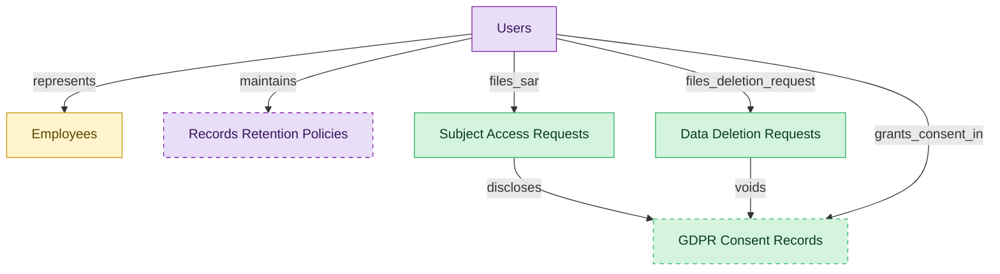

# Learner Data Privacy

## 1. Overview

Learner data privacy substrate that compliance training depends on: GDPR Article 6/7 consent capture, Article 15 subject access requests, and Article 17 right-to-erasure processing for training data. Carved out from LMS-COMPLIANCE-TRAINING because privacy obligations apply across the LMS even where statutory training is out of scope.

## 2. Entity summary

| Name | data_object | Description |
| --- | --- | --- |
| Data Deletion Requests | `data_deletion_requests` | Right-to-erasure requests under GDPR Article 17, covering scope, anonymization policy, regulator deadline, and fulfillment status. |
| GDPR Consent Records | `gdpr_consent_records` | Consent records for learner training data under GDPR, capturing purpose, lawful basis, and grant and withdrawal timestamps. |
| Subject Access Requests | `subject_access_requests` | Subject access request tickets under GDPR Article 15, tracking requester, scope, fulfillment status, and regulator deadline. |
| Employees | `employees` | Canonical records of people currently or formerly employed, carrying identity, employment metadata, and relationships to position, manager, and org unit. |
| Records Retention Policies | `records_retention_policies` | Legal hold and disposition rules per document class, with regulatory retention periods and scheduled destruction dates. |
| Users | `users` | Platform users referenced as assignees, authors, approvers, and creators across records. |

## 3. Entities catalog

| # | data_object | catalog code | singular | plural | held_as | mastered in | mastered label | install_optional | personal_content | entity_type | write tier | notes |
| ---: | --- | --- | --- | --- | --- | --- | --- | --- | --- | --- | --- | --- |
| 1 | `data_deletion_requests` | `data_deletion_requests` | Data Deletion Request | Data Deletion Requests | master | - | - | - | yes | operational_workflow | `:manage` | - |
| 2 | `gdpr_consent_records` | `gdpr_consent_records` | GDPR Consent Record | GDPR Consent Records | master | - | - | yes | yes | operational_workflow | `:manage` | - |
| 3 | `subject_access_requests` | `subject_access_requests` | Subject Access Request | Subject Access Requests | master | - | - | - | yes | operational_workflow | `:manage` | - |
| 4 | `employees` | `employees` | Employee | Employees | embedded_master | `hcm-core-worker` | Core Worker Record | - | yes | operational_workflow | `:manage` | - |
| 5 | `records_retention_policies` | `records_retention_policies` | Records Retention Policy | Records Retention Policies | consumer | `ecm-records-gov` | Records Management and Information Governance | yes | - | operational_workflow | `:manage` | - |
| 6 | `users` | `users` | User | Users | consumer | _(platform built-in)_ | _(platform built-in)_ | - | - | operational_record | `:manage` | - |

## 4. Aliases and industry synonyms

_(none: no industry-scoped aliases for this scope)_

## 5. Relationships

_`field_required` applies only when both entities are installed. It never makes an entity required._

### 5.1 Relationships between entities in this blueprint

| from | verb | to | cardinality | kind | field_required | delete_mode | fk_format | notes |
| --- | --- | --- | --- | --- | --- | --- | --- | --- |
| `subject_access_requests` | discloses | `gdpr_consent_records` | many_to_many | association | - | cascade | parent | - |
| `data_deletion_requests` | voids | `gdpr_consent_records` | many_to_many | association | - | cascade | parent | - |

### 5.2 Relationships to platform built-ins (`users`)

| from | verb | to | cardinality | field_required | delete_mode | fk_format | notes |
| --- | --- | --- | --- | --- | --- | --- | --- |
| `users` | represents | `employees` | one_to_one | no | clear | reference | - |
| `users` | maintains | `records_retention_policies` | one_to_many | no | clear | reference | - |
| `users` | grants_consent_in | `gdpr_consent_records` | one_to_many | yes | restrict | reference | - |
| `users` | files_sar | `subject_access_requests` | one_to_many | yes | restrict | reference | - |
| `users` | files_deletion_request | `data_deletion_requests` | one_to_many | yes | restrict | reference | - |

### 5.3 Relationships to entities outside this blueprint

_External entities are optional: this blueprint never installs them. If one exists at install, the relationship is proposed. A many-to-many relationship is listed under outgoing and proposed as a new junction table._

#### 5.3a Outgoing relationships: this blueprint's entity points to the external entity

| from | verb | to | cardinality | field_required | notes |
| --- | --- | --- | --- | --- | --- |
| `org_units` | groups | `employees` | one_to_many | yes | - |
| `survey_campaigns` | targets | `employees` | many_to_many | - | - |
| `case_categories` | drives | `employees` | one_to_many | no | - |
| `audit_findings` | reviews | `records_retention_policies` | many_to_many | - | - |
| `legal_holds` | identifies_custodians_from | `employees` | many_to_many | - | - |
| `legal_advice_records` | references | `employees` | many_to_many | - | - |
| `candidates` | becomes | `employees` | one_to_one | no | - |
| `pre_employees` | promotes to | `employees` | one_to_one | no | - |
| `contingent_workers` | converts_to | `employees` | one_to_one | no | - |

#### 5.3b Incoming relationships: the external entity points to this blueprint's entity

| from | verb | to | cardinality | field_required | notes |
| --- | --- | --- | --- | --- | --- |
| `employees` | signs | `employment_contracts` | one_to_many | yes | - |
| `employees` | generates | `employment_events` | one_to_many | yes | - |
| `employees` | triggers | `asset_lifecycle_events` | one_to_many | no | - |
| `employees` | requests | `absence_requests` | one_to_many | no | - |
| `employees` | holds | `skill_profiles` | one_to_one | no | - |
| `employees` | triggers | `service_requests` | one_to_many | no | - |
| `employees` | triggers | `iga_provisioning_events` | one_to_many | no | - |
| `employees` | triggers | `pay_runs` | one_to_many | no | - |
| `employees` | enrolls_in | `course_enrollments` | one_to_many | no | - |
| `employees` | becomes | `career_aspirations` | one_to_one | no | - |
| `employees` | becomes | `work_shifts` | one_to_many | no | - |
| `employees` | becomes | `compensation_statements` | one_to_one | no | - |
| `employees` | triggers | `benefit_enrollments` | one_to_many | no | - |
| `employees` | triggers | `corporate_cards` | one_to_many | no | - |
| `employees` | spawns | `onboarding_journeys` | one_to_one | no | - |
| `employees` | spawns | `hr_cases` | one_to_many | no | - |
| `employees` | feeds | `headcount_plans` | one_to_many | no | - |
| `employees` | feeds | `agency_time_entries` | one_to_many | no | - |
| `employees` | onboarded by | `onboarding_journeys` | one_to_many | yes | - |
| `employees` | fills | `hcm_positions` | one_to_one | no | - |
| `employees` | finalized by | `onboarding_document_collections` | one_to_many | no | - |
| `employees` | learns_via | `course_enrollments` | one_to_many | yes | - |
| `employees` | reflects | `learning_records` | one_to_many | no | - |
| `employees` | reflected on | `compliance_assignments` | one_to_many | no | - |
| `employees` | enrolls_in | `benefit_enrollments` | one_to_many | yes | - |
| `employees` | declares | `life_events` | one_to_many | no | - |
| `employees` | updated by | `life_events` | one_to_many | no | - |
| `employees` | submits | `survey_responses` | one_to_many | no | - |
| `employees` | flagged on | `engagement_drivers` | one_to_many | no | - |
| `employees` | reflected on | `engagement_drivers` | one_to_many | no | - |
| `employees` | raises | `hr_cases` | one_to_many | yes | - |
| `employees` | updated by | `hr_cases` | one_to_many | no | - |
| `employees` | is host for | `host_assignments` | one_to_many | yes | - |
| `employees` | reclassifies | `contingent_workers` | one_to_one | no | - |
| `records_retention_policies` | retains | `content_documents` | one_to_many | no | - |
| `records_retention_policies` | retains | `document_folders` | one_to_many | no | - |
| `records_retention_policies` | applies to classification | `document_classifications` | one_to_many | no | - |
| `records_retention_policies` | streams_disposition_to | `audit_engagements` | one_to_many | no | - |
| `employees` | receives | `merit_recommendations` | one_to_one | no | - |
| `employees` | holds | `equity_grants` | one_to_one | no | - |
| `employees` | receives | `compensation_statements` | one_to_one | no | - |
| `employees` | has | `emergency_contacts` | one_to_many | yes | - |
| `employees` | has | `work_eligibility_documents` | one_to_many | yes | - |
| `employees` | has | `national_ids` | one_to_many | yes | - |
| `employees` | has | `worker_addresses` | one_to_many | yes | - |
| `employees` | has | `employee_dependents` | one_to_many | yes | - |
| `employees` | has | `worker_change_requests` | one_to_many | yes | - |
| `employees` | applies_as | `candidates` | one_to_many | no | - |
| `employees` | is the worker behind | `traveler_profiles` | one_to_one | no | - |
| `employees` | is assessed by | `exit_risk_assessments` | one_to_one | no | - |
| `employees` | is subject of | `insider_risk_cases` | one_to_many | no | - |
| `employees` | is recognized in | `frontline_recognitions` | one_to_many | yes | - |
| `employees` | is enrolled as | `advocate_profiles` | one_to_one | yes | - |
| `employees` | receives | `incentive_awards` | one_to_many | yes | - |

## 6. Cross-domain context

### 6.1 Master consumers (other modules / domains that embed this scope's masters)

_(none: no other module embeds this scope's masters)_

### 6.2 Outbound handoffs (events this scope publishes)

_(none: no outbound handoffs whose payload is in this scope)_

### 6.3 Inbound handoffs (events this scope reacts to)

_(none: no inbound handoffs whose payload is in this scope)_

### 6.4 Master providers (modules / domains that own masters this scope embeds)

| data_object | held_as | install_optional | catalog owner(s) | slice notes |
| --- | --- | --- | --- | --- |
| `employees` | embedded_master | - | HCM-CORE-WORKER (HCM) | - |
| `records_retention_policies` | consumer | yes | ECM-RECORDS-GOV (ECM) | - |
| `users` | consumer | - | _(platform built-in)_ | - |

## 7. Lifecycle states

### `data_deletion_requests` (Data Deletion Request)

| order | state_name | initial? | terminal? | realizing module | requires_permission? | high risk? | derived gate | description |
| --- | --- | --- | --- | --- | --- | --- | --- | --- |
| 1 | `received` | ✓ | - | `LMS-CT-GDPR` | - | - | - | - |
| 2 | `in_progress` | - | - | `LMS-CT-GDPR` | - | - | - | - |
| 3 | `fulfilled` | - | ✓ | `LMS-CT-GDPR` | ✓ | - | `lms-ct-gdpr:fulfill` | - |
| 4 | `declined` | - | ✓ | `LMS-CT-GDPR` | ✓ | - | `lms-ct-gdpr:decline` | - |

### `employees` (Employee)

_This scope holds `employees` as **embedded_master**; the canonical state machine is owned by `HCM-CORE-WORKER`._

| order | state_name | initial? | terminal? | realizing module | requires_permission? | high risk? | derived gate | description |
| --- | --- | --- | --- | --- | --- | --- | --- | --- |
| 1 | `draft` | ✓ | - | `HCM-CORE-WORKER` | - | - | - | Pre-hire stub created during requisition or onboarding handoff; not yet a worker of record. |
| 2 | `active` | - | - | `HCM-CORE-WORKER` | ✓ | - | `hcm-core-worker:active_employee` | Worker is currently employed and appears in headcount, payroll eligibility, and directory feeds. |
| 3 | `on_leave` | - | - | `HCM-CORE-WORKER` | ✓ | - | `hcm-core-worker:on_leave_employee` | Employee is on approved leave (parental, medical, sabbatical); active record but suppressed from some downstream feeds. |
| 4 | `suspended` | - | - | `HCM-CORE-WORKER` | ✓ | - | `hcm-core-worker:suspended_employee` | Employment temporarily halted (investigation, disciplinary); pay and access may be paused. |
| 5 | `terminated` | - | ✓ | `HCM-CORE-WORKER` | ✓ | - | `hcm-core-worker:terminated_employee` | Employment ended (voluntary or involuntary); final pay processed, access deprovisioned. |

### `gdpr_consent_records` (GDPR Consent Record)

| order | state_name | initial? | terminal? | realizing module | requires_permission? | high risk? | derived gate | description |
| --- | --- | --- | --- | --- | --- | --- | --- | --- |
| 1 | `granted` | ✓ | - | `LMS-CT-GDPR` | - | - | - | - |
| 2 | `withdrawn` | - | ✓ | `LMS-CT-GDPR` | ✓ | - | `lms-ct-gdpr:withdraw` | - |
| 3 | `expired` | - | ✓ | `LMS-CT-GDPR` | - | - | - | - |

### `subject_access_requests` (Subject Access Request)

| order | state_name | initial? | terminal? | realizing module | requires_permission? | high risk? | derived gate | description |
| --- | --- | --- | --- | --- | --- | --- | --- | --- |
| 1 | `received` | ✓ | - | `LMS-CT-GDPR` | - | - | - | - |
| 2 | `in_progress` | - | - | `LMS-CT-GDPR` | - | - | - | - |
| 3 | `fulfilled` | - | - | `LMS-CT-GDPR` | ✓ | - | `lms-ct-gdpr:fulfill` | - |
| 4 | `closed` | - | ✓ | `LMS-CT-GDPR` | ✓ | - | `lms-ct-gdpr:close` | - |

## 8. Permissions and business rules (derived)

### 8.1 Permissions

| permission | tier | description | included in `:admin`? |
| --- | --- | --- | --- |
| `lms-ct-gdpr:read` | baseline-read | Read access to every entity in the module | ✓ |
| `lms-ct-gdpr:manage` | baseline-manage | Edit operational records | ✓ |
| `lms-ct-gdpr:admin` | baseline-admin | Edit reference data and inherit every workflow gate below | - |
| `hcm-core-worker:read_employees` | entity-read | Read Employees | ✓ |
| `hcm-core-worker:write_employees` | entity-write | Write Employees | ✓ |
| `ecm-records-gov:read_records_retention_policies` | entity-read | Read Records Retention Policies | ✓ |
| `lms-ct-gdpr:read_gdpr_consent_records` | entity-read | Read GDPR Consent Records | ✓ |
| `lms-ct-gdpr:write_gdpr_consent_records` | entity-write | Write GDPR Consent Records | ✓ |
| `lms-ct-gdpr:read_subject_access_requests` | entity-read | Read Subject Access Requests | ✓ |
| `lms-ct-gdpr:write_subject_access_requests` | entity-write | Write Subject Access Requests | ✓ |
| `lms-ct-gdpr:read_data_deletion_requests` | entity-read | Read Data Deletion Requests | ✓ |
| `lms-ct-gdpr:write_data_deletion_requests` | entity-write | Write Data Deletion Requests | ✓ |
| `hcm-core-worker:active_employee` | workflow-gate (lifecycle) | Transition `employees` into state `active` | ✓ |
| `hcm-core-worker:on_leave_employee` | workflow-gate (lifecycle) | Transition `employees` into state `on_leave` | ✓ |
| `hcm-core-worker:suspended_employee` | workflow-gate (lifecycle) | Transition `employees` into state `suspended` | ✓ |
| `hcm-core-worker:terminated_employee` | workflow-gate (lifecycle) | Transition `employees` into state `terminated` | ✓ |
| `lms-ct-gdpr:withdraw` | workflow-gate (lifecycle) | Transition `gdpr_consent_records` into state `withdrawn` | ✓ |
| `lms-ct-gdpr:fulfill` | workflow-gate (lifecycle) | Transition `subject_access_requests` into state `fulfilled` or `data_deletion_requests` into state `fulfilled` | ✓ |
| `lms-ct-gdpr:close` | workflow-gate (lifecycle) | Transition `subject_access_requests` into state `closed` | ✓ |
| `lms-ct-gdpr:decline` | workflow-gate (lifecycle) | Transition `data_deletion_requests` into state `declined` | ✓ |
| `hcm-core-worker:view_all_employees` | override (personal_content) | View all `employees` rows beyond row-scope | ✓ |
| `hcm-core-worker:manage_all_employees` | override (personal_content) | Manage all `employees` rows beyond row-scope | ✓ |
| `lms-ct-gdpr:view_all_gdpr_consent_records` | override (personal_content) | View all `gdpr_consent_records` rows beyond row-scope | ✓ |
| `lms-ct-gdpr:manage_all_gdpr_consent_records` | override (personal_content) | Manage all `gdpr_consent_records` rows beyond row-scope | ✓ |
| `lms-ct-gdpr:view_all_subject_access_requests` | override (personal_content) | View all `subject_access_requests` rows beyond row-scope | ✓ |
| `lms-ct-gdpr:manage_all_subject_access_requests` | override (personal_content) | Manage all `subject_access_requests` rows beyond row-scope | ✓ |
| `lms-ct-gdpr:view_all_data_deletion_requests` | override (personal_content) | View all `data_deletion_requests` rows beyond row-scope | ✓ |
| `lms-ct-gdpr:manage_all_data_deletion_requests` | override (personal_content) | Manage all `data_deletion_requests` rows beyond row-scope | ✓ |

_Gates with no process: `hcm-core-worker:suspended_employee`, `lms-ct-gdpr:withdraw`, `lms-ct-gdpr:fulfill`, `lms-ct-gdpr:close`, `lms-ct-gdpr:decline`. No Accountable can hold them, so this blueprint does not support `raci`._

### 8.2 Business rules

| rule_name | data_object | source flag | intent |
| --- | --- | --- | --- |
| `employee_edit_scope` | `employees` | has_personal_content | Row-scope by default; override via `hcm-core-worker:view_all_employees` / `hcm-core-worker:manage_all_employees` |
| `gdpr_consent_record_edit_scope` | `gdpr_consent_records` | has_personal_content | Row-scope by default; override via `lms-ct-gdpr:view_all_gdpr_consent_records` / `lms-ct-gdpr:manage_all_gdpr_consent_records` |
| `subject_access_request_edit_scope` | `subject_access_requests` | has_personal_content | Row-scope by default; override via `lms-ct-gdpr:view_all_subject_access_requests` / `lms-ct-gdpr:manage_all_subject_access_requests` |
| `data_deletion_request_edit_scope` | `data_deletion_requests` | has_personal_content | Row-scope by default; override via `lms-ct-gdpr:view_all_data_deletion_requests` / `lms-ct-gdpr:manage_all_data_deletion_requests` |

## 9. Roles, RACI, and responsibilities (derived)

_Baseline roles, the permission hierarchy, and RACI realization are DERIVED from this scope's entity-type write tiers + `process_raci`; none of it is stored in the catalog (the deployer provisions it from this blueprint)._

### 9.1 `LMS-CT-GDPR`

**Baseline roles:**

| role | baseline grant |
| --- | --- |
| `lms-ct-gdpr_viewer` | `lms-ct-gdpr:read` |
| `lms-ct-gdpr_manager` | `lms-ct-gdpr:manage` |
| `lms-ct-gdpr_admin` | `lms-ct-gdpr:admin` |

**Permission hierarchy:**

| permission | includes |
| --- | --- |
| `lms-ct-gdpr:admin` | `lms-ct-gdpr:manage` |
| `lms-ct-gdpr:manage` | `lms-ct-gdpr:read` |
| `lms-ct-gdpr:read` | `hcm-core-worker:read_employees` |
| `lms-ct-gdpr:read` | `ecm-records-gov:read_records_retention_policies` |
| `lms-ct-gdpr:read` | `lms-ct-gdpr:read_gdpr_consent_records` |
| `lms-ct-gdpr:read` | `lms-ct-gdpr:read_subject_access_requests` |
| `lms-ct-gdpr:read` | `lms-ct-gdpr:read_data_deletion_requests` |
| `lms-ct-gdpr:manage` | `hcm-core-worker:write_employees` |
| `hcm-core-worker:write_employees` | `hcm-core-worker:read_employees` |
| `lms-ct-gdpr:manage` | `lms-ct-gdpr:write_gdpr_consent_records` |
| `lms-ct-gdpr:write_gdpr_consent_records` | `lms-ct-gdpr:read_gdpr_consent_records` |
| `lms-ct-gdpr:manage` | `lms-ct-gdpr:write_subject_access_requests` |
| `lms-ct-gdpr:write_subject_access_requests` | `lms-ct-gdpr:read_subject_access_requests` |
| `lms-ct-gdpr:manage` | `lms-ct-gdpr:write_data_deletion_requests` |
| `lms-ct-gdpr:write_data_deletion_requests` | `lms-ct-gdpr:read_data_deletion_requests` |
| `lms-ct-gdpr:admin` | `hcm-core-worker:active_employee` |
| `lms-ct-gdpr:admin` | `hcm-core-worker:on_leave_employee` |
| `lms-ct-gdpr:admin` | `hcm-core-worker:suspended_employee` |
| `lms-ct-gdpr:admin` | `hcm-core-worker:terminated_employee` |
| `lms-ct-gdpr:admin` | `lms-ct-gdpr:withdraw` |
| `lms-ct-gdpr:admin` | `lms-ct-gdpr:fulfill` |
| `lms-ct-gdpr:admin` | `lms-ct-gdpr:close` |
| `lms-ct-gdpr:admin` | `lms-ct-gdpr:decline` |
| `lms-ct-gdpr:admin` | `hcm-core-worker:view_all_employees` |
| `lms-ct-gdpr:admin` | `hcm-core-worker:manage_all_employees` |
| `lms-ct-gdpr:admin` | `lms-ct-gdpr:view_all_gdpr_consent_records` |
| `lms-ct-gdpr:admin` | `lms-ct-gdpr:manage_all_gdpr_consent_records` |
| `lms-ct-gdpr:admin` | `lms-ct-gdpr:view_all_subject_access_requests` |
| `lms-ct-gdpr:admin` | `lms-ct-gdpr:manage_all_subject_access_requests` |
| `lms-ct-gdpr:admin` | `lms-ct-gdpr:view_all_data_deletion_requests` |
| `lms-ct-gdpr:admin` | `lms-ct-gdpr:manage_all_data_deletion_requests` |

**Processes wired:**

| process_key | process_name | PCF code | PCF ID | level | description |
| --- | --- | --- | --- | --- | --- |
| `manage_maintain_employee_data` | Manage and maintain employee data | 7.7.3 | 10524 | 3 | Capturing and updating employee information and data and information on the employees. |
| `manage_leave_absence` | Manage leave of absence | 7.6.2.2 | 10515 | 4 | Managing the period of time that an employee must be away from their primary job, while maintaining the status of employee (i.e., paid and unpaid leave of absence but not vacations, holidays, hiatuses, sabbaticals, and work-from-home programs). |
| `manage_separation` | Manage separation | 7.6.2 | 10513 | 3 | Managing the process of employee separation, including leaves of absence, resignations, discharges, and layoffs. Inform the employee of the termination. Complete paperwork for continuation of benefits. Enter employment status change into system. |

**RACI realization:**

| actor | kind | raci | process_key | realization |
| --- | --- | --- | --- | --- |
| `HR-PEOPLE-OPS-SPECIALIST` | persona | responsible | `manage_maintain_employee_data` | the gated entities' write tier |
| `HR-BUSINESS-PARTNER` | persona | accountable | `manage_maintain_employee_data` | grant gates [hcm-core-worker:active_employee] + the gated entities' write tier |
| `HR-HRIS-ADMIN` | persona | consulted | `manage_maintain_employee_data` | advisory read grant |
| `PEOPLE-MANAGER` | persona | informed | `manage_maintain_employee_data` | notify on trigger_events [employee.applied_internally] |
| `HR-PEOPLE-OPS-SPECIALIST` | persona | responsible | `manage_leave_absence` | the gated entities' write tier |
| `PEOPLE-MANAGER` | persona | accountable | `manage_leave_absence` | grant gates [hcm-core-worker:on_leave_employee] + the gated entities' write tier |
| `HR-BUSINESS-PARTNER` | persona | consulted | `manage_leave_absence` | blocking consultation state |
| `HR-HRIS-ADMIN` | persona | informed | `manage_leave_absence` | ⚠ no event wired |
| `HR-PEOPLE-OPS-SPECIALIST` | persona | responsible | `manage_separation` | the gated entities' write tier |
| `HR-BUSINESS-PARTNER` | persona | accountable | `manage_separation` | grant gates [hcm-core-worker:terminated_employee] + the gated entities' write tier |
| `PEOPLE-MANAGER` | persona | consulted | `manage_separation` | advisory read grant |
| `HR-HRIS-ADMIN` | persona | informed | `manage_separation` | notify on trigger_events [employee.terminated] |

### 9.2 Functional ownership and default grants

| responsibility | business function | default role | default tier |
| --- | --- | --- | --- |
| owner | Learning and Development | `admin` | `:admin` |
| contributor | Governance, Risk and Compliance | `manager` | `:manage` |
| contributor | Legal | `manager` | `:manage` |
| consumer | Manufacturing Operations | `viewer` | `:read` |
| consumer | Sales | `viewer` | `:read` |
| consumer | Software Engineering | `viewer` | `:read` |
