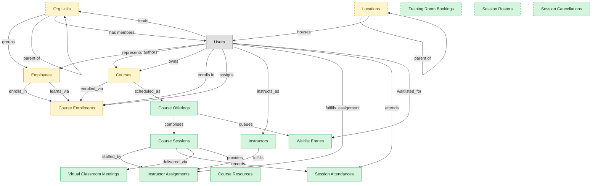

# Instructor-Led and Virtual-Instructor-Led Training

## 1. Overview

Scheduled course delivery: offerings and sessions, instructor assignments, attendance capture (OSHA evidence substrate), waitlist management, virtual-classroom integration, and per-session resources. Structurally distinct from evergreen e-learning in LMS-COURSE-DELIVERY because it carries its own cardinality (course -> many offerings -> many sessions), its own roles (instructors are not learners), and its own per-session compliance footprint.

## 2. Entity summary

| Name | data_object | Description |
| --- | --- | --- |
| Course Offerings | `course_offerings` | Scheduled instances of a course, with date range, location, capacity, language, and delivery mode. |
| Course Resources | `course_resources` | Handouts, supplementary materials, and pre-reads attached to a course offering or session. |
| Course Sessions | `course_sessions` | Individual sessions within a multi-day offering, with per-session attendance and instructor assignment. |
| Instructor Assignments | `instructor_assignments` | Assignments of an instructor to a session or offering, with role such as primary, assistant, or observer. |
| Instructors | `instructors` | Instructor records covering internal trainers, contracted experts, and external vendor instructors, kept separate from employees. |
| Session Attendances | `session_attendances` | Per-session attendance roster rows for each learner, serving as evidence of completed required workplace training. |
| Session Cancellations | `session_cancellations` | Cancellation or no-show records for an instructor-led session, used to drive waitlist promotion. |
| Session Rosters | `session_rosters` | Pre-session enrollment snapshots for an instructor-led session, used as the basis for attendance proof. |
| Training Room Bookings | `training_room_bookings` | Reservations of a physical or virtual room and its resources for an instructor-led session. |
| Virtual Classroom Meetings | `virtual_classroom_meetings` | Links to external video meetings for a virtual session, carrying the join URL and recording reference. |
| Waitlist Entries | `waitlist_entries` | Capacity overflow queue for a course offering, with priority order and a notify-on-seat-open policy. |
| Course Enrollments | `course_enrollments` | Per-learner per-course records tracking assigned and due dates, attempts, status, and score. |
| Courses | `courses` | Learning units such as e-learning modules, videos, live sessions, or blended programs, with format, duration, and prerequisites. |
| Employees | `employees` | Canonical records of people currently or formerly employed, carrying identity, employment metadata, and relationships to position, manager, and org unit. |
| Locations | `locations` | Physical or organizational locations referenced across the system, used to place and group other records. |
| Org Units | `org_units` | Nodes in the organizational hierarchy such as divisions, departments, and teams, with manager, cost center alignment, geographic scope, and parent-child relationships. |

## 3. Entities catalog

| # | data_object | catalog code | singular | plural | held_as | mastered in | mastered label | install_optional | personal_content | entity_type | write tier | notes |
| ---: | --- | --- | --- | --- | --- | --- | --- | --- | --- | --- | --- | --- |
| 1 | `course_offerings` | `course_offerings` | Course Offering | Course Offerings | master | - | - | - | - | operational_workflow | `:manage` | - |
| 2 | `course_resources` | `course_resources` | Course Resource | Course Resources | master | - | - | - | - | catalog | `:admin` | - |
| 3 | `course_sessions` | `course_sessions` | Course Session | Course Sessions | master | - | - | - | - | operational_workflow | `:manage` | - |
| 4 | `instructor_assignments` | `instructor_assignments` | Instructor Assignment | Instructor Assignments | master | - | - | - | - | operational_workflow | `:manage` | - |
| 5 | `instructors` | `instructors` | Instructor | Instructors | master | - | - | - | yes | operational_workflow | `:manage` | - |
| 6 | `session_attendances` | `session_attendances` | Session Attendance | Session Attendances | master | - | - | - | yes | operational_record | `:manage` | - |
| 7 | `session_cancellations` | `session_cancellations` | Session Cancellation | Session Cancellations | master | - | - | yes | yes | operational_record | `:manage` | - |
| 8 | `session_rosters` | `session_rosters` | Session Roster | Session Rosters | master | - | - | yes | yes | operational_record | `:manage` | - |
| 9 | `training_room_bookings` | `training_room_bookings` | Training Room Booking | Training Room Bookings | master | - | - | yes | yes | operational_workflow | `:manage` | - |
| 10 | `virtual_classroom_meetings` | `virtual_classroom_meetings` | Virtual Classroom Meeting | Virtual Classroom Meetings | master | - | - | - | - | operational_workflow | `:manage` | - |
| 11 | `waitlist_entries` | `waitlist_entries` | Waitlist Entry | Waitlist Entries | master | - | - | - | yes | operational_workflow | `:manage` | - |
| 12 | `course_enrollments` | `course_enrollments` | Course Enrollment | Course Enrollments | embedded_master | `lms-course-delivery` | Course Delivery | - | yes | operational_workflow | `:manage` | - |
| 13 | `courses` | `courses` | Course | Courses | embedded_master | `lms-course-delivery` | Course Delivery | - | - | operational_workflow | `:manage` | - |
| 14 | `employees` | `employees` | Employee | Employees | embedded_master | `hcm-core-worker` | Core Worker Record | - | yes | operational_workflow | `:manage` | - |
| 15 | `locations` | `locations` | Location | Locations | embedded_master | `iwms-location-master` | Location and Property Master | yes | - | catalog | `:admin` | - |
| 16 | `org_units` | `org_units` | Org Unit | Org Units | embedded_master | `hcm-org-positions` | Organization and Position Management | yes | - | operational_workflow | `:manage` | - |

## 4. Aliases and industry synonyms

_(none: no industry-scoped aliases for this scope)_

## 5. Relationships

_`field_required` applies only when both entities are installed. It never makes an entity required._

### 5.1 Relationships between entities in this blueprint

| from | verb | to | cardinality | kind | field_required | delete_mode | fk_format | notes |
| --- | --- | --- | --- | --- | --- | --- | --- | --- |
| `org_units` | groups | `employees` | one_to_many | reference | yes | restrict | reference | - |
| `employees` | enrolls_in | `course_enrollments` | one_to_many | reference | no | clear | reference | - |
| `courses` | enrolled_via | `course_enrollments` | one_to_many | reference | yes | restrict | reference | - |
| `employees` | learns_via | `course_enrollments` | one_to_many | reference | yes | restrict | reference | - |
| `org_units` | parent of | `org_units` | one_to_many | reference | no | clear | reference | - |
| `locations` | parent of | `locations` | one_to_many | reference | no | clear | reference | - |
| `courses` | scheduled_as | `course_offerings` | one_to_many | reference | no | clear | reference | - |
| `course_offerings` | comprises | `course_sessions` | one_to_many | composition | yes | cascade | parent | - |
| `course_sessions` | staffed_by | `instructor_assignments` | one_to_many | reference | no | clear | reference | - |
| `instructors` | fulfills | `instructor_assignments` | one_to_many | reference | no | clear | reference | - |
| `course_sessions` | records | `session_attendances` | one_to_many | composition | yes | cascade | parent | - |
| `course_offerings` | queues | `waitlist_entries` | one_to_many | composition | yes | cascade | parent | - |
| `course_sessions` | delivered_via | `virtual_classroom_meetings` | one_to_many | reference | no | clear | reference | - |
| `course_sessions` | provides | `course_resources` | many_to_many | association | - | cascade | parent | - |

### 5.2 Relationships to platform built-ins (`users`)

| from | verb | to | cardinality | field_required | delete_mode | fk_format | notes |
| --- | --- | --- | --- | --- | --- | --- | --- |
| `users` | represents | `employees` | one_to_one | no | clear | reference | - |
| `users` | leads | `org_units` | one_to_many | no | clear | reference | - |
| `users` | authors | `courses` | one_to_many | no | clear | reference | - |
| `users` | owns | `courses` | one_to_many | no | clear | reference | - |
| `users` | enrolls in | `course_enrollments` | one_to_many | yes | restrict | reference | - |
| `users` | assigns | `course_enrollments` | one_to_many | no | clear | reference | - |
| `org_units` | has members | `users` | one_to_many | no | clear | reference | - |
| `locations` | houses | `users` | one_to_many | no | clear | reference | - |
| `users` | instructs_as | `instructors` | one_to_many | no | clear | reference | - |
| `users` | fulfills_assignment | `instructor_assignments` | one_to_many | no | clear | reference | - |
| `users` | attends | `session_attendances` | one_to_many | yes | restrict | reference | - |
| `users` | waitlisted_for | `waitlist_entries` | one_to_many | yes | restrict | reference | - |

### 5.3 Relationships to entities outside this blueprint

_External entities are optional: this blueprint never installs them. If one exists at install, the relationship is proposed. A many-to-many relationship is listed under outgoing and proposed as a new junction table._

#### 5.3a Outgoing relationships: this blueprint's entity points to the external entity

| from | verb | to | cardinality | field_required | notes |
| --- | --- | --- | --- | --- | --- |
| `cost_centers` | funds | `org_units` | one_to_many | yes | - |
| `job_profiles` | maps_to | `courses` | many_to_many | - | - |
| `onboarding_tasks` | spawns | `course_enrollments` | one_to_many | no | - |
| `courses` | sequenced_into | `learning_paths` | many_to_many | - | - |
| `skill_profiles` | updated by | `course_enrollments` | one_to_many | no | - |
| `cost_centers` | funds | `course_enrollments` | one_to_many | no | - |
| `org_units` | sponsors | `benefit_plans` | many_to_many | - | - |
| `survey_campaigns` | targets | `employees` | many_to_many | - | - |
| `survey_campaigns` | targets | `org_units` | many_to_many | - | - |
| `case_categories` | drives | `employees` | one_to_many | no | - |
| `legal_holds` | identifies_custodians_from | `employees` | many_to_many | - | - |
| `legal_advice_records` | references | `employees` | many_to_many | - | - |
| `candidates` | becomes | `employees` | one_to_one | no | - |
| `pre_employees` | promotes to | `employees` | one_to_one | no | - |
| `courses` | classified_as | `course_categories` | many_to_many | - | - |
| `courses` | tagged_with | `course_tags` | many_to_many | - | - |
| `course_catalogs` | lists | `courses` | many_to_many | - | - |
| `courses` | grants | `certification_definitions` | many_to_many | - | - |
| `courses` | yields_credits_via | `continuing_education_credits` | many_to_many | - | - |
| `learning_path_steps` | references | `courses` | one_to_many | no | - |
| `automated_enrollment_rules` | creates | `course_enrollments` | one_to_many | no | - |
| `contingent_workers` | converts_to | `employees` | one_to_one | no | - |

#### 5.3b Incoming relationships: the external entity points to this blueprint's entity

| from | verb | to | cardinality | field_required | notes |
| --- | --- | --- | --- | --- | --- |
| `org_units` | contains | `hcm_positions` | one_to_many | yes | - |
| `employees` | signs | `employment_contracts` | one_to_many | yes | - |
| `employees` | generates | `employment_events` | one_to_many | yes | - |
| `employees` | triggers | `asset_lifecycle_events` | one_to_many | no | - |
| `employees` | requests | `absence_requests` | one_to_many | no | - |
| `employees` | holds | `skill_profiles` | one_to_one | no | - |
| `org_units` | engages | `contingent_workers` | one_to_many | no | - |
| `org_units` | is_scored_by | `engagement_drivers` | one_to_many | no | - |
| `org_units` | is_measured_by | `people_kpis` | one_to_many | no | - |
| `employees` | triggers | `service_requests` | one_to_many | no | - |
| `employees` | triggers | `iga_provisioning_events` | one_to_many | no | - |
| `org_units` | triggers | `iga_entitlement_definitions` | one_to_many | no | - |
| `employees` | triggers | `pay_runs` | one_to_many | no | - |
| `employees` | becomes | `career_aspirations` | one_to_one | no | - |
| `employees` | becomes | `work_shifts` | one_to_many | no | - |
| `employees` | becomes | `compensation_statements` | one_to_one | no | - |
| `employees` | triggers | `benefit_enrollments` | one_to_many | no | - |
| `org_units` | maps_to | `cost_centers` | one_to_one | no | - |
| `employees` | triggers | `corporate_cards` | one_to_many | no | - |
| `employees` | spawns | `onboarding_journeys` | one_to_one | no | - |
| `employees` | spawns | `hr_cases` | one_to_many | no | - |
| `employees` | feeds | `headcount_plans` | one_to_many | no | - |
| `employees` | feeds | `agency_time_entries` | one_to_many | no | - |
| `employees` | onboarded by | `onboarding_journeys` | one_to_many | yes | - |
| `employees` | fills | `hcm_positions` | one_to_one | no | - |
| `employees` | finalized by | `onboarding_document_collections` | one_to_many | no | - |
| `course_enrollments` | produces | `learning_records` | one_to_many | yes | - |
| `courses` | fulfills | `compliance_assignments` | one_to_many | no | - |
| `courses` | grants | `learner_certifications` | one_to_many | no | - |
| `org_units` | sponsors | `compliance_assignments` | one_to_many | no | - |
| `employees` | reflects | `learning_records` | one_to_many | no | - |
| `employees` | reflected on | `compliance_assignments` | one_to_many | no | - |
| `course_enrollments` | updates | `career_aspirations` | one_to_many | no | - |
| `employees` | enrolls_in | `benefit_enrollments` | one_to_many | yes | - |
| `employees` | declares | `life_events` | one_to_many | no | - |
| `employees` | updated by | `life_events` | one_to_many | no | - |
| `org_units` | owns | `action_plans` | one_to_many | no | - |
| `employees` | submits | `survey_responses` | one_to_many | no | - |
| `employees` | flagged on | `engagement_drivers` | one_to_many | no | - |
| `employees` | reflected on | `engagement_drivers` | one_to_many | no | - |
| `employees` | raises | `hr_cases` | one_to_many | yes | - |
| `employees` | updated by | `hr_cases` | one_to_many | no | - |
| `employees` | is host for | `host_assignments` | one_to_many | yes | - |
| `employees` | reclassifies | `contingent_workers` | one_to_one | no | - |
| `locations` | hosts_desk_bookings | `desk_bookings` | one_to_many | yes | - |
| `locations` | hosts_room_reservations | `room_reservations` | one_to_many | yes | - |
| `locations` | site_of_service_requests | `workplace_service_requests` | one_to_many | yes | - |
| `locations` | measured_by_reports | `space_utilization_reports` | one_to_many | yes | - |
| `locations` | subject_of_feedback | `workplace_experience_feedback` | one_to_many | no | - |
| `courses` | has_version | `course_versions` | one_to_many | yes | - |
| `course_enrollments` | yields | `course_completions` | one_to_many | yes | - |
| `courses` | reviewed_via | `course_reviews` | one_to_many | no | - |
| `courses` | rated_via | `course_ratings` | one_to_many | no | - |
| `courses` | discussed_in | `course_discussions` | one_to_many | no | - |
| `employees` | receives | `merit_recommendations` | one_to_one | no | - |
| `employees` | holds | `equity_grants` | one_to_one | no | - |
| `employees` | receives | `compensation_statements` | one_to_one | no | - |
| `employees` | has | `emergency_contacts` | one_to_many | yes | - |
| `employees` | has | `work_eligibility_documents` | one_to_many | yes | - |
| `employees` | has | `national_ids` | one_to_many | yes | - |
| `employees` | has | `worker_addresses` | one_to_many | yes | - |
| `employees` | has | `employee_dependents` | one_to_many | yes | - |
| `employees` | has | `worker_change_requests` | one_to_many | yes | - |
| `employees` | applies_as | `candidates` | one_to_many | no | - |
| `employees` | is the worker behind | `traveler_profiles` | one_to_one | no | - |
| `employees` | is assessed by | `exit_risk_assessments` | one_to_one | no | - |
| `employees` | is subject of | `insider_risk_cases` | one_to_many | no | - |
| `employees` | is recognized in | `frontline_recognitions` | one_to_many | yes | - |
| `employees` | is enrolled as | `advocate_profiles` | one_to_one | yes | - |
| `employees` | receives | `incentive_awards` | one_to_many | yes | - |

## 6. Cross-domain context

### 6.1 Master consumers (other modules / domains that embed this scope's masters)

_(none: no other module embeds this scope's masters)_

### 6.2 Outbound handoffs (events this scope publishes)

_(none: no outbound handoffs whose payload is in this scope)_

### 6.3 Inbound handoffs (events this scope reacts to)

_(none: no inbound handoffs whose payload is in this scope)_

### 6.4 Master providers (modules / domains that own masters this scope embeds)

| data_object | held_as | install_optional | catalog owner(s) | slice notes |
| --- | --- | --- | --- | --- |
| `course_enrollments` | embedded_master | - | LMS-COURSE-DELIVERY (LMS) | - |
| `courses` | embedded_master | - | LMS-COURSE-DELIVERY (LMS) | - |
| `employees` | embedded_master | - | HCM-CORE-WORKER (HCM) | - |
| `locations` | embedded_master | yes | IWMS-LOCATION-MASTER (IWMS) | - |
| `org_units` | embedded_master | yes | HCM-ORG-POSITIONS (HCM) | - |

## 7. Lifecycle states

### `course_enrollments` (Course Enrollment)

_This scope holds `course_enrollments` as **embedded_master**; the canonical state machine is owned by `LMS-COURSE-DELIVERY`._

| order | state_name | initial? | terminal? | realizing module | requires_permission? | high risk? | derived gate | description |
| --- | --- | --- | --- | --- | --- | --- | --- | --- |
| 1 | `enrolled` | ✓ | - | _(always)_ | - | - | - | Learner enrolled in the course but has not started. |
| 2 | `in_progress` | - | - | _(always)_ | - | - | - | Learner has begun the course content or activities. |
| 3 | `completed` | - | ✓ | `LMS-COURSE-DELIVERY` | ✓ | - | `lms-course-delivery:complete` | Learner met all completion criteria with a passing score. |
| 4 | `failed` | - | ✓ | `LMS-COURSE-DELIVERY` | ✓ | - | `lms-course-delivery:fail` | Learner did not meet the passing criteria within allowed attempts. |
| 5 | `expired` | - | ✓ | `LMS-COURSE-DELIVERY` | ✓ | - | `lms-course-delivery:expire` | Enrollment closed unmet at the due date or content expiry. |
| 6 | `withdrawn` | - | ✓ | `LMS-COURSE-DELIVERY` | ✓ | - | `lms-course-delivery:withdraw` | Learner withdrew or was unenrolled before completion. |

### `course_offerings` (Course Offering)

| order | state_name | initial? | terminal? | realizing module | requires_permission? | high risk? | derived gate | description |
| --- | --- | --- | --- | --- | --- | --- | --- | --- |
| 1 | `scheduled` | ✓ | - | `LMS-ILT-DELIVERY` | - | - | - | - |
| 2 | `open_for_enrollment` | - | - | `LMS-ILT-DELIVERY` | ✓ | - | `lms-ilt-delivery:open` | - |
| 3 | `in_progress` | - | - | `LMS-ILT-DELIVERY` | - | - | - | - |
| 4 | `completed` | - | ✓ | `LMS-ILT-DELIVERY` | ✓ | - | `lms-ilt-delivery:complete` | - |
| 5 | `canceled` | - | ✓ | `LMS-ILT-DELIVERY` | ✓ | - | `lms-ilt-delivery:cancel` | - |

### `course_sessions` (Course Session)

| order | state_name | initial? | terminal? | realizing module | requires_permission? | high risk? | derived gate | description |
| --- | --- | --- | --- | --- | --- | --- | --- | --- |
| 1 | `scheduled` | ✓ | - | `LMS-ILT-DELIVERY` | - | - | - | - |
| 2 | `in_progress` | - | - | `LMS-ILT-DELIVERY` | - | - | - | - |
| 3 | `completed` | - | ✓ | `LMS-ILT-DELIVERY` | ✓ | - | `lms-ilt-delivery:complete` | - |
| 4 | `canceled` | - | ✓ | `LMS-ILT-DELIVERY` | ✓ | - | `lms-ilt-delivery:cancel` | - |

### `courses` (Course)

_This scope holds `courses` as **embedded_master**; the canonical state machine is owned by `LMS-COURSE-DELIVERY`._

| order | state_name | initial? | terminal? | realizing module | requires_permission? | high risk? | derived gate | description |
| --- | --- | --- | --- | --- | --- | --- | --- | --- |
| 1 | `draft` | ✓ | - | _(always)_ | - | - | - | Course being authored by an instructional designer or SME. |
| 2 | `in_review` | - | - | _(always)_ | - | - | - | Content under review by L&D or compliance reviewers. |
| 3 | `published` | - | - | `LMS-COURSE-DELIVERY` | ✓ | - | `lms-course-delivery:publish` | Course released to the catalog and available for enrollment. |
| 4 | `retired` | - | ✓ | `LMS-COURSE-DELIVERY` | ✓ | - | `lms-course-delivery:retire` | Course removed from the catalog and kept for historical transcripts. |

### `employees` (Employee)

_This scope holds `employees` as **embedded_master**; the canonical state machine is owned by `HCM-CORE-WORKER`._

| order | state_name | initial? | terminal? | realizing module | requires_permission? | high risk? | derived gate | description |
| --- | --- | --- | --- | --- | --- | --- | --- | --- |
| 1 | `draft` | ✓ | - | `HCM-CORE-WORKER` | - | - | - | Pre-hire stub created during requisition or onboarding handoff; not yet a worker of record. |
| 2 | `active` | - | - | `HCM-CORE-WORKER` | ✓ | - | `hcm-core-worker:active_employee` | Worker is currently employed and appears in headcount, payroll eligibility, and directory feeds. |
| 3 | `on_leave` | - | - | `HCM-CORE-WORKER` | ✓ | - | `hcm-core-worker:on_leave_employee` | Employee is on approved leave (parental, medical, sabbatical); active record but suppressed from some downstream feeds. |
| 4 | `suspended` | - | - | `HCM-CORE-WORKER` | ✓ | - | `hcm-core-worker:suspended_employee` | Employment temporarily halted (investigation, disciplinary); pay and access may be paused. |
| 5 | `terminated` | - | ✓ | `HCM-CORE-WORKER` | ✓ | - | `hcm-core-worker:terminated_employee` | Employment ended (voluntary or involuntary); final pay processed, access deprovisioned. |

### `instructor_assignments` (Instructor Assignment)

| order | state_name | initial? | terminal? | realizing module | requires_permission? | high risk? | derived gate | description |
| --- | --- | --- | --- | --- | --- | --- | --- | --- |
| 1 | `assigned` | ✓ | - | `LMS-ILT-DELIVERY` | - | - | - | - |
| 2 | `confirmed` | - | - | `LMS-ILT-DELIVERY` | ✓ | - | `lms-ilt-delivery:confirm` | - |
| 3 | `completed` | - | ✓ | `LMS-ILT-DELIVERY` | - | - | - | - |
| 4 | `canceled` | - | ✓ | `LMS-ILT-DELIVERY` | ✓ | - | `lms-ilt-delivery:cancel` | - |

### `instructors` (Instructor)

| order | state_name | initial? | terminal? | realizing module | requires_permission? | high risk? | derived gate | description |
| --- | --- | --- | --- | --- | --- | --- | --- | --- |
| 1 | `pending` | ✓ | - | `LMS-ILT-DELIVERY` | - | - | - | - |
| 2 | `active` | - | - | `LMS-ILT-DELIVERY` | ✓ | - | `lms-ilt-delivery:activate` | - |
| 3 | `inactive` | - | ✓ | `LMS-ILT-DELIVERY` | ✓ | - | `lms-ilt-delivery:deactivate` | - |

### `org_units` (Org Unit)

_This scope holds `org_units` as **embedded_master**; the canonical state machine is owned by `HCM-ORG-POSITIONS`._

| order | state_name | initial? | terminal? | realizing module | requires_permission? | high risk? | derived gate | description |
| --- | --- | --- | --- | --- | --- | --- | --- | --- |
| 1 | `draft` | ✓ | - | `HCM-ORG-POSITIONS` | - | - | - | Org unit defined as part of a future structure; not yet operational. |
| 2 | `active` | - | - | `HCM-ORG-POSITIONS` | ✓ | - | `hcm-org-positions:active_org_unit` | Operational unit; carries headcount, cost-center relationship, and reporting lines. |
| 3 | `reorganized` | - | ✓ | `HCM-ORG-POSITIONS` | ✓ | - | `hcm-org-positions:reorganized_org_unit` | Unit folded into or replaced by a new structure; references remain for history. |
| 4 | `closed` | - | ✓ | `HCM-ORG-POSITIONS` | ✓ | - | `hcm-org-positions:closed_org_unit` | Unit dissolved; no employees or positions reside in it. |

### `session_attendances` (Session Attendance)

| order | state_name | initial? | terminal? | realizing module | requires_permission? | high risk? | derived gate | description |
| --- | --- | --- | --- | --- | --- | --- | --- | --- |
| 1 | `recorded` | ✓ | - | `LMS-ILT-DELIVERY` | - | - | - | - |
| 2 | `validated` | - | ✓ | `LMS-ILT-DELIVERY` | ✓ | - | `lms-ilt-delivery:validate` | - |

### `training_room_bookings` (Training Room Booking)

| order | state_name | initial? | terminal? | realizing module | requires_permission? | high risk? | derived gate | description |
| --- | --- | --- | --- | --- | --- | --- | --- | --- |
| 1 | `requested` | ✓ | - | `LMS-ILT-DELIVERY` | - | - | - | - |
| 2 | `confirmed` | - | - | `LMS-ILT-DELIVERY` | ✓ | - | `lms-ilt-delivery:confirm` | - |
| 3 | `released` | - | ✓ | `LMS-ILT-DELIVERY` | ✓ | - | `lms-ilt-delivery:release` | - |

### `virtual_classroom_meetings` (Virtual Classroom Meeting)

| order | state_name | initial? | terminal? | realizing module | requires_permission? | high risk? | derived gate | description |
| --- | --- | --- | --- | --- | --- | --- | --- | --- |
| 1 | `scheduled` | ✓ | - | `LMS-ILT-DELIVERY` | - | - | - | - |
| 2 | `in_progress` | - | - | `LMS-ILT-DELIVERY` | - | - | - | - |
| 3 | `completed` | - | ✓ | `LMS-ILT-DELIVERY` | - | - | - | - |
| 4 | `canceled` | - | ✓ | `LMS-ILT-DELIVERY` | ✓ | - | `lms-ilt-delivery:cancel` | - |

### `waitlist_entries` (Waitlist Entry)

| order | state_name | initial? | terminal? | realizing module | requires_permission? | high risk? | derived gate | description |
| --- | --- | --- | --- | --- | --- | --- | --- | --- |
| 1 | `waiting` | ✓ | - | `LMS-ILT-DELIVERY` | - | - | - | - |
| 2 | `promoted` | - | ✓ | `LMS-ILT-DELIVERY` | ✓ | - | `lms-ilt-delivery:promote` | - |
| 3 | `expired` | - | ✓ | `LMS-ILT-DELIVERY` | - | - | - | - |
| 4 | `canceled` | - | ✓ | `LMS-ILT-DELIVERY` | - | - | - | - |

## 8. Permissions and business rules (derived)

### 8.1 Permissions

| permission | tier | description | included in `:admin`? |
| --- | --- | --- | --- |
| `lms-ilt-delivery:read` | baseline-read | Read access to every entity in the module | ✓ |
| `lms-ilt-delivery:manage` | baseline-manage | Edit operational records | ✓ |
| `lms-ilt-delivery:admin` | baseline-admin | Edit reference data and inherit every workflow gate below | - |
| `hcm-core-worker:read_employees` | entity-read | Read Employees | ✓ |
| `hcm-core-worker:write_employees` | entity-write | Write Employees | ✓ |
| `hcm-org-positions:read_org_units` | entity-read | Read Org Units | ✓ |
| `hcm-org-positions:write_org_units` | entity-write | Write Org Units | ✓ |
| `lms-course-delivery:read_courses` | entity-read | Read Courses | ✓ |
| `lms-course-delivery:write_courses` | entity-write | Write Courses | ✓ |
| `lms-course-delivery:read_course_enrollments` | entity-read | Read Course Enrollments | ✓ |
| `lms-course-delivery:write_course_enrollments` | entity-write | Write Course Enrollments | ✓ |
| `iwms-location-master:read_locations` | entity-read | Read Locations | ✓ |
| `iwms-location-master:write_locations` | entity-write | Write Locations | ✓ |
| `lms-ilt-delivery:read_course_offerings` | entity-read | Read Course Offerings | ✓ |
| `lms-ilt-delivery:write_course_offerings` | entity-write | Write Course Offerings | ✓ |
| `lms-ilt-delivery:read_course_sessions` | entity-read | Read Course Sessions | ✓ |
| `lms-ilt-delivery:write_course_sessions` | entity-write | Write Course Sessions | ✓ |
| `lms-ilt-delivery:read_instructors` | entity-read | Read Instructors | ✓ |
| `lms-ilt-delivery:write_instructors` | entity-write | Write Instructors | ✓ |
| `lms-ilt-delivery:read_instructor_assignments` | entity-read | Read Instructor Assignments | ✓ |
| `lms-ilt-delivery:write_instructor_assignments` | entity-write | Write Instructor Assignments | ✓ |
| `lms-ilt-delivery:read_session_attendances` | entity-read | Read Session Attendances | ✓ |
| `lms-ilt-delivery:write_session_attendances` | entity-write | Write Session Attendances | ✓ |
| `lms-ilt-delivery:read_waitlist_entries` | entity-read | Read Waitlist Entries | ✓ |
| `lms-ilt-delivery:write_waitlist_entries` | entity-write | Write Waitlist Entries | ✓ |
| `lms-ilt-delivery:read_virtual_classroom_meetings` | entity-read | Read Virtual Classroom Meetings | ✓ |
| `lms-ilt-delivery:write_virtual_classroom_meetings` | entity-write | Write Virtual Classroom Meetings | ✓ |
| `lms-ilt-delivery:read_course_resources` | entity-read | Read Course Resources | ✓ |
| `lms-ilt-delivery:write_course_resources` | entity-write | Write Course Resources | ✓ |
| `lms-ilt-delivery:read_training_room_bookings` | entity-read | Read Training Room Bookings | ✓ |
| `lms-ilt-delivery:write_training_room_bookings` | entity-write | Write Training Room Bookings | ✓ |
| `lms-ilt-delivery:read_session_rosters` | entity-read | Read Session Rosters | ✓ |
| `lms-ilt-delivery:write_session_rosters` | entity-write | Write Session Rosters | ✓ |
| `lms-ilt-delivery:read_session_cancellations` | entity-read | Read Session Cancellations | ✓ |
| `lms-ilt-delivery:write_session_cancellations` | entity-write | Write Session Cancellations | ✓ |
| `hcm-core-worker:active_employee` | workflow-gate (lifecycle) | Transition `employees` into state `active` | ✓ |
| `hcm-core-worker:on_leave_employee` | workflow-gate (lifecycle) | Transition `employees` into state `on_leave` | ✓ |
| `hcm-core-worker:suspended_employee` | workflow-gate (lifecycle) | Transition `employees` into state `suspended` | ✓ |
| `hcm-core-worker:terminated_employee` | workflow-gate (lifecycle) | Transition `employees` into state `terminated` | ✓ |
| `hcm-org-positions:active_org_unit` | workflow-gate (lifecycle) | Transition `org_units` into state `active` | ✓ |
| `hcm-org-positions:reorganized_org_unit` | workflow-gate (lifecycle) | Transition `org_units` into state `reorganized` | ✓ |
| `hcm-org-positions:closed_org_unit` | workflow-gate (lifecycle) | Transition `org_units` into state `closed` | ✓ |
| `lms-course-delivery:publish` | workflow-gate (lifecycle) | Transition `courses` into state `published` | ✓ |
| `lms-course-delivery:retire` | workflow-gate (lifecycle) | Transition `courses` into state `retired` | ✓ |
| `lms-course-delivery:complete` | workflow-gate (lifecycle) | Transition `course_enrollments` into state `completed` | ✓ |
| `lms-course-delivery:fail` | workflow-gate (lifecycle) | Transition `course_enrollments` into state `failed` | ✓ |
| `lms-course-delivery:expire` | workflow-gate (lifecycle) | Transition `course_enrollments` into state `expired` | ✓ |
| `lms-course-delivery:withdraw` | workflow-gate (lifecycle) | Transition `course_enrollments` into state `withdrawn` | ✓ |
| `lms-ilt-delivery:open` | workflow-gate (lifecycle) | Transition `course_offerings` into state `open_for_enrollment` | ✓ |
| `lms-ilt-delivery:complete` | workflow-gate (lifecycle) | Transition `course_offerings` into state `completed` or `course_sessions` into state `completed` | ✓ |
| `lms-ilt-delivery:cancel` | workflow-gate (lifecycle) | Transition `course_offerings` into state `canceled`, `course_sessions` into state `canceled`, `instructor_assignments` into state `canceled` or `virtual_classroom_meetings` into state `canceled` | ✓ |
| `lms-ilt-delivery:activate` | workflow-gate (lifecycle) | Transition `instructors` into state `active` | ✓ |
| `lms-ilt-delivery:deactivate` | workflow-gate (lifecycle) | Transition `instructors` into state `inactive` | ✓ |
| `lms-ilt-delivery:confirm` | workflow-gate (lifecycle) | Transition `instructor_assignments` into state `confirmed` or `training_room_bookings` into state `confirmed` | ✓ |
| `lms-ilt-delivery:validate` | workflow-gate (lifecycle) | Transition `session_attendances` into state `validated` | ✓ |
| `lms-ilt-delivery:promote` | workflow-gate (lifecycle) | Transition `waitlist_entries` into state `promoted` | ✓ |
| `lms-ilt-delivery:release` | workflow-gate (lifecycle) | Transition `training_room_bookings` into state `released` | ✓ |
| `hcm-core-worker:view_all_employees` | override (personal_content) | View all `employees` rows beyond row-scope | ✓ |
| `hcm-core-worker:manage_all_employees` | override (personal_content) | Manage all `employees` rows beyond row-scope | ✓ |
| `lms-course-delivery:view_all_course_enrollments` | override (personal_content) | View all `course_enrollments` rows beyond row-scope | ✓ |
| `lms-course-delivery:manage_all_course_enrollments` | override (personal_content) | Manage all `course_enrollments` rows beyond row-scope | ✓ |
| `lms-ilt-delivery:view_all_instructors` | override (personal_content) | View all `instructors` rows beyond row-scope | ✓ |
| `lms-ilt-delivery:manage_all_instructors` | override (personal_content) | Manage all `instructors` rows beyond row-scope | ✓ |
| `lms-ilt-delivery:view_all_session_attendances` | override (personal_content) | View all `session_attendances` rows beyond row-scope | ✓ |
| `lms-ilt-delivery:manage_all_session_attendances` | override (personal_content) | Manage all `session_attendances` rows beyond row-scope | ✓ |
| `lms-ilt-delivery:view_all_waitlist_entries` | override (personal_content) | View all `waitlist_entries` rows beyond row-scope | ✓ |
| `lms-ilt-delivery:manage_all_waitlist_entries` | override (personal_content) | Manage all `waitlist_entries` rows beyond row-scope | ✓ |
| `lms-ilt-delivery:view_all_training_room_bookings` | override (personal_content) | View all `training_room_bookings` rows beyond row-scope | ✓ |
| `lms-ilt-delivery:manage_all_training_room_bookings` | override (personal_content) | Manage all `training_room_bookings` rows beyond row-scope | ✓ |
| `lms-ilt-delivery:view_all_session_rosters` | override (personal_content) | View all `session_rosters` rows beyond row-scope | ✓ |
| `lms-ilt-delivery:manage_all_session_rosters` | override (personal_content) | Manage all `session_rosters` rows beyond row-scope | ✓ |
| `lms-ilt-delivery:view_all_session_cancellations` | override (personal_content) | View all `session_cancellations` rows beyond row-scope | ✓ |
| `lms-ilt-delivery:manage_all_session_cancellations` | override (personal_content) | Manage all `session_cancellations` rows beyond row-scope | ✓ |

_Gates with no process: `hcm-core-worker:suspended_employee`, `hcm-org-positions:closed_org_unit`, `lms-course-delivery:retire`, `lms-course-delivery:fail`, `lms-course-delivery:expire`, `lms-course-delivery:withdraw`, `lms-ilt-delivery:cancel`, `lms-ilt-delivery:activate`, `lms-ilt-delivery:deactivate`, `lms-ilt-delivery:confirm`, `lms-ilt-delivery:validate`, `lms-ilt-delivery:promote`, `lms-ilt-delivery:release`. No Accountable can hold them, so this blueprint does not support `raci`._

### 8.2 Business rules

| rule_name | data_object | source flag | intent |
| --- | --- | --- | --- |
| `employee_edit_scope` | `employees` | has_personal_content | Row-scope by default; override via `hcm-core-worker:view_all_employees` / `hcm-core-worker:manage_all_employees` |
| `course_enrollment_edit_scope` | `course_enrollments` | has_personal_content | Row-scope by default; override via `lms-course-delivery:view_all_course_enrollments` / `lms-course-delivery:manage_all_course_enrollments` |
| `instructor_edit_scope` | `instructors` | has_personal_content | Row-scope by default; override via `lms-ilt-delivery:view_all_instructors` / `lms-ilt-delivery:manage_all_instructors` |
| `session_attendance_edit_scope` | `session_attendances` | has_personal_content | Row-scope by default; override via `lms-ilt-delivery:view_all_session_attendances` / `lms-ilt-delivery:manage_all_session_attendances` |
| `waitlist_entry_edit_scope` | `waitlist_entries` | has_personal_content | Row-scope by default; override via `lms-ilt-delivery:view_all_waitlist_entries` / `lms-ilt-delivery:manage_all_waitlist_entries` |
| `training_room_booking_edit_scope` | `training_room_bookings` | has_personal_content | Row-scope by default; override via `lms-ilt-delivery:view_all_training_room_bookings` / `lms-ilt-delivery:manage_all_training_room_bookings` |
| `session_roster_edit_scope` | `session_rosters` | has_personal_content | Row-scope by default; override via `lms-ilt-delivery:view_all_session_rosters` / `lms-ilt-delivery:manage_all_session_rosters` |
| `session_cancellation_edit_scope` | `session_cancellations` | has_personal_content | Row-scope by default; override via `lms-ilt-delivery:view_all_session_cancellations` / `lms-ilt-delivery:manage_all_session_cancellations` |

## 9. Roles, RACI, and responsibilities (derived)

_Baseline roles, the permission hierarchy, and RACI realization are DERIVED from this scope's entity-type write tiers + `process_raci`; none of it is stored in the catalog (the deployer provisions it from this blueprint)._

### 9.1 `LMS-ILT-DELIVERY`

**Baseline roles:**

| role | baseline grant |
| --- | --- |
| `lms-ilt-delivery_viewer` | `lms-ilt-delivery:read` |
| `lms-ilt-delivery_manager` | `lms-ilt-delivery:manage` |
| `lms-ilt-delivery_admin` | `lms-ilt-delivery:admin` |

**Permission hierarchy:**

| permission | includes |
| --- | --- |
| `lms-ilt-delivery:admin` | `lms-ilt-delivery:manage` |
| `lms-ilt-delivery:manage` | `lms-ilt-delivery:read` |
| `lms-ilt-delivery:read` | `hcm-core-worker:read_employees` |
| `lms-ilt-delivery:read` | `hcm-org-positions:read_org_units` |
| `lms-ilt-delivery:read` | `lms-course-delivery:read_courses` |
| `lms-ilt-delivery:read` | `lms-course-delivery:read_course_enrollments` |
| `lms-ilt-delivery:read` | `iwms-location-master:read_locations` |
| `lms-ilt-delivery:read` | `lms-ilt-delivery:read_course_offerings` |
| `lms-ilt-delivery:read` | `lms-ilt-delivery:read_course_sessions` |
| `lms-ilt-delivery:read` | `lms-ilt-delivery:read_instructors` |
| `lms-ilt-delivery:read` | `lms-ilt-delivery:read_instructor_assignments` |
| `lms-ilt-delivery:read` | `lms-ilt-delivery:read_session_attendances` |
| `lms-ilt-delivery:read` | `lms-ilt-delivery:read_waitlist_entries` |
| `lms-ilt-delivery:read` | `lms-ilt-delivery:read_virtual_classroom_meetings` |
| `lms-ilt-delivery:read` | `lms-ilt-delivery:read_course_resources` |
| `lms-ilt-delivery:read` | `lms-ilt-delivery:read_training_room_bookings` |
| `lms-ilt-delivery:read` | `lms-ilt-delivery:read_session_rosters` |
| `lms-ilt-delivery:read` | `lms-ilt-delivery:read_session_cancellations` |
| `lms-ilt-delivery:manage` | `hcm-core-worker:write_employees` |
| `hcm-core-worker:write_employees` | `hcm-core-worker:read_employees` |
| `lms-ilt-delivery:manage` | `hcm-org-positions:write_org_units` |
| `hcm-org-positions:write_org_units` | `hcm-org-positions:read_org_units` |
| `lms-ilt-delivery:manage` | `lms-course-delivery:write_courses` |
| `lms-course-delivery:write_courses` | `lms-course-delivery:read_courses` |
| `lms-ilt-delivery:manage` | `lms-course-delivery:write_course_enrollments` |
| `lms-course-delivery:write_course_enrollments` | `lms-course-delivery:read_course_enrollments` |
| `lms-ilt-delivery:admin` | `iwms-location-master:write_locations` |
| `iwms-location-master:write_locations` | `iwms-location-master:read_locations` |
| `lms-ilt-delivery:manage` | `lms-ilt-delivery:write_course_offerings` |
| `lms-ilt-delivery:write_course_offerings` | `lms-ilt-delivery:read_course_offerings` |
| `lms-ilt-delivery:manage` | `lms-ilt-delivery:write_course_sessions` |
| `lms-ilt-delivery:write_course_sessions` | `lms-ilt-delivery:read_course_sessions` |
| `lms-ilt-delivery:manage` | `lms-ilt-delivery:write_instructors` |
| `lms-ilt-delivery:write_instructors` | `lms-ilt-delivery:read_instructors` |
| `lms-ilt-delivery:manage` | `lms-ilt-delivery:write_instructor_assignments` |
| `lms-ilt-delivery:write_instructor_assignments` | `lms-ilt-delivery:read_instructor_assignments` |
| `lms-ilt-delivery:manage` | `lms-ilt-delivery:write_session_attendances` |
| `lms-ilt-delivery:write_session_attendances` | `lms-ilt-delivery:read_session_attendances` |
| `lms-ilt-delivery:manage` | `lms-ilt-delivery:write_waitlist_entries` |
| `lms-ilt-delivery:write_waitlist_entries` | `lms-ilt-delivery:read_waitlist_entries` |
| `lms-ilt-delivery:manage` | `lms-ilt-delivery:write_virtual_classroom_meetings` |
| `lms-ilt-delivery:write_virtual_classroom_meetings` | `lms-ilt-delivery:read_virtual_classroom_meetings` |
| `lms-ilt-delivery:admin` | `lms-ilt-delivery:write_course_resources` |
| `lms-ilt-delivery:write_course_resources` | `lms-ilt-delivery:read_course_resources` |
| `lms-ilt-delivery:manage` | `lms-ilt-delivery:write_training_room_bookings` |
| `lms-ilt-delivery:write_training_room_bookings` | `lms-ilt-delivery:read_training_room_bookings` |
| `lms-ilt-delivery:manage` | `lms-ilt-delivery:write_session_rosters` |
| `lms-ilt-delivery:write_session_rosters` | `lms-ilt-delivery:read_session_rosters` |
| `lms-ilt-delivery:manage` | `lms-ilt-delivery:write_session_cancellations` |
| `lms-ilt-delivery:write_session_cancellations` | `lms-ilt-delivery:read_session_cancellations` |
| `lms-ilt-delivery:admin` | `hcm-core-worker:active_employee` |
| `lms-ilt-delivery:admin` | `hcm-core-worker:on_leave_employee` |
| `lms-ilt-delivery:admin` | `hcm-core-worker:suspended_employee` |
| `lms-ilt-delivery:admin` | `hcm-core-worker:terminated_employee` |
| `lms-ilt-delivery:admin` | `hcm-org-positions:active_org_unit` |
| `lms-ilt-delivery:admin` | `hcm-org-positions:reorganized_org_unit` |
| `lms-ilt-delivery:admin` | `hcm-org-positions:closed_org_unit` |
| `lms-ilt-delivery:admin` | `lms-course-delivery:publish` |
| `lms-ilt-delivery:admin` | `lms-course-delivery:retire` |
| `lms-ilt-delivery:admin` | `lms-course-delivery:complete` |
| `lms-ilt-delivery:admin` | `lms-course-delivery:fail` |
| `lms-ilt-delivery:admin` | `lms-course-delivery:expire` |
| `lms-ilt-delivery:admin` | `lms-course-delivery:withdraw` |
| `lms-ilt-delivery:admin` | `lms-ilt-delivery:open` |
| `lms-ilt-delivery:admin` | `lms-ilt-delivery:complete` |
| `lms-ilt-delivery:admin` | `lms-ilt-delivery:cancel` |
| `lms-ilt-delivery:admin` | `lms-ilt-delivery:activate` |
| `lms-ilt-delivery:admin` | `lms-ilt-delivery:deactivate` |
| `lms-ilt-delivery:admin` | `lms-ilt-delivery:confirm` |
| `lms-ilt-delivery:admin` | `lms-ilt-delivery:validate` |
| `lms-ilt-delivery:admin` | `lms-ilt-delivery:promote` |
| `lms-ilt-delivery:admin` | `lms-ilt-delivery:release` |
| `lms-ilt-delivery:admin` | `hcm-core-worker:view_all_employees` |
| `lms-ilt-delivery:admin` | `hcm-core-worker:manage_all_employees` |
| `lms-ilt-delivery:admin` | `lms-course-delivery:view_all_course_enrollments` |
| `lms-ilt-delivery:admin` | `lms-course-delivery:manage_all_course_enrollments` |
| `lms-ilt-delivery:admin` | `lms-ilt-delivery:view_all_instructors` |
| `lms-ilt-delivery:admin` | `lms-ilt-delivery:manage_all_instructors` |
| `lms-ilt-delivery:admin` | `lms-ilt-delivery:view_all_session_attendances` |
| `lms-ilt-delivery:admin` | `lms-ilt-delivery:manage_all_session_attendances` |
| `lms-ilt-delivery:admin` | `lms-ilt-delivery:view_all_waitlist_entries` |
| `lms-ilt-delivery:admin` | `lms-ilt-delivery:manage_all_waitlist_entries` |
| `lms-ilt-delivery:admin` | `lms-ilt-delivery:view_all_training_room_bookings` |
| `lms-ilt-delivery:admin` | `lms-ilt-delivery:manage_all_training_room_bookings` |
| `lms-ilt-delivery:admin` | `lms-ilt-delivery:view_all_session_rosters` |
| `lms-ilt-delivery:admin` | `lms-ilt-delivery:manage_all_session_rosters` |
| `lms-ilt-delivery:admin` | `lms-ilt-delivery:view_all_session_cancellations` |
| `lms-ilt-delivery:admin` | `lms-ilt-delivery:manage_all_session_cancellations` |

**Processes wired:**

| process_key | process_name | PCF code | PCF ID | level | description |
| --- | --- | --- | --- | --- | --- |
| `manage_maintain_employee_data` | Manage and maintain employee data | 7.7.3 | 10524 | 3 | Capturing and updating employee information and data and information on the employees. |
| `manage_leave_absence` | Manage leave of absence | 7.6.2.2 | 10515 | 4 | Managing the period of time that an employee must be away from their primary job, while maintaining the status of employee (i.e., paid and unpaid leave of absence but not vacations, holidays, hiatuses, sabbaticals, and work-from-home programs). |
| `manage_separation` | Manage separation | 7.6.2 | 10513 | 3 | Managing the process of employee separation, including leaves of absence, resignations, discharges, and layoffs. Inform the employee of the termination. Complete paperwork for continuation of benefits. Enter employment status change into system. |
| `create_organizational_design` | Create organizational design | 1.2.5 | 10041 | 3 | Formulating a design for the organization's resources that allow it to meet its objectives. Develop a new framework for molding the organization's various processes into a coherent and seamless whole. |
| `conduct_organization` | Conduct organization restructuring opportunities | 1.1.5 | 16792 | 3 | Examining the scope and contingencies for restructuring based on market situation and internal realities. Map the market forces over which any and all probabilities can be probed for utility and viability. Once the restructuring options have been analyzed and the due-diligence performed, execute the deal. Consider seeking professional services for assistance in formalizing these opportunities. |
| `develop_conduct_manage_employee` | Develop, conduct, and manage employee training programs | 7.3.4.5 | 10493 | 4 | Creating, implementing, and managing the programs for training employees. Create and design sessions on the basis of the needs and the availability of the skills. Conduct the sessions in person or virtually. Manage all aspects related to the training programs. Consider including literacy training, interpersonal skills training, technical training, problem-solving training, diversity or sensitivity training, etc. |
| `manage_training_schedule` | Manage training schedule | 5.2.3.3 | 12131 | 4 | Providing training to the employee within a manageable timeframe to meet the needs of both the individual and the organization. |

**RACI realization:**

| actor | kind | raci | process_key | realization |
| --- | --- | --- | --- | --- |
| `HR-PEOPLE-OPS-SPECIALIST` | persona | responsible | `manage_maintain_employee_data` | the gated entities' write tier |
| `HR-BUSINESS-PARTNER` | persona | accountable | `manage_maintain_employee_data` | grant gates [hcm-core-worker:active_employee] + the gated entities' write tier |
| `HR-HRIS-ADMIN` | persona | consulted | `manage_maintain_employee_data` | advisory read grant |
| `PEOPLE-MANAGER` | persona | informed | `manage_maintain_employee_data` | notify on trigger_events [employee.applied_internally] |
| `HR-PEOPLE-OPS-SPECIALIST` | persona | responsible | `manage_leave_absence` | the gated entities' write tier |
| `PEOPLE-MANAGER` | persona | accountable | `manage_leave_absence` | grant gates [hcm-core-worker:on_leave_employee] + the gated entities' write tier |
| `HR-BUSINESS-PARTNER` | persona | consulted | `manage_leave_absence` | blocking consultation state |
| `HR-HRIS-ADMIN` | persona | informed | `manage_leave_absence` | ⚠ no event wired |
| `HR-PEOPLE-OPS-SPECIALIST` | persona | responsible | `manage_separation` | the gated entities' write tier |
| `HR-BUSINESS-PARTNER` | persona | accountable | `manage_separation` | grant gates [hcm-core-worker:terminated_employee] + the gated entities' write tier |
| `PEOPLE-MANAGER` | persona | consulted | `manage_separation` | advisory read grant |
| `HR-HRIS-ADMIN` | persona | informed | `manage_separation` | notify on trigger_events [employee.terminated] |
| `HR-ORG-DESIGN-ANALYST` | persona | responsible | `create_organizational_design` | the gated entities' write tier |
| `HR-BUSINESS-PARTNER` | persona | accountable | `create_organizational_design` | grant gates [hcm-org-positions:active_org_unit] + the gated entities' write tier |
| `PEOPLE-MANAGER` | persona | consulted | `create_organizational_design` | advisory read grant |
| `HR-HRIS-ADMIN` | persona | informed | `create_organizational_design` | ⚠ no event wired |
| `HR-ORG-DESIGN-ANALYST` | persona | responsible | `conduct_organization` | the gated entities' write tier |
| `HR-BUSINESS-PARTNER` | persona | accountable | `conduct_organization` | grant gates [hcm-org-positions:reorganized_org_unit] + the gated entities' write tier |
| `PEOPLE-MANAGER` | persona | consulted | `conduct_organization` | advisory read grant |
| `LD-INSTRUCTIONAL-DESIGNER` | persona | responsible | `develop_conduct_manage_employee` | the gated entities' write tier |
| `LD-LEARNING-ADMIN` | persona | accountable | `develop_conduct_manage_employee` | grant gates [lms-course-delivery:publish, lms-course-delivery:complete] + the gated entities' write tier |
| `LD-INSTRUCTOR` | persona | consulted | `develop_conduct_manage_employee` | advisory read grant |
| `PEOPLE-MANAGER` | persona | informed | `develop_conduct_manage_employee` | notify on trigger_events [course.published, course_enrollment.completed] |
| `LD-INSTRUCTOR` | persona | responsible | `manage_training_schedule` | the gated entities' write tier |
| `LD-LEARNING-ADMIN` | persona | accountable | `manage_training_schedule` | grant gates [lms-ilt-delivery:open, lms-ilt-delivery:complete] + the gated entities' write tier |

### 9.2 Functional ownership and default grants

| responsibility | business function | default role | default tier |
| --- | --- | --- | --- |
| owner | Learning and Development | `admin` | `:admin` |
| contributor | Governance, Risk and Compliance | `manager` | `:manage` |
| contributor | Legal | `manager` | `:manage` |
| consumer | Manufacturing Operations | `viewer` | `:read` |
| consumer | Sales | `viewer` | `:read` |
| consumer | Software Engineering | `viewer` | `:read` |
