# Learning Paths

## 1. Overview

Authors and assigns sequenced learning paths inside the LMS. Masters learning_paths; consumes skill_profiles (mastered by SKILLS-MGMT after migration) to recommend paths against skill gaps.

## 2. Entity summary

| Name | data_object | Description |
| --- | --- | --- |
| Curricula | `curricula` | Grouped learning paths and courses targeting a role, function, or compliance scope. |
| Learning Path Assignments | `learning_path_assignments` | Assignments of a learning path to a learner, tracking overall path progress and completion percentage. |
| Learning Path Steps | `learning_path_steps` | Ordered steps inside a learning path, each pointing to a course, sub-path, or external resource with sequencing rules. |
| Learning Paths | `learning_paths` | Curated sequences of courses targeting a role, skill, or certification, driving ordered enrollment and progress tracking. |
| Learning Plans | `learning_plans` | Personalized learning plans composed of multiple paths or courses, often manager-curated or recommended against skill gaps. |
| Learning Recommendations | `learning_recommendations` | Per-learner content suggestions generated from skill gaps and the learner's role profile. |
| Prerequisite Rules | `prerequisite_rules` | Gating rules that control learning-path progression, requiring completions, scores, certifications, or competencies before the next step. |
| Skill Targets | `skill_targets` | Learning-path steps, each binding a skill to a target proficiency threshold to reach. |
| Certifications | `learner_certifications` | Credentials issued to a worker (internal, vendor, or regulatory), with issue date, expiry, issuing body, and renewal rules. Drives recertification campaigns. |
| Course Enrollments | `course_enrollments` | Per-learner per-course records tracking assigned and due dates, attempts, status, and score. |
| Employees | `employees` | Canonical records of people currently or formerly employed, carrying identity, employment metadata, and relationships to position, manager, and org unit. |
| Job Profiles | `job_profiles` | Canonical role definitions in the job catalog: title, family, level, responsibilities, required skills, pay range, and FLSA class. Many positions share one profile. |
| Org Units | `org_units` | Nodes in the organizational hierarchy such as divisions, departments, and teams, with manager, cost center alignment, geographic scope, and parent-child relationships. |
| Positions | `hcm_positions` | Approved org slots with role definition, cost center, reporting line, location, and FTE allocation. Each can be open, filled, or eliminated. |
| Performance Goals | `performance_goals` | Individual performance goals with owner, period, metric, weight, and status, aligned to organizational objectives and reviewed within performance cycles. |
| Skill Profiles | `skill_profiles` | Per-worker collections of skills with self-assessed and validated proficiency, derived from courses, certifications, and performance signals. |
| Skills Gap Analyses | `skills_gap_analyses` | Comparisons of current skills inventory against future demand by role, level, and location, guiding build, buy, or borrow decisions. |

```mermaid
flowchart TD
  classDef master fill:#d4f4dd,stroke:#27ae60,color:#0b3d20;
  classDef embedded_master fill:#fff4cc,stroke:#c79100,color:#5b4500;
  classDef consumer fill:#e8def8,stroke:#7b1fa2,color:#3a155d;
  classDef platform_builtin fill:#e0e0e0,stroke:#424242,color:#1a1a1a;
  skills_gap_analyses["Skills Gap Analyses"]
  employees["Employees"]
  hcm_positions["Positions"]
  job_profiles["Job Profiles"]
  org_units["Org Units"]
  learning_paths["Learning Paths"]
  course_enrollments["Course Enrollments"]
  learner_certifications["Certifications"]
  skill_profiles["Skill Profiles"]
  performance_goals["Performance Goals"]
  learning_path_steps["Learning Path Steps"]
  curricula["Curricula"]
  learning_path_assignments["Learning Path Assignments"]
  learning_plans["Learning Plans"]
  prerequisite_rules["Prerequisite Rules"]
  skill_targets["Skill Targets"]
  learning_recommendations["Learning Recommendations"]
  users["Users"]
  org_units -->|"groups"| employees
  org_units -->|"contains"| hcm_positions
  job_profiles -->|"defines"| hcm_positions
  employees -->|"holds"| skill_profiles
  job_profiles -->|"maps_to"| skill_profiles
  employees -->|"enrolls_in"| course_enrollments
  employees -->|"fills"| hcm_positions
  skill_profiles -->|"updated by"| learner_certifications
  skill_profiles -->|"updated by"| course_enrollments
  employees -->|"learns_via"| course_enrollments
  job_profiles -->|"requires"| learning_paths
  job_profiles -->|"expects"| skill_profiles
  org_units -->|"parent of"| org_units
  skills_gap_analyses -->|"prescribes"| learning_paths
  learning_paths -->|"contains"| learning_path_steps
  curricula -->|"comprises"| learning_paths
  learning_paths -->|"assigned_via"| learning_path_assignments
  learning_plans -->|"composes"| learning_paths
  learning_path_steps -->|"gated_by"| prerequisite_rules
  users -->|"represents"| employees
  users -->|"manages"| hcm_positions
  users -->|"leads"| org_units
  users -->|"owns"| job_profiles
  users -->|"enrolls in"| course_enrollments
  users -->|"assigns"| course_enrollments
  users -->|"holds"| learner_certifications
  users -->|"curates"| learning_paths
  users -->|"holds"| skill_profiles
  users -->|"owns"| performance_goals
  org_units -->|"has members"| users
  users -->|"prepares"| skills_gap_analyses
  users -->|"assigned_path"| learning_path_assignments
  users -->|"owns_plan"| learning_plans
  class skills_gap_analyses consumer;
  class employees embedded_master;
  class hcm_positions embedded_master;
  class job_profiles embedded_master;
  class org_units embedded_master;
  class learning_paths master;
  class course_enrollments embedded_master;
  class learner_certifications embedded_master;
  class skill_profiles consumer;
  class performance_goals consumer;
  class learning_path_steps master;
  class curricula master;
  class learning_path_assignments master;
  class learning_plans master;
  class prerequisite_rules master;
  class skill_targets master;
  class learning_recommendations master;
  class users platform_builtin;
  style skills_gap_analyses stroke-dasharray:5 5;
  style hcm_positions stroke-dasharray:5 5;
  style job_profiles stroke-dasharray:5 5;
  style org_units stroke-dasharray:5 5;
  style skill_profiles stroke-dasharray:5 5;
  style performance_goals stroke-dasharray:5 5;
  style skill_targets stroke-dasharray:5 5;
  style learning_recommendations stroke-dasharray:5 5;
```

## 3. Entities catalog

| # | data_object | catalog code | singular | plural | held_as | mastered in | mastered label | install_optional | personal_content | entity_type | write tier | notes |
| ---: | --- | --- | --- | --- | --- | --- | --- | --- | --- | --- | --- | --- |
| 1 | `curricula` | `curricula` | Curriculum | Curricula | master | - | - | - | - | catalog | `:admin` | - |
| 2 | `learning_path_assignments` | `learning_path_assignments` | Learning Path Assignment | Learning Path Assignments | master | - | - | - | yes | operational_workflow | `:manage` | - |
| 3 | `learning_path_steps` | `learning_path_steps` | Learning Path Step | Learning Path Steps | master | - | - | - | - | junction | `:admin` | - |
| 4 | `learning_paths` | `learning_paths` | Learning Path | Learning Paths | master | - | - | - | - | operational_workflow | `:manage` | - |
| 5 | `learning_plans` | `learning_plans` | Learning Plan | Learning Plans | master | - | - | - | yes | operational_workflow | `:manage` | - |
| 6 | `learning_recommendations` | `learning_recommendations` | Learning Recommendation | Learning Recommendations | master | - | - | yes | yes | operational_workflow | `:manage` | - |
| 7 | `prerequisite_rules` | `prerequisite_rules` | Prerequisite Rule | Prerequisite Rules | master | - | - | - | - | catalog | `:admin` | - |
| 8 | `skill_targets` | `skill_targets` | Skill Target | Skill Targets | master | - | - | yes | - | catalog | `:admin` | - |
| 9 | `learner_certifications` | `learner_certifications` | Certification | Certifications | embedded_master | `lms-credentials` | Credentials, Badges and Continuing Education | - | yes | operational_workflow | `:manage` | - |
| 10 | `course_enrollments` | `course_enrollments` | Course Enrollment | Course Enrollments | embedded_master | `lms-course-delivery` | Course Delivery | - | yes | operational_workflow | `:manage` | - |
| 11 | `employees` | `employees` | Employee | Employees | embedded_master | `hcm-core-worker` | Core Worker Record | - | yes | operational_workflow | `:manage` | - |
| 12 | `job_profiles` | `job_profiles` | Job Profile | Job Profiles | embedded_master | `hcm-org-positions` | Organization and Position Management | yes | - | catalog | `:admin` | - |
| 13 | `org_units` | `org_units` | Org Unit | Org Units | embedded_master | `hcm-org-positions` | Organization and Position Management | yes | - | operational_workflow | `:manage` | - |
| 14 | `hcm_positions` | `hcm_positions` | Position | Positions | embedded_master | `hcm-org-positions` | Organization and Position Management | yes | - | operational_workflow | `:manage` | - |
| 15 | `performance_goals` | `performance_goals` | Performance Goal | Performance Goals | consumer | `talent-performance-mgmt` | Performance and Goal Management | yes | yes | operational_workflow | `:manage` | - |
| 16 | `skill_profiles` | `skill_profiles` | Skill Profile | Skill Profiles | consumer | `skills-mgmt-profile` | Worker Skill Profiles and Assessments | yes | yes | operational_workflow | `:manage` | - |
| 17 | `skills_gap_analyses` | `skills_gap_analyses` | Skills Gap Analysis | Skills Gap Analyses | consumer | `swp-demand-forecast` | Demand Forecast | yes | - | operational_workflow | `:manage` | - |

## 4. Aliases and industry synonyms

_(none: no industry-scoped aliases for this scope)_

## 5. Relationships

_`field_required` applies only when both entities are installed. It never makes an entity required._

### 5.1 Relationships between entities in this blueprint

| from | verb | to | cardinality | kind | field_required | delete_mode | fk_format | notes |
| --- | --- | --- | --- | --- | --- | --- | --- | --- |
| `org_units` | groups | `employees` | one_to_many | reference | yes | restrict | reference | - |
| `org_units` | contains | `hcm_positions` | one_to_many | reference | yes | restrict | reference | - |
| `job_profiles` | defines | `hcm_positions` | one_to_many | reference | yes | restrict | reference | - |
| `employees` | holds | `skill_profiles` | one_to_one | reference | no | clear | reference | - |
| `job_profiles` | maps_to | `skill_profiles` | many_to_many | association | - | cascade | parent | - |
| `employees` | enrolls_in | `course_enrollments` | one_to_many | reference | no | clear | reference | - |
| `employees` | fills | `hcm_positions` | one_to_one | reference | no | clear | reference | - |
| `skill_profiles` | updated by | `learner_certifications` | one_to_many | reference | no | clear | reference | - |
| `skill_profiles` | updated by | `course_enrollments` | one_to_many | reference | no | clear | reference | - |
| `employees` | learns_via | `course_enrollments` | one_to_many | reference | yes | restrict | reference | - |
| `job_profiles` | requires | `learning_paths` | many_to_many | association | - | cascade | parent | - |
| `job_profiles` | expects | `skill_profiles` | many_to_many | association | - | cascade | parent | - |
| `org_units` | parent of | `org_units` | one_to_many | reference | no | clear | reference | - |
| `skills_gap_analyses` | prescribes | `learning_paths` | one_to_many | reference | no | clear | reference | - |
| `learning_paths` | contains | `learning_path_steps` | one_to_many | composition | yes | cascade | parent | - |
| `curricula` | comprises | `learning_paths` | many_to_many | association | - | cascade | parent | - |
| `learning_paths` | assigned_via | `learning_path_assignments` | one_to_many | reference | no | clear | reference | - |
| `learning_plans` | composes | `learning_paths` | many_to_many | association | - | cascade | parent | - |
| `learning_path_steps` | gated_by | `prerequisite_rules` | many_to_many | association | - | cascade | parent | - |

### 5.2 Relationships to platform built-ins (`users`)

| from | verb | to | cardinality | field_required | delete_mode | fk_format | notes |
| --- | --- | --- | --- | --- | --- | --- | --- |
| `users` | represents | `employees` | one_to_one | no | clear | reference | - |
| `users` | manages | `hcm_positions` | one_to_many | no | clear | reference | - |
| `users` | leads | `org_units` | one_to_many | no | clear | reference | - |
| `users` | owns | `job_profiles` | one_to_many | no | clear | reference | - |
| `users` | enrolls in | `course_enrollments` | one_to_many | yes | restrict | reference | - |
| `users` | assigns | `course_enrollments` | one_to_many | no | clear | reference | - |
| `users` | holds | `learner_certifications` | one_to_many | yes | restrict | reference | - |
| `users` | curates | `learning_paths` | one_to_many | no | clear | reference | - |
| `users` | holds | `skill_profiles` | one_to_many | yes | restrict | reference | - |
| `users` | owns | `performance_goals` | one_to_many | yes | restrict | reference | - |
| `org_units` | has members | `users` | one_to_many | no | clear | reference | - |
| `users` | prepares | `skills_gap_analyses` | one_to_many | no | clear | reference | - |
| `users` | assigned_path | `learning_path_assignments` | one_to_many | yes | restrict | reference | - |
| `users` | owns_plan | `learning_plans` | one_to_many | yes | restrict | reference | - |

### 5.3 Relationships to entities outside this blueprint

_External entities are optional: this blueprint never installs them. If one exists at install, the relationship is proposed. A many-to-many relationship is listed under outgoing and proposed as a new junction table._

#### 5.3a Outgoing relationships: this blueprint's entity points to the external entity

| from | verb | to | cardinality | field_required | notes |
| --- | --- | --- | --- | --- | --- |
| `cost_centers` | funds | `org_units` | one_to_many | yes | - |
| `job_profiles` | maps_to | `courses` | many_to_many | - | - |
| `salary_bands` | anchors | `hcm_positions` | one_to_many | no | - |
| `salary_bands` | bands | `job_profiles` | one_to_many | no | - |
| `onboarding_tasks` | spawns | `course_enrollments` | one_to_many | no | - |
| `courses` | sequenced_into | `learning_paths` | many_to_many | - | - |
| `courses` | enrolled_via | `course_enrollments` | one_to_many | yes | - |
| `courses` | grants | `learner_certifications` | one_to_many | no | - |
| `cost_centers` | funds | `course_enrollments` | one_to_many | no | - |
| `org_units` | sponsors | `benefit_plans` | many_to_many | - | - |
| `survey_campaigns` | targets | `employees` | many_to_many | - | - |
| `survey_campaigns` | targets | `org_units` | many_to_many | - | - |
| `case_categories` | drives | `employees` | one_to_many | no | - |
| `legal_holds` | identifies_custodians_from | `employees` | many_to_many | - | - |
| `legal_advice_records` | references | `employees` | many_to_many | - | - |
| `candidates` | becomes | `employees` | one_to_one | no | - |
| `pre_employees` | promotes to | `employees` | one_to_one | no | - |
| `performance_reviews` | evaluates | `performance_goals` | many_to_many | - | - |
| `performance_goals` | aligns_to | `okr_objectives` | many_to_many | - | - |
| `position_demand_forecasts` | grounds | `skills_gap_analyses` | one_to_many | no | - |
| `workforce_scenarios` | drives | `hcm_positions` | one_to_many | no | - |
| `org_designs` | proposes | `hcm_positions` | one_to_many | no | - |
| `skill_profiles` | assessed against | `competency_models` | many_to_many | - | - |
| `competency_models` | compared via | `skills_gap_analyses` | one_to_many | no | - |
| `certification_definitions` | instantiated_as | `learner_certifications` | one_to_many | yes | - |
| `certificate_templates` | renders | `learner_certifications` | one_to_many | no | - |
| `automated_enrollment_rules` | creates | `course_enrollments` | one_to_many | no | - |
| `contingent_workers` | converts_to | `employees` | one_to_one | no | - |

#### 5.3b Incoming relationships: the external entity points to this blueprint's entity

| from | verb | to | cardinality | field_required | notes |
| --- | --- | --- | --- | --- | --- |
| `employees` | signs | `employment_contracts` | one_to_many | yes | - |
| `employees` | generates | `employment_events` | one_to_many | yes | - |
| `employees` | triggers | `asset_lifecycle_events` | one_to_many | no | - |
| `employees` | requests | `absence_requests` | one_to_many | no | - |
| `org_units` | engages | `contingent_workers` | one_to_many | no | - |
| `org_units` | is_scored_by | `engagement_drivers` | one_to_many | no | - |
| `org_units` | is_measured_by | `people_kpis` | one_to_many | no | - |
| `employees` | triggers | `service_requests` | one_to_many | no | - |
| `employees` | triggers | `iga_provisioning_events` | one_to_many | no | - |
| `org_units` | triggers | `iga_entitlement_definitions` | one_to_many | no | - |
| `employees` | triggers | `pay_runs` | one_to_many | no | - |
| `hcm_positions` | spawns | `job_requisitions` | one_to_many | no | - |
| `job_profiles` | feeds | `job_postings` | one_to_many | no | - |
| `employees` | becomes | `career_aspirations` | one_to_one | no | - |
| `employees` | becomes | `work_shifts` | one_to_many | no | - |
| `employees` | becomes | `compensation_statements` | one_to_one | no | - |
| `employees` | triggers | `benefit_enrollments` | one_to_many | no | - |
| `org_units` | maps_to | `cost_centers` | one_to_one | no | - |
| `employees` | triggers | `corporate_cards` | one_to_many | no | - |
| `employees` | spawns | `onboarding_journeys` | one_to_one | no | - |
| `employees` | spawns | `hr_cases` | one_to_many | no | - |
| `employees` | feeds | `headcount_plans` | one_to_many | no | - |
| `employees` | feeds | `agency_time_entries` | one_to_many | no | - |
| `employees` | onboarded by | `onboarding_journeys` | one_to_many | yes | - |
| `employees` | finalized by | `onboarding_document_collections` | one_to_many | no | - |
| `course_enrollments` | produces | `learning_records` | one_to_many | yes | - |
| `hcm_positions` | requires | `compliance_assignments` | one_to_many | no | - |
| `org_units` | sponsors | `compliance_assignments` | one_to_many | no | - |
| `employees` | reflects | `learning_records` | one_to_many | no | - |
| `employees` | reflected on | `compliance_assignments` | one_to_many | no | - |
| `skill_profiles` | feeds | `candidates` | one_to_many | no | - |
| `skill_profiles` | feeds | `career_aspirations` | one_to_many | no | - |
| `course_enrollments` | updates | `career_aspirations` | one_to_many | no | - |
| `employees` | enrolls_in | `benefit_enrollments` | one_to_many | yes | - |
| `employees` | declares | `life_events` | one_to_many | no | - |
| `employees` | updated by | `life_events` | one_to_many | no | - |
| `org_units` | owns | `action_plans` | one_to_many | no | - |
| `employees` | submits | `survey_responses` | one_to_many | no | - |
| `employees` | flagged on | `engagement_drivers` | one_to_many | no | - |
| `employees` | reflected on | `engagement_drivers` | one_to_many | no | - |
| `employees` | raises | `hr_cases` | one_to_many | yes | - |
| `employees` | updated by | `hr_cases` | one_to_many | no | - |
| `employees` | is host for | `host_assignments` | one_to_many | yes | - |
| `employees` | reclassifies | `contingent_workers` | one_to_one | no | - |
| `job_profiles` | expects | `competency_models` | one_to_many | no | - |
| `skill_profiles` | updated by | `skill_assessments` | one_to_many | no | - |
| `skill_profiles` | updated by | `skill_endorsements` | one_to_many | no | - |
| `skill_profiles` | updated by | `skill_inference_runs` | one_to_many | no | - |
| `skill_profiles` | compared via | `fit_scores` | one_to_many | yes | - |
| `skill_profiles` | feeds | `mobility_recommendations` | one_to_many | yes | - |
| `course_enrollments` | yields | `course_completions` | one_to_many | yes | - |
| `learning_path_steps` | references | `courses` | one_to_many | no | - |
| `employees` | receives | `merit_recommendations` | one_to_one | no | - |
| `employees` | holds | `equity_grants` | one_to_one | no | - |
| `employees` | receives | `compensation_statements` | one_to_one | no | - |
| `employees` | has | `emergency_contacts` | one_to_many | yes | - |
| `employees` | has | `work_eligibility_documents` | one_to_many | yes | - |
| `employees` | has | `national_ids` | one_to_many | yes | - |
| `employees` | has | `worker_addresses` | one_to_many | yes | - |
| `employees` | has | `employee_dependents` | one_to_many | yes | - |
| `employees` | has | `worker_change_requests` | one_to_many | yes | - |
| `employees` | applies_as | `candidates` | one_to_many | no | - |
| `employees` | is the worker behind | `traveler_profiles` | one_to_one | no | - |
| `employees` | is assessed by | `exit_risk_assessments` | one_to_one | no | - |
| `employees` | is subject of | `insider_risk_cases` | one_to_many | no | - |
| `employees` | is recognized in | `frontline_recognitions` | one_to_many | yes | - |
| `employees` | is enrolled as | `advocate_profiles` | one_to_one | yes | - |
| `employees` | receives | `incentive_awards` | one_to_many | yes | - |

## 6. Cross-domain context

### 6.1 Master consumers (other modules / domains that embed this scope's masters)

_(none: no other module embeds this scope's masters)_

### 6.2 Outbound handoffs (events this scope publishes)

_(none: no outbound handoffs whose payload is in this scope)_

### 6.3 Inbound handoffs (events this scope reacts to)

_(none: no inbound handoffs whose payload is in this scope)_

### 6.4 Master providers (modules / domains that own masters this scope embeds)

| data_object | held_as | install_optional | catalog owner(s) | slice notes |
| --- | --- | --- | --- | --- |
| `course_enrollments` | embedded_master | - | LMS-COURSE-DELIVERY (LMS) | - |
| `employees` | embedded_master | - | HCM-CORE-WORKER (HCM) | - |
| `hcm_positions` | embedded_master | yes | HCM-ORG-POSITIONS (HCM) | - |
| `job_profiles` | embedded_master | yes | HCM-ORG-POSITIONS (HCM) | - |
| `learner_certifications` | embedded_master | - | LMS-CREDENTIALS (LMS) | - |
| `org_units` | embedded_master | yes | HCM-ORG-POSITIONS (HCM) | - |
| `performance_goals` | consumer | yes | TALENT-PERFORMANCE-MGMT (TALENT-MGMT) | - |
| `skill_profiles` | consumer | yes | SKILLS-MGMT-PROFILE (SKILLS-MGMT) | - |
| `skills_gap_analyses` | consumer | yes | SWP-DEMAND-FORECAST (SWP) | - |

## 7. Lifecycle states

### `course_enrollments` (Course Enrollment)

_This scope holds `course_enrollments` as **embedded_master**; the canonical state machine is owned by `LMS-COURSE-DELIVERY`._

| order | state_name | initial? | terminal? | realizing module | requires_permission? | high risk? | derived gate | description |
| --- | --- | --- | --- | --- | --- | --- | --- | --- |
| 1 | `enrolled` | ✓ | - | _(always)_ | - | - | - | Learner enrolled in the course but has not started. |
| 2 | `in_progress` | - | - | _(always)_ | - | - | - | Learner has begun the course content or activities. |
| 3 | `completed` | - | ✓ | `LMS-COURSE-DELIVERY` | ✓ | - | `lms-course-delivery:complete` | Learner met all completion criteria with a passing score. |
| 4 | `failed` | - | ✓ | `LMS-COURSE-DELIVERY` | ✓ | - | `lms-course-delivery:fail` | Learner did not meet the passing criteria within allowed attempts. |
| 5 | `expired` | - | ✓ | `LMS-COURSE-DELIVERY` | ✓ | - | `lms-course-delivery:expire` | Enrollment closed unmet at the due date or content expiry. |
| 6 | `withdrawn` | - | ✓ | `LMS-COURSE-DELIVERY` | ✓ | - | `lms-course-delivery:withdraw` | Learner withdrew or was unenrolled before completion. |

### `curricula` (Curriculum)

| order | state_name | initial? | terminal? | realizing module | requires_permission? | high risk? | derived gate | description |
| --- | --- | --- | --- | --- | --- | --- | --- | --- |
| 1 | `draft` | ✓ | - | `LMS-PATHS` | - | - | - | - |
| 2 | `published` | - | - | `LMS-PATHS` | ✓ | - | `lms-paths:publish` | - |
| 3 | `retired` | - | ✓ | `LMS-PATHS` | ✓ | - | `lms-paths:retire` | - |

### `employees` (Employee)

_This scope holds `employees` as **embedded_master**; the canonical state machine is owned by `HCM-CORE-WORKER`._

| order | state_name | initial? | terminal? | realizing module | requires_permission? | high risk? | derived gate | description |
| --- | --- | --- | --- | --- | --- | --- | --- | --- |
| 1 | `draft` | ✓ | - | `HCM-CORE-WORKER` | - | - | - | Pre-hire stub created during requisition or onboarding handoff; not yet a worker of record. |
| 2 | `active` | - | - | `HCM-CORE-WORKER` | ✓ | - | `hcm-core-worker:active_employee` | Worker is currently employed and appears in headcount, payroll eligibility, and directory feeds. |
| 3 | `on_leave` | - | - | `HCM-CORE-WORKER` | ✓ | - | `hcm-core-worker:on_leave_employee` | Employee is on approved leave (parental, medical, sabbatical); active record but suppressed from some downstream feeds. |
| 4 | `suspended` | - | - | `HCM-CORE-WORKER` | ✓ | - | `hcm-core-worker:suspended_employee` | Employment temporarily halted (investigation, disciplinary); pay and access may be paused. |
| 5 | `terminated` | - | ✓ | `HCM-CORE-WORKER` | ✓ | - | `hcm-core-worker:terminated_employee` | Employment ended (voluntary or involuntary); final pay processed, access deprovisioned. |

### `hcm_positions` (Position)

_This scope holds `hcm_positions` as **embedded_master**; the canonical state machine is owned by `HCM-ORG-POSITIONS`._

| order | state_name | initial? | terminal? | realizing module | requires_permission? | high risk? | derived gate | description |
| --- | --- | --- | --- | --- | --- | --- | --- | --- |
| 1 | `proposed` | ✓ | - | `HCM-ORG-POSITIONS` | - | - | - | Position has been designed but not yet approved against the headcount plan. |
| 2 | `approved` | - | - | `HCM-ORG-POSITIONS` | ✓ | - | `hcm-org-positions:approved_position` | Cleared by headcount/finance owner; eligible to spawn a requisition. |
| 3 | `open` | - | - | `HCM-ORG-POSITIONS` | ✓ | - | `hcm-org-positions:open_position` | Approved and actively being recruited against; not yet filled. |
| 4 | `filled` | - | - | `HCM-ORG-POSITIONS` | ✓ | - | `hcm-org-positions:filled_position` | An employee occupies the position. |
| 5 | `frozen` | - | - | `HCM-ORG-POSITIONS` | ✓ | - | `hcm-org-positions:frozen_position` | Temporarily not fillable (hiring freeze, budget hold); retains the slot. |
| 6 | `eliminated` | - | ✓ | `HCM-ORG-POSITIONS` | ✓ | - | `hcm-org-positions:eliminated_position` | Removed from the org structure permanently. |

### `job_profiles` (Job Profile)

_This scope holds `job_profiles` as **embedded_master**; the canonical state machine is owned by `HCM-ORG-POSITIONS`._

| order | state_name | initial? | terminal? | realizing module | requires_permission? | high risk? | derived gate | description |
| --- | --- | --- | --- | --- | --- | --- | --- | --- |
| 1 | `draft` | ✓ | - | `HCM-ORG-POSITIONS` | - | - | - | Profile is being authored or revised; not yet available for position assignment. |
| 2 | `approved` | - | - | `HCM-ORG-POSITIONS` | ✓ | - | `hcm-org-positions:approved_job_profile` | Cleared by the catalog owner; ready to be referenced by positions and postings. |
| 3 | `active` | - | - | `HCM-ORG-POSITIONS` | ✓ | - | `hcm-org-positions:active_job_profile` | In production use; positions and postings can reference it. |
| 4 | `retired` | - | ✓ | `HCM-ORG-POSITIONS` | ✓ | - | `hcm-org-positions:retired_job_profile` | No longer assignable to new positions; historical references preserved. |

### `learner_certifications` (Certification)

_This scope holds `learner_certifications` as **embedded_master**; the canonical state machine is owned by `LMS-CREDENTIALS`._

| order | state_name | initial? | terminal? | realizing module | requires_permission? | high risk? | derived gate | description |
| --- | --- | --- | --- | --- | --- | --- | --- | --- |
| 1 | `issued` | ✓ | - | `LMS-COMPLIANCE-TRAINING` | ✓ | - | `lms-compliance-training:issue` | Credential awarded to the learner with issue and expiry dates. |
| 2 | `active` | - | - | _(always)_ | - | - | - | Credential in force and valid for compliance or role requirements. |
| 3 | `renewing` | - | - | _(always)_ | - | - | - | Recertification campaign engaged before expiry. |
| 4 | `renewed` | - | - | `LMS-COMPLIANCE-TRAINING` | ✓ | - | `lms-compliance-training:renew` | Credential renewed with a fresh validity window. |
| 5 | `expired` | - | ✓ | _(always)_ | - | - | - | Credential past its expiry date and no longer valid. |
| 6 | `revoked` | - | ✓ | `LMS-COMPLIANCE-TRAINING` | ✓ | - | `lms-compliance-training:revoke` | Credential withdrawn by the issuing body or L&D for cause. |

### `learning_path_assignments` (Learning Path Assignment)

| order | state_name | initial? | terminal? | realizing module | requires_permission? | high risk? | derived gate | description |
| --- | --- | --- | --- | --- | --- | --- | --- | --- |
| 1 | `assigned` | ✓ | - | `LMS-PATHS` | - | - | - | - |
| 2 | `in_progress` | - | - | `LMS-PATHS` | - | - | - | - |
| 3 | `completed` | - | ✓ | `LMS-PATHS` | ✓ | - | `lms-paths:complete` | - |
| 4 | `expired` | - | ✓ | `LMS-PATHS` | - | - | - | - |

### `learning_paths` (Learning Path)

| order | state_name | initial? | terminal? | realizing module | requires_permission? | high risk? | derived gate | description |
| --- | --- | --- | --- | --- | --- | --- | --- | --- |
| 1 | `draft` | ✓ | - | _(always)_ | - | - | - | Path being curated by L&D with course sequencing. |
| 2 | `published` | - | - | `LMS-PATHS` | ✓ | - | `lms-paths:publish` | Path released and assignable to roles, skills, or audiences. |
| 3 | `retired` | - | ✓ | `LMS-PATHS` | ✓ | - | `lms-paths:retire` | Path removed from new assignments and kept for historical reference. |

### `learning_plans` (Learning Plan)

| order | state_name | initial? | terminal? | realizing module | requires_permission? | high risk? | derived gate | description |
| --- | --- | --- | --- | --- | --- | --- | --- | --- |
| 1 | `draft` | ✓ | - | `LMS-PATHS` | - | - | - | - |
| 2 | `active` | - | - | `LMS-PATHS` | ✓ | - | `lms-paths:activate` | - |
| 3 | `completed` | - | ✓ | `LMS-PATHS` | ✓ | - | `lms-paths:complete` | - |
| 4 | `archived` | - | ✓ | `LMS-PATHS` | ✓ | - | `lms-paths:archive` | - |

### `learning_recommendations` (Learning Recommendation)

| order | state_name | initial? | terminal? | realizing module | requires_permission? | high risk? | derived gate | description |
| --- | --- | --- | --- | --- | --- | --- | --- | --- |
| 1 | `generated` | ✓ | - | `LMS-PATHS` | - | - | - | - |
| 2 | `accepted` | - | - | `LMS-PATHS` | ✓ | - | `lms-paths:accept` | - |
| 3 | `dismissed` | - | ✓ | `LMS-PATHS` | ✓ | - | `lms-paths:dismiss` | - |

### `org_units` (Org Unit)

_This scope holds `org_units` as **embedded_master**; the canonical state machine is owned by `HCM-ORG-POSITIONS`._

| order | state_name | initial? | terminal? | realizing module | requires_permission? | high risk? | derived gate | description |
| --- | --- | --- | --- | --- | --- | --- | --- | --- |
| 1 | `draft` | ✓ | - | `HCM-ORG-POSITIONS` | - | - | - | Org unit defined as part of a future structure; not yet operational. |
| 2 | `active` | - | - | `HCM-ORG-POSITIONS` | ✓ | - | `hcm-org-positions:active_org_unit` | Operational unit; carries headcount, cost-center relationship, and reporting lines. |
| 3 | `reorganized` | - | ✓ | `HCM-ORG-POSITIONS` | ✓ | - | `hcm-org-positions:reorganized_org_unit` | Unit folded into or replaced by a new structure; references remain for history. |
| 4 | `closed` | - | ✓ | `HCM-ORG-POSITIONS` | ✓ | - | `hcm-org-positions:closed_org_unit` | Unit dissolved; no employees or positions reside in it. |

## 8. Permissions and business rules (derived)

### 8.1 Permissions

| permission | tier | description | included in `:admin`? |
| --- | --- | --- | --- |
| `lms-paths:read` | baseline-read | Read access to every entity in the module | ✓ |
| `lms-paths:manage` | baseline-manage | Edit operational records | ✓ |
| `lms-paths:admin` | baseline-admin | Edit reference data and inherit every workflow gate below | - |
| `swp-demand-forecast:read_skills_gap_analyses` | entity-read | Read Skills Gap Analyses | ✓ |
| `hcm-core-worker:read_employees` | entity-read | Read Employees | ✓ |
| `hcm-core-worker:write_employees` | entity-write | Write Employees | ✓ |
| `hcm-org-positions:read_hcm_positions` | entity-read | Read Positions | ✓ |
| `hcm-org-positions:write_hcm_positions` | entity-write | Write Positions | ✓ |
| `hcm-org-positions:read_job_profiles` | entity-read | Read Job Profiles | ✓ |
| `hcm-org-positions:write_job_profiles` | entity-write | Write Job Profiles | ✓ |
| `hcm-org-positions:read_org_units` | entity-read | Read Org Units | ✓ |
| `hcm-org-positions:write_org_units` | entity-write | Write Org Units | ✓ |
| `lms-paths:read_learning_paths` | entity-read | Read Learning Paths | ✓ |
| `lms-paths:write_learning_paths` | entity-write | Write Learning Paths | ✓ |
| `lms-course-delivery:read_course_enrollments` | entity-read | Read Course Enrollments | ✓ |
| `lms-course-delivery:write_course_enrollments` | entity-write | Write Course Enrollments | ✓ |
| `lms-credentials:read_learner_certifications` | entity-read | Read Certifications | ✓ |
| `lms-credentials:write_learner_certifications` | entity-write | Write Certifications | ✓ |
| `skills-mgmt-profile:read_skill_profiles` | entity-read | Read Skill Profiles | ✓ |
| `talent-performance-mgmt:read_performance_goals` | entity-read | Read Performance Goals | ✓ |
| `lms-paths:read_learning_path_steps` | entity-read | Read Learning Path Steps | ✓ |
| `lms-paths:write_learning_path_steps` | entity-write | Write Learning Path Steps | ✓ |
| `lms-paths:read_curricula` | entity-read | Read Curricula | ✓ |
| `lms-paths:write_curricula` | entity-write | Write Curricula | ✓ |
| `lms-paths:read_learning_path_assignments` | entity-read | Read Learning Path Assignments | ✓ |
| `lms-paths:write_learning_path_assignments` | entity-write | Write Learning Path Assignments | ✓ |
| `lms-paths:read_learning_plans` | entity-read | Read Learning Plans | ✓ |
| `lms-paths:write_learning_plans` | entity-write | Write Learning Plans | ✓ |
| `lms-paths:read_prerequisite_rules` | entity-read | Read Prerequisite Rules | ✓ |
| `lms-paths:write_prerequisite_rules` | entity-write | Write Prerequisite Rules | ✓ |
| `lms-paths:read_skill_targets` | entity-read | Read Skill Targets | ✓ |
| `lms-paths:write_skill_targets` | entity-write | Write Skill Targets | ✓ |
| `lms-paths:read_learning_recommendations` | entity-read | Read Learning Recommendations | ✓ |
| `lms-paths:write_learning_recommendations` | entity-write | Write Learning Recommendations | ✓ |
| `hcm-core-worker:active_employee` | workflow-gate (lifecycle) | Transition `employees` into state `active` | ✓ |
| `hcm-core-worker:on_leave_employee` | workflow-gate (lifecycle) | Transition `employees` into state `on_leave` | ✓ |
| `hcm-core-worker:suspended_employee` | workflow-gate (lifecycle) | Transition `employees` into state `suspended` | ✓ |
| `hcm-core-worker:terminated_employee` | workflow-gate (lifecycle) | Transition `employees` into state `terminated` | ✓ |
| `hcm-org-positions:approved_position` | workflow-gate (lifecycle) | Transition `hcm_positions` into state `approved` | ✓ |
| `hcm-org-positions:open_position` | workflow-gate (lifecycle) | Transition `hcm_positions` into state `open` | ✓ |
| `hcm-org-positions:filled_position` | workflow-gate (lifecycle) | Transition `hcm_positions` into state `filled` | ✓ |
| `hcm-org-positions:frozen_position` | workflow-gate (lifecycle) | Transition `hcm_positions` into state `frozen` | ✓ |
| `hcm-org-positions:eliminated_position` | workflow-gate (lifecycle) | Transition `hcm_positions` into state `eliminated` | ✓ |
| `hcm-org-positions:approved_job_profile` | workflow-gate (lifecycle) | Transition `job_profiles` into state `approved` | ✓ |
| `hcm-org-positions:active_job_profile` | workflow-gate (lifecycle) | Transition `job_profiles` into state `active` | ✓ |
| `hcm-org-positions:retired_job_profile` | workflow-gate (lifecycle) | Transition `job_profiles` into state `retired` | ✓ |
| `hcm-org-positions:active_org_unit` | workflow-gate (lifecycle) | Transition `org_units` into state `active` | ✓ |
| `hcm-org-positions:reorganized_org_unit` | workflow-gate (lifecycle) | Transition `org_units` into state `reorganized` | ✓ |
| `hcm-org-positions:closed_org_unit` | workflow-gate (lifecycle) | Transition `org_units` into state `closed` | ✓ |
| `lms-paths:publish` | workflow-gate (lifecycle) | Transition `learning_paths` into state `published` or `curricula` into state `published` | ✓ |
| `lms-paths:retire` | workflow-gate (lifecycle) | Transition `learning_paths` into state `retired` or `curricula` into state `retired` | ✓ |
| `lms-course-delivery:complete` | workflow-gate (lifecycle) | Transition `course_enrollments` into state `completed` | ✓ |
| `lms-course-delivery:fail` | workflow-gate (lifecycle) | Transition `course_enrollments` into state `failed` | ✓ |
| `lms-course-delivery:expire` | workflow-gate (lifecycle) | Transition `course_enrollments` into state `expired` | ✓ |
| `lms-course-delivery:withdraw` | workflow-gate (lifecycle) | Transition `course_enrollments` into state `withdrawn` | ✓ |
| `lms-compliance-training:issue` | workflow-gate (lifecycle) | Transition `learner_certifications` into state `issued` | ✓ |
| `lms-compliance-training:renew` | workflow-gate (lifecycle) | Transition `learner_certifications` into state `renewed` | ✓ |
| `lms-compliance-training:revoke` | workflow-gate (lifecycle) | Transition `learner_certifications` into state `revoked` | ✓ |
| `lms-paths:complete` | workflow-gate (lifecycle) | Transition `learning_path_assignments` into state `completed` or `learning_plans` into state `completed` | ✓ |
| `lms-paths:activate` | workflow-gate (lifecycle) | Transition `learning_plans` into state `active` | ✓ |
| `lms-paths:archive` | workflow-gate (lifecycle) | Transition `learning_plans` into state `archived` | ✓ |
| `lms-paths:accept` | workflow-gate (lifecycle) | Transition `learning_recommendations` into state `accepted` | ✓ |
| `lms-paths:dismiss` | workflow-gate (lifecycle) | Transition `learning_recommendations` into state `dismissed` | ✓ |
| `hcm-core-worker:view_all_employees` | override (personal_content) | View all `employees` rows beyond row-scope | ✓ |
| `hcm-core-worker:manage_all_employees` | override (personal_content) | Manage all `employees` rows beyond row-scope | ✓ |
| `lms-course-delivery:view_all_course_enrollments` | override (personal_content) | View all `course_enrollments` rows beyond row-scope | ✓ |
| `lms-course-delivery:manage_all_course_enrollments` | override (personal_content) | Manage all `course_enrollments` rows beyond row-scope | ✓ |
| `lms-credentials:view_all_certifications` | override (personal_content) | View all `learner_certifications` rows beyond row-scope | ✓ |
| `lms-credentials:manage_all_certifications` | override (personal_content) | Manage all `learner_certifications` rows beyond row-scope | ✓ |
| `lms-paths:view_all_learning_path_assignments` | override (personal_content) | View all `learning_path_assignments` rows beyond row-scope | ✓ |
| `lms-paths:manage_all_learning_path_assignments` | override (personal_content) | Manage all `learning_path_assignments` rows beyond row-scope | ✓ |
| `lms-paths:view_all_learning_plans` | override (personal_content) | View all `learning_plans` rows beyond row-scope | ✓ |
| `lms-paths:manage_all_learning_plans` | override (personal_content) | Manage all `learning_plans` rows beyond row-scope | ✓ |
| `lms-paths:view_all_learning_recommendations` | override (personal_content) | View all `learning_recommendations` rows beyond row-scope | ✓ |
| `lms-paths:manage_all_learning_recommendations` | override (personal_content) | Manage all `learning_recommendations` rows beyond row-scope | ✓ |

_Gates with no process: `hcm-core-worker:suspended_employee`, `hcm-org-positions:open_position`, `hcm-org-positions:filled_position`, `hcm-org-positions:frozen_position`, `hcm-org-positions:eliminated_position`, `hcm-org-positions:active_job_profile`, `hcm-org-positions:retired_job_profile`, `hcm-org-positions:closed_org_unit`, `lms-paths:retire`, `lms-course-delivery:fail`, `lms-course-delivery:expire`, `lms-course-delivery:withdraw`, `lms-compliance-training:renew`, `lms-compliance-training:revoke`, `lms-paths:archive`, `lms-paths:accept`, `lms-paths:dismiss`. No Accountable can hold them, so this blueprint does not support `raci`._

### 8.2 Business rules

| rule_name | data_object | source flag | intent |
| --- | --- | --- | --- |
| `employee_edit_scope` | `employees` | has_personal_content | Row-scope by default; override via `hcm-core-worker:view_all_employees` / `hcm-core-worker:manage_all_employees` |
| `course_enrollment_edit_scope` | `course_enrollments` | has_personal_content | Row-scope by default; override via `lms-course-delivery:view_all_course_enrollments` / `lms-course-delivery:manage_all_course_enrollments` |
| `certification_edit_scope` | `learner_certifications` | has_personal_content | Row-scope by default; override via `lms-credentials:view_all_certifications` / `lms-credentials:manage_all_certifications` |
| `learning_path_assignment_edit_scope` | `learning_path_assignments` | has_personal_content | Row-scope by default; override via `lms-paths:view_all_learning_path_assignments` / `lms-paths:manage_all_learning_path_assignments` |
| `learning_plan_edit_scope` | `learning_plans` | has_personal_content | Row-scope by default; override via `lms-paths:view_all_learning_plans` / `lms-paths:manage_all_learning_plans` |
| `learning_recommendation_edit_scope` | `learning_recommendations` | has_personal_content | Row-scope by default; override via `lms-paths:view_all_learning_recommendations` / `lms-paths:manage_all_learning_recommendations` |

## 9. Roles, RACI, and responsibilities (derived)

_Baseline roles, the permission hierarchy, and RACI realization are DERIVED from this scope's entity-type write tiers + `process_raci`; none of it is stored in the catalog (the deployer provisions it from this blueprint)._

### 9.1 `LMS-PATHS`

**Baseline roles:**

| role | baseline grant |
| --- | --- |
| `lms-paths_viewer` | `lms-paths:read` |
| `lms-paths_manager` | `lms-paths:manage` |
| `lms-paths_admin` | `lms-paths:admin` |

**Permission hierarchy:**

| permission | includes |
| --- | --- |
| `lms-paths:admin` | `lms-paths:manage` |
| `lms-paths:manage` | `lms-paths:read` |
| `lms-paths:read` | `swp-demand-forecast:read_skills_gap_analyses` |
| `lms-paths:read` | `hcm-core-worker:read_employees` |
| `lms-paths:read` | `hcm-org-positions:read_hcm_positions` |
| `lms-paths:read` | `hcm-org-positions:read_job_profiles` |
| `lms-paths:read` | `hcm-org-positions:read_org_units` |
| `lms-paths:read` | `lms-paths:read_learning_paths` |
| `lms-paths:read` | `lms-course-delivery:read_course_enrollments` |
| `lms-paths:read` | `lms-credentials:read_learner_certifications` |
| `lms-paths:read` | `skills-mgmt-profile:read_skill_profiles` |
| `lms-paths:read` | `talent-performance-mgmt:read_performance_goals` |
| `lms-paths:read` | `lms-paths:read_learning_path_steps` |
| `lms-paths:read` | `lms-paths:read_curricula` |
| `lms-paths:read` | `lms-paths:read_learning_path_assignments` |
| `lms-paths:read` | `lms-paths:read_learning_plans` |
| `lms-paths:read` | `lms-paths:read_prerequisite_rules` |
| `lms-paths:read` | `lms-paths:read_skill_targets` |
| `lms-paths:read` | `lms-paths:read_learning_recommendations` |
| `lms-paths:manage` | `hcm-core-worker:write_employees` |
| `hcm-core-worker:write_employees` | `hcm-core-worker:read_employees` |
| `lms-paths:manage` | `hcm-org-positions:write_hcm_positions` |
| `hcm-org-positions:write_hcm_positions` | `hcm-org-positions:read_hcm_positions` |
| `lms-paths:admin` | `hcm-org-positions:write_job_profiles` |
| `hcm-org-positions:write_job_profiles` | `hcm-org-positions:read_job_profiles` |
| `lms-paths:manage` | `hcm-org-positions:write_org_units` |
| `hcm-org-positions:write_org_units` | `hcm-org-positions:read_org_units` |
| `lms-paths:manage` | `lms-paths:write_learning_paths` |
| `lms-paths:write_learning_paths` | `lms-paths:read_learning_paths` |
| `lms-paths:manage` | `lms-course-delivery:write_course_enrollments` |
| `lms-course-delivery:write_course_enrollments` | `lms-course-delivery:read_course_enrollments` |
| `lms-paths:manage` | `lms-credentials:write_learner_certifications` |
| `lms-credentials:write_learner_certifications` | `lms-credentials:read_learner_certifications` |
| `lms-paths:admin` | `lms-paths:write_learning_path_steps` |
| `lms-paths:write_learning_path_steps` | `lms-paths:read_learning_path_steps` |
| `lms-paths:admin` | `lms-paths:write_curricula` |
| `lms-paths:write_curricula` | `lms-paths:read_curricula` |
| `lms-paths:manage` | `lms-paths:write_learning_path_assignments` |
| `lms-paths:write_learning_path_assignments` | `lms-paths:read_learning_path_assignments` |
| `lms-paths:manage` | `lms-paths:write_learning_plans` |
| `lms-paths:write_learning_plans` | `lms-paths:read_learning_plans` |
| `lms-paths:admin` | `lms-paths:write_prerequisite_rules` |
| `lms-paths:write_prerequisite_rules` | `lms-paths:read_prerequisite_rules` |
| `lms-paths:admin` | `lms-paths:write_skill_targets` |
| `lms-paths:write_skill_targets` | `lms-paths:read_skill_targets` |
| `lms-paths:manage` | `lms-paths:write_learning_recommendations` |
| `lms-paths:write_learning_recommendations` | `lms-paths:read_learning_recommendations` |
| `lms-paths:admin` | `hcm-core-worker:active_employee` |
| `lms-paths:admin` | `hcm-core-worker:on_leave_employee` |
| `lms-paths:admin` | `hcm-core-worker:suspended_employee` |
| `lms-paths:admin` | `hcm-core-worker:terminated_employee` |
| `lms-paths:admin` | `hcm-org-positions:approved_position` |
| `lms-paths:admin` | `hcm-org-positions:open_position` |
| `lms-paths:admin` | `hcm-org-positions:filled_position` |
| `lms-paths:admin` | `hcm-org-positions:frozen_position` |
| `lms-paths:admin` | `hcm-org-positions:eliminated_position` |
| `lms-paths:admin` | `hcm-org-positions:approved_job_profile` |
| `lms-paths:admin` | `hcm-org-positions:active_job_profile` |
| `lms-paths:admin` | `hcm-org-positions:retired_job_profile` |
| `lms-paths:admin` | `hcm-org-positions:active_org_unit` |
| `lms-paths:admin` | `hcm-org-positions:reorganized_org_unit` |
| `lms-paths:admin` | `hcm-org-positions:closed_org_unit` |
| `lms-paths:admin` | `lms-paths:publish` |
| `lms-paths:admin` | `lms-paths:retire` |
| `lms-paths:admin` | `lms-course-delivery:complete` |
| `lms-paths:admin` | `lms-course-delivery:fail` |
| `lms-paths:admin` | `lms-course-delivery:expire` |
| `lms-paths:admin` | `lms-course-delivery:withdraw` |
| `lms-paths:admin` | `lms-compliance-training:issue` |
| `lms-paths:admin` | `lms-compliance-training:renew` |
| `lms-paths:admin` | `lms-compliance-training:revoke` |
| `lms-paths:admin` | `lms-paths:complete` |
| `lms-paths:admin` | `lms-paths:activate` |
| `lms-paths:admin` | `lms-paths:archive` |
| `lms-paths:admin` | `lms-paths:accept` |
| `lms-paths:admin` | `lms-paths:dismiss` |
| `lms-paths:admin` | `hcm-core-worker:view_all_employees` |
| `lms-paths:admin` | `hcm-core-worker:manage_all_employees` |
| `lms-paths:admin` | `lms-course-delivery:view_all_course_enrollments` |
| `lms-paths:admin` | `lms-course-delivery:manage_all_course_enrollments` |
| `lms-paths:admin` | `lms-credentials:view_all_certifications` |
| `lms-paths:admin` | `lms-credentials:manage_all_certifications` |
| `lms-paths:admin` | `lms-paths:view_all_learning_path_assignments` |
| `lms-paths:admin` | `lms-paths:manage_all_learning_path_assignments` |
| `lms-paths:admin` | `lms-paths:view_all_learning_plans` |
| `lms-paths:admin` | `lms-paths:manage_all_learning_plans` |
| `lms-paths:admin` | `lms-paths:view_all_learning_recommendations` |
| `lms-paths:admin` | `lms-paths:manage_all_learning_recommendations` |

**Processes wired:**

| process_key | process_name | PCF code | PCF ID | level | description |
| --- | --- | --- | --- | --- | --- |
| `manage_maintain_employee_data` | Manage and maintain employee data | 7.7.3 | 10524 | 3 | Capturing and updating employee information and data and information on the employees. |
| `manage_leave_absence` | Manage leave of absence | 7.6.2.2 | 10515 | 4 | Managing the period of time that an employee must be away from their primary job, while maintaining the status of employee (i.e., paid and unpaid leave of absence but not vacations, holidays, hiatuses, sabbaticals, and work-from-home programs). |
| `manage_separation` | Manage separation | 7.6.2 | 10513 | 3 | Managing the process of employee separation, including leaves of absence, resignations, discharges, and layoffs. Inform the employee of the termination. Complete paperwork for continuation of benefits. Enter employment status change into system. |
| `create_organizational_design` | Create organizational design | 1.2.5 | 10041 | 3 | Formulating a design for the organization's resources that allow it to meet its objectives. Develop a new framework for molding the organization's various processes into a coherent and seamless whole. |
| `develop_maintain_job` | Develop and maintain job descriptions | 7.1.2.16 | 10447 | 4 | Creating descriptions for job requisitions. Define the normal components of a job description, such as the overall position description with general areas of responsibility listed, essential functions of the job described with a couple of examples of each, required knowledge, skills, abilities, required education and experience, a description of the physical demands, and a description of the work environment. |
| `conduct_organization` | Conduct organization restructuring opportunities | 1.1.5 | 16792 | 3 | Examining the scope and contingencies for restructuring based on market situation and internal realities. Map the market forces over which any and all probabilities can be probed for utility and viability. Once the restructuring options have been analyzed and the due-diligence performed, execute the deal. Consider seeking professional services for assistance in formalizing these opportunities. |
| `align_learning_programs` | Align learning programs with competencies and skills | 7.3.4.3 | 10491 | 4 | Aligning the learning programs with the core capabilities and competencies of the organization. Contextualize the training programs so that employees can expand their knowledge base and add new skills in line with the core competencies of the organization. |
| `develop_conduct_manage_employee` | Develop, conduct, and manage employee training programs | 7.3.4.5 | 10493 | 4 | Creating, implementing, and managing the programs for training employees. Create and design sessions on the basis of the needs and the availability of the skills. Conduct the sessions in person or virtually. Manage all aspects related to the training programs. Consider including literacy training, interpersonal skills training, technical training, problem-solving training, diversity or sensitivity training, etc. |
| `manage_examinations` | Manage examinations and certifications | 7.3.4.6 | 20125 | 4 | Managing identified training programs for employees. Engage with industries to provide certifications, administer certification test, and maintain active certification. |
| `develop_employee_career_plans` | Develop employee career plans and career paths | 7.3.3.2 | 10488 | 4 | Designing a future career path for the employees that encourages them to explore and gather information. |

**RACI realization:**

| actor | kind | raci | process_key | realization |
| --- | --- | --- | --- | --- |
| `HR-PEOPLE-OPS-SPECIALIST` | persona | responsible | `manage_maintain_employee_data` | the gated entities' write tier |
| `HR-BUSINESS-PARTNER` | persona | accountable | `manage_maintain_employee_data` | grant gates [hcm-core-worker:active_employee] + the gated entities' write tier |
| `HR-HRIS-ADMIN` | persona | consulted | `manage_maintain_employee_data` | advisory read grant |
| `PEOPLE-MANAGER` | persona | informed | `manage_maintain_employee_data` | notify on trigger_events [employee.applied_internally] |
| `HR-PEOPLE-OPS-SPECIALIST` | persona | responsible | `manage_leave_absence` | the gated entities' write tier |
| `PEOPLE-MANAGER` | persona | accountable | `manage_leave_absence` | grant gates [hcm-core-worker:on_leave_employee] + the gated entities' write tier |
| `HR-BUSINESS-PARTNER` | persona | consulted | `manage_leave_absence` | blocking consultation state |
| `HR-HRIS-ADMIN` | persona | informed | `manage_leave_absence` | ⚠ no event wired |
| `HR-PEOPLE-OPS-SPECIALIST` | persona | responsible | `manage_separation` | the gated entities' write tier |
| `HR-BUSINESS-PARTNER` | persona | accountable | `manage_separation` | grant gates [hcm-core-worker:terminated_employee] + the gated entities' write tier |
| `PEOPLE-MANAGER` | persona | consulted | `manage_separation` | advisory read grant |
| `HR-HRIS-ADMIN` | persona | informed | `manage_separation` | notify on trigger_events [employee.terminated] |
| `HR-ORG-DESIGN-ANALYST` | persona | responsible | `create_organizational_design` | the gated entities' write tier |
| `HR-BUSINESS-PARTNER` | persona | accountable | `create_organizational_design` | grant gates [hcm-org-positions:approved_position, hcm-org-positions:active_org_unit] + the gated entities' write tier |
| `PEOPLE-MANAGER` | persona | consulted | `create_organizational_design` | advisory read grant |
| `HR-HRIS-ADMIN` | persona | informed | `create_organizational_design` | notify on trigger_events [hcm_position.approved] |
| `HR-ORG-DESIGN-ANALYST` | persona | responsible | `develop_maintain_job` | the gated entities' write tier |
| `HR-HRIS-ADMIN` | persona | accountable | `develop_maintain_job` | grant gates [hcm-org-positions:approved_job_profile] + the gated entities' write tier |
| `HR-BUSINESS-PARTNER` | persona | consulted | `develop_maintain_job` | advisory read grant |
| `HR-ORG-DESIGN-ANALYST` | persona | responsible | `conduct_organization` | the gated entities' write tier |
| `HR-BUSINESS-PARTNER` | persona | accountable | `conduct_organization` | grant gates [hcm-org-positions:reorganized_org_unit] + the gated entities' write tier |
| `PEOPLE-MANAGER` | persona | consulted | `conduct_organization` | advisory read grant |
| `LD-LEARNING-ADMIN` | persona | responsible | `align_learning_programs` | the gated entities' write tier |
| `PEOPLE-MANAGER` | persona | accountable | `align_learning_programs` | grant gates [lms-paths:publish, lms-paths:complete] + the gated entities' write tier |
| `LD-INSTRUCTIONAL-DESIGNER` | persona | consulted | `align_learning_programs` | advisory read grant |
| `LD-INSTRUCTIONAL-DESIGNER` | persona | responsible | `develop_conduct_manage_employee` | the gated entities' write tier |
| `LD-LEARNING-ADMIN` | persona | accountable | `develop_conduct_manage_employee` | grant gates [lms-course-delivery:complete] + the gated entities' write tier |
| `LD-INSTRUCTOR` | persona | consulted | `develop_conduct_manage_employee` | advisory read grant |
| `PEOPLE-MANAGER` | persona | informed | `develop_conduct_manage_employee` | notify on trigger_events [course_enrollment.completed] |
| `LD-LEARNING-ADMIN` | persona | responsible | `manage_examinations` | the gated entities' write tier |
| `GRC-COMPLIANCE-TRAINING-MANAGER` | persona | accountable | `manage_examinations` | grant gates [lms-compliance-training:issue] + the gated entities' write tier |
| `LD-INSTRUCTOR` | persona | consulted | `manage_examinations` | advisory read grant |
| `PEOPLE-MANAGER` | persona | responsible | `develop_employee_career_plans` | the gated entities' write tier |
| `LD-LEARNING-ADMIN` | persona | accountable | `develop_employee_career_plans` | grant gates [lms-paths:activate] + the gated entities' write tier |

### 9.2 Functional ownership and default grants

| responsibility | business function | default role | default tier |
| --- | --- | --- | --- |
| owner | Learning and Development | `admin` | `:admin` |
| contributor | Governance, Risk and Compliance | `manager` | `:manage` |
| contributor | Legal | `manager` | `:manage` |
| consumer | Manufacturing Operations | `viewer` | `:read` |
| consumer | Sales | `viewer` | `:read` |
| consumer | Software Engineering | `viewer` | `:read` |
