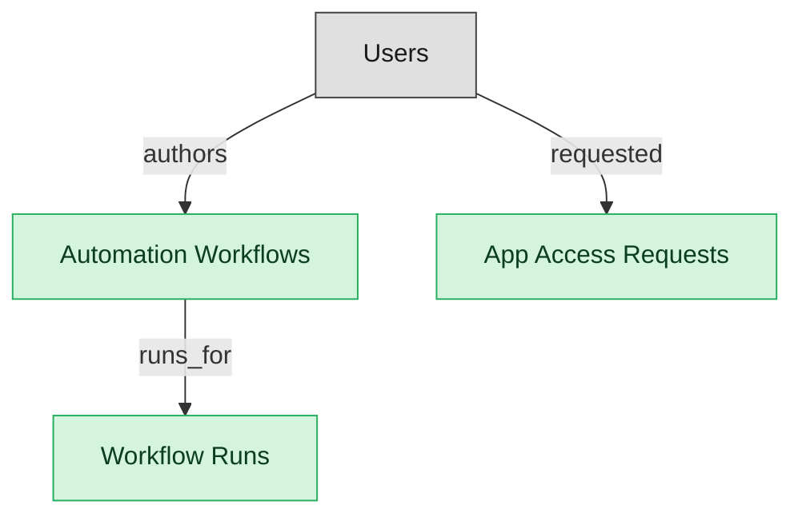

# SMP Automation and Self-Service Requests

## 1. Overview

Declarative automation workflows, workflow run history, and employee-facing self-service app-access requests. The automation surface of an SMP deployment.

## 2. Entity summary

| Name | data_object | Description |
| --- | --- | --- |
| App Access Requests | `smp_app_requests` | Employee requests for access to a SaaS app via the published catalog, routed for manager and IT approval before provisioning. |
| Automation Workflows | `smp_automation_workflows` | Declarative automation workflows with a trigger and steps such as provisioning, notifying, offboarding, or requesting approval. |
| Workflow Runs | `smp_workflow_runs` | Execution logs for each automation workflow run, with trigger source, input, step-by-step status, output, duration, and any error. |

## 3. Entities catalog

| # | data_object | catalog code | singular | plural | held_as | mastered in | mastered label | install_optional | personal_content | entity_type | write tier | notes |
| ---: | --- | --- | --- | --- | --- | --- | --- | --- | --- | --- | --- | --- |
| 1 | `smp_app_requests` | `smp_app_requests` | App Access Request | App Access Requests | master | - | - | - | yes | operational_workflow | `:manage` | - |
| 2 | `smp_automation_workflows` | `smp_automation_workflows` | Automation Workflow | Automation Workflows | master | - | - | - | - | catalog | `:admin` | - |
| 3 | `smp_workflow_runs` | `smp_workflow_runs` | Workflow Run | Workflow Runs | master | - | - | - | - | operational_record | `:manage` | - |

## 4. Aliases and industry synonyms

_(none: no industry-scoped aliases for this scope)_

## 5. Relationships

_`field_required` applies only when both entities are installed. It never makes an entity required._

### 5.1 Relationships between entities in this blueprint

| from | verb | to | cardinality | kind | field_required | delete_mode | fk_format | notes |
| --- | --- | --- | --- | --- | --- | --- | --- | --- |
| `smp_automation_workflows` | runs_for | `smp_workflow_runs` | one_to_many | composition | yes | cascade | parent | - |

### 5.2 Relationships to platform built-ins (`users`)

| from | verb | to | cardinality | field_required | delete_mode | fk_format | notes |
| --- | --- | --- | --- | --- | --- | --- | --- |
| `users` | requested | `smp_app_requests` | one_to_many | yes | restrict | reference | - |
| `users` | authors | `smp_automation_workflows` | one_to_many | yes | restrict | reference | - |

### 5.3 Relationships to entities outside this blueprint

_External entities are optional: this blueprint never installs them. If one exists at install, the relationship is proposed. A many-to-many relationship is listed under outgoing and proposed as a new junction table._

#### 5.3a Outgoing relationships: this blueprint's entity points to the external entity

| from | verb | to | cardinality | field_required | notes |
| --- | --- | --- | --- | --- | --- |
| `saas_applications` | has_workflows | `smp_automation_workflows` | one_to_many | no | - |
| `smp_app_catalog_listings` | has_requests | `smp_app_requests` | one_to_many | yes | - |

#### 5.3b Incoming relationships: the external entity points to this blueprint's entity

_(none: no incoming relationships from external entities)_

## 6. Cross-domain context

### 6.1 Master consumers (other modules / domains that embed this scope's masters)

_(none: no other module embeds this scope's masters)_

### 6.2 Outbound handoffs (events this scope publishes)

_(none: no outbound handoffs whose payload is in this scope)_

### 6.3 Inbound handoffs (events this scope reacts to)

_(none: no inbound handoffs whose payload is in this scope)_

### 6.4 Master providers (modules / domains that own masters this scope embeds)

_(none: this scope embeds no masters owned elsewhere; every entity is mastered here)_

## 7. Lifecycle states

### `smp_app_requests` (App Access Request)

| order | state_name | initial? | terminal? | requires_permission? | high risk? | derived gate | description |
| --- | --- | --- | --- | --- | --- | --- | --- |
| 10 | `submitted` | ✓ | - | ✓ | - | `smp-automation:submit_app_request` | - |
| 20 | `manager_approved` | - | - | ✓ | - | `smp-automation:manager_approve_request` | - |
| 30 | `it_approved` | - | - | ✓ | - | `smp-automation:it_approve_request` | - |
| 40 | `fulfilled` | - | ✓ | ✓ | - | `smp-automation:fulfill_app_request` | - |
| 50 | `denied` | - | ✓ | ✓ | - | `smp-automation:deny_app_request` | - |
| 60 | `canceled` | - | ✓ | ✓ | - | `smp-automation:cancel_app_request` | - |

### `smp_automation_workflows` (Automation Workflow)

| order | state_name | initial? | terminal? | requires_permission? | high risk? | derived gate | description |
| --- | --- | --- | --- | --- | --- | --- | --- |
| 10 | `draft` | ✓ | - | - | - | - | - |
| 20 | `active` | - | - | ✓ | - | `smp-automation:activate_workflow` | - |
| 30 | `paused` | - | - | ✓ | - | `smp-automation:pause_workflow` | - |
| 40 | `archived` | - | ✓ | ✓ | - | `smp-automation:archive_workflow` | - |

### `smp_workflow_runs` (Workflow Run)

| order | state_name | initial? | terminal? | requires_permission? | high risk? | derived gate | description |
| --- | --- | --- | --- | --- | --- | --- | --- |
| 10 | `queued` | ✓ | - | - | - | - | - |
| 20 | `running` | - | - | - | - | - | - |
| 30 | `succeeded` | - | ✓ | - | - | - | - |
| 40 | `failed` | - | ✓ | - | - | - | - |
| 50 | `canceled` | - | ✓ | ✓ | - | `smp-automation:cancel_workflow_run` | - |

## 8. Permissions and business rules (derived)

### 8.1 Permissions

| permission | tier | description | included in `:admin`? |
| --- | --- | --- | --- |
| `smp-automation:read` | baseline-read | Read access to every entity in the module | ✓ |
| `smp-automation:manage` | baseline-manage | Edit operational records | ✓ |
| `smp-automation:admin` | baseline-admin | Edit reference data and inherit every workflow gate below | - |
| `smp-automation:read_smp_automation_workflows` | entity-read | Read Automation Workflows | ✓ |
| `smp-automation:write_smp_automation_workflows` | entity-write | Write Automation Workflows | ✓ |
| `smp-automation:read_smp_workflow_runs` | entity-read | Read Workflow Runs | ✓ |
| `smp-automation:write_smp_workflow_runs` | entity-write | Write Workflow Runs | ✓ |
| `smp-automation:read_smp_app_requests` | entity-read | Read App Access Requests | ✓ |
| `smp-automation:write_smp_app_requests` | entity-write | Write App Access Requests | ✓ |
| `smp-automation:activate_workflow` | workflow-gate (lifecycle) | Transition `smp_automation_workflows` into state `active` | ✓ |
| `smp-automation:pause_workflow` | workflow-gate (lifecycle) | Transition `smp_automation_workflows` into state `paused` | ✓ |
| `smp-automation:archive_workflow` | workflow-gate (lifecycle) | Transition `smp_automation_workflows` into state `archived` | ✓ |
| `smp-automation:cancel_workflow_run` | workflow-gate (lifecycle) | Transition `smp_workflow_runs` into state `canceled` | ✓ |
| `smp-automation:submit_app_request` | workflow-gate (lifecycle) | Transition `smp_app_requests` into state `submitted` | ✓ |
| `smp-automation:manager_approve_request` | workflow-gate (lifecycle) | Transition `smp_app_requests` into state `manager_approved` | ✓ |
| `smp-automation:it_approve_request` | workflow-gate (lifecycle) | Transition `smp_app_requests` into state `it_approved` | ✓ |
| `smp-automation:fulfill_app_request` | workflow-gate (lifecycle) | Transition `smp_app_requests` into state `fulfilled` | ✓ |
| `smp-automation:deny_app_request` | workflow-gate (lifecycle) | Transition `smp_app_requests` into state `denied` | ✓ |
| `smp-automation:cancel_app_request` | workflow-gate (lifecycle) | Transition `smp_app_requests` into state `canceled` | ✓ |
| `smp-automation:view_all_app_access_requests` | override (personal_content) | View all `smp_app_requests` rows beyond row-scope | ✓ |
| `smp-automation:manage_all_app_access_requests` | override (personal_content) | Manage all `smp_app_requests` rows beyond row-scope | ✓ |

### 8.2 Business rules

| rule_name | data_object | source flag | intent |
| --- | --- | --- | --- |
| `app_access_request_edit_scope` | `smp_app_requests` | has_personal_content | Row-scope by default; override via `smp-automation:view_all_app_access_requests` / `smp-automation:manage_all_app_access_requests` |

## 9. Roles, RACI, and responsibilities (derived)

_Baseline roles, the permission hierarchy, and RACI realization are DERIVED from this scope's entity-type write tiers + `process_raci`; none of it is stored in the catalog (the deployer provisions it from this blueprint)._

### 9.1 `SMP-AUTOMATION`

**Baseline roles:**

| role | baseline grant |
| --- | --- |
| `smp-automation_viewer` | `smp-automation:read` |
| `smp-automation_manager` | `smp-automation:manage` |
| `smp-automation_admin` | `smp-automation:admin` |

**Permission hierarchy:**

| permission | includes |
| --- | --- |
| `smp-automation:admin` | `smp-automation:manage` |
| `smp-automation:manage` | `smp-automation:read` |
| `smp-automation:read` | `smp-automation:read_smp_automation_workflows` |
| `smp-automation:read` | `smp-automation:read_smp_workflow_runs` |
| `smp-automation:read` | `smp-automation:read_smp_app_requests` |
| `smp-automation:admin` | `smp-automation:write_smp_automation_workflows` |
| `smp-automation:write_smp_automation_workflows` | `smp-automation:read_smp_automation_workflows` |
| `smp-automation:manage` | `smp-automation:write_smp_workflow_runs` |
| `smp-automation:write_smp_workflow_runs` | `smp-automation:read_smp_workflow_runs` |
| `smp-automation:manage` | `smp-automation:write_smp_app_requests` |
| `smp-automation:write_smp_app_requests` | `smp-automation:read_smp_app_requests` |
| `smp-automation:admin` | `smp-automation:activate_workflow` |
| `smp-automation:admin` | `smp-automation:pause_workflow` |
| `smp-automation:admin` | `smp-automation:archive_workflow` |
| `smp-automation:admin` | `smp-automation:cancel_workflow_run` |
| `smp-automation:admin` | `smp-automation:submit_app_request` |
| `smp-automation:admin` | `smp-automation:manager_approve_request` |
| `smp-automation:admin` | `smp-automation:it_approve_request` |
| `smp-automation:admin` | `smp-automation:fulfill_app_request` |
| `smp-automation:admin` | `smp-automation:deny_app_request` |
| `smp-automation:admin` | `smp-automation:cancel_app_request` |
| `smp-automation:admin` | `smp-automation:view_all_app_access_requests` |
| `smp-automation:admin` | `smp-automation:manage_all_app_access_requests` |

**Processes wired:**

| process_key | process_name | PCF code | PCF ID | level | description |
| --- | --- | --- | --- | --- | --- |
| `manage_infrastructure_resource` | Manage infrastructure resource administration | 8.7.7 | 20914 | 3 | Managing the resources required for administration of IT infrastructure. Manage the IT inventory and assets. Take care of the organization's IT resource capacity. |
| `manage_it_user_identity` | Manage IT user identity and authorization | 8.3.8 | 20756 | 3 | The process of identifying, authenticating, and authorizing IT users to have access to applications, systems, IT components, or networks by associating user rights and restrictions with established identities. |

**RACI realization:**

| actor | kind | raci | process_key | realization |
| --- | --- | --- | --- | --- |
| `IT-SAAS-ADMIN` | persona | responsible | `manage_infrastructure_resource` | the gated entities' write tier |
| `IT-SAAS-ADMIN` | persona | accountable | `manage_infrastructure_resource` | grant gates [smp-automation:activate_workflow, smp-automation:pause_workflow, smp-automation:archive_workflow, smp-automation:cancel_workflow_run] + the gated entities' write tier |
| `IT-SAAS-ADMIN` | persona | responsible | `manage_it_user_identity` | the gated entities' write tier |
| `IT-SAAS-ADMIN` | persona | accountable | `manage_it_user_identity` | grant gates [smp-automation:submit_app_request, smp-automation:manager_approve_request, smp-automation:it_approve_request, smp-automation:fulfill_app_request, smp-automation:deny_app_request, smp-automation:cancel_app_request] + the gated entities' write tier |

### 9.2 Functional ownership and default grants

| responsibility | business function | default role | default tier |
| --- | --- | --- | --- |
| owner | IT Asset Management | `admin` | `:admin` |
| contributor | Finance | `manager` | `:manage` |
| contributor | Procurement | `manager` | `:manage` |
