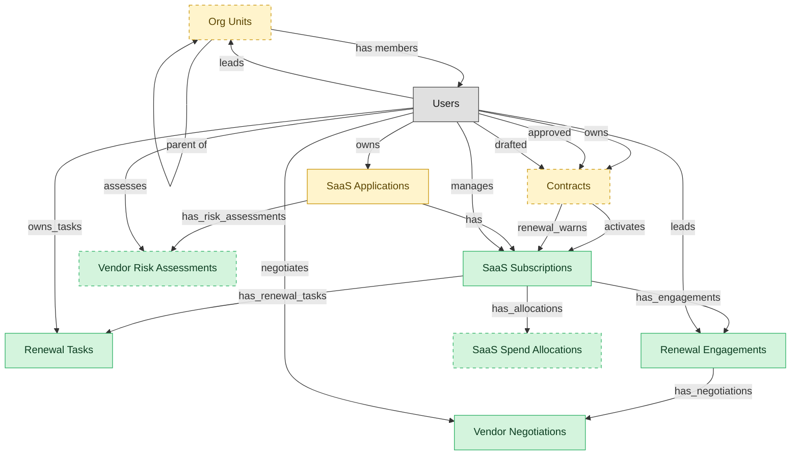

# SMP Renewal and Vendor Management

## 1. Overview

Renewal pipeline tracking, vendor relationship management, contract coordination with procurement and legal, spend allocation, and per-SaaS vendor-risk attestation. The commercial layer of an SMP deployment.

## 2. Entity summary

| Name | data_object | Description |
| --- | --- | --- |
| Renewal Engagements | `smp_renewal_engagements` | Per-renewal-cycle envelopes covering timeline, owner, vendor proposals received, fallback notes, and decisions taken. |
| Renewal Tasks | `smp_renewal_tasks` | Tasks within a SaaS renewal cycle, such as the renewal-window notice, owner assignment, and the renew-or-cancel decision. |
| SaaS Spend Allocations | `smp_spend_allocations` | Chargeback splits of a SaaS subscription across cost centers, business units, or projects, with the allocation method and effective window. |
| SaaS Subscriptions | `saas_subscriptions` | Contractual subscriptions for SaaS apps: plan tier, seat count, recurring cost, billing cadence, renewal date, and owner. |
| Vendor Negotiations | `smp_vendor_negotiations` | Quote, counter-quote, and discount records tied to a renewal, documenting how the final commercial terms were reached. |
| Vendor Risk Assessments | `smp_vendor_risk_assessments` | SaaS vendor risk scorecards covering attestation status, data-processing review, subprocessors, breach history, and posture score. |
| Contracts | `legal_contracts` | Contracts with counterparties or suppliers, covering type, value, key dates, governing law, and lifecycle from draft to terminated. |
| Org Units | `org_units` | Nodes in the organizational hierarchy such as divisions, departments, and teams, with manager, cost center alignment, geographic scope, and parent-child relationships. |
| SaaS Applications | `saas_applications` | SaaS applications in the company portfolio, with vendor, category, criticality, owner, and whether each is sanctioned or shadow IT. |

## 3. Entities catalog

| # | data_object | catalog code | singular | plural | held_as | mastered in | mastered label | install_optional | personal_content | entity_type | write tier | notes |
| ---: | --- | --- | --- | --- | --- | --- | --- | --- | --- | --- | --- | --- |
| 1 | `smp_renewal_engagements` | `smp_renewal_engagements` | Renewal Engagement | Renewal Engagements | master | - | - | - | - | operational_workflow | `:manage` | - |
| 2 | `smp_renewal_tasks` | `smp_renewal_tasks` | Renewal Task | Renewal Tasks | master | - | - | - | - | operational_workflow | `:manage` | - |
| 3 | `smp_spend_allocations` | `smp_spend_allocations` | SaaS Spend Allocation | SaaS Spend Allocations | master | - | - | yes | - | operational_workflow | `:manage` | - |
| 4 | `saas_subscriptions` | `saas_subscriptions` | SaaS Subscription | SaaS Subscriptions | master | - | - | - | - | operational_workflow | `:manage` | - |
| 5 | `smp_vendor_negotiations` | `smp_vendor_negotiations` | Vendor Negotiation | Vendor Negotiations | master | - | - | - | - | operational_workflow | `:manage` | - |
| 6 | `smp_vendor_risk_assessments` | `smp_vendor_risk_assessments` | Vendor Risk Assessment | Vendor Risk Assessments | master | - | - | yes | - | operational_workflow | `:manage` | - |
| 7 | `legal_contracts` | `legal_contracts` | Contract | Contracts | embedded_master | `clm-repository` | Contract Repository | yes | yes | operational_workflow | `:manage` | - |
| 8 | `org_units` | `org_units` | Org Unit | Org Units | embedded_master | `hcm-org-positions` | Organization and Position Management | yes | - | operational_workflow | `:manage` | - |
| 9 | `saas_applications` | `saas_applications` | SaaS Application | SaaS Applications | embedded_master | `smp-discovery` | SMP Discovery and Catalog | - | - | operational_workflow | `:manage` | - |

## 4. Aliases and industry synonyms

_(none: no industry-scoped aliases for this scope)_

## 5. Relationships

_`field_required` applies only when both entities are installed. It never makes an entity required._

### 5.1 Relationships between entities in this blueprint

| from | verb | to | cardinality | kind | field_required | delete_mode | fk_format | notes |
| --- | --- | --- | --- | --- | --- | --- | --- | --- |
| `legal_contracts` | activates | `saas_subscriptions` | one_to_many | reference | no | clear | reference | - |
| `legal_contracts` | renewal_warns | `saas_subscriptions` | one_to_many | reference | no | clear | reference | - |
| `saas_applications` | has | `saas_subscriptions` | one_to_many | reference | no | clear | reference | - |
| `org_units` | parent of | `org_units` | one_to_many | reference | no | clear | reference | - |
| `saas_subscriptions` | has_renewal_tasks | `smp_renewal_tasks` | one_to_many | reference | yes | restrict | reference | - |
| `saas_subscriptions` | has_engagements | `smp_renewal_engagements` | one_to_many | reference | yes | restrict | reference | - |
| `smp_renewal_engagements` | has_negotiations | `smp_vendor_negotiations` | one_to_many | composition | yes | cascade | parent | - |
| `saas_subscriptions` | has_allocations | `smp_spend_allocations` | one_to_many | reference | yes | restrict | reference | - |
| `saas_applications` | has_risk_assessments | `smp_vendor_risk_assessments` | one_to_many | reference | yes | restrict | reference | - |

### 5.2 Relationships to platform built-ins (`users`)

| from | verb | to | cardinality | field_required | delete_mode | fk_format | notes |
| --- | --- | --- | --- | --- | --- | --- | --- |
| `users` | leads | `org_units` | one_to_many | no | clear | reference | - |
| `users` | owns | `legal_contracts` | one_to_many | no | clear | reference | - |
| `users` | approved | `legal_contracts` | one_to_many | no | clear | reference | - |
| `users` | drafted | `legal_contracts` | one_to_many | no | clear | reference | - |
| `users` | owns | `saas_applications` | one_to_many | yes | restrict | reference | - |
| `users` | manages | `saas_subscriptions` | one_to_many | yes | restrict | reference | - |
| `org_units` | has members | `users` | one_to_many | no | clear | reference | - |
| `users` | owns_tasks | `smp_renewal_tasks` | one_to_many | yes | restrict | reference | - |
| `users` | leads | `smp_renewal_engagements` | one_to_many | yes | restrict | reference | - |
| `users` | negotiates | `smp_vendor_negotiations` | one_to_many | yes | restrict | reference | - |
| `users` | assesses | `smp_vendor_risk_assessments` | one_to_many | yes | restrict | reference | - |

### 5.3 Relationships to entities outside this blueprint

_External entities are optional: this blueprint never installs them. If one exists at install, the relationship is proposed. A many-to-many relationship is listed under outgoing and proposed as a new junction table._

#### 5.3a Outgoing relationships: this blueprint's entity points to the external entity

| from | verb | to | cardinality | field_required | notes |
| --- | --- | --- | --- | --- | --- |
| `cost_centers` | funds | `org_units` | one_to_many | yes | - |
| `org_units` | sponsors | `benefit_plans` | many_to_many | - | - |
| `survey_campaigns` | targets | `org_units` | many_to_many | - | - |
| `asset_contracts` | covers | `saas_applications` | many_to_many | - | - |
| `in_house_legal_matters` | references | `legal_contracts` | many_to_many | - | - |
| `contract_templates` | seeds | `legal_contracts` | one_to_many | no | - |
| `sourcing_events` | originates | `legal_contracts` | one_to_many | no | - |
| `crm_opportunities` | drafts | `legal_contracts` | one_to_many | no | - |
| `sales_quotes` | drafts | `legal_contracts` | one_to_many | no | - |
| `contract_drafts` | drafts | `legal_contracts` | one_to_many | no | - |
| `quote_discounts` | flows into | `legal_contracts` | one_to_many | no | - |
| `commercial_leases` | flows into | `legal_contracts` | one_to_many | no | - |
| `engagement_letters` | flows into | `legal_contracts` | one_to_many | no | - |
| `shadow_it_apps` | promotes_to | `saas_applications` | one_to_one | no | - |
| `saas_applications` | owns | `smp_app_owners` | many_to_many | - | - |
| `smp_app_lifecycle_stages` | has_stage | `saas_applications` | one_to_one | yes | - |
| `enterprise_applications` | is delivered via | `saas_subscriptions` | one_to_many | no | - |
| `contract_counterparties` | is party to | `legal_contracts` | one_to_many | no | - |

#### 5.3b Incoming relationships: the external entity points to this blueprint's entity

| from | verb | to | cardinality | field_required | notes |
| --- | --- | --- | --- | --- | --- |
| `org_units` | groups | `employees` | one_to_many | yes | - |
| `org_units` | contains | `hcm_positions` | one_to_many | yes | - |
| `org_units` | engages | `contingent_workers` | one_to_many | no | - |
| `org_units` | is_scored_by | `engagement_drivers` | one_to_many | no | - |
| `org_units` | is_measured_by | `people_kpis` | one_to_many | no | - |
| `org_units` | triggers | `iga_entitlement_definitions` | one_to_many | no | - |
| `org_units` | maps_to | `cost_centers` | one_to_one | no | - |
| `org_units` | sponsors | `compliance_assignments` | one_to_many | no | - |
| `org_units` | owns | `action_plans` | one_to_many | no | - |
| `saas_applications` | lifecycle events for | `asset_lifecycle_events` | one_to_many | no | - |
| `legal_contracts` | governs | `customer_entitlements` | one_to_many | no | - |
| `legal_contracts` | backs | `customer_subscriptions` | one_to_many | no | - |
| `legal_contracts` | contains | `contract_clauses` | one_to_many | no | - |
| `legal_contracts` | imposes | `contract_obligations` | one_to_many | yes | - |
| `legal_contracts` | witnessed_by | `signature_records` | one_to_many | yes | - |
| `legal_contracts` | activates | `software_licenses` | one_to_many | no | - |
| `legal_contracts` | triggers_creation_of | `purchase_orders` | one_to_many | no | - |
| `legal_contracts` | triggers_review_in | `purchase_requisitions` | one_to_many | no | - |
| `legal_contracts` | propagates_terms_to | `invoice_matches` | one_to_many | no | - |
| `legal_contracts` | feeds_revrec_in | `revenue_recognition_records` | one_to_many | no | - |
| `legal_contracts` | seeds | `service_projects` | one_to_many | no | - |
| `legal_contracts` | renewal_warns | `crm_opportunities` | one_to_many | no | - |
| `legal_contracts` | renewed_into | `customer_subscriptions` | one_to_many | no | - |
| `legal_contracts` | seeds | `agency_jobs` | one_to_many | no | - |
| `saas_subscriptions` | charged to subscription | `expense_lines` | one_to_many | no | - |
| `saas_applications` | measured_by | `saas_usage_metrics` | one_to_many | yes | - |
| `saas_applications` | assigned_via | `smp_license_seat_assignments` | one_to_many | yes | - |
| `saas_subscriptions` | grants | `smp_license_seat_assignments` | one_to_many | no | - |
| `saas_applications` | entitles_to | `iga_user_entitlements` | one_to_many | no | - |
| `saas_applications` | integrates_with | `smp_app_integrations` | one_to_many | yes | - |
| `saas_applications` | publishes | `smp_app_catalog_listings` | one_to_one | yes | - |
| `saas_applications` | has_alerts | `smp_alerts` | one_to_many | no | - |
| `saas_applications` | has_recommendations | `smp_optimization_recommendations` | one_to_many | no | - |
| `saas_subscriptions` | has_recommendations | `smp_optimization_recommendations` | one_to_many | no | - |
| `saas_applications` | has_benchmarks | `smp_app_benchmarks` | one_to_many | yes | - |
| `saas_applications` | has_workflows | `smp_automation_workflows` | one_to_many | no | - |
| `saas_applications` | is registered as | `enterprise_applications` | one_to_one | no | - |
| `legal_contracts` | is amended by | `contract_amendments` | one_to_many | yes | - |
| `legal_contracts` | is renewed by | `contract_renewal_records` | one_to_many | yes | - |
| `legal_contracts` | is assessed by | `contract_risk_assessments` | one_to_many | no | - |
| `legal_contracts` | has milestone | `contract_milestones` | one_to_many | yes | - |
| `legal_contracts` | has data protection addendum | `data_protection_addenda` | one_to_many | yes | - |
| `legal_contracts` | is negotiated in | `contract_negotiation_threads` | one_to_many | yes | - |
| `saas_applications` | raises_incident | `service_incidents` | one_to_many | no | - |

## 6. Cross-domain context

### 6.1 Master consumers (other modules / domains that embed this scope's masters)

_(none: no other module embeds this scope's masters)_

### 6.2 Outbound handoffs (events this scope publishes)

_(none: no outbound handoffs whose payload is in this scope)_

### 6.3 Inbound handoffs (events this scope reacts to)

_(none: no inbound handoffs whose payload is in this scope)_

### 6.4 Master providers (modules / domains that own masters this scope embeds)

| data_object | held_as | install_optional | catalog owner(s) | slice notes |
| --- | --- | --- | --- | --- |
| `legal_contracts` | embedded_master | yes | CLM-REPOSITORY (CLM) | - |
| `org_units` | embedded_master | yes | HCM-ORG-POSITIONS (HCM) | - |
| `saas_applications` | embedded_master | - | SMP-DISCOVERY (SMP) | - |

## 7. Lifecycle states

### `legal_contracts` (Contract)

_This scope holds `legal_contracts` as **embedded_master**; the canonical state machine is owned by `CLM-REPOSITORY`._

| order | state_name | initial? | terminal? | realizing module | requires_permission? | high risk? | derived gate | description |
| --- | --- | --- | --- | --- | --- | --- | --- | --- |
| 10 | `draft` | ✓ | - | _(always)_ | - | - | - | Initial draft created in CLM-AUTHORING from a template, or received via inbound handoff from CPQ/sourcing. |
| 20 | `in_review` | - | - | `CLM-NEGOTIATION` | - | - | - | Draft has been routed for internal review prior to counterparty exchange. |
| 30 | `in_negotiation` | - | - | `CLM-NEGOTIATION` | - | - | - | Active counterparty negotiation with track-changes / redline exchange. |
| 40 | `approved` | - | - | `CLM-NEGOTIATION` | ✓ | - | `clm-negotiation:approve_legal_contract` | Final negotiated text approved by all internal stakeholders; ready for signature. |
| 50 | `out_for_signature` | - | - | `CLM-REPOSITORY` | - | - | - | Signature envelope dispatched to all required signers. |
| 60 | `signed` | - | - | `CLM-REPOSITORY` | ✓ | - | `clm-repository:execute_legal_contract` | All signers have signed; contract is fully executed. |
| 70 | `active` | - | - | _(always)_ | - | - | - | Effective date has passed; contract is in force. Default post-signature state. |
| 75 | `amended` | - | - | `CLM-REPOSITORY` | ✓ | - | `clm-repository:amend_legal_contract` | An amendment has been executed against this contract. Amendment is a separate record; this contract row reflects the amended terms going forward. |
| 80 | `expired` | - | ✓ | _(always)_ | - | - | - | End date passed without renewal or termination. Terminal state. |
| 90 | `terminated` | - | ✓ | `CLM-REPOSITORY` | ✓ | - | `clm-repository:terminate_legal_contract` | Contract terminated before end date (by mutual consent, breach, or for-cause). Terminal state. |
| 100 | `renewed` | - | ✓ | `CLM-RENEWAL` | ✓ | - | `clm-renewal:renew_legal_contract` | Renewed via a new contract record (or extended via amendment). The renewal is a separate record; this row is terminal. |

### `org_units` (Org Unit)

_This scope holds `org_units` as **embedded_master**; the canonical state machine is owned by `HCM-ORG-POSITIONS`._

| order | state_name | initial? | terminal? | realizing module | requires_permission? | high risk? | derived gate | description |
| --- | --- | --- | --- | --- | --- | --- | --- | --- |
| 1 | `draft` | ✓ | - | `HCM-ORG-POSITIONS` | - | - | - | Org unit defined as part of a future structure; not yet operational. |
| 2 | `active` | - | - | `HCM-ORG-POSITIONS` | ✓ | - | `hcm-org-positions:active_org_unit` | Operational unit; carries headcount, cost-center relationship, and reporting lines. |
| 3 | `reorganized` | - | ✓ | `HCM-ORG-POSITIONS` | ✓ | - | `hcm-org-positions:reorganized_org_unit` | Unit folded into or replaced by a new structure; references remain for history. |
| 4 | `closed` | - | ✓ | `HCM-ORG-POSITIONS` | ✓ | - | `hcm-org-positions:closed_org_unit` | Unit dissolved; no employees or positions reside in it. |

### `saas_applications` (SaaS Application)

_This scope holds `saas_applications` as **embedded_master**; the canonical state machine is owned by `SMP-DISCOVERY`._

| order | state_name | initial? | terminal? | realizing module | requires_permission? | high risk? | derived gate | description |
| --- | --- | --- | --- | --- | --- | --- | --- | --- |
| 10 | `discovered` | ✓ | - | `SMP-DISCOVERY` | - | - | - | App detected via SSO logs, expense data, or browser plugin. Not yet reviewed by IT. |
| 20 | `triaged` | - | - | `SMP-DISCOVERY` | - | - | - | App has been reviewed by IT but no sanction decision recorded yet. |
| 30 | `sanctioned` | - | - | `SMP-DISCOVERY` | ✓ | - | `smp-discovery:sanction_application` | App is officially supported; IGA provisioning, FINOPS spend tracking, and ITAM registration activated. |
| 40 | `deprecated` | - | - | `SMP-DISCOVERY` | ✓ | - | `smp-discovery:deprecate_application` | Slated for replacement or removal; no new assignments allowed; existing users on read-only or sunset path. |
| 50 | `deprovisioned` | - | ✓ | `SMP-DISCOVERY` | ✓ | - | `smp-discovery:deprovision_application` | App removed tenant-wide. ITSM closes related tickets; IGA revokes access; FINOPS terminates spend. |

### `saas_subscriptions` (SaaS Subscription)

| order | state_name | initial? | terminal? | realizing module | requires_permission? | high risk? | derived gate | description |
| --- | --- | --- | --- | --- | --- | --- | --- | --- |
| 10 | `draft` | ✓ | - | `SMP-RENEWAL-VENDOR` | - | - | - | Subscription record created during procurement; terms not yet finalized. |
| 20 | `active` | - | - | `SMP-RENEWAL-VENDOR` | - | - | - | Contract executed; license consumption underway. |
| 30 | `renewing` | - | - | `SMP-RENEWAL-VENDOR` | ✓ | - | `smp-renewal-vendor:initiate_renewal` | Within the renewal window (typically 90 days pre-expiry). Quantity and tier negotiation in progress. |
| 40 | `renewed` | - | ✓ | `SMP-RENEWAL-VENDOR` | ✓ | - | `smp-renewal-vendor:approve_renewal` | Renewal executed; a new active term started. |
| 50 | `canceled` | - | ✓ | `SMP-RENEWAL-VENDOR` | ✓ | - | `smp-renewal-vendor:cancel_subscription` | Subscription terminated; deprovisioning workflow triggered. |

### `smp_renewal_engagements` (Renewal Engagement)

| order | state_name | initial? | terminal? | realizing module | requires_permission? | high risk? | derived gate | description |
| --- | --- | --- | --- | --- | --- | --- | --- | --- |
| 10 | `scheduled` | ✓ | - | `SMP-RENEWAL-VENDOR` | - | - | - | - |
| 20 | `discovery` | - | - | `SMP-RENEWAL-VENDOR` | - | - | - | - |
| 30 | `negotiation` | - | - | `SMP-RENEWAL-VENDOR` | ✓ | - | `smp-renewal-vendor:begin_negotiation` | - |
| 40 | `decision` | - | - | `SMP-RENEWAL-VENDOR` | ✓ | - | `smp-renewal-vendor:decide_renewal` | - |
| 50 | `executed` | - | - | `SMP-RENEWAL-VENDOR` | ✓ | - | `smp-renewal-vendor:execute_renewal` | - |
| 60 | `closed` | - | ✓ | `SMP-RENEWAL-VENDOR` | - | - | - | - |

### `smp_renewal_tasks` (Renewal Task)

| order | state_name | initial? | terminal? | realizing module | requires_permission? | high risk? | derived gate | description |
| --- | --- | --- | --- | --- | --- | --- | --- | --- |
| 10 | `open` | ✓ | - | `SMP-RENEWAL-VENDOR` | - | - | - | - |
| 20 | `in_progress` | - | - | `SMP-RENEWAL-VENDOR` | ✓ | - | `smp-renewal-vendor:start_renewal_task` | - |
| 30 | `blocked` | - | - | `SMP-RENEWAL-VENDOR` | - | - | - | - |
| 40 | `done` | - | ✓ | `SMP-RENEWAL-VENDOR` | ✓ | - | `smp-renewal-vendor:complete_renewal_task` | - |
| 50 | `canceled` | - | ✓ | `SMP-RENEWAL-VENDOR` | ✓ | - | `smp-renewal-vendor:cancel_renewal_task` | - |

### `smp_spend_allocations` (SaaS Spend Allocation)

| order | state_name | initial? | terminal? | realizing module | requires_permission? | high risk? | derived gate | description |
| --- | --- | --- | --- | --- | --- | --- | --- | --- |
| 10 | `draft` | ✓ | - | `SMP-RENEWAL-VENDOR` | - | - | - | - |
| 20 | `active` | - | - | `SMP-RENEWAL-VENDOR` | ✓ | - | `smp-renewal-vendor:activate_allocation` | - |
| 30 | `adjusted` | - | - | `SMP-RENEWAL-VENDOR` | - | - | - | - |
| 40 | `closed` | - | ✓ | `SMP-RENEWAL-VENDOR` | ✓ | - | `smp-renewal-vendor:close_allocation` | - |

### `smp_vendor_negotiations` (Vendor Negotiation)

| order | state_name | initial? | terminal? | realizing module | requires_permission? | high risk? | derived gate | description |
| --- | --- | --- | --- | --- | --- | --- | --- | --- |
| 10 | `opened` | ✓ | - | `SMP-RENEWAL-VENDOR` | - | - | - | - |
| 20 | `counter_offered` | - | - | `SMP-RENEWAL-VENDOR` | - | - | - | - |
| 30 | `at_impasse` | - | - | `SMP-RENEWAL-VENDOR` | - | - | - | - |
| 40 | `agreed` | - | ✓ | `SMP-RENEWAL-VENDOR` | ✓ | - | `smp-renewal-vendor:agree_negotiation` | - |
| 50 | `abandoned` | - | ✓ | `SMP-RENEWAL-VENDOR` | ✓ | - | `smp-renewal-vendor:abandon_negotiation` | - |

### `smp_vendor_risk_assessments` (Vendor Risk Assessment)

| order | state_name | initial? | terminal? | realizing module | requires_permission? | high risk? | derived gate | description |
| --- | --- | --- | --- | --- | --- | --- | --- | --- |
| 10 | `scoped` | ✓ | - | `SMP-RENEWAL-VENDOR` | - | - | - | - |
| 20 | `in_review` | - | - | `SMP-RENEWAL-VENDOR` | ✓ | - | `smp-renewal-vendor:start_risk_review` | - |
| 30 | `information_requested` | - | - | `SMP-RENEWAL-VENDOR` | - | - | - | - |
| 40 | `completed` | - | - | `SMP-RENEWAL-VENDOR` | ✓ | - | `smp-renewal-vendor:complete_risk_review` | - |
| 50 | `expired` | - | ✓ | `SMP-RENEWAL-VENDOR` | - | - | - | - |
| 60 | `remediation_required` | - | - | `SMP-RENEWAL-VENDOR` | ✓ | - | `smp-renewal-vendor:flag_remediation` | - |

## 8. Permissions and business rules (derived)

### 8.1 Permissions

| permission | tier | description | included in `:admin`? |
| --- | --- | --- | --- |
| `smp-renewal-vendor:read` | baseline-read | Read access to every entity in the module | ✓ |
| `smp-renewal-vendor:manage` | baseline-manage | Edit operational records | ✓ |
| `smp-renewal-vendor:admin` | baseline-admin | Edit reference data and inherit every workflow gate below | - |
| `hcm-org-positions:read_org_units` | entity-read | Read Org Units | ✓ |
| `hcm-org-positions:write_org_units` | entity-write | Write Org Units | ✓ |
| `smp-discovery:read_saas_applications` | entity-read | Read SaaS Applications | ✓ |
| `smp-discovery:write_saas_applications` | entity-write | Write SaaS Applications | ✓ |
| `smp-renewal-vendor:read_saas_subscriptions` | entity-read | Read SaaS Subscriptions | ✓ |
| `smp-renewal-vendor:write_saas_subscriptions` | entity-write | Write SaaS Subscriptions | ✓ |
| `clm-repository:read_legal_contracts` | entity-read | Read Contracts | ✓ |
| `clm-repository:write_legal_contracts` | entity-write | Write Contracts | ✓ |
| `smp-renewal-vendor:read_smp_renewal_tasks` | entity-read | Read Renewal Tasks | ✓ |
| `smp-renewal-vendor:write_smp_renewal_tasks` | entity-write | Write Renewal Tasks | ✓ |
| `smp-renewal-vendor:read_smp_renewal_engagements` | entity-read | Read Renewal Engagements | ✓ |
| `smp-renewal-vendor:write_smp_renewal_engagements` | entity-write | Write Renewal Engagements | ✓ |
| `smp-renewal-vendor:read_smp_vendor_negotiations` | entity-read | Read Vendor Negotiations | ✓ |
| `smp-renewal-vendor:write_smp_vendor_negotiations` | entity-write | Write Vendor Negotiations | ✓ |
| `smp-renewal-vendor:read_smp_spend_allocations` | entity-read | Read SaaS Spend Allocations | ✓ |
| `smp-renewal-vendor:write_smp_spend_allocations` | entity-write | Write SaaS Spend Allocations | ✓ |
| `smp-renewal-vendor:read_smp_vendor_risk_assessments` | entity-read | Read Vendor Risk Assessments | ✓ |
| `smp-renewal-vendor:write_smp_vendor_risk_assessments` | entity-write | Write Vendor Risk Assessments | ✓ |
| `hcm-org-positions:active_org_unit` | workflow-gate (lifecycle) | Transition `org_units` into state `active` | ✓ |
| `hcm-org-positions:reorganized_org_unit` | workflow-gate (lifecycle) | Transition `org_units` into state `reorganized` | ✓ |
| `hcm-org-positions:closed_org_unit` | workflow-gate (lifecycle) | Transition `org_units` into state `closed` | ✓ |
| `smp-discovery:sanction_application` | workflow-gate (lifecycle) | Transition `saas_applications` into state `sanctioned` | ✓ |
| `smp-discovery:deprecate_application` | workflow-gate (lifecycle) | Transition `saas_applications` into state `deprecated` | ✓ |
| `smp-discovery:deprovision_application` | workflow-gate (lifecycle) | Transition `saas_applications` into state `deprovisioned` | ✓ |
| `smp-renewal-vendor:initiate_renewal` | workflow-gate (lifecycle) | Transition `saas_subscriptions` into state `renewing` | ✓ |
| `smp-renewal-vendor:approve_renewal` | workflow-gate (lifecycle) | Transition `saas_subscriptions` into state `renewed` | ✓ |
| `smp-renewal-vendor:cancel_subscription` | workflow-gate (lifecycle) | Transition `saas_subscriptions` into state `canceled` | ✓ |
| `clm-negotiation:approve_legal_contract` | workflow-gate (lifecycle) | Transition `legal_contracts` into state `approved` | ✓ |
| `clm-repository:execute_legal_contract` | workflow-gate (lifecycle) | Transition `legal_contracts` into state `signed` | ✓ |
| `clm-repository:amend_legal_contract` | workflow-gate (lifecycle) | Transition `legal_contracts` into state `amended` | ✓ |
| `clm-repository:terminate_legal_contract` | workflow-gate (lifecycle) | Transition `legal_contracts` into state `terminated` | ✓ |
| `clm-renewal:renew_legal_contract` | workflow-gate (lifecycle) | Transition `legal_contracts` into state `renewed` | ✓ |
| `smp-renewal-vendor:start_renewal_task` | workflow-gate (lifecycle) | Transition `smp_renewal_tasks` into state `in_progress` | ✓ |
| `smp-renewal-vendor:complete_renewal_task` | workflow-gate (lifecycle) | Transition `smp_renewal_tasks` into state `done` | ✓ |
| `smp-renewal-vendor:cancel_renewal_task` | workflow-gate (lifecycle) | Transition `smp_renewal_tasks` into state `canceled` | ✓ |
| `smp-renewal-vendor:begin_negotiation` | workflow-gate (lifecycle) | Transition `smp_renewal_engagements` into state `negotiation` | ✓ |
| `smp-renewal-vendor:decide_renewal` | workflow-gate (lifecycle) | Transition `smp_renewal_engagements` into state `decision` | ✓ |
| `smp-renewal-vendor:execute_renewal` | workflow-gate (lifecycle) | Transition `smp_renewal_engagements` into state `executed` | ✓ |
| `smp-renewal-vendor:agree_negotiation` | workflow-gate (lifecycle) | Transition `smp_vendor_negotiations` into state `agreed` | ✓ |
| `smp-renewal-vendor:abandon_negotiation` | workflow-gate (lifecycle) | Transition `smp_vendor_negotiations` into state `abandoned` | ✓ |
| `smp-renewal-vendor:activate_allocation` | workflow-gate (lifecycle) | Transition `smp_spend_allocations` into state `active` | ✓ |
| `smp-renewal-vendor:close_allocation` | workflow-gate (lifecycle) | Transition `smp_spend_allocations` into state `closed` | ✓ |
| `smp-renewal-vendor:start_risk_review` | workflow-gate (lifecycle) | Transition `smp_vendor_risk_assessments` into state `in_review` | ✓ |
| `smp-renewal-vendor:complete_risk_review` | workflow-gate (lifecycle) | Transition `smp_vendor_risk_assessments` into state `completed` | ✓ |
| `smp-renewal-vendor:flag_remediation` | workflow-gate (lifecycle) | Transition `smp_vendor_risk_assessments` into state `remediation_required` | ✓ |
| `clm-repository:view_all_contracts` | override (personal_content) | View all `legal_contracts` rows beyond row-scope | ✓ |
| `clm-repository:manage_all_contracts` | override (personal_content) | Manage all `legal_contracts` rows beyond row-scope | ✓ |

_Gates with no process: `hcm-org-positions:closed_org_unit`, `clm-repository:amend_legal_contract`, `smp-renewal-vendor:start_renewal_task`, `smp-renewal-vendor:complete_renewal_task`, `smp-renewal-vendor:cancel_renewal_task`, `smp-renewal-vendor:begin_negotiation`, `smp-renewal-vendor:decide_renewal`, `smp-renewal-vendor:execute_renewal`, `smp-renewal-vendor:agree_negotiation`, `smp-renewal-vendor:abandon_negotiation`, `smp-renewal-vendor:start_risk_review`, `smp-renewal-vendor:complete_risk_review`, `smp-renewal-vendor:flag_remediation`. No Accountable can hold them, so this blueprint does not support `raci`._

### 8.2 Business rules

| rule_name | data_object | source flag | intent |
| --- | --- | --- | --- |
| `contract_edit_scope` | `legal_contracts` | has_personal_content | Row-scope by default; override via `clm-repository:view_all_contracts` / `clm-repository:manage_all_contracts` |

## 9. Roles, RACI, and responsibilities (derived)

_Baseline roles, the permission hierarchy, and RACI realization are DERIVED from this scope's entity-type write tiers + `process_raci`; none of it is stored in the catalog (the deployer provisions it from this blueprint)._

### 9.1 `SMP-RENEWAL-VENDOR`

**Baseline roles:**

| role | baseline grant |
| --- | --- |
| `smp-renewal-vendor_viewer` | `smp-renewal-vendor:read` |
| `smp-renewal-vendor_manager` | `smp-renewal-vendor:manage` |
| `smp-renewal-vendor_admin` | `smp-renewal-vendor:admin` |

**Permission hierarchy:**

| permission | includes |
| --- | --- |
| `smp-renewal-vendor:admin` | `smp-renewal-vendor:manage` |
| `smp-renewal-vendor:manage` | `smp-renewal-vendor:read` |
| `smp-renewal-vendor:read` | `hcm-org-positions:read_org_units` |
| `smp-renewal-vendor:read` | `smp-discovery:read_saas_applications` |
| `smp-renewal-vendor:read` | `smp-renewal-vendor:read_saas_subscriptions` |
| `smp-renewal-vendor:read` | `clm-repository:read_legal_contracts` |
| `smp-renewal-vendor:read` | `smp-renewal-vendor:read_smp_renewal_tasks` |
| `smp-renewal-vendor:read` | `smp-renewal-vendor:read_smp_renewal_engagements` |
| `smp-renewal-vendor:read` | `smp-renewal-vendor:read_smp_vendor_negotiations` |
| `smp-renewal-vendor:read` | `smp-renewal-vendor:read_smp_spend_allocations` |
| `smp-renewal-vendor:read` | `smp-renewal-vendor:read_smp_vendor_risk_assessments` |
| `smp-renewal-vendor:manage` | `hcm-org-positions:write_org_units` |
| `hcm-org-positions:write_org_units` | `hcm-org-positions:read_org_units` |
| `smp-renewal-vendor:manage` | `smp-discovery:write_saas_applications` |
| `smp-discovery:write_saas_applications` | `smp-discovery:read_saas_applications` |
| `smp-renewal-vendor:manage` | `smp-renewal-vendor:write_saas_subscriptions` |
| `smp-renewal-vendor:write_saas_subscriptions` | `smp-renewal-vendor:read_saas_subscriptions` |
| `smp-renewal-vendor:manage` | `clm-repository:write_legal_contracts` |
| `clm-repository:write_legal_contracts` | `clm-repository:read_legal_contracts` |
| `smp-renewal-vendor:manage` | `smp-renewal-vendor:write_smp_renewal_tasks` |
| `smp-renewal-vendor:write_smp_renewal_tasks` | `smp-renewal-vendor:read_smp_renewal_tasks` |
| `smp-renewal-vendor:manage` | `smp-renewal-vendor:write_smp_renewal_engagements` |
| `smp-renewal-vendor:write_smp_renewal_engagements` | `smp-renewal-vendor:read_smp_renewal_engagements` |
| `smp-renewal-vendor:manage` | `smp-renewal-vendor:write_smp_vendor_negotiations` |
| `smp-renewal-vendor:write_smp_vendor_negotiations` | `smp-renewal-vendor:read_smp_vendor_negotiations` |
| `smp-renewal-vendor:manage` | `smp-renewal-vendor:write_smp_spend_allocations` |
| `smp-renewal-vendor:write_smp_spend_allocations` | `smp-renewal-vendor:read_smp_spend_allocations` |
| `smp-renewal-vendor:manage` | `smp-renewal-vendor:write_smp_vendor_risk_assessments` |
| `smp-renewal-vendor:write_smp_vendor_risk_assessments` | `smp-renewal-vendor:read_smp_vendor_risk_assessments` |
| `smp-renewal-vendor:admin` | `hcm-org-positions:active_org_unit` |
| `smp-renewal-vendor:admin` | `hcm-org-positions:reorganized_org_unit` |
| `smp-renewal-vendor:admin` | `hcm-org-positions:closed_org_unit` |
| `smp-renewal-vendor:admin` | `smp-discovery:sanction_application` |
| `smp-renewal-vendor:admin` | `smp-discovery:deprecate_application` |
| `smp-renewal-vendor:admin` | `smp-discovery:deprovision_application` |
| `smp-renewal-vendor:admin` | `smp-renewal-vendor:initiate_renewal` |
| `smp-renewal-vendor:admin` | `smp-renewal-vendor:approve_renewal` |
| `smp-renewal-vendor:admin` | `smp-renewal-vendor:cancel_subscription` |
| `smp-renewal-vendor:admin` | `clm-negotiation:approve_legal_contract` |
| `smp-renewal-vendor:admin` | `clm-repository:execute_legal_contract` |
| `smp-renewal-vendor:admin` | `clm-repository:amend_legal_contract` |
| `smp-renewal-vendor:admin` | `clm-repository:terminate_legal_contract` |
| `smp-renewal-vendor:admin` | `clm-renewal:renew_legal_contract` |
| `smp-renewal-vendor:admin` | `smp-renewal-vendor:start_renewal_task` |
| `smp-renewal-vendor:admin` | `smp-renewal-vendor:complete_renewal_task` |
| `smp-renewal-vendor:admin` | `smp-renewal-vendor:cancel_renewal_task` |
| `smp-renewal-vendor:admin` | `smp-renewal-vendor:begin_negotiation` |
| `smp-renewal-vendor:admin` | `smp-renewal-vendor:decide_renewal` |
| `smp-renewal-vendor:admin` | `smp-renewal-vendor:execute_renewal` |
| `smp-renewal-vendor:admin` | `smp-renewal-vendor:agree_negotiation` |
| `smp-renewal-vendor:admin` | `smp-renewal-vendor:abandon_negotiation` |
| `smp-renewal-vendor:admin` | `smp-renewal-vendor:activate_allocation` |
| `smp-renewal-vendor:admin` | `smp-renewal-vendor:close_allocation` |
| `smp-renewal-vendor:admin` | `smp-renewal-vendor:start_risk_review` |
| `smp-renewal-vendor:admin` | `smp-renewal-vendor:complete_risk_review` |
| `smp-renewal-vendor:admin` | `smp-renewal-vendor:flag_remediation` |
| `smp-renewal-vendor:admin` | `clm-repository:view_all_contracts` |
| `smp-renewal-vendor:admin` | `clm-repository:manage_all_contracts` |

**Processes wired:**

| process_key | process_name | PCF code | PCF ID | level | description |
| --- | --- | --- | --- | --- | --- |
| `create_organizational_design` | Create organizational design | 1.2.5 | 10041 | 3 | Formulating a design for the organization's resources that allow it to meet its objectives. Develop a new framework for molding the organization's various processes into a coherent and seamless whole. |
| `conduct_organization` | Conduct organization restructuring opportunities | 1.1.5 | 16792 | 3 | Examining the scope and contingencies for restructuring based on market situation and internal realities. Map the market forces over which any and all probabilities can be probed for utility and viability. Once the restructuring options have been analyzed and the due-diligence performed, execute the deal. Consider seeking professional services for assistance in formalizing these opportunities. |
| `manage_it_portfolio_strategy` | Manage IT portfolio strategy | 8.2.2 | 20660 | 3 | Strategy for systematic management of IT investments, projects, and activities. Analyze and examine the value of the IT portfolio and allocate resources based on business objectives. |
| `manage_it_user_identity` | Manage IT user identity and authorization | 8.3.8 | 20756 | 3 | The process of identifying, authenticating, and authorizing IT users to have access to applications, systems, IT components, or networks by associating user rights and restrictions with established identities. |
| `manage_demand_products` | Manage demand for products | 4.1.2 | 10222 | 3 | Forecasting demand for products using secondary research and customer feedback. Refine these forecasts. Inspect the approach used in creating forecasts, and determine its accuracy. |
| `negotiate_document_agreements` | Negotiate and document agreements/contracts | 12.4.9 | 11052 | 3 | Negotiating terms to reach a final draft of a contract that is acceptable to all parties. |
| `manage_contracts` | Manage contracts | 4.2.3.4 | 10291 | 4 | Keeping contracts up-to-date with routine evaluation. Maintain order and discipline with the contracts in order to avoid any loss of information and mishaps. |
| `optimize_it_resource_allocation` | Optimize IT resource allocation | 8.2.5.6 | 20688 | 4 | Create process to assign and manage IT assets that support organization's strategic goals. |

**RACI realization:**

| actor | kind | raci | process_key | realization |
| --- | --- | --- | --- | --- |
| `HR-ORG-DESIGN-ANALYST` | persona | responsible | `create_organizational_design` | the gated entities' write tier |
| `HR-BUSINESS-PARTNER` | persona | accountable | `create_organizational_design` | grant gates [hcm-org-positions:active_org_unit] + the gated entities' write tier |
| `PEOPLE-MANAGER` | persona | consulted | `create_organizational_design` | advisory read grant |
| `HR-HRIS-ADMIN` | persona | informed | `create_organizational_design` | ⚠ no event wired |
| `HR-ORG-DESIGN-ANALYST` | persona | responsible | `conduct_organization` | the gated entities' write tier |
| `HR-BUSINESS-PARTNER` | persona | accountable | `conduct_organization` | grant gates [hcm-org-positions:reorganized_org_unit] + the gated entities' write tier |
| `PEOPLE-MANAGER` | persona | consulted | `conduct_organization` | advisory read grant |
| `ITAM-SAAS-PORTFOLIO-MANAGER` | persona | responsible | `manage_it_portfolio_strategy` | the gated entities' write tier |
| `ITAM-SAAS-PORTFOLIO-MANAGER` | persona | accountable | `manage_it_portfolio_strategy` | grant gates [smp-discovery:sanction_application, smp-discovery:deprecate_application] + the gated entities' write tier |
| `IT-SAAS-ADMIN` | persona | responsible | `manage_it_user_identity` | the gated entities' write tier |
| `IT-SAAS-ADMIN` | persona | accountable | `manage_it_user_identity` | grant gates [smp-discovery:deprovision_application] + the gated entities' write tier |
| `PROCUREMENT-SAAS-RENEWAL-OWNER` | persona | responsible | `manage_demand_products` | the gated entities' write tier |
| `PROCUREMENT-SAAS-RENEWAL-OWNER` | persona | accountable | `manage_demand_products` | grant gates [smp-renewal-vendor:initiate_renewal, smp-renewal-vendor:approve_renewal, smp-renewal-vendor:cancel_subscription] + the gated entities' write tier |
| `LEGAL-COUNSEL` | persona | responsible | `negotiate_document_agreements` | the gated entities' write tier |
| `CONTRACT-OPS-MANAGER` | persona | accountable | `negotiate_document_agreements` | grant gates [clm-negotiation:approve_legal_contract] + the gated entities' write tier |
| `PROCUREMENT-CONTRACT-LIAISON` | persona | consulted | `negotiate_document_agreements` | advisory read grant |
| `CONTRACT-OPS-SPECIALIST` | persona | informed | `negotiate_document_agreements` | notify on trigger_events [legal_contract.approved] |
| `CONTRACT-OPS-SPECIALIST` | persona | responsible | `manage_contracts` | the gated entities' write tier |
| `CONTRACT-OPS-MANAGER` | persona | accountable | `manage_contracts` | grant gates [clm-repository:execute_legal_contract, clm-repository:terminate_legal_contract, clm-renewal:renew_legal_contract] + the gated entities' write tier |
| `LEGAL-COUNSEL` | persona | consulted | `manage_contracts` | advisory read grant |
| `ITAM-SAAS-PORTFOLIO-MANAGER` | persona | responsible | `optimize_it_resource_allocation` | the gated entities' write tier |
| `ITAM-SAAS-PORTFOLIO-MANAGER` | persona | accountable | `optimize_it_resource_allocation` | grant gates [smp-renewal-vendor:activate_allocation, smp-renewal-vendor:close_allocation] + the gated entities' write tier |

### 9.2 Functional ownership and default grants

| responsibility | business function | default role | default tier |
| --- | --- | --- | --- |
| owner | IT Asset Management | `admin` | `:admin` |
| contributor | Finance | `manager` | `:manage` |
| contributor | Procurement | `manager` | `:manage` |
