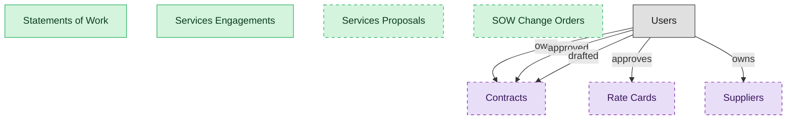

# Services Sourcing and Engagement

## 1. Overview

The pre-delivery surface: author the statement of work, take in services proposals, stand up the engagement against the supplier and the contract, and amend scope through change orders. Masters the SOW, the engagement, the proposal, and the change order; consumes the supplier, the contract, and rate cards from their owning domains.

## 2. Entity summary

| Name | data_object | Description |
| --- | --- | --- |
| Services Engagements | `services_engagements` | The active firm-level engagement that executes a statement of work: the spine milestones, deliverables, and invoices bind to, carrying the supplier, the contract reference, and the engagement-scoped scorecard. One supplier can hold several distinct engagements. |
| Services Proposals | `services_proposals` | Bids and proposals a firm submits against a specific statement of work, capturing the proposed scope, approach, and price for evaluation. Optional because some buyers run a SOW off a pre-awarded master agreement without a bid round. |
| SOW Change Orders | `sow_change_orders` | Amendments to an active statement of work that revise scope, schedule, deliverables, or price, tracked through approval so the SOW stays current. Optional because not every engagement amends. |
| Statements of Work | `statements_of_work` | The buyer-side statement of work that scopes outsourced services a firm will deliver: the deliverables, the schedule, the price basis, and the acceptance terms. The headline document the whole engagement hangs off, distinct from the underlying contract that governs it. |
| Contracts | `legal_contracts` | Contracts with counterparties or suppliers, covering type, value, key dates, governing law, and lifecycle from draft to terminated. |
| Rate Cards | `rate_cards` | Pre-agreed bill rates by role, geography, and supplier tier, driving consistent work-order pricing and accounts-payable matching. |
| Suppliers | `suppliers` | Vendor master records, holding legal name, tax id, addresses, payment terms, contacts, currency, status, and risk profile. |

## 3. Entities catalog

| # | data_object | catalog code | singular | plural | held_as | mastered in | mastered label | install_optional | personal_content | entity_type | write tier | notes |
| ---: | --- | --- | --- | --- | --- | --- | --- | --- | --- | --- | --- | --- |
| 1 | `services_engagements` | `services_engagements` | Services Engagement | Services Engagements | master | - | - | - | - | operational_workflow | `:manage` | - |
| 2 | `services_proposals` | `services_proposals` | Services Proposal | Services Proposals | master | - | - | yes | - | operational_workflow | `:manage` | - |
| 3 | `sow_change_orders` | `sow_change_orders` | SOW Change Order | SOW Change Orders | master | - | - | yes | - | operational_workflow | `:manage` | - |
| 4 | `statements_of_work` | `statements_of_work` | Statement of Work | Statements of Work | master | - | - | - | - | operational_workflow | `:manage` | - |
| 5 | `legal_contracts` | `legal_contracts` | Contract | Contracts | consumer | `clm-repository` | Contract Repository | yes | yes | operational_workflow | `:manage` | - |
| 6 | `rate_cards` | `rate_cards` | Rate Card | Rate Cards | consumer | `cwm-worker-sourcing` | Worker Sourcing and Supplier Management | yes | - | catalog | `:admin` | - |
| 7 | `suppliers` | `suppliers` | Supplier | Suppliers | consumer | `srm-supplier-lifecycle` | Supplier Lifecycle Management | yes | yes | operational_workflow | `:manage` | - |

## 4. Aliases and industry synonyms

_(none: no industry-scoped aliases for this scope)_

## 5. Relationships

_`field_required` applies only when both entities are installed. It never makes an entity required._

### 5.1 Relationships between entities in this blueprint

_(none: no relationships with both entities in this blueprint)_

### 5.2 Relationships to platform built-ins (`users`)

| from | verb | to | cardinality | field_required | delete_mode | fk_format | notes |
| --- | --- | --- | --- | --- | --- | --- | --- |
| `users` | owns | `legal_contracts` | one_to_many | no | clear | reference | - |
| `users` | approved | `legal_contracts` | one_to_many | no | clear | reference | - |
| `users` | drafted | `legal_contracts` | one_to_many | no | clear | reference | - |
| `users` | approves | `rate_cards` | one_to_many | no | clear | reference | - |
| `users` | owns | `suppliers` | one_to_many | no | clear | reference | - |

### 5.3 Relationships to entities outside this blueprint

_External entities are optional: this blueprint never installs them. If one exists at install, the relationship is proposed. A many-to-many relationship is listed under outgoing and proposed as a new junction table._

#### 5.3a Outgoing relationships: this blueprint's entity points to the external entity

| from | verb | to | cardinality | field_required | notes |
| --- | --- | --- | --- | --- | --- |
| `audit_findings` | updates | `suppliers` | many_to_many | - | - |
| `in_house_legal_matters` | references | `legal_contracts` | many_to_many | - | - |
| `contract_templates` | seeds | `legal_contracts` | one_to_many | no | - |
| `sourcing_events` | originates | `legal_contracts` | one_to_many | no | - |
| `crm_opportunities` | drafts | `legal_contracts` | one_to_many | no | - |
| `sales_quotes` | drafts | `legal_contracts` | one_to_many | no | - |
| `contract_drafts` | drafts | `legal_contracts` | one_to_many | no | - |
| `quote_discounts` | flows into | `legal_contracts` | one_to_many | no | - |
| `commercial_leases` | flows into | `legal_contracts` | one_to_many | no | - |
| `engagement_letters` | flows into | `legal_contracts` | one_to_many | no | - |
| `staffing_suppliers` | publishes | `rate_cards` | one_to_many | yes | - |
| `supplier_golden_records` | resolves to | `suppliers` | one_to_many | no | - |
| `engineering_parts` | sourced_from | `suppliers` | many_to_many | - | - |
| `pim_products` | sourced_from | `suppliers` | many_to_many | - | Supplier onboarding feeds attribute data into PIM; the product can have one primary supplier and many alternates. |
| `contract_counterparties` | is party to | `legal_contracts` | one_to_many | no | - |
| `freight_carriers` | is paid as | `suppliers` | one_to_one | no | - |

#### 5.3b Incoming relationships: the external entity points to this blueprint's entity

| from | verb | to | cardinality | field_required | notes |
| --- | --- | --- | --- | --- | --- |
| `legal_contracts` | governs | `customer_entitlements` | one_to_many | no | - |
| `legal_contracts` | backs | `customer_subscriptions` | one_to_many | no | - |
| `legal_contracts` | contains | `contract_clauses` | one_to_many | no | - |
| `legal_contracts` | imposes | `contract_obligations` | one_to_many | yes | - |
| `legal_contracts` | witnessed_by | `signature_records` | one_to_many | yes | - |
| `legal_contracts` | activates | `saas_subscriptions` | one_to_many | no | - |
| `legal_contracts` | activates | `software_licenses` | one_to_many | no | - |
| `legal_contracts` | triggers_creation_of | `purchase_orders` | one_to_many | no | - |
| `legal_contracts` | triggers_review_in | `purchase_requisitions` | one_to_many | no | - |
| `legal_contracts` | propagates_terms_to | `invoice_matches` | one_to_many | no | - |
| `legal_contracts` | feeds_revrec_in | `revenue_recognition_records` | one_to_many | no | - |
| `legal_contracts` | seeds | `service_projects` | one_to_many | no | - |
| `legal_contracts` | renewal_warns | `crm_opportunities` | one_to_many | no | - |
| `legal_contracts` | renewal_warns | `saas_subscriptions` | one_to_many | no | - |
| `legal_contracts` | renewed_into | `customer_subscriptions` | one_to_many | no | - |
| `legal_contracts` | seeds | `agency_jobs` | one_to_many | no | - |
| `rate_cards` | prices | `contingent_timesheets` | one_to_many | yes | - |
| `suppliers` | reconciles | `staffing_suppliers` | one_to_many | no | - |
| `suppliers` | undergoes | `supplier_onboardings` | one_to_many | yes | - |
| `suppliers` | holds | `supplier_qualifications` | one_to_many | yes | - |
| `suppliers` | holds | `supplier_certifications` | one_to_many | yes | - |
| `suppliers` | assessed_by | `supplier_risk_assessments` | one_to_many | yes | - |
| `suppliers` | rated_by | `supplier_scorecards` | one_to_many | yes | - |
| `suppliers` | enables | `sourcing_events` | one_to_many | no | - |
| `suppliers` | propagates_bank_change_to | `payment_runs` | one_to_many | no | - |
| `suppliers` | submits | `product_compliance_declarations` | one_to_many | yes | - |
| `legal_contracts` | is amended by | `contract_amendments` | one_to_many | yes | - |
| `legal_contracts` | is renewed by | `contract_renewal_records` | one_to_many | yes | - |
| `legal_contracts` | is assessed by | `contract_risk_assessments` | one_to_many | no | - |
| `legal_contracts` | has milestone | `contract_milestones` | one_to_many | yes | - |
| `legal_contracts` | has data protection addendum | `data_protection_addenda` | one_to_many | yes | - |
| `legal_contracts` | is negotiated in | `contract_negotiation_threads` | one_to_many | yes | - |

## 6. Cross-domain context

### 6.1 Master consumers (other modules / domains that embed this scope's masters)

_(none: no other module embeds this scope's masters)_

### 6.2 Outbound handoffs (events this scope publishes)

_(none: no outbound handoffs whose payload is in this scope)_

### 6.3 Inbound handoffs (events this scope reacts to)

_(none: no inbound handoffs whose payload is in this scope)_

### 6.4 Master providers (modules / domains that own masters this scope embeds)

| data_object | held_as | install_optional | catalog owner(s) | slice notes |
| --- | --- | --- | --- | --- |
| `legal_contracts` | consumer | yes | CLM-REPOSITORY (CLM) | - |
| `rate_cards` | consumer | yes | CWM-WORKER-SOURCING (CWM) | - |
| `suppliers` | consumer | yes | SRM-SUPPLIER-LIFECYCLE (SRM) | - |

## 7. Lifecycle states

## 8. Permissions and business rules (derived)

### 8.1 Permissions

| permission | tier | description | included in `:admin`? |
| --- | --- | --- | --- |
| `svcs-proc-engagement:read` | baseline-read | Read access to every entity in the module | ✓ |
| `svcs-proc-engagement:manage` | baseline-manage | Edit operational records | ✓ |
| `svcs-proc-engagement:admin` | baseline-admin | Edit reference data and inherit every workflow gate below | - |
| `clm-repository:read_legal_contracts` | entity-read | Read Contracts | ✓ |
| `cwm-worker-sourcing:read_rate_cards` | entity-read | Read Rate Cards | ✓ |
| `srm-supplier-lifecycle:read_suppliers` | entity-read | Read Suppliers | ✓ |
| `svcs-proc-engagement:read_statements_of_work` | entity-read | Read Statements of Work | ✓ |
| `svcs-proc-engagement:write_statements_of_work` | entity-write | Write Statements of Work | ✓ |
| `svcs-proc-engagement:read_services_engagements` | entity-read | Read Services Engagements | ✓ |
| `svcs-proc-engagement:write_services_engagements` | entity-write | Write Services Engagements | ✓ |
| `svcs-proc-engagement:read_services_proposals` | entity-read | Read Services Proposals | ✓ |
| `svcs-proc-engagement:write_services_proposals` | entity-write | Write Services Proposals | ✓ |
| `svcs-proc-engagement:read_sow_change_orders` | entity-read | Read SOW Change Orders | ✓ |
| `svcs-proc-engagement:write_sow_change_orders` | entity-write | Write SOW Change Orders | ✓ |

### 8.2 Business rules

_(none: no flag-derived business rules)_

## 9. Roles, RACI, and responsibilities (derived)

_Baseline roles, the permission hierarchy, and RACI realization are DERIVED from this scope's entity-type write tiers + `process_raci`; none of it is stored in the catalog (the deployer provisions it from this blueprint)._

### 9.1 `SVCS-PROC-ENGAGEMENT`

**Baseline roles:**

| role | baseline grant |
| --- | --- |
| `svcs-proc-engagement_viewer` | `svcs-proc-engagement:read` |
| `svcs-proc-engagement_manager` | `svcs-proc-engagement:manage` |
| `svcs-proc-engagement_admin` | `svcs-proc-engagement:admin` |

**Permission hierarchy:**

| permission | includes |
| --- | --- |
| `svcs-proc-engagement:admin` | `svcs-proc-engagement:manage` |
| `svcs-proc-engagement:manage` | `svcs-proc-engagement:read` |
| `svcs-proc-engagement:read` | `clm-repository:read_legal_contracts` |
| `svcs-proc-engagement:read` | `cwm-worker-sourcing:read_rate_cards` |
| `svcs-proc-engagement:read` | `srm-supplier-lifecycle:read_suppliers` |
| `svcs-proc-engagement:read` | `svcs-proc-engagement:read_statements_of_work` |
| `svcs-proc-engagement:read` | `svcs-proc-engagement:read_services_engagements` |
| `svcs-proc-engagement:read` | `svcs-proc-engagement:read_services_proposals` |
| `svcs-proc-engagement:read` | `svcs-proc-engagement:read_sow_change_orders` |
| `svcs-proc-engagement:manage` | `svcs-proc-engagement:write_statements_of_work` |
| `svcs-proc-engagement:write_statements_of_work` | `svcs-proc-engagement:read_statements_of_work` |
| `svcs-proc-engagement:manage` | `svcs-proc-engagement:write_services_engagements` |
| `svcs-proc-engagement:write_services_engagements` | `svcs-proc-engagement:read_services_engagements` |
| `svcs-proc-engagement:manage` | `svcs-proc-engagement:write_services_proposals` |
| `svcs-proc-engagement:write_services_proposals` | `svcs-proc-engagement:read_services_proposals` |
| `svcs-proc-engagement:manage` | `svcs-proc-engagement:write_sow_change_orders` |
| `svcs-proc-engagement:write_sow_change_orders` | `svcs-proc-engagement:read_sow_change_orders` |

**RACI realization:**

_(none: no process_raci assignments wired to this module's gated processes yet)_

### 9.2 Functional ownership and default grants

_(none: no business_function_domains rows for this scope's domain)_
