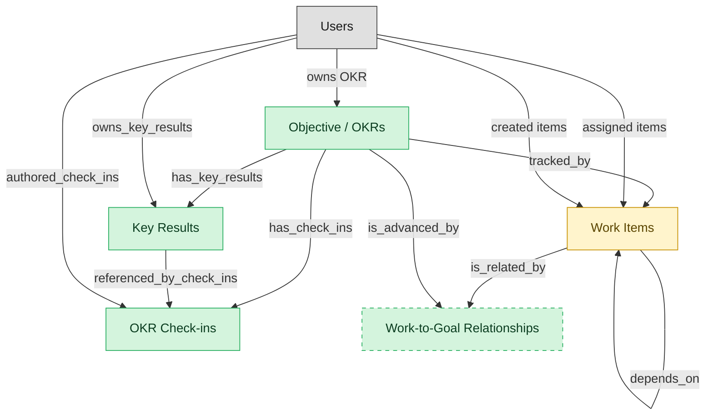

# Team-Execution Goals and OKRs

## 1. Overview

Team-execution OKR tracking surface: objectives with key results that relate to work items for automatic progress rollup, weekly check-in cadences, scoring, and closure. Deploys alongside the task-execution module for full integration, or standalone with a thin embedded work-item shell for KR relationships.

## 2. Entity summary

| Name | data_object | Description |
| --- | --- | --- |
| Key Results | `okr_key_results` | Measurable results attached to an objective, the unit of scoring that tracks progress toward the goal. |
| Objective / OKRs | `okr_objectives` | Goals with measurable key results, owner accountability, and weighted progress rollup, organized in a hierarchy and reviewed on a quarterly or annual cadence. |
| OKR Check-ins | `okr_check_ins` | Periodic status updates on an objective or key result during the active cycle, the cadence of record for OKR programs. |
| Work-to-Goal Relationships | `work_goal_relationships` | Contribution relationships between a work item or project and an objective, so goal progress can roll up from the work that drives it. |
| Work Items | `work_items` | Atomic tasks, items, or cards in a work-management tool, with owner, due date, status, priority, dependencies, subtasks, attachments, and comments. |

## 3. Entities catalog

| # | data_object | catalog code | singular | plural | held_as | mastered in | mastered label | install_optional | personal_content | entity_type | write tier | notes |
| ---: | --- | --- | --- | --- | --- | --- | --- | --- | --- | --- | --- | --- |
| 1 | `okr_key_results` | `okr_key_results` | Key Result | Key Results | master | - | - | - | - | operational_record | `:manage` | - |
| 2 | `okr_objectives` | `okr_objectives` | Objective / OKR | Objective / OKRs | master | - | - | - | yes | operational_workflow | `:manage` | - |
| 3 | `okr_check_ins` | `okr_check_ins` | OKR Check-in | OKR Check-ins | master | - | - | - | yes | operational_record | `:manage` | - |
| 4 | `work_goal_relationships` | `work_goal_relationships` | Work-to-Goal Relationship | Work-to-Goal Relationships | master | - | - | yes | - | junction | `:manage` | - |
| 5 | `work_items` | `work_items` | Work Item | Work Items | embedded_master | `work-mgmt-task-exec` | Task and Project Execution | - | - | operational_workflow | `:manage` | - |

## 4. Aliases and industry synonyms

_(none: no industry-scoped aliases for this scope)_

## 5. Relationships

_`field_required` applies only when both entities are installed. It never makes an entity required._

### 5.1 Relationships between entities in this blueprint

| from | verb | to | cardinality | kind | field_required | delete_mode | fk_format | notes |
| --- | --- | --- | --- | --- | --- | --- | --- | --- |
| `work_items` | depends_on | `work_items` | many_to_many | association | - | cascade | parent | - |
| `okr_objectives` | tracked_by | `work_items` | one_to_many | reference | no | clear | reference | - |
| `okr_objectives` | has_key_results | `okr_key_results` | one_to_many | composition | yes | cascade | parent | - |
| `okr_objectives` | has_check_ins | `okr_check_ins` | one_to_many | composition | yes | cascade | parent | - |
| `okr_key_results` | referenced_by_check_ins | `okr_check_ins` | one_to_many | reference | no | clear | reference | - |
| `work_items` | is_related_by | `work_goal_relationships` | one_to_many | reference | yes | restrict | reference | - |
| `okr_objectives` | is_advanced_by | `work_goal_relationships` | one_to_many | reference | yes | restrict | reference | - |

### 5.2 Relationships to platform built-ins (`users`)

| from | verb | to | cardinality | field_required | delete_mode | fk_format | notes |
| --- | --- | --- | --- | --- | --- | --- | --- |
| `users` | assigned items | `work_items` | one_to_many | no | clear | reference | - |
| `users` | created items | `work_items` | one_to_many | yes | restrict | reference | - |
| `users` | owns OKR | `okr_objectives` | one_to_many | yes | restrict | reference | - |
| `users` | owns_key_results | `okr_key_results` | one_to_many | no | clear | reference | - |
| `users` | authored_check_ins | `okr_check_ins` | one_to_many | no | clear | reference | - |

### 5.3 Relationships to entities outside this blueprint

_External entities are optional: this blueprint never installs them. If one exists at install, the relationship is proposed. A many-to-many relationship is listed under outgoing and proposed as a new junction table._

#### 5.3a Outgoing relationships: this blueprint's entity points to the external entity

| from | verb | to | cardinality | field_required | notes |
| --- | --- | --- | --- | --- | --- |
| `action_plans` | spawns | `work_items` | one_to_many | no | - |
| `test_defects` | spawns | `work_items` | one_to_many | no | - |
| `work_projects` | contains | `work_items` | one_to_many | yes | - |
| `work_automations` | drives | `work_items` | one_to_many | no | - |
| `work_projects` | aligned_to | `okr_objectives` | many_to_many | - | - |
| `strategic_initiatives` | portfolio rollup from | `work_items` | one_to_many | no | - |
| `performance_reviews` | evaluates | `okr_objectives` | many_to_many | - | - |
| `performance_goals` | aligns_to | `okr_objectives` | many_to_many | - | - |
| `strategy_maps` | organizes | `okr_objectives` | one_to_many | no | - |
| `okr_objectives` | advanced_by | `strategic_initiatives` | many_to_many | - | - |
| `okr_objectives` | reviewed_in | `operating_reviews` | many_to_many | - | - |
| `strategy_decisions` | affects | `okr_objectives` | many_to_many | - | - |
| `work_dependencies` | blocks | `work_items` | many_to_many | - | - |
| `work_approval_chains` | gates | `work_items` | many_to_many | - | - |
| `work_user_workloads` | rolls_up | `work_items` | many_to_many | - | - |
| `work_sections` | holds_items | `work_items` | one_to_many | no | - |
| `work_task_templates` | seeds_item | `work_items` | one_to_many | no | - |
| `work_form_submissions` | converts_to | `work_items` | one_to_many | no | - |
| `intranet_content_inventory_records` | spawns improvement | `work_items` | one_to_many | no | - |
| `marketing_plan_lines` | is delivered by | `work_items` | one_to_many | no | - |
| `work_statuses` | is_status_of | `work_items` | one_to_many | no | - |

#### 5.3b Incoming relationships: the external entity points to this blueprint's entity

| from | verb | to | cardinality | field_required | notes |
| --- | --- | --- | --- | --- | --- |
| `work_items` | mirrors_to | `service_requests` | one_to_one | no | - |
| `work_items` | has_field_values | `work_custom_field_values` | one_to_many | yes | - |
| `work_items` | has_tag_assignments | `work_item_tags` | one_to_many | yes | - |
| `work_items` | has_comments | `work_item_comments` | one_to_many | yes | - |
| `work_items` | has_attachments | `work_item_attachments` | one_to_many | yes | - |
| `work_items` | has_proofing_sessions | `proofing_sessions` | one_to_many | yes | - |
| `work_items` | has_time_entries | `work_time_entries` | one_to_many | yes | - |
| `work_items` | has_status_updates | `work_status_updates` | one_to_many | yes | - |

## 6. Cross-domain context

### 6.1 Master consumers (other modules / domains that embed this scope's masters)

_(none: no other module embeds this scope's masters)_

### 6.2 Outbound handoffs (events this scope publishes)

_(none: no outbound handoffs whose payload is in this scope)_

### 6.3 Inbound handoffs (events this scope reacts to)

_(none: no inbound handoffs whose payload is in this scope)_

### 6.4 Master providers (modules / domains that own masters this scope embeds)

| data_object | held_as | install_optional | catalog owner(s) | slice notes |
| --- | --- | --- | --- | --- |
| `work_items` | embedded_master | - | WORK-MGMT-TASK-EXEC (WORK-MGMT) | - |

## 7. Lifecycle states

### `okr_key_results` (Key Result)

| order | state_name | initial? | terminal? | realizing module | requires_permission? | high risk? | derived gate | description |
| --- | --- | --- | --- | --- | --- | --- | --- | --- |
| 1 | `drafted` | ✓ | - | `WORK-MGMT-GOALS-OKR` | - | - | - | - |
| 2 | `committed` | - | - | `WORK-MGMT-GOALS-OKR` | ✓ | - | `work-mgmt-goals-okr:commit_okr_key_result` | - |
| 3 | `in_progress` | - | - | `WORK-MGMT-GOALS-OKR` | - | - | - | - |
| 4 | `at_risk` | - | - | `WORK-MGMT-GOALS-OKR` | - | - | - | - |
| 5 | `achieved` | - | ✓ | `WORK-MGMT-GOALS-OKR` | ✓ | - | `work-mgmt-goals-okr:achieve_okr_key_result` | - |
| 6 | `missed` | - | ✓ | `WORK-MGMT-GOALS-OKR` | ✓ | - | `work-mgmt-goals-okr:miss_okr_key_result` | - |

### `okr_objectives` (Objective / OKR)

| order | state_name | initial? | terminal? | realizing module | requires_permission? | high risk? | derived gate | description |
| --- | --- | --- | --- | --- | --- | --- | --- | --- |
| 1 | `drafted` | ✓ | - | `WORK-MGMT-GOALS-OKR` | - | - | - | - |
| 2 | `committed` | - | - | `WORK-MGMT-GOALS-OKR` | ✓ | - | `work-mgmt-goals-okr:commit_okr_objective` | - |
| 3 | `in_progress` | - | - | `WORK-MGMT-GOALS-OKR` | - | - | - | - |
| 4 | `scored` | - | - | `WORK-MGMT-GOALS-OKR` | ✓ | - | `work-mgmt-goals-okr:score_okr_objective` | - |
| 5 | `closed` | - | ✓ | `WORK-MGMT-GOALS-OKR` | - | - | - | - |

### `work_items` (Work Item)

_This scope holds `work_items` as **embedded_master**; the canonical state machine is owned by `WORK-MGMT-TASK-EXEC`._

| order | state_name | initial? | terminal? | realizing module | requires_permission? | high risk? | derived gate | description |
| --- | --- | --- | --- | --- | --- | --- | --- | --- |
| 1 | `open` | ✓ | - | `WORK-MGMT-TASK-EXEC` | - | - | - | - |
| 2 | `in_progress` | - | - | `WORK-MGMT-TASK-EXEC` | - | - | - | - |
| 3 | `blocked` | - | - | `WORK-MGMT-TASK-EXEC` | - | - | - | - |
| 4 | `done` | - | ✓ | `WORK-MGMT-TASK-EXEC` | - | - | - | - |
| 5 | `canceled` | - | ✓ | `WORK-MGMT-TASK-EXEC` | ✓ | - | `work-mgmt-task-exec:cancel_work_item` | - |

## 8. Permissions and business rules (derived)

### 8.1 Permissions

| permission | tier | description | included in `:admin`? |
| --- | --- | --- | --- |
| `work-mgmt-goals-okr:read` | baseline-read | Read access to every entity in the module | ✓ |
| `work-mgmt-goals-okr:manage` | baseline-manage | Edit operational records | ✓ |
| `work-mgmt-goals-okr:admin` | baseline-admin | Edit reference data and inherit every workflow gate below | - |
| `work-mgmt-task-exec:read_work_items` | entity-read | Read Work Items | ✓ |
| `work-mgmt-task-exec:write_work_items` | entity-write | Write Work Items | ✓ |
| `work-mgmt-goals-okr:read_okr_objectives` | entity-read | Read Objective / OKRs | ✓ |
| `work-mgmt-goals-okr:write_okr_objectives` | entity-write | Write Objective / OKRs | ✓ |
| `work-mgmt-goals-okr:read_okr_key_results` | entity-read | Read Key Results | ✓ |
| `work-mgmt-goals-okr:write_okr_key_results` | entity-write | Write Key Results | ✓ |
| `work-mgmt-goals-okr:read_okr_check_ins` | entity-read | Read OKR Check-ins | ✓ |
| `work-mgmt-goals-okr:write_okr_check_ins` | entity-write | Write OKR Check-ins | ✓ |
| `work-mgmt-goals-okr:read_work_goal_relationships` | entity-read | Read Work-to-Goal Relationships | ✓ |
| `work-mgmt-goals-okr:write_work_goal_relationships` | entity-write | Write Work-to-Goal Relationships | ✓ |
| `work-mgmt-task-exec:cancel_work_item` | workflow-gate (lifecycle) | Transition `work_items` into state `canceled` | ✓ |
| `work-mgmt-goals-okr:commit_okr_objective` | workflow-gate (lifecycle) | Transition `okr_objectives` into state `committed` | ✓ |
| `work-mgmt-goals-okr:score_okr_objective` | workflow-gate (lifecycle) | Transition `okr_objectives` into state `scored` | ✓ |
| `work-mgmt-goals-okr:commit_okr_key_result` | workflow-gate (lifecycle) | Transition `okr_key_results` into state `committed` | ✓ |
| `work-mgmt-goals-okr:achieve_okr_key_result` | workflow-gate (lifecycle) | Transition `okr_key_results` into state `achieved` | ✓ |
| `work-mgmt-goals-okr:miss_okr_key_result` | workflow-gate (lifecycle) | Transition `okr_key_results` into state `missed` | ✓ |
| `work-mgmt-goals-okr:view_all_objective_okrs` | override (personal_content) | View all `okr_objectives` rows beyond row-scope | ✓ |
| `work-mgmt-goals-okr:manage_all_objective_okrs` | override (personal_content) | Manage all `okr_objectives` rows beyond row-scope | ✓ |
| `work-mgmt-goals-okr:view_all_okr_check_ins` | override (personal_content) | View all `okr_check_ins` rows beyond row-scope | ✓ |
| `work-mgmt-goals-okr:manage_all_okr_check_ins` | override (personal_content) | Manage all `okr_check_ins` rows beyond row-scope | ✓ |

_Gates with no process: `work-mgmt-goals-okr:commit_okr_key_result`, `work-mgmt-goals-okr:achieve_okr_key_result`, `work-mgmt-goals-okr:miss_okr_key_result`. No Accountable can hold them, so this blueprint does not support `raci`._

### 8.2 Business rules

| rule_name | data_object | source flag | intent |
| --- | --- | --- | --- |
| `objective_okr_edit_scope` | `okr_objectives` | has_personal_content | Row-scope by default; override via `work-mgmt-goals-okr:view_all_objective_okrs` / `work-mgmt-goals-okr:manage_all_objective_okrs` |
| `okr_check_in_edit_scope` | `okr_check_ins` | has_personal_content | Row-scope by default; override via `work-mgmt-goals-okr:view_all_okr_check_ins` / `work-mgmt-goals-okr:manage_all_okr_check_ins` |

## 9. Roles, RACI, and responsibilities (derived)

_Baseline roles, the permission hierarchy, and RACI realization are DERIVED from this scope's entity-type write tiers + `process_raci`; none of it is stored in the catalog (the deployer provisions it from this blueprint)._

### 9.1 `WORK-MGMT-GOALS-OKR`

**Baseline roles:**

| role | baseline grant |
| --- | --- |
| `work-mgmt-goals-okr_viewer` | `work-mgmt-goals-okr:read` |
| `work-mgmt-goals-okr_manager` | `work-mgmt-goals-okr:manage` |
| `work-mgmt-goals-okr_admin` | `work-mgmt-goals-okr:admin` |

**Permission hierarchy:**

| permission | includes |
| --- | --- |
| `work-mgmt-goals-okr:admin` | `work-mgmt-goals-okr:manage` |
| `work-mgmt-goals-okr:manage` | `work-mgmt-goals-okr:read` |
| `work-mgmt-goals-okr:read` | `work-mgmt-task-exec:read_work_items` |
| `work-mgmt-goals-okr:read` | `work-mgmt-goals-okr:read_okr_objectives` |
| `work-mgmt-goals-okr:read` | `work-mgmt-goals-okr:read_okr_key_results` |
| `work-mgmt-goals-okr:read` | `work-mgmt-goals-okr:read_okr_check_ins` |
| `work-mgmt-goals-okr:read` | `work-mgmt-goals-okr:read_work_goal_relationships` |
| `work-mgmt-goals-okr:manage` | `work-mgmt-task-exec:write_work_items` |
| `work-mgmt-task-exec:write_work_items` | `work-mgmt-task-exec:read_work_items` |
| `work-mgmt-goals-okr:manage` | `work-mgmt-goals-okr:write_okr_objectives` |
| `work-mgmt-goals-okr:write_okr_objectives` | `work-mgmt-goals-okr:read_okr_objectives` |
| `work-mgmt-goals-okr:manage` | `work-mgmt-goals-okr:write_okr_key_results` |
| `work-mgmt-goals-okr:write_okr_key_results` | `work-mgmt-goals-okr:read_okr_key_results` |
| `work-mgmt-goals-okr:manage` | `work-mgmt-goals-okr:write_okr_check_ins` |
| `work-mgmt-goals-okr:write_okr_check_ins` | `work-mgmt-goals-okr:read_okr_check_ins` |
| `work-mgmt-goals-okr:manage` | `work-mgmt-goals-okr:write_work_goal_relationships` |
| `work-mgmt-goals-okr:write_work_goal_relationships` | `work-mgmt-goals-okr:read_work_goal_relationships` |
| `work-mgmt-goals-okr:admin` | `work-mgmt-task-exec:cancel_work_item` |
| `work-mgmt-goals-okr:admin` | `work-mgmt-goals-okr:commit_okr_objective` |
| `work-mgmt-goals-okr:admin` | `work-mgmt-goals-okr:score_okr_objective` |
| `work-mgmt-goals-okr:admin` | `work-mgmt-goals-okr:commit_okr_key_result` |
| `work-mgmt-goals-okr:admin` | `work-mgmt-goals-okr:achieve_okr_key_result` |
| `work-mgmt-goals-okr:admin` | `work-mgmt-goals-okr:miss_okr_key_result` |
| `work-mgmt-goals-okr:admin` | `work-mgmt-goals-okr:view_all_objective_okrs` |
| `work-mgmt-goals-okr:admin` | `work-mgmt-goals-okr:manage_all_objective_okrs` |
| `work-mgmt-goals-okr:admin` | `work-mgmt-goals-okr:view_all_okr_check_ins` |
| `work-mgmt-goals-okr:admin` | `work-mgmt-goals-okr:manage_all_okr_check_ins` |

**Processes wired:**

| process_key | process_name | PCF code | PCF ID | level | description |
| --- | --- | --- | --- | --- | --- |
| `manage_projects` | Manage projects | 13.2.3 | 16410 | 3 | Establishing the scope of the projects. Create plans for implementing the projects. Initiate projects. Review and report project performance to management. Close projects. |
| `develop_set_organizational` | Develop and set organizational objectives | 1.2.6 | 10042 | 3 | Developing overall goals for the organization that help in accomplishing its mission. Formulate organization-wide targets in the near to middle term, which will accumulate and propel the organization to realize its long-term objectives, as outlined in Develop an overall mission statement [10037]. Enlist business unit heads or equivalent personnel, in close collaboration with senior management executives. |

**RACI realization:**

| actor | kind | raci | process_key | realization |
| --- | --- | --- | --- | --- |
| `OPERATIONS-WORK-CONTRIBUTOR` | persona | responsible | `manage_projects` | the gated entities' write tier |
| `OPERATIONS-WORK-PROGRAM-LEAD` | persona | accountable | `manage_projects` | grant gates [work-mgmt-task-exec:cancel_work_item] + the gated entities' write tier |
| `OKR-OWNER` | persona | responsible | `develop_set_organizational` | the gated entities' write tier |
| `OKR-OWNER` | persona | accountable | `develop_set_organizational` | grant gates [work-mgmt-goals-okr:commit_okr_objective, work-mgmt-goals-okr:score_okr_objective] + the gated entities' write tier |

### 9.2 Functional ownership and default grants

| responsibility | business function | default role | default tier |
| --- | --- | --- | --- |
| owner | Business Operations | `admin` | `:admin` |
| contributor | Customer Success | `manager` | `:manage` |
| contributor | Marketing | `manager` | `:manage` |
| contributor | Product Management | `manager` | `:manage` |
| consumer | Sales | `viewer` | `:read` |
