# Task and Project Execution

## 1. Overview

Cross-functional task and project execution surface: work items with owners, due dates, dependencies, statuses, and assignments; project containers with timelines, dashboards, and board views; user-authored automation rules that fire on item state changes. The deployable substrate every team-based work-management product orbits.

## 2. Entity summary

| Name | data_object | Description |
| --- | --- | --- |
| Approval Chains | `work_approval_chains` | Ordered or parallel sets of approval steps that gate a work item or project transition. |
| Approval Steps | `work_approval_steps` | Single approval gates on a work item or project, performed by a designated approver, with states pending, approved, rejected, or expired. |
| Custom Field Values | `work_custom_field_values` | Per-work-item values for a custom field, one value per item and field. |
| Custom Fields | `work_custom_fields` | User-defined fields attached to a project or workspace, typed as text, number, date, select, and more, applying to all items in scope. |
| Item Attachments | `work_item_attachments` | Files or external links attached to a work item. |
| Item Comments | `work_item_comments` | Threaded comments on a work item, which may include personal or sensitive content. |
| Item Tag Assignments | `work_item_tags` | Assignments relating work items to tags, where existence asserts the tag is applied. |
| Milestones | `work_milestones` | Zero-duration gates within a project marking a meaningful transition, distinguished from regular items by passed or missed semantics. |
| Project Templates | `work_project_templates` | Reusable project blueprints with seeded sections, items, custom fields, and automations. |
| Proofing Annotations | `proofing_annotations` | Markup comments placed on a region of a proof during review, with the reviewer, location, and resolution state. |
| Proofing Sessions | `proofing_sessions` | Review-and-approval cycles on a creative asset or document, where reviewers mark up the proof and decide to approve or request changes. |
| Sections | `work_sections` | Containers within a project that group work items for board and list views. |
| Tags | `work_tags` | Free-form labels attached to work items for cross-cutting categorization such as priority, theme, or status. |
| Task Templates | `work_task_templates` | Reusable work-item blueprints with seeded assignee role, due-date offset, subtasks, and custom field defaults. |
| Work Automations | `work_automations` | Trigger-action rules defined per board or project, with triggers like status change or assignment driving multi-step conditional actions. |
| Work Dashboards | `work_dashboards` | Saved, shareable cross-project dashboards composed of widgets that summarize work progress, workload, and goal status. |
| Work Dependencies | `work_dependencies` | Typed dependencies between two work items, relating predecessor and successor with finish-to-start, start-to-start, finish-to-finish, or start-to-finish type. |
| Work Items | `work_items` | Atomic tasks, items, or cards in a work-management tool, with owner, due date, status, priority, dependencies, subtasks, attachments, and comments. |
| Work Portfolios | `work_portfolios` | Team-level groupings of related projects for cross-project status roll-up. |
| Work Projects | `work_projects` | Containers of work items (project, board, sheet, or space), with timeline, status, owner, members, dashboards, and embedded views. |
| Work Status Updates | `work_status_updates` | Logged status-change events on a work item or project, capturing the prior status, new status, who changed it, and when. |
| Work Statuses | `work_statuses` | Configurable status values in a project or team status taxonomy, with category (not started, in progress, done) and display order. |
| Work Time Entries | `work_time_entries` | Non-billable time logged against a work item for effort tracking and capacity reporting. |
| Work Views | `work_views` | Saved, named, shareable board, list, timeline, or calendar views of work items, with persisted filters, grouping, and sort. |
| Workloads | `work_user_workloads` | Per-user, per-period sums of allocated effort across work items, compared against a capacity ceiling. |
| Business Value Assessments | `business_value_assessments` | Scoring models for prioritizing portfolio items by value, strategic alignment, risk, and dependencies, producing a ranked backlog. |
| Engagement Action Plans | `action_plans` | Team or manager commitments to act on engagement survey results, tracked through to closure. |
| Feature Requests | `feature_requests` | Customer requests for new capabilities, feeding the product prioritization workflow. |
| Opportunities | `crm_opportunities` | Active sales deals, tracking stage, amount, close date, probability, products, competitor, and decision criteria. |
| Portfolios | `strategic_portfolios` | Containers grouping strategic initiatives by business unit, product line, or cost center, with aggregate KPIs and investment rules. |
| Product Releases | `product_releases` | Versioned software releases that bundle a set of features and define the delivery date and scope. |
| Product Roadmaps | `product_roadmaps` | Timeline views of planned features grouped by release, product, or theme. |
| Project Assignments | `project_assignments` | Allocations of a worker to a project, with role, bill rate, cost rate, planned hours, and period, driving utilization and availability reporting. |
| Project Tasks | `project_tasks` | Decomposed units of work within a project, with scope, dependencies, estimated hours, and status, used for time tracking and earned-value calculation. |
| Strategic Initiatives | `strategic_initiatives` | Multi-quarter programs aligned to corporate strategy, bundling related projects with an executive sponsor and benefits plan. |

```mermaid
flowchart TD
  classDef master fill:#d4f4dd,stroke:#27ae60,color:#0b3d20;
  classDef consumer fill:#e8def8,stroke:#7b1fa2,color:#3a155d;
  classDef platform_builtin fill:#e0e0e0,stroke:#424242,color:#1a1a1a;
  crm_opportunities["Opportunities"]
  action_plans["Engagement Action Plans"]
  project_tasks["Project Tasks"]
  project_assignments["Project Assignments"]
  work_items["Work Items"]
  work_projects["Work Projects"]
  work_automations["Work Automations"]
  strategic_portfolios["Portfolios"]
  strategic_initiatives["Strategic Initiatives"]
  business_value_assessments["Business Value Assessments"]
  product_releases["Product Releases"]
  product_roadmaps["Product Roadmaps"]
  feature_requests["Feature Requests"]
  work_dependencies["Work Dependencies"]
  work_milestones["Milestones"]
  work_approval_steps["Approval Steps"]
  work_approval_chains["Approval Chains"]
  work_user_workloads["Workloads"]
  work_custom_fields["Custom Fields"]
  work_custom_field_values["Custom Field Values"]
  work_sections["Sections"]
  work_project_templates["Project Templates"]
  work_task_templates["Task Templates"]
  work_tags["Tags"]
  work_item_tags["Item Tag Assignments"]
  work_item_comments["Item Comments"]
  work_item_attachments["Item Attachments"]
  proofing_sessions["Proofing Sessions"]
  proofing_annotations["Proofing Annotations"]
  work_dashboards["Work Dashboards"]
  work_views["Work Views"]
  work_time_entries["Work Time Entries"]
  work_portfolios["Work Portfolios"]
  work_statuses["Work Statuses"]
  work_status_updates["Work Status Updates"]
  users["Users"]
  action_plans -->|"spawns"| work_items
  work_projects -->|"contains"| work_items
  work_items -->|"depends_on"| work_items
  work_automations -->|"drives"| work_items
  work_automations -->|"applies_to"| work_projects
  strategic_initiatives -->|"portfolio rollup from"| work_items
  work_automations -->|"rolls_up_into"| strategic_portfolios
  work_automations -->|"feeds"| project_tasks
  work_automations -->|"mirrors_to"| product_roadmaps
  project_tasks -->|"performed_by"| project_assignments
  work_dependencies -->|"blocks"| work_items
  work_projects -->|"has_milestones"| work_milestones
  work_approval_chains -->|"has_steps"| work_approval_steps
  work_approval_chains -->|"gates"| work_items
  work_approval_chains -->|"gates_project"| work_projects
  work_user_workloads -->|"rolls_up"| work_items
  work_projects -->|"has_custom_fields"| work_custom_fields
  work_custom_fields -->|"has_values"| work_custom_field_values
  work_items -->|"has_field_values"| work_custom_field_values
  work_projects -->|"has_sections"| work_sections
  work_sections -->|"holds_items"| work_items
  work_project_templates -->|"seeds"| work_projects
  work_task_templates -->|"seeds_item"| work_items
  work_tags -->|"applied_via"| work_item_tags
  work_items -->|"has_tag_assignments"| work_item_tags
  work_items -->|"has_comments"| work_item_comments
  work_items -->|"has_attachments"| work_item_attachments
  strategic_portfolios -->|"groups"| strategic_initiatives
  strategic_initiatives -->|"evaluated_by"| business_value_assessments
  work_items -->|"has_proofing_sessions"| proofing_sessions
  proofing_sessions -->|"has_annotations"| proofing_annotations
  work_dashboards -->|"summarizes"| work_projects
  work_projects -->|"is_scoped_by"| work_views
  work_items -->|"has_time_entries"| work_time_entries
  work_portfolios -->|"groups"| work_projects
  work_statuses -->|"is_status_of"| work_items
  work_items -->|"has_status_updates"| work_status_updates
  users -->|"owns"| action_plans
  action_plans -->|"is_assigned_to"| users
  users -->|"assigned items"| work_items
  users -->|"created items"| work_items
  users -->|"owns projects"| work_projects
  users -->|"authored automations"| work_automations
  users -->|"owns"| crm_opportunities
  users -->|"assigned_to"| project_tasks
  users -->|"staffed_on"| project_assignments
  users -->|"owns_milestones"| work_milestones
  users -->|"approves_steps"| work_approval_steps
  users -->|"initiated_chains"| work_approval_chains
  users -->|"created_custom_fields"| work_custom_fields
  users -->|"created_sections"| work_sections
  users -->|"authored_project_templates"| work_project_templates
  users -->|"authored_task_templates"| work_task_templates
  users -->|"authored_comments"| work_item_comments
  users -->|"uploaded_attachments"| work_item_attachments
  users -->|"owns"| strategic_portfolios
  users -->|"assesses"| business_value_assessments
  users -->|"approves"| business_value_assessments
  users -->|"owns"| product_releases
  users -->|"owns"| product_roadmaps
  users -->|"submits"| feature_requests
  users -->|"owns_proofing_sessions"| proofing_sessions
  users -->|"authored_annotations"| proofing_annotations
  users -->|"owns_dashboards"| work_dashboards
  users -->|"owns_views"| work_views
  users -->|"logged_time"| work_time_entries
  users -->|"owns_portfolios"| work_portfolios
  users -->|"made_status_updates"| work_status_updates
  class crm_opportunities consumer;
  class action_plans consumer;
  class project_tasks consumer;
  class project_assignments consumer;
  class work_items master;
  class work_projects master;
  class work_automations master;
  class strategic_portfolios consumer;
  class strategic_initiatives consumer;
  class business_value_assessments consumer;
  class product_releases consumer;
  class product_roadmaps consumer;
  class feature_requests consumer;
  class work_dependencies master;
  class work_milestones master;
  class work_approval_steps master;
  class work_approval_chains master;
  class work_user_workloads master;
  class work_custom_fields master;
  class work_custom_field_values master;
  class work_sections master;
  class work_project_templates master;
  class work_task_templates master;
  class work_tags master;
  class work_item_tags master;
  class work_item_comments master;
  class work_item_attachments master;
  class proofing_sessions master;
  class proofing_annotations master;
  class work_dashboards master;
  class work_views master;
  class work_time_entries master;
  class work_portfolios master;
  class work_statuses master;
  class work_status_updates master;
  class users platform_builtin;
  style crm_opportunities stroke-dasharray:5 5;
  style action_plans stroke-dasharray:5 5;
  style project_tasks stroke-dasharray:5 5;
  style project_assignments stroke-dasharray:5 5;
  style strategic_portfolios stroke-dasharray:5 5;
  style strategic_initiatives stroke-dasharray:5 5;
  style business_value_assessments stroke-dasharray:5 5;
  style product_releases stroke-dasharray:5 5;
  style product_roadmaps stroke-dasharray:5 5;
  style feature_requests stroke-dasharray:5 5;
  style proofing_sessions stroke-dasharray:5 5;
  style proofing_annotations stroke-dasharray:5 5;
  style work_dashboards stroke-dasharray:5 5;
  style work_views stroke-dasharray:5 5;
  style work_time_entries stroke-dasharray:5 5;
  style work_portfolios stroke-dasharray:5 5;
  style work_statuses stroke-dasharray:5 5;
  style work_status_updates stroke-dasharray:5 5;
```

## 3. Entities catalog

| # | data_object | catalog code | singular | plural | held_as | mastered in | mastered label | install_optional | personal_content | entity_type | write tier | notes |
| ---: | --- | --- | --- | --- | --- | --- | --- | --- | --- | --- | --- | --- |
| 1 | `work_approval_chains` | `work_approval_chains` | Approval Chain | Approval Chains | master | - | - | - | - | catalog | `:admin` | - |
| 2 | `work_approval_steps` | `work_approval_steps` | Approval Step | Approval Steps | master | - | - | - | - | operational_workflow | `:manage` | - |
| 3 | `work_custom_field_values` | `work_custom_field_values` | Custom Field Value | Custom Field Values | master | - | - | - | - | junction | `:admin` | - |
| 4 | `work_custom_fields` | `work_custom_fields` | Custom Field | Custom Fields | master | - | - | - | - | catalog | `:admin` | - |
| 5 | `work_item_attachments` | `work_item_attachments` | Item Attachment | Item Attachments | master | - | - | - | - | operational_record | `:manage` | - |
| 6 | `work_item_comments` | `work_item_comments` | Item Comment | Item Comments | master | - | - | - | yes | operational_record | `:manage` | - |
| 7 | `work_item_tags` | `work_item_tags` | Item Tag Assignment | Item Tag Assignments | master | - | - | - | - | junction | `:admin` | - |
| 8 | `work_milestones` | `work_milestones` | Milestone | Milestones | master | - | - | - | - | operational_record | `:manage` | - |
| 9 | `work_project_templates` | `work_project_templates` | Project Template | Project Templates | master | - | - | - | - | catalog | `:admin` | - |
| 10 | `proofing_annotations` | `proofing_annotations` | Proofing Annotation | Proofing Annotations | master | - | - | yes | - | operational_record | `:manage` | - |
| 11 | `proofing_sessions` | `proofing_sessions` | Proofing Session | Proofing Sessions | master | - | - | yes | - | operational_workflow | `:manage` | - |
| 12 | `work_sections` | `work_sections` | Section | Sections | master | - | - | - | - | catalog | `:admin` | - |
| 13 | `work_tags` | `work_tags` | Tag | Tags | master | - | - | - | - | catalog | `:admin` | - |
| 14 | `work_task_templates` | `work_task_templates` | Task Template | Task Templates | master | - | - | - | - | catalog | `:admin` | - |
| 15 | `work_automations` | `work_automations` | Work Automation | Work Automations | master | - | - | - | - | catalog | `:admin` | - |
| 16 | `work_dashboards` | `work_dashboards` | Work Dashboard | Work Dashboards | master | - | - | yes | - | catalog | `:admin` | - |
| 17 | `work_dependencies` | `work_dependencies` | Work Dependency | Work Dependencies | master | - | - | - | - | junction | `:manage` | - |
| 18 | `work_items` | `work_items` | Work Item | Work Items | master | - | - | - | - | operational_workflow | `:manage` | - |
| 19 | `work_portfolios` | `work_portfolios` | Work Portfolio | Work Portfolios | master | - | - | yes | - | catalog | `:admin` | - |
| 20 | `work_projects` | `work_projects` | Work Project | Work Projects | master | - | - | - | - | operational_workflow | `:manage` | - |
| 21 | `work_status_updates` | `work_status_updates` | Work Status Update | Work Status Updates | master | - | - | yes | - | operational_record | `:manage` | - |
| 22 | `work_statuses` | `work_statuses` | Work Status | Work Statuses | master | - | - | yes | - | catalog | `:admin` | - |
| 23 | `work_time_entries` | `work_time_entries` | Work Time Entry | Work Time Entries | master | - | - | yes | yes | operational_record | `:manage` | - |
| 24 | `work_views` | `work_views` | Work View | Work Views | master | - | - | yes | - | catalog | `:admin` | - |
| 25 | `work_user_workloads` | `work_user_workloads` | Workload | Workloads | master | - | - | - | - | computed | read-only | - |
| 26 | `business_value_assessments` | `business_value_assessments` | Business Value Assessment | Business Value Assessments | consumer | `spm-demand-mgmt` | Demand and Value Management | yes | - | operational_workflow | `:manage` | - |
| 27 | `action_plans` | `action_plans` | Engagement Action Plan | Engagement Action Plans | consumer | `emp-exp-action-planning` | Action Planning | yes | - | operational_workflow | `:manage` | - |
| 28 | `feature_requests` | `feature_requests` | Feature Request | Feature Requests | consumer | `pm-discovery` | Product Discovery and Prioritization | yes | yes | operational_workflow | `:manage` | - |
| 29 | `crm_opportunities` | `crm_opportunities` | Opportunity | Opportunities | consumer | `crm-pipeline-mgt` | Opportunity and Pipeline Management | yes | yes | operational_workflow | `:manage` | - |
| 30 | `strategic_portfolios` | `strategic_portfolios` | Portfolio | Portfolios | consumer | `spm-portfolio-planning` | Portfolio Planning | yes | - | operational_workflow | `:manage` | - |
| 31 | `product_releases` | `product_releases` | Product Release | Product Releases | consumer | `pm-roadmap-delivery` | Roadmap, Release, and Strategy | yes | - | operational_workflow | `:manage` | - |
| 32 | `product_roadmaps` | `product_roadmaps` | Product Roadmap | Product Roadmaps | consumer | `pm-roadmap-delivery` | Roadmap, Release, and Strategy | yes | - | operational_workflow | `:manage` | - |
| 33 | `project_assignments` | `project_assignments` | Project Assignment | Project Assignments | consumer | `psa-resource-mgmt` | Resource Management | yes | - | operational_workflow | `:manage` | - |
| 34 | `project_tasks` | `project_tasks` | Project Task | Project Tasks | consumer | `psa-project-delivery` | Project Delivery | yes | - | operational_workflow | `:manage` | - |
| 35 | `strategic_initiatives` | `strategic_initiatives` | Strategic Initiative | Strategic Initiatives | consumer | `sem-execution-tracking` | Execution Tracking | yes | - | operational_workflow | `:manage` | - |

## 4. Aliases and industry synonyms

_(none: no industry-scoped aliases for this scope)_

## 5. Relationships

_`field_required` applies only when both entities are installed. It never makes an entity required._

### 5.1 Relationships between entities in this blueprint

| from | verb | to | cardinality | kind | field_required | delete_mode | fk_format | notes |
| --- | --- | --- | --- | --- | --- | --- | --- | --- |
| `action_plans` | spawns | `work_items` | one_to_many | reference | no | clear | reference | - |
| `work_projects` | contains | `work_items` | one_to_many | composition | yes | cascade | parent | - |
| `work_items` | depends_on | `work_items` | many_to_many | association | - | cascade | parent | - |
| `work_automations` | drives | `work_items` | one_to_many | reference | no | clear | reference | - |
| `work_automations` | applies_to | `work_projects` | many_to_many | association | - | cascade | parent | - |
| `strategic_initiatives` | portfolio rollup from | `work_items` | one_to_many | reference | no | clear | reference | - |
| `work_automations` | rolls_up_into | `strategic_portfolios` | many_to_many | reference | - | cascade | parent | - |
| `work_automations` | feeds | `project_tasks` | many_to_many | reference | - | cascade | parent | - |
| `work_automations` | mirrors_to | `product_roadmaps` | many_to_many | reference | - | cascade | parent | - |
| `project_tasks` | performed_by | `project_assignments` | many_to_many | association | - | cascade | parent | - |
| `work_dependencies` | blocks | `work_items` | many_to_many | association | - | cascade | parent | - |
| `work_projects` | has_milestones | `work_milestones` | one_to_many | composition | yes | cascade | parent | - |
| `work_approval_chains` | has_steps | `work_approval_steps` | one_to_many | composition | yes | cascade | parent | - |
| `work_approval_chains` | gates | `work_items` | many_to_many | reference | - | cascade | parent | - |
| `work_approval_chains` | gates_project | `work_projects` | many_to_many | reference | - | cascade | parent | - |
| `work_user_workloads` | rolls_up | `work_items` | many_to_many | reference | - | cascade | parent | - |
| `work_projects` | has_custom_fields | `work_custom_fields` | one_to_many | reference | no | clear | reference | - |
| `work_custom_fields` | has_values | `work_custom_field_values` | one_to_many | composition | yes | cascade | parent | - |
| `work_items` | has_field_values | `work_custom_field_values` | one_to_many | composition | yes | cascade | parent | - |
| `work_projects` | has_sections | `work_sections` | one_to_many | composition | yes | cascade | parent | - |
| `work_sections` | holds_items | `work_items` | one_to_many | reference | no | clear | reference | - |
| `work_project_templates` | seeds | `work_projects` | one_to_many | reference | no | clear | reference | - |
| `work_task_templates` | seeds_item | `work_items` | one_to_many | reference | no | clear | reference | - |
| `work_tags` | applied_via | `work_item_tags` | one_to_many | composition | yes | cascade | parent | - |
| `work_items` | has_tag_assignments | `work_item_tags` | one_to_many | composition | yes | cascade | parent | - |
| `work_items` | has_comments | `work_item_comments` | one_to_many | composition | yes | cascade | parent | - |
| `work_items` | has_attachments | `work_item_attachments` | one_to_many | composition | yes | cascade | parent | - |
| `strategic_portfolios` | groups | `strategic_initiatives` | one_to_many | association | no | clear | reference | - |
| `strategic_initiatives` | evaluated_by | `business_value_assessments` | one_to_many | reference | no | clear | reference | - |
| `work_items` | has_proofing_sessions | `proofing_sessions` | one_to_many | composition | yes | cascade | parent | - |
| `proofing_sessions` | has_annotations | `proofing_annotations` | one_to_many | composition | yes | cascade | parent | - |
| `work_dashboards` | summarizes | `work_projects` | many_to_many | reference | - | cascade | parent | - |
| `work_projects` | is_scoped_by | `work_views` | one_to_many | reference | no | clear | reference | - |
| `work_items` | has_time_entries | `work_time_entries` | one_to_many | composition | yes | cascade | parent | - |
| `work_portfolios` | groups | `work_projects` | one_to_many | association | no | clear | reference | - |
| `work_statuses` | is_status_of | `work_items` | one_to_many | reference | no | clear | reference | - |
| `work_items` | has_status_updates | `work_status_updates` | one_to_many | composition | yes | cascade | parent | - |

### 5.2 Relationships to platform built-ins (`users`)

| from | verb | to | cardinality | field_required | delete_mode | fk_format | notes |
| --- | --- | --- | --- | --- | --- | --- | --- |
| `users` | owns | `action_plans` | one_to_many | yes | restrict | reference | - |
| `action_plans` | is_assigned_to | `users` | many_to_many | - | cascade | parent | - |
| `users` | assigned items | `work_items` | one_to_many | no | clear | reference | - |
| `users` | created items | `work_items` | one_to_many | yes | restrict | reference | - |
| `users` | owns projects | `work_projects` | one_to_many | yes | restrict | reference | - |
| `users` | authored automations | `work_automations` | one_to_many | yes | restrict | reference | - |
| `users` | owns | `crm_opportunities` | one_to_many | yes | restrict | reference | - |
| `users` | assigned_to | `project_tasks` | many_to_many | - | cascade | parent | - |
| `users` | staffed_on | `project_assignments` | one_to_many | yes | restrict | reference | - |
| `users` | owns_milestones | `work_milestones` | one_to_many | no | clear | reference | - |
| `users` | approves_steps | `work_approval_steps` | one_to_many | no | clear | reference | - |
| `users` | initiated_chains | `work_approval_chains` | one_to_many | no | clear | reference | - |
| `users` | created_custom_fields | `work_custom_fields` | one_to_many | no | clear | reference | - |
| `users` | created_sections | `work_sections` | one_to_many | no | clear | reference | - |
| `users` | authored_project_templates | `work_project_templates` | one_to_many | no | clear | reference | - |
| `users` | authored_task_templates | `work_task_templates` | one_to_many | no | clear | reference | - |
| `users` | authored_comments | `work_item_comments` | one_to_many | no | clear | reference | - |
| `users` | uploaded_attachments | `work_item_attachments` | one_to_many | no | clear | reference | - |
| `users` | owns | `strategic_portfolios` | one_to_many | yes | restrict | reference | - |
| `users` | assesses | `business_value_assessments` | one_to_many | yes | restrict | reference | - |
| `users` | approves | `business_value_assessments` | one_to_many | no | clear | reference | - |
| `users` | owns | `product_releases` | one_to_many | no | clear | reference | - |
| `users` | owns | `product_roadmaps` | one_to_many | no | clear | reference | - |
| `users` | submits | `feature_requests` | one_to_many | no | clear | reference | - |
| `users` | owns_proofing_sessions | `proofing_sessions` | one_to_many | no | clear | reference | - |
| `users` | authored_annotations | `proofing_annotations` | one_to_many | no | clear | reference | - |
| `users` | owns_dashboards | `work_dashboards` | one_to_many | no | clear | reference | - |
| `users` | owns_views | `work_views` | one_to_many | no | clear | reference | - |
| `users` | logged_time | `work_time_entries` | one_to_many | no | clear | reference | - |
| `users` | owns_portfolios | `work_portfolios` | one_to_many | no | clear | reference | - |
| `users` | made_status_updates | `work_status_updates` | one_to_many | no | clear | reference | - |

### 5.3 Relationships to entities outside this blueprint

_External entities are optional: this blueprint never installs them. If one exists at install, the relationship is proposed. A many-to-many relationship is listed under outgoing and proposed as a new junction table._

#### 5.3a Outgoing relationships: this blueprint's entity points to the external entity

| from | verb | to | cardinality | field_required | notes |
| --- | --- | --- | --- | --- | --- |
| `engagement_drivers` | triggers | `action_plans` | one_to_many | no | - |
| `org_units` | owns | `action_plans` | one_to_many | no | - |
| `test_defects` | spawns | `work_items` | one_to_many | no | - |
| `customers` | flags_churn_risk_on | `crm_opportunities` | one_to_many | no | - |
| `customers` | impacted_by | `product_releases` | many_to_many | - | - |
| `legal_contracts` | renewal_warns | `crm_opportunities` | one_to_many | no | - |
| `okr_objectives` | tracked_by | `work_items` | one_to_many | no | - |
| `work_projects` | aligned_to | `okr_objectives` | many_to_many | - | - |
| `work_automations` | propagates_to | `service_requests` | many_to_many | - | - |
| `work_automations` | posts_to | `chat_channels` | many_to_many | - | - |
| `customers` | has_opportunities | `crm_opportunities` | one_to_many | yes | - |
| `pipeline_stages` | tracks | `crm_opportunities` | one_to_many | yes | - |
| `crm_opportunities` | involves_contacts | `crm_contacts` | many_to_many | - | - |
| `okr_objectives` | advanced_by | `strategic_initiatives` | many_to_many | - | - |
| `strategic_initiatives` | reviewed_in | `operating_reviews` | many_to_many | - | - |
| `strategy_decisions` | affects | `strategic_initiatives` | many_to_many | - | - |
| `service_projects` | contains | `project_tasks` | one_to_many | yes | - |
| `service_projects` | staffs | `project_assignments` | one_to_many | yes | - |
| `project_assignments` | requires_skills_from | `resource_skill_inventories` | many_to_many | - | - |
| `project_resource_allocations` | confirms_into | `project_assignments` | one_to_many | no | - |
| `work_form_submissions` | converts_to | `work_items` | one_to_many | no | - |
| `work_forms` | routes_to | `work_projects` | one_to_many | no | - |
| `revenue_forecasts` | forecasts | `crm_opportunities` | many_to_many | - | - |
| `intranet_content_inventory_records` | spawns improvement | `work_items` | one_to_many | no | - |
| `demand_intake_requests` | becomes | `strategic_initiatives` | one_to_one | no | - |
| `dependency_chains` | relates | `strategic_initiatives` | many_to_many | - | - |
| `marketing_plan_lines` | is delivered by | `work_items` | one_to_many | no | - |
| `marketing_plan_lines` | is delivered by | `work_projects` | one_to_many | no | - |

#### 5.3b Incoming relationships: the external entity points to this blueprint's entity

| from | verb | to | cardinality | field_required | notes |
| --- | --- | --- | --- | --- | --- |
| `crm_opportunities` | is activity context for | `customer_cases` | one_to_many | no | - |
| `crm_opportunities` | opens | `customer_cases` | one_to_many | no | - |
| `crm_opportunities` | drafts | `legal_contracts` | one_to_many | no | - |
| `work_items` | mirrors_to | `service_requests` | one_to_one | no | - |
| `work_projects` | closes_into | `service_projects` | one_to_one | no | - |
| `crm_opportunities` | converted_from_lead | `crm_leads` | one_to_many | no | - |
| `crm_opportunities` | has_activities | `sales_activities` | one_to_many | no | - |
| `crm_opportunities` | scored_by | `deal_risk_scores` | one_to_many | no | - |
| `crm_opportunities` | has_captured_activity | `captured_activities` | one_to_many | no | - |
| `strategic_initiatives` | delivered_through | `roadmap_items` | one_to_many | no | - |
| `strategic_initiatives` | staffed_by | `resource_allocations` | one_to_many | no | - |
| `strategic_initiatives` | tracked_by | `benefits_tracking_records` | one_to_many | no | - |
| `work_items` | is_related_by | `work_goal_relationships` | one_to_many | yes | - |

## 6. Cross-domain context

### 6.1 Master consumers (other modules / domains that embed this scope's masters)

_(none: no other module embeds this scope's masters)_

### 6.2 Outbound handoffs (events this scope publishes)

_(none: no outbound handoffs whose payload is in this scope)_

### 6.3 Inbound handoffs (events this scope reacts to)

_(none: no inbound handoffs whose payload is in this scope)_

### 6.4 Master providers (modules / domains that own masters this scope embeds)

| data_object | held_as | install_optional | catalog owner(s) | slice notes |
| --- | --- | --- | --- | --- |
| `action_plans` | consumer | yes | EMP-EXP-ACTION-PLANNING (EMP-EXP) | - |
| `business_value_assessments` | consumer | yes | SPM-DEMAND-MGMT (SPM) | - |
| `crm_opportunities` | consumer | yes | CRM-PIPELINE-MGT (CRM) | - |
| `feature_requests` | consumer | yes | PM-DISCOVERY (PROD-MGMT) | - |
| `product_releases` | consumer | yes | PM-ROADMAP-DELIVERY (PROD-MGMT) | - |
| `product_roadmaps` | consumer | yes | PM-ROADMAP-DELIVERY (PROD-MGMT) | - |
| `project_assignments` | consumer | yes | PSA-RESOURCE-MGMT (PSA) | - |
| `project_tasks` | consumer | yes | PSA-PROJECT-DELIVERY (PSA) | - |
| `strategic_initiatives` | consumer | yes | SEM-EXECUTION-TRACKING (SEM) | - |
| `strategic_portfolios` | consumer | yes | SPM-PORTFOLIO-PLANNING (SPM) | - |

## 7. Lifecycle states

### `proofing_sessions` (Proofing Session)

| order | state_name | initial? | terminal? | requires_permission? | high risk? | derived gate | description |
| --- | --- | --- | --- | --- | --- | --- | --- |
| 1 | `open` | ✓ | - | - | - | - | - |
| 2 | `in_review` | - | - | - | - | - | - |
| 3 | `changes_requested` | - | - | - | - | - | - |
| 4 | `approved` | - | ✓ | ✓ | - | `work-mgmt-task-exec:approve_proofing_session` | - |
| 5 | `rejected` | - | ✓ | ✓ | - | `work-mgmt-task-exec:reject_proofing_session` | - |

### `work_approval_chains` (Approval Chain)

| order | state_name | initial? | terminal? | requires_permission? | high risk? | derived gate | description |
| --- | --- | --- | --- | --- | --- | --- | --- |
| 1 | `initiated` | ✓ | - | - | - | - | - |
| 2 | `in_progress` | - | - | - | - | - | - |
| 3 | `approved` | - | ✓ | ✓ | - | `work-mgmt-task-exec:approve_chain` | - |
| 4 | `rejected` | - | ✓ | ✓ | - | `work-mgmt-task-exec:reject_chain` | - |
| 5 | `canceled` | - | ✓ | ✓ | - | `work-mgmt-task-exec:cancel_approval_chain` | - |

### `work_approval_steps` (Approval Step)

| order | state_name | initial? | terminal? | requires_permission? | high risk? | derived gate | description |
| --- | --- | --- | --- | --- | --- | --- | --- |
| 1 | `pending` | ✓ | - | - | - | - | - |
| 2 | `approved` | - | ✓ | ✓ | - | `work-mgmt-task-exec:approve_step` | - |
| 3 | `rejected` | - | ✓ | ✓ | - | `work-mgmt-task-exec:reject_step` | - |
| 4 | `expired` | - | ✓ | - | - | - | - |

### `work_automations` (Work Automation)

| order | state_name | initial? | terminal? | requires_permission? | high risk? | derived gate | description |
| --- | --- | --- | --- | --- | --- | --- | --- |
| 1 | `drafted` | ✓ | - | - | - | - | - |
| 2 | `enabled` | - | - | ✓ | - | `work-mgmt-task-exec:enable_work_automation` | - |
| 3 | `disabled` | - | - | ✓ | - | `work-mgmt-task-exec:disable_work_automation` | - |
| 4 | `archived` | - | ✓ | - | - | - | - |

### `work_items` (Work Item)

| order | state_name | initial? | terminal? | requires_permission? | high risk? | derived gate | description |
| --- | --- | --- | --- | --- | --- | --- | --- |
| 1 | `open` | ✓ | - | - | - | - | - |
| 2 | `in_progress` | - | - | - | - | - | - |
| 3 | `blocked` | - | - | - | - | - | - |
| 4 | `done` | - | ✓ | - | - | - | - |
| 5 | `canceled` | - | ✓ | ✓ | - | `work-mgmt-task-exec:cancel_work_item` | - |

### `work_milestones` (Milestone)

| order | state_name | initial? | terminal? | requires_permission? | high risk? | derived gate | description |
| --- | --- | --- | --- | --- | --- | --- | --- |
| 1 | `open` | ✓ | - | - | - | - | - |
| 2 | `reached` | - | ✓ | ✓ | - | `work-mgmt-task-exec:reach_work_milestone` | - |
| 3 | `missed` | - | ✓ | ✓ | - | `work-mgmt-task-exec:miss_work_milestone` | - |

### `work_project_templates` (Project Template)

| order | state_name | initial? | terminal? | requires_permission? | high risk? | derived gate | description |
| --- | --- | --- | --- | --- | --- | --- | --- |
| 1 | `drafted` | ✓ | - | - | - | - | - |
| 2 | `published` | - | - | ✓ | - | `work-mgmt-task-exec:publish_project_template` | - |
| 3 | `archived` | - | ✓ | - | - | - | - |

### `work_projects` (Work Project)

| order | state_name | initial? | terminal? | requires_permission? | high risk? | derived gate | description |
| --- | --- | --- | --- | --- | --- | --- | --- |
| 1 | `planning` | ✓ | - | - | - | - | - |
| 2 | `active` | - | - | - | - | - | - |
| 3 | `on_hold` | - | - | - | - | - | - |
| 4 | `completed` | - | ✓ | ✓ | - | `work-mgmt-task-exec:complete_work_project` | - |
| 5 | `archived` | - | ✓ | - | - | - | - |

### `work_task_templates` (Task Template)

| order | state_name | initial? | terminal? | requires_permission? | high risk? | derived gate | description |
| --- | --- | --- | --- | --- | --- | --- | --- |
| 1 | `drafted` | ✓ | - | - | - | - | - |
| 2 | `published` | - | - | ✓ | - | `work-mgmt-task-exec:publish_task_template` | - |
| 3 | `archived` | - | ✓ | - | - | - | - |

## 8. Permissions and business rules (derived)

### 8.1 Permissions

| permission | tier | description | included in `:admin`? |
| --- | --- | --- | --- |
| `work-mgmt-task-exec:read` | baseline-read | Read access to every entity in the module | ✓ |
| `work-mgmt-task-exec:manage` | baseline-manage | Edit operational records | ✓ |
| `work-mgmt-task-exec:admin` | baseline-admin | Edit reference data and inherit every workflow gate below | - |
| `crm-pipeline-mgt:read_crm_opportunities` | entity-read | Read Opportunities | ✓ |
| `emp-exp-action-planning:read_action_plans` | entity-read | Read Engagement Action Plans | ✓ |
| `psa-project-delivery:read_project_tasks` | entity-read | Read Project Tasks | ✓ |
| `psa-resource-mgmt:read_project_assignments` | entity-read | Read Project Assignments | ✓ |
| `work-mgmt-task-exec:read_work_items` | entity-read | Read Work Items | ✓ |
| `work-mgmt-task-exec:write_work_items` | entity-write | Write Work Items | ✓ |
| `work-mgmt-task-exec:read_work_projects` | entity-read | Read Work Projects | ✓ |
| `work-mgmt-task-exec:write_work_projects` | entity-write | Write Work Projects | ✓ |
| `work-mgmt-task-exec:read_work_automations` | entity-read | Read Work Automations | ✓ |
| `work-mgmt-task-exec:write_work_automations` | entity-write | Write Work Automations | ✓ |
| `spm-portfolio-planning:read_strategic_portfolios` | entity-read | Read Portfolios | ✓ |
| `sem-execution-tracking:read_strategic_initiatives` | entity-read | Read Strategic Initiatives | ✓ |
| `spm-demand-mgmt:read_business_value_assessments` | entity-read | Read Business Value Assessments | ✓ |
| `pm-roadmap-delivery:read_product_releases` | entity-read | Read Product Releases | ✓ |
| `pm-roadmap-delivery:read_product_roadmaps` | entity-read | Read Product Roadmaps | ✓ |
| `pm-discovery:read_feature_requests` | entity-read | Read Feature Requests | ✓ |
| `work-mgmt-task-exec:read_work_dependencies` | entity-read | Read Work Dependencies | ✓ |
| `work-mgmt-task-exec:write_work_dependencies` | entity-write | Write Work Dependencies | ✓ |
| `work-mgmt-task-exec:read_work_milestones` | entity-read | Read Milestones | ✓ |
| `work-mgmt-task-exec:write_work_milestones` | entity-write | Write Milestones | ✓ |
| `work-mgmt-task-exec:read_work_approval_steps` | entity-read | Read Approval Steps | ✓ |
| `work-mgmt-task-exec:write_work_approval_steps` | entity-write | Write Approval Steps | ✓ |
| `work-mgmt-task-exec:read_work_approval_chains` | entity-read | Read Approval Chains | ✓ |
| `work-mgmt-task-exec:write_work_approval_chains` | entity-write | Write Approval Chains | ✓ |
| `work-mgmt-task-exec:read_work_user_workloads` | entity-read | Read Workloads | ✓ |
| `work-mgmt-task-exec:read_work_custom_fields` | entity-read | Read Custom Fields | ✓ |
| `work-mgmt-task-exec:write_work_custom_fields` | entity-write | Write Custom Fields | ✓ |
| `work-mgmt-task-exec:read_work_custom_field_values` | entity-read | Read Custom Field Values | ✓ |
| `work-mgmt-task-exec:write_work_custom_field_values` | entity-write | Write Custom Field Values | ✓ |
| `work-mgmt-task-exec:read_work_sections` | entity-read | Read Sections | ✓ |
| `work-mgmt-task-exec:write_work_sections` | entity-write | Write Sections | ✓ |
| `work-mgmt-task-exec:read_work_project_templates` | entity-read | Read Project Templates | ✓ |
| `work-mgmt-task-exec:write_work_project_templates` | entity-write | Write Project Templates | ✓ |
| `work-mgmt-task-exec:read_work_task_templates` | entity-read | Read Task Templates | ✓ |
| `work-mgmt-task-exec:write_work_task_templates` | entity-write | Write Task Templates | ✓ |
| `work-mgmt-task-exec:read_work_tags` | entity-read | Read Tags | ✓ |
| `work-mgmt-task-exec:write_work_tags` | entity-write | Write Tags | ✓ |
| `work-mgmt-task-exec:read_work_item_tags` | entity-read | Read Item Tag Assignments | ✓ |
| `work-mgmt-task-exec:write_work_item_tags` | entity-write | Write Item Tag Assignments | ✓ |
| `work-mgmt-task-exec:read_work_item_comments` | entity-read | Read Item Comments | ✓ |
| `work-mgmt-task-exec:write_work_item_comments` | entity-write | Write Item Comments | ✓ |
| `work-mgmt-task-exec:read_work_item_attachments` | entity-read | Read Item Attachments | ✓ |
| `work-mgmt-task-exec:write_work_item_attachments` | entity-write | Write Item Attachments | ✓ |
| `work-mgmt-task-exec:read_proofing_sessions` | entity-read | Read Proofing Sessions | ✓ |
| `work-mgmt-task-exec:write_proofing_sessions` | entity-write | Write Proofing Sessions | ✓ |
| `work-mgmt-task-exec:read_proofing_annotations` | entity-read | Read Proofing Annotations | ✓ |
| `work-mgmt-task-exec:write_proofing_annotations` | entity-write | Write Proofing Annotations | ✓ |
| `work-mgmt-task-exec:read_work_dashboards` | entity-read | Read Work Dashboards | ✓ |
| `work-mgmt-task-exec:write_work_dashboards` | entity-write | Write Work Dashboards | ✓ |
| `work-mgmt-task-exec:read_work_views` | entity-read | Read Work Views | ✓ |
| `work-mgmt-task-exec:write_work_views` | entity-write | Write Work Views | ✓ |
| `work-mgmt-task-exec:read_work_time_entries` | entity-read | Read Work Time Entries | ✓ |
| `work-mgmt-task-exec:write_work_time_entries` | entity-write | Write Work Time Entries | ✓ |
| `work-mgmt-task-exec:read_work_portfolios` | entity-read | Read Work Portfolios | ✓ |
| `work-mgmt-task-exec:write_work_portfolios` | entity-write | Write Work Portfolios | ✓ |
| `work-mgmt-task-exec:read_work_statuses` | entity-read | Read Work Statuses | ✓ |
| `work-mgmt-task-exec:write_work_statuses` | entity-write | Write Work Statuses | ✓ |
| `work-mgmt-task-exec:read_work_status_updates` | entity-read | Read Work Status Updates | ✓ |
| `work-mgmt-task-exec:write_work_status_updates` | entity-write | Write Work Status Updates | ✓ |
| `work-mgmt-task-exec:cancel_work_item` | workflow-gate (lifecycle) | Transition `work_items` into state `canceled` | ✓ |
| `work-mgmt-task-exec:complete_work_project` | workflow-gate (lifecycle) | Transition `work_projects` into state `completed` | ✓ |
| `work-mgmt-task-exec:enable_work_automation` | workflow-gate (lifecycle) | Transition `work_automations` into state `enabled` | ✓ |
| `work-mgmt-task-exec:disable_work_automation` | workflow-gate (lifecycle) | Transition `work_automations` into state `disabled` | ✓ |
| `work-mgmt-task-exec:reach_work_milestone` | workflow-gate (lifecycle) | Transition `work_milestones` into state `reached` | ✓ |
| `work-mgmt-task-exec:miss_work_milestone` | workflow-gate (lifecycle) | Transition `work_milestones` into state `missed` | ✓ |
| `work-mgmt-task-exec:approve_step` | workflow-gate (lifecycle) | Transition `work_approval_steps` into state `approved` | ✓ |
| `work-mgmt-task-exec:reject_step` | workflow-gate (lifecycle) | Transition `work_approval_steps` into state `rejected` | ✓ |
| `work-mgmt-task-exec:approve_chain` | workflow-gate (lifecycle) | Transition `work_approval_chains` into state `approved` | ✓ |
| `work-mgmt-task-exec:reject_chain` | workflow-gate (lifecycle) | Transition `work_approval_chains` into state `rejected` | ✓ |
| `work-mgmt-task-exec:cancel_approval_chain` | workflow-gate (lifecycle) | Transition `work_approval_chains` into state `canceled` | ✓ |
| `work-mgmt-task-exec:publish_project_template` | workflow-gate (lifecycle) | Transition `work_project_templates` into state `published` | ✓ |
| `work-mgmt-task-exec:publish_task_template` | workflow-gate (lifecycle) | Transition `work_task_templates` into state `published` | ✓ |
| `work-mgmt-task-exec:approve_proofing_session` | workflow-gate (lifecycle) | Transition `proofing_sessions` into state `approved` | ✓ |
| `work-mgmt-task-exec:reject_proofing_session` | workflow-gate (lifecycle) | Transition `proofing_sessions` into state `rejected` | ✓ |
| `work-mgmt-task-exec:view_all_item_comments` | override (personal_content) | View all `work_item_comments` rows beyond row-scope | ✓ |
| `work-mgmt-task-exec:manage_all_item_comments` | override (personal_content) | Manage all `work_item_comments` rows beyond row-scope | ✓ |
| `work-mgmt-task-exec:view_all_work_time_entries` | override (personal_content) | View all `work_time_entries` rows beyond row-scope | ✓ |
| `work-mgmt-task-exec:manage_all_work_time_entries` | override (personal_content) | Manage all `work_time_entries` rows beyond row-scope | ✓ |

_Gates with no process: `work-mgmt-task-exec:enable_work_automation`, `work-mgmt-task-exec:disable_work_automation`, `work-mgmt-task-exec:reach_work_milestone`, `work-mgmt-task-exec:miss_work_milestone`, `work-mgmt-task-exec:approve_step`, `work-mgmt-task-exec:reject_step`, `work-mgmt-task-exec:approve_chain`, `work-mgmt-task-exec:reject_chain`, `work-mgmt-task-exec:cancel_approval_chain`, `work-mgmt-task-exec:publish_project_template`, `work-mgmt-task-exec:publish_task_template`, `work-mgmt-task-exec:approve_proofing_session`, `work-mgmt-task-exec:reject_proofing_session`. No Accountable can hold them, so this blueprint does not support `raci`._

### 8.2 Business rules

| rule_name | data_object | source flag | intent |
| --- | --- | --- | --- |
| `item_comment_edit_scope` | `work_item_comments` | has_personal_content | Row-scope by default; override via `work-mgmt-task-exec:view_all_item_comments` / `work-mgmt-task-exec:manage_all_item_comments` |
| `work_time_entry_edit_scope` | `work_time_entries` | has_personal_content | Row-scope by default; override via `work-mgmt-task-exec:view_all_work_time_entries` / `work-mgmt-task-exec:manage_all_work_time_entries` |

## 9. Roles, RACI, and responsibilities (derived)

_Baseline roles, the permission hierarchy, and RACI realization are DERIVED from this scope's entity-type write tiers + `process_raci`; none of it is stored in the catalog (the deployer provisions it from this blueprint)._

### 9.1 `WORK-MGMT-TASK-EXEC`

**Baseline roles:**

| role | baseline grant |
| --- | --- |
| `work-mgmt-task-exec_viewer` | `work-mgmt-task-exec:read` |
| `work-mgmt-task-exec_manager` | `work-mgmt-task-exec:manage` |
| `work-mgmt-task-exec_admin` | `work-mgmt-task-exec:admin` |

**Permission hierarchy:**

| permission | includes |
| --- | --- |
| `work-mgmt-task-exec:admin` | `work-mgmt-task-exec:manage` |
| `work-mgmt-task-exec:manage` | `work-mgmt-task-exec:read` |
| `work-mgmt-task-exec:read` | `crm-pipeline-mgt:read_crm_opportunities` |
| `work-mgmt-task-exec:read` | `emp-exp-action-planning:read_action_plans` |
| `work-mgmt-task-exec:read` | `psa-project-delivery:read_project_tasks` |
| `work-mgmt-task-exec:read` | `psa-resource-mgmt:read_project_assignments` |
| `work-mgmt-task-exec:read` | `work-mgmt-task-exec:read_work_items` |
| `work-mgmt-task-exec:read` | `work-mgmt-task-exec:read_work_projects` |
| `work-mgmt-task-exec:read` | `work-mgmt-task-exec:read_work_automations` |
| `work-mgmt-task-exec:read` | `spm-portfolio-planning:read_strategic_portfolios` |
| `work-mgmt-task-exec:read` | `sem-execution-tracking:read_strategic_initiatives` |
| `work-mgmt-task-exec:read` | `spm-demand-mgmt:read_business_value_assessments` |
| `work-mgmt-task-exec:read` | `pm-roadmap-delivery:read_product_releases` |
| `work-mgmt-task-exec:read` | `pm-roadmap-delivery:read_product_roadmaps` |
| `work-mgmt-task-exec:read` | `pm-discovery:read_feature_requests` |
| `work-mgmt-task-exec:read` | `work-mgmt-task-exec:read_work_dependencies` |
| `work-mgmt-task-exec:read` | `work-mgmt-task-exec:read_work_milestones` |
| `work-mgmt-task-exec:read` | `work-mgmt-task-exec:read_work_approval_steps` |
| `work-mgmt-task-exec:read` | `work-mgmt-task-exec:read_work_approval_chains` |
| `work-mgmt-task-exec:read` | `work-mgmt-task-exec:read_work_user_workloads` |
| `work-mgmt-task-exec:read` | `work-mgmt-task-exec:read_work_custom_fields` |
| `work-mgmt-task-exec:read` | `work-mgmt-task-exec:read_work_custom_field_values` |
| `work-mgmt-task-exec:read` | `work-mgmt-task-exec:read_work_sections` |
| `work-mgmt-task-exec:read` | `work-mgmt-task-exec:read_work_project_templates` |
| `work-mgmt-task-exec:read` | `work-mgmt-task-exec:read_work_task_templates` |
| `work-mgmt-task-exec:read` | `work-mgmt-task-exec:read_work_tags` |
| `work-mgmt-task-exec:read` | `work-mgmt-task-exec:read_work_item_tags` |
| `work-mgmt-task-exec:read` | `work-mgmt-task-exec:read_work_item_comments` |
| `work-mgmt-task-exec:read` | `work-mgmt-task-exec:read_work_item_attachments` |
| `work-mgmt-task-exec:read` | `work-mgmt-task-exec:read_proofing_sessions` |
| `work-mgmt-task-exec:read` | `work-mgmt-task-exec:read_proofing_annotations` |
| `work-mgmt-task-exec:read` | `work-mgmt-task-exec:read_work_dashboards` |
| `work-mgmt-task-exec:read` | `work-mgmt-task-exec:read_work_views` |
| `work-mgmt-task-exec:read` | `work-mgmt-task-exec:read_work_time_entries` |
| `work-mgmt-task-exec:read` | `work-mgmt-task-exec:read_work_portfolios` |
| `work-mgmt-task-exec:read` | `work-mgmt-task-exec:read_work_statuses` |
| `work-mgmt-task-exec:read` | `work-mgmt-task-exec:read_work_status_updates` |
| `work-mgmt-task-exec:manage` | `work-mgmt-task-exec:write_work_items` |
| `work-mgmt-task-exec:write_work_items` | `work-mgmt-task-exec:read_work_items` |
| `work-mgmt-task-exec:manage` | `work-mgmt-task-exec:write_work_projects` |
| `work-mgmt-task-exec:write_work_projects` | `work-mgmt-task-exec:read_work_projects` |
| `work-mgmt-task-exec:admin` | `work-mgmt-task-exec:write_work_automations` |
| `work-mgmt-task-exec:write_work_automations` | `work-mgmt-task-exec:read_work_automations` |
| `work-mgmt-task-exec:manage` | `work-mgmt-task-exec:write_work_dependencies` |
| `work-mgmt-task-exec:write_work_dependencies` | `work-mgmt-task-exec:read_work_dependencies` |
| `work-mgmt-task-exec:manage` | `work-mgmt-task-exec:write_work_milestones` |
| `work-mgmt-task-exec:write_work_milestones` | `work-mgmt-task-exec:read_work_milestones` |
| `work-mgmt-task-exec:manage` | `work-mgmt-task-exec:write_work_approval_steps` |
| `work-mgmt-task-exec:write_work_approval_steps` | `work-mgmt-task-exec:read_work_approval_steps` |
| `work-mgmt-task-exec:admin` | `work-mgmt-task-exec:write_work_approval_chains` |
| `work-mgmt-task-exec:write_work_approval_chains` | `work-mgmt-task-exec:read_work_approval_chains` |
| `work-mgmt-task-exec:admin` | `work-mgmt-task-exec:write_work_custom_fields` |
| `work-mgmt-task-exec:write_work_custom_fields` | `work-mgmt-task-exec:read_work_custom_fields` |
| `work-mgmt-task-exec:admin` | `work-mgmt-task-exec:write_work_custom_field_values` |
| `work-mgmt-task-exec:write_work_custom_field_values` | `work-mgmt-task-exec:read_work_custom_field_values` |
| `work-mgmt-task-exec:admin` | `work-mgmt-task-exec:write_work_sections` |
| `work-mgmt-task-exec:write_work_sections` | `work-mgmt-task-exec:read_work_sections` |
| `work-mgmt-task-exec:admin` | `work-mgmt-task-exec:write_work_project_templates` |
| `work-mgmt-task-exec:write_work_project_templates` | `work-mgmt-task-exec:read_work_project_templates` |
| `work-mgmt-task-exec:admin` | `work-mgmt-task-exec:write_work_task_templates` |
| `work-mgmt-task-exec:write_work_task_templates` | `work-mgmt-task-exec:read_work_task_templates` |
| `work-mgmt-task-exec:admin` | `work-mgmt-task-exec:write_work_tags` |
| `work-mgmt-task-exec:write_work_tags` | `work-mgmt-task-exec:read_work_tags` |
| `work-mgmt-task-exec:admin` | `work-mgmt-task-exec:write_work_item_tags` |
| `work-mgmt-task-exec:write_work_item_tags` | `work-mgmt-task-exec:read_work_item_tags` |
| `work-mgmt-task-exec:manage` | `work-mgmt-task-exec:write_work_item_comments` |
| `work-mgmt-task-exec:write_work_item_comments` | `work-mgmt-task-exec:read_work_item_comments` |
| `work-mgmt-task-exec:manage` | `work-mgmt-task-exec:write_work_item_attachments` |
| `work-mgmt-task-exec:write_work_item_attachments` | `work-mgmt-task-exec:read_work_item_attachments` |
| `work-mgmt-task-exec:manage` | `work-mgmt-task-exec:write_proofing_sessions` |
| `work-mgmt-task-exec:write_proofing_sessions` | `work-mgmt-task-exec:read_proofing_sessions` |
| `work-mgmt-task-exec:manage` | `work-mgmt-task-exec:write_proofing_annotations` |
| `work-mgmt-task-exec:write_proofing_annotations` | `work-mgmt-task-exec:read_proofing_annotations` |
| `work-mgmt-task-exec:admin` | `work-mgmt-task-exec:write_work_dashboards` |
| `work-mgmt-task-exec:write_work_dashboards` | `work-mgmt-task-exec:read_work_dashboards` |
| `work-mgmt-task-exec:admin` | `work-mgmt-task-exec:write_work_views` |
| `work-mgmt-task-exec:write_work_views` | `work-mgmt-task-exec:read_work_views` |
| `work-mgmt-task-exec:manage` | `work-mgmt-task-exec:write_work_time_entries` |
| `work-mgmt-task-exec:write_work_time_entries` | `work-mgmt-task-exec:read_work_time_entries` |
| `work-mgmt-task-exec:admin` | `work-mgmt-task-exec:write_work_portfolios` |
| `work-mgmt-task-exec:write_work_portfolios` | `work-mgmt-task-exec:read_work_portfolios` |
| `work-mgmt-task-exec:admin` | `work-mgmt-task-exec:write_work_statuses` |
| `work-mgmt-task-exec:write_work_statuses` | `work-mgmt-task-exec:read_work_statuses` |
| `work-mgmt-task-exec:manage` | `work-mgmt-task-exec:write_work_status_updates` |
| `work-mgmt-task-exec:write_work_status_updates` | `work-mgmt-task-exec:read_work_status_updates` |
| `work-mgmt-task-exec:admin` | `work-mgmt-task-exec:cancel_work_item` |
| `work-mgmt-task-exec:admin` | `work-mgmt-task-exec:complete_work_project` |
| `work-mgmt-task-exec:admin` | `work-mgmt-task-exec:enable_work_automation` |
| `work-mgmt-task-exec:admin` | `work-mgmt-task-exec:disable_work_automation` |
| `work-mgmt-task-exec:admin` | `work-mgmt-task-exec:reach_work_milestone` |
| `work-mgmt-task-exec:admin` | `work-mgmt-task-exec:miss_work_milestone` |
| `work-mgmt-task-exec:admin` | `work-mgmt-task-exec:approve_step` |
| `work-mgmt-task-exec:admin` | `work-mgmt-task-exec:reject_step` |
| `work-mgmt-task-exec:admin` | `work-mgmt-task-exec:approve_chain` |
| `work-mgmt-task-exec:admin` | `work-mgmt-task-exec:reject_chain` |
| `work-mgmt-task-exec:admin` | `work-mgmt-task-exec:cancel_approval_chain` |
| `work-mgmt-task-exec:admin` | `work-mgmt-task-exec:publish_project_template` |
| `work-mgmt-task-exec:admin` | `work-mgmt-task-exec:publish_task_template` |
| `work-mgmt-task-exec:admin` | `work-mgmt-task-exec:approve_proofing_session` |
| `work-mgmt-task-exec:admin` | `work-mgmt-task-exec:reject_proofing_session` |
| `work-mgmt-task-exec:admin` | `work-mgmt-task-exec:view_all_item_comments` |
| `work-mgmt-task-exec:admin` | `work-mgmt-task-exec:manage_all_item_comments` |
| `work-mgmt-task-exec:admin` | `work-mgmt-task-exec:view_all_work_time_entries` |
| `work-mgmt-task-exec:admin` | `work-mgmt-task-exec:manage_all_work_time_entries` |

**Processes wired:**

| process_key | process_name | PCF code | PCF ID | level | description |
| --- | --- | --- | --- | --- | --- |
| `manage_projects` | Manage projects | 13.2.3 | 16410 | 3 | Establishing the scope of the projects. Create plans for implementing the projects. Initiate projects. Review and report project performance to management. Close projects. |

**RACI realization:**

| actor | kind | raci | process_key | realization |
| --- | --- | --- | --- | --- |
| `OPERATIONS-WORK-CONTRIBUTOR` | persona | responsible | `manage_projects` | the gated entities' write tier |
| `OPERATIONS-WORK-PROGRAM-LEAD` | persona | accountable | `manage_projects` | grant gates [work-mgmt-task-exec:cancel_work_item, work-mgmt-task-exec:complete_work_project] + the gated entities' write tier |

### 9.2 Functional ownership and default grants

| responsibility | business function | default role | default tier |
| --- | --- | --- | --- |
| owner | Business Operations | `admin` | `:admin` |
| contributor | Customer Success | `manager` | `:manage` |
| contributor | Marketing | `manager` | `:manage` |
| contributor | Product Management | `manager` | `:manage` |
| consumer | Sales | `viewer` | `:read` |
